# Kafka vs RabbitMQ vs SQS - Choosing a Message Broker

> [!summary] TL;DR
> A **queue** (SQS, RabbitMQ) hands each message to one worker and forgets it after the worker confirms; a **log** (Kafka, Redis Streams, NATS JetStream, Pub/Sub with retention) keeps messages so many readers can read them, in order, and replay them later.
>
> Pick a queue for **tasks** ("send this email"), pick a log for **events and history** ("every order that ever happened").

> [!abstract] Core idea
> - The first question is not "which product" but "queue model or log model".
> - Need replay, many independent readers, strict order per key, or huge throughput: log (Kafka).
> - Need per-message routing, priorities, delays, or request/reply: RabbitMQ.
> - Need zero operations on AWS and simple task distribution: SQS (with SNS for fan-out).
> - Every durable broker is at-least-once in practice. Design the consumer to be idempotent.

## Start here: the basics 🟢

> [!info] How to read this note (pick your level)
> - 🟢 **New to this?** Read "From zero" below, then sections 1, 2 and the cheat sheet (12). Stop there, that is a full first pass.
> - 🟡 **Know the basics?** Add section 3 (both models, the flowchart), 4 (worked example), 5, 6 and 9 (drills).
> - 🔴 **Interview / SDE-3 prep?** Add 7, 8, 10 and 11. Headings are tagged 🟢🟡🔴 so you always know where you are.

> [!note] Before this note
> - [[Queues vs Streams and Broker Comparison]]: a queue hands each job to one worker and forgets it; a stream (log) keeps events so many readers can replay them.
> - [[Event-Driven Architecture Basics]]: services publish "this happened" events and others react later, instead of calling each other directly.

**From zero, in 60 seconds** 🟢

Checkout must tell email, the warehouse and analytics that an order happened.
If checkout calls each one directly, checkout breaks whenever any of them is slow or down.
So checkout drops a message in a middle box and moves on. Others pick it up when ready. That middle box is a **broker**.
Brokers come in two kinds. A **queue** (SQS, RabbitMQ) hands each message to one worker, then deletes it, like a to-do pile.
A **log** (Kafka) keeps every message in order for days, and many readers can each read it, and even re-read it, like a newspaper archive.

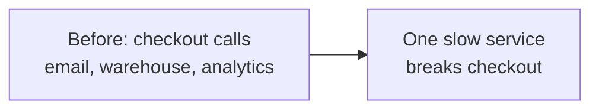

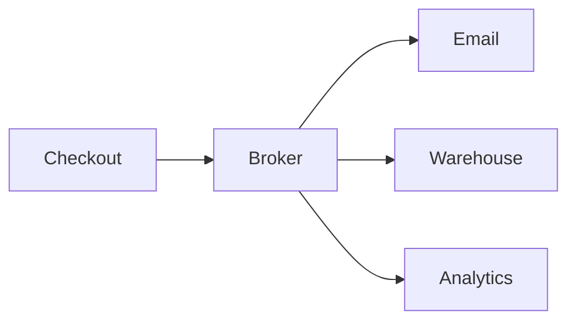

The rest of this note is just these 3 questions:
1. Is your message a task to do once, or a fact to keep and replay?
2. Which product fits, given your team and your cloud?
3. How do you handle order, retries and duplicates?

**The problem in one story.**
A shop's checkout service must tell the email service, the warehouse and the analytics team that an order happened.
Calling each one directly means checkout fails whenever any of them is slow or down.
Instead, checkout drops a message into a broker and moves on; the others pick it up when ready.
The question is which broker, and that depends on whether the message is a task or a fact to keep.

**Words you need first**

| Word | Plain meaning | Tiny example |
| --- | --- | --- |
| Message | A small piece of data sent from one service to another | `{"order_id": 42, "status": "paid"}` |
| Producer / consumer | The sender / the reader of messages | Checkout produces, email service consumes |
| Queue | Each message goes to one worker, then is deleted | SQS queue of "send email" jobs |
| Log | Messages are kept in order so many readers can read and replay them | Kafka topic of all orders |
| Partition | One ordered slice of a Kafka topic | Orders for user 7 always go to partition 3 |
| Ack (acknowledge) | The consumer saying "done, you can forget it" | Worker acks after sending the email |
| At-least-once | A message may arrive more than once, never zero times | Email sent twice after a retry |
| Idempotent | Processing the same message twice has the same effect as once | Skip if `order_id` already handled |
| Offset | A reader's bookmark: the position of the next record to read in a partition | consumer at offset 1,204 |
| Consumer group | A set of readers that share a topic's partitions | 4 email workers share 12 partitions |
| Visibility timeout | How long an SQS message is hidden after one worker takes it | 30 s; if not deleted, it comes back |
| Dead letter queue (DLQ) | A side queue for messages that keep failing | after 5 failed tries |
| Retention | How long a log keeps records before deleting them | Kafka keeps 7 days |
| Consumer lag | How far a reader is behind the newest record | 50,000 records behind |

**Picture it**

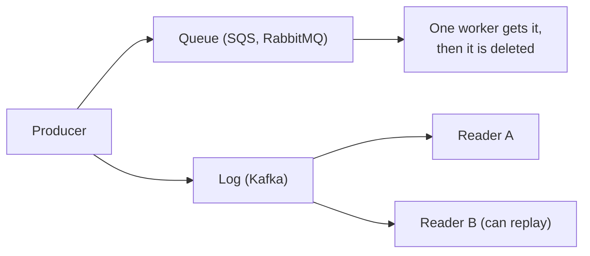

**Analogy.** A queue is a to-do pile at a desk: each worker takes a card and throws it away when done. A log is a newspaper archive: anyone can read any day's issue, as many times as they want.
Where it breaks: an archive never loses issues, but a log also deletes old messages after its retention period.

**How the rest of this note builds up**

- First, why brokers exist and the queue vs log mental model (sections 1-2).
- Then both models step by step, a decision flowchart, and guarantees and ordering in plain words (section 3).
- Then a worked example, the comparison table, lightweight logs and cloud options (sections 4-5).
- Finally the SDE-3 material: trade-offs, real failure modes, metrics, and the deep dive on partitions, ordering with retries, exactly-once and schemas (sections 6-8).

> [!tip] Remember
> Decide queue (tasks) or log (events you keep and replay) first; then pick the product, and always make consumers idempotent.

## 1. Why it exists 🟢

You run a food delivery app. When an order is placed, six things must happen: charge the card, notify the restaurant, assign a driver, email a receipt, update analytics, and update the search ranking. If checkout calls all six directly, it is slow, and a failure in the email service breaks ordering.

So you put a broker in the middle. The checkout writes one message and returns. But which broker? The wrong choice shows up later:

- You pick SQS for analytics, then a new team wants to read last week's orders again. SQS deleted them on ack. No replay.
- You pick Kafka for a simple "resize this image" job queue, then spend weeks on partition counts and a stuck partition because one slow job blocks the ones behind it.
- You pick RabbitMQ for a 500k messages per second click stream and the broker's memory fills when consumers fall behind.

This note gives you a fast way to choose, with the reasons.

> [!tip] Remember
> Queue means "work to be done once". Log means "facts that happened, to be read by anyone, any time within retention".

## 2. Mental model 🟢

**A queue is a restaurant ticket rail.** The cook takes a ticket off the rail; it is gone. Two cooks never cook the same ticket. If a cook drops it, it goes back on the rail.

**A log is a newspaper archive.** Every edition is kept in order. Each reader keeps their own bookmark. A new reader can start from last month. Reading does not remove anything; old issues expire after the retention period.

The analogy breaks in one place: a real archive has one shelf, while Kafka splits it into **partitions**, and order only holds within one partition.

### Real-life example: one order, two kinds of broker 🟢

When you place an order on a food app, an `OrderPlaced` event goes into a Kafka log: payments, the restaurant system, delivery and analytics each read it at their own pace, and analytics can replay last week if it had a bug.
The "send receipt email" job goes into a simple queue like SQS: one worker takes it, sends the email, and it is gone.
LinkedIn built Kafka for exactly this "many readers, keep history" case; queues like SQS and RabbitMQ are built for "do this job once".

## Common beginner mistakes 🟢

- **Picking Kafka for a few hundred jobs a minute** → you inherit partitions, rebalances and a cluster to run → use SQS or a jobs table.
- **Using a queue when you may need to re-read history** → processed messages are gone → use a log with retention.
- **Expecting order across a whole Kafka topic** → order holds only inside one partition → key by order or user ID so related events share a partition.
- **Non-idempotent consumers** → every broker can redeliver, so emails or charges happen twice → dedupe by message or entity ID.
- **No dead letter queue** → one bad message is retried forever and blocks others → move it aside after a few tries, and alert.

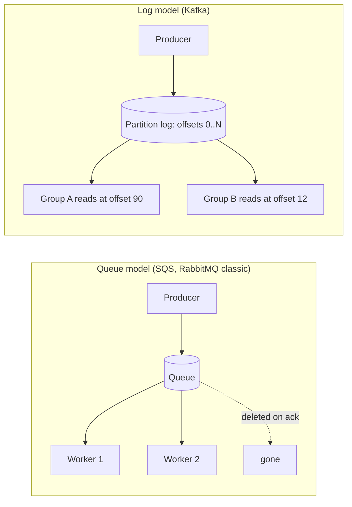

## 3. How it works 🟡

> 🟢 → 🟡 **You now know** a queue forgets a job once done and a log remembers everything. **Next we open the box**: both models step by step, a decision flowchart, and what ordering and delivery guarantees really mean.

### The two models, step by step

**In plain words:** A queue is a to-do pile: take a card, do it, throw it away. A log is an archive: everyone reads at their own pace and nothing is thrown away until it expires.

**Queue (SQS standard as the example):**

1. A producer sends a message; the broker stores it durably.
2. A consumer polls and receives it. The message becomes invisible for the **visibility timeout** (30 seconds by default in SQS).
3. The consumer processes it and calls delete. The message is removed.
4. If the consumer crashes, the timeout expires and the message becomes visible again for another consumer.
5. After too many failed receives, the broker moves it to a **dead letter queue** (DLQ). See [[Dead Letter Queues and Poison Messages]].

**Log (Kafka as the example):**

1. A producer sends a record with a key. The key hash picks a partition.
2. The broker appends the record to that partition's log and replicates it to followers.
3. A consumer in a **consumer group** is assigned some partitions and reads from its stored **offset**.
4. After processing, it commits the new offset. Nothing is deleted.
5. Records are deleted only by retention (time or size), or compacted by key.

**Why it matters:** the queue forgets by design, the log remembers by design. That one difference drives almost every row in the table below.

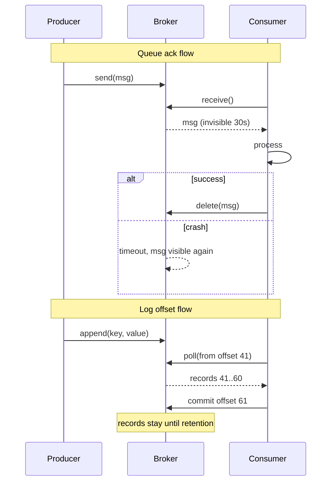

### The decision flowchart

**In plain words:** Follow the yes/no questions. Most answers come down to "task queue" or "event log".

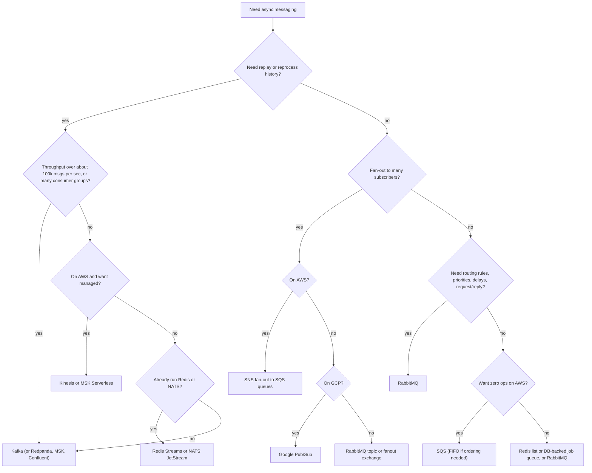

> [!tip] Remember
> The first fork is replay. If you might need to re-read history, a queue is the wrong shape.

### Guarantees and ordering in plain words

**In plain words:** Order is kept only inside one lane. Put all messages for the same order or user in the same lane.

**Step by step:**
1. Order 42 produces three events: placed, paid, delivered. All use key `order:42`.
2. The key hash sends all three to partition 3, so they stay in order.
3. The consumer handles "placed" and "paid", then crashes before saving its offset.
4. After restart it reads "paid" again (at-least-once). It sees order 42 is already paid and skips it (idempotent).
5. Events of different orders in other partitions may be read in any order, which is fine.

**Ordering.** Kafka guarantees order within a partition, so use the entity id (order id, user id) as the key and all events for that entity stay in order. SQS FIFO guarantees order per **message group id**.

RabbitMQ keeps order within one queue with one consumer, but order is lost when several consumers or redeliveries are involved. SQS standard gives best-effort order only. See [[Message Ordering and Partition Keys]].

**Delivery semantics.** All durable brokers are at-least-once by default: a crash after processing but before the ack means a redelivery. Kafka can give exactly-once inside Kafka (idempotent producer plus transactions), but not across your database and email service. SQS FIFO deduplicates for 5 minutes by deduplication id. See [[Delivery Semantics and Exactly-Once]] and [[Idempotency and Idempotency Keys]].

**Example with numbers:** a consumer processes 1,000 payments, then crashes before committing the offset for the last 40. After restart, those 40 are processed again. If "charge card" is not idempotent, 40 customers are charged twice.

## 4. Worked example 🟡

**Scenario: choose brokers for the food delivery app.** Four needs, each decided with the flowchart.

| Need | Question that decides | Pick |
| --- | --- | --- |
| Order events consumed by billing, analytics, search, fraud, with the ability to replay last week | Replay? yes. Many groups? yes | **Kafka**, topic `orders`, key = order id |
| Receipt emails and push notifications, retried on failure, delayed sends | Replay? no. Delays and retries? yes. On AWS | **SQS** (plus DLQ), or RabbitMQ with delayed retry |
| "Order placed" must reach 5 services, each with its own retry | Fan-out, on AWS | **SNS to 5 SQS queues** |
| Driver dispatch with priority (VIP orders first) and routing by city | Routing and priorities | **RabbitMQ** with topic exchange `dispatch.<city>` and priority queue |

Step by step for the Kafka part:

1. Checkout writes the order to Postgres and an outbox row in the same transaction ([[Transactional Outbox and CDC]]).
2. A relay publishes the outbox row to Kafka topic `orders` with key = `order_id`. Every event for that order lands in one partition, in order.
3. Billing, analytics and search are three consumer groups. Each keeps its own offset.
4. A bug in analytics is fixed on Tuesday; the team resets the analytics group's offset to Monday and reprocesses. Billing is untouched.

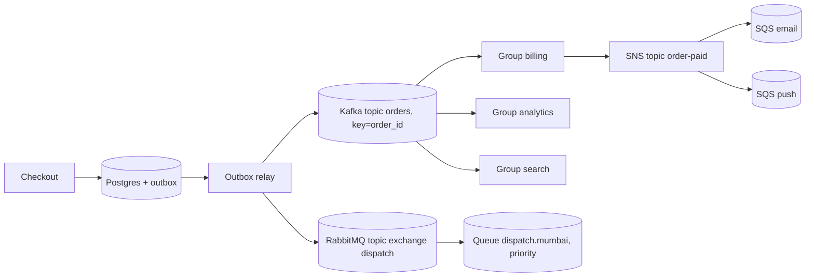

This is not over-engineering: three brokers each match a different shape. A smaller team could use Kafka for all three, or SNS and SQS for everything except replay. Name the trade-off if you simplify.

> [!warning] Common mistake
> Using the broker as a database, for example reading Kafka to answer "what is the status of order 42" by scanning. Keep a database for state and use the broker to move changes.

## 5. Variants and comparison 🟡

### The comparison table

**In plain words:** The brokers side by side. Numbers are rough sizes, not promises.

Throughput and latency figures are rough, public or estimated, and depend on message size, replication and hardware. Treat them as orders of magnitude and benchmark your workload.

| Dimension | Kafka | RabbitMQ | SQS (standard / FIFO) | Redis Streams | NATS JetStream | Google Pub/Sub | SNS |
| --- | --- | --- | --- | --- | --- | --- | --- |
| Model | Partitioned log | Queue with exchanges (also streams since 3.9) | Queue | Log with consumer groups | Log with consumers (core NATS is plain pub/sub) | Topic with subscriptions, retention optional | Pub/sub push topic |
| Retention and replay | Yes, time or size, or compacted by key | Classic and quorum queues: no replay. Streams: yes | No replay. Retention up to 14 days for unconsumed messages | Yes, until trimmed (memory bound) | Yes, by limits or policy | Yes with message retention or seek, up to 31 days | No storage; delivers then forgets |
| Ordering | Per partition | Per queue, weakened with competing consumers or requeue | Standard: best effort. FIFO: per message group | Per stream | Per stream or subject | Per ordering key, when enabled | FIFO topics: per group |
| Delivery semantics | At least once; exactly-once inside Kafka with transactions | At least once with acks and publisher confirms | Standard: at least once. FIFO: dedup window 5 minutes | At least once (XACK) | At least once; dedupe window; core NATS at most once | At least once; exactly-once delivery option per subscription | At least once to endpoints |
| Throughput (estimate) | Hundreds of thousands to millions of msgs/s per cluster; LinkedIn's 2014 benchmark reported 2 million writes/s on 3 machines with small messages | Tens of thousands per second per queue (estimate), more with streams | Standard: nearly unlimited, scales automatically. FIFO: 300 msgs/s per API action, 3,000 with batching, higher in high-throughput mode (see docs) | Very high for one node, limited by RAM and one thread | Very high for core NATS; JetStream lower with persistence | Scales automatically; billed per data volume | Scales automatically |
| Latency (estimate) | Low ms to tens of ms | Sub-ms to ms | Tens of ms; polling adds wait unless long polling | Sub-ms | Sub-ms core; low ms JetStream | Tens to 100 ms typical | Tens of ms |
| Routing | By topic and partition key only | Rich: direct, topic, fanout, headers exchanges | None (one queue); use SNS filters | Stream per key | Subject wildcards | Subscription filters | Message filtering policies |
| Special features | Compaction, Kafka Streams, Connect, schema registry | Priorities, per-message TTL, delayed via plugin, request/reply, DLX | Visibility timeout, DLQ, per-message delay up to 15 min | Tiny footprint, XAUTOCLAIM for stuck messages | Request/reply, KV store, object store | Dead-letter topic, push or pull, BigQuery subscription | Fan-out to SQS, Lambda, HTTP, email |
| Scaling model | Add partitions and brokers; consumers up to partition count | Scale queues and consumers; clusters scale poorly beyond a point | Fully managed, automatic | Redis Cluster shards by key | Cluster and super-cluster | Fully managed, global | Fully managed |
| Ops cost | High self-run (KRaft quorum, rebalances, disk); medium with MSK or Confluent | Medium: clustering, memory alarms, quorum queues (classic mirrored queues are deprecated) | Near zero | Low if Redis exists | Low to medium | Near zero | Near zero |
| Typical failure mode | Consumer lag, rebalance storms, hot partition, under-replicated partitions | Memory and disk alarms with deep queues, unacked build-up, network partition handling | Poison message loops, duplicate processing after timeout too short | Memory full, lost data if persistence is weak | Slow consumer, stream limits | Backlog growth, ack deadline expiry duplicates | Subscriber failures with no replay |
| Wrong choice when | Simple low-volume task queue; you need per-message priorities or complex routing | You need replay at huge scale or millions of msgs/s | You need replay, strict ordering at high throughput, or non-AWS | You need durable, large retention beyond RAM | You need huge ecosystem tooling or long retention analytics | You are not on GCP and want no vendor tie | You need to read old messages later |

> [!tip] Remember
> "Wrong choice when" is the safest column to learn first.

### Kafka vs RabbitMQ in one picture

**In plain words:** RabbitMQ is a smart post office that routes and deletes. Kafka is a long tape that keeps everything and lets readers rewind.

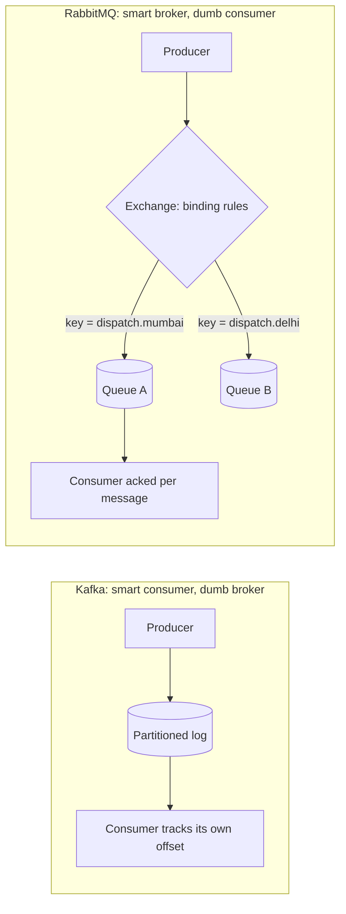

**Why this matters:** in Kafka the broker barely cares who reads; it scales by appending. In RabbitMQ the broker tracks each message's state (ready, unacked), which gives flexibility (routing, priority, per-message TTL) and costs throughput and memory when queues grow deep.

### Redis Streams and NATS: the lightweight logs

**In plain words:** Small, simple logs for when Kafka is too much. Fine for moderate traffic and short history.

Use **Redis Streams** when you already run Redis, volume is moderate, and a few minutes to hours of history in RAM is enough. See [[Redis as a Queue - Lists, Streams and Pub-Sub]]. Redis Pub/Sub alone is fire-and-forget: a subscriber that is offline misses messages.

Use **NATS** for very low latency service-to-service messaging. Core NATS is at most once. **JetStream** adds persistence, acks and replay.

### Cloud managed options

**In plain words:** Let the cloud run the broker for you. Less power to tune, much less work at 3 a.m.

- **SQS** for task queues, **SNS** to fan out to many SQS queues or Lambdas, **EventBridge** for event routing between AWS services and SaaS ([[AWS SQS, SNS and EventBridge]]).
- **Google Pub/Sub** for a global, fully managed topic with at-least-once delivery, ordering keys and optional exactly-once.
- **Amazon MSK, Confluent Cloud, Redpanda** when you want Kafka's model without running brokers.

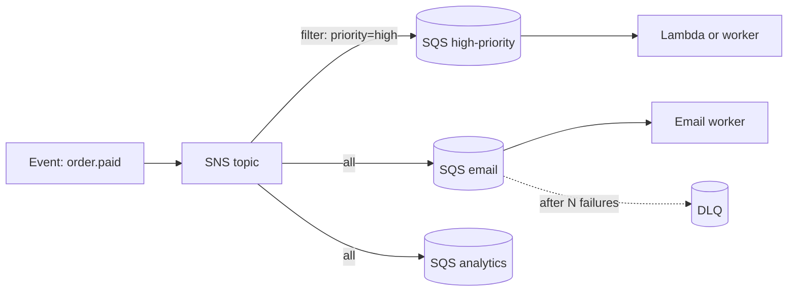

## 6. Trade-offs 🟡

| Choice | You gain | You pay |
| --- | --- | --- |
| Kafka | Replay, many independent consumers, per-key order, huge throughput | Operational weight, partition planning, rebalances, no per-message priority or delay |
| RabbitMQ | Flexible routing, priorities, TTLs, request/reply, low latency | Lower ceiling at scale, deep queues strain memory, clustering is delicate |
| SQS | No servers, effectively unlimited standard throughput, simple | No replay, weak ordering in standard, polling model, AWS lock-in |
| SNS plus SQS | Durable fan-out with independent retry per subscriber | Extra moving parts, no replay of the topic |
| Redis Streams | Easy if Redis exists, low latency | Memory-bound, durability depends on Redis persistence |
| NATS JetStream | Light, fast, simple ops | Smaller ecosystem and tooling than Kafka |
| Pub/Sub | Global managed, no ops | GCP tie, cost at high volume, less partition-level control |
| Database as queue | One system, transactional with your data | Polling cost, lock contention, does not scale like a broker |

### When not to use a broker at all

**In plain words:** If the caller needs the answer right now, or traffic is tiny, a direct call or a database table may be enough.

- The caller needs the answer now (use a synchronous call, with timeouts and retries).
- Volume is tiny and you already have Postgres: a `jobs` table with `SELECT ... FOR UPDATE SKIP LOCKED` can serve a modest job queue. See [[Background Jobs and Worker Pools]].
- You need workflow state across many steps: a workflow engine such as Temporal fits better. See [[Workflow Engines and Durable Execution]].

> [!warning] Common mistake
> Choosing Kafka for a few hundred jobs a minute because "it is the standard". You inherit partitions, consumer-group rebalances and head-of-line blocking (one slow message holds up the rest of its partition) for no benefit.

## 7. In production 🔴

> 🟡 → 🔴 **You now know** which broker fits which need and what each costs. **Next comes the senior view**: real company choices, failure modes, metrics, why partitions cap parallelism, ordering with retries, honest exactly-once, schemas and operations.

### Real company examples

**In plain words:** Public stories of who used which broker, for what.

| Company | Broker use | Source note |
| --- | --- | --- |
| LinkedIn | Created Kafka to carry activity streams and operational metrics, then open-sourced it | Kafka paper (NetDB 2011), Jay Kreps, "The Log" (2013) |
| Netflix | Kafka is the backbone of the Keystone data pipeline that routes events to sinks | Netflix Tech Blog, Keystone (2016) |
| Slack | Put Kafka in front of Redis in the job queue to absorb bursts and avoid Redis memory exhaustion | Slack Engineering, Scaling Slack's Job Queue (2020) |
| Spotify | Moved event delivery to Google Cloud Pub/Sub | Spotify Labs (2016) |
| Instagram (early years) and many Django shops | Celery task queues on RabbitMQ | Instagram Engineering (2011); Celery docs |
| Uber | Large Kafka deployments for event pipelines and cross-cluster replication (uReplicator) | Uber Engineering (2016 onward) |

> [!note]
> These are published choices at a point in time. Use them to learn the reasoning, not to copy the stack.

### Failure modes and fixes

**In plain words:** The usual ways brokers go wrong, what you will see, and how to fix it.

| Problem | Symptom | Fix |
| --- | --- | --- |
| Poison message | Same message fails and loops forever, queue blocks | Max receive count, then DLQ; alert on DLQ depth |
| Consumer lag (Kafka) | Offset lag grows, data arrives late | Add consumers up to partition count; fix slow handler; raise partitions |
| Rebalance storm (Kafka) | Consumers keep stopping to reassign | Static membership, cooperative rebalancing, longer session timeout |
| Hot partition | One partition gets most traffic | Better key, or salt the key (lose strict order for that key) |
| Duplicate processing | Customer charged twice | Idempotency key on the consumer side |
| Visibility timeout too short (SQS) | Duplicate work while a job still runs | Set timeout above max processing time; extend while working |
| Unbounded queue (RabbitMQ) | Memory or disk alarm, publishers blocked | Consumer scaling, prefetch limits, max-length policies, backpressure |
| Lost message on publish | Order saved but no event | Transactional outbox; publisher confirms in RabbitMQ; `acks=all` in Kafka |

### Metrics to watch

**In plain words:** The one number that matters most is lag: how far behind the readers are.

- Kafka: consumer group lag per partition (`kafka-consumer-groups.sh --bootstrap-server <host:9092> --describe --group <group>`), under-replicated partitions, request latency.
- RabbitMQ: queue depth (ready and unacked), consumer utilisation, memory and disk alarms.
- SQS: `ApproximateNumberOfMessagesVisible`, `ApproximateAgeOfOldestMessage`, DLQ depth.
- All: processing time p99, redelivery rate, DLQ growth.

See [[Backpressure and Flow Control]] for what to do when producers outrun consumers.

## 8. Deep dive 🔴

### Why a partition limits parallelism

**In plain words:** In Kafka, one lane is read by only one reader in a group. Twelve lanes means at most twelve busy readers, no matter how many you add.

In Kafka one partition is read by at most one consumer in a group. With 12 partitions, a 20-consumer group has 8 idle members. So partition count is your parallelism ceiling and is hard to reduce later. Choose it from target throughput divided by per-partition throughput, then add headroom (an estimate-based exercise; measure your own).

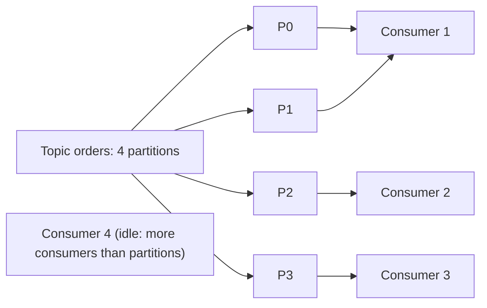

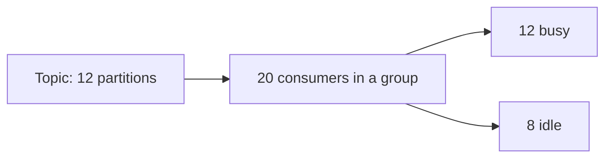

### Ordering plus retries

**In plain words:** If message 1 fails and message 2 goes through, order is broken. You must either wait on message 1 or accept the break.

If message 1 fails and is retried while message 2 succeeds, order is broken. Options: stop consuming that key until it succeeds (Kafka pause, SQS FIFO blocks the group), or make handlers commutative with version numbers. This is why strict order and independent retry are in tension.

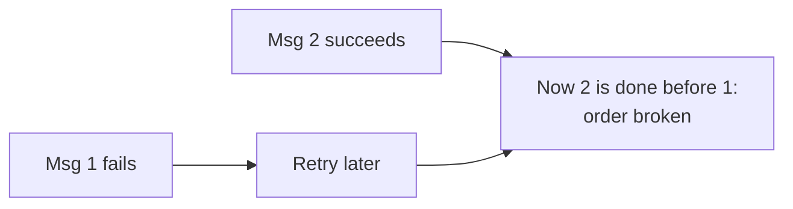

### Exactly-once, honestly

**In plain words:** True "exactly once" only works inside Kafka. Once you touch a database or send an email, use "at least once" plus duplicate checks.

Kafka transactions give atomic read-process-write between Kafka topics. When a side effect lives outside (database, email), the practical recipe is at-least-once plus an idempotent handler, for example a unique `event_id` with an insert-if-absent check. See [[Delivery Semantics and Exactly-Once]].

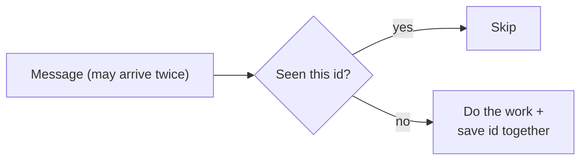

### Schemas

**In plain words:** Messages are read years later by new code. Agree on a message shape and only change it in safe ways, like adding optional fields.

A log is read years later by code that did not exist when it was written. Use a schema registry and compatible evolution (add optional fields, never reuse tags). See [[Event Schemas and Schema Registry]].

### Choosing by operational ability

**In plain words:** Pick a broker your team can actually run. A small team is better off with a managed service.

A good senior answer includes who will run it. A three-person team on AWS is better served by SNS and SQS or MSK than by a self-run Kafka cluster, even if Kafka is technically better for the workload.

### Whiteboard version

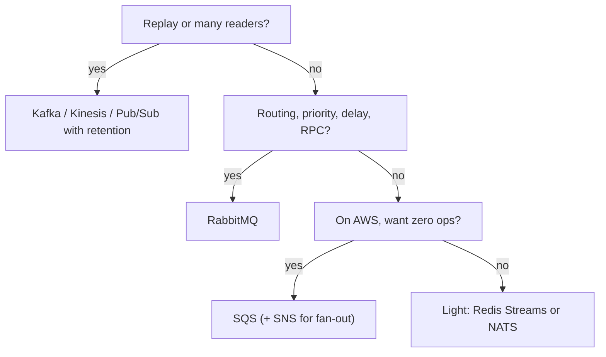

## 9. Scenario drills (scenario, choice, why) 🟡

| # | Scenario | Pick | Why | What to say in the interview |
| --- | --- | --- | --- | --- |
| 1 | Order events to billing, search, analytics, fraud | Kafka, key = order id | Many independent readers, replay, per-order order | "A log lets each consumer group progress independently and lets us replay after a bug." |
| 2 | Order confirmation emails | SQS with DLQ (or RabbitMQ) | Task, retries, no replay needed | "Each email is a one-time task. SQS retries automatically and moves poison messages to a DLQ." |
| 3 | Clickstream, 500k events per second | Kafka | Throughput and retention for batch consumers | "Sequential disk appends and batching make Kafka suited to this; I'd batch-load into ClickHouse." |
| 4 | Chat message delivery between servers | Redis Pub/Sub or NATS for live fan-out, plus a durable store | Live delivery wants low latency; history lives in a database | "Pub/Sub for presence and live push, the database for history; a missed live message is fixed on reconnect." See [[Case Study - Chat System]]. |
| 5 | Payment ledger events | Kafka with outbox and idempotent consumers | Durable, ordered per account, auditable | "Per-account partition key for order, idempotency key on every consumer, and the outbox so we never publish without committing." |
| 6 | Image or video processing jobs | SQS, or RabbitMQ with prefetch 1 | Long, variable tasks; independent workers | "Long jobs need a visibility timeout longer than the job, or a heartbeat extension." |
| 7 | Delayed retry in 10 minutes | SQS delay (up to 15 min), RabbitMQ delayed plugin or TTL plus DLX, or a durable scheduler | Needs delay semantics Kafka lacks | "Kafka has no per-message delay, so I would not use it for timers." See [[Scheduled Jobs - Cron to Durable Schedulers]]. |
| 8 | Notification fan-out to email, SMS, push | SNS to SQS per channel | Each channel has its own retry and rate limit | "Fan-out with an independent queue per channel isolates failures." See [[Case Study - Notification System]]. |
| 9 | Service-to-service request/reply with low latency | NATS request/reply, RabbitMQ RPC, or gRPC directly | Needs a reply, not a log | "If the caller waits, a direct call is simpler than a broker." |
| 10 | Driver dispatch with priority by city | RabbitMQ topic exchange plus priority queues | Routing and priority are native | "Routing key `dispatch.<city>` and priority levels, handled by the broker." |
| 11 | Audit log kept 30 days, replayable | Kafka with retention, or Kinesis | Retention and replay | "Retention is a configuration, and consumers can rewind." |
| 12 | Small startup, 200 jobs per minute, already on Postgres | Postgres jobs table with SKIP LOCKED, or SQS | A full broker is more than needed | "I'd start with what we already operate, and move when a measured limit shows up." |

## 10. How to say it in the interview 🔴

Use this skeleton:

1. **Name the shape:** "This is a task (or an event stream)."
2. **Name the needs:** "We need replay, per-key ordering and N consumers" or "We need retries, delay and low ops."
3. **Pick:** "So Kafka" or "So SQS".
4. **State the guarantee honestly:** "Delivery is at-least-once, so the consumer is idempotent using the event id."
5. **Name the cost:** "I accept the operational weight of partitions" or "I accept no replay, since we never re-read these."

Phrases that score well:

- "Ordering is per partition, so I key by order id."
- "Parallelism is capped by the partition count, so I would start at N and plan for growth."
- "We publish through an outbox so the database and the broker cannot disagree."
- "I'd put a DLQ and an alert on its depth."

Phrases to avoid: "exactly-once, no problem", "Kafka is always faster", "just use a queue" with no failure plan.

## 11. Interview questions 🔴

> [!question]- When would you choose RabbitMQ over Kafka?
> When you need rich routing (topic and header exchanges), per-message priorities, TTLs, delayed retry, or request/reply, and the throughput is moderate. RabbitMQ's broker tracks each message and routes it by rules. If you also need replay and very high throughput, choose Kafka (or RabbitMQ Streams for a log inside RabbitMQ).

> [!question]- Why can Kafka not do per-message priority or delay well?
> A partition is an append-only log read in order by offset. A consumer commits a single position, so it cannot skip a message and come back to it without holding back later ones. Priorities need separate topics (high and low), and delays need a separate scheduler or retry topics.

> [!question]- How do you get ordering with SQS?
> Use a FIFO queue and give related messages the same message group id. Order holds within the group; different groups process in parallel. FIFO has lower throughput limits than standard (300 messages per second per API action, 3,000 with batching, with high-throughput mode raising it), and a failing message blocks the rest of its group.

> [!question]- A consumer crashes after processing but before acking. What happens?
> The broker redelivers (SQS after the visibility timeout, RabbitMQ when the channel closes, Kafka from the last committed offset). So processing runs twice. The fix is an idempotent handler with a deduplication key, not a different broker.

> [!question]- How do you fan out one event to five services with independent retries?
> On AWS, publish to an SNS topic and subscribe five SQS queues, each with its own DLQ. In Kafka, give each service its own consumer group. In RabbitMQ, a fanout or topic exchange bound to five queues. The per-subscriber queue or group isolates failures and slow consumers.

> [!question]- Your Kafka consumer lag keeps rising. What do you do?
> Check whether the handler is slow (a dependency, a database call), and fix that first. If handlers are fine, add consumers up to the partition count. If you are already at that cap, increase partitions (which changes key-to-partition mapping for new data) or batch the work. Also look for one hot partition and rebalance storms.

## 12. Cheat sheet 🟢

- Queue: tasks, delete on ack. Log: events, retained, replayable, one offset per group.
- Kafka: replay, throughput, per-partition order, parallelism equals partitions, heavy ops.
- RabbitMQ: routing, priority, TTL and delay, RPC; smaller scale; watch queue depth and memory.
- SQS: zero ops, standard is unordered at-least-once, FIFO is ordered per group; DLQ always.
- SNS plus SQS: durable fan-out on AWS. Pub/Sub is the GCP equivalent.
- Redis Streams and NATS JetStream: light logs when you already run them.
- Everything is at-least-once: idempotent consumers and an outbox.
- Say: shape, needs, pick, guarantee, cost.

## Self-check 🟢🟡

> [!question]- (easy) Queue vs log in one line?
> A queue hands each message to one worker and deletes it; a log keeps messages so many readers can replay.

> [!question]- (easy) What is a dead letter queue for?
> Holding messages that keep failing so they do not block the rest.

> [!question]- (easy) Why must consumers be idempotent?
> Brokers deliver at least once, so a message can arrive twice.

> [!question]- (medium) How do you keep all events for one order in order in Kafka?
> Use the order ID as the key so they all land in one partition.

> [!question]- (medium) A topic has 6 partitions. How many consumers in one group can do useful work?
> At most 6; extra consumers sit idle.

> [!question]- (medium) When is no broker the right answer?
> When the caller needs the answer now, or volume is tiny and a Postgres jobs table is enough.

## Links 🟢

- Before this: [[Queues vs Streams and Broker Comparison]], [[Event-Driven Architecture Basics]], [[System Design Interview Framework]]
- Brokers: [[Kafka and Event Streaming]], [[AWS SQS, SNS and EventBridge]], [[Redis as a Queue - Lists, Streams and Pub-Sub]]
- Guarantees: [[Delivery Semantics and Exactly-Once]], [[Message Ordering and Partition Keys]], [[Idempotency and Idempotency Keys]], [[Dead Letter Queues and Poison Messages]], [[Backpressure and Flow Control]]
- Patterns: [[Transactional Outbox and CDC]], [[Event Schemas and Schema Registry]], [[Stream Processing Basics]], [[Background Jobs and Worker Pools]], [[Scheduled Jobs - Cron to Durable Schedulers]], [[Workflow Engines and Durable Execution]], [[Saga Pattern]]
- Case studies: [[Case Study - Distributed Message Queue]], [[Case Study - Notification System]], [[Case Study - Chat System]], [[Case Study - Ad Click Aggregation]]
- Compare with: [[Choosing a Database - Decision Guide]]
- Map: [[09 Messaging & Async MOC]]

 🟢

### Watch on YouTube

- [Kafka vs. RabbitMQ vs. Messaging Middleware vs. Pulsar](https://www.youtube.com/watch?v=x4k1XEjNzYQ) · ByteByteGo · 4 min · 215,512 views
- [Kafka vs RabbitMQ](https://www.youtube.com/watch?v=1HOVtQ-_fcE) · Hello Interview · 10 min · 354,475 views
