# Staff-Level HLD Signals and Company Rubrics

> [!summary] TL;DR
> The same design question is scored differently at different levels. An **SDE-2** is judged on producing a sound, working design. An **SDE-3** is judged on choosing well between options, quantifying, and finding failures. A **Staff** candidate is also judged on **driving the conversation**, resolving ambiguity, planning how v1 evolves to v2, migration without downtime, and thinking about people, cost and risk. Company formats differ in flavor, but the public advice agrees on the core signals. Company rubrics are not published, so this note describes only what is publicly known, conservatively.

> [!abstract] Core idea
> - Levels differ by **scope of ambiguity you can handle** and **depth of trade-off reasoning**, not by number of boxes drawn.
> - Staff signals: you lead, you frame the problem, you cut scope on purpose, you plan the migration, you name org and cost impact.
> - Company formats differ (product-flavored, infra-flavored, behavioral overlay), but each wants requirements, numbers, trade-offs and failure thinking.
> - Treat company-specific claims as hints, not facts. Ask your recruiter what the round looks like.

## 1. Why it exists

Two candidates draw almost the same diagram for "design a food delivery app". One gets hired as SDE-2, the other is rejected for SDE-3, and a third would have been offered Staff. The diagrams were not the difference.

The SDE-2 candidate drew a clean design when told the requirements. The SDE-3 candidate asked which requirements mattered most, estimated the load, and picked a database with a reason. The Staff candidate proposed shipping a simple version first, said what would trigger the next version, and explained how to move traffic over without downtime.

Candidates preparing for SDE-3 often do not know what the interviewer is writing down. This note makes the hidden checklist visible, so you can show the signals on purpose.

> [!warning] Common mistake
> Believing that a longer, bigger, fancier design scores higher. Extra components without a stated reason are scored as a **negative** signal at every level.

> [!tip] Remember
> The level is read from how you decide and lead, not from what you draw.

## 2. Mental model

Think of a **building project**. The SDE-2 is a skilled builder: give a blueprint and they build it well. The SDE-3 is the site engineer: they check the blueprint for load, choose materials, and spot what will crack. The Staff engineer is the architect plus the project lead: they ask what the building is for, decide what to build first, plan how people keep living in the old building while the new one goes up, and think about who maintains it in ten years.

The analogy breaks because in an interview the interviewer is also the client who can change requirements mid-way; your job is to adapt, not to defend the first drawing.

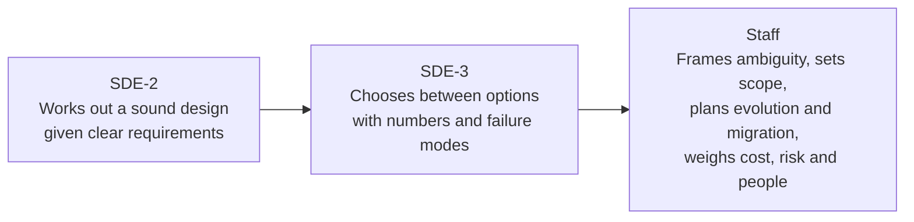

> [!tip] Remember
> Scope of ambiguity handled rises with each level. Respond to vague by asking, then deciding.

## 3. How it works

### Step 1: the signals by level

**In plain words:** interviewers judge a few areas, and each level expects a higher bar in each. The table below is this note's own **study model** built from public interview guides and staffeng.com. It is not any company's official scorecard; those are not public.

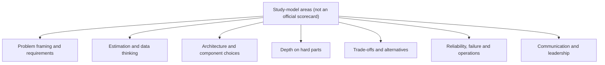

| Area | SDE-2 | SDE-3 | Staff |
| --- | --- | --- | --- |
| Requirements | Asks some questions, lists functional needs | Separates functional and non-functional, sets SLAs and scale | Challenges the requirement itself, ranks what matters, cuts scope on purpose |
| Estimation | Does it when prompted | Does it unprompted and uses it to choose designs | Uses it to find the single constraint that shapes the system |
| Architecture | Reasonable boxes, correct flow | Boxes tied to requirements, justified | Sequenced: v1 simple, v2 on a named trigger |
| Depth | One area in some depth | Two areas deep with options | Picks the riskiest area without being told, goes deep, links to org and cost |
| Trade-offs | Mentions a few | Names alternatives, choice, reason, cost | Frames decisions as reversible or not, picks the cheap-to-reverse first |
| Failure | Handles basic cases (retry, replica) | Handles partial failure, idempotency, overload | Plans blast radius, degradation, runbooks, SLOs |
| Evolution | Rarely discussed | Mentions scaling next | Explicit migration plan, dual-write or shadow traffic, rollback |
| Communication | Answers questions | Narrates decisions | Leads the session, checks alignment, summarizes risks |

**Example:** asked "design notifications", an SDE-2 draws queue plus workers. An SDE-3 asks about volume, channels and priority, then adds per-user rate limits and dedupe. A Staff candidate also asks whether to build or buy the email and SMS layer, how to migrate the three existing teams onto a shared service, and what the first-quarter slice is.

**Why it matters:** knowing the next level's behavior lets you show it deliberately.

### Step 2: driving ambiguity

**In plain words:** the prompt is deliberately vague ("design a ride-hailing app"). **Driving ambiguity** means you turn it into a clear scope by asking a short set of questions, stating assumptions out loud, and getting the interviewer to confirm.

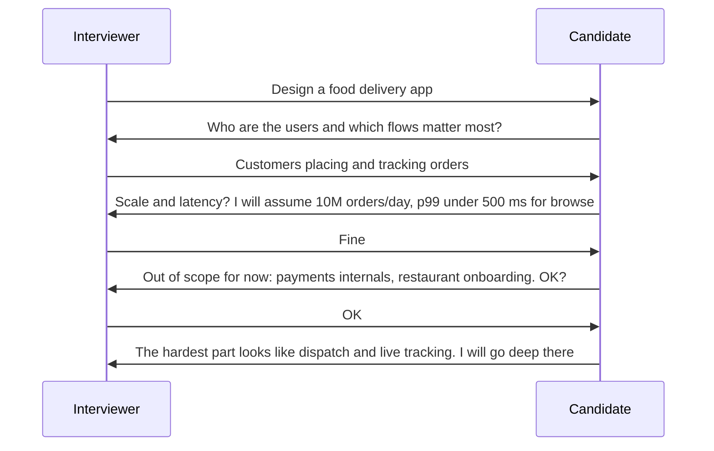

Rules of thumb:

1. Ask at most 5 or 6 questions in about 5 minutes.
2. For each unanswered thing, write "assuming X" on the board.
3. Name the hardest requirement and propose the deep dive.
4. Ask for agreement once, then move on.

**Why it matters:** it shows you can start work in a vague situation, which is most of a Staff job.

> [!warning] Common mistake
> Asking 15 questions and never designing. The aim is to reach a decision, not to collect information.

### Step 3: evolving v1 to v2

**In plain words:** real systems are built in stages. Show a **v1** that is boring and works, then say what number or event forces **v2**.

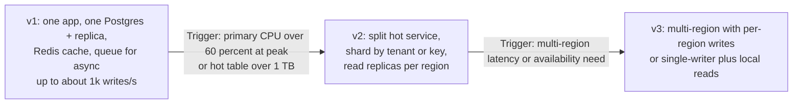

| Stage | Trigger (example numbers are estimates) | Change | Cost |
| --- | --- | --- | --- |
| v1 | Launch | Monolith, one database, cache, queue | Low |
| v2 | Primary above 60 percent CPU at peak, or writes above what a load test shows one primary handles | Shard or split the hot domain | Re-key data, app changes |
| v3 | Users in other continents, a regional outage hurt | Multi-region replicas or writers | Consistency complexity |

**Example:** "I would not shard on day one. I will say the trigger: when write QPS passes what a load test shows one primary sustains, I shard by `restaurant_id`. Until then a replica and a cache cover reads."

**Why it matters:** this is the opposite of over-engineering, and Staff interviews read it as judgment.

### Step 4: migration plans

**In plain words:** once you replace v1 with v2, how do users keep working? A **migration plan** is the ordered set of steps to move data and traffic safely, with a way to go back.

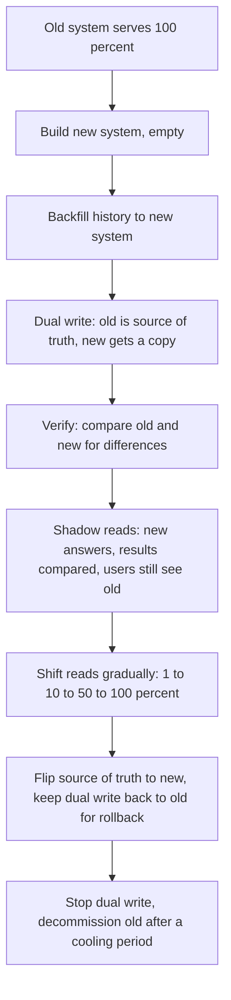

Steps with the reason for each:

1. **Backfill** so the new system starts with history.
2. **Dual write** (old stays source of truth) keeps the two in sync during the move.
3. **Verify** with a diff job; a mismatch is a bug found before users see it.
4. **Shadow reads** exercise the new read path under real traffic.
5. **Gradual shift** limits blast radius.
6. **Rollback path** until a cooling-off period ends.

See [[Zero-Downtime Schema Migrations]] for the database side and [[Multi-Region Architecture]] for regions.

**Why it matters:** "how do you migrate?" is the commonest Staff follow-up. Having the sequence ready is a strong signal.

### Step 5: company formats (public, conservative)

**In plain words:** firms run design rounds differently. The descriptions below are only broad, publicly shared patterns; formats change by team, level and year. Ask your recruiter and read the prep material they send.

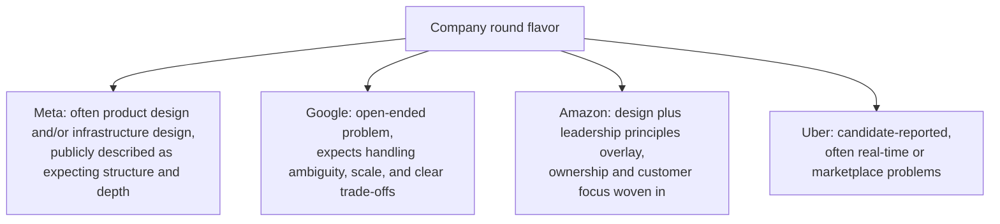

| Company | Commonly reported shape (verify) | What to emphasize |
| --- | --- | --- |
| Meta | Public prep guidance describes system design rounds that can lean either toward product architecture (feeds, messaging, with API and data model) or infrastructure (storage, queues, caches), depending on role | Pick the flavor by role; for product, show API, data model, scale of reads and writes; for infra, show internals, failure and capacity |
| Google | Public guidance describes open-ended design with follow-ups that increase scale and constraints | Clarify, structure, estimate, show trade-offs, keep the design simple until pushed |
| Amazon | Public guidance describes design discussions alongside questions based on the Leadership Principles | Prepare stories for ownership, dive deep, and "are right a lot"; link design choices to customer impact, cost and operability |
| Uber | Candidate-reported rounds often resemble real-time or marketplace problems (dispatch, location, pricing) | Know geospatial indexing, real-time updates and consistency under load; see [[Geospatial Indexing]], [[Case Study - Ride Sharing and Proximity]] |

> [!warning] Common mistake
> Memorizing a "company rubric" from a forum post. Rubrics are internal, change, and vary per interviewer. Prepare for the general signals, then adapt in the room.

### Step 6: Amazon-style overlay

**In plain words:** with a behavioral overlay, the same design answer also needs stories. Public Amazon material lists the Leadership Principles (for example Customer Obsession, Ownership, Dive Deep, Bias for Action, Invent and Simplify). Map a few of them onto design behaviors.

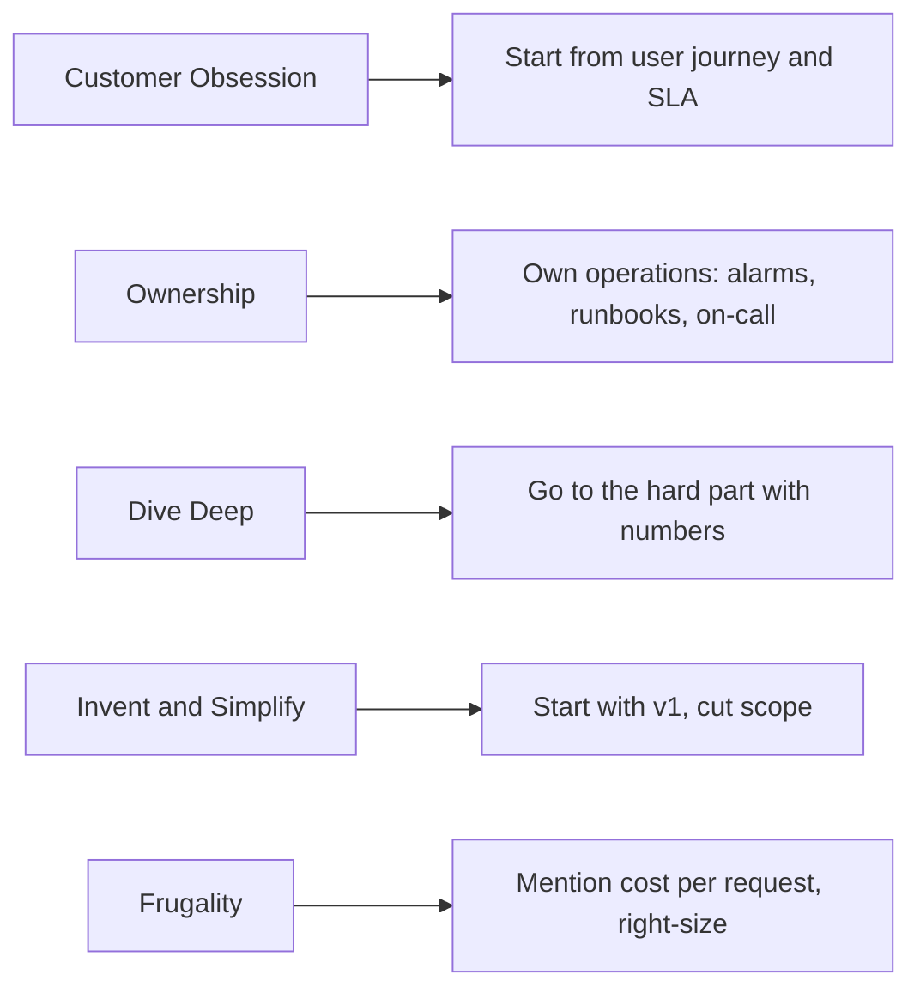

**Example:** "I would start with managed queue and one database. The cost per million requests is low, and we only split if the numbers say so. The on-call team gets two alarms: queue age and error rate."

**Why it matters:** it shows the design and the leadership evidence are the same story.

> [!tip] Remember
> Every company wants the same core: clarify, quantify, decide, show cost, handle failure. The flavor differs.

### Step 7: Staff-level extras

**In plain words:** beyond the box diagram, Staff candidates talk about things that cross teams and time.

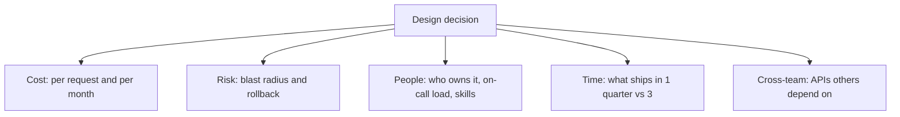

Short phrases to use:

- "Ownership: the payments team owns the ledger; we consume events. This avoids two teams writing the same table."
- "Cost: this index doubles write cost. At our volume that is about N dollars a month (an estimate I would confirm)."
- "Reversibility: a queue between services is easy to change; a primary key choice is not. I will spend time on the second."
- "First quarter ships ordering and tracking; payouts reuse the existing ledger."

## 4. Worked example

### Whiteboard version

Prompt: "Design the notification platform for a company with several teams sending emails, SMS and push."

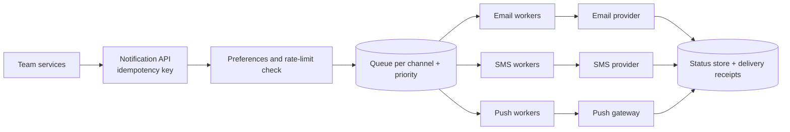

How the same answer reads at each level:

1. **SDE-2 answer:** API, one queue, workers per channel, provider calls with retry, a table of statuses.
2. **SDE-3 answer:** adds idempotency keys so retries do not double-send, priority queues so OTPs jump ahead of marketing, per-user rate limits, provider failover, and a DLQ for poison messages. Estimates 50M messages per day, about 600 per second average, 5 to 10 times at peak (estimates).
3. **Staff answer:** adds scope and sequence. "v1 covers OTP and order updates on email and SMS for two teams. Marketing waits for v2 because its volume and risk differ." Adds a migration plan: "the three existing teams each send directly. We ship a client library, run in shadow mode that logs what we would send, compare with what they sent, then move one team per sprint, rolling back by a flag." Adds ownership and cost: "we own routing and templates; teams own content; we publish a cost-per-channel report."

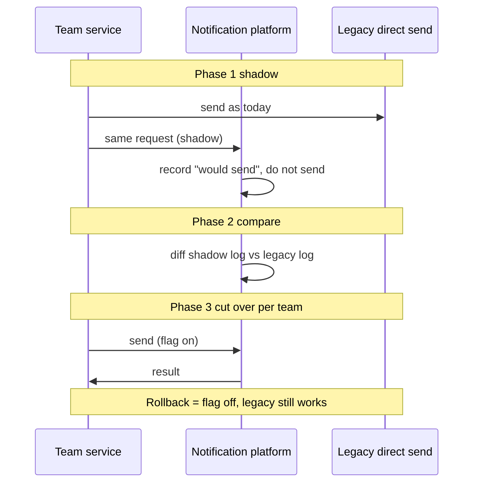

## 5. Variants and comparison

### Red flags and recoveries

| Red flag | Why it hurts at this level | Recovery |
| --- | --- | --- |
| Waits to be told what to do | Staff leads | Propose the plan in the first 5 minutes |
| Designs only the happy path | SDE-3 must find failures | Ask "what if this dies?" for each box |
| No numbers | Cannot justify anything | Estimate in 3 minutes, say "rough" |
| Everything is distributed from the start | Over-engineering | State the trigger for splitting |
| Defends the first idea against hints | Rigid | Treat a hint as a new requirement |
| No mention of migration or rollout | Staff gap | Add a 5-step plan |
| Ignores cost and operations | Staff gap | Add cost per request and an on-call view |
| Jargon without reasons | Buzzword signal | Say "I pick X over Y because Z, cost W" |

### Common Staff-level follow-ups

| Follow-up | Answer shape |
| --- | --- |
| "How would you roll this out?" | Shadow, canary, percentage ramp, rollback flag |
| "How do you migrate existing data?" | Backfill, dual write, verify, switch, cool-off |
| "What would you cut for a 6-week version?" | Name the thin slice and what is deferred and why |
| "What would make you change this design?" | Name the triggers: traffic, latency, cost, team size |
| "Who owns this and who is on call?" | Ownership boundaries, runbooks, SLOs ([[SLIs, SLOs, SLAs and Error Budgets]]) |
| "What is the riskiest part?" | Name one, with a mitigation and a test |
| "How does this affect other teams?" | Contracts, versioned APIs, deprecation plan |

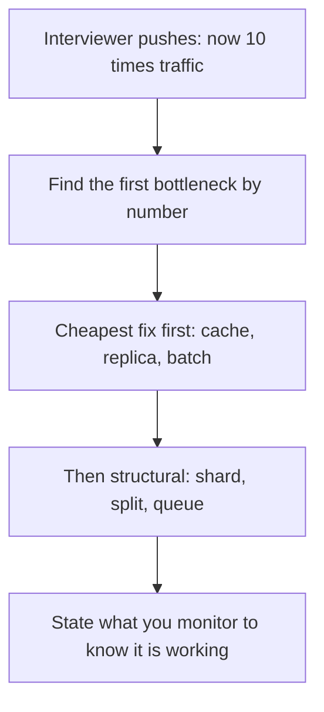

## 6. Trade-offs and when not to use

- **Do not perform Staff behaviors at the cost of fundamentals.** A missing estimate or an unhandled failure mode costs more than a missing migration plan.
- **Do not claim ownership of things you do not know.** Say "I would confirm with the payments team".
- **Do not recite a company's supposed rubric.** It is not public, and acting as if you know it reads as scripted.
- **Do not over-explain scope cuts.** One sentence per cut, then move on.
- **Do not apply the Staff checklist to a 30-minute SDE-2 round.** Match depth to the level of the role and the time given.

## 7. In production

- **Real design reviews** use the same signals: context, requirements, numbers, options, decision, rollout, risks, monitoring. See [[Architecture Decision Records]] and [[Production Readiness Review]].
- **Real migrations** use the dual-write and shadow sequence above, with a diff job and a rollback flag.
- **Real Staff work** is mostly alignment: writing the design doc, getting other teams to agree on contracts, and sequencing so something ships early.
- **Practice routine:** after each mock, write one line per scorecard area: what I showed, what I missed. Repeat with one area as the focus.

## 8. Deep dive

### Reading hints from the interviewer

**In plain words:** interviewers steer with questions. Each type of question tells you what is being checked.

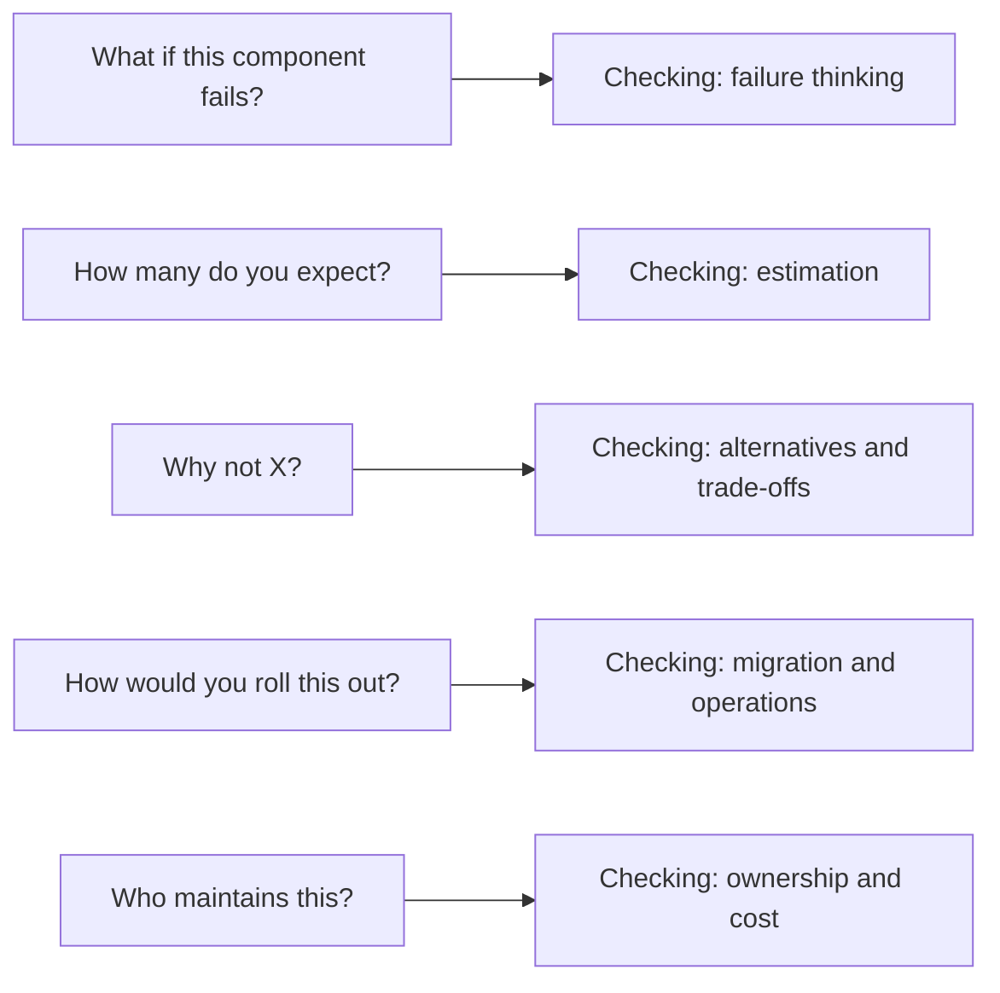

When a hint arrives, say "that changes my assumption", restate the new requirement, and adjust the design in one sentence.

### Making trade-offs reversible

Staff candidates classify decisions as **one-way doors** (hard to undo: primary keys, partition keys, public API contracts, data retention) and **two-way doors** (easy to undo: cache choice, queue vendor behind an interface). Spend time on one-way doors; decide two-way doors fast. This phrase is widely used in engineering writing and is a compact way to show judgment.

### A 45-minute plan that shows the signals

| Minutes | Activity | Signal shown |
| --- | --- | --- |
| 0 to 6 | Clarify, assumptions, scope cut | Framing and leadership |
| 6 to 10 | Estimates and the key constraint | Quantitative thinking |
| 10 to 16 | API, data model, simple diagram (v1) | Sound architecture |
| 16 to 34 | Two deep dives on riskiest parts | Depth and trade-offs |
| 34 to 40 | 10 times growth, failure, v2 trigger | Scaling and reliability |
| 40 to 45 | Rollout and migration, risks, summary | Staff extras |

## 9. Interview questions

> [!question]- What separates SDE-3 from Staff in a design round?
> Both choose well between options with numbers. Staff also frames and scopes the problem on their own, sequences the work as v1 then v2 with explicit triggers, plans migration and rollback, and talks about cost, ownership and cross-team impact.

> [!question]- How do you handle an extremely vague prompt?
> Ask a short batch of questions on users, core flows, scale and latency. Write assumptions on the board, name the hardest requirement, propose the deep dive, and get one confirmation. Do not ask endlessly.

> [!question]- How would you migrate a live system to a new design without downtime?
> Build the new system, backfill history, dual write while the old stays the source of truth, diff old and new, shadow reads, ramp reads gradually, flip the source of truth while keeping a path back, then decommission after a cooling period.

> [!question]- What do you do when the interviewer says your design is wrong?
> Ask what constraint they see, restate it as a requirement, and adjust. Defending the first idea is a negative signal; adapting visibly is a positive one.

> [!question]- How do you show cost awareness?
> Give a per-request or per-month estimate for the expensive parts (storage, egress, cross-region traffic, always-on clusters), label it as an estimate, and say which choices you would revisit if cost mattered more.

> [!question]- How should you prepare for different companies' rounds?
> Practice the general framework, then ask the recruiter what the round looks like. Add the flavor: product vs infrastructure emphasis for some, leadership-principle stories for others, real-time and marketplace problems for others. Do not rely on rumors about internal rubrics.

## 10. Cheat sheet

| Level | Show this |
| --- | --- |
| SDE-2 | Correct, working design with the main flows and some trade-offs |
| SDE-3 | Requirements split, numbers, two deep dives with alternatives, failure handling |
| Staff | All above plus framing, scope cuts, v1 to v2 triggers, migration, cost, ownership |

- **Say it like this:** "I will ship v1 as X; I move to v2 when Y crosses Z; the migration is dual write, verify, shadow, ramp, with a rollback flag."
- **Company advice:** use public prep material from the recruiter; do not trust forum rubrics.
- **Always:** state assumptions, estimate, name the riskiest part, end with risks and monitoring.

## Links

- Core: [[HLD Round - Complete Step-by-Step Guide]], [[System Design Interview Framework]], [[HLD Trade-offs Master Cheat Sheet]], [[HLD Round - Full Worked Mock (Food Delivery App)]].
- Supporting: [[Back-of-the-Envelope Estimation]], [[Zero-Downtime Schema Migrations]], [[Multi-Region Architecture]], [[SLIs, SLOs, SLAs and Error Budgets]], [[Production Readiness Review]], [[Architecture Decision Records]].
- Case studies: [[Case Study - Notification System]], [[Case Study - Ride Sharing and Proximity]], [[Geospatial Indexing]].
- Career: [[SDE-3 Readiness Checklist]].
