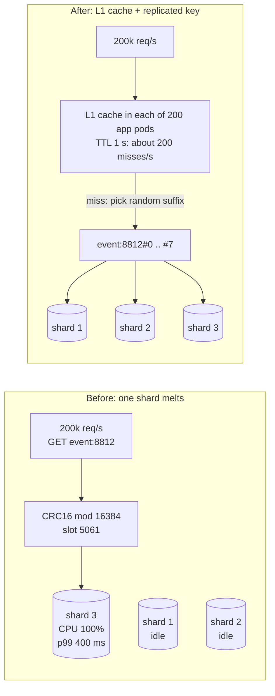
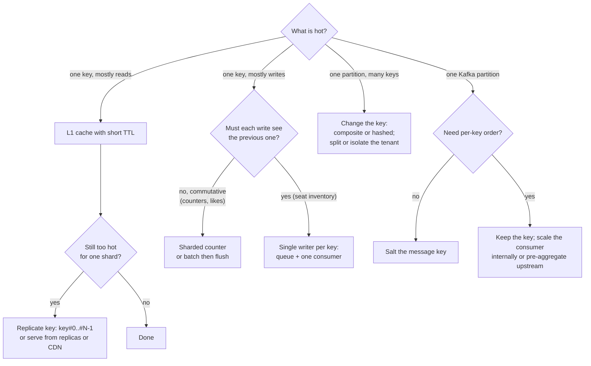
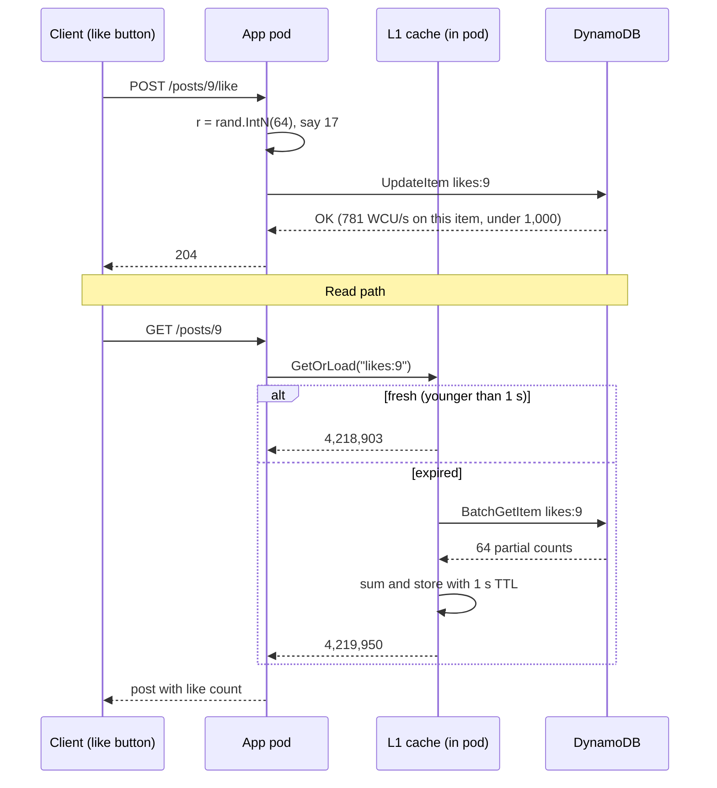

# Hot Keys and Hot Partitions

> [!summary] TL;DR
> A **hot key** is one key (a cache entry, a database row, a message key) that gets far more traffic than the rest. A **hot partition** is the shard, node or queue partition that owns it. Because each key lives on exactly one partition, adding more machines does not help: the fix is to change how that one key is read or written.

> [!abstract] Core idea
> - Partitioning spreads **keys** evenly, not **traffic**. One popular key still lands on one shard.
> - A shard has a hard per-key ceiling: one Redis thread, 1,000 writes per second per DynamoDB partition, one consumer per Kafka partition.
> - Read-hot keys are fixed by copying them: a local (L1) cache, replicated keys, replicas, a CDN, request coalescing.
> - Write-hot keys are fixed by splitting them: sharded counters, batching, or one writer per key with a queue.
> - Classic mistake: answering "add more shards" or "use consistent hashing". Neither moves a single key.

## 1. Why it exists

A ticketing site opens sales for a stadium concert at 10:00. One million fans are waiting. At 10:00:00 each of them refreshes the event page, which reads the cache key `event:8812:availability`.

- Requests on that key: about 1,000,000 users × 1 refresh every 5 s = **200,000 reads per second** (estimate).
- The cache is a 12-shard Redis Cluster. The key hashes to **one slot on one shard**, so that shard gets all 200,000 reads per second while the other 11 shards are idle.
- A single Redis shard runs commands on one main thread. A plain `GET` workload on one shard tops out somewhere around 100,000 to a few hundred thousand operations per second, depending on hardware and pipelining (estimate; measure with `redis-benchmark` on your own instance). The hot shard's CPU hits 100%, latency climbs from under 1 ms to hundreds of milliseconds, and every *other* key on that shard becomes slow too.

Adding a 13th shard does nothing: the key still maps to one slot. The same shape shows up everywhere:

| Where | The "partition" | Its ceiling |
| --- | --- | --- |
| Redis Cluster | one shard (one main thread) | one CPU core for command execution |
| DynamoDB | one partition | 3,000 read units and 1,000 write units per second |
| Kafka | one partition | one consumer in a consumer group, one broker leader |
| Cassandra / Bigtable / HBase | one partition or tablet | one replica set or one tablet server |
| SQL row | one row | row lock: writers to it run one at a time |

## 2. Mental model

Think of a supermarket with 12 checkout lanes, where every customer is assigned a lane by the first letter of their surname. That works until a celebrity named "Zed" arrives with 10,000 fans who all insist on being in Zed's lane. Opening a 13th lane does not help, because the rule still sends all of them to one lane.

You have two kinds of fix:

- **Copy the lane** (for reads): let any lane serve Zed's fans, because they all want the same answer.
- **Split the work** (for writes): give each fan a ticket number `Zed-0 … Zed-9` so they spread across 10 lanes, and add the totals at the end.

Key terms used below:

- **Skew:** uneven distribution of traffic across keys. Real traffic usually follows a power law (Zipf-like): a few keys get most requests.
- **Read-hot vs write-hot:** a key read 200,000 times per second needs different fixes from a key *written* 50,000 times per second.
- **Salting (key suffixing):** appending a small number (`#0` to `#N-1`) to a key so its traffic spreads over N physical keys.
- **L1 cache:** a small cache inside each application process, in front of the shared (L2) cache such as Redis.

## 3. How it works

### 3.1 Where skew comes from

1. **Celebrity or viral content:** a post by an account with 100 million followers, a trending video, a breaking-news article.
2. **Flash events:** a flash-sale SKU, a concert on-sale, a cricket final's live score.
3. **Monotonic keys:** a partition key or range key that only grows, such as a timestamp or an auto-increment ID. With **range** partitioning every new write lands in the last range. Bigtable's schema guide warns against row keys that start with a timestamp for exactly this reason.
4. **Low-cardinality keys:** partitioning by `country` or `status` gives a handful of partitions, and `country = 'IN'` or `status = 'PENDING'` takes most of the traffic.
5. **Big tenants:** in a multi-tenant system keyed by `tenant_id`, the largest customer can be 1,000 times the median.
6. **Default and null values:** every event without a user ID gets key `""` or `"anonymous"` and lands in one Kafka partition.

### 3.2 Why one key cannot be spread by the partitioner

Every partitioner, whether `hash % N`, a [[Consistent Hashing]] ring, Redis Cluster's `CRC16(key) mod 16384` slots or a range map, is a **function of the key**. The same key always gives the same partition. That is the whole point: it is how readers find the data. So the only way to spread a hot key is to make it *several keys* (split it), or to stop sending its traffic to the partition at all (copy it closer to the caller).



### 3.3 The fix menu

**Read-hot fixes:**

- **In-process L1 cache with a short TTL** (0.5 to 5 s). Each app instance asks the shared cache at most once per TTL per key. This is usually the biggest single win.
- **Key replication:** write the value to `key#0 … key#N-1` (hash tags must be *different* so the copies land in different Redis slots); readers pick one at random. Writes cost N times more, so use it for keys that are read far more than written.
- **Read replicas:** let a hot shard's replicas serve reads (Redis `READONLY` on cluster replicas, DynamoDB eventually consistent reads, database read replicas). It adds stale-read risk; see [[Replication]].
- **CDN or edge cache:** for public, cacheable responses, the hot key never reaches your data centre.
- **Request coalescing:** many concurrent misses on one key become one backend fetch (Go `singleflight`); covered with stampedes in [[Cache Failure Modes - Stampede, Avalanche, Penetration, Hot and Big Keys]].

**Write-hot fixes:**

- **Write sharding (salting) with aggregation on read:** a like counter becomes 64 sub-counters; each write picks one at random; a read sums them. This is DynamoDB's documented write-sharding pattern.
- **In-memory batching:** count in the app process for 1 s, then flush one `INCRBY 937`. Thousands of writes become one; you can lose up to one batch if the process crashes.
- **Single writer per key:** route all updates for the key through one queue and one consumer, which applies them in order. Throughput is limited to one consumer, but there is no lock contention, and it is the only option when every update must see the previous one (seat inventory).

**Partition fixes:**

- **Better keys:** composite (`tenant_id + order_id`), hashed (`hash(user_id)` instead of a sequence), or a high-cardinality key instead of `country`. See [[Partitioning and Sharding]].
- **Split the hot partition:** dedicate a shard to the big tenant, or let the store split it (DynamoDB's "split for heat", Bigtable and other range-partitioned stores split hot tablets).
- **Managed burst absorption:** DynamoDB adaptive capacity moves throughput to a hot partition and can isolate a hot item, but it can never exceed the per-partition limit for one item.



## 4. Worked example

A social app shows a like count under every post. A celebrity posts; the post gets **50,000 likes per second** at peak and **300,000 count reads per second** (both estimates for the scenario). Counts live in DynamoDB, with Redis in front for reads.

### Whiteboard version

```text
WRITE (50k/s)                         READ (300k/s)
  like(post) ──► pick r in 0..63        count(post)
                 UpdateItem               │
                 likes:9#r  ADD 1         ▼
                   │                    L1 cache (TTL 1 s) per pod ── hit ─► return
                   ▼                      │ miss (≈200 pods × 1/s = 200/s)
   64 items spread over partitions        ▼
   50k / 64 ≈ 780 WCU per item          BatchGetItem likes:9#0..#63, sum
   (< 1,000 WCU per partition)            │
                                          ▼
                                        put in L1, return total
```

### The arithmetic

- **Without sharding:** one item `likes:9` receives 50,000 writes/s. One partition allows 1,000 WCU/s, and a 1 KB-or-smaller `UpdateItem` costs 1 WCU. 50,000 WCU/s ÷ 1,000 WCU/s = **50 times over the limit**. Requests are throttled.
- **Sub-key count:** need N ≥ 50,000 ÷ 1,000 = 50. Pick **N = 64** for head-room: 50,000 ÷ 64 ≈ **781 WCU/s per sub-item**, which is under the limit only if the sub-items land on different partitions. DynamoDB hashes the partition key, so 64 distinct keys spread over the table's partitions (the table must have enough partitions; adaptive capacity and split-for-heat help here).
- **Read cost:** one exact read is a `BatchGetItem` of 64 items. 64 items × 0.5 RCU (eventually consistent, ≤ 4 KB) = **32 RCU per read**. At 300,000 reads/s that would be 9.6 million RCU/s, which is absurd.
- **So reads go through L1:** 200 app pods × 1 refresh per second per pod = **200 sharded reads per second** × 32 RCU = **6,400 RCU/s**, spread over 64 items. Users see a count that is up to 1 s old, which a like counter tolerates.

### Go code

The code below has three pieces: the sharded counter, the L1 cache, and a simple hot-key detector. The store and the clock are injected, so tests run without Redis and without sleeping. It passes `go vet` and `go test -race` on Go 1.24.

```go
package hotkey

import (
	"sort"
	"strconv"
	"sync"
	"time"
)

// Store is the remote key-value store (Redis in production, a map in tests).
type Store interface {
	IncrBy(key string, n int64) int64
	Get(key string) int64
}

// ShardedCounter spreads writes for one logical key over N physical keys
// ("likes:post:9#0" .. "likes:post:9#N-1"), so they land on different shards.
type ShardedCounter struct {
	store  Store
	shards int
	pick   func(n int) int // injected: returns a shard in [0, n)
}

func NewShardedCounter(s Store, shards int, pick func(n int) int) *ShardedCounter {
	return &ShardedCounter{store: s, shards: shards, pick: pick}
}

func subKey(key string, i int) string { return key + "#" + strconv.Itoa(i) }

// Incr writes to one random sub-key: O(1) and contention-free across shards.
func (c *ShardedCounter) Incr(key string, n int64) {
	c.store.IncrBy(subKey(key, c.pick(c.shards)), n)
}

// Total reads all N sub-keys and sums them: reads pay for cheap writes.
func (c *ShardedCounter) Total(key string) int64 {
	var sum int64
	for i := 0; i < c.shards; i++ {
		sum += c.store.Get(subKey(key, i))
	}
	return sum
}

// L1Cache is a tiny in-process cache with a short TTL that absorbs reads of
// hot keys before they reach the shared cache or database.
type L1Cache struct {
	mu   sync.Mutex
	ttl  time.Duration
	now  func() time.Time // injected clock
	data map[string]l1Entry
}

type l1Entry struct {
	val     string
	expires time.Time
}

func NewL1Cache(ttl time.Duration, now func() time.Time) *L1Cache {
	return &L1Cache{ttl: ttl, now: now, data: make(map[string]l1Entry)}
}

// GetOrLoad returns a fresh local copy, or calls load once and caches it.
func (c *L1Cache) GetOrLoad(key string, load func() string) string {
	c.mu.Lock()
	defer c.mu.Unlock()
	if e, ok := c.data[key]; ok && c.now().Before(e.expires) {
		return e.val
	}
	v := load() // held under the lock: concurrent misses on one key load once
	c.data[key] = l1Entry{val: v, expires: c.now().Add(c.ttl)}
	return v
}

// Detector counts requests per key in fixed windows and reports keys whose
// count in the last full window crossed a threshold.
type Detector struct {
	mu        sync.Mutex
	window    time.Duration
	threshold int
	now       func() time.Time
	start     time.Time
	counts    map[string]int
	hot       []string
}

func NewDetector(window time.Duration, threshold int, now func() time.Time) *Detector {
	return &Detector{window: window, threshold: threshold, now: now,
		start: now(), counts: make(map[string]int)}
}

func (d *Detector) Observe(key string) {
	d.mu.Lock()
	defer d.mu.Unlock()
	d.rollLocked()
	d.counts[key]++
}

// Hot returns the hot keys of the last completed window, sorted.
func (d *Detector) Hot() []string {
	d.mu.Lock()
	defer d.mu.Unlock()
	d.rollLocked()
	return append([]string(nil), d.hot...)
}

func (d *Detector) rollLocked() {
	if d.now().Sub(d.start) < d.window {
		return
	}
	d.hot = d.hot[:0]
	for k, n := range d.counts {
		if n >= d.threshold {
			d.hot = append(d.hot, k)
		}
	}
	sort.Strings(d.hot)
	d.counts = make(map[string]int)
	d.start = d.now()
}
```

Two simplifications to know about. The L1 cache holds one mutex while loading, which serialises loads of *different* keys too; production code uses a per-key `singleflight.Group` instead. The detector keeps an exact count per key, which is fine for sampled traffic; at full traffic a Count-Min Sketch with a small top-K heap gives the same answer in fixed memory (see [[Bloom Filters and Probabilistic Data Structures]]).

The tests use a map-backed store and a fake clock:

```go
package hotkey

import (
	"slices"
	"sync"
	"testing"
	"time"
)

type mapStore struct {
	mu     sync.Mutex
	m      map[string]int64
	writes map[string]int // writes per physical key
}

func newMapStore() *mapStore {
	return &mapStore{m: map[string]int64{}, writes: map[string]int{}}
}

func (s *mapStore) IncrBy(k string, n int64) int64 {
	s.mu.Lock()
	defer s.mu.Unlock()
	s.m[k] += n
	s.writes[k]++
	return s.m[k]
}

func (s *mapStore) Get(k string) int64 {
	s.mu.Lock()
	defer s.mu.Unlock()
	return s.m[k]
}

type fakeClock struct {
	mu sync.Mutex
	t  time.Time
}

func (c *fakeClock) Now() time.Time { c.mu.Lock(); defer c.mu.Unlock(); return c.t }
func (c *fakeClock) Advance(d time.Duration) {
	c.mu.Lock()
	defer c.mu.Unlock()
	c.t = c.t.Add(d)
}

func TestShardedCounterSpreadsWritesAndSumsExactly(t *testing.T) {
	s := newMapStore()
	var mu sync.Mutex
	next := 0
	roundRobin := func(n int) int { // deterministic stand-in for rand.IntN
		mu.Lock()
		defer mu.Unlock()
		next++
		return next % n
	}
	c := NewShardedCounter(s, 8, roundRobin)

	var wg sync.WaitGroup
	for g := 0; g < 8; g++ {
		wg.Add(1)
		go func() {
			defer wg.Done()
			for i := 0; i < 1000; i++ {
				c.Incr("likes:post:9", 1)
			}
		}()
	}
	wg.Wait()

	if got := c.Total("likes:post:9"); got != 8000 {
		t.Fatalf("Total = %d, want 8000", got)
	}
	for i := 0; i < 8; i++ {
		if w := s.writes[subKey("likes:post:9", i)]; w != 1000 {
			t.Fatalf("sub-key %d got %d writes, want 1000", i, w)
		}
	}
}

func TestL1CacheAbsorbsReadsUntilTTL(t *testing.T) {
	clk := &fakeClock{t: time.Unix(0, 0)}
	c := NewL1Cache(time.Second, clk.Now)
	loads := 0
	load := func() string { loads++; return "v" + string(rune('0'+loads)) }

	for i := 0; i < 1000; i++ {
		if v := c.GetOrLoad("product:42", load); v != "v1" {
			t.Fatalf("got %q, want v1", v)
		}
	}
	if loads != 1 {
		t.Fatalf("loads = %d, want 1", loads)
	}
	clk.Advance(time.Second) // TTL reached: entry is stale
	if v := c.GetOrLoad("product:42", load); v != "v2" || loads != 2 {
		t.Fatalf("after TTL got %q with %d loads, want v2 and 2", v, loads)
	}
}

func TestL1CacheConcurrentMissLoadsOnce(t *testing.T) {
	clk := &fakeClock{t: time.Unix(0, 0)}
	c := NewL1Cache(time.Second, clk.Now)
	var mu sync.Mutex
	loads := 0
	var wg sync.WaitGroup
	for i := 0; i < 50; i++ {
		wg.Add(1)
		go func() {
			defer wg.Done()
			c.GetOrLoad("k", func() string { mu.Lock(); loads++; mu.Unlock(); return "v" })
		}()
	}
	wg.Wait()
	if loads != 1 {
		t.Fatalf("loads = %d, want 1", loads)
	}
}

func TestDetectorFlagsKeysOverThreshold(t *testing.T) {
	clk := &fakeClock{t: time.Unix(0, 0)}
	d := NewDetector(time.Second, 100, clk.Now)
	for i := 0; i < 500; i++ {
		d.Observe("sku:ps5")
	}
	for i := 0; i < 99; i++ {
		d.Observe("sku:mouse")
	}
	if h := d.Hot(); len(h) != 0 {
		t.Fatalf("window not finished, got %v", h)
	}
	clk.Advance(time.Second)
	if h := d.Hot(); !slices.Equal(h, []string{"sku:ps5"}) {
		t.Fatalf("Hot = %v, want [sku:ps5]", h)
	}
	clk.Advance(time.Second) // quiet window: nothing is hot any more
	if h := d.Hot(); len(h) != 0 {
		t.Fatalf("after quiet window got %v", h)
	}
}
```

The write and read paths of the sharded counter, end to end:



## 5. Variants and comparison

| Technique | How it works | Use when | Cost |
| --- | --- | --- | --- |
| L1 (in-process) cache | Each pod caches the value for 0.5 to 5 s | Read-hot keys that tolerate seconds of staleness | Staleness; memory per pod; invalidation is per pod |
| Redis client-side caching | `CLIENT TRACKING` (Redis 6.0+) tells clients to drop a key when it changes | Read-hot keys that need faster invalidation than a TTL | More client complexity; invalidation messages on writes |
| Replicated key (`key#0..#N-1`) | Write N copies in different slots, read one at random | Read-hot keys too hot for one shard even after L1 | N× write cost; copies briefly disagree |
| Read replicas | Serve reads from a shard's replicas | Moderately hot keys; already have replicas | Replication lag; replica count caps the gain |
| CDN or edge cache | Cache the public response at the edge | Public, identical responses (event page, video manifest) | Purging; only for non-personalised data |
| Sharded counter (salting) | Writes to one of N sub-keys; reads sum all N | Write-hot commutative values: likes, views, votes | Reads cost N lookups; exact reads need all N |
| Batch then flush | Aggregate in memory, flush every 100 ms to 1 s | Very high write rates where small loss or delay is fine | Data loss on crash; delay |
| Single writer per key | Queue per key, one consumer applies updates in order | Every write depends on the previous state (inventory) | Throughput of one consumer; queue latency |
| Composite or hashed key | Change the partition key to raise cardinality | Hot *partition* caused by a bad key design | Data migration; may break range scans |
| Split or isolate partition | Move the hot range or tenant to its own node | One large tenant or one hot range | Operational work; directory or override map |

> [!warning] Interview trap
> "Use consistent hashing" or "add shards" does **not** fix a hot key. Both decide *which* shard owns a key; neither lets one key live on two shards. Consistent hashing balances key counts; bounded-load hashing balances *connections* to cache nodes, but one key's requests still go to one place.

## 6. Trade-offs and when not to use

- **Do not shard a counter that is not hot.** Reading 64 sub-keys instead of one is 64 times the read cost. Shard only keys that a detector flags, or only keys known to be hot (celebrity accounts, on-sale events).
- **Salting a Kafka key breaks ordering for that key.** Messages for `match:42#3` and `match:42#5` land on different partitions and can be consumed out of order. Salt only when consumers do not need per-key order (metrics, analytics), and see [[Message Ordering and Partition Keys]].
- **L1 caches make invalidation harder.** A price change takes up to one TTL to reach every pod. Do not L1-cache values where a stale read causes a wrong decision (seat availability at checkout). Show the cached count; check the real one in the transaction.
- **Replicated keys can disagree.** For a few milliseconds after a write, `key#0` and `key#5` differ. Fine for a product page; wrong for a balance.
- **Batching loses data on crash.** Use it for views and impressions, not for payments.
- **Sometimes the simple fix wins:** if one shard is hot because the cluster is too small *overall*, scale the cluster. Hot-key techniques are for traffic concentrated on a few keys.

## 7. In production

- **Real cases:**
	- **Like and view counters:** sharded counters, or batching in a stream processor, then periodic writes.
	- **Ticket on-sales:** the availability *display* is cached and approximate; the seat *hold* uses a single writer or row locks per seat, so contention is per seat, not per event. Links: [[Case Study - Ticket Booking]], LLD twin [[Movie Ticket Booking]].
	- **Celebrity posts in feeds:** fan-out on write is skipped for very large accounts; their posts are pulled at read time and cached hard. See [[Case Study - News Feed]].
	- **Leaderboards:** one Redis sorted set for a global leaderboard is a single key on a single shard; large systems split by region or score band and merge. See [[Case Study - Leaderboard and Top-K]].
	- **DynamoDB:** AWS documents write sharding with random or calculated suffixes, and adaptive capacity that can isolate a frequently accessed item on its own partition.
- **Detection:**
	- `redis-cli --hotkeys` samples keys by LFU access frequency, so it only works when `maxmemory-policy` is an LFU policy (`allkeys-lfu` or `volatile-lfu`). `--bigkeys` and `--memkeys` find large keys, a related problem.
	- Per-shard CPU, ops per second and latency: one shard far above the others is the signature of a hot key.
	- DynamoDB CloudWatch Contributor Insights reports the most accessed and most throttled partition keys.
	- Kafka: per-partition bytes in and consumer lag per partition. One partition with growing lag while others sit at zero means a skewed key.
	- Application-side: sample 1% of requests into a counter or Count-Min Sketch and publish the top 20 keys per minute.
	- Avoid `MONITOR` on a busy Redis in production; it streams every command and costs a lot of throughput.
- **Failure modes → fixes:**
	- One hot shard slows unrelated keys on that shard → L1 cache plus key replication; move other large keys off that shard.
	- The hot key's TTL expires and every pod misses at once → coalescing and stale-while-revalidate (see [[Cache Failure Modes - Stampede, Avalanche, Penetration, Hot and Big Keys]]).
	- A hot key is also a big key (a 5 MB JSON blob read 10,000 times per second = 50 GB/s of network) → split the value, compress it, or cache it in L1.
	- A Kafka consumer for the hot partition falls behind → pre-aggregate upstream, or process the partition with internal parallelism keyed by a finer sub-key.
- **What to monitor:** max/average ratio of ops per shard, top-N keys by request rate, throttled requests per partition key, per-partition consumer lag, L1 hit rate.

## 8. Deep dive

- **Why skew gets worse with scale.** With a Zipf-like distribution, the top key's share of traffic stays roughly constant as total traffic grows. If the top key is 2% of 1 million requests per second, it is 20,000 requests per second on one shard no matter how many shards you add. Total capacity grows with shards; the ceiling for one key does not.
- **Choosing N for a sharded counter.** N must be at least `peak write rate ÷ per-partition write limit`, with head-room for uneven random picks. With N sub-keys and uniform random choice, each gets about `rate / N` with small variance at high rates. Larger N makes reads more expensive, so some systems make N **adaptive**: start at 1, and raise N when a detector flags the key. Readers must then know N, so store it in the key's metadata.
- **Hot keys in Redis Cluster specifically.** Hash tags (`{user:42}:cart`) deliberately put keys in one slot for multi-key commands. That is the opposite of what you want for a hot key: the replicated copies must use *different* tags (`{event:8812#3}`), or they all land on the same shard.
- **Monotonic keys in range-partitioned stores.** A timestamp-first row key in Bigtable or HBase, or an auto-increment primary key in a range-sharded distributed SQL database, sends every insert to the last range. Fixes: put a high-cardinality field first (`device_id#timestamp`), prefix a small hash bucket (`hash(id) % 16 # timestamp`, which costs 16 scans for a time-range query), or use random or hashed IDs. See [[Unique ID Generation]].
- **Write contention in SQL.** `UPDATE counters SET n = n + 1 WHERE id = 9` at high rates serialises on the row lock: each transaction waits for the previous one to commit. The same sharded-counter idea applies: 16 rows `(id, slot, n)` and `SELECT sum(n)` to read.
- **Single writer vs locks.** For inventory you cannot salt (100 seats cannot be split into independent counters without risking overselling). The usual design is to partition by *seat* or *section* so the hot unit is smaller, and to serialise updates per unit through a queue or row lock. Pre-split inventory (10 buckets of 10 seats each, with rebalancing when a bucket runs out) is the counter trick applied to stock.
- **Kafka hot partitions.** The default partitioner hashes the key, so a skewed key gives a skewed partition, and one consumer in the group owns it. Options in order of preference: choose a finer key that still gives the ordering you need (`match_id + innings` instead of `match_id`); pre-aggregate before producing; salt the key when order does not matter; inside the consumer, dispatch the hot partition's records to worker goroutines by a finer sub-key while committing offsets only after all earlier records finish.

## 9. Interview questions

> [!question]- We added 4 more Redis shards and one shard is still at 100% CPU. Why?
> A single key always maps to one slot (`CRC16(key) mod 16384`), so one hot key's traffic stays on one shard no matter how many shards exist. Find the key with `redis-cli --hotkeys` (LFU policy) or per-key sampling, then add an L1 cache with a short TTL and, if needed, replicate the key across slots.

> [!question]- Design a like counter for a post getting 50,000 likes per second on DynamoDB.
> One item is capped at 1,000 WCU/s, so shard it: `likes:9#0..#63`, each write `ADD 1` to a random sub-item (about 780 WCU/s each). Reads sum 64 items, so cache the total for about 1 s in each pod. Optionally batch likes in memory and flush every second if a little loss is acceptable.

> [!question]- Does consistent hashing solve hot keys? (trap)
> No. It decides which node owns each key and limits data movement on membership changes. One key still has one owner. Bounded-load variants cap how many connections or requests a node takes, but the hot key's traffic still needs splitting or copying.

> [!question]- How do you salt a Kafka key, and what do you lose?
> Produce with key `match:42#<rand 0..7>` so the key's traffic spreads over up to 8 partitions. You lose per-key ordering, because those partitions are consumed independently. Do it only for order-insensitive data, or re-sequence downstream.

> [!question]- Read-hot vs write-hot: how do the fixes differ?
> Read-hot keys are fixed by copying: L1 cache, replicated keys, replicas, CDN, coalescing. Write-hot keys are fixed by splitting or batching: sharded counters, buffered increments, or one writer per key when each update depends on the last one.

> [!question]- How would you detect hot keys before they cause an outage?
> Watch per-shard ops and CPU for one outlier, run `redis-cli --hotkeys` with an LFU policy, enable DynamoDB Contributor Insights, and watch per-partition Kafka lag. In the app, sample requests into a Count-Min Sketch plus a top-K heap and alert when one key exceeds a share of a shard's capacity.

> [!question]- An event on-sale makes the seat-availability key hot. Can you use an L1 cache?
> For the *display* of availability, yes: a 1 s stale "312 seats left" is fine. For the *hold* or purchase, no: that must check the authoritative row (or a per-section single writer) inside a transaction, so two users cannot buy the same seat.

## 10. Cheat sheet

- Partitioning spreads keys, not traffic. A hot key lives on one partition.
- Ceilings: one Redis main thread; DynamoDB 3,000 RCU / 1,000 WCU per partition; one consumer per Kafka partition.
- Read-hot: L1 cache (biggest win) → replicated keys in different slots → replicas → CDN → coalescing.
- Write-hot: sharded counter (N ≥ rate ÷ partition limit) → batching → single writer when order matters.
- Bad keys: monotonic, low-cardinality, default or null values, giant tenants.
- Salting a Kafka key costs per-key ordering.
- Detect: `--hotkeys` (needs LFU), per-shard max/average, Contributor Insights, per-partition lag.

## Links

- **Before this:** [[Partitioning and Sharding]], [[Consistent Hashing]], [[Caching Patterns]]
- **Next:** [[Cache Failure Modes - Stampede, Avalanche, Penetration, Hot and Big Keys]], [[Case Study - Ticket Booking]], [[Case Study - Leaderboard and Top-K]]
- **Compare with:** [[Message Ordering and Partition Keys]] (choosing Kafka keys), [[Rate Limiting - Algorithms and Distributed Design]] (a global limit is itself a hot key)
