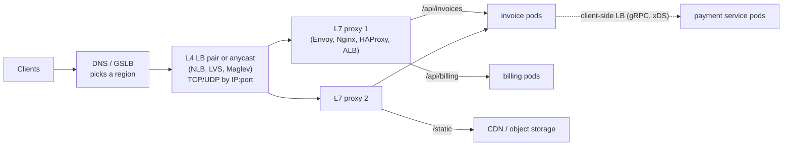
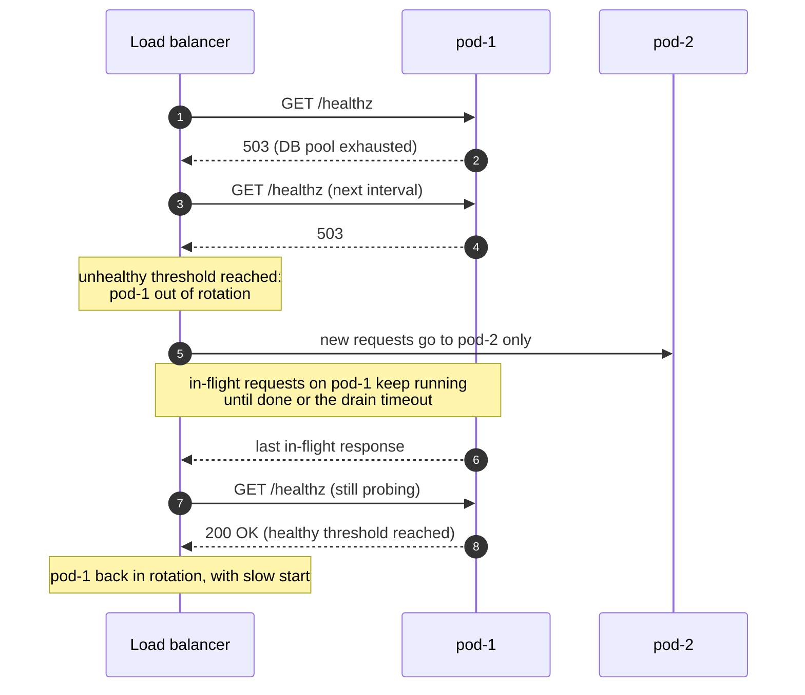

# Load Balancing

> [!summary] TL;DR
> A load balancer (LB) sits in front of several identical servers (**backends**), gives clients one address, and spreads requests across the backends that are healthy. It is what makes horizontal scaling and surviving a dead server possible; the interesting choices are at which network layer it works, which algorithm picks the backend, and how it detects and drains unhealthy ones.

> [!abstract] Core idea
> - An L4 balancer routes TCP/UDP connections by IP and port; an L7 balancer understands HTTP and routes each request by path, header or cookie.
> - The algorithm decides who gets the next request: round robin for equal backends, least outstanding requests or "power of two choices" for uneven work, consistent hashing when the same key should hit the same backend.
> - Health checks remove dead backends; connection draining lets a backend finish in-flight work before it leaves.
> - The balancer itself must be redundant (a pair, anycast, or a managed service).
> - Trap: an L4 balancer cannot spread gRPC or HTTP/2 traffic well, because many requests share one long-lived connection.

## 1. Why it exists

The invoice API runs on three pods, each good for about 800 requests per second (RPS). Clients hard-code pod 1's IP address.

- Pod 1 gets all 2,000 RPS and falls over while pods 2 and 3 idle.
- When pod 1 is redeployed, every client fails for 30 seconds.
- Adding pod 4 helps nobody, because no client knows it exists.

A load balancer gives clients one stable address, spreads the 2,000 RPS as about 667 per pod, stops sending to a pod that fails its health check, and lets you add pod 4 by registering it.

## 2. Mental model

A host at a busy restaurant. Guests do not pick a table; the host does. A good host:

- seats parties at the waiter with the fewest tables (**least connections**), not just the next one in rotation (**round robin**);
- stops seating at a section whose waiter went home (**health checks**);
- lets a waiter whose shift is ending finish the tables they already have, but gives them no new ones (**connection draining**);
- seats regulars with the waiter who knows their order (**sticky sessions**), which works until that waiter is off sick.

## 3. How it works

### Where load balancers sit



Large sites stack layers: DNS picks a region, a fast L4 tier spreads TCP connections over a fleet of L7 proxies, and the L7 proxies route each HTTP request to the right service. Service-to-service calls often skip the central LB and balance in the client.

### L4 vs L7

| | L4 (transport layer) | L7 (application layer) |
| --- | --- | --- |
| Sees | Source and destination IP and port, TCP/UDP | Full HTTP: method, path, headers, cookies, body |
| Decides per | Connection (or packet flow) | Request |
| Can do | Very high throughput, low latency, any TCP/UDP protocol, preserve client IP | Path and host routing, header rewrites, retries, auth hooks, rate limits, canary splits |
| TLS | Usually pass-through (backend terminates) | Usually terminates TLS, then re-encrypts or not |
| Products | AWS NLB, LVS/IPVS, Google Maglev, HAProxy in TCP mode | AWS ALB, Envoy, Nginx, HAProxy in HTTP mode, Traefik |
| Weak at | HTTP/2 and gRPC: all requests on one connection go to one backend | Cost per request; it must parse every request |

The owning note for the proxy layers themselves is [[Forward and Reverse Proxies - L4 vs L7]]; the AWS product choice is in [[AWS 06 - Load Balancing (ALB vs NLB)]].

### Algorithms

| Algorithm | How it picks | Use when | Weakness |
| --- | --- | --- | --- |
| Round robin | Next backend in order | Equal backends, similar request cost | Ignores slow or busy backends |
| Weighted round robin | Order biased by weight (Nginx's smooth variant interleaves) | Mixed instance sizes, canary at 5% | Static weights do not react to load |
| Random | Uniform random pick | Simple, stateless balancers | Uneven by chance: busiest gets about 1.3× average in our test |
| Least connections | Fewest open connections | Long or varied connections | Needs global state; connection count is a weak proxy for HTTP/2 |
| Least outstanding requests | Fewest in-flight requests | Variable request cost (default to consider for L7) | Needs per-request accounting |
| Power of two choices (P2C) | Pick 2 at random, send to the less loaded | Many balancers each with a local view (Envoy `LEAST_REQUEST`) | Slightly more work than random |
| Latency-aware / EWMA | Prefer backends with the lowest recent latency (exponentially weighted average) | Heterogeneous or noisy backends | Can herd onto a backend that is fast because it is failing fast |
| IP hash / consistent hash (ring hash, Maglev) | Hash a key (client IP, user ID, URL) to a backend | Cache affinity, sticky routing without cookies | Hot keys; see [[Consistent Hashing]] |

### Health checks, draining and slow start

- **Active checks:** the LB calls `GET /healthz` every few seconds; after N failures it marks the backend down, after M successes it marks it up.
- **Passive checks (outlier detection):** the LB watches real traffic and ejects a backend that returns, for example, 5 consecutive 5xx responses (Envoy's documented default for `consecutive_5xx`), then retries it later.
- **Readiness vs liveness** (Kubernetes): readiness says "send me traffic" and removes the pod from the endpoints when it fails; liveness says "I am not stuck" and restarts the container when it fails. A liveness probe that checks the database will restart every pod during a database blip; keep liveness shallow. See [[Graceful Shutdown and Health Checks]].
- **Connection draining (deregistration delay):** a backend that is leaving gets no new requests but keeps its in-flight ones until they finish or a timeout passes (AWS ALB target groups default to a 300 s deregistration delay, per the ELB docs).
- **Slow start:** a new backend gets a ramp of traffic instead of its full share at once, so a backend with cold caches and empty connection pools is not flattened by a full share of traffic in its first seconds.



### Sticky sessions vs external state

Sticky sessions (a cookie such as AWS's `AWSALB`, or an IP hash) send a user back to the same backend. They hide in-memory session state but break when that backend dies, unbalance load when a few users are heavy, and fight autoscaling. The cleaner design keeps the app tier stateless and stores sessions in Redis or a signed token ([[Scaling Basics]], [[Sessions and Cookies]]). Stickiness remains useful as an optimisation, for example to keep a user's local cache warm.

## 4. Worked example

### Whiteboard version

```text
DNS -> [L4 pair / anycast] -> [L7 proxy x N] -> service pods
algo:   equal pods -> round robin; uneven cost -> P2C least-request; affinity -> ring hash
health: active /healthz + passive 5xx ejection; readiness != liveness
deploy: deregister -> drain (in-flight finish) -> stop; new pod -> slow start
HA:     the LB itself is a pair (VRRP), anycast, or a managed service
gRPC:   L7 or client-side LB, never plain L4
```

### Two algorithms in Go

Smooth weighted round robin (the Nginx algorithm) and power of two choices over outstanding requests. The random source is injected so the test is deterministic. The code passes `go vet` and `go test -race` on Go 1.24.

```go
package lb

import (
	"math/rand/v2"
	"sync"
)

// Backend is one upstream server as the balancer sees it.
type Backend struct {
	Name     string
	Weight   int // used by weighted round robin
	inflight int // outstanding requests, used by P2C
	current  int // smooth-WRR running score
}

// SmoothWRR is Nginx's smooth weighted round robin: weights 5,1,1 give
// a a b a c a a instead of a burst of five a's in a row.
type SmoothWRR struct {
	mu       sync.Mutex
	backends []*Backend
}

func NewSmoothWRR(bs ...*Backend) *SmoothWRR { return &SmoothWRR{backends: bs} }

func (s *SmoothWRR) Next() *Backend {
	s.mu.Lock()
	defer s.mu.Unlock()
	total := 0
	var best *Backend
	for _, b := range s.backends {
		b.current += b.Weight
		total += b.Weight
		if best == nil || b.current > best.current {
			best = b
		}
	}
	best.current -= total
	return best
}

// P2C picks two backends at random and sends the request to the one with
// fewer outstanding requests ("power of two choices", least-request).
type P2C struct {
	mu       sync.Mutex
	rng      *rand.Rand // injected so tests are deterministic
	backends []*Backend
}

func NewP2C(rng *rand.Rand, bs ...*Backend) *P2C { return &P2C{rng: rng, backends: bs} }

// Acquire chooses a backend and counts the request as outstanding.
// The caller must call Release when the response finishes.
func (p *P2C) Acquire() *Backend {
	p.mu.Lock()
	defer p.mu.Unlock()
	n := len(p.backends)
	if n == 1 { // IntN(0) would panic; with one backend there is no choice
		p.backends[0].inflight++
		return p.backends[0]
	}
	i := p.rng.IntN(n)
	j := p.rng.IntN(n - 1)
	if j >= i {
		j++ // second pick is always a different backend
	}
	b := p.backends[i]
	if p.backends[j].inflight < b.inflight {
		b = p.backends[j]
	}
	b.inflight++
	return b
}

func (p *P2C) Release(b *Backend) {
	p.mu.Lock()
	b.inflight--
	p.mu.Unlock()
}
```

```go
package lb

import (
	"math/rand/v2"
	"strconv"
	"strings"
	"sync"
	"testing"
)

func TestSmoothWRRInterleaves(t *testing.T) {
	s := NewSmoothWRR(&Backend{Name: "a", Weight: 5}, &Backend{Name: "b", Weight: 1}, &Backend{Name: "c", Weight: 1})
	var got []string
	for range 7 {
		got = append(got, s.Next().Name)
	}
	if seq := strings.Join(got, " "); seq != "a a b a c a a" {
		t.Fatalf("sequence = %q, want %q", seq, "a a b a c a a")
	}
}

func backends(n int) []*Backend {
	bs := make([]*Backend, n)
	for i := range bs {
		bs[i] = &Backend{Name: "b" + strconv.Itoa(i)}
	}
	return bs
}

// maxLoad places m requests that never finish on n backends and returns
// the largest per-backend count. choices=1 is plain random, 2 is P2C.
func maxLoad(n, m, choices int, seed uint64) int {
	bs := backends(n)
	rng := rand.New(rand.NewPCG(seed, seed))
	if choices == 2 {
		p := NewP2C(rng, bs...)
		for range m {
			p.Acquire()
		}
	} else {
		for range m {
			bs[rng.IntN(n)].inflight++
		}
	}
	best := 0
	for _, b := range bs {
		best = max(best, b.inflight)
	}
	return best
}

func TestP2CBeatsRandom(t *testing.T) {
	const n, m = 100, 10_000 // average 100 per backend
	random, p2c := maxLoad(n, m, 1, 42), maxLoad(n, m, 2, 42)
	t.Logf("max outstanding per backend: random=%d p2c=%d (average 100)", random, p2c)
	if p2c >= random {
		t.Fatalf("p2c max %d should be below random max %d", p2c, random)
	}
	if p2c > 105 {
		t.Fatalf("p2c max %d, want within a few of the average 100", p2c)
	}
}

func TestP2CConcurrentAcquireRelease(t *testing.T) {
	p := NewP2C(rand.New(rand.NewPCG(1, 2)), backends(4)...)
	var wg sync.WaitGroup
	for range 64 {
		wg.Add(1)
		go func() {
			defer wg.Done()
			for range 100 {
				p.Release(p.Acquire())
			}
		}()
	}
	wg.Wait()
	for _, b := range p.backends {
		if b.inflight != 0 {
			t.Fatalf("%s inflight = %d after all releases", b.Name, b.inflight)
		}
	}
}
```

**Measured** (`go test -v`, Go 1.24, 2026-11-04): 10,000 requests that never complete, spread over 100 backends (average 100 each), PCG seed 42.

| Algorithm | Busiest backend | vs average |
| --- | --- | --- |
| Random | 133 | 1.33× |
| Power of two choices | 102 | 1.02× |

One extra random sample nearly removes the imbalance. Mitzenmacher's analysis explains why: with `n` balls in `n` bins the maximum load drops from about `log n / log log n` (one choice) to about `log log n / log 2` (two choices).

### Tracing one deploy

1. The deploy tool marks `pod-1` for removal; Kubernetes sets it not-ready and the LB deregisters it.
2. The LB stops sending new requests to `pod-1`; its 40 in-flight requests continue.
3. `pod-1` receives `SIGTERM`, stops accepting new connections, and Go's `http.Server.Shutdown` waits for the 40 requests to finish.
4. The new `pod-1b` passes readiness and gets a slow-start ramp.

Without step 2 (or with a shutdown that exits immediately), those 40 requests become 502 errors on every deploy.

## 5. Variants and comparison

| Where balancing happens | How | Use when | Cost |
| --- | --- | --- | --- |
| DNS (round-robin records, GSLB) | Different IPs per lookup; latency or geo policies (Route 53) | Region and data-centre selection | Client and resolver caching ignore TTLs; slow failover |
| Anycast | Same IP announced from many sites; BGP picks the nearest | Global edge, DNS, CDNs, L4 front doors | Needs your own network/BGP; a route change can move flows |
| L4 load balancer | Connection-level forwarding (NLB, IPVS, Maglev) | Raw throughput, non-HTTP protocols, static IPs | No request-level routing |
| L7 proxy | Request-level routing (ALB, Envoy, Nginx, HAProxy) | HTTP APIs, path routing, canaries | More CPU per request; TLS termination point |
| Client-side (look-aside) | Client gets the backend list from [[Service Discovery]] or xDS and picks | gRPC and service-to-service calls | Logic in every client; needs a discovery system |
| Sidecar / service mesh | An Envoy next to each pod does the client-side work | Many services, many languages | Extra hop and operational weight |

## 6. Trade-offs and when not to use

- **Another hop.** Each LB adds latency (sub-millisecond inside a data centre) and is one more thing that can fail or be misconfigured.
- **Sticky sessions trade balance for convenience.** Prefer stateless backends.
- **Least-connections with L4 and HTTP/2 is misleading.** One connection can carry thousands of requests; count requests, not connections.
- **Retries at the LB can amplify an outage.** Retrying every 5xx on another backend doubles load exactly when the system is struggling; use retry budgets ([[Timeouts, Retries and Backoff]]).
- **For two servers in one office, DNS round robin or a single Nginx is enough.** A multi-tier LB stack only pays off with many backends or many services.

## 7. In production

- **Real systems:** AWS ALB (L7), NLB (L4, preserves client IP, static IPs) and GWLB (for inline security appliances, using GENEVE); Google Maglev (software L4 with consistent hashing); Envoy (L7 with `ROUND_ROBIN`, `LEAST_REQUEST`, `RING_HASH`, `MAGLEV`, `RANDOM` policies); Nginx (`round robin` by default, `least_conn`, `ip_hash`, `hash ... consistent`, `random two least_conn`); HAProxy; Kubernetes Services (kube-proxy with iptables or IPVS, which is L4).
- **Client IP:** an L7 proxy adds `X-Forwarded-For` (and `X-Forwarded-Proto`); an L4 balancer that does not preserve the source IP can send the PROXY protocol header (v1 text, v2 binary) so the backend still learns it. Trust these headers only from your own proxies.
- **TLS:** terminate at the L7 proxy to route by path and inspect headers; pass through at L4 when the backend must hold the key or for end-to-end mTLS; re-encrypt to the backend when the network is untrusted.
- **LB high availability:** an active/passive pair sharing a virtual IP with VRRP (keepalived), an anycast fleet, or a managed LB that is already multi-zone. A single LB box is a single point of failure.
- **Failure modes → fixes:**
	- gRPC traffic all on one pod behind an L4 LB → use an L7 proxy that balances per request, or gRPC client-side `round_robin` with DNS or xDS; set `MaxConnectionAge` on the server so clients reconnect and rebalance.
	- WebSocket connections never rebalance after scale-out → see [[Scaling WebSockets]].
	- Health check passes while the service is broken (checks only "process is up") → readiness checks that cover critical dependencies, plus passive outlier detection.
	- Deploys produce 502s → drain before stop; make the app's shutdown wait for in-flight requests.
	- Thundering herd onto a recovered backend → slow start.
- **What to monitor:** RPS, 4xx and 5xx per backend, latency per backend (p99), healthy host count, active and new connections, surge queue length and spillover (classic ELB) or rejected connections, and the max/average request ratio across backends.

## 8. Deep dive

- **Why P2C works with stale information.** Many independent balancers each with a slightly stale view of backend load all herd onto the "least loaded" backend if they pick the global minimum. Sampling two at random keeps the choice spread out while still avoiding the worst backends, which is why Envoy uses it for `LEAST_REQUEST`.
- **EWMA and the fast-failure trap.** A latency-aware balancer prefers the fastest backend; a backend that returns errors in 1 ms looks fastest of all. Combine latency scoring with error-rate ejection.
- **Consistent hashing in LBs.** Ring hash and Maglev keep a key on the same backend when the backend set changes, which keeps caches warm. Maglev builds a lookup table so each lookup is `O(1)`, at the cost of moving slightly more keys on change; details in [[Consistent Hashing]]. Bounded-load variants cap any backend at `(1 + ε) ×` average to tame hot keys.
- **Connection reuse hides imbalance.** Keep-alive and HTTP/2 mean a client may send all its traffic through one connection chosen minutes ago. Balancing per request at L7, capping connection age, or client-side balancing restores spread.
- **Global vs regional.** Global balancing chooses a region (DNS latency or geo routing, anycast) and must handle region failover and data residency; regional balancing spreads load across zones and instances. Cross-zone balancing evens load but can add inter-zone data transfer cost on some clouds.
- **The LB as a protection layer.** L7 proxies are a natural place for rate limits, request size limits and load shedding; see [[Rate Limiting - Algorithms and Distributed Design]] and [[Load Shedding and Graceful Degradation]].

## 9. Interview questions

> [!question]- What is the difference between an L4 and an L7 load balancer?
> L4 routes connections using IP and port, without reading the payload: fast, protocol-agnostic, preserves client IP. L7 parses HTTP and routes each request by path, host or header, terminates TLS, and can retry or rewrite. Use L4 for raw throughput and non-HTTP traffic, L7 for HTTP APIs.

> [!question]- Trap: you put gRPC services behind an L4 load balancer and one pod is at 100% while others idle. Why?
> gRPC multiplexes all requests over one long-lived HTTP/2 connection, and an L4 balancer balances connections, not requests. Use an L7 proxy (Envoy) or client-side balancing (gRPC `round_robin` with DNS or xDS), and cap connection age so clients rebalance.

> [!question]- Round robin or least outstanding requests?
> Round robin when backends are equal and requests cost about the same. Least outstanding requests (often via power of two choices) when request cost varies or backends differ, because it reacts to which backend is actually busy.

> [!question]- What is power of two choices and why is it good?
> Pick two backends at random and send to the less loaded one. It nearly removes the imbalance of pure random (in our test, the busiest backend went from 1.33× to 1.02× the average) without global state, and avoids the herding that "always pick the least loaded" causes with stale data.

> [!question]- How do you deploy without dropping requests?
> Deregister the instance and drain: the LB sends no new requests but lets in-flight ones finish within a timeout; the app handles SIGTERM by stopping intake and waiting for in-flight work. New instances pass readiness and get slow start.

> [!question]- Sticky sessions or a shared session store?
> A shared store (Redis) or signed tokens keep the app stateless, so any instance can fail or scale. Sticky sessions lose sessions when the instance dies and unbalance load; use them only as a cache-warmth optimisation.

> [!question]- How do you make the load balancer itself highly available?
> Run a pair with a floating virtual IP (VRRP via keepalived), an anycast fleet, or a managed multi-zone LB, and put several LB IPs behind DNS. Never a single LB instance.

## 10. Cheat sheet

- L4 = connections by IP:port (NLB, IPVS, Maglev). L7 = HTTP requests by path/header (ALB, Envoy, Nginx).
- Equal backends → round robin; uneven work → least outstanding / P2C; affinity → ring hash or Maglev.
- P2C measured: busiest backend 1.33× → 1.02× of average.
- Active health checks + passive outlier ejection; readiness ≠ liveness.
- Drain before stop (ALB default 300 s); slow start for new backends.
- gRPC / HTTP/2 → L7 or client-side LB, never plain L4.
- Client IP via `X-Forwarded-For` (L7) or PROXY protocol (L4).
- LB HA: VRRP pair, anycast, or managed; DNS/GSLB for regions.

## Links

- **Before this:** [[Scaling Basics]], [[Forward and Reverse Proxies - L4 vs L7]]
- **Next:** [[Service Discovery]], [[Scaling WebSockets]], [[Rate Limiting - Algorithms and Distributed Design]]
- **Compare with:** [[Consistent Hashing]] (hash-based routing in depth), [[Nginx]] (configuring upstreams), [[AWS 06 - Load Balancing (ALB vs NLB)]] (the managed products), [[API Gateway and BFF]] (an L7 proxy with API concerns on top)
