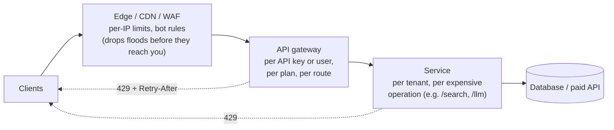
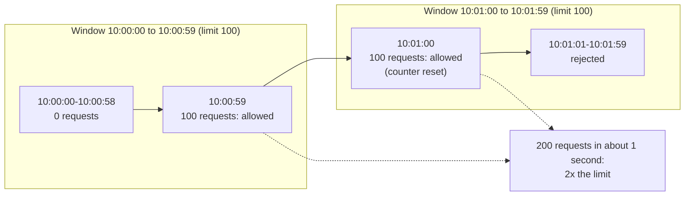
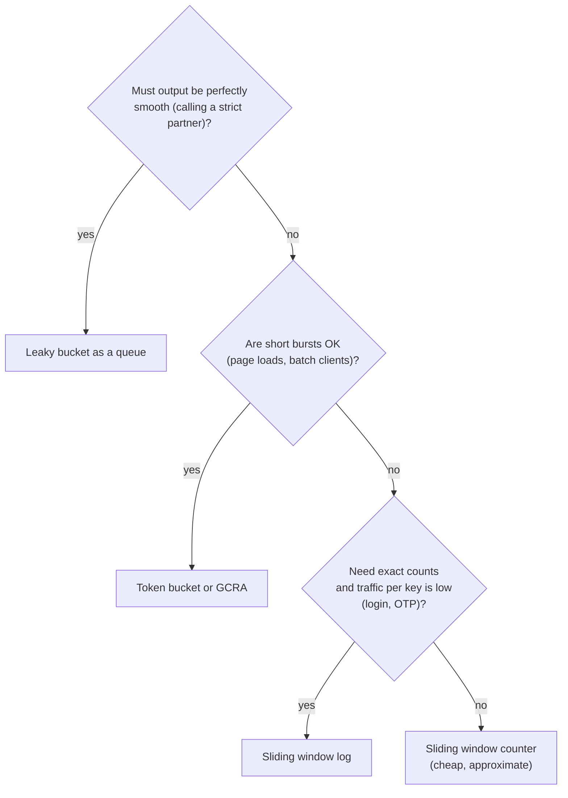
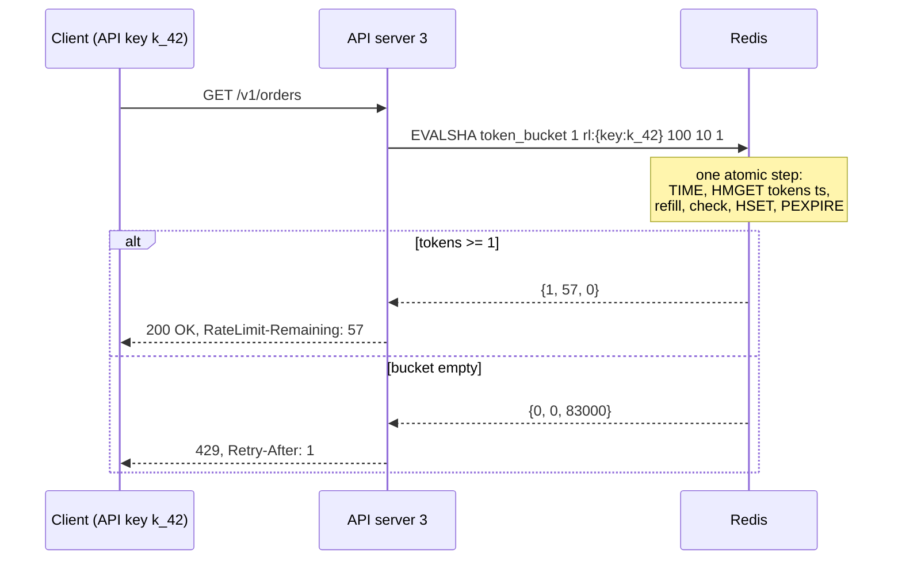
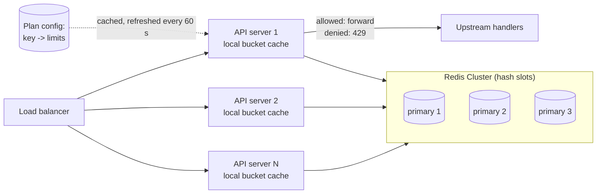

# Rate Limiting - Algorithms and Distributed Design

> [!summary] TL;DR
> A **rate limiter** counts how many requests a client (an IP, user, API key or tenant) has made recently and rejects the extra ones with HTTP **429 Too Many Requests**. The counting rule is the **algorithm** (fixed window, sliding window, token bucket, leaky bucket, GCRA); when you have many servers, the counts live in a shared store such as Redis and must be updated **atomically**.

> [!abstract] Core idea
> - Pick a **key** (who is limited), a **limit** (how many per how long) and an **algorithm** (how bursts are treated).
> - Token bucket is the usual default: it allows a short burst up to the bucket size, then a steady rate.
> - With many API servers, the state goes in Redis and the read-check-update runs as **one Lua script**, or two servers will both let the "last" request through.
> - Decide up front what happens when Redis is down: **fail open** (allow, maybe with a local limiter) or **fail closed** (reject).
> - Tell clients what happened: `429`, `Retry-After`, and the remaining quota.

## 1. Why it exists

Your public API runs on 10 servers, and each can handle about 500 requests per second before latency climbs (an estimate for a typical JSON API doing one database query). That is 5,000 requests per second in total.

One customer ships a bug: a retry loop with no delay. Their client alone sends 4,000 requests per second. Now every other customer shares the remaining 1,000 requests per second of capacity, their requests queue, time out and retry, and the whole API goes down because of one caller. A per-API-key limit of, say, 100 requests per second would have rejected 3,900 of those requests per second at almost no cost, and everyone else would not have noticed.

Rate limits protect against more than bugs:

- **Abuse:** password guessing on `/login`, scraping, card testing on a payment form (see [[API Abuse and Bot Protection]]).
- **Cost:** an endpoint that calls a paid service (an LLM, an SMS gateway) costs money per call.
- **Fairness:** on a multi-tenant platform, one tenant must not starve the others.
- **Business plans:** "Free: 60 requests per minute, Pro: 1,000" is a product feature.

## 2. Mental model

Think of a **token bucket** as a turnstile that only opens when you drop a token in.

- Each client has a bucket that holds at most `capacity` tokens (for example 10).
- Tokens drip in at a steady rate (for example 1 per second) until the bucket is full.
- Each request takes one token. No token, no entry: the request gets a 429.

A client that has been quiet for a while has a full bucket, so it can make 10 quick requests (a **burst**). After that it can only go as fast as tokens drip in: 1 per second. Every other algorithm in this note is a different rule for when the turnstile opens.

## 3. How it works

### Where to limit, and by what key

Limits usually stack in layers, cheapest first:



- **Edge** limits stop volumetric floods by IP before they cost you anything.
- **Gateway** limits know who the caller is (API key, user ID, plan) and are the usual place for public quotas (see [[API Gateway and BFF]]).
- **Service** limits protect a specific expensive operation, for example 5 password attempts per account per 15 minutes on `/login`.

Choosing the key:

| Key | Good for | Watch out for |
| --- | --- | --- |
| IP address | Anonymous traffic, login pages | Behind a load balancer, the socket's IP is the proxy's IP, so everyone shares one bucket. Read the client IP from `X-Forwarded-For` **only** when it is set by your own trusted proxy, otherwise clients can forge it. Many users share one IP behind corporate NAT or a mobile carrier. |
| User ID | Logged-in actions | Not available before authentication. |
| API key | Public APIs, paid plans | One customer may use many keys; add a tenant-level limit as well. |
| Tenant / org | Multi-tenant fairness | Needs a second, finer key so one user cannot use the whole tenant's quota. |
| Key + route | Expensive endpoints | More keys in the store. |

### The algorithms

**1. Fixed window counter.** Keep one counter per key per window, for example `rl:user:42:2026-11-04T10:30`. Increment it on each request, reject when it is above the limit, and let it expire after the window.

The classic Redis version is **not atomic**:

```text
INCR  rl:user:42:202611041030
EXPIRE rl:user:42:202611041030 60
```

If the process crashes between the two calls, or the `EXPIRE` is only sent when `INCR` returned 1 and that one call fails, the key has no TTL and lives forever. Once it passes the limit, the user is blocked for good. Atomic versions:

```text
# Option A (Redis 7.0+): both commands in one MULTI/EXEC; NX only sets a TTL if none exists
MULTI
INCR   rl:user:42:202611041030
EXPIRE rl:user:42:202611041030 60 NX
EXEC

# Option B (any version): create the key with its TTL first, then increment
SET  rl:user:42:202611041030 0 EX 60 NX
INCR rl:user:42:202611041030
```

The weakness of a fixed window is the **boundary burst**: a client can send the full limit at the end of one window and the full limit again at the start of the next.



**2. Sliding window log.** Store the timestamp of every request in a sorted set (ZSET) and count the ones inside the last window.

```text
ZREMRANGEBYSCORE rl:{user:42} -inf <now_ms - 60000>   # drop old entries
ZCARD            rl:{user:42}                          # how many in the last 60 s?
ZADD             rl:{user:42} <now_ms> <request_id>    # only if under the limit
PEXPIRE          rl:{user:42} 60000
```

It is exact, with no boundary burst, but memory is **O(requests in the window)** per key, and the four commands must run in one Lua script to be correct under concurrency.

**3. Sliding window counter.** Keep only the counters for the current and the previous fixed window, and estimate the count over the last full window by weighting the previous one by how much of it still overlaps:

`estimate = prev × (1 − elapsed / window) + curr`

Example: limit 100 per minute. The previous minute had 80 requests, the current one has 30, and we are 15 seconds into it (elapsed / window = 0.25). Estimate = 80 × 0.75 + 30 = **90**, so 10 more requests fit. It assumes the previous window's requests were spread evenly, which is why it is an approximation, but it costs two integers per key.

**4. Token bucket.** Keep `tokens` and `last_refill_time`. On each request, first add `elapsed × rate` tokens (capped at `capacity`), then take one if available. This is **lazy refill**: nothing runs in the background; the bucket is topped up only when it is read. Capacity sets the burst size and rate sets the long-run average.

**5. Leaky bucket.** Two different things share this name:
- **As a queue:** requests enter a FIFO queue of fixed size and a worker takes them out at a constant rate; when the queue is full, new requests are dropped. Output is perfectly smooth, but requests wait. This is **traffic shaping** (for example, sending to a partner API that allows exactly 10 calls per second).
- **As a meter:** a counter that drains at a constant rate and rejects when it would overflow. This behaves like a token bucket viewed upside down.

**6. GCRA (generic cell rate algorithm).** Store a single timestamp per key: the **theoretical arrival time** (TAT) of the next request. With emission interval `T = period / rate` and burst tolerance `τ = T × (burst − 1)`, a request at time `now` is allowed if `now ≥ TAT − τ`; then `TAT = max(TAT, now) + T`. It gives the same behaviour as a token bucket while storing one number instead of two. redis-cell (`CL.THROTTLE`) and the Go library throttled implement it.

### Choosing an algorithm



## 4. Worked example

### Whiteboard version

The whole token bucket in 15 lines:

```go
package wb

import "time"

// Bucket is the bare token bucket: refill lazily, then spend one token.
type Bucket struct {
	cap, perSec, tokens float64
	last                time.Time
}

func (b *Bucket) Allow(now time.Time) bool {
	b.tokens = min(b.cap, b.tokens+now.Sub(b.last).Seconds()*b.perSec)
	b.last = now
	if b.tokens < 1 {
		return false // caller answers 429
	}
	b.tokens--
	return true
}
```

Trace with capacity 10 and 1 token per second: at `t = 0` the bucket is full, so 10 requests pass and the 11th fails. At `t = 2.5 s`, 2.5 tokens have come back, so 2 more pass and the third fails (0.5 tokens left).

### Single-process limiters in Go

All three take an injected clock, so tests can move time without sleeping. Each is safe for concurrent use.

Token bucket, which also reports how long to wait (for `Retry-After`):

```go
// Package ratelimit holds single-process limiters with an injected clock.
package ratelimit

import (
	"sync"
	"time"
)

// TokenBucket allows bursts up to capacity and a long-run rate of refill tokens/second.
// Refill is lazy: tokens are topped up only when Allow is called.
type TokenBucket struct {
	mu       sync.Mutex
	capacity float64
	refill   float64 // tokens per second
	tokens   float64
	last     time.Time
	now      func() time.Time
}

func NewTokenBucket(capacity, refillPerSec float64, now func() time.Time) *TokenBucket {
	return &TokenBucket{capacity: capacity, refill: refillPerSec, tokens: capacity, last: now(), now: now}
}

// Allow spends cost tokens if available. When it refuses, retryAfter says when
// enough tokens will exist.
func (b *TokenBucket) Allow(cost float64) (ok bool, retryAfter time.Duration) {
	b.mu.Lock()
	defer b.mu.Unlock()
	now := b.now()
	if elapsed := now.Sub(b.last).Seconds(); elapsed > 0 {
		b.tokens = min(b.capacity, b.tokens+elapsed*b.refill)
		b.last = now
	}
	if b.tokens >= cost {
		b.tokens -= cost
		return true, 0
	}
	missing := cost - b.tokens
	return false, time.Duration(missing / b.refill * float64(time.Second))
}
```

Sliding window counter:

```go
package ratelimit

import (
	"sync"
	"time"
)

// SlidingWindow is the sliding-window counter: two fixed-window counters and a
// weighted estimate  prev*(1 - elapsed/window) + curr.
type SlidingWindow struct {
	mu          sync.Mutex
	limit       int
	window      time.Duration
	windowStart time.Time // start of the current fixed window
	prev, curr  int
	now         func() time.Time
}

func NewSlidingWindow(limit int, window time.Duration, now func() time.Time) *SlidingWindow {
	return &SlidingWindow{limit: limit, window: window, windowStart: now().Truncate(window), now: now}
}

func (s *SlidingWindow) Allow() bool {
	s.mu.Lock()
	defer s.mu.Unlock()
	now := s.now()
	start := now.Truncate(s.window)
	switch n := start.Sub(s.windowStart) / s.window; {
	case n == 1: // moved into the next window
		s.prev, s.curr = s.curr, 0
	case n > 1: // idle for 2+ windows: both counters are stale
		s.prev, s.curr = 0, 0
	}
	s.windowStart = start
	elapsed := float64(now.Sub(start)) / float64(s.window)
	estimate := float64(s.prev)*(1-elapsed) + float64(s.curr)
	if estimate+1 > float64(s.limit) {
		return false
	}
	s.curr++
	return true
}
```

GCRA:

```go
package ratelimit

import (
	"sync"
	"time"
)

// GCRA (generic cell rate algorithm) stores one timestamp per key: the
// theoretical arrival time (TAT) of the next request.
type GCRA struct {
	mu       sync.Mutex
	interval time.Duration // emission interval T = period / rate
	tau      time.Duration // burst tolerance = T * (burst - 1)
	tat      time.Time
	now      func() time.Time
}

func NewGCRA(rate int, period time.Duration, burst int, now func() time.Time) *GCRA {
	t := period / time.Duration(rate)
	return &GCRA{interval: t, tau: t * time.Duration(burst-1), now: now}
}

func (g *GCRA) Allow() (bool, time.Duration) {
	g.mu.Lock()
	defer g.mu.Unlock()
	now := g.now()
	tat := g.tat
	if tat.Before(now) {
		tat = now
	}
	allowAt := tat.Add(-g.tau)
	if now.Before(allowAt) {
		return false, allowAt.Sub(now)
	}
	g.tat = tat.Add(g.interval)
	return true, 0
}
```

Tests. `TestFixedWindowBoundaryBurstIsBlockedBySlidingCounter` replays the boundary-burst timeline from section 3: 100 requests at 10:00:59, then 100 more at 10:01:00. A fixed window would allow all 200; the sliding counter estimates `100 × (1 − 0) + 0 = 100` and rejects all of the second batch.

```go
package ratelimit

import (
	"sync"
	"testing"
	"time"
)

type clock struct {
	mu sync.Mutex
	t  time.Time
}

func (c *clock) now() time.Time      { c.mu.Lock(); defer c.mu.Unlock(); return c.t }
func (c *clock) add(d time.Duration) { c.mu.Lock(); c.t = c.t.Add(d); c.mu.Unlock() }
func newClock() *clock               { return &clock{t: time.Date(2026, 11, 4, 10, 0, 0, 0, time.UTC)} }

func TestTokenBucketBurstThenRefill(t *testing.T) {
	c := newClock()
	b := NewTokenBucket(10, 1, c.now) // burst 10, 1 token/s
	for i := 0; i < 10; i++ {
		if ok, _ := b.Allow(1); !ok {
			t.Fatalf("request %d should pass (burst)", i)
		}
	}
	ok, retry := b.Allow(1)
	if ok || retry != time.Second {
		t.Fatalf("11th: ok=%v retry=%v", ok, retry)
	}
	c.add(2500 * time.Millisecond) // 2.5 tokens come back
	passed := 0
	for i := 0; i < 5; i++ {
		if ok, _ := b.Allow(1); ok {
			passed++
		}
	}
	if passed != 2 {
		t.Fatalf("after 2.5 s want 2 passes, got %d", passed)
	}
	c.add(time.Hour) // refill is capped at capacity
	passed = 0
	for i := 0; i < 20; i++ {
		if ok, _ := b.Allow(1); ok {
			passed++
		}
	}
	if passed != 10 {
		t.Fatalf("cap: got %d", passed)
	}
}

func TestTokenBucketConcurrent(t *testing.T) {
	c := newClock()
	b := NewTokenBucket(100, 1, c.now)
	var wg sync.WaitGroup
	var mu sync.Mutex
	passed := 0
	for g := 0; g < 10; g++ {
		wg.Add(1)
		go func() {
			defer wg.Done()
			for i := 0; i < 50; i++ {
				if ok, _ := b.Allow(1); ok {
					mu.Lock()
					passed++
					mu.Unlock()
				}
			}
		}()
	}
	wg.Wait()
	if passed != 100 {
		t.Fatalf("500 concurrent requests, capacity 100: passed %d", passed)
	}
}

func TestSlidingWindowWeightsPreviousWindow(t *testing.T) {
	c := newClock() // 10:00:00, exactly on a window boundary
	s := NewSlidingWindow(100, time.Minute, c.now)
	c.add(30 * time.Second)
	for i := 0; i < 100; i++ {
		if !s.Allow() {
			t.Fatalf("first window request %d refused", i)
		}
	}
	if s.Allow() {
		t.Fatal("101st in the same window must be refused")
	}
	// 10:01:15 -> 25% into the new window: estimate = 100*0.75 + curr, so 25 fit.
	c.add(45 * time.Second)
	passed := 0
	for i := 0; i < 100; i++ {
		if s.Allow() {
			passed++
		}
	}
	if passed != 25 {
		t.Fatalf("want 25, got %d", passed)
	}
	c.add(3 * time.Minute) // idle for several windows: everything resets
	if !s.Allow() {
		t.Fatal("should allow after idle")
	}
}

func TestFixedWindowBoundaryBurstIsBlockedBySlidingCounter(t *testing.T) {
	c := newClock()
	s := NewSlidingWindow(100, time.Minute, c.now)
	c.add(59 * time.Second) // 100 requests at 10:00:59
	for i := 0; i < 100; i++ {
		s.Allow()
	}
	c.add(time.Second) // 10:01:00 -> a fixed window would allow 100 more now
	passed := 0
	for i := 0; i < 100; i++ {
		if s.Allow() {
			passed++
		}
	}
	if passed != 0 {
		t.Fatalf("sliding counter should refuse the boundary burst, passed %d", passed)
	}
}

func TestGCRA(t *testing.T) {
	c := newClock()
	g := NewGCRA(10, time.Second, 3, c.now) // 10/s, burst 3 -> T = 100 ms, tau = 200 ms
	for i := 0; i < 3; i++ {
		if ok, _ := g.Allow(); !ok {
			t.Fatalf("burst request %d refused", i)
		}
	}
	ok, retry := g.Allow()
	if ok || retry != 100*time.Millisecond {
		t.Fatalf("4th: ok=%v retry=%v", ok, retry)
	}
	c.add(100 * time.Millisecond)
	if ok, _ := g.Allow(); !ok {
		t.Fatal("one slot should open every 100 ms")
	}
	if ok, _ := g.Allow(); ok {
		t.Fatal("only one slot opened")
	}
}
```

For one process you rarely need to write your own: `golang.org/x/time/rate` is a token bucket, where `Limit` is the refill rate and `burst` is the capacity.

```go
package ratelimit

import (
	"fmt"
	"time"

	"golang.org/x/time/rate"
)

// x/time/rate is a token bucket: Limit is the refill rate, burst is the capacity.
func Example_xTimeRate() {
	lim := rate.NewLimiter(rate.Every(100*time.Millisecond), 3) // 10/s, burst 3
	start := time.Date(2026, 11, 4, 10, 0, 0, 0, time.UTC)
	for i := 0; i < 4; i++ {
		fmt.Print(lim.AllowN(start, 1), " ")
	}
	fmt.Println(lim.AllowN(start.Add(100*time.Millisecond), 1))
	// Output: true true true false true
}
```

### Distributed token bucket: Redis + Lua

With 10 API servers, each server's in-memory bucket only sees a tenth of the traffic. The state must be shared, and the read-refill-check-write must be **one atomic step**. Otherwise two servers both read `tokens = 1`, both allow, and both write `0`, so two requests went through on one token.

Redis runs a Lua script atomically: no other command runs in the middle of it. The script also reads the time with Redis `TIME`, so every API server uses **Redis's clock**, not its own (API servers' clocks drift apart). Since Redis 5.0 scripts are replicated by their effects (the writes they make) by default, and Redis 7.0 removed the old verbatim mode, so calling `TIME` before writing is safe.



The Go side, with go-redis v9. `redis.NewScript` sends `EVALSHA` and falls back to `EVAL` the first time the script is not cached on the server.

```go
package ratelimit

import (
	"context"
	"fmt"
	"time"

	"github.com/redis/go-redis/v9"
)

// tokenBucketLua runs atomically inside Redis. It reads the clock with TIME so
// every API server uses the same clock. Redis 7 always replicates a script's
// effects (its writes), so calling TIME before writing is allowed.
const tokenBucketLua = `
local capacity = tonumber(ARGV[1])
local rate     = tonumber(ARGV[2])   -- tokens per second
local cost     = tonumber(ARGV[3])
local t   = redis.call('TIME')
local now = tonumber(t[1]) * 1000000 + tonumber(t[2])   -- microseconds
local s      = redis.call('HMGET', KEYS[1], 'tokens', 'ts')
local tokens = tonumber(s[1]) or capacity
local ts     = tonumber(s[2]) or now
tokens = math.min(capacity, tokens + math.max(0, now - ts) * rate / 1000000)
local allowed, retry_us = 0, 0
if tokens >= cost then
  tokens = tokens - cost
  allowed = 1
else
  retry_us = math.ceil((cost - tokens) * 1000000 / rate)
end
redis.call('HSET', KEYS[1], 'tokens', tokens, 'ts', now)
redis.call('PEXPIRE', KEYS[1], math.ceil(capacity / rate * 1000) + 1000)
return {allowed, math.floor(tokens), retry_us}
`

var tokenBucketScript = redis.NewScript(tokenBucketLua)

// Decision is what the HTTP layer needs to answer 200 or 429.
type Decision struct {
	Allowed    bool
	Remaining  int64
	RetryAfter time.Duration
}

// RedisTokenBucket is a distributed limiter shared by every API server.
type RedisTokenBucket struct {
	rdb      redis.Scripter
	capacity int
	perSec   float64
}

func NewRedisTokenBucket(rdb redis.Scripter, capacity int, perSec float64) *RedisTokenBucket {
	return &RedisTokenBucket{rdb: rdb, capacity: capacity, perSec: perSec}
}

// Key wraps the id in a hash tag so that, in Redis Cluster, every key for this
// client hashes to the same slot.
func Key(scope, id string) string { return fmt.Sprintf("rl:{%s:%s}", scope, id) }

func (r *RedisTokenBucket) Allow(ctx context.Context, key string) (Decision, error) {
	res, err := tokenBucketScript.Run(ctx, r.rdb, []string{key}, r.capacity, r.perSec, 1).Int64Slice()
	if err != nil {
		return Decision{}, err
	}
	return Decision{
		Allowed:    res[0] == 1,
		Remaining:  res[1],
		RetryAfter: time.Duration(res[2]) * time.Microsecond,
	}, nil
}
```

Notes on the script:

- `now` is in microseconds: about 1.7 × 10^15 today, well below 2^53, so Lua's double-precision numbers hold it exactly.
- The TTL is the time to refill a full bucket plus 1 second. An idle key disappears, and a missing key is treated as a full bucket, which is exactly what it would be after that much idle time.
- Lua returns floats to Redis as truncated integers, so the script floors `tokens` itself.
- This code compiles and passes `go vet`; the Redis path was not run here because no Redis server is available in this environment. Its logic is the same as the tested in-memory `TokenBucket`.

### HTTP middleware with headers and a fail-open fallback

```go
package ratelimit

import (
	"context"
	"math"
	"net/http"
	"strconv"
	"time"
)

// Limiter is satisfied by RedisTokenBucket (and by fakes in tests).
type Limiter interface {
	Allow(ctx context.Context, key string) (Decision, error)
}

// Middleware asks the global limiter first. If the store fails or is slow, it
// falls back to a per-instance bucket (fail-open, but still bounded).
func Middleware(global Limiter, fallback *TokenBucket, limit int, keyOf func(*http.Request) string, next http.Handler) http.Handler {
	return http.HandlerFunc(func(w http.ResponseWriter, r *http.Request) {
		ctx, cancel := context.WithTimeout(r.Context(), 20*time.Millisecond)
		defer cancel()
		d, err := global.Allow(ctx, keyOf(r))
		if err != nil {
			ok, retry := fallback.Allow(1)
			d = Decision{Allowed: ok, RetryAfter: retry, Remaining: -1}
			w.Header().Set("X-RateLimit-Degraded", "local")
		}
		w.Header().Set("RateLimit-Limit", strconv.Itoa(limit))
		if d.Remaining >= 0 {
			w.Header().Set("RateLimit-Remaining", strconv.FormatInt(d.Remaining, 10))
		}
		if !d.Allowed {
			secs := int(math.Ceil(d.RetryAfter.Seconds()))
			w.Header().Set("Retry-After", strconv.Itoa(max(secs, 1)))
			http.Error(w, "rate limit exceeded", http.StatusTooManyRequests)
			return
		}
		next.ServeHTTP(w, r)
	})
}
```

```go
package ratelimit

import (
	"context"
	"errors"
	"net/http"
	"net/http/httptest"
	"testing"
	"time"
)

type fakeLimiter struct {
	d   Decision
	err error
}

func (f fakeLimiter) Allow(context.Context, string) (Decision, error) { return f.d, f.err }

func serve(l Limiter, fb *TokenBucket) *httptest.ResponseRecorder {
	ok := http.HandlerFunc(func(w http.ResponseWriter, _ *http.Request) { w.WriteHeader(http.StatusOK) })
	h := Middleware(l, fb, 100, func(r *http.Request) string { return r.Header.Get("X-API-Key") }, ok)
	rec := httptest.NewRecorder()
	h.ServeHTTP(rec, httptest.NewRequest(http.MethodGet, "/v1/orders", nil))
	return rec
}

func TestMiddleware429WithRetryAfter(t *testing.T) {
	c := newClock()
	rec := serve(fakeLimiter{d: Decision{Allowed: false, Remaining: 0, RetryAfter: 1200 * time.Millisecond}},
		NewTokenBucket(5, 1, c.now))
	if rec.Code != http.StatusTooManyRequests || rec.Header().Get("Retry-After") != "2" ||
		rec.Header().Get("RateLimit-Remaining") != "0" {
		t.Fatalf("code=%d headers=%v", rec.Code, rec.Header())
	}
}

func TestMiddlewareFallsBackWhenRedisFails(t *testing.T) {
	c := newClock()
	fb := NewTokenBucket(2, 1, c.now)
	down := fakeLimiter{err: errors.New("dial tcp: connection refused")}
	codes := []int{serve(down, fb).Code, serve(down, fb).Code, serve(down, fb).Code}
	if codes[0] != 200 || codes[1] != 200 || codes[2] != 429 {
		t.Fatalf("fallback codes = %v", codes)
	}
}
```

`go vet` is clean and `go test -race` passes all eight tests and the example in the package (Go 1.24.4).

### Case: design a rate limiter for a public API

**Requirements.** Limit each API key to its plan's rate (Free: 10 requests per second, burst 20; Pro: 100 per second, burst 200). Limits hold across all servers and all regions to within a few percent. The check adds under 2 ms at p99. If the limiter fails, the API keeps serving. Clients learn their quota from headers.

**Estimates (all estimates, with units):**

- Peak traffic: 200,000 requests per second across 200 API servers, so 1,000 requests per second per server.
- Active keys: 5,000,000 API keys, of which 500,000 are active in any minute.
- State per key (token bucket as a Redis hash with two fields): about 100 bytes including key name and overhead. 500,000 × 100 B = **50 MB**. Even all 5,000,000 keys would be 500 MB. Memory is not the problem.
- The same with a sliding log at a Pro limit of 6,000 requests per minute: up to 6,000 entries × about 50 B = 300 KB per busy key. 10,000 busy keys would need **3 GB**. This is why the log is kept for low-rate keys such as logins.
- Redis load: one script call per request = 200,000 calls per second. One Redis process handles on the order of 100,000 simple commands per second (an estimate; measure with `redis-benchmark` on your hardware), and a Lua script call costs several times a simple command, so shard across a Redis Cluster of several primaries (for example 4 to 8) and measure.

**High-level design.**



**Deep dives an interviewer will push on:**

1. **Race conditions.** The read-check-write runs as one Lua script per key (shown above). `MULTI` alone is not enough for token bucket, because the decision depends on values read inside the transaction.
2. **Redis Cluster.** A script may only touch keys in one hash slot. A sliding window counter that uses `rl:user:42:1030` and `rl:user:42:1029` would hash the two keys to different slots and fail with `CROSSSLOT`. Put the shared part in a **hash tag**: `rl:{user:42}:1030` and `rl:{user:42}:1029`; only the text inside `{…}` is hashed, so both land in the same slot. A single hot key still sits on one shard (see [[Hot Keys and Hot Partitions]]).
3. **Latency and round trips: hybrid local + global.** A Redis call per request adds a network round trip (typically a fraction of a millisecond in the same zone, an estimate). To cut it, each server can keep a **local** bucket that takes a share of the quota (for example `limit / number_of_servers`, with a margin) and sync with Redis in batches, say every 100 ms or every 10 requests. You trade exactness (a key can briefly exceed its limit by up to the unsynced amount) for fewer round trips. Envoy offers both a local rate-limit filter and a global rate-limit service for the same reason.
4. **Fail open or fail closed.** If Redis times out (20 ms budget in the middleware above), **fail open with a local limiter** for ordinary API traffic, so a Redis outage does not take the API down while each server still caps damage on its own. **Fail closed** where letting extra requests through is worse than rejecting, such as `/login` brute-force limits or an endpoint that sends money or SMS.
5. **Multi-region.** One global Redis adds a cross-region round trip (tens of milliseconds) to every request. The usual answer is a limiter per region with a share of the global quota, or asynchronous counter syncing between regions, accepting that a client hitting several regions at once can briefly exceed the limit.
6. **Client feedback.** Return `429` with `Retry-After` (seconds, RFC 9110) and quota headers, and document that clients should back off with jitter (see [[Timeouts, Retries and Backoff]]). Without this, rejected clients retry immediately and make the overload worse.

### Response headers

```http
HTTP/1.1 429 Too Many Requests
Content-Type: application/problem+json
Retry-After: 12
RateLimit-Limit: 100
RateLimit-Remaining: 0
RateLimit-Reset: 12

{"type":"https://api.example.com/errors/rate-limited","title":"Too Many Requests","status":429,"detail":"Limit 100 requests per 60 s for this API key."}
```

- `429 Too Many Requests` is defined in RFC 6585; `Retry-After` in RFC 9110 (seconds or an HTTP date).
- The `RateLimit-*` fields come from an IETF draft that is **not yet an RFC**. Earlier drafts (and many APIs today) use the three separate fields above; later revisions of the draft replace them with structured `RateLimit` and `RateLimit-Policy` fields. Many APIs still use their own `X-RateLimit-*` names; GitHub, for example, sends `x-ratelimit-limit`, `x-ratelimit-remaining`, `x-ratelimit-used` and `x-ratelimit-reset`.
- `Reset` as "seconds from now" avoids depending on the client's clock; an absolute Unix timestamp (GitHub's choice) breaks when the client's clock is wrong.

## 5. Variants and comparison

| Algorithm | State per key | Redis type | Accuracy | Bursts | Best for |
| --- | --- | --- | --- | --- | --- |
| Fixed window | 1 counter | String (`INCR`) | Up to 2× the limit at a window edge | Boundary burst | Coarse quotas (per day), simplest code |
| Sliding window log | 1 entry per request | Sorted set | Exact | None beyond the limit | Low-rate, sensitive limits: login, OTP |
| Sliding window counter | 2 counters | Two strings, hash-tagged | Approximate (assumes even spread) | Smoothed | General API limits at large scale |
| Token bucket | tokens + timestamp | Hash | Exact for the model | Up to capacity, then steady rate | Public APIs, the usual default |
| Leaky bucket (queue) | queue | List or in-process queue | Exact | None: output is constant | Shaping calls to a strict downstream |
| GCRA | 1 timestamp (TAT) | String | Exact for the model | Up to `burst` | Token-bucket behaviour with the least state |
| Concurrency limiter | in-flight count | Counter with `INCR`/`DECR` | Exact | n/a | Long or expensive requests (Stripe uses one) |

**Rate limits vs quotas.** A rate limit protects capacity over seconds or minutes ("100 per second"). A quota is a business allowance over a long period ("1,000,000 calls per month") and must be durable and billable, so it usually lives in a database with periodic aggregation, not in a Redis key with a TTL.

## 6. Trade-offs and when not to use

- **Exactness costs memory or round trips.** The sliding log is exact but O(requests) per key; the counter and the bucket are O(1) but approximate the window or allow bursts.
- **Global accuracy costs latency.** A shared store adds a network hop to every request; local limiters are free but each one sees only part of the traffic.
- **A limiter is another dependency.** If it is in the request path, its outage policy (fail open or closed) matters as much as its algorithm.
- **Per-client limits do not stop overload.** If 10,000 legitimate clients each stay under their limit, the system can still be overloaded. Protecting the server from total load is the job of load shedding and concurrency limits (see [[Load Shedding and Graceful Degradation]]), not per-key rate limits.
- **IP limits punish shared networks.** One office or one mobile carrier NAT can put thousands of users behind one IP. Use IP limits as a coarse outer layer and identity-based limits inside.
- **When a simpler option wins:** a single-instance internal tool needs `x/time/rate` in memory, not Redis. A batch job calling a partner needs a client-side limiter (a leaky bucket or `rate.Limiter.Wait`), not a server.

## 7. In production

- **Real systems:**
	- **Stripe** (2017 engineering blog) described four limiters: a request-rate limiter (token bucket in Redis), a concurrent-requests limiter, and two load shedders that reserve capacity for critical traffic when the fleet or workers are saturated.
	- **Cloudflare** (2017 blog) uses the sliding window counter at its edge. It reported that, on 400 million requests, 0.003% were wrongly allowed or rate-limited compared with an exact count.
	- **Envoy** offers a local rate-limit filter (a token bucket per proxy) and a global mode in which the proxy calls an external gRPC rate-limit service (the reference implementation, envoyproxy/ratelimit, keeps counters in Redis).
	- **redis-cell** adds a `CL.THROTTLE` command implementing GCRA inside Redis.
	- **GitHub** publishes per-user and per-app hourly limits with `x-ratelimit-*` headers.
- **Failure modes and fixes:**
	- *Key with no TTL blocks a user forever* → atomic `INCR` + `EXPIRE … NX`, `SET … NX EX`, or Lua.
	- *All traffic shares one bucket* → the limiter keyed on the load balancer's IP; read the client IP from your trusted proxy's `X-Forwarded-For`.
	- *Redis outage takes the API down* → a short timeout and fail open with a local limiter (or fail closed on sensitive endpoints, by decision, not by accident).
	- *Hot key overloads one Redis shard* → a local pre-limiter for that key, or cache denials locally for the `Retry-After` period so a blocked client does not hit Redis on every retry.
	- *Clients retry 429s instantly* → `Retry-After` plus documented exponential backoff with jitter.
	- *Clock differences between servers* → take time from Redis `TIME` inside the script, not from each server.
- **What to monitor:** 429 rate per key and per route (a sudden jump means an attack, a bug or a limit set too low), limiter latency p99, limiter errors and fallback activations (`X-RateLimit-Degraded` above), Redis CPU and ops per second per shard, and the top keys by rejections.

## 8. Deep dive

### Why `MULTI` is not enough for a token bucket

`MULTI … EXEC` queues commands and runs them together, but you cannot use a value read inside the transaction to decide what to write inside the same transaction. A token bucket must read `tokens`, compute, and then decide whether to decrement. The options are optimistic `WATCH` (retry on conflict, which spins under contention), a Lua script (one atomic step, the standard choice), or a Redis Function (the Redis 7.0+ way to register scripts by name).

### Hash tags and multi-key scripts

Redis Cluster splits keys into 16,384 slots by `CRC16(key) mod 16384`. If a key contains `{…}`, only the text inside the braces is hashed. Rate-limit keys should therefore be built as `rl:{<scope>:<id>}:<suffix>`, as the `Key` helper above does, so that every key a script touches for one client is in one slot. The downside: everything for one client lives on one shard, so a very hot client is a hot shard.

### Hybrid limits, worked out

Global limit: 1,000 requests per second for a key, 10 API servers. Give each server a local bucket of 100 per second (1,000 / 10) and sync usage to Redis every 100 ms. Between syncs, the worst case is every server using its full local share while the global bucket is already empty: up to 10 servers × 100 per second × 0.1 s = **100 extra requests per sync interval**, about 10% over for one interval. Shorter syncs or smaller local shares reduce the overshoot and increase Redis traffic. If traffic for the key is spread unevenly over servers, a fixed `limit / N` share rejects too early on the busy server, so real systems rebalance the shares from Redis.

### GCRA in one picture

With rate 10 per second (`T = 100 ms`) and burst 3 (`τ = 200 ms`): three requests at `t = 0` push TAT from 0 to 100, 200, then 300 ms. A fourth request at `t = 0` would need `0 ≥ 300 − 200 = 100`, so it is rejected and told to retry in 100 ms. That is exactly the behaviour of a token bucket with capacity 3 and 10 tokens per second, but the state is one timestamp. `TestGCRA` checks this trace.

### Concurrency limits vs rate limits

A rate limit counts **starts per second**; a concurrency limit counts **requests in flight**. A report endpoint that takes 30 seconds can be "1 per second" and still have 30 running at once. For slow or expensive work, limit concurrency (a semaphore locally, or `INCR`/`DECR` with a TTL safety net in Redis), and remember to release in a `defer` so failures do not leak slots.

### The sliding counter's error

The sliding counter assumes the previous window's requests were spread evenly. If they were all at its very end, the estimate undercounts them. Worst case, with a limit of 100 per minute: 100 requests at 10:00:59, then at 10:01:58 the estimate is `100 × (1 − 58/60) + curr ≈ 3 + curr`, so about 96 more are allowed during 10:01:00-10:01:58. That is close to **2× the limit inside one 60-second span**, the same bound as the fixed window, but only for this contrived pattern. Cloudflare's measurement (0.003% of requests wrongly handled) shows that on real traffic the error is tiny; for a security limit where every attempt counts, use the sliding log instead.

## 9. Interview questions

> [!question]- Design a rate limiter for an API with 200 servers.
> Key by API key (plus IP at the edge). Token bucket per key in Redis Cluster, updated by one Lua script that uses Redis `TIME`; keys hash-tagged per client. Middleware with a 20 ms timeout: on Redis failure, fail open to a per-server local bucket. Return 429 with `Retry-After` and remaining-quota headers. Then discuss hot keys, hybrid local/global limits to save round trips, and multi-region shares.

> [!question]- Trap: "We use `INCR` then `EXPIRE` in Redis, so the fixed window is atomic." Is it?
> No. They are two separate commands. If the client crashes or the `EXPIRE` fails after `INCR`, the key has no TTL, and once it passes the limit the user is blocked forever. Use `MULTI` with `EXPIRE key 60 NX` (Redis 7.0+), `SET key 0 EX 60 NX` followed by `INCR`, or a Lua script.

> [!question]- Token bucket vs leaky bucket?
> A token bucket allows a burst up to its capacity and then a steady rate; requests are allowed or rejected immediately. A leaky bucket used as a queue smooths output to a constant rate and makes requests wait, rejecting only when the queue is full. Use token bucket for APIs, and leaky bucket for shaping calls to a downstream that cannot take bursts.

> [!question]- Write the sliding window counter formula and explain its error.
> `prev × (1 − elapsed / window) + curr`. It assumes requests in the previous window were spread evenly, so bunched traffic is under- or over-counted. It costs two counters per key instead of one entry per request; Cloudflare measured the error at 0.003% of requests on real traffic.

> [!question]- Redis is down. What does your rate limiter do?
> It depends on the endpoint, and that is a decision you make up front. For ordinary traffic, fail open with a local per-server limiter so the API stays up and each server still caps abuse. For login, OTP or money-moving endpoints, fail closed. Either way, use a short timeout so a slow Redis does not add seconds to every request, and alert on fallback activations.

> [!question]- How do you rate-limit across Redis Cluster shards when your algorithm needs two keys?
> Put a hash tag in the key, for example `rl:{user:42}:cur` and `rl:{user:42}:prev`. Only `user:42` is hashed, so both keys are in the same slot and one Lua script can touch both. Without the tag, the script fails with `CROSSSLOT`.

> [!question]- What is the difference between a rate limit and a quota?
> A rate limit protects capacity over a short window ("100 per second"), is approximate and can live in Redis with TTLs. A quota is a business allowance over a long period ("1 million calls per month"), must be durable and auditable for billing, and usually lives in a database fed by usage events.

## 10. Cheat sheet

- Key choice: IP at the edge (from a trusted proxy's `X-Forwarded-For`), API key or user at the gateway, tenant plus route in the service.
- Fixed window: one atomic counter; up to 2× the limit at a window boundary.
- Sliding log: exact, ZSET, memory O(requests). Sliding counter: `prev × (1 − elapsed/window) + curr`.
- Token bucket: capacity = burst, rate = refill, lazy refill on read. GCRA: one TAT timestamp, same behaviour.
- Distributed: one Lua script per check, Redis `TIME` as the clock, hash tags `{…}` for Redis Cluster.
- Fail open with a local limiter for normal traffic; fail closed for login, OTP and payments.
- Respond `429` + `Retry-After`; `RateLimit-*` headers are an IETF draft.

## Links

- **Before this:** [[Unique ID Generation]], [[Redis Fundamentals]], [[API Gateway and BFF]]
- **Next:** [[Bloom Filters and Probabilistic Data Structures]]
- **Compare with:** [[Rate Limiter]] (the class-level LLD twin), [[Load Shedding and Graceful Degradation]] (protecting total capacity), [[API Abuse and Bot Protection]] (the security layer around limits), [[Redis in Go]]
