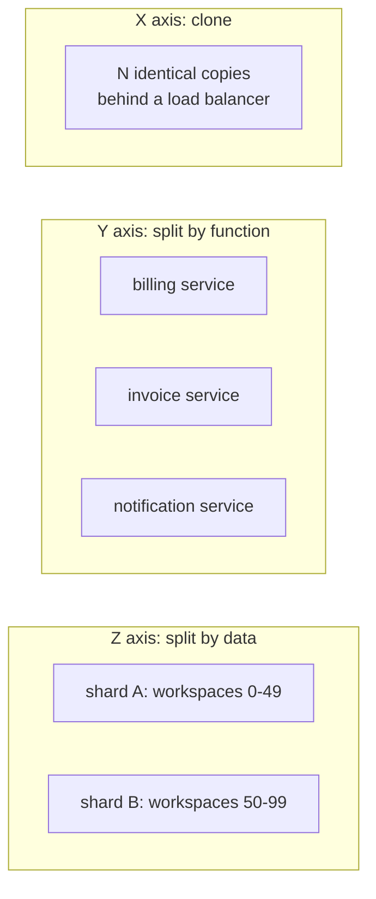
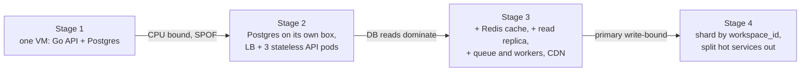

# Scaling Basics

> [!summary] TL;DR
> Scaling means handling more load (users, requests, data) without the system slowing down or falling over. You either buy a bigger machine (**vertical scaling**) or add more machines (**horizontal scaling**); horizontal only works when servers are **stateless** and when the database, which is usually the real limit, is scaled with its own techniques.

> [!abstract] Core idea
> - Vertical scaling is simple but has a ceiling and a steep price curve; horizontal scaling has no hard ceiling but needs stateless servers and a load balancer.
> - Reads and writes scale differently: reads with caches, CDNs and replicas; writes with batching, queues and partitioning.
> - Adding nodes has diminishing returns: serial work (Amdahl) and coordination between nodes (USL) cap and can even reverse the gain.
> - The app tier is easy to scale; the database is the hard part.
> - Measure first, keep headroom (run at 50-70% at peak), and scale the actual bottleneck.

## 1. Why it exists

An invoice API runs on one 4-vCPU VM that serves about 800 requests per second (RPS) at 70% CPU (an estimate for this example; your number comes from a load test). Month-end billing brings 2,500 RPS for two hours.

- At 2,500 RPS the box needs about three times its CPU. Requests queue, p99 latency climbs from 120 ms to several seconds, health checks time out, and the box is restarted in the middle of the busiest hour.
- Buying a 16-vCPU box fixes this month. Next year's 10,000 RPS peak needs a box that may not exist at a sane price, and the one box is still a single point of failure.

Scaling is the set of moves that let capacity grow with demand, ideally by adding cheap, identical units.

## 2. Mental model

A supermarket at rush hour.

- **Vertical:** train the one cashier to scan faster. It works until they are as fast as a human can be.
- **Horizontal:** open more checkout lanes. Customers must be able to use any lane, so no lane may keep a customer's half-finished basket (that would be state).
- **The stockroom** is the database. Ten lanes all sending runners to one stockroom door just moves the queue to the door.

## 3. How it works

### Vertical vs horizontal

| | Vertical (scale up) | Horizontal (scale out) |
| --- | --- | --- |
| Move | Bigger CPU, more RAM, faster disk | More identical instances behind a load balancer |
| Code change | None | Servers must be stateless; data tier needs its own plan |
| Ceiling | The largest machine you can buy (the largest cloud instances have several hundred vCPUs, and AWS high-memory instances reach tens of TB of RAM; AWS instance types page) | No hard ceiling for stateless tiers |
| Price curve | Rises faster than linearly at the top end, and needs downtime to resize | Roughly linear; small units |
| Failure | One box: a single point of failure | Lose one of N; the rest carry on |
| Best for | Databases early on, quick wins, licensed software | Stateless app tiers, workers |

Do vertical first for the database (it is cheap and keeps one source of truth), and horizontal first for the app tier.

### Making a service stateless

A service is stateless when any instance can serve any request. Move each kind of local state out:

| Local state | Where it goes |
| --- | --- |
| Login session in memory | Redis or a signed token; see [[Sessions and Cookies]] |
| Uploaded file on local disk | Object storage; see [[File Uploads and Object Storage]] |
| In-process cache | Shared cache (Redis) or accept per-instance caches with short TTLs |
| In-memory lock or counter | Database row lock, Redis, or [[Distributed Locks and Fencing Tokens]] |
| Cron job running on "the" server | A scheduler with leader election or a job queue; see [[Scheduled Jobs - Cron to Durable Schedulers]] |
| WebSocket connections | Allowed, but need a routing layer; see [[Scaling WebSockets]] |

### The scale cube (three axes)

The three axes are independent: a system can clone (X), split by function (Y) and split by data (Z) at the same time, in any combination. X is usually the first move because it is cheapest.



- **X axis (clone):** run copies of the same service. Cheapest; needs statelessness. Covered by [[Load Balancing]].
- **Y axis (functional split):** separate services for separate jobs, so a heavy reporting job cannot starve checkout. Brings network calls and partial failure; see [[Monolith vs Microservices]].
- **Z axis (data split):** each instance owns a slice of the data, chosen by a key such as `workspace_id`. This is the only axis that scales writes on one dataset; see [[Partitioning and Sharding]].

### Read path vs write path

| Read scaling (cheapest first) | Write scaling (cheapest first) |
| --- | --- |
| 1. Fix the query and the index | 1. Fix the query and the index |
| 2. Cache hot results ([[Caching Patterns]]) | 2. Batch writes (one `INSERT` of 500 rows, not 500 statements) |
| 3. CDN for static and public responses ([[CDN and Edge]]) | 3. Move slow work off the request path to a queue ([[Background Jobs and Worker Pools]]) |
| 4. Read replicas ([[Replication]]) | 4. Bigger primary (vertical) |
| 5. Denormalised read models ([[Materialized Views and Denormalization]]) | 5. Partition the data ([[Partitioning and Sharding]]) |

Caches and replicas do nothing for writes: every write still lands on the primary.

### The growth journey



Each arrow is triggered by a measured bottleneck, not by a calendar.

## 4. Worked example

### Whiteboard version

```text
Stage 1  [VM: API+PG]                                   ~ hundreds RPS
Stage 2  [LB] -> [API x3] -> [PG primary]               app tier scales out
Stage 3  [CDN] [LB] -> [API xN] -> [Redis] / [PG primary -> replica]
                         \-> [Queue] -> [Workers]       reads off the primary
Stage 4  [LB] -> [API xN] -> [router] -> [PG shard A | shard B | ...]
Rule: measure -> find the bottleneck -> cheapest fix on the right path (read or write)
```

### Why more nodes stop helping: Amdahl and USL

**Amdahl's law:** if a fraction `p` of the work can run in parallel and `1 − p` must run serially (one lock, one primary database, one leader), then with `N` workers the speed-up is `S(N) = 1 / ((1 − p) + p/N)`. It can never exceed `1 / (1 − p)`.

**Universal Scalability Law (USL):** Gunther adds a second penalty. Capacity relative to one node is `C(N) = N / (1 + α(N − 1) + βN(N − 1))`, where `α` is **contention** (queueing for a shared resource) and `β` is **coherency** (nodes keeping each other in sync, which grows with every pair of nodes). With `β > 0` throughput peaks at `N* = √((1 − α)/β)` and then **falls**.

This Go code computes both and passes `go vet` and `go test -race` on Go 1.24.

```go
package usl

import "math"

// Amdahl returns the speed-up on n workers when fraction p of the work
// can run in parallel and (1-p) must run serially.
func Amdahl(p float64, n int) float64 {
	return 1 / ((1 - p) + p/float64(n))
}

// USL returns relative capacity C(n) from Gunther's Universal Scalability Law.
// alpha models contention (waiting on a shared resource, e.g. one lock or one primary);
// beta models coherency (nodes keeping each other in sync; it grows with n*(n-1)).
func USL(alpha, beta float64, n int) float64 {
	nf := float64(n)
	return nf / (1 + alpha*(nf-1) + beta*nf*(nf-1))
}

// PeakNodes is the node count where USL capacity is highest: sqrt((1-alpha)/beta).
// Adding nodes past it lowers total throughput.
func PeakNodes(alpha, beta float64) float64 {
	return math.Sqrt((1 - alpha) / beta)
}
```

```go
package usl

import (
	"math"
	"testing"
)

func TestAmdahlCeiling(t *testing.T) {
	if got := Amdahl(0.95, 8); math.Abs(got-5.926) > 0.001 {
		t.Fatalf("Amdahl(0.95, 8) = %.3f, want 5.926", got)
	}
	// With 5% serial work no number of workers beats 20x.
	if got := Amdahl(0.95, 1_000_000); got >= 20 {
		t.Fatalf("Amdahl(0.95, 1e6) = %.3f, must stay below 20", got)
	}
}

func TestUSLPeaksThenFalls(t *testing.T) {
	const a, b = 0.03, 0.0005
	peak := PeakNodes(a, b)
	if math.Abs(peak-44.05) > 0.01 {
		t.Fatalf("PeakNodes = %.2f, want 44.05", peak)
	}
	c44, c88 := USL(a, b, 44), USL(a, b, 88)
	if math.Abs(c44-13.60) > 0.01 || math.Abs(c88-11.83) > 0.01 {
		t.Fatalf("C(44)=%.2f C(88)=%.2f, want 13.60 and 11.83", c44, c88)
	}
	if c88 >= c44 {
		t.Fatal("doubling nodes past the peak must lower throughput")
	}
}

func TestUSLWithNoPenaltiesIsLinear(t *testing.T) {
	if got := USL(0, 0, 32); got != 32 {
		t.Fatalf("USL(0,0,32) = %v, want 32", got)
	}
}
```

Reading the numbers (the `α` and `β` values are illustrative; in practice you fit them to load-test results):

| Model | Nodes | Capacity vs 1 node |
| --- | --- | --- |
| Amdahl, `p = 0.95` | 8 | 5.93× |
| Amdahl, `p = 0.95` | ∞ | 20× ceiling |
| USL, `α = 0.03, β = 0.0005` | 44 (peak) | 13.60× |
| USL, `α = 0.03, β = 0.0005` | 88 | 11.83× (worse than 44) |

The lesson: before adding nodes, shrink the serial part (the shared lock, the single hot row, the global counter) and the cross-node chatter (cache invalidation broadcasts, distributed locks).

### Sizing with headroom

Peak load 2,500 RPS. A load test shows one API pod handles 800 RPS before p99 breaks the SLO. Running at 60% utilisation at peak leaves room for a zone failure and a traffic spike:

`pods = ⌈2,500 ÷ (800 × 0.6)⌉ = ⌈5.21⌉ = 6`, spread over 3 zones (2 per zone). Losing one zone leaves 4 pods × 800 = 3,200 RPS of raw capacity, still above the 2,500 peak.

More sizing arithmetic lives in [[Back-of-the-Envelope Estimation]].

## 5. Variants and comparison

| Technique | What it scales | How | Cost |
| --- | --- | --- | --- |
| Vertical scaling | Everything on the box | Bigger instance | Ceiling, price curve, resize downtime |
| Horizontal clones (X) | Stateless compute | LB + N copies | State must move out; LB is a new component |
| Caching | Reads | Serve hot data from memory | Staleness, invalidation, cold-start risk |
| Read replicas | Reads | Copies of the DB | Replication lag; read-your-writes issues |
| Async queues | Peak smoothing, slow work | Accept now, process later | Eventual completion, retries, duplicates |
| Functional split (Y) | Teams, workload isolation | Separate services | Network calls, partial failure |
| Sharding (Z) | Writes and data size | Split data by key | Cross-shard queries, rebalancing, hot shards |
| Autoscaling | Variable load | Add or remove instances on a signal | Lag of minutes; needs stateless instances |

## 6. Trade-offs and when not to use

- **Do not shard first.** Sharding is the most expensive move and hard to undo. Exhaust indexes, query fixes, a bigger primary, caching and replicas first.
- **Caches and replicas add staleness.** A user who edits an invoice and reloads may read an old replica; see read-your-writes in [[Consistency Models]].
- **Async adds eventual completion.** A queue flattens a spike but turns "done" into "accepted"; the UI and API must say so (`202 Accepted`).
- **Autoscaling is not instant.** New instances take one to several minutes to boot and warm up, so it handles slow ramps, not a spike that arrives in 10 seconds. Keep static headroom for spikes; see [[Autoscaling]].
- **Microservices are not a scaling technique by default.** A Y-axis split adds latency and failure modes; do it for isolation and team ownership, not because traffic grew.

## 7. In production

- **Real systems:** Typical web stacks run stateless app containers behind an ALB on ECS or Kubernetes with a Horizontal Pod Autoscaler on CPU or RPS, a managed PostgreSQL primary with read replicas, Redis in front, and SQS or Kafka for async work.
- **Failure modes → fixes:**
	- Scale-out does nothing because the DB is saturated → check DB CPU, locks and connection count; add a pooler, cache or replica; see [[Connection Pooling]].
	- More pods exhaust the database's connection limit (20 pods × 25 connections = 500 > `max_connections` 100 by default in PostgreSQL 17) → size pools from the DB backwards, add PgBouncer.
	- Autoscaler flaps up and down → longer stabilisation windows, scale on a smoother signal.
	- One hot key or hot shard caps throughput → see [[Hot Keys and Hot Partitions]].
- **What to monitor:** utilisation and saturation per tier (CPU, connections, queue depth), p99 latency against load, the max/average ratio across instances, and DB replication lag.

## 8. Deep dive

- **Autoscaling signals.** CPU is easy but lags and misses I/O-bound services. RPS per instance tracks demand directly. Queue depth or queue age is the right signal for workers. Scale on the signal closest to the user-facing bottleneck, and set the target below the knee of the latency curve.
- **Why run at 50-70%.** Queueing theory: for a simple single-server queue (M/M/1), average time in the system is `service time ÷ (1 − utilisation)`. At 50% it is 2× the service time, at 90% it is 10×, and it explodes near 100%. Headroom keeps latency flat and leaves capacity for a lost zone.
- **Scaling cost is not linear at the edges.** Small units scale linearly until a shared component (NAT gateway, DB connections, a lock, one Kafka partition) saturates. USL `α` shows up as a flattening curve, `β` as a curve that bends down.
- **Data gravity.** Compute can move to where data is; data cannot cheaply move. Plan partition keys early (tenant, user, region) even if you do not shard yet, so that a later Z-axis split follows an existing boundary.
- **Measure first.** Profile before scaling: a missing index or an N+1 query often buys more than 10 extra pods; see [[N+1 Query Problem]] and [[Performance Engineering and Capacity Planning]].

## 9. Interview questions

> [!question]- Vertical or horizontal scaling: which do you choose?
> Horizontal for stateless app tiers because it has no ceiling and survives instance loss. Vertical first for the database because it keeps one source of truth with no code change; move to replicas and sharding only when a bigger box stops being enough or affordable.

> [!question]- What must change before a service can scale horizontally?
> It must become stateless: sessions in Redis or tokens, files in object storage, locks and counters in a shared store, cron behind leader election. Then any instance can serve any request and the load balancer can route freely.

> [!question]- How do you scale reads versus writes?
> Reads: index, cache, CDN, read replicas, denormalised views. Writes: batch, queue, bigger primary, then partition. Caches and replicas do not help writes, because every write still hits the primary.

> [!question]- Trap: we doubled the nodes but throughput went down. How is that possible?
> Coherency cost. The Universal Scalability Law shows that when nodes must coordinate (cache invalidation, distributed locks, cross-node chatter) the cost grows with N², so throughput peaks and then falls. Reduce shared state and cross-node coordination instead of adding nodes.

> [!question]- What is the scale cube?
> Three ways to scale: X clones identical copies, Y splits by function into services, Z splits by data key into shards. X is cheapest; Z is the only one that scales writes on one dataset.

> [!question]- Why not run servers at 95% CPU to save money?
> Queueing delay grows like `1/(1 − utilisation)`, so latency explodes near 100%, and there is no room for a lost zone or a spike while autoscaling catches up. Target 50-70% at peak.

## 10. Cheat sheet

- Vertical: simple, ceiling, SPOF. Horizontal: stateless + LB, no ceiling.
- Stateless = sessions, files, caches, locks, cron moved out of the instance.
- Scale cube: X clone, Y functional split, Z data split (only Z scales writes).
- Reads → cache, CDN, replicas. Writes → batch, queue, bigger primary, shard.
- Amdahl: max speed-up `1/(1 − p)`. USL: coherency makes extra nodes hurt past `√((1 − α)/β)`.
- Headroom: 50-70% at peak, N+1 zones. Autoscaling lags by minutes.
- The database is usually the bottleneck; measure before scaling.

## Links

- **Before this:** [[System Design Fundamentals]]
- **Next:** [[Back-of-the-Envelope Estimation]], [[Load Balancing]], [[Caching Patterns]], [[Replication]], [[Partitioning and Sharding]]
- **Compare with:** [[Autoscaling]] (the mechanism that adds instances), [[Performance Engineering and Capacity Planning]] (measuring before scaling), [[Monolith vs Microservices]] (the Y axis as an architecture choice)
