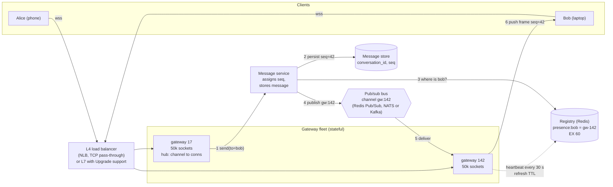
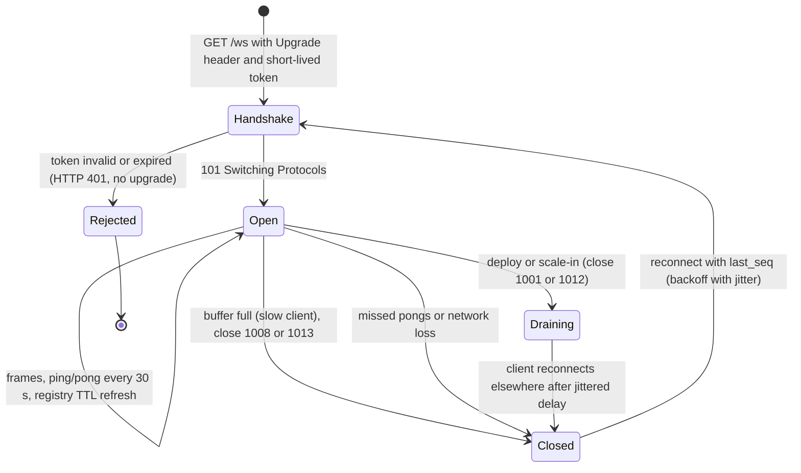
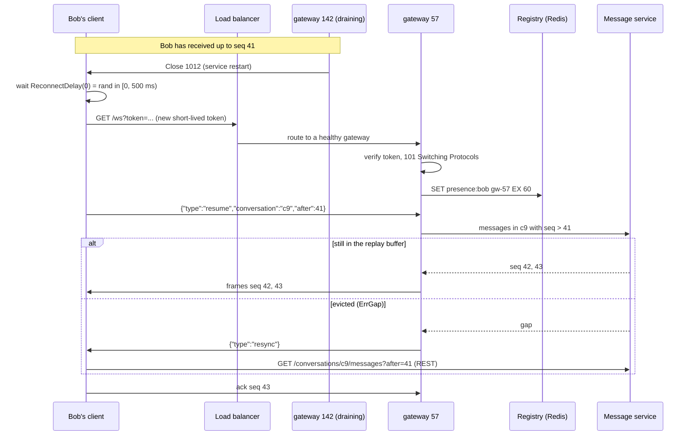

# Scaling WebSockets

> [!summary] TL;DR
> A WebSocket is a long-lived, two-way connection between a client and **one** server. Scaling it means three things: holding millions of open connections cheaply, finding which server holds a given user's connection, and surviving deploys and failures without every client reconnecting at once.

> [!abstract] Core idea
> - WebSocket servers are **stateful**: each socket is pinned to one gateway process until it closes.
> - A **connection registry** (user → gateway) plus a **pub/sub bus** between gateways lets any server deliver to any user.
> - Pub/sub between gateways is usually at-most-once, so reliable delivery needs sequence numbers, acks and **resume from the last sequence** on reconnect.
> - Protect the fleet from its own clients: bounded send buffers for slow clients, and jittered reconnects so a deploy does not cause a reconnect storm.
> - Classic mistake: scaling WebSocket servers like stateless HTTP servers. Adding a node does not move existing connections to it.

This note is about running WebSockets at scale. The protocol itself (handshake, frames, ping/pong, SSE and long polling) is in [[Real-time APIs - WebSocket, SSE and Long Polling]], and the Go server code is in [[WebSockets and SSE in Go]].

## 1. Why it exists

A chat app has **10 million users online at peak**. Each user keeps one WebSocket open so messages arrive instantly.

- One server cannot hold 10 million sockets. Suppose each gateway holds **50,000 connections** (an estimate; measure your own). That needs 10,000,000 ÷ 50,000 = **200 gateways**.
- Alice is connected to gateway 17 and Bob to gateway 142. When Alice sends Bob a message, gateway 17 has no socket for Bob. Something must know that **Bob is on gateway 142** and get the message there.
- On Tuesday you deploy a new version. Each gateway restarts and drops 50,000 sockets. If those clients all reconnect within one second, the remaining gateways see **50,000 TLS handshakes per second** from one restart, on top of normal load (estimate of the burst shape, not a measurement).
- Bob's phone enters a tunnel for 20 seconds. Messages sent in that window must not be lost.

A stateless HTTP API has none of these problems: any server can answer any request. WebSockets need extra parts, and this note is about those parts.

## 2. Mental model

Think of a telephone switchboard building with 200 operators. Each caller is connected to one operator's desk and stays there for the whole call.

- A **directory** on the wall says which desk each person is at (the connection registry).
- An **intercom** between desks lets operator 17 tell operator 142, "pass this to Bob" (the pub/sub bus).
- Each operator keeps a **notepad of the last few messages** for each line, so if Bob's line drops and he calls back, the new operator can say "here is what you missed since message 41" (resume buffer).
- When an operator goes on break, they tell their callers "please call back" over a few minutes, not all at once (graceful drain with jitter).

Terms used below:

- **Gateway (edge, connection server):** the process that terminates WebSockets. It holds sockets and little business logic.
- **Fan-out:** delivering one message to many recipients.
- **Presence:** whether a user is online, usually derived from connection heartbeats.
- **Sticky session:** a load-balancer setting that keeps a client on one server. WebSockets are sticky by nature: the TCP connection itself pins the client.

## 3. How it works

### 3.1 The architecture



Step by step for "Alice sends Bob a message":

1. Alice's frame arrives at gateway 17, which forwards it to the **message service** (gateways stay thin).
2. The message service assigns a per-conversation **sequence number** (42) and writes the message to durable storage. From this point the message is safe.
3. It looks up Bob in the **registry**: `presence:bob → gw-142`.
4. It publishes the message on gateway 142's bus channel.
5. Gateway 142 finds Bob's socket in its local hub.
6. It pushes the frame; Bob's client acks `seq=42` (or just remembers it as `last_seq`).

If Bob is offline (no registry entry), step 4 is replaced by a mobile push notification; Bob fetches history when he reconnects.

### 3.2 Two ways to route between gateways

| Routing | How it works | Good for | Cost |
| --- | --- | --- | --- |
| **Per-gateway channel** | Registry maps user → gateway; publish to `gw:{id}` | 1:1 chat, notifications to a user | A registry lookup per recipient; registry must be accurate |
| **Per-topic channel** | Gateways subscribe to `room:{id}` while they have a local member | Group rooms, live scores, collaborative docs | Each gateway subscribes to many topics; a huge room hits every gateway |

Large systems mix them: per-user routing for direct messages, per-topic subscriptions for rooms and broadcasts.

### 3.3 The connection lifecycle



## 4. Worked example

### Whiteboard version

```text
           ┌───────────────┐   lookup user → gw   ┌──────────────┐
 client ──►│ gateway (hub) │◄────────────────────►│ registry     │
  wss      │ bounded queue │                      │ Redis + TTL  │
           └──────┬────────┘                      └──────────────┘
                  │ subscribe gw:{id}
           ┌──────▼────────┐  publish   ┌───────────────────────────┐
           │ pub/sub bus   │◄───────────│ message service           │
           │ (at-most-once)│            │ seq per conversation, DB  │
           └───────────────┘            └───────────────────────────┘
 reconnect: client sends last_seq → gateway replays from buffer or tells client to GET history
```

### Capacity estimate for 10 million concurrent users

All figures below are **estimates** to show the method.

- **Memory per connection** with a goroutine-per-connection design (for example gorilla/websocket with one reader and one writer goroutine): 2 goroutines × at least 2 KiB of stack (Go starts stacks at 2 KiB and grows them; real stacks are often 4 to 8 KiB) + 4 KiB read buffer + 4 KiB write buffer (gorilla's defaults) + TLS and kernel socket buffers. Call it **about 30 KiB** per connection.
- **Per gateway:** 50,000 connections × 30 KiB ≈ 1.5 GB of RAM. That fits a modest machine; CPU for TLS and message volume is often the real limit.
- **Fleet:** 10,000,000 ÷ 50,000 = **200 gateways**, plus spare capacity (say 25%, so about 250) to absorb a zone failure and deploys.
- **Heartbeats:** ping every 30 s → 10,000,000 ÷ 30 ≈ **333,000 pings per second** across the fleet, handled locally by each gateway (1,667 per gateway per second).
- **Registry writes:** if every gateway refreshes each user's TTL on every 30 s heartbeat, that is also about **333,000 writes per second** to Redis. Each gateway can pipeline its 1,667 `SET presence:{user} gw-17 EX 60` commands per second, but the total still needs a sharded Redis Cluster (for example 6 to 10 shards, estimate). A cheaper alternative is to write `user → gateway` only on connect and disconnect (about the connect rate, far lower), and treat "the gateway is alive" (one heartbeat key per gateway) as the presence signal.
- **Reconnect storm:** draining one gateway's 50,000 clients over a **30 s jittered window** gives about 50,000 ÷ 30 ≈ **1,700 new handshakes per second**, spread over 249 other gateways (about 7 each per second). Without jitter, 50,000 handshakes land within a second or two.
- **File descriptors:** 50,000 sockets need `ulimit -n` (`nofile`) well above 50,000; the common default soft limit of 1,024 fails at connection 1,021 or so.
- **Ephemeral ports:** a proxy that opens its own connection to a backend uses one local port per connection for each (source IP, backend IP, backend port). With Linux's default `ip_local_port_range` of 32768-60999, that is **28,232 connections** per backend address per proxy IP. An L7 proxy holding 50,000 WebSockets to one backend address runs out. Fixes: more backend IPs or ports, more proxy source IPs, or L4 pass-through.

### Go code: the gateway's hub, resume buffer, registry and reconnect delay

The code is transport-agnostic: `Conn.Out` is the queue a writer goroutine would drain into the real socket. The clock and the random source are injected so the tests are deterministic. It passes `go vet` and `go test -race` on Go 1.24.

```go
package wsgw

import (
	"errors"
	"sync"
	"time"
)

// Message is one event pushed to clients. Seq is assigned per channel by the
// message service, so a client can say "resume after Seq 41".
type Message struct {
	Seq  uint64
	Body string
}

// Conn wraps one client connection's outbound queue. A writer goroutine
// (not shown) drains Out and writes frames to the socket.
type Conn struct {
	UserID string
	Out    chan Message // bounded: its capacity is the slow-client budget
	once   sync.Once
	closed chan struct{}
}

func NewConn(user string, buf int) *Conn {
	return &Conn{UserID: user, Out: make(chan Message, buf), closed: make(chan struct{})}
}

// Close is idempotent and reports whether this call closed the connection, so
// concurrent publishers count a drop only once. The writer goroutine sees
// Closed() and sends close code 1008/1013.
func (c *Conn) Close() (first bool) {
	c.once.Do(func() { close(c.closed); first = true })
	return first
}

func (c *Conn) Closed() <-chan struct{} { return c.closed }

// Hub is the per-gateway fan-out point: channel -> local connections.
type Hub struct {
	mu      sync.RWMutex
	subs    map[string]map[*Conn]struct{}
	dropped int
}

func NewHub() *Hub { return &Hub{subs: make(map[string]map[*Conn]struct{})} }

func (h *Hub) Subscribe(channel string, c *Conn) {
	h.mu.Lock()
	defer h.mu.Unlock()
	if h.subs[channel] == nil {
		h.subs[channel] = make(map[*Conn]struct{})
	}
	h.subs[channel][c] = struct{}{}
}

func (h *Hub) Unsubscribe(channel string, c *Conn) {
	h.mu.Lock()
	defer h.mu.Unlock()
	delete(h.subs[channel], c)
}

// Publish never blocks: a client whose buffer is full is closed, so one slow
// phone cannot stall delivery to the other 50,000 sockets on this node.
func (h *Hub) Publish(channel string, m Message) (delivered int) {
	h.mu.RLock()
	conns := make([]*Conn, 0, len(h.subs[channel]))
	for c := range h.subs[channel] {
		conns = append(conns, c)
	}
	h.mu.RUnlock()

	for _, c := range conns {
		select {
		case <-c.closed:
			continue
		default:
		}
		select {
		case c.Out <- m:
			delivered++
		default:
			if c.Close() { // it will reconnect and resume from its last Seq
				h.Unsubscribe(channel, c)
				h.mu.Lock()
				h.dropped++
				h.mu.Unlock()
			}
		}
	}
	return delivered
}

func (h *Hub) Dropped() int { h.mu.RLock(); defer h.mu.RUnlock(); return h.dropped }

// ErrGap means the client is too far behind the replay buffer; it must
// reload state over REST (GET /channels/{id}/messages?after=seq).
var ErrGap = errors.New("resume point no longer buffered")

// ReplayBuffer keeps the last N messages of one channel for resume.
type ReplayBuffer struct {
	mu  sync.Mutex
	buf []Message
	max int
}

func NewReplayBuffer(max int) *ReplayBuffer { return &ReplayBuffer{max: max} }

func (r *ReplayBuffer) Append(m Message) {
	r.mu.Lock()
	defer r.mu.Unlock()
	r.buf = append(r.buf, m)
	if len(r.buf) > r.max {
		r.buf = append(r.buf[:0:0], r.buf[len(r.buf)-r.max:]...)
	}
}

// Since returns every message with Seq > after, or ErrGap if some were evicted.
func (r *ReplayBuffer) Since(after uint64) ([]Message, error) {
	r.mu.Lock()
	defer r.mu.Unlock()
	if len(r.buf) == 0 {
		return nil, nil
	}
	if after+1 < r.buf[0].Seq {
		return nil, ErrGap
	}
	var out []Message
	for _, m := range r.buf {
		if m.Seq > after {
			out = append(out, m)
		}
	}
	return out, nil
}

// Registry maps user -> gateway with a TTL refreshed by heartbeats. In
// production it is Redis: SET presence:{user} gw-7 EX 60 on every heartbeat.
type Registry struct {
	mu   sync.Mutex
	ttl  time.Duration
	now  func() time.Time
	seen map[string]entry
}

type entry struct {
	gateway string
	expires time.Time
}

func NewRegistry(ttl time.Duration, now func() time.Time) *Registry {
	return &Registry{ttl: ttl, now: now, seen: make(map[string]entry)}
}

func (r *Registry) Heartbeat(user, gateway string) {
	r.mu.Lock()
	defer r.mu.Unlock()
	r.seen[user] = entry{gateway: gateway, expires: r.now().Add(r.ttl)}
}

// Lookup returns the gateway holding the user's socket, if the user is online.
func (r *Registry) Lookup(user string) (string, bool) {
	r.mu.Lock()
	defer r.mu.Unlock()
	e, ok := r.seen[user]
	if !ok || !r.now().Before(e.expires) {
		return "", false
	}
	return e.gateway, true
}

// ReconnectDelay is "full jitter": a random wait in [0, min(cap, base*2^attempt)).
// rnd returns a float in [0,1) and is injected for tests.
func ReconnectDelay(attempt int, base, cap time.Duration, rnd func() float64) time.Duration {
	d := cap
	if attempt < 30 {
		if e := base << attempt; e > 0 && e < cap {
			d = e
		}
	}
	return time.Duration(rnd() * float64(d))
}
```

The tests prove four behaviours: a slow client is cut off without blocking others, publishing is race-free, resume works or reports a gap, and presence expires without heartbeats.

```go
package wsgw

import (
	"errors"
	"sync"
	"testing"
	"time"
)

func TestSlowClientIsClosedAndOthersStillGetMessages(t *testing.T) {
	h := NewHub()
	fast := NewConn("fast", 8) // its writer keeps up, so it has room
	slow := NewConn("slow", 2) // its writer is stuck on a bad mobile link
	h.Subscribe("room:1", fast)
	h.Subscribe("room:1", slow)

	for i := uint64(1); i <= 5; i++ {
		h.Publish("room:1", Message{Seq: i, Body: "hi"})
	}

	if got := len(fast.Out); got != 5 {
		t.Fatalf("fast client got %d messages, want 5", got)
	}
	select {
	case <-slow.Closed():
	default:
		t.Fatal("slow client should have been closed when its buffer filled")
	}
	if h.Dropped() != 1 {
		t.Fatalf("dropped = %d, want 1", h.Dropped())
	}
	if got := len(slow.Out); got != 2 {
		t.Fatalf("slow buffer holds %d, want 2 (the budget)", got)
	}
}

func TestPublishIsSafeUnderConcurrency(t *testing.T) {
	h := NewHub()
	var conns []*Conn
	for range 20 {
		c := NewConn("u", 1000)
		conns = append(conns, c)
		h.Subscribe("feed", c)
	}
	var wg sync.WaitGroup
	for p := 0; p < 10; p++ {
		wg.Add(1)
		go func() {
			defer wg.Done()
			for i := 0; i < 50; i++ {
				h.Publish("feed", Message{Seq: uint64(i)})
			}
		}()
	}
	wg.Wait()
	for _, c := range conns {
		if len(c.Out) != 500 {
			t.Fatalf("conn got %d messages, want 500", len(c.Out))
		}
	}
}

func TestReplayBufferResumeAndGap(t *testing.T) {
	r := NewReplayBuffer(3)
	for i := uint64(1); i <= 5; i++ {
		r.Append(Message{Seq: i})
	}
	// Buffer now holds 3, 4, 5.
	got, err := r.Since(3)
	if err != nil || len(got) != 2 || got[0].Seq != 4 || got[1].Seq != 5 {
		t.Fatalf("Since(3) = %v, %v; want [4 5]", got, err)
	}
	if got, err := r.Since(2); err != nil || len(got) != 3 {
		t.Fatalf("Since(2) = %v, %v; want [3 4 5]", got, err)
	}
	if _, err := r.Since(1); !errors.Is(err, ErrGap) {
		t.Fatalf("Since(1) err = %v, want ErrGap (message 2 was evicted)", err)
	}
	if got, _ := r.Since(5); len(got) != 0 {
		t.Fatalf("Since(5) = %v, want nothing new", got)
	}
}

func TestRegistryExpiresWithoutHeartbeat(t *testing.T) {
	now := time.Unix(0, 0)
	var mu sync.Mutex
	clock := func() time.Time { mu.Lock(); defer mu.Unlock(); return now }
	advance := func(d time.Duration) { mu.Lock(); now = now.Add(d); mu.Unlock() }

	r := NewRegistry(60*time.Second, clock)
	r.Heartbeat("alice", "gw-7")
	advance(30 * time.Second)
	if gw, ok := r.Lookup("alice"); !ok || gw != "gw-7" {
		t.Fatalf("Lookup = %q %v, want gw-7 true", gw, ok)
	}
	r.Heartbeat("alice", "gw-3") // reconnected to another gateway
	advance(59 * time.Second)
	if gw, _ := r.Lookup("alice"); gw != "gw-3" {
		t.Fatalf("gateway = %q, want gw-3", gw)
	}
	advance(time.Second)
	if _, ok := r.Lookup("alice"); ok {
		t.Fatal("alice should be offline 60 s after the last heartbeat")
	}
}

func TestReconnectDelayFullJitter(t *testing.T) {
	base, cap := 500*time.Millisecond, 30*time.Second
	max := func() float64 { return 0.999999 }
	cases := []struct {
		attempt int
		ceiling time.Duration
	}{{0, 500 * time.Millisecond}, {3, 4 * time.Second}, {6, 30 * time.Second}, {100, 30 * time.Second}}
	for _, c := range cases {
		d := ReconnectDelay(c.attempt, base, cap, max)
		if d >= c.ceiling || d < c.ceiling*99/100 {
			t.Fatalf("attempt %d: delay %v, want just under %v", c.attempt, d, c.ceiling)
		}
		if z := ReconnectDelay(c.attempt, base, cap, func() float64 { return 0 }); z != 0 {
			t.Fatalf("attempt %d: zero random should give 0, got %v", c.attempt, z)
		}
	}
}
```

### Reconnect with resume



## 5. Variants and comparison

### Cross-gateway bus

| Bus | Delivery | Use when | Cost |
| --- | --- | --- | --- |
| Redis Pub/Sub | At-most-once: a gateway that is disconnected misses messages | Low latency, small fleets; durability comes from the message store + resume | No replay; Redis Cluster broadcasts classic Pub/Sub to every node (sharded Pub/Sub, Redis 7.0+, avoids this) |
| Redis Streams | Persisted log with consumer groups and IDs | You want replay from the bus itself for a short window | Memory; trimming (`MAXLEN`) policy |
| NATS (core / JetStream) | Core: at-most-once; JetStream: persisted, acked | Large fan-out with subject wildcards (`room.*`) | Another system to run |
| Kafka | Durable, partitioned log | Very high throughput and replay; message service already uses it | Higher latency than in-memory buses; partition-to-gateway mapping is awkward for per-user routing |

### Ways to run real-time connections

| Option | How it works | Use when | Cost |
| --- | --- | --- | --- |
| Self-hosted gateways (goroutine per connection) | `net/http` + a WebSocket library, 1-2 goroutines per socket | Up to hundreds of thousands of sockets per node; simplest code | About 10-30 KiB per connection (estimate) |
| Self-hosted, epoll-based | gobwas/ws with netpoll; goroutines only for active sockets | Millions of mostly idle sockets per node | Harder code; fewer libraries |
| SSE instead of WebSocket | Server-to-client stream over plain HTTP; client sends via normal POSTs | One-way updates: notifications, feeds, dashboards | No client-to-server channel on the same connection |
| AWS API Gateway WebSockets | AWS holds sockets; your backend gets HTTP callbacks and posts back to `@connections` | Spiky or small workloads; no gateway fleet to run | 10-minute idle timeout and 2-hour max connection; per-message pricing |
| Pusher, Ably and similar | Managed pub/sub with client SDKs | Fast time to market | Vendor lock-in; cost at high message volume |

## 6. Trade-offs and when not to use

- **Do not use WebSockets for one-way updates.** If the server only pushes (notifications, progress bars, live scores), SSE is plain HTTP, reconnects with `Last-Event-ID` built in, and passes through proxies more easily.
- **Do not use them for rare updates.** If a user gets one update per minute, long polling or a mobile push notification costs far less than a socket per user.
- **Statefulness makes deploys slower.** You must drain connections gradually; a fleet of 250 gateways drained 10 at a time with a 30 s window takes about 13 minutes (25 batches × 30 s, estimate).
- **L4 vs L7 load balancers:** L4 (TCP pass-through) has no per-connection HTTP parsing and no ephemeral-port problem on the backend side, but cannot route by path or header. L7 can route `/ws` to the gateway fleet and terminate TLS, but must support the `Upgrade` handshake and must have an idle timeout longer than your ping interval (ALB default 60 s, so ping every 30 s).
- **Imbalance after scale-out:** a new gateway starts with zero connections, and the old ones keep theirs until clients reconnect. Least-connections balancing helps only for *new* connections. To rebalance, ask a fraction of clients on overloaded nodes to reconnect.

## 7. In production

- **Authentication:**
	- Authenticate at the handshake with a **short-lived token** (for example a 60 s ticket fetched over REST), passed in a header or a subprotocol, or as a query parameter only if your logs redact it. Browsers cannot set arbitrary headers on WebSocket requests, which is why tickets in the URL are common.
	- Check the `Origin` header to prevent cross-site WebSocket hijacking.
	- A socket can outlive the token. Re-check **authorization per message** (can this user post to this room?), and close sockets when a session is revoked.
- **Heartbeats and presence:**
	- Ping every 25-30 s so idle sockets are not killed by load-balancer idle timeouts (ALB 60 s by default; NLB 350 s for TCP).
	- A missed pong (for example two in a row) means the client is gone; close the socket and let the registry TTL expire.
	- Presence fan-out is expensive: telling 500 friends that Alice went online is 500 messages. Batch presence updates, or fetch presence only for users on screen.
- **Slow clients:** each connection gets a **bounded** send queue (the Go `Out` channel above). When it is full, close the socket (close code 1008 or 1013) and let the client resume. An unbounded queue turns one slow phone into an out-of-memory crash for 50,000 users.
- **Deploys and scale-in (graceful drain):**
	1. Mark the gateway unhealthy so the load balancer sends no new connections.
	2. Send close frames (1001 Going Away or 1012 Service Restart) to clients in batches spread over 30-60 s.
	3. Clients reconnect with exponential backoff and **full jitter**, and resume from `last_seq`.
	4. Exit after the last socket closes or a hard deadline passes. See [[Graceful Shutdown and Health Checks]].
- **Failure modes → fixes:**
	- A gateway crashes → 50,000 clients reconnect at once → client-side backoff with full jitter, and admission limits (reject with 1013 when the handshake rate is too high). See [[Timeouts, Retries and Backoff]].
	- A gateway misses bus messages during a blip (at-most-once) → messages are already in the store, so clients get them through resume.
	- The registry says Bob is on gateway 142, but he just moved → the publish reaches nobody; his new gateway's resume fetches the message. Write registry entries as `user → (gateway, connection_id)` and only delete if the connection ID matches, so an old gateway's cleanup cannot erase the new entry.
	- One huge room (a live stream with 1 million viewers) makes its topic hot → a tree of fan-out (the message service publishes once per gateway, not per user) and sampling or aggregating reactions. See [[Hot Keys and Hot Partitions]].
- **What to monitor:** connections per gateway (and max/average across the fleet), handshake rate and failures, reconnect rate, delivery latency from send to client ack (p99), send-queue drops (slow-client closes), bus lag, registry ops per second, file descriptors in use.

## 8. Deep dive

- **Why epoll-based servers hold more sockets.** In the goroutine-per-connection design each socket owns at least one blocked goroutine and its read buffer even when idle. The "A Million WebSockets and Go" design (gobwas/ws) registers sockets with epoll and only starts a goroutine and allocates a buffer when data actually arrives, so idle sockets cost little more than the kernel's socket structure. The price is more complex code and fewer ready-made libraries; most teams only need it above a few hundred thousand sockets per node.
- **Ordering.** Per-conversation sequence numbers, assigned by the message service (a database sequence, a counter in the partition leader, or a Snowflake-style ID per channel), give clients a total order to apply and a cursor to resume from. Ordering across conversations is not needed.
- **Exactly-once to the user.** The bus delivers at-most-once and resume can replay messages the client already has, so delivery to the client is at-least-once. The client drops any message with `seq <= last_seq`, which makes the result effectively once. See [[Delivery Semantics and Exactly-Once]].
- **Send idempotency.** The client attaches a `client_msg_id` (a UUID) to each send. If the ack is lost and the client resends, the message service deduplicates on it. See [[Idempotency and Idempotency Keys]].
- **Multi-device.** Bob on a phone and a laptop is two connections, possibly on two gateways. The registry stores a set per user, and each device keeps its own `last_seq` cursor.
- **Connection rebalancing.** After scaling out, overloaded gateways can send `reconnect` hints to a small random fraction of clients per minute until load evens out. Without this, the new nodes stay idle until normal churn moves clients.
- **Multi-region.** Users connect to the nearest region; the bus is per region, and cross-region messages go through a replicated log (for example Kafka with MirrorMaker or a managed equivalent). Registry lookups become "which region, then which gateway". See [[Multi-Region Architecture]].

## 9. Interview questions

> [!question]- How does a message from a user on server A reach a user on server B?
> A connection registry maps user → gateway (Redis with a TTL refreshed by heartbeats). The message service stores the message, looks up the recipient's gateway and publishes to that gateway's channel on a pub/sub bus. Gateway B pushes it down the socket. For rooms, gateways subscribe to room topics instead.

> [!question]- Redis Pub/Sub drops messages when a subscriber is disconnected. Is that acceptable?
> Yes, if the bus is not your source of truth. The message is persisted with a sequence number before publishing, and clients resume with `after=last_seq` on reconnect. The bus is a fast path for online users; the store plus resume gives reliability.

> [!question]- We added 50 new gateways, but the old ones are still overloaded. Why? (trap)
> Existing WebSockets never move: the load balancer only places *new* connections. Least-connections helps new clients, but the old sockets stay put until they reconnect. Rebalance by asking a fraction of clients on hot nodes to reconnect, with jitter.

> [!question]- How do you deploy a WebSocket fleet without a reconnect storm?
> Drain one batch of gateways at a time: stop new connections, send close 1001 or 1012 to clients spread over 30-60 s, and have clients reconnect with exponential backoff and full jitter. Admission control on handshakes protects the rest of the fleet if clients misbehave.

> [!question]- What do you do with a client that cannot keep up?
> Give each connection a bounded send queue. When it is full, close the socket instead of blocking the publisher or growing memory. The client reconnects and resumes from its last sequence, or does a REST resync if the gap is too large.

> [!question]- How do you authenticate a WebSocket, and what changes after the handshake?
> Authenticate the upgrade request with a short-lived token and check `Origin`. After that, the token may expire while the socket lives, so enforce authorization on every message and close sockets when sessions are revoked or tokens are not refreshed.

> [!question]- When would you pick SSE or a managed service instead?
> SSE when updates only flow server to client: it is plain HTTP and has `Last-Event-ID` resume built in. A managed service (API Gateway WebSockets, Pusher, Ably) when the fleet is small or spiky and you do not want to run gateways, accepting its limits (API Gateway: 10-minute idle, 2-hour max connection).

## 10. Cheat sheet

- Gateways are stateful; a socket stays on one node until it closes.
- Registry (user → gateway, TTL) + bus (per-gateway or per-topic channels) + message service with per-conversation `seq`.
- Bus is at-most-once; reliability = persist first, then resume with `after=last_seq`; client dedups by `seq`.
- Bounded send queue per socket; close slow clients.
- Ping every 25-30 s (below LB idle timeouts: ALB 60 s); presence by TTL.
- Drain gradually (close 1001/1012) and reconnect with exponential backoff + full jitter.
- Limits: `nofile`, about 28k ephemeral ports per proxy-to-backend address, memory per connection.

## Links

- **Before this:** [[Real-time APIs - WebSocket, SSE and Long Polling]], [[Load Balancing]]
- **Next:** [[Case Study - Chat System]], [[Case Study - Notification System]], [[WebSockets and SSE in Go]]
- **Compare with:** [[Redis as a Queue - Lists, Streams and Pub-Sub]] (the bus options), [[Notification Service]] (class-level design of delivery channels)
