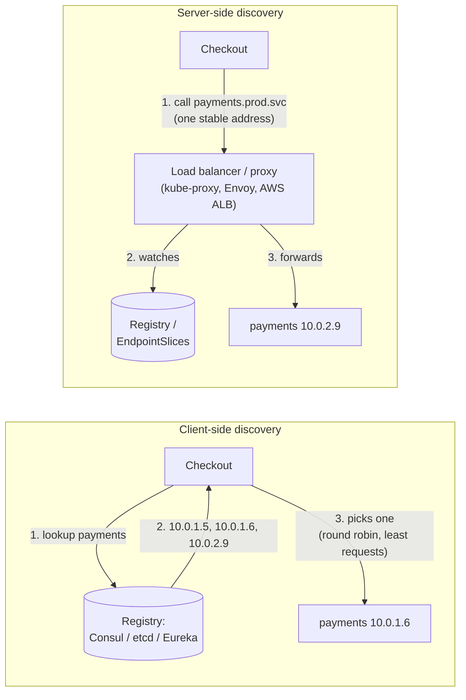
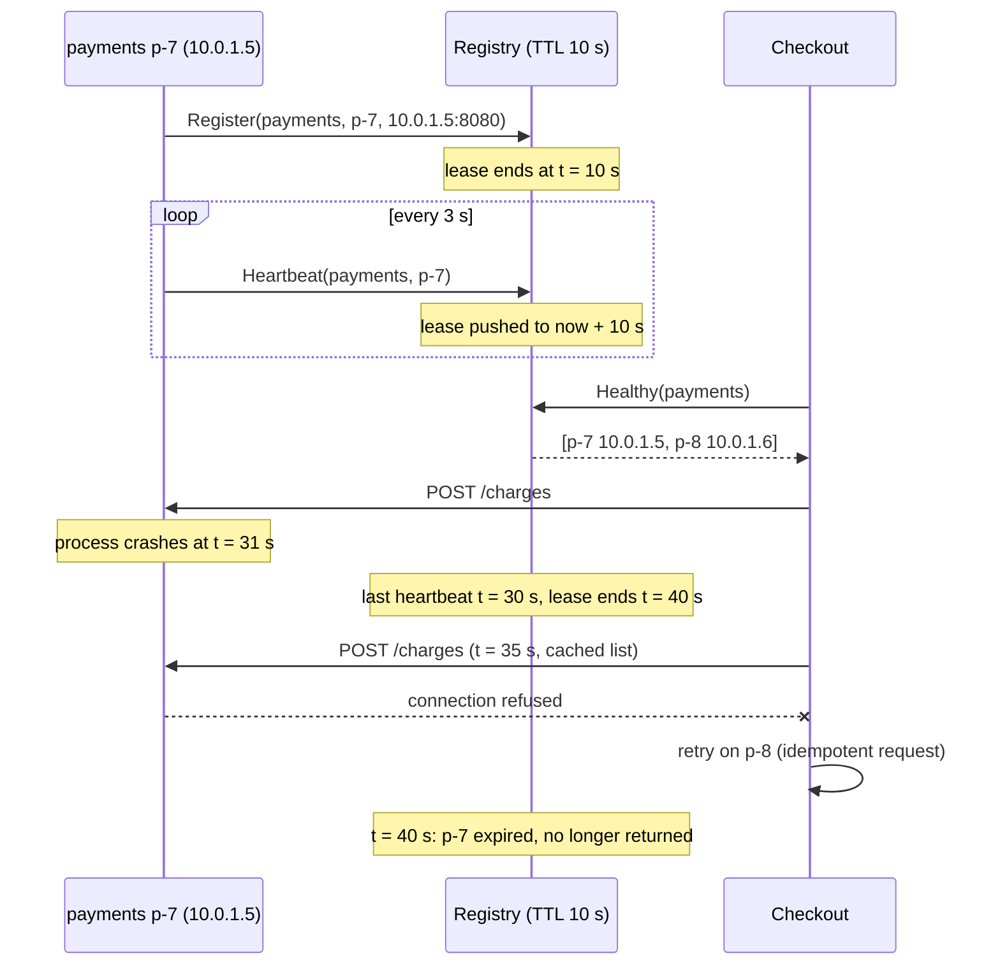
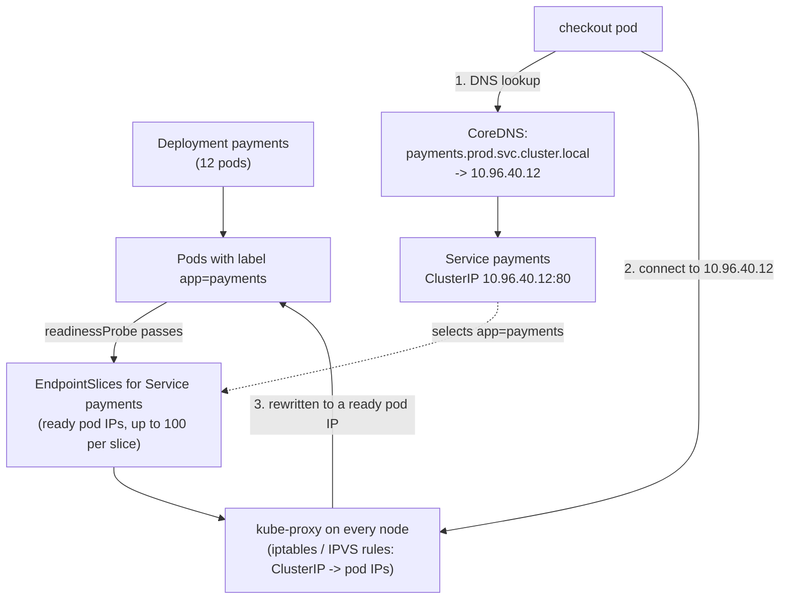

# Service Discovery

> [!summary] TL;DR
> **Service discovery** is how one service finds the current network addresses (IP and port) of another service, when those addresses keep changing because instances start, stop, crash and autoscale. A **registry** keeps the list of healthy instances, and callers look it up either themselves (**client-side**) or through a load balancer that does it for them (**server-side**).

> [!abstract] Core idea
> - Instances come and go, so addresses must be looked up at runtime, never written into config.
> - A **registry** holds `service name → healthy instances`; entries are kept alive by heartbeats or health checks and expire when they stop.
> - **Client-side discovery:** the caller fetches the list and load-balances itself. **Server-side discovery:** the caller hits one stable address and a proxy picks the instance.
> - Every answer is slightly stale. Design callers to survive a dead address: timeouts, retries on another instance, and graceful deregistration on shutdown.

## 1. Why it exists

The checkout service calls the payments service. In 2015 you might have written `PAYMENTS_URL=http://10.0.1.5:8080` in a config file. Today payments runs as 12 containers in Kubernetes:

- Each deploy replaces all 12 pods, and each new pod gets a new IP.
- The autoscaler adds 8 more pods at 7 pm and removes them at midnight.
- A node fails, and its 3 pods restart elsewhere with new IPs.

On a busy day the set of payments addresses might change dozens of times. A hard-coded list would point at dead IPs within the first deploy, and checkout would fail with connection-refused errors or, worse, time out on IPs that no longer answer. Someone would have to edit configs by hand every time the set changed.

Service discovery replaces the hard-coded list with a lookup: "give me the healthy instances of `payments` right now".

## 2. Mental model

Think of a company's internal phone directory that updates itself.

- Every employee who arrives at their desk **checks in** ("I'm Alice from payments, extension 8080").
- They must **check in again every few minutes**. If they stop (they went home, or the phone broke), their entry disappears after a short while.
- To call payments, you either **look up the list yourself** and pick someone (client-side), or you **call the payments front desk**, which forwards you to whoever is free (server-side).

The directory is only as fresh as the last check-in. Someone may have left a minute ago and still be listed, which is why you need to hang up and try someone else when nobody answers.

## 3. How it works

### The four jobs

1. **Register:** an instance tells the registry "service `payments`, instance `p-7`, at `10.0.1.5:8080`". Either the instance does it itself (**self-registration**, as with Eureka clients) or the platform does it for it (**third-party registration**, as when Kubernetes adds a ready pod to the Service's EndpointSlices).
2. **Stay healthy:** the entry stays only while it is proven alive. Either the instance renews a **lease** (heartbeat with a TTL), or the registry **actively probes** it (an HTTP `GET /ready`, a TCP connect).
3. **Look up:** a caller asks for the healthy instances of `payments`, usually caching the answer and watching for changes.
4. **Deregister:** on graceful shutdown the instance removes itself first, so callers stop sending it traffic before it stops listening. If it crashes, the lease or failed probe removes it later.

### Client-side vs server-side discovery



| | Client-side | Server-side |
| --- | --- | --- |
| Who picks the instance | A library in the caller | A proxy or load balancer |
| Extra network hop | None | One, unless the proxy is a sidecar on the same host |
| Smart balancing (least requests, zone-aware) | Yes, in the client | Yes, in the proxy |
| Cost | A discovery client in every language you use | Running and scaling the proxy layer |
| Examples | Eureka + Ribbon, gRPC with a resolver, Consul client libraries | Kubernetes Service (kube-proxy), AWS ALB with target groups, Envoy/service mesh |

### A lease-based registry, step by step



The timeline shows the unavoidable window: between the crash (31 s) and the lease expiry (40 s), p-7 is still listed. Callers must handle that with timeouts and a retry on another instance, which is safe only for idempotent requests (see [[Timeouts, Retries and Backoff]]).

### Kubernetes: discovery built into the platform



- A **Service** selects pods by label and gets a stable virtual IP (ClusterIP) and DNS name `<service>.<namespace>.svc.cluster.local`.
- The EndpointSlice controller keeps the list of matching pods' IPs, marking each one ready or not ready based on its **readiness probe**. Pods that fail readiness stay running but stop receiving traffic.
- **kube-proxy** on each node programs iptables or IPVS rules so that a connection to the ClusterIP is sent to one of the ready pod IPs. This is server-side discovery, done in the kernel of the caller's own node.
- A **headless Service** (`clusterIP: None`) skips the virtual IP: DNS returns the pod IPs directly, so clients can do client-side balancing. gRPC clients often need this (section 8).

See [[Kubernetes Fundamentals]] for Services and probes in more depth.

## 4. Worked example

### Whiteboard version

The heart of a lease-based registry: an address is valid until its lease runs out, and a heartbeat pushes the lease forward.

```go
package wb

import "time"

// Registry is the bare idea: an address is valid until its lease runs out.
type Registry struct {
	ttl     time.Duration
	expires map[string]time.Time // "payments/10.0.1.5:8080" -> lease end
}

// Heartbeat registers or renews; instances call it every ttl/3 or so.
func (r *Registry) Heartbeat(addr string, now time.Time) {
	r.expires[addr] = now.Add(r.ttl)
}

func (r *Registry) Alive(now time.Time) []string {
	var out []string
	for addr, end := range r.expires {
		if now.Before(end) {
			out = append(out, addr)
		}
	}
	return out
}
```

### A registry and a client-side balancer in Go

The full version adds service names, instance IDs, explicit deregistration (the graceful-shutdown path), a reaper that deletes expired entries, and a round-robin balancer that always reads the current healthy list. The clock is injected so the tests can move time.

```go
// Package discovery is a minimal service registry with TTL leases, the model
// behind etcd leases, Consul TTL checks and Eureka renewals.
package discovery

import (
	"cmp"
	"errors"
	"slices"
	"sync"
	"sync/atomic"
	"time"
)

type Instance struct {
	ID   string
	Addr string // host:port
}

type entry struct {
	inst    Instance
	expires time.Time
}

var ErrUnknown = errors.New("discovery: unknown instance (lease expired?)")

// Registry is safe for concurrent use.
type Registry struct {
	mu       sync.RWMutex
	ttl      time.Duration
	now      func() time.Time
	services map[string]map[string]*entry // service -> instance id -> entry
}

func NewRegistry(ttl time.Duration, now func() time.Time) *Registry {
	return &Registry{ttl: ttl, now: now, services: map[string]map[string]*entry{}}
}

// Register adds or replaces an instance with a fresh lease.
func (r *Registry) Register(service string, in Instance) {
	r.mu.Lock()
	defer r.mu.Unlock()
	if r.services[service] == nil {
		r.services[service] = map[string]*entry{}
	}
	r.services[service][in.ID] = &entry{inst: in, expires: r.now().Add(r.ttl)}
}

// Heartbeat renews the lease. An expired instance must register again.
func (r *Registry) Heartbeat(service, id string) error {
	r.mu.Lock()
	defer r.mu.Unlock()
	e, ok := r.services[service][id]
	if !ok || !r.now().Before(e.expires) {
		return ErrUnknown
	}
	e.expires = r.now().Add(r.ttl)
	return nil
}

// Deregister is the graceful-shutdown path: remove before the lease runs out.
func (r *Registry) Deregister(service, id string) {
	r.mu.Lock()
	defer r.mu.Unlock()
	delete(r.services[service], id)
}

// Healthy returns live instances sorted by ID (stable order for clients).
func (r *Registry) Healthy(service string) []Instance {
	r.mu.RLock()
	defer r.mu.RUnlock()
	now := r.now()
	var out []Instance
	for _, e := range r.services[service] {
		if now.Before(e.expires) {
			out = append(out, e.inst)
		}
	}
	slices.SortFunc(out, func(a, b Instance) int { return cmp.Compare(a.ID, b.ID) })
	return out
}

// Reap deletes expired entries; run it on a ticker.
func (r *Registry) Reap() int {
	r.mu.Lock()
	defer r.mu.Unlock()
	now, n := r.now(), 0
	for _, insts := range r.services {
		for id, e := range insts {
			if !now.Before(e.expires) {
				delete(insts, id)
				n++
			}
		}
	}
	return n
}

// Balancer is client-side discovery: it keeps a cached list and round-robins.
type Balancer struct {
	reg     *Registry
	service string
	next    atomic.Uint64
}

func NewBalancer(reg *Registry, service string) *Balancer {
	return &Balancer{reg: reg, service: service}
}

var ErrNoInstances = errors.New("discovery: no healthy instances")

func (b *Balancer) Pick() (Instance, error) {
	insts := b.reg.Healthy(b.service)
	if len(insts) == 0 {
		return Instance{}, ErrNoInstances
	}
	i := b.next.Add(1) - 1
	return insts[i%uint64(len(insts))], nil
}
```

```go
package discovery

import (
	"sync"
	"testing"
	"time"
)

type clock struct {
	mu sync.Mutex
	t  time.Time
}

func (c *clock) now() time.Time      { c.mu.Lock(); defer c.mu.Unlock(); return c.t }
func (c *clock) add(d time.Duration) { c.mu.Lock(); c.t = c.t.Add(d); c.mu.Unlock() }

func TestLeaseExpiresWithoutHeartbeat(t *testing.T) {
	c := &clock{t: time.Unix(1_800_000_000, 0)}
	r := NewRegistry(10*time.Second, c.now)
	r.Register("payments", Instance{"p-1", "10.0.1.5:8080"})
	r.Register("payments", Instance{"p-2", "10.0.1.6:8080"})

	c.add(6 * time.Second)
	if err := r.Heartbeat("payments", "p-1"); err != nil { // p-1 renews, p-2 is silent
		t.Fatal(err)
	}
	c.add(6 * time.Second) // t = 12 s: p-2's lease (10 s) is gone, p-1's runs to 16 s
	got := r.Healthy("payments")
	if len(got) != 1 || got[0].ID != "p-1" {
		t.Fatalf("healthy = %v", got)
	}
	if err := r.Heartbeat("payments", "p-2"); err != ErrUnknown {
		t.Fatalf("late heartbeat should fail, got %v", err)
	}
	if n := r.Reap(); n != 1 {
		t.Fatalf("reaped %d", n)
	}
}

func TestDeregisterAndRoundRobin(t *testing.T) {
	c := &clock{t: time.Unix(1_800_000_000, 0)}
	r := NewRegistry(10*time.Second, c.now)
	for _, id := range []string{"a", "b", "c"} {
		r.Register("search", Instance{id, id + ":9000"})
	}
	b := NewBalancer(r, "search")
	var seq string
	for i := 0; i < 6; i++ {
		in, _ := b.Pick()
		seq += in.ID
	}
	if seq != "abcabc" {
		t.Fatalf("round robin = %s", seq)
	}
	r.Deregister("search", "b")
	for i := 0; i < 4; i++ {
		if in, _ := b.Pick(); in.ID == "b" {
			t.Fatal("deregistered instance picked")
		}
	}
	c.add(time.Minute)
	if _, err := b.Pick(); err != ErrNoInstances {
		t.Fatalf("want ErrNoInstances, got %v", err)
	}
}

func TestConcurrentAccess(t *testing.T) {
	c := &clock{t: time.Unix(1_800_000_000, 0)}
	r := NewRegistry(time.Second, c.now)
	r.Register("cart", Instance{"x", "x:1"})
	b := NewBalancer(r, "cart")
	var wg sync.WaitGroup
	for g := 0; g < 8; g++ {
		wg.Add(1)
		go func() {
			defer wg.Done()
			for i := 0; i < 200; i++ {
				_ = r.Heartbeat("cart", "x")
				_, _ = b.Pick()
				r.Reap()
			}
		}()
	}
	wg.Wait()
}
```

`go vet` is clean and `go test -race` passes all three tests (Go 1.24.4). `TestLeaseExpiresWithoutHeartbeat` is the sequence diagram above in code: p-1 heartbeats at 6 s and lives to 16 s, p-2 never heartbeats and is gone at 10 s, so at 12 s only p-1 is returned and p-2's late heartbeat is refused, forcing it to register again.

### Choosing TTL and heartbeat interval, with numbers

Take a TTL of 10 s and a heartbeat every 3 s:

- **Detection time for a crash:** up to 10 s after the last heartbeat. The average is about 10 − 3/2 = 8.5 s after the crash, since the crash happens at a random point between heartbeats.
- **Tolerance for lost heartbeats:** after a beat at t = 0 the lease runs to 10 s. If the beats at 3 s and 6 s are lost, the one at 9 s still renews it; if that one is lost too, the entry expires at 10 s. So two lost heartbeats in a row are survived and three are not.
- **Registry load:** 2,000 instances × 1 heartbeat / 3 s ≈ **667 writes per second**. If every heartbeat were a Raft write (as a naive "rewrite the key with a TTL" design would make it), the registry would replicate 667 writes per second just to say "still alive". etcd avoids this: one lease can cover many keys, and keep-alives are sent to the leader over a stream without being written through Raft. Consul goes further and runs health checks on a local agent on each node, so only status changes reach the servers.
- **Caller staleness:** if callers cache the list for 5 s, the worst case for sending to a crashed instance becomes 10 + 5 = **15 s**. Watching the registry for changes (etcd watch, Consul blocking queries, Kubernetes watches) brings the cache delay down to the push latency.

Shorter TTLs detect failures faster but turn a 2-second GC pause or network blip into a false removal; a mass expiry during a network partition can drop most of a healthy fleet. Eureka's defaults (30 s renewals, 90 s expiry) sit at the slow and safe end; Kubernetes readiness probes default to every 10 s, with 3 failures before a pod is marked not ready.

## 5. Variants and comparison

| Option | How it works | Health | Consistency | Use when |
| --- | --- | --- | --- | --- |
| Static config / DNS A records | Fixed names or IPs, DNS TTL caching | None built in | Stale until TTL and client caches expire | Few, stable endpoints (databases, partners) |
| DNS SRV records | DNS returns host + port + weight | Depends on what updates DNS | As stale as DNS caching | Clients can read SRV; ports vary |
| Kubernetes Service + EndpointSlices | Platform registers pods; kube-proxy or DNS routes | Readiness probes | Watch-based, seconds | Everything already runs in Kubernetes |
| Consul | Agents on every node; servers replicate with Raft; DNS (port 8600) and HTTP API | Agent-run checks (HTTP, TCP, TTL, script) | CP catalog, with stale reads allowed | Mixed VMs and containers, multiple data centres |
| etcd | Keys under a prefix, attached to TTL leases; clients watch the prefix | Lease keep-alives | Linearizable (Raft) | You already run etcd; Go services |
| ZooKeeper | Ephemeral znodes disappear when the session ends | Session heartbeats | Linearizable writes (ZAB) | JVM ecosystems already on ZooKeeper (Kafka before KRaft, HBase) |
| Eureka | Client-side registry, peers replicate asynchronously | Client renewals (30 s), expiry (90 s) | AP: prefers stale data to no data | Spring Cloud / Netflix-style stacks |
| Service mesh (Envoy + xDS) | Control plane pushes endpoints (EDS) to sidecar proxies | Active and passive (outlier detection) | Eventually consistent push | Need mTLS, retries, zone-aware routing for many languages |
| Cloud service registries (AWS Cloud Map, ALB target groups) | Managed registry or LB health checks | LB health checks | Managed | You are on one cloud and want no extra servers |

**CP vs AP registries.** etcd, ZooKeeper and Consul's catalog use consensus (see [[Consensus - Raft and Paxos]]), so during a partition the minority side cannot register or renew. Eureka chose availability: each node keeps serving what it has, and its **self-preservation** mode stops expiring instances when renewals drop sharply, on the theory that the network, not the fleet, is broken. For discovery, slightly stale data is usually better than no data, because callers already retry on dead instances.

## 6. Trade-offs and when not to use

- **Client-side discovery puts logic in every client.** Balancing, retries and caching must be implemented (or a library maintained) for each language. Server-side discovery centralises that at the cost of a proxy layer and, without sidecars, an extra hop.
- **DNS is a weak discovery protocol on its own.** Clients and libraries cache answers, some longer than the TTL, and DNS carries no health detail. It works when the name points to something stable (a ClusterIP or a load balancer) that handles changes behind it.
- **The registry is critical infrastructure.** If it is down and callers have no cache, nothing can find anything. Run it replicated, and make callers keep using the last good list when the registry is unreachable.
- **Health is not one bit.** "Process is up" (liveness) is not "ready for traffic" (readiness). An instance that is warming a cache or has lost its database should fail readiness and leave the pool without being restarted (see [[Graceful Shutdown and Health Checks]]).
- **When not to use a separate registry:** inside Kubernetes, Services already give you discovery; adding Consul or Eureka on top duplicates it unless you also span VMs or clusters. For a monolith with one database, a load balancer's static target list is enough.

## 7. In production

- **Real systems:**
	- **Kubernetes** is the most common discovery system today: Services, EndpointSlices (by default at most 100 endpoints per slice, so large services have many slices and updates touch only one), CoreDNS, and kube-proxy.
	- **Consul** runs an agent on every node that performs health checks locally and gossips membership (Serf), while a small set of servers keeps the catalog with Raft. Services are reachable through its DNS interface (`payments.service.consul`, port 8600) or the HTTP API on port 8500.
	- **etcd** is often used directly by Go services: register as a key under `/services/payments/` attached to a lease, keep it alive, and have callers watch the prefix.
	- **Netflix Eureka** popularised client-side discovery with Ribbon for balancing.
	- **gRPC** has pluggable name resolvers and load-balancing policies. Its default policy is `pick_first`; `round_robin` must be enabled in the service config. It also supports xDS, so a control plane can push endpoints and policies to proxyless gRPC clients.
- **Failure modes and fixes:**
	- *Traffic to pods that are shutting down* → on SIGTERM, fail readiness first, keep serving in-flight requests, and stop only after endpoint removal has propagated; in Kubernetes a short `preStop` sleep covers the delay before kube-proxy rules update.
	- *Long-lived connections ignore new instances* → HTTP/2 and gRPC keep one connection per backend open, so kube-proxy's per-connection balancing pins all traffic to the pods that existed when the connection opened. Use a headless Service with client-side `round_robin`, a mesh, or periodically recycle connections (gRPC servers can set a maximum connection age).
	- *Registry outage* → callers keep their last known list and keep working; alert on stale caches.
	- *Mass expiry during a network blip* → longer TTLs, Eureka-style self-preservation, or a floor on how many instances can be removed at once.
	- *Zombie entries* (instance dead, entry alive because something else keeps renewing it) → tie the lease to the instance's own process, and add passive health checking (outlier detection) at the caller or proxy.
	- *DNS caching* → long client-side caching keeps sending traffic to old IPs; point DNS at stable virtual IPs or load balancers and keep TTLs short where names map to instances.
- **What to monitor:** healthy instance count per service (against the desired count), registration and deregistration rate (a spike means flapping), heartbeat failures, endpoint propagation delay, connection errors and retries at callers by target instance, and the registry's own latency and leader changes.

## 8. Deep dive

### How fast does a removal propagate in Kubernetes?

A pod being deleted is removed from the EndpointSlices, and in parallel the kubelet sends SIGTERM to the container. The removal then travels: the API server → EndpointSlice watch → kube-proxy on every node → new iptables or IPVS rules, plus any ingress controllers or mesh proxies doing their own watching. Those steps are asynchronous, so for a short time some nodes still route new connections to a pod that has already received SIGTERM. If the app exits immediately, those connections fail. The usual fix is to keep accepting requests for a few seconds after SIGTERM (a `preStop` sleep, or a delay in the app's shutdown handler) and only then drain and exit. The right delay depends on your cluster size and proxies, so measure it rather than guessing.

### gRPC and connection-level balancing

kube-proxy balances **connections**, not requests. An HTTP/1.1 client opens many short connections, so its requests spread across pods. A gRPC client opens one HTTP/2 connection per target and sends every request over it. If checkout connects to the `payments` ClusterIP once, every request goes to one pod, and the 8 pods the autoscaler adds never see traffic. Options:

1. **Headless Service + client-side balancing:** `dns:///payments.prod.svc.cluster.local:50051` with the `round_robin` policy, so the client opens a connection to every pod IP. DNS re-resolution picks up new pods.
2. **xDS:** the client uses `xds:///payments`, and a control plane pushes endpoints and weights directly.
3. **A mesh sidecar or L7 proxy** that balances per request.
4. **Server-side `MaxConnectionAge`:** servers close connections periodically, so clients reconnect and spread out over time.

See [[gRPC]] for the protocol background.

### Zone-aware routing

With instances in three availability zones, sending every request to a random instance means two-thirds of calls cross zones, which adds latency and, in most clouds, data-transfer charges. Discovery systems can prefer same-zone endpoints (Kubernetes topology-aware routing, Envoy zone-aware balancing) and fall back to other zones when the local zone lacks healthy capacity. The risk is overloading a zone that has fewer instances, so these features only kick in when capacity is balanced.

### Health checking: active, passive and both

- **Active** checks probe each instance on a schedule. They catch dead instances even with no traffic, but they test the health endpoint, not real requests.
- **Passive** checks (outlier detection) watch real traffic and eject an instance after, for example, 5 consecutive 5xx responses, for a cooldown period. They catch "up but broken" instances fast, but only with traffic.
- Production systems use both, plus a cap on how many instances may be ejected at once, so a shared failure (the database is down, and all instances return 500) does not eject the whole fleet. A circuit breaker at the caller is the per-dependency version of the same idea (see [[Circuit Breaker]]).

## 9. Interview questions

> [!question]- Client-side vs server-side discovery: which would you pick?
> Server-side (a Kubernetes Service, a load balancer or a mesh sidecar) when you have several languages or want balancing and retries in one place. Client-side when you need smart per-request balancing without an extra hop and control the client library, for example gRPC with `round_robin` or xDS. Inside Kubernetes, the default answer is server-side via Services.

> [!question]- An instance crashes. How long until callers stop sending it requests, and what happens in between?
> Up to the lease TTL (or the probe interval × failure threshold), plus caller cache or propagation delay. In between, callers get connection errors or timeouts on that address, so they need short timeouts and a retry on a different instance for idempotent requests. Graceful shutdown avoids the window for planned stops by deregistering first.

> [!question]- Trap: "Our gRPC service has 10 pods behind a ClusterIP Service, so load is balanced." Is it?
> Probably not. kube-proxy balances connections, and a gRPC client keeps one long-lived HTTP/2 connection, so all its requests go to one pod. Use a headless Service with client-side `round_robin`, an xDS control plane, a mesh, or `MaxConnectionAge` on the servers.

> [!question]- Should a service registry be CP or AP?
> For discovery, slightly stale data is usually better than none, because callers already retry on dead addresses; Eureka is deliberately AP. CP stores (etcd, ZooKeeper, Consul servers) give one consistent view and are also used for locks and leader election, but the minority side of a partition cannot register or renew. Whichever you choose, callers should cache the last good list.

> [!question]- What is the difference between liveness and readiness, and why does discovery care?
> Liveness asks "is the process stuck? restart it". Readiness asks "should it receive traffic now?". Discovery uses readiness: a failing readiness probe removes the pod from EndpointSlices without restarting it, which is right for warming up, overload or a lost dependency. Wiring a dependency check into liveness instead causes restart storms.

> [!question]- How do you avoid dropped requests during a rolling deploy?
> On SIGTERM: fail readiness, keep serving for a few seconds while removal propagates (a `preStop` sleep in Kubernetes), stop accepting new connections, finish in-flight requests with a deadline, then exit. Set `terminationGracePeriodSeconds` longer than that whole sequence.

## 10. Cheat sheet

- Registry = `service → healthy instances`; kept fresh by lease heartbeats (etcd, Eureka) or active probes (Consul agents, Kubernetes readiness).
- Client-side: the caller looks up and balances. Server-side: the caller hits a stable address; a proxy picks.
- Kubernetes: Service (ClusterIP + DNS `<service>.<namespace>.svc.cluster.local`) → EndpointSlices of ready pods → kube-proxy rules.
- Crash detection ≈ TTL + caller cache; keep timeouts short and retry idempotent calls elsewhere.
- Shutdown order: fail readiness → wait for propagation → drain → exit.
- gRPC over a ClusterIP pins to one pod: use headless + `round_robin`, xDS, or a mesh.
- Cache the last good list; slightly stale beats unavailable.

## Links

- **Before this:** [[Load Balancing]], [[DNS - Resolution, Records and Caching]], [[Bloom Filters and Probabilistic Data Structures]]
- **Next:** [[Hot Keys and Hot Partitions]]
- **Compare with:** [[Kubernetes Fundamentals]] (Services and probes), [[API Gateway and BFF]] (the edge entry point that also routes by service), [[Leader Election]] (the same lease mechanism used to own a role), [[Graceful Shutdown and Health Checks]] (the instance side of deregistration)
