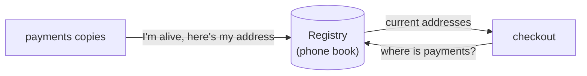
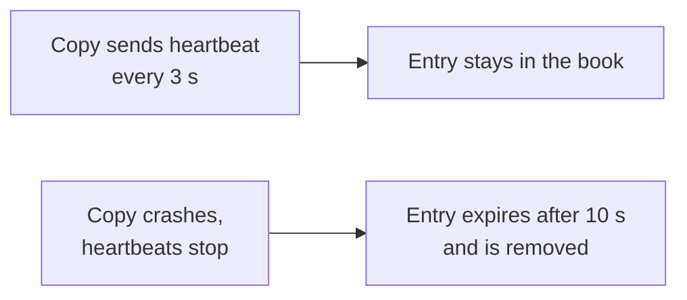
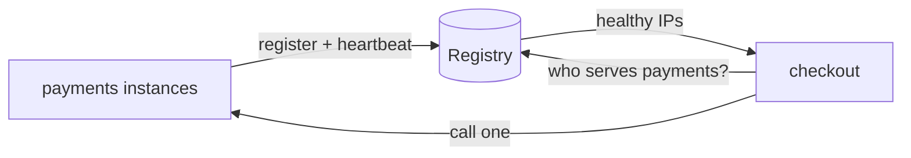
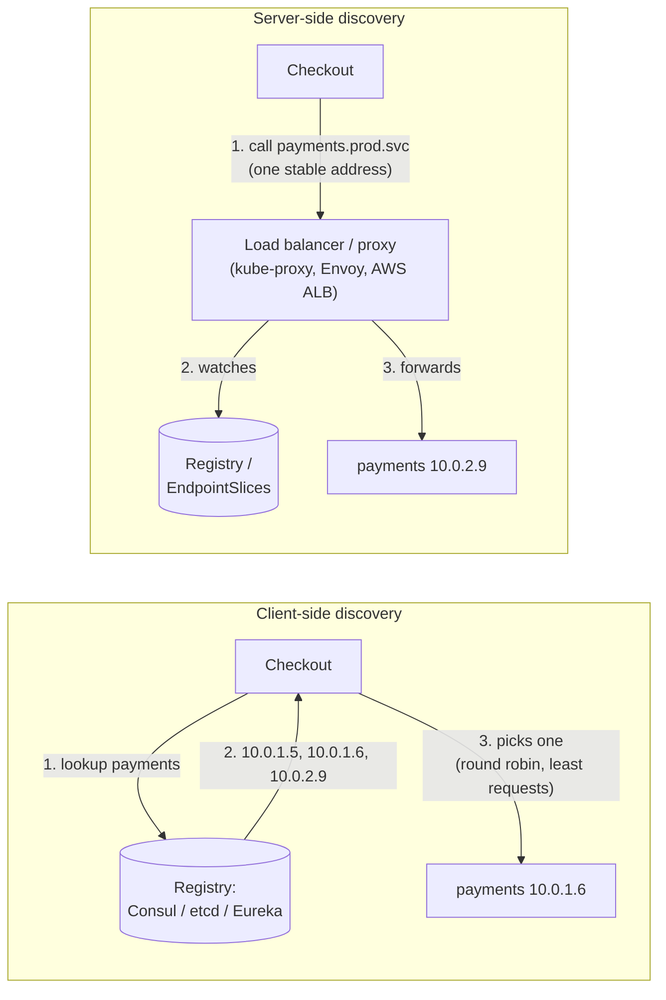
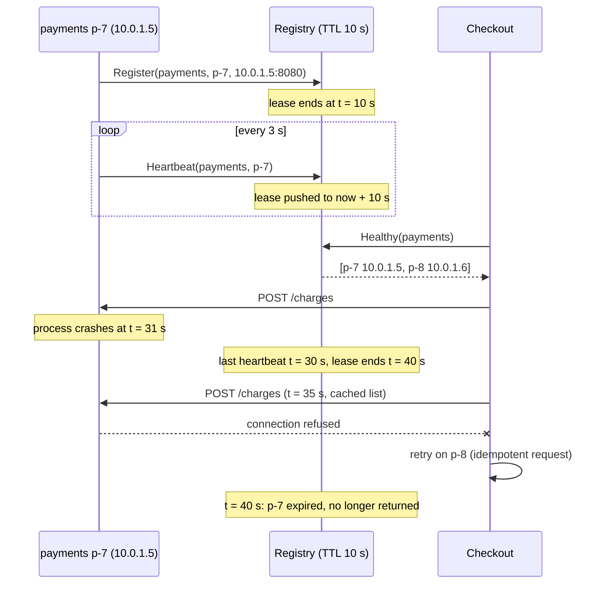
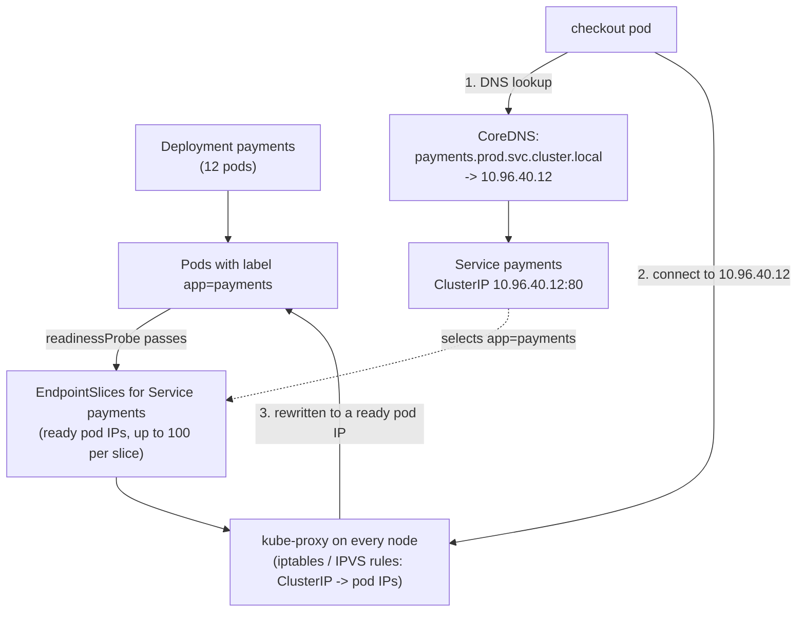
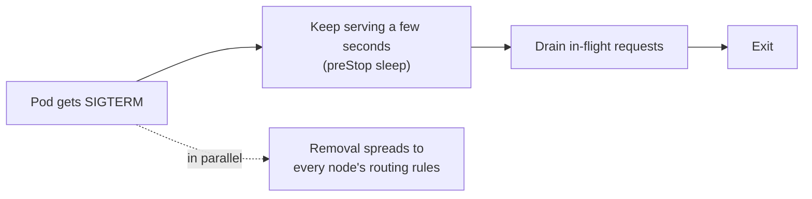

# Service Discovery

> [!summary] TL;DR
> **Service discovery** is how one service finds the current network addresses (IP and port) of another service, when those addresses keep changing because instances start, stop, crash and autoscale. A **registry** keeps the list of healthy instances, and callers look it up either themselves (**client-side**) or through a load balancer that does it for them (**server-side**).

> [!abstract] Core idea
> - Instances come and go, so addresses must be looked up at runtime, never written into config.
> - A **registry** holds `service name → healthy instances`; entries are kept alive by heartbeats or health checks and expire when they stop.
> - **Client-side discovery:** the caller fetches the list and load-balances itself. **Server-side discovery:** the caller hits one stable address and a proxy picks the instance.
> - Every answer is slightly stale. Design callers to survive a dead address: timeouts, retries on another instance, and graceful deregistration on shutdown.

## Start here: the basics 🟢

> [!info] How to read this note (pick your level)
> - 🟢 **New to this?** Read "From zero" below, then sections 1, 2 and the cheat sheet (10). Stop there, that is a full first pass.
> - 🟡 **Know the basics?** Add section 3 (how it works), 4 (worked example) and 5 (variants).
> - 🔴 **Interview / SDE-3 prep?** Add 6, 7, 8 and 9. Headings are tagged 🟢🟡🔴 so you always know where you are.

> [!note] Before this note
> - [[Load Balancing]]: a load balancer spreads requests over several copies of a service and skips the ones that fail health checks.
> - [[DNS - Resolution, Records and Caching]]: DNS turns a name into an IP address, and answers are cached for a while (the TTL), so they can be out of date.

**From zero, in 60 seconds** 🟢

Big apps are made of many small programs (**services**) that call each other. Checkout calls payments, payments calls the bank, and so on.

Each service runs as several copies, and the copies keep moving: they restart, crash, get added, get removed. Every copy has a network address, and the addresses change all the time.

So how does checkout know where payments lives *right now*? It asks a shared, always-updated phone book. That phone book is the **registry**, and the whole idea is called **service discovery**.



Each copy must keep saying "I'm still alive" (a **heartbeat**). If it goes quiet, the phone book drops it after a few seconds.



The rest of this note is just these 4 questions:
1. How does a copy get into the phone book, and how does it fall out?
2. Who looks up the book: the caller itself, or a middleman?
3. What happens in the few seconds when the book is out of date?
4. How does Kubernetes do all of this for you?


**The problem in one story.**
You want to call a friend, but they change phone numbers every few hours.
Writing their number on paper fails by lunch.
Instead you ask a shared contacts app, which always has their latest number.
Service discovery is that contacts app for services whose addresses keep changing.

**Words you need first**

| Word | Plain meaning | Tiny example |
| --- | --- | --- |
| Service | A program other programs call | `payments` |
| Instance | One running copy of a service | Pod 3 of 12 |
| IP and port | The network address of an instance | `10.0.1.5:8080` |
| Registry | A list of healthy instances per service | `payments → [ip1, ip2]` |
| Heartbeat | A regular "I'm alive" message | Every 3 s |
| TTL / lease | Time after which an entry expires unless renewed | 10 s |
| Health check | A test that the instance can serve | `GET /healthz` returns 200 |
| Load balancer | Picks one instance for each call | Round robin |
| Idempotent | Safe to repeat: doing it twice has the same effect as once | a charge with an idempotency key |
| Sidecar | A small helper proxy running next to your app in the same pod | Envoy beside the checkout container |
| Kubernetes Service / ClusterIP | A fixed name and virtual IP that always points at the ready pods | `payments` → `10.96.40.12` |
| Readiness probe | Kubernetes's "can this pod take traffic now?" check | `GET /ready` every 10 s |
| etcd / Consul / Eureka | Popular registry products | etcd also stores Kubernetes's own state |
| Raft | A voting method that keeps several copies of a store in agreement | 3 etcd nodes, 2 must agree |

**Picture it**



**Analogy.** A shopping mall directory board that updates when shops move.
Where it breaks: the board can be a few seconds out of date, so you may still walk to a shop that just closed; callers must retry elsewhere.

**How the rest of this note builds up**

- First, why hard-coded addresses fail (section 1) and the mental model (section 2).
- Then the four jobs, client-side vs server-side discovery, a lease-based registry and Kubernetes (section 3).
- Then a registry and client-side balancer in Go, and choosing TTL and heartbeat with numbers (section 4).
- Finally the SDE-3 deep dive: CP vs AP registries, removal propagation in Kubernetes, gRPC balancing, zone-aware routing and health checks (sections 5-8).

> [!tip] Remember
> Look addresses up at runtime from a registry kept fresh by heartbeats, and assume every answer is a little stale.

## 1. Why it exists 🟢

The checkout service calls the payments service. In 2015 you might have written `PAYMENTS_URL=http://10.0.1.5:8080` in a config file. Today payments runs as 12 containers in Kubernetes:

- Each deploy replaces all 12 pods, and each new pod gets a new IP.
- The autoscaler adds 8 more pods at 7 pm and removes them at midnight.
- A node fails, and its 3 pods restart elsewhere with new IPs.

On a busy day the set of payments addresses might change dozens of times. A hard-coded list would point at dead IPs within the first deploy, and checkout would fail with connection-refused errors or, worse, time out on IPs that no longer answer. Someone would have to edit configs by hand every time the set changed.

Service discovery replaces the hard-coded list with a lookup: "give me the healthy instances of `payments` right now".

## 2. Mental model 🟢

Think of a company's internal phone directory that updates itself.

- Every employee who arrives at their desk **checks in** ("I'm Alice from payments, extension 8080").
- They must **check in again every few minutes**. If they stop (they went home, or the phone broke), their entry disappears after a short while.
- To call payments, you either **look up the list yourself** and pick someone (client-side), or you **call the payments front desk**, which forwards you to whoever is free (server-side).

The directory is only as fresh as the last check-in. Someone may have left a minute ago and still be listed, which is why you need to hang up and try someone else when nobody answers.

### Real-life example: placing an order on Swiggy 🟢

When you tap "Place order", the order service must call the payment service, then the restaurant service, then the delivery service.
Each of those runs as dozens of copies that come and go all evening as traffic rises and falls.
The order service never stores their addresses. It asks "where is payments right now?" (in Kubernetes, it just calls the name `payments`), and gets a live answer.
If a payment copy crashed a second ago, the call fails fast and is retried on another copy, so your order still goes through.

## Common beginner mistakes 🟢

- **Writing IP addresses in a config file** → they are dead after the next deploy → look up a service name at runtime.
- **Retrying every failed call on another instance** → a charge may happen twice → retry only idempotent calls, or send an idempotency key.
- **Shutting a pod down the instant it gets the stop signal** → some nodes still send it traffic for a moment → fail readiness, wait a few seconds, finish in-flight work, then exit.
- **Adding Consul or Eureka inside Kubernetes "to be safe"** → you now run two phone books that can disagree → use Kubernetes Services unless you also span VMs or clusters.
- **Treating "process is up" as "ready"** → a pod with a lost database still gets traffic → use a readiness check that covers what a request needs.

### Service discovery vs things people confuse it with 🟡

| Thing | What it answers | Example |
| --- | --- | --- |
| Service discovery | Which copies of `payments` are alive right now? | registry returns 3 pod IPs |
| DNS | What address does this name point to? | `payments.prod.svc.cluster.local` → a ClusterIP |
| Load balancer | Which one copy gets this request? | round robin over the 3 pods |
| Config service | What settings should the app use? | `max_retries = 3` |

## 3. How it works 🟡

> 🟢 → 🟡 **You now know** that services find each other through a live phone book kept fresh by heartbeats. **Next we open the box**: the four jobs of a registry, who does the lookup, what happens in the seconds after a crash, and how Kubernetes does it all for you. Most subsections start with a plain step-by-step walk; the full detail follows.

### The four jobs

**In plain words:** a registry entry has a life: get added, keep proving you are alive, get looked up, get removed. Like signing in at a reception desk and signing out when you leave.

1. **Register:** an instance tells the registry "service `payments`, instance `p-7`, at `10.0.1.5:8080`". Either the instance does it itself (**self-registration**, as with Eureka clients) or the platform does it for it (**third-party registration**, as when Kubernetes adds a ready pod to the Service's EndpointSlices, which are Kubernetes's lists of pod addresses for a Service).
2. **Stay healthy:** the entry stays only while it is proven alive. Either the instance renews a **lease** (heartbeat with a TTL), or the registry **actively probes** it (an HTTP `GET /ready`, a TCP connect).
3. **Look up:** a caller asks for the healthy instances of `payments`, usually caching the answer and watching for changes.
4. **Deregister:** on graceful shutdown the instance removes itself first, so callers stop sending it traffic before it stops listening. If it crashes, the lease or failed probe removes it later.

### Client-side vs server-side discovery

**In plain words:** either the caller reads the phone book itself and dials a copy directly (client-side), or the caller always dials one fixed number and a receptionist forwards the call (server-side).

**Step by step:**
1. Client-side: checkout asks the registry "who serves payments?" and gets 3 addresses.
2. Checkout keeps the list, picks `10.0.1.6` itself (say round robin) and calls it directly.
3. Server-side: checkout always calls one fixed address, `payments.prod.svc`.
4. A proxy behind that address (kube-proxy, Envoy or an ALB) watches the registry and forwards the call to `10.0.2.9`.
5. Client-side saves a hop but needs a smart library in every language; server-side keeps clients dumb but runs a proxy layer.



| | Client-side | Server-side |
| --- | --- | --- |
| Who picks the instance | A library in the caller | A proxy or load balancer |
| Extra network hop | None | One, unless the proxy is a sidecar on the same host |
| Smart balancing (least requests, zone-aware) | Yes, in the client | Yes, in the proxy |
| Cost | A discovery client in every language you use | Running and scaling the proxy layer |
| Examples | Eureka + Ribbon, gRPC with a resolver, Consul client libraries | Kubernetes Service (kube-proxy), AWS ALB with target groups, Envoy/service mesh |

### A lease-based registry, step by step

**In plain words:** a **lease** is a short-term booking: "this address is valid for 10 more seconds." Every heartbeat extends the booking. The diagram below walks through a crash and shows the few seconds where callers still have the dead address.

**Step by step:**
1. Pod p-7 registers at time 0. Its lease ends at 10 s.
2. Every 3 s it sends a heartbeat, and the end moves to "now + 10 s".
3. At 30 s it sends its last heartbeat. At 31 s it crashes. The lease still runs to 40 s.
4. At 35 s checkout still has p-7 in its list, calls it, and gets "connection refused".
5. Checkout retries on p-8 (safe because the call is idempotent). At 40 s p-7 disappears from the list.



The timeline shows the unavoidable window: between the crash (31 s) and the lease expiry (40 s), p-7 is still listed. Callers must handle that with timeouts and a retry on another instance, which is safe only for idempotent requests (see [[Timeouts, Retries and Backoff]]).

### Kubernetes: discovery built into the platform

**In plain words:** in Kubernetes you never build any of this yourself. The platform keeps the phone book (EndpointSlices), gives each service a fixed name and address, and quietly rewrites your connection to a healthy copy.

**Step by step:**
1. You create a Service called `payments`. It gets a fixed virtual IP, `10.96.40.12`, and a DNS name.
2. Each payments pod that passes its readiness probe is added to the Service's address list.
3. Checkout looks up `payments.prod.svc.cluster.local` and gets `10.96.40.12`.
4. It connects. kube-proxy (a program on every node that writes the node's traffic rules) rewrites the connection to one ready pod's real IP.
5. A pod fails readiness? It is dropped from the list and gets no new connections, but it is not restarted.



- A **Service** selects pods by label and gets a stable virtual IP (ClusterIP) and DNS name `<service>.<namespace>.svc.cluster.local`.
- The EndpointSlice controller keeps the list of matching pods' IPs, marking each one ready or not ready based on its **readiness probe**. Pods that fail readiness stay running but stop receiving traffic.
- **kube-proxy** on each node programs iptables or IPVS rules (Linux kernel features that rewrite where network packets go) so that a connection to the ClusterIP is sent to one of the ready pod IPs. This is server-side discovery, done in the kernel of the caller's own node.
- A **headless Service** (`clusterIP: None`) skips the virtual IP: DNS returns the pod IPs directly, so clients can do client-side balancing. gRPC clients often need this (section 8).

See [[Kubernetes Fundamentals]] for Services and probes in more depth.

## 4. Worked example 🟡

### Whiteboard version

The heart of a lease-based registry: an address is valid until its lease runs out, and a heartbeat pushes the lease forward.

```go
package wb

import "time"

// Registry is the bare idea: an address is valid until its lease runs out.
type Registry struct {
	ttl     time.Duration
	expires map[string]time.Time // "payments/10.0.1.5:8080" -> lease end
}

// Heartbeat registers or renews; instances call it every ttl/3 or so.
func (r *Registry) Heartbeat(addr string, now time.Time) {
	r.expires[addr] = now.Add(r.ttl)
}

func (r *Registry) Alive(now time.Time) []string {
	var out []string
	for addr, end := range r.expires {
		if now.Before(end) {
			out = append(out, addr)
		}
	}
	return out
}
```

### A registry and a client-side balancer in Go

**In plain words:** the code below is a toy version of the real thing: a map of addresses with expiry times, plus a picker that goes round the healthy list in a circle.

The full version adds service names, instance IDs, explicit deregistration (the graceful-shutdown path), a reaper that deletes expired entries, and a round-robin balancer that always reads the current healthy list. The clock is injected so the tests can move time.

```go
// Package discovery is a minimal service registry with TTL leases, the model
// behind etcd leases, Consul TTL checks and Eureka renewals.
package discovery

import (
	"cmp"
	"errors"
	"slices"
	"sync"
	"sync/atomic"
	"time"
)

type Instance struct {
	ID   string
	Addr string // host:port
}

type entry struct {
	inst    Instance
	expires time.Time
}

var ErrUnknown = errors.New("discovery: unknown instance (lease expired?)")

// Registry is safe for concurrent use.
type Registry struct {
	mu       sync.RWMutex
	ttl      time.Duration
	now      func() time.Time
	services map[string]map[string]*entry // service -> instance id -> entry
}

func NewRegistry(ttl time.Duration, now func() time.Time) *Registry {
	return &Registry{ttl: ttl, now: now, services: map[string]map[string]*entry{}}
}

// Register adds or replaces an instance with a fresh lease.
func (r *Registry) Register(service string, in Instance) {
	r.mu.Lock()
	defer r.mu.Unlock()
	if r.services[service] == nil {
		r.services[service] = map[string]*entry{}
	}
	r.services[service][in.ID] = &entry{inst: in, expires: r.now().Add(r.ttl)}
}

// Heartbeat renews the lease. An expired instance must register again.
func (r *Registry) Heartbeat(service, id string) error {
	r.mu.Lock()
	defer r.mu.Unlock()
	e, ok := r.services[service][id]
	if !ok || !r.now().Before(e.expires) {
		return ErrUnknown
	}
	e.expires = r.now().Add(r.ttl)
	return nil
}

// Deregister is the graceful-shutdown path: remove before the lease runs out.
func (r *Registry) Deregister(service, id string) {
	r.mu.Lock()
	defer r.mu.Unlock()
	delete(r.services[service], id)
}

// Healthy returns live instances sorted by ID (stable order for clients).
func (r *Registry) Healthy(service string) []Instance {
	r.mu.RLock()
	defer r.mu.RUnlock()
	now := r.now()
	var out []Instance
	for _, e := range r.services[service] {
		if now.Before(e.expires) {
			out = append(out, e.inst)
		}
	}
	slices.SortFunc(out, func(a, b Instance) int { return cmp.Compare(a.ID, b.ID) })
	return out
}

// Reap deletes expired entries; run it on a ticker.
func (r *Registry) Reap() int {
	r.mu.Lock()
	defer r.mu.Unlock()
	now, n := r.now(), 0
	for _, insts := range r.services {
		for id, e := range insts {
			if !now.Before(e.expires) {
				delete(insts, id)
				n++
			}
		}
	}
	return n
}

// Balancer is client-side discovery: it keeps a cached list and round-robins.
type Balancer struct {
	reg     *Registry
	service string
	next    atomic.Uint64
}

func NewBalancer(reg *Registry, service string) *Balancer {
	return &Balancer{reg: reg, service: service}
}

var ErrNoInstances = errors.New("discovery: no healthy instances")

func (b *Balancer) Pick() (Instance, error) {
	insts := b.reg.Healthy(b.service)
	if len(insts) == 0 {
		return Instance{}, ErrNoInstances
	}
	i := b.next.Add(1) - 1
	return insts[i%uint64(len(insts))], nil
}
```

```go
package discovery

import (
	"sync"
	"testing"
	"time"
)

type clock struct {
	mu sync.Mutex
	t  time.Time
}

func (c *clock) now() time.Time      { c.mu.Lock(); defer c.mu.Unlock(); return c.t }
func (c *clock) add(d time.Duration) { c.mu.Lock(); c.t = c.t.Add(d); c.mu.Unlock() }

func TestLeaseExpiresWithoutHeartbeat(t *testing.T) {
	c := &clock{t: time.Unix(1_800_000_000, 0)}
	r := NewRegistry(10*time.Second, c.now)
	r.Register("payments", Instance{"p-1", "10.0.1.5:8080"})
	r.Register("payments", Instance{"p-2", "10.0.1.6:8080"})

	c.add(6 * time.Second)
	if err := r.Heartbeat("payments", "p-1"); err != nil { // p-1 renews, p-2 is silent
		t.Fatal(err)
	}
	c.add(6 * time.Second) // t = 12 s: p-2's lease (10 s) is gone, p-1's runs to 16 s
	got := r.Healthy("payments")
	if len(got) != 1 || got[0].ID != "p-1" {
		t.Fatalf("healthy = %v", got)
	}
	if err := r.Heartbeat("payments", "p-2"); err != ErrUnknown {
		t.Fatalf("late heartbeat should fail, got %v", err)
	}
	if n := r.Reap(); n != 1 {
		t.Fatalf("reaped %d", n)
	}
}

func TestDeregisterAndRoundRobin(t *testing.T) {
	c := &clock{t: time.Unix(1_800_000_000, 0)}
	r := NewRegistry(10*time.Second, c.now)
	for _, id := range []string{"a", "b", "c"} {
		r.Register("search", Instance{id, id + ":9000"})
	}
	b := NewBalancer(r, "search")
	var seq string
	for i := 0; i < 6; i++ {
		in, _ := b.Pick()
		seq += in.ID
	}
	if seq != "abcabc" {
		t.Fatalf("round robin = %s", seq)
	}
	r.Deregister("search", "b")
	for i := 0; i < 4; i++ {
		if in, _ := b.Pick(); in.ID == "b" {
			t.Fatal("deregistered instance picked")
		}
	}
	c.add(time.Minute)
	if _, err := b.Pick(); err != ErrNoInstances {
		t.Fatalf("want ErrNoInstances, got %v", err)
	}
}

func TestConcurrentAccess(t *testing.T) {
	c := &clock{t: time.Unix(1_800_000_000, 0)}
	r := NewRegistry(time.Second, c.now)
	r.Register("cart", Instance{"x", "x:1"})
	b := NewBalancer(r, "cart")
	var wg sync.WaitGroup
	for g := 0; g < 8; g++ {
		wg.Add(1)
		go func() {
			defer wg.Done()
			for i := 0; i < 200; i++ {
				_ = r.Heartbeat("cart", "x")
				_, _ = b.Pick()
				r.Reap()
			}
		}()
	}
	wg.Wait()
}
```

`go vet` is clean and `go test -race` passes all three tests (Go 1.24.4). `TestLeaseExpiresWithoutHeartbeat` is the sequence diagram above in code: p-1 heartbeats at 6 s and lives to 16 s, p-2 never heartbeats and is gone at 10 s, so at 12 s only p-1 is returned and p-2's late heartbeat is refused, forcing it to register again.

### Choosing TTL and heartbeat interval, with numbers

**In plain words:** short expiry times spot crashes fast but panic over small hiccups; long ones are calm but slow to notice a death. The numbers below show the trade.

Take a TTL of 10 s and a heartbeat every 3 s:

- **Detection time for a crash:** up to 10 s after the last heartbeat. The average is about 10 − 3/2 = 8.5 s after the crash, since the crash happens at a random point between heartbeats.
- **Tolerance for lost heartbeats:** after a beat at t = 0 the lease runs to 10 s. If the beats at 3 s and 6 s are lost, the one at 9 s still renews it; if that one is lost too, the entry expires at 10 s.

  So two lost heartbeats in a row are survived and three are not.
- **Registry load:** 2,000 instances × 1 heartbeat / 3 s ≈ **667 writes per second**.

  If every heartbeat were a Raft write (as a naive "rewrite the key with a TTL" design would make it), the registry would replicate 667 writes per second just to say "still alive". etcd avoids this: one lease can cover many keys, and keep-alives are sent to the leader over a stream without being written through Raft.

  Consul goes further and runs health checks on a local agent on each node, so only status changes reach the servers.
- **Caller staleness:** if callers cache the list for 5 s, the worst case for sending to a crashed instance becomes 10 + 5 = **15 s**. Watching the registry for changes (etcd watch, Consul blocking queries, Kubernetes watches) brings the cache delay down to the push latency.

Shorter TTLs detect failures faster but turn a 2-second GC pause (the program freezing while it frees unused memory) or network blip into a false removal; a mass expiry during a network partition (some machines can no longer reach the others) can drop most of a healthy fleet.

Eureka's defaults (30 s renewals, 90 s expiry) sit at the slow and safe end; Kubernetes readiness probes default to every 10 s, with 3 failures before a pod is marked not ready.

## 5. Variants and comparison 🟡

| Option | How it works | Health | Consistency | Use when |
| --- | --- | --- | --- | --- |
| Static config / DNS A records | Fixed names or IPs, DNS TTL caching | None built in | Stale until TTL and client caches expire | Few, stable endpoints (databases, partners) |
| DNS SRV records (a DNS record type that also carries the port) | DNS returns host + port + weight | Depends on what updates DNS | As stale as DNS caching | Clients can read SRV; ports vary |
| Kubernetes Service + EndpointSlices | Platform registers pods; kube-proxy or DNS routes | Readiness probes | Watch-based, seconds | Everything already runs in Kubernetes |
| Consul | Agents on every node; servers replicate with Raft; DNS (port 8600) and HTTP API | Agent-run checks (HTTP, TCP, TTL, script) | CP catalog, with stale reads allowed | Mixed VMs and containers, multiple data centres |
| etcd | Keys under a prefix, attached to TTL leases; clients watch the prefix | Lease keep-alives | Linearizable (Raft) | You already run etcd; Go services |
| ZooKeeper | Ephemeral znodes (entries in ZooKeeper's tree that vanish with their owner) disappear when the session ends | Session heartbeats | Linearizable writes (ZAB) | JVM ecosystems already on ZooKeeper (Kafka before KRaft, HBase) |
| Eureka | Client-side registry, peers replicate asynchronously | Client renewals (30 s), expiry (90 s) | AP: prefers stale data to no data | Spring Cloud / Netflix-style stacks |
| Service mesh (Envoy + xDS) | Control plane pushes endpoints (EDS) to sidecar proxies | Active and passive (outlier detection) | Eventually consistent push | Need mTLS, retries, zone-aware routing for many languages |
| Cloud service registries (AWS Cloud Map, ALB target groups) | Managed registry or LB health checks | LB health checks | Managed | You are on one cloud and want no extra servers |

**CP vs AP registries** (CP = stay correct even if some callers get errors during a network split; AP = keep answering, maybe with old data). etcd, ZooKeeper and Consul's catalog use consensus (see [[Consensus - Raft and Paxos]]), so during a partition the minority side cannot register or renew. Eureka chose availability: each node keeps serving what it has, and its **self-preservation** mode stops expiring instances when renewals drop sharply, on the theory that the network, not the fleet, is broken.

For discovery, slightly stale data is usually better than no data, because callers already retry on dead instances.

## 6. Trade-offs and when not to use 🔴

> 🟡 → 🔴 **You now know** how a registry lives, how lookups work and how to pick TTLs. **Next comes the senior view**: what each style costs you, what breaks in real fleets (dying pods, gRPC pinning, registry outages), and how removals actually travel through Kubernetes.

- **Client-side discovery puts logic in every client.** Balancing, retries and caching must be implemented (or a library maintained) for each language. Server-side discovery centralises that at the cost of a proxy layer and, without sidecars, an extra hop.
- **DNS is a weak discovery protocol on its own.** Clients and libraries cache answers, some longer than the TTL, and DNS carries no health detail. It works when the name points to something stable (a ClusterIP or a load balancer) that handles changes behind it.
- **The registry is critical infrastructure.** If it is down and callers have no cache, nothing can find anything. Run it replicated, and make callers keep using the last good list when the registry is unreachable.
- **Health is not one bit.** "Process is up" (liveness) is not "ready for traffic" (readiness). An instance that is warming a cache or has lost its database should fail readiness and leave the pool without being restarted (see [[Graceful Shutdown and Health Checks]]).
- **When not to use a separate registry:** inside Kubernetes, Services already give you discovery; adding Consul or Eureka on top duplicates it unless you also span VMs or clusters. For a monolith with one database, a load balancer's static target list is enough.

## 7. In production 🔴

- **Real systems:**
	- **Kubernetes** is the most common discovery system today: Services, EndpointSlices (by default at most 100 endpoints per slice, so large services have many slices and updates touch only one), CoreDNS, and kube-proxy.
	- **Consul** runs an agent on every node that performs health checks locally and gossips membership (Serf; gossip means each node passes news to a few random others until everyone knows), while a small set of servers keeps the catalog with Raft. Services are reachable through its DNS interface (`payments.service.consul`, port 8600) or the HTTP API on port 8500.
	- **etcd** is often used directly by Go services: register as a key under `/services/payments/` attached to a lease, keep it alive, and have callers watch the prefix.
	- **Netflix Eureka** popularised client-side discovery with Ribbon for balancing.
	- **gRPC** has pluggable name resolvers and load-balancing policies. Its default policy is `pick_first`; `round_robin` must be enabled in the service config. It also supports xDS, so a control plane can push endpoints and policies to proxyless gRPC clients.
- **Failure modes and fixes:**
	- *Traffic to pods that are shutting down* → on SIGTERM, fail readiness first, keep serving in-flight requests, and stop only after endpoint removal has propagated; in Kubernetes a short `preStop` sleep (a hook that runs before the stop signal reaches the app) covers the delay before kube-proxy rules update.
	- *Long-lived connections ignore new instances* → HTTP/2 and gRPC keep one connection per backend open, so kube-proxy's per-connection balancing pins all traffic to the pods that existed when the connection opened. Use a headless Service with client-side `round_robin`, a mesh, or periodically recycle connections (gRPC servers can set a maximum connection age).
	- *Registry outage* → callers keep their last known list and keep working; alert on stale caches.
	- *Mass expiry during a network blip* → longer TTLs, Eureka-style self-preservation, or a floor on how many instances can be removed at once.
	- *Zombie entries* (instance dead, entry alive because something else keeps renewing it) → tie the lease to the instance's own process, and add passive health checking (outlier detection) at the caller or proxy.
	- *DNS caching* → long client-side caching keeps sending traffic to old IPs; point DNS at stable virtual IPs or load balancers and keep TTLs short where names map to instances.
- **What to monitor:** healthy instance count per service (against the desired count), registration and deregistration rate (a spike means flapping), heartbeat failures, endpoint propagation delay, connection errors and retries at callers by target instance, and the registry's own latency and leader changes.

## 8. Deep dive 🔴

### How fast does a removal propagate in Kubernetes?

**In plain words:** when a pod is told to stop, the news travels to every node a moment later. For a second or two some nodes still send it traffic, so a pod must not die instantly; it should wave goodbye and serve a little longer.



A pod being deleted is removed from the EndpointSlices, and in parallel the kubelet sends SIGTERM to the container. The removal then travels: the API server → EndpointSlice watch → kube-proxy on every node → new iptables or IPVS rules, plus any ingress controllers or mesh proxies doing their own watching.

Those steps are asynchronous, so for a short time some nodes still route new connections to a pod that has already received SIGTERM. If the app exits immediately, those connections fail.

The usual fix is to keep accepting requests for a few seconds after SIGTERM (a `preStop` sleep, or a delay in the app's shutdown handler) and only then drain and exit.

The right delay depends on your cluster size and proxies, so measure it rather than guessing.

### gRPC and connection-level balancing

**In plain words:** gRPC opens one long phone call and sends everything over it, so a per-call balancer never gets a chance to spread the load. All traffic sticks to one pod unless you fix it.

kube-proxy balances **connections**, not requests. An HTTP/1.1 client opens many short connections, so its requests spread across pods. A gRPC client opens one HTTP/2 connection per target and sends every request over it. If checkout connects to the `payments` ClusterIP once, every request goes to one pod, and the 8 pods the autoscaler adds never see traffic. Options:

1. **Headless Service + client-side balancing:** `dns:///payments.prod.svc.cluster.local:50051` with the `round_robin` policy, so the client opens a connection to every pod IP. DNS re-resolution picks up new pods.
2. **xDS:** the client uses `xds:///payments`, and a control plane pushes endpoints and weights directly.
3. **A mesh sidecar or L7 proxy** that balances per request.
4. **Server-side `MaxConnectionAge`:** servers close connections periodically, so clients reconnect and spread out over time.

See [[gRPC]] for the protocol background.

### Zone-aware routing

**In plain words:** calling a copy in your own data-center zone is faster and cheaper than calling one across town; good routers prefer the local copy but fall back when it is unhealthy.

With instances in three availability zones, sending every request to a random instance means two-thirds of calls cross zones, which adds latency and, in most clouds, data-transfer charges. Discovery systems can prefer same-zone endpoints (Kubernetes topology-aware routing, Envoy zone-aware balancing) and fall back to other zones when the local zone lacks healthy capacity.

The risk is overloading a zone that has fewer instances, so these features only kick in when capacity is balanced.

### Health checking: active, passive and both

**In plain words:** active = the system knocks on each door to check; passive = it watches real calls and ejects whoever keeps failing them. Use both.

- **Active** checks probe each instance on a schedule. They catch dead instances even with no traffic, but they test the health endpoint, not real requests.
- **Passive** checks (outlier detection) watch real traffic and eject an instance after, for example, 5 consecutive 5xx responses, for a cooldown period. They catch "up but broken" instances fast, but only with traffic.
- Production systems use both, plus a cap on how many instances may be ejected at once, so a shared failure (the database is down, and all instances return 500) does not eject the whole fleet. A circuit breaker at the caller is the per-dependency version of the same idea (see [[Circuit Breaker]]).

## 9. Interview questions 🔴

> [!question]- Client-side vs server-side discovery: which would you pick?
> Server-side (a Kubernetes Service, a load balancer or a mesh sidecar) when you have several languages or want balancing and retries in one place. Client-side when you need smart per-request balancing without an extra hop and control the client library, for example gRPC with `round_robin` or xDS. Inside Kubernetes, the default answer is server-side via Services.

> [!question]- An instance crashes. How long until callers stop sending it requests, and what happens in between?
> Up to the lease TTL (or the probe interval × failure threshold), plus caller cache or propagation delay. In between, callers get connection errors or timeouts on that address, so they need short timeouts and a retry on a different instance for idempotent requests. Graceful shutdown avoids the window for planned stops by deregistering first.

> [!question]- Trap: "Our gRPC service has 10 pods behind a ClusterIP Service, so load is balanced." Is it?
> Probably not. kube-proxy balances connections, and a gRPC client keeps one long-lived HTTP/2 connection, so all its requests go to one pod. Use a headless Service with client-side `round_robin`, an xDS control plane, a mesh, or `MaxConnectionAge` on the servers.

> [!question]- Should a service registry be CP or AP?
> For discovery, slightly stale data is usually better than none, because callers already retry on dead addresses; Eureka is deliberately AP.
>
> CP stores (etcd, ZooKeeper, Consul servers) give one consistent view and are also used for locks and leader election, but the minority side of a partition cannot register or renew. Whichever you choose, callers should cache the last good list.

> [!question]- What is the difference between liveness and readiness, and why does discovery care?
> Liveness asks "is the process stuck? restart it". Readiness asks "should it receive traffic now?". Discovery uses readiness: a failing readiness probe removes the pod from EndpointSlices without restarting it, which is right for warming up, overload or a lost dependency. Wiring a dependency check into liveness instead causes restart storms.

> [!question]- How do you avoid dropped requests during a rolling deploy?
> On SIGTERM: fail readiness, keep serving for a few seconds while removal propagates (a `preStop` sleep in Kubernetes), stop accepting new connections, finish in-flight requests with a deadline, then exit. Set `terminationGracePeriodSeconds` longer than that whole sequence.

## 10. Cheat sheet 🟢

- Registry = `service → healthy instances`; kept fresh by lease heartbeats (etcd, Eureka) or active probes (Consul agents, Kubernetes readiness).
- Client-side: the caller looks up and balances. Server-side: the caller hits a stable address; a proxy picks.
- Kubernetes: Service (ClusterIP + DNS `<service>.<namespace>.svc.cluster.local`) → EndpointSlices of ready pods → kube-proxy rules.
- Crash detection ≈ TTL + caller cache; keep timeouts short and retry idempotent calls elsewhere.
- Shutdown order: fail readiness → wait for propagation → drain → exit.
- gRPC over a ClusterIP pins to one pod: use headless + `round_robin`, xDS, or a mesh.
- Cache the last good list; slightly stale beats unavailable.

## Self-check 🟢🟡

> [!question]- (easy) Why not write a service's IP address in a config file?
> Pods get new IPs on every deploy, crash and scale-out, so the address goes stale fast.

> [!question]- (easy) What is a heartbeat for?
> It proves an instance is still alive; when heartbeats stop, its entry expires.

> [!question]- (easy) What is the difference between client-side and server-side discovery?
> Client-side: the caller looks up the list and picks. Server-side: the caller hits one fixed address and a proxy picks.

> [!question]- (medium) TTL 10 s, heartbeat every 3 s, callers cache for 5 s. Worst case to stop calling a dead pod?
> About 10 + 5 = 15 seconds.

> [!question]- (medium) Why does a gRPC client behind a ClusterIP often hit only one pod?
> It keeps one long connection, and kube-proxy balances connections, not requests.

> [!question]- (medium) What should a pod do when it gets SIGTERM?
> Fail readiness, keep serving a few seconds while removal spreads, finish in-flight work, then exit.

## Links

- **Before this:** [[Load Balancing]], [[DNS - Resolution, Records and Caching]], [[Bloom Filters and Probabilistic Data Structures]]
- **Next:** [[Hot Keys and Hot Partitions]]
- **Compare with:** [[Kubernetes Fundamentals]] (Services and probes), [[API Gateway and BFF]] (the edge entry point that also routes by service), [[Leader Election]] (the same lease mechanism used to own a role), [[Graceful Shutdown and Health Checks]] (the instance side of deregistration)

### Watch on YouTube

- [Service discovery and heartbeats in micro-services 👍📈](https://www.youtube.com/watch?v=lWE_UIbm8NA) · Gaurav Sen · 6 min · 120,843 views
- [Master Service Discovery in Microservices / Eureka and Java Spring Boot](https://www.youtube.com/watch?v=ecuEkmFs5Vk) · ByteMonk · 8 min · 55,096 views
