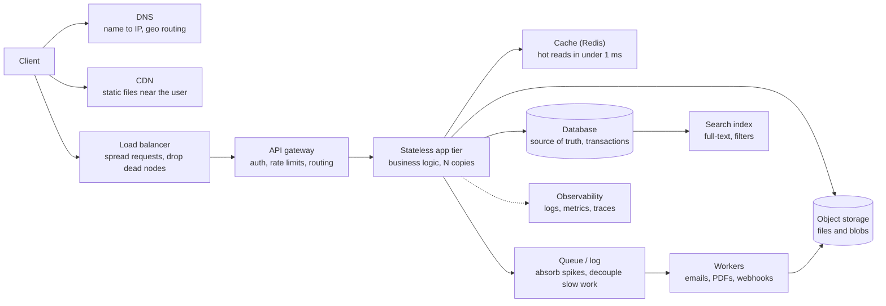
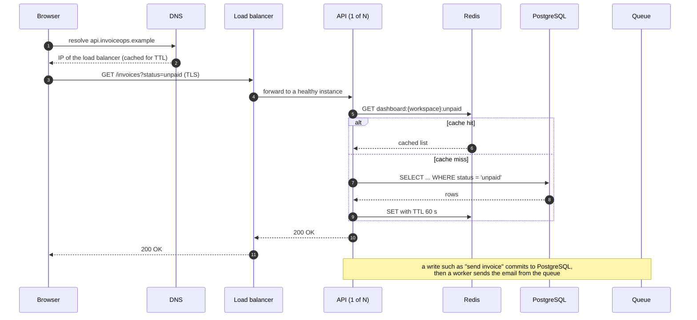

# System Design Fundamentals

> [!summary] TL;DR
> System design is choosing the components of a software system (servers, databases, caches, queues) and how they connect, so that it does what users need (**functional requirements**) at the speed, scale, reliability and cost the business needs (**non-functional requirements**). Every choice trades one quality for another, and good design states that trade-off with numbers.

> [!abstract] Core idea
> - Start from requirements: what the system must do, then how well it must do it (latency, availability, scale, durability, cost).
> - Every quality has a unit: nines for availability, milliseconds at p99 for latency, requests per second for throughput.
> - A standard stack of building blocks (DNS, CDN, load balancer, stateless app tier, cache, database, queue, object storage) solves most problems; each block exists to fix one specific pain.
> - Keep the app tier stateless and push state into a few purpose-built stores; the stores are where the hard trade-offs live.
> - Trap: "highly available" or "scalable" without a number means nothing.

## 1. Why it exists

A team builds an invoice service on one virtual machine: Go API and PostgreSQL on the same box. It works for 200 customers. Then three things happen in one quarter:

- A marketing email sends 5,000 users to the dashboard in ten minutes. CPU hits 100% and p99 latency goes from 80 ms to 9 s.
- The disk fails. There is a nightly backup, so 14 hours of invoices are lost.
- A deploy restarts the process, and every request in flight during the 20-second restart fails.

None of these is a coding bug. They are **design** gaps: one machine is a single point of failure, there is no headroom for peaks, and durability was never specified. System design is the discipline of deciding, before the incident, how much of each quality the system needs and which components buy it.

## 2. Mental model

Think of designing a restaurant kitchen rather than cooking one dish.

- The **menu** is the functional requirements: what can be ordered.
- **"Food within 15 minutes, 300 covers a night, never poison anyone"** are the non-functional requirements.
- **Stations** (grill, fry, pass, dishwash) are the building blocks. You add a second grill cook when the grill is the bottleneck, not before.
- The **walk-in fridge** is the database: it holds the state everything else depends on, and it is the hardest thing to duplicate.

Two vocabulary pairs you will use in every design:

- **Stateless vs stateful.** A stateless component keeps nothing between requests that another copy could not also serve (a Go API that reads the session from Redis). You can add or kill copies freely. A stateful component owns data (PostgreSQL, Kafka, Redis); copying it means [[Replication]] and splitting it means [[Partitioning and Sharding]].
- **Read-heavy vs write-heavy.** A URL shortener does about 100 reads per write, so caches and replicas fix it. A metrics ingester does mostly writes, so batching, queues and partitioning fix it. The read:write ratio decides the whole architecture.

## 3. How it works

### Requirements first

| Kind | Question it answers | Example (invoice service) |
| --- | --- | --- |
| Functional | What can a user do? | Create invoice, send it, record payment, list unpaid invoices |
| Non-functional | How well, how much, how safely? | p99 read < 200 ms, 99.9% monthly availability, zero lost payments, 2,000 RPS peak |
| Out of scope | What will we not build now? | Multi-currency tax, offline mobile mode |

### Quality attributes and their units

| Attribute | Definition | Unit and typical target |
| --- | --- | --- |
| Availability | Fraction of time (or of requests) the system answers correctly | Nines: 99.9% allows 8 h 46 min down per year (computed below) |
| Latency | Time for one request, measured as a distribution | p50 and p99 in ms; p99 is what your slowest 1% of users feel |
| Throughput | Work completed per unit of time | Requests per second (RPS), messages/s, MB/s |
| Durability | Probability that stored data is not lost | S3 is designed for 99.999999999% (11 nines) of object durability per year (AWS docs) |
| Consistency | Whether every reader sees the latest write | Strong, read-your-writes, eventual; see [[Consistency Models]] |
| Scalability | How cost and effort grow with load | "2x traffic needs about 2x app nodes and no redesign" |
| Cost | Money per unit of work | $ per million requests, $ per GB-month |

Availability and durability are different. A system can be down for an hour (availability lost) and still lose no data (durability kept). Losing a disk with no replica loses both.

The formal way to write these targets is an SLI (what you measure) and an SLO (the target for it); see [[SLIs, SLOs, SLAs and Error Budgets]].

### The building-block catalogue



| Block | Pain it removes | Owning note |
| --- | --- | --- |
| DNS | Clients need an address; regions need routing | [[DNS - Resolution, Records and Caching]] |
| CDN | Static and cacheable bytes travel far | [[CDN and Edge]] |
| Load balancer | One server is a bottleneck and a single point of failure | [[Load Balancing]] |
| API gateway | Every service re-implements auth and rate limits | [[API Gateway and BFF]] |
| Stateless app tier | Code must scale by adding copies | [[Scaling Basics]] |
| Cache | The database is too slow or too busy for hot reads | [[Caching Patterns]] |
| Database | State must be correct and survive crashes | [[SQL vs NoSQL]] |
| Queue or log | Slow or bursty work blocks the request path | [[Queues vs Streams and Broker Comparison]], [[Kafka and Event Streaming]] |
| Object storage | Files do not belong in database rows | [[File Uploads and Object Storage]] |
| Search index | `LIKE '%term%'` cannot rank or scale | [[Search Engines and Inverted Indexes]] |
| Observability | You cannot fix what you cannot see | [[Observability Fundamentals]] |

### A request's lifecycle through the stack



Each hop adds latency and a failure point. Most design work is deciding which hops a given request must take and which it can skip.

## 4. Worked example

### Whiteboard version

Draw this in two minutes for any web system, then adapt it:

```text
[Client] -> [DNS] -> [CDN: static]
         -> [LB] -> [API x N, stateless]
                       |-> [Redis cache]      (reads)
                       |-> [Postgres primary] (writes) -> [replicas] (reads)
                       |-> [Queue] -> [Workers] -> [Object storage / email]
NFRs on the side: p99 < 200 ms, 99.9%, 2k RPS peak, RPO 0 for payments
```

### Availability is arithmetic

A request that passes through components **in series** succeeds only if all of them are up, so you multiply. **Redundant** copies fail only if all copies are down at once. This Go code computes both; it passes `go vet` and `go test -race` on Go 1.24.

```go
package avail

import "time"

// Series is the availability of components that must ALL be up
// (a request passes through each one): multiply the availabilities.
func Series(a ...float64) float64 {
	out := 1.0
	for _, x := range a {
		out *= x
	}
	return out
}

// Parallel is the availability of redundant copies where ANY ONE up is enough,
// assuming the copies fail independently: 1 - P(all down).
func Parallel(a ...float64) float64 {
	allDown := 1.0
	for _, x := range a {
		allDown *= 1 - x
	}
	return 1 - allDown
}

// Downtime converts an availability into allowed downtime over a period.
func Downtime(availability float64, period time.Duration) time.Duration {
	return time.Duration((1 - availability) * float64(period))
}
```

```go
package avail

import (
	"math"
	"testing"
	"time"
)

func near(a, b, eps float64) bool { return math.Abs(a-b) < eps }

func TestSeriesLowersAvailability(t *testing.T) {
	// LB -> app -> database, each 99.9%.
	got := Series(0.999, 0.999, 0.999)
	if !near(got, 0.997003, 1e-9) {
		t.Fatalf("Series = %.6f, want 0.997003", got)
	}
}

func TestParallelRaisesAvailability(t *testing.T) {
	// Two independent replicas, each 99%.
	got := Parallel(0.99, 0.99)
	if !near(got, 0.9999, 1e-12) {
		t.Fatalf("Parallel = %.6f, want 0.9999", got)
	}
}

func TestDowntimeBudget(t *testing.T) {
	year := 365 * 24 * time.Hour
	cases := []struct {
		a    float64
		want time.Duration
	}{
		{0.99, 87*time.Hour + 36*time.Minute},       // 3.65 days
		{0.999, 8*time.Hour + 45*time.Minute + 36*time.Second},
		{0.9999, 52*time.Minute + 33*time.Second + 600*time.Millisecond},
	}
	for _, c := range cases {
		got := Downtime(c.a, year)
		if d := got - c.want; d > time.Second || d < -time.Second {
			t.Errorf("Downtime(%v) = %v, want about %v", c.a, got, c.want)
		}
	}
}
```

What the numbers say (computed by the code above, 365-day year, 30-day month):

| Availability | Down per year | Down per 30-day month |
| --- | --- | --- |
| 99% | 3.65 days | 7 h 12 min |
| 99.9% | 8 h 45 min 36 s | 43 min 12 s |
| 99.99% | 52 min 34 s | 4 min 19 s |
| 99.999% | 5 min 15 s | 26 s |

Three lessons for the invoice service:

1. **Series hurts.** LB, API and database at 99.9% each give 0.999³ = 99.7003%, about 26 hours of downtime a year. Every component you add to the request path lowers availability.
2. **Redundancy helps, if failures are independent.** Two API instances at 99% each give 1 − 0.01² = 99.99%. Two instances in the same rack on the same bad deploy are not independent, which is why real gains come from separate zones and staged rollouts.
3. **Pick the target before the architecture.** 99.9% can tolerate a 10-minute manual database failover a few times a year. 99.99% (4 minutes a month) cannot, so it forces automatic failover; see [[High Availability and Failover]].

## 5. Variants and comparison

Systems fall into a few shapes, and the shape decides the first components you reach for.

| Shape | Read:write | First tools | Typical example |
| --- | --- | --- | --- |
| Read-heavy | 10:1 to 1000:1 | Cache, CDN, read replicas | URL shortener, product catalogue, news feed reads |
| Write-heavy | 1:1 or below | Append-only logs, batching, partitioning, LSM stores | Metrics, logs, ad clicks, IoT telemetry |
| Real-time / connection-heavy | Mixed | Long-lived connections, fan-out, presence | Chat, live scores; see [[Scaling WebSockets]] |
| Transactional / correctness-heavy | Mixed, low volume | Relational DB, idempotency keys, ledgers | Payments, ticket booking |
| Batch / analytical | Huge scans | Columnar storage, stream or batch jobs | Reporting, billing runs |

| Trade-off pair | Choosing the left means | Example |
| --- | --- | --- |
| Latency vs consistency | Serve possibly stale data fast | Feed from a cache with 60 s TTL |
| Availability vs consistency (during a partition) | Accept writes that may conflict | Shopping cart in a leaderless store; see [[CAP and PACELC]] |
| Cost vs availability | Fewer replicas, one region | Internal admin tool at 99.5% |
| Simplicity vs scalability | One database, no sharding yet | Most products below about 10k writes/s (estimate; depends on hardware and query shape) |
| Throughput vs latency | Batch writes, wait to fill a batch | Kafka producer `linger.ms` |

## 6. Trade-offs and when not to use

- **Do not design for scale you do not have.** A single PostgreSQL primary with a replica serves most products for years. Microservices, Kafka and sharding each add operational cost before they add value.
- **Every extra hop costs latency and availability** (see the series rule). A cache that is down must not take the request path down with it.
- **Stateless is a property you maintain.** One in-memory session map or local file upload quietly makes an instance stateful and breaks load balancing.
- **Strong guarantees cost money.** Synchronous cross-region replication gives zero data loss and adds a cross-region round trip (often 50-150 ms, estimate) to every write.

## 7. In production

- **Real systems:** The canonical stack above is how most web products are built: a CDN (CloudFront, Cloudflare), a managed load balancer (AWS ALB), containers on ECS or Kubernetes, PostgreSQL or MySQL, Redis, a queue (SQS or Kafka), and S3 for files.
- **Failure modes → fixes:**
	- Single point of failure (one DB, one LB) → redundancy across availability zones plus automated failover.
	- Cache outage sends all reads to the database → capacity for a cold cache, rate limits, circuit breakers; see [[Cache Failure Modes - Stampede, Avalanche, Penetration, Hot and Big Keys]].
	- Slow dependency ties up every request → timeouts and bulkheads; see [[Timeouts, Retries and Backoff]].
	- Deploy kills in-flight requests → graceful shutdown and connection draining; see [[Graceful Shutdown and Health Checks]].
- **What to monitor:** the four golden signals per component (latency, traffic, errors, saturation), and the SLO burn rate for each user-facing journey.

## 8. Deep dive

- **Availability by requests, not minutes.** Many SLOs are written as "good requests ÷ total requests" rather than uptime. A system that fails 1% of requests all day is 99% available even though it was never "down".
- **Correlated failure breaks the parallel formula.** `Parallel` assumes independence. Shared power, a shared bad config, a shared dependency (DNS, an identity provider) or a retry storm make replicas fail together. This is why cloud regions are split into availability zones with separate power and networking.
- **Tail latency amplification.** If a page fans out to 100 backends and each has a 1% chance of being slow, the page is slow with probability 1 − 0.99¹⁰⁰ ≈ 63%. Fan-out designs must chase p99 and p99.9, not p50.
- **Durability is replication plus independence plus repair.** Eleven nines come from storing data across devices and facilities and repairing lost copies quickly; a replica alone is not a backup, because deletes and bad migrations replicate too (see [[Backup, PITR and Disaster Recovery]]).
- **State is the hard part.** Stateless tiers scale by adding copies. Stateful tiers need [[Replication]], [[Partitioning and Sharding]] and [[Consistent Hashing]], and each brings consistency questions. Most interview deep dives end up in the data layer.

## 9. Interview questions

> [!question]- What is the difference between functional and non-functional requirements?
> Functional requirements are what the system does ("users can shorten a URL"). Non-functional requirements are how well it does it, with numbers: "p99 redirect under 50 ms, 99.99% available, 10k writes/s". The non-functional ones decide the architecture; two systems with the same features can need very different designs.

> [!question]- Your service has an LB, API and database in series, each 99.9%. What is the end-to-end availability?
> 0.999³ ≈ 99.7%, about 26 hours of downtime a year. Components in series multiply. To raise it, make each tier redundant across zones and remove hops from the critical path.

> [!question]- Trap: two replicas at 99% give 99.99%, so we are done?
> Only if they fail independently. Same rack, same deploy, same config or same dependency means they fail together. Real redundancy needs separate failure domains, staged rollouts and no shared single dependency.

> [!question]- What makes a service stateless, and why do we care?
> No request depends on data held only in that instance's memory or disk: sessions, uploads, caches and locks live in shared stores. Then any instance can serve any request, so you can load-balance freely, autoscale and replace instances during deploys.

> [!question]- Is availability the same as durability?
> No. Availability is whether the system answers now. Durability is whether stored data survives. A database can be unavailable for an hour and lose nothing; a cache can be always up and keep nothing durable.

> [!question]- How does the read:write ratio change the design?
> Read-heavy systems scale with caches, CDNs and replicas. Write-heavy systems need batching, queues, append-only storage and partitioning, because caches do not absorb writes. Always ask for the ratio early.

## 10. Cheat sheet

- Requirements first: functional, non-functional with numbers, and out of scope.
- Units: nines for availability, p99 ms for latency, RPS for throughput, nines for durability.
- 99.9% ≈ 8 h 46 min/year ≈ 43 min/month; 99.99% ≈ 53 min/year ≈ 4.3 min/month.
- Series multiplies (0.999³ = 99.7%); parallel is `1 − Π(1 − a)` only for independent failures.
- Canonical stack: DNS → CDN → LB → gateway → stateless API → cache / DB / queue → workers → object storage.
- Stateless app tier, few stateful stores; the stores hold the hard trade-offs.
- Read-heavy → cache and replicas; write-heavy → batch, queue, partition.

## Links

- **Before this:** [[What Happens When You Type a URL]], [[Backend Request Lifecycle and Layering]]
- **Next:** [[Scaling Basics]], [[Back-of-the-Envelope Estimation]], [[Load Balancing]], [[System Design Interview Framework]], and the case-study index in [[11 System Design MOC]]
- **Compare with:** [[Architecture Fundamentals - Coupling, Cohesion and Dependency Direction]] (inside one service rather than across services), [[Distributed Systems Fundamentals]] (what goes wrong between the boxes)
