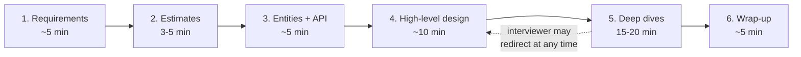
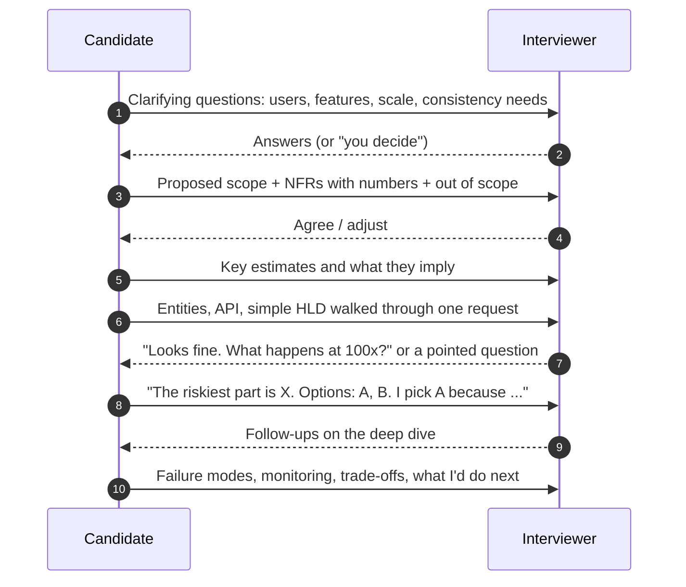

# System Design Interview Framework

> [!summary] TL;DR
> A system design interview gives you 45-60 minutes to design a large system out loud. This note is a repeatable plan for that hour: clarify requirements, estimate only what matters, define entities and APIs, draw a high-level design that works, then spend most of the time on one or two deep dives driven by the non-functional requirements, stating every trade-off as "X over Y because ...".

> [!abstract] Core idea
> - Requirements before boxes: functional, non-functional with numbers, and what is explicitly out of scope.
> - Make it work first (a simple design that meets the functional requirements), then make it scale and survive (deep dives driven by the non-functional ones).
> - Spend the most time on the riskiest component, and offer options before choosing.
> - Say trade-offs out loud, with numbers; name failure modes and what you would monitor.
> - At SDE-3 level the interviewer scores whether you drive the conversation, quantify, and keep the design simple and operable, not how many technologies you name.

## 1. Why it exists

Two candidates get "design a URL shortener".

- Candidate A starts drawing Kafka, Cassandra, a service mesh and five microservices in minute two. At minute 35 the interviewer asks how a redirect works and how short codes are generated; there is no answer, because the core flow was never designed.
- Candidate B spends 5 minutes on requirements (100:1 reads, 100 M new links/day, p99 redirect under 50 ms), 3 minutes on numbers, 5 on the API and schema, 10 on a simple design, and 17 on two deep dives (code generation without collisions; a cache for 116k reads/s). Every component is justified by a number.

The difference is not knowledge; it is a plan. Interviews are short, open-ended and judged on reasoning, so a fixed structure frees your attention for the actual design.

## 2. Mental model

Think of an architect meeting a client. The architect does not start with the roof material. They ask how many people will live there and what the budget is (requirements), sketch the floor plan (high-level design), then go deep on the hard part (the cantilevered balcony), while telling the client what each choice costs. The interviewer is the client and a colleague at the same time: they want to see how you decide, not just the final drawing.

## 3. How it works

### The time budget



For a 60-minute slot, give the extra time to deep dives. For a 35-40 minute slot, shrink estimates to one minute and do one deep dive.

### The steps (the 10-step framework, grouped)

| Phase | Steps | What you produce |
| --- | --- | --- |
| Requirements | 1. Clarify functional requirements (3-5 core features). 2. Non-functional requirements with numbers. Say what is out of scope. | A short list on the board |
| Estimates | 3. Scale: QPS (read and write), storage, bandwidth, only where it changes a decision | 3-6 numbers with units; see [[Back-of-the-Envelope Estimation]] |
| Interface | 4. Core entities. 5. API (endpoints or RPCs) and data model | `POST /links {url} -> {code}`; tables with keys |
| High-level design | 6. Boxes and arrows that satisfy every functional requirement | A working, simple design |
| Deep dives | 7. The hardest part, driven by the NFRs: scale, consistency, latency | Options, a choice, and why |
| Robustness | 8. Failure modes. 9. Observability | What breaks, how it recovers, what you monitor |
| Wrap-up | 10. Trade-offs, bottlenecks, evolution path | Summary in 4-5 sentences |

### How the conversation flows



Check in at each phase boundary ("Does this scope work for you?"), but do not wait for permission at every sentence. Driving is part of the signal.

### Choosing the deep dive

Pick the component where the non-functional requirements are hardest to meet, then present two or three options with their costs.

| Problem | Main lesson | Typical deep dive |
| --- | --- | --- |
| [[Case Study - URL Shortener]] | Key generation, redirects, caching | Collision-free short codes; hot links |
| [[Case Study - Notification System]] | Async jobs, retries, DLQ | Delivery guarantees and deduplication |
| [[Case Study - Key-Value Store]] | Partitioning, replication, quorums | Consistency vs availability per request |
| [[Case Study - Search Autocomplete]] | Tries, precomputed top-k | Freshness vs latency of suggestions |
| [[Case Study - News Feed]] | Fan-out on write vs read | Celebrity users and freshness |
| [[Case Study - Chat System]] | WebSockets, ordering, presence | Fan-out and offline delivery |
| [[Case Study - Ticket Booking]] | Contention on a scarce resource | Seat holds without overselling |
| [[Case Study - Leaderboard and Top-K]] | Sorted sets, approximate counting | Top-k at scale with sharded counters |
| [[Case Study - Payment System]] | Idempotency, ledgers, reconciliation | Unknown PSP outcomes and duplicate webhooks |
| [[Case Study - File Storage and Sync]] | Object storage, metadata, chunking | Large uploads and sync conflicts |
| [[Case Study - Web Crawler]] | Frontier, politeness, dedup | URL deduplication at billions of pages |
| [[Case Study - Ride Sharing and Proximity]] | Geospatial indexing, matching | Nearby-driver queries with moving points |
| [[Case Study - Distributed Job Scheduler]] | Durable timers, leases | Exactly-once-ish execution after crashes |
| [[Case Study - Metrics and Logging Platform]] | High write volume, time-series storage | Ingestion, downsampling and retention |
| [[Case Study - Video Streaming]] | Transcoding pipeline, CDN | Adaptive bitrate and edge caching |
| [[Case Study - Distributed Message Queue]] | Partitioned logs, replication | Ordering, retention and consumer offsets |
| [[Case Study - Ad Click Aggregation]] | Stream aggregation, dedup | Late events and exactly-once counts |
| [[Rate Limiting - Algorithms and Distributed Design]] | Token bucket, sliding window | Distributed counters and their accuracy |

## 4. Worked example

### Whiteboard version

```text
REQ   shorten(url) -> code; redirect(code) -> 301/302; optional expiry. Out: analytics UI, custom domains
NFR   100M new/day, 100:1 reads, p99 redirect < 50 ms, 99.99% for redirects, links never lost
EST   1.2k writes/s, 116k reads/s avg (231k peak), 91 TB/copy in 5 yr, hot set 10 GB
API   POST /v1/links {url, ttl?} -> {code};  GET /{code} -> 302 Location
DATA  links(code PK, long_url, created_at, expires_at)
HLD   LB -> stateless API -> Redis (code->url) -> partitioned KV/SQL store
DEEP  1) code generation: counter+base62 vs random+retry vs hash; 2) cache + hot links
WRAP  302 vs 301 trade-off, failure of cache, metrics: hit rate, p99, 404 rate
```

### The URL shortener in 45 minutes

**Minutes 0-5, requirements.** Functional: create a short link for a long URL; redirect a short code to the long URL; optional expiry. Out of scope: user accounts, analytics dashboards, custom domains. Non-functional: 100 M new links/day, 100 reads per write, p99 redirect under 50 ms, redirects 99.99% available, links never lost, codes not guessable in sequence (a nice-to-have).

**Minutes 5-9, estimates** (from [[Back-of-the-Envelope Estimation]]): about 1,200 writes/s, 116k reads/s average and 231k at peak, about 91 TB per copy over 5 years, a 10 GB hot set. Implications said out loud: "reads need a cache; writes are modest; total data needs a partitioned store; 7 base-62 characters give 3.5 × 10¹² codes, enough."

**Minutes 9-14, entities and API.** One entity, `Link`. `POST /v1/links {"url": "...", "ttl_days": 30}` returns `{"code": "aZ3k9Qx"}`; `GET /aZ3k9Qx` returns `302 Found` with a `Location` header. Data: `links(code PRIMARY KEY, long_url, created_at, expires_at)`, keyed by `code`, which is also the partition key.

**Minutes 14-24, high-level design.** Load balancer → stateless API pods → Redis cache (`code → long_url`, cache-aside) → a partitioned store keyed by code. Walk one write and one read through it. This already meets every functional requirement.

**Minutes 24-41, deep dives.**

1. *Code generation.* Options: (a) hash the URL and take 7 characters, which collides and needs a check-and-retry; (b) random 7 characters with insert-if-absent, simple with a tiny collision rate at this fill level; (c) a counter encoded in base 62, which never collides but is guessable and needs a distributed ID source (ranges handed out in blocks; see [[Unique ID Generation]]). Choice: (c) with block allocation for no collisions, shuffled or encrypted if guessability matters, "because it removes the read-before-write on the hot path."
2. *Read path at 231k/s.* Cache-aside in Redis with the 10 GB hot set; [[Caching Patterns]] owns the details. Hot viral links: replicate hot keys or add a small in-process cache with a short TTL ([[Hot Keys and Hot Partitions]]). 302 instead of 301, "because 301 is cached by browsers and we would lose the ability to change or expire links and to count clicks."

**Minutes 41-45, wrap-up.** Failure modes: Redis down → reads fall through to the store, protected by rate limiting and a circuit breaker; a store partition down → replicas take over. Monitor cache hit rate, redirect p99, 404 rate and code-allocator lag. Evolution: analytics via an async click stream to [[Kafka and Event Streaming]], custom aliases with a uniqueness check.

### Self-review rubric

Score yourself 0-2 on each after a practice run (0 = missing, 1 = present but shallow, 2 = solid):

| Area | 2 points looks like |
| --- | --- |
| Requirements | Core features, NFRs with numbers, explicit out of scope |
| Estimates | 3-6 numbers with units, each tied to a decision |
| API and data | Concrete endpoints, keys and partition key chosen |
| High-level design | Simple, complete, one request walked end to end |
| Deep dive | Riskiest part chosen; 2-3 options; choice justified |
| Trade-offs | "X over Y because ..." at least three times |
| Failures and operations | What breaks, how it recovers, what is monitored |
| Communication | Drove the session, checked in at phase boundaries, managed time |

As a personal heuristic (not an interviewer's scale), 12 or more of 16 is a solid answer and below 8 means repeat the problem.

## 5. Variants and comparison

| Format | What changes | How to adapt |
| --- | --- | --- |
| 45-60 min product design (most common) | Whole framework | As above |
| 35-40 min | Less time | One deep dive, estimates in one minute |
| "Design X you built" (experience deep dive) | Your real system | Lead with constraints and numbers; own the mistakes and what you would change |
| Infrastructure design (KV store, queue, scheduler) | Deeper internals | More time on replication, partitioning, consistency |
| Product-architecture round | APIs and data model weigh more | Spend longer on entities, API and schema evolution |
| LLD / machine coding | Classes, not boxes | Use [[LLD Interview Method]] and [[LLD Round Playbook]] |

| Level | What the interviewer looks for |
| --- | --- |
| Mid-level (SDE-2) | A working design, reasonable components, answers follow-ups |
| SDE-3 / senior | Drives the session, quantifies, picks the right deep dive unprompted, discusses failure and operations, prefers the simpler design that meets the numbers |
| Staff | Frames the problem and its business constraints, multiple viable designs, migration and evolution, cross-team impact |

## 6. Trade-offs and when not to use

- **Do not follow the framework blindly.** If the interviewer jumps to a deep dive at minute 8, follow them; the framework is a default, not a script.
- **Do not over-estimate.** Estimating cache size for a write-only system wastes minutes. Estimate what changes a decision.
- **Do not hide behind buzzwords.** "Add Kafka" without saying what problem it solves, its partition key and its delivery semantics scores worse than a plain queue you can explain.
- **Do not default to microservices.** A modular service with a clear data model is usually the stronger starting point; split only for a stated reason.
- **Do not chase completeness.** Two deep dives done well beat six components named.

## 7. In production

The interview is a compressed version of real design work, and the same habits show up in design docs:

- **Real practice:** design documents and [[Architecture Decision Records]] follow the same order: context and requirements, numbers, options considered, decision and trade-offs, risks, monitoring.
- **Failure modes in interviews → fixes:**
	- Ran out of time before a deep dive → time-box requirements to 5 minutes and say "I'll park that" for side questions.
	- Silent drawing → narrate decisions; the interviewer scores reasoning they can hear.
	- No numbers → state assumptions and compute; "about 1,200 writes/s" beats "a lot".
	- Never mentioned failure → reserve the last 5 minutes for failures, monitoring and trade-offs.
	- Fought the interviewer's hint → treat hints as requirements changes; adapt and say what changes.
- **What to watch in yourself:** time per phase (use a timer in practice), number of explicit trade-off statements, and whether every component on the board maps to a requirement.

## 8. Deep dive

**Common mistakes** (from the owner's original list, extended):

- Starting with components before requirements.
- Skipping the scale estimate, or estimating everything.
- Drawing many boxes without explaining how data flows through them.
- Ignoring failure paths and partial failure.
- Not choosing a deep dive, or choosing an easy one.
- Forgetting metrics, logs and traces.
- Not stating trade-offs, or stating them without a reason.
- Reaching for Kafka, microservices or sharding by default.

**SDE-3 signals in detail:**

- *Driving.* You propose the agenda ("requirements, numbers, API, simple design, then I'd go deep on code generation and caching") and keep to it.
- *Quantifying.* Every scaling decision cites a number: "116k reads/s is far beyond one database, the hot set is 10 GB, so a cache absorbs it."
- *Operability.* You mention deploys, migrations, backfills, alerting and on-call pain, not just the happy path.
- *Simplicity.* You choose the least complex design that meets the NFRs and say what would trigger the next step ("shard when writes pass what one primary sustains in our benchmark").
- *Trade-off language.* "Fan-out on write over fan-out on read, because reads outnumber writes 100:1, accepting slower posts for celebrity accounts, which we handle with a hybrid."

**Practice method:**

1. Solve one problem in 35-45 minutes against a timer, out loud or with a partner.
2. Redraw the architecture from memory the next day.
3. Explain one failure mode end to end (detection, impact, recovery).
4. Explain one scaling bottleneck and what fixes it.
5. Compare one alternative design and when it would win.
6. Score yourself with the rubric above and repeat weak areas.

## 9. Interview questions

> [!question]- What is the first thing you do when given a design problem?
> Clarify requirements: the 3-5 core features, who the users are, scale (DAU, read:write), latency and availability targets, consistency needs, and what is out of scope. Write them down; every later choice points back to them.

> [!question]- What path do you follow through the interview?
> Requirements, estimates that change decisions, entities and API, a simple high-level design that meets the functional requirements, then deep dives driven by the non-functional ones, then failures, monitoring and trade-offs.

> [!question]- What separates a senior (SDE-3) answer from a mid-level one?
> The senior candidate drives the session, quantifies decisions, picks the riskiest component for the deep dive without being asked, discusses failure modes and operations, and prefers the simplest design that meets the numbers. Mid-level answers are often correct but reactive and unquantified.

> [!question]- How do you choose the deep dive?
> Find the part where the non-functional requirements are hardest to meet: payment idempotency, feed fan-out, chat ordering, seat contention, upload consistency. Present 2-3 options with their costs, choose one, and say why.

> [!question]- How do you close the interview?
> Summarise the design in a few sentences, name the main trade-offs, say what you would monitor, identify the first bottleneck at 10x scale, and say what you would build next.

> [!question]- Trap: the interviewer asks "why not just use Kafka here?" Do you add it?
> Only if it solves a stated requirement. Ask what it would buy (durable replay, many consumers, ordering per key) versus its cost (operations, partition planning, at-least-once handling). If a simple queue or a database table meets the numbers, say so and explain when you would switch.

> [!question]- How much time should estimates take?
> Three to five minutes, and only for numbers that change the design: read and write QPS, storage growth, and maybe bandwidth or connection counts. Round aggressively and state the implication of each number.

## 10. Cheat sheet

- Timeline (45 min): requirements 5, estimates 3-5, entities + API 5, HLD 10, deep dives 15-20, wrap-up 5.
- Requirements: features, NFRs with numbers, out of scope.
- Estimate only what changes a decision.
- Make it work (HLD), then make it scale (deep dives on NFRs).
- Deep dive = riskiest component; offer options; "X over Y because ...".
- Always cover failure modes, monitoring and the evolution path.
- SDE-3 signals: drive, quantify, operate, keep it simple.
- No buzzwords without a requirement behind them.

## Links

- **Before this:** [[System Design Fundamentals]], [[Back-of-the-Envelope Estimation]], [[Scaling Basics]], [[Load Balancing]]
- **Next:** [[Case Study - URL Shortener]], then the other case studies in [[11 System Design MOC]]
- **Compare with:** [[LLD Interview Method]] and [[LLD Round Playbook]] (the class-design round), [[SDE-3 Readiness Checklist]] (where this framework fits in overall preparation)
