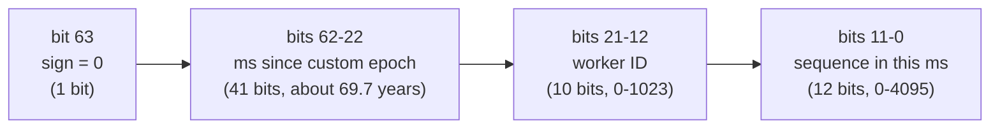
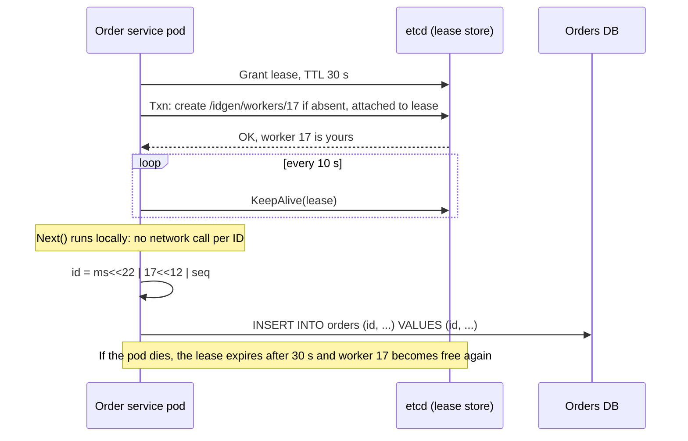

# Unique ID Generation

> [!summary] TL;DR
> Every row, message or order needs an ID that no other machine will ever hand out. With one database a counter is enough; with many servers you need a scheme such as a **Snowflake ID** (time + machine number + counter packed into 64 bits) or a **UUIDv7** (time + random bits in 128 bits), which every server can generate on its own without asking anyone.

> [!abstract] Core idea
> - A single database counter is simple, but it becomes a bottleneck and a single point of failure once you shard.
> - Put the **time first** in the ID, so IDs sort roughly by creation time and B-tree indexes stay append-only.
> - Make uniqueness come from **structure** (a unique worker number plus a per-millisecond counter) or from **randomness** (74 or more random bits).
> - The two real failure modes are **duplicate worker numbers** and **the clock going backwards**; a design is judged by how it handles both.

## 1. Why it exists

Picture an orders table on one PostgreSQL server with `id BIGSERIAL`. Every insert asks the server's sequence for the next number: `1, 2, 3, …`. This works well for a long time.

Now the business grows to 50,000 orders per second (an estimate for a large flash sale), and you split the table across 4 shards (see [[Partitioning and Sharding]]). Each shard has its own sequence, so shard 1 and shard 3 both create order `1042`. A support agent who searches for "order 1042" now gets two different orders, and any cache or event keyed by the ID mixes them up.

You have three ways out, and each has a cost:

| Option | What goes wrong |
| --- | --- |
| Keep one central counter for all shards | Every insert in every region makes a network call to one box. If that box is down, nobody can create orders. |
| Random 128-bit IDs (UUIDv4) | Unique without coordination, but random keys scatter inserts across the whole B-tree index, and they say nothing about time. |
| Time-ordered IDs built locally (Snowflake, UUIDv7, ULID) | Unique without coordination and roughly sorted by time. You must manage worker numbers and clocks. |

A second, quieter problem: sequential IDs leak business data. If a customer sees order `1042` today and `1342` tomorrow, they know you took about 300 orders in a day. Public IDs that are easy to guess also invite enumeration attacks (`/orders/1043`, `/orders/1044`, …).

## 2. Mental model

Think of a deli counter with many ticket machines instead of one.

- Every ticket is stamped with the **current minute** (the timestamp), the **machine's number** (the worker ID), and the **machine's own counter for that minute** (the sequence).
- Two machines can never print the same ticket, because their machine numbers differ.
- One machine never prints the same ticket twice, because its counter goes up within a minute and the minute changes after that.
- If you sort tickets by their printed value, you get them roughly in time order, because the minute is printed first.

The two ways this breaks are just as clear in the analogy: two machines given the **same number**, or a machine whose **clock is turned back** so it reprints minutes it already used.

## 3. How it works

### What an ID scheme must decide

1. **Size.** 64 bits fit a PostgreSQL `BIGINT` and a CPU register. 128 bits (UUID) are twice the index size, but leave room for lots of randomness.
2. **Ordering.** Must IDs sort by creation time? Time-first IDs make "newest first" pagination and B-tree inserts cheap.
3. **Coordination.** Who must agree before an ID is issued: nobody (random), once at start-up (worker-ID lease), or on every ID (central counter)?
4. **Exposure.** Will the ID appear in URLs? Then it should not be guessable, and it should not reveal volume.

### The schemes, from simplest to most distributed

- **Database auto-increment** (`BIGSERIAL`, `GENERATED ALWAYS AS IDENTITY`). One sequence, strictly increasing, 8 bytes. Fine until you need more than one writer.
- **Ticket server** (Flickr, 2010). A dedicated database whose only job is handing out numbers. Flickr ran two of them; one gave odd numbers and the other even numbers (`auto_increment_increment = 2`, offsets 1 and 2), so either could fail without causing duplicates. Every ID is still one network call.
- **ID batches (hi/lo or segment allocation).** A service grabs a range, for example 1,000 numbers, from the database in one update (`UPDATE id_alloc SET max_id = max_id + 1000 … RETURNING max_id`) and hands them out from memory. One database call per 1,000 IDs instead of per ID. IDs are unique and increasing per server but not globally ordered, and a crash wastes the rest of the batch.
- **UUIDv4.** 122 random bits (6 bits are fixed for version and variant). The chance of a collision is negligible, and no coordination is needed. The downsides are 16 bytes and no time order.
- **UUIDv7** (RFC 9562, May 2024). A 48-bit Unix-millisecond timestamp first, then version bits, then 74 random bits. Unique without coordination, like v4, and time-ordered, like Snowflake.
- **ULID.** The same idea as UUIDv7 that came earlier: 48-bit milliseconds plus 80 random bits, written as 26 Crockford Base32 characters (for example `01JBRQ2Y0G4X…`). It fits in a UUID column.
- **Snowflake** (Twitter, 2010). 64 bits: 1 unused sign bit, a 41-bit millisecond timestamp since a custom epoch, a 10-bit worker ID and a 12-bit sequence. The worker ID is assigned once; after that every ID is created locally.

### The Snowflake bit layout



The arithmetic, with units:

- **Lifetime:** 2^41 ms = 2,199,023,255,552 ms. Divide by 1,000 × 86,400 × 365.25 and you get **about 69.7 years**. With a custom epoch of 2024-01-01 the IDs last until around 2093. Using the Unix epoch (1970) instead would waste 54 of those years, which is why every Snowflake variant picks a recent epoch.
- **Throughput per worker:** 2^12 = 4,096 IDs per millisecond, which is **4,096,000 IDs per second** per worker.
- **Fleet throughput:** 1,024 workers × 4,096,000 = **about 4.19 billion IDs per second**. Real systems run out of worker IDs long before they run out of sequence numbers.
- **Packing:** `id = ms << 22 | worker << 12 | seq`, because the sequence takes 12 bits and the worker takes 10 bits, so the timestamp starts at bit 22.

### How a generator gets its worker ID and issues IDs

The worker ID is the only part that needs coordination, and it happens once at start-up, not per ID.



Other ways to hand out worker IDs: a Kubernetes StatefulSet ordinal (`order-svc-17` gets 17), a ZooKeeper ephemeral sequential node, or a row in a database table. Whatever you choose, **two live processes must never hold the same number**, because then they will produce identical IDs in the same millisecond.

## 4. Worked example

### Whiteboard version

The core of Snowflake fits in a dozen lines. This version skips sequence overflow and clock rollback, which the full version handles.

```go
package wb

// Gen is the bare Snowflake idea. It skips sequence overflow and clock
// rollback, which the full version handles.
type Gen struct{ lastMs, seq, worker int64 }

func (g *Gen) Next(nowMs int64) int64 { // nowMs is relative to a custom epoch
	if nowMs == g.lastMs {
		g.seq = (g.seq + 1) & 4095 // 12-bit sequence
	} else {
		g.lastMs, g.seq = nowMs, 0
	}
	return nowMs<<22 | g.worker<<12 | g.seq // 41 | 10 | 12 bits
}
```

Trace with `worker = 7`, at 5 ms after the epoch:

| Call | nowMs | seq | ID (decimal) | Why |
| --- | --- | --- | --- | --- |
| 1 | 5 | 0 | `5<<22 \| 7<<12 \| 0` = 20,971,520 + 28,672 = **21,000,192** | new millisecond, sequence resets |
| 2 | 5 | 1 | **21,000,193** | same millisecond, sequence +1 |
| 3 | 6 | 0 | `6<<22 \| 7<<12` = 25,165,824 + 28,672 = **25,194,496** | next millisecond |

The IDs go up, and the gap between call 2 and call 3 shows that the timestamp dominates the ordering.

### Full Snowflake generator in Go

It is safe for concurrent use, takes an injected clock so tests can control time, waits for the next millisecond when 4,096 IDs have been used, and handles the clock going backwards: a small step back (within `tolerance`) reuses the last timestamp, and a large one returns an error instead of risking duplicates.

```go
// Package idgen generates Snowflake-style 64-bit IDs and UUIDv7 values.
package idgen

import (
	"errors"
	"sync"
)

const (
	timestampBits = 41
	workerBits    = 10
	sequenceBits  = 12

	maxWorker   = 1<<workerBits - 1   // 1023
	maxSequence = 1<<sequenceBits - 1 // 4095

	workerShift    = sequenceBits              // 12
	timestampShift = sequenceBits + workerBits // 22
)

// Clock returns Unix time in milliseconds. Tests inject a fake one.
type Clock func() int64

var (
	ErrBadWorker      = errors.New("idgen: worker id out of range 0..1023")
	ErrClockBackwards = errors.New("idgen: clock moved backwards beyond tolerance")
)

// Snowflake is safe for concurrent use.
type Snowflake struct {
	mu        sync.Mutex
	epoch     int64 // custom epoch in Unix ms
	worker    int64
	tolerance int64 // how far back (ms) the clock may jump before we refuse
	now       Clock
	lastMs    int64 // last timestamp used, relative to epoch
	seq       int64
}

func NewSnowflake(epochMs, worker, toleranceMs int64, now Clock) (*Snowflake, error) {
	if worker < 0 || worker > maxWorker {
		return nil, ErrBadWorker
	}
	return &Snowflake{epoch: epochMs, worker: worker, tolerance: toleranceMs, now: now, lastMs: -1}, nil
}

// Next returns a new ID: | 1 sign bit (0) | 41-bit ms | 10-bit worker | 12-bit sequence |.
func (s *Snowflake) Next() (int64, error) {
	s.mu.Lock()
	defer s.mu.Unlock()

	ms := s.now() - s.epoch
	if ms < s.lastMs {
		if s.lastMs-ms > s.tolerance {
			return 0, ErrClockBackwards
		}
		ms = s.lastMs // small step back: keep using the last timestamp
	}
	if ms == s.lastMs {
		s.seq = (s.seq + 1) & maxSequence
		if s.seq == 0 { // 4,096 IDs used in this ms: wait for the next one
			for ms <= s.lastMs {
				ms = s.now() - s.epoch
			}
		}
	} else {
		s.seq = 0
	}
	s.lastMs = ms
	return ms<<timestampShift | s.worker<<workerShift | s.seq, nil
}

// Parse splits an ID back into its parts.
func Parse(id, epochMs int64) (unixMs, worker, seq int64) {
	return id>>timestampShift + epochMs, id >> workerShift & maxWorker, id & maxSequence
}
```

### UUIDv7 in Go

Go 1.24's standard library has no UUID package, but RFC 9562's layout is simple enough to build by hand: 48 bits of milliseconds, the version nibble `7`, then randomness, with the two variant bits set to `10`.

```go
package idgen

import (
	"encoding/hex"
	"io"
)

// UUID is a 128-bit RFC 9562 UUID.
type UUID [16]byte

// NewV7 builds a UUIDv7: 48-bit Unix ms, version 7, 74 random bits, variant 10.
// rnd is normally crypto/rand.Reader.
func NewV7(unixMs int64, rnd io.Reader) (UUID, error) {
	var u UUID
	if _, err := io.ReadFull(rnd, u[6:]); err != nil {
		return u, err
	}
	for i := 0; i < 6; i++ { // big-endian 48-bit timestamp
		u[i] = byte(unixMs >> (40 - 8*i))
	}
	u[6] = u[6]&0x0f | 0x70 // version 7 in the high nibble
	u[8] = u[8]&0x3f | 0x80 // variant bits 10
	return u, nil
}

func (u UUID) String() string {
	var b [36]byte
	hex.Encode(b[0:8], u[0:4])
	b[8] = '-'
	hex.Encode(b[9:13], u[4:6])
	b[13] = '-'
	hex.Encode(b[14:18], u[6:8])
	b[18] = '-'
	hex.Encode(b[19:23], u[8:10])
	b[23] = '-'
	hex.Encode(b[24:], u[10:])
	return string(b[:])
}
```

### Tests

The fake clock lets the tests force the two hard cases: running out of sequence numbers inside one millisecond, and the clock jumping backwards.

```go
package idgen

import (
	"bytes"
	"crypto/rand"
	"sync"
	"testing"
)

const epoch = 1_704_067_200_000 // 2024-01-01T00:00:00Z in Unix ms

// fakeClock returns a fixed time; tick() moves it forward.
type fakeClock struct {
	mu sync.Mutex
	ms int64
}

func (c *fakeClock) now() int64   { c.mu.Lock(); defer c.mu.Unlock(); return c.ms }
func (c *fakeClock) set(ms int64) { c.mu.Lock(); c.ms = ms; c.mu.Unlock() }

func TestLayoutAndParse(t *testing.T) {
	c := &fakeClock{ms: epoch + 5}
	s, _ := NewSnowflake(epoch, 7, 10, c.now)
	id, _ := s.Next()
	if id != 5<<22|7<<12|0 {
		t.Fatalf("id = %d", id)
	}
	ms, w, seq := Parse(id, epoch)
	if ms != epoch+5 || w != 7 || seq != 0 {
		t.Fatalf("parse = %d %d %d", ms, w, seq)
	}
}

func TestSequenceOverflowWaitsForNextMs(t *testing.T) {
	c := &fakeClock{ms: epoch}
	calls := 0
	clock := func() int64 { // the clock advances 1 ms after 4,100 reads
		calls++
		if calls > 4100 {
			return epoch + 1
		}
		return c.now()
	}
	s, _ := NewSnowflake(epoch, 1, 10, clock)
	var last int64 = -1
	for i := 0; i < 4097; i++ {
		id, err := s.Next()
		if err != nil || id <= last {
			t.Fatalf("i=%d id=%d last=%d err=%v", i, id, last, err)
		}
		last = id
	}
	ms, _, seq := Parse(last, epoch)
	if ms != epoch+1 || seq != 0 {
		t.Fatalf("4097th id should be ms+1 seq 0, got ms=%d seq=%d", ms-epoch, seq)
	}
}

func TestClockRollback(t *testing.T) {
	c := &fakeClock{ms: epoch + 1000}
	s, _ := NewSnowflake(epoch, 1, 10, c.now)
	a, _ := s.Next()
	c.set(epoch + 995) // 5 ms back: tolerated, IDs still increase
	b, err := s.Next()
	if err != nil || b <= a {
		t.Fatalf("small rollback: a=%d b=%d err=%v", a, b, err)
	}
	c.set(epoch + 900) // 100 ms back: refused
	if _, err := s.Next(); err != ErrClockBackwards {
		t.Fatalf("want ErrClockBackwards, got %v", err)
	}
}

func TestConcurrentUnique(t *testing.T) {
	c := &fakeClock{ms: epoch}
	var reads int64
	var mu sync.Mutex
	clock := func() int64 { // advance 1 ms every 1,000 reads
		mu.Lock()
		defer mu.Unlock()
		reads++
		return c.now() + reads/1000
	}
	s, _ := NewSnowflake(epoch, 3, 10, clock)
	var wg sync.WaitGroup
	ids := make(chan int64, 8*5000)
	for g := 0; g < 8; g++ {
		wg.Add(1)
		go func() {
			defer wg.Done()
			for i := 0; i < 5000; i++ {
				id, err := s.Next()
				if err != nil {
					t.Error(err)
					return
				}
				ids <- id
			}
		}()
	}
	wg.Wait()
	close(ids)
	seen := map[int64]bool{}
	for id := range ids {
		if seen[id] {
			t.Fatalf("duplicate %d", id)
		}
		seen[id] = true
	}
	if len(seen) != 40000 {
		t.Fatalf("got %d ids", len(seen))
	}
}

func TestBadWorker(t *testing.T) {
	if _, err := NewSnowflake(epoch, 1024, 0, nil); err != ErrBadWorker {
		t.Fatal(err)
	}
}

func TestUUIDv7(t *testing.T) {
	a, err := NewV7(1_730_678_400_000, rand.Reader)
	if err != nil {
		t.Fatal(err)
	}
	b, _ := NewV7(1_730_678_400_001, rand.Reader)
	s := a.String()
	if len(s) != 36 || s[14] != '7' {
		t.Fatalf("bad version: %s", s)
	}
	if v := a[8] >> 6; v != 0b10 {
		t.Fatalf("bad variant %b", v)
	}
	if bytes.Compare(a[:], b[:]) >= 0 {
		t.Fatal("later ms must sort after earlier ms")
	}
	if s[:13] != "0192f478-a400" {
		t.Fatalf("timestamp prefix = %s", s[:13])
	}
}
```

`go vet` is clean and `go test -race` passes all six tests (Go 1.24.4, darwin/arm64). Note the expected UUID prefix in `TestUUIDv7`: 1,730,678,400,000 ms (2024-11-04 00:00 UTC) is `0x0192f478a400`, so the string starts `0192f478-a400-7…`, and the `7` at index 14 is the version.

### The Instagram scheme in PostgreSQL

Instagram (2012) generated IDs inside PostgreSQL, one function per logical shard (schema): 41 bits of milliseconds since its own epoch, 13 bits of shard ID (8,192 logical shards) and 10 bits from a sequence taken modulo 1,024. The database is already the thing that owns the shard, so no extra service is needed. A version in PostgreSQL 17 syntax:

```sql
-- One schema per logical shard; this one is shard 5.
CREATE SCHEMA IF NOT EXISTS shard_0005;
CREATE SEQUENCE shard_0005.photo_id_seq;

CREATE OR REPLACE FUNCTION shard_0005.next_id(OUT result bigint)
LANGUAGE plpgsql AS $$
DECLARE
    our_epoch  bigint := 1704067200000;  -- 2024-01-01T00:00:00Z in ms
    shard_id   int    := 5;              -- 13 bits: 0..8191
    seq_id     bigint;
    now_millis bigint;
BEGIN
    SELECT nextval('shard_0005.photo_id_seq') % 1024 INTO seq_id;   -- 10 bits
    SELECT floor(extract(epoch FROM clock_timestamp()) * 1000) INTO now_millis;
    result := (now_millis - our_epoch) << 23;   -- 13 + 10 = 23 bits below the time
    result := result | (shard_id::bigint << 10);
    result := result | seq_id;
END;
$$;

CREATE TABLE shard_0005.photos (
    id         bigint PRIMARY KEY DEFAULT shard_0005.next_id(),
    user_id    bigint NOT NULL,
    created_at timestamptz NOT NULL DEFAULT now()
);
```

Two details matter. `clock_timestamp()` is used instead of `now()`, because `now()` is fixed for the whole transaction, so a transaction inserting 2,000 rows would reuse one millisecond and wrap the 10-bit sequence. And the limit is **1,024 IDs per shard per millisecond**; a shard that inserts faster than that would repeat IDs, so the scheme fits a workload of many shards with modest per-shard rates.

PostgreSQL 17 ships `gen_random_uuid()` (version 4) in core. PostgreSQL 18 added a built-in `uuidv7()` function. On 17 you generate UUIDv7 in the application, as above.

## 5. Variants and comparison

| Scheme | Size | Sorted by time? | Coordination | Throughput limit | Main risk | Use when |
| --- | --- | --- | --- | --- | --- | --- |
| DB auto-increment | 8 B | Yes, strictly | Every insert, one DB | One DB's write rate | Single writer; leaks volume | One database, internal IDs |
| Ticket server (Flickr) | 8 B | Roughly | Network call per ID | The ticket DB | Extra hop and dependency | Need small integers across shards; low rate |
| ID batches (hi/lo) | 8 B | Per server only | One call per batch | Very high | Gaps after crashes | Want integer IDs, can't run a generator service |
| UUIDv4 | 16 B | No | None | Unlimited | Random index inserts; no time info | Public, unguessable IDs; small tables |
| UUIDv7 | 16 B | Yes (ms) | None | Unlimited | Reveals creation time | Default choice for new systems with UUID columns |
| ULID | 16 B (26 chars) | Yes (ms) | None | Unlimited | Same as UUIDv7; not an RFC | Need a short, URL-safe text ID |
| Snowflake | 8 B | Yes (ms, k-sorted) | Worker-ID lease at start | 4,096/ms per worker | Duplicate worker ID; clock rollback | High volume, want 64-bit integer keys |
| Instagram in-DB | 8 B | Yes (ms) | None beyond shard mapping | 1,024/ms per shard | Hot shard wraps the sequence | IDs must encode the shard, PostgreSQL owns the shard |

"K-sorted" means IDs from different workers are only roughly in order: two IDs made in the same millisecond on workers 3 and 9 sort by worker number, not by which came first. Across machines, ordering is also only as good as the clock sync (see [[Clocks and Ordering]]).

## 6. Trade-offs and when not to use

- **Do not distribute what is not distributed.** One PostgreSQL primary handles tens of thousands of sequence calls per second; if all writes go to one primary anyway, `GENERATED ALWAYS AS IDENTITY` is the simplest correct answer.
- **Snowflake costs operations.** You now run worker-ID leasing, must watch clock sync, and must ensure two pods never share a worker ID. UUIDv7 needs none of this at the price of 8 more bytes per key and per index entry.
- **Random keys hurt B-tree indexes.** A UUIDv4 primary key lands on a random leaf page on every insert, so the working set is the whole index and pages split all over it. Time-ordered keys (v7, ULID, Snowflake) append to the right-hand edge, so only the last few pages are hot. The size of the effect depends on how much of the index fits in memory; measure it on your own data before quoting a number.
- **Time-ordered IDs reveal time.** Anyone can decode a Snowflake or UUIDv7 to get the creation time, and the sequence part hints at volume. If that matters (for example, signup dates of users), expose a separate random public ID, or use UUIDv4 for the public one.
- **IDs are not secrets.** Never use an ID as an access token or a password-reset code, even a random one; use a separate token from `crypto/rand` with an expiry.
- **64-bit IDs and JavaScript.** JavaScript numbers are doubles with 53 bits of integer precision, so a Snowflake ID above 2^53 loses its last digits in a browser. Send IDs as JSON strings (Twitter added `id_str` for this reason).

## 7. In production

- **Real systems:**
	- **Twitter** created Snowflake in 2010 when it moved off MySQL auto-increment; its layout (41/10/12 bits, epoch 1288834974657) became the model for the others.
	- **Discord** uses Snowflake IDs with its own epoch, 1420070400000 (the first second of 2015), and documents the format in its public API docs.
	- **Instagram** generated IDs in PL/pgSQL per logical shard (section 4).
	- **Sonyflake** (Sony, Go) trades throughput for lifetime: 39 bits of time in 10 ms units (about 174 years), 8 bits of sequence and 16 bits of machine ID. That is the original (v1) layout; Sonyflake v2 makes the bit split and time unit configurable.
	- **Flickr** ran two ticket-server MySQL instances, one issuing odd and one issuing even numbers.
- **Failure modes and fixes:**
	- *Two processes share a worker ID* (a copied config, or a pod restarted while the old one is still alive) → lease the ID with a TTL (etcd, ZooKeeper) and stop generating if the lease is lost; or derive it from something unique by construction, such as a StatefulSet ordinal.
	- *The clock steps backwards* (an NTP correction or a VM migration) → tolerate a few milliseconds by reusing the last timestamp, refuse larger jumps with an error and alert. Run NTP or chrony in slew mode so corrections are gradual instead of jumps.
	- *Sequence exhaustion inside one millisecond* → the generator waits for the next millisecond. Spikes show up as small latency bumps; if it happens constantly, add workers.
	- *Leap seconds* → use a smeared clock (Google Public NTP and Amazon Time Sync Service, for example, smear leap seconds over many hours) so the Unix time never repeats.
	- *IDs used as JSON numbers* → precision loss in browsers; serialize as strings.
- **What to monitor:** the clock offset per host (chrony or `node_exporter` timex metrics), the count of clock-backwards errors, the time spent waiting for the next millisecond, worker-ID lease renewals and losses, and duplicate-key errors on insert (they should be zero).

## 8. Deep dive

### Clock rollback, precisely

`time.Now()` in Go carries a monotonic reading for measuring durations, but `UnixMilli()` returns the **wall clock**, which can jump back when NTP steps it. A Snowflake generator therefore has to protect itself:

1. **Remember the last timestamp used.** If the new reading is lower, the clock went back.
2. **Small step back (a few ms):** reuse `lastMs` and keep incrementing the sequence. IDs stay unique and increasing; they are just stamped a bit late. If the sequence runs out, wait until the real clock passes `lastMs`.
3. **Large step back:** return an error and alert. Waiting out a 10-second rollback while holding a lock would stall every caller.
4. **Never trust a restart.** After a restart, `lastMs` is lost. If the clock went back before the restart, the new process could reissue IDs. Fixes: persist `lastMs` occasionally and refuse to start until the clock passes it, or wait at start-up for longer than any plausible rollback.

The `TestClockRollback` test above covers steps 2 and 3.

### UUIDv7 inside one millisecond

RFC 9562 allows IDs generated in the same millisecond to be unordered, but offers optional methods to keep them monotonic within one generator: use part of `rand_a` (12 bits) as a counter, or use those bits for sub-millisecond precision. The simple generator above uses pure randomness, so two v7 IDs from the same millisecond sort randomly relative to each other. That is fine for index locality (they still land on the same right-hand page), but not if you need strict creation order within a millisecond.

### Collision probability for random IDs

For `n` random IDs with `b` random bits, the chance of any collision is about `n² / 2^(b+1)` (the birthday bound). UUIDv7 has 74 random bits per millisecond, so collisions only matter between IDs from the same millisecond. Even at 1,000,000 IDs in one millisecond: (10^6)² / 2^75 ≈ 10^12 / 3.8 × 10^22 ≈ 2.6 × 10^-11. UUIDv4 with 122 bits is lower still. Bad randomness (for example, forking a process with a seeded `math/rand`) is the realistic cause of duplicates, so always use `crypto/rand`.

### Reading the bits back

Because the layout is fixed, any ID can be decoded for debugging: `Parse(id, epoch)` returns the creation time, the worker and the sequence. This is handy in incident reviews ("which pod created this order and when?"), and it is also why such IDs leak information.

### Index locality at scale

In a B-tree (see [[Storage Engines - B-tree vs LSM and WAL]] and [[Index Types and Index Design]]), a time-ordered key always goes into the right-most leaf page. That page stays in memory, fills up, and a new one starts. A random key picks any leaf page, so the database must keep the whole index hot or read pages from disk on inserts, and half-full pages after splits waste space. With many concurrent writers, the right-most page can itself become a contention point; that is rarely the bottleneck compared with random I/O, and partitioning by shard spreads it.

## 9. Interview questions

> [!question]- Design a unique ID generator for a sharded system that writes 100,000 rows per second.
> Use a Snowflake layout: 41-bit ms since a custom epoch, 10-bit worker, 12-bit sequence. One worker makes 4,096,000 IDs per second, so even a handful of workers cover 100k/s many times over. Workers lease their ID from etcd with a TTL at start-up; after that every ID is local. Handle clock rollback (tolerate small, refuse large) and sequence exhaustion (wait for the next ms).

> [!question]- Why not just use UUIDv4 everywhere?
> It is unique without coordination, but it is 16 bytes, carries no time order, and its random values scatter inserts across the B-tree index, which hurts write performance once the index is larger than memory. UUIDv7 keeps the "no coordination" property and adds time order, so it is the better default for new UUID columns.

> [!question]- Trap: "Snowflake IDs are globally ordered by creation time." True?
> No. They are k-sorted: ordered by millisecond, but within one millisecond IDs from different workers order by worker number, not by real time. Across machines, the order is only as good as clock sync, which can be off by milliseconds. Never use ID order to decide which of two events happened first across machines.

> [!question]- What happens if the clock goes back by 2 seconds on one Snowflake worker?
> Without protection it would reissue IDs from 2 seconds ago, which can duplicate existing ones. A correct generator remembers the last timestamp, refuses to generate when the clock is far behind it (error and alert), and reuses the last timestamp for tiny steps back. Running chrony or NTP in slew mode avoids most jumps.

> [!question]- How do you make sure no two workers get the same worker ID?
> Lease it: create `/idgen/workers/17` in etcd (or an ephemeral znode in ZooKeeper) attached to a TTL lease and keep it alive. If the process dies, the lease expires and the number is freed. If the process loses its lease (for example, during a long GC pause), it must stop generating. A StatefulSet ordinal also works, as long as two pods with the same ordinal can never run at the same time.

> [!question]- The front end shows wrong order IDs, off in the last few digits. Why?
> The IDs are 64-bit Snowflakes sent as JSON numbers, and JavaScript numbers only hold integers exactly up to 2^53. Send IDs as strings in JSON.

> [!question]- Ticket server vs Snowflake?
> A ticket server is a database that returns the next number on each call: small, dense, increasing integers, but one network call per ID and a dependency on that database (Flickr ran two, one issuing odd and one issuing even numbers). Snowflake needs coordination only at start-up and scales to millions of IDs per second per worker, at the cost of managing worker IDs and clocks.

## 10. Cheat sheet

- Snowflake: `0 | 41-bit ms | 10-bit worker | 12-bit seq`, about 69.7 years, 4,096 IDs per ms per worker, 1,024 workers.
- UUIDv7 (RFC 9562): 48-bit ms + version + 74 random bits; time-ordered and coordination-free; PostgreSQL 18 has `uuidv7()`.
- ULID: 48-bit ms + 80 random bits, 26 Crockford Base32 characters.
- Random UUIDv4 keys scatter B-tree inserts; time-first keys append to the right edge.
- Hard parts: unique worker IDs (lease with a TTL) and clock rollback (tolerate small, refuse large, persist last timestamp).
- Instagram: per-shard PL/pgSQL, `ms << 23 | shard << 10 | seq % 1024`, with `clock_timestamp()` instead of `now()`.
- Send 64-bit IDs to browsers as strings; never use IDs as secrets.

## Links

- **Before this:** [[Back-of-the-Envelope Estimation]], [[Partitioning and Sharding]]
- **Next:** [[Rate Limiting - Algorithms and Distributed Design]]
- **Compare with:** [[Clocks and Ordering]] (why time-based order across machines is approximate), [[Leader Election]] (the same lease idea used to own a role), [[Case Study - URL Shortener]] (IDs turned into short codes)
