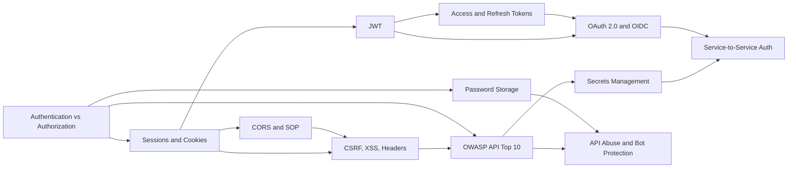

# 12 Security & Auth MOC

> [!summary] What this folder covers
> After this folder you can explain and design authentication and authorization for a backend: password storage, sessions, JWTs, refresh tokens, OAuth/OIDC, browser security (CORS, CSRF, XSS), secrets, machine-to-machine auth and abuse protection.

## Before and after

- **Before this:** [[02 Networking & Web MOC]]
- **After this:** nothing; this is a starting point

## Learning path

Back to [[Home]].

1. [[Authentication vs Authorization]] · basic. Who you are versus what you may do, and why mixing them up causes most access bugs.
2. [[Password Storage and Login Security]] · intermediate. Slow salted hashes, MFA and defenses against credential stuffing.
3. [[Sessions and Cookies]] · intermediate. Server-side sessions and the cookie attributes that form the real security boundary.
4. [[JWT - Structure, Validation and Pitfalls]] · intermediate. What a JWT contains, how to validate it, and the classic mistakes like `alg: none`.
5. [[Access and Refresh Tokens]] · intermediate. Short-lived access tokens, rotating refresh tokens and how to revoke them.
6. [[CORS and Same-Origin Policy]] · intermediate. Why browsers block cross-origin reads and how CORS headers relax that safely.
7. [[CSRF, XSS and Security Headers]] · intermediate. The two classic browser attacks and the headers that stop them.
8. [[OWASP API Security Top 10]] · intermediate. The most common API vulnerabilities, led by broken object-level authorization.
9. [[Secrets Management]] · intermediate. Keeping keys out of code, rotating them and using a vault or KMS.
10. [[OAuth 2.0 and OpenID Connect]] · advanced. Delegated access with the authorization code + PKCE flow, and identity on top with OIDC.
11. [[Service-to-Service Auth - API Keys, HMAC, mTLS]] · advanced. How machines prove identity when no user is present.
12. [[API Abuse and Bot Protection]] · advanced. Layered defenses against scraping, bots and account takeover.

## Concept map

## Interview focus

- What is the difference between authentication and authorization, and which status codes go with each? See [[Authentication vs Authorization]].
- How should you store passwords, and why bcrypt or Argon2 instead of SHA-256? See [[Password Storage and Login Security]].
- Sessions or JWTs: which would you choose and why? See [[Sessions and Cookies]] and [[JWT - Structure, Validation and Pitfalls]].
- How do you revoke a JWT before it expires, and how does refresh token rotation work? See [[Access and Refresh Tokens]].
- Does CORS protect against CSRF? See [[CORS and Same-Origin Policy]].
- How do you prevent CSRF and XSS, and where should tokens be stored in a browser? See [[CSRF, XSS and Security Headers]].
- What is BOLA/IDOR and how do you prevent it? See [[OWASP API Security Top 10]].
- Walk through the OAuth authorization code flow with PKCE, and explain what OIDC adds. See [[OAuth 2.0 and OpenID Connect]].
- How do two internal services authenticate each other? See [[Service-to-Service Auth - API Keys, HMAC, mTLS]].
- How would you defend a login endpoint against credential stuffing? See [[API Abuse and Bot Protection]].

## Sources worth reading

- OWASP Cheat Sheet Series (Password Storage, Session Management, CSRF Prevention, XSS Prevention).
- OWASP API Security Top 10 (2023 edition).
- RFC 6749 (OAuth 2.0), RFC 7636 (PKCE), RFC 7519 (JWT), RFC 8725 (JWT Best Current Practices) and the OAuth 2.0 Security Best Current Practice (RFC 9700).
- MDN Web Docs on CORS, the same-origin policy and the Set-Cookie header.
- NIST SP 800-63B, Digital Identity Guidelines.
