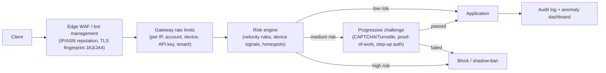
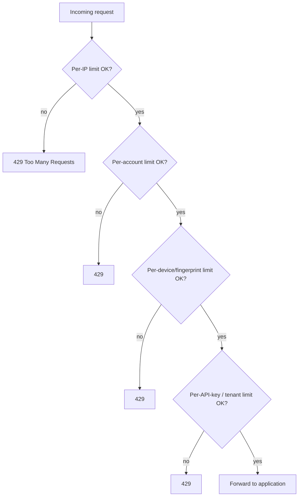
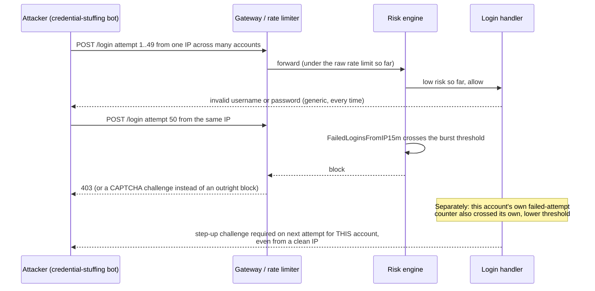

# API Abuse and Bot Protection

> [!summary] TL;DR
> API abuse is traffic that is technically valid (correct auth, correct JSON, correct HTTP) but harms the business: credential stuffing, scraping, fake signups, and cost attacks. Defending against it means layering identity, rate limits, risk signals, and progressively stronger challenges, because no single layer catches every pattern.

> [!abstract] Core idea
> - Abuse traffic is not malformed — it passes every normal validation check. The defense has to look at *patterns*, not single requests.
> - No one signal is reliable alone (an IP, a user-agent, a request rate); combine several into a risk score.
> - Respond proportionally: allow, slow down, challenge, or block, roughly matched to how confident the detection is.
> - Login and OTP endpoints need stricter, separate limits from the rest of the API, because they are the ones attackers hit hardest.
> - Classic mistake: blocking the first suspicious signal outright. That both creates false positives against real users and teaches the attacker exactly which signal tripped the alarm.

## 1. Why it exists

A ticketing platform opens sales for a popular concert at 10:00 AM. Within seconds, bots using thousands of residential proxy IPs have bought most of the floor section, reselling tickets at a markup minutes later. Separately, that same week, an attacker runs a list of 2 million leaked username/password pairs from an unrelated breach against the platform's login endpoint — a **credential stuffing** attack. Security vendors who publish credential-stuffing statistics (Akamai, Imperva) commonly report hit rates of roughly 0.1–2% of attempted pairs succeeding, depending on how much the target's user base overlaps with the breached source — an estimate, not a figure measured on this platform. Even at the low end, a two-million-pair list yields thousands of compromised accounts.

Both attacks used perfectly valid requests: correct JSON, a real (if automated) browser, a syntactically fine password. Nothing in request validation rejects them. The only way to tell them apart from legitimate traffic is behavior over time and across many requests: one IP hitting the login endpoint 500 times in a minute, one device buying 40 tickets in three seconds, one account's password matching a known breach dump. That is what this note is about — the layer above "is this request well-formed," which [[OWASP API Security Top 10]]-style validation already handles.

## 2. Mental model

Think of a nightclub's door policy, not a single bouncer but several checks in sequence: an ID check (authentication), a dress code (basic request validation), a headcount limit per hour (rate limiting), a bouncer watching for group behavior that looks like trouble before anyone does anything wrong (risk signals and velocity rules), and a manager who can eject someone retroactively once a pattern becomes clear (post-hoc detection and account action). No single person at the door catches everything; the combination does.

## 3. How it works

### Defense in depth



Each layer catches what the one before it missed. The WAF filters obviously automated traffic before it costs a database query. Gateway rate limits (the algorithms themselves — token bucket, sliding window, distributed counters — are covered in [[Rate Limiting - Algorithms and Distributed Design]]) cap how much any one dimension can do per window. The risk engine combines signals the first two layers do not see individually. Only requests that make it through all of that reach the application, and even successful ones are logged for later anomaly detection.

### The threat catalog

| Attack | What it looks like | Primary defense |
| --- | --- | --- |
| Credential stuffing | Many login attempts, one leaked password list, spread across accounts and IPs | Per-account + per-IP login throttles, breached-password check, MFA |
| Account enumeration | Login or signup response reveals whether a username/email exists | Identical response message, status code, and timing for "wrong password" and "unknown user" |
| Scraping | High-volume reads of catalog/listing endpoints, often via headless browsers | Per-IP/device rate limits, response randomization for detection, licensing/ToS enforcement |
| OTP / SMS pumping | Attacker triggers thousands of OTP sends to premium-rate numbers for a cut of the telco revenue | Per-phone and per-IP send caps, cooldown between sends, country allowlist/denylist |
| Fake signups | Bulk account creation for referral abuse, spam, or inventory hoarding | CAPTCHA/Turnstile at signup, email/phone verification, device fingerprint clustering |
| Card testing | Many small authorization attempts with stolen card numbers to find valid ones | Velocity limits on payment attempts, CVV/AVS checks, step-up auth above a threshold |
| Inventory hoarding / scalping | Bots add-to-cart or buy far faster and more than a human can | Per-account purchase limits, queueing, proof-of-work or CAPTCHA at checkout |
| Expensive-query DoS | Valid but costly requests (deep pagination, broad search, large exports) run at volume | Per-endpoint quotas, query cost limits, caching, separate rate budget for expensive routes |

This maps onto OWASP API Security Top 10 (2023) **API4: Unrestricted Resource Consumption** (the cost attacks: scraping, expensive queries, OTP pumping) and **API6: Unrestricted Access to Sensitive Business Flows** (the business-logic attacks: scalping, card testing, fake signups) — both categories exist because the requests are individually valid and only the pattern is wrong.

### Rate limits per dimension

A single rate limit (say, per IP) is trivially defeated by rotating IPs. Production systems key limits on multiple dimensions at once and require all of them to pass:



An attacker rotating IPs still hits the per-account limit on the account they are targeting; an attacker rotating accounts (fake signups) still hits the per-IP or per-device limit. Requiring all dimensions to clear raises the cost of evasion substantially above any single limit.

### Progressive challenges and login hardening

Login endpoints get stricter, separate handling from the rest of the API, because credential stuffing concentrates there:



Hardening specific to login: check new passwords (and flag existing ones) against known breach corpora, apply **both** a per-account and a per-IP throttle (neither alone is enough, as the diagram shows), return the same generic failure message and status code whether the username does not exist or the password is wrong, and offer MFA as a second factor that credential stuffing cannot satisfy even with a correct password.

### Detection signals

- **Velocity rules:** request or failure counts over a rolling window, per dimension (the `FailedLoginsLast15m` / `FailedLoginsFromIP15m` style counters in the worked example below).
- **Device fingerprinting and behavioral signals:** canvas/font fingerprint stability, mouse movement or keystroke timing entropy (bots tend to be too fast or too mechanically uniform), consistent device ID across sessions.
- **Honeypot fields:** a form field hidden from real users (no label, `display:none`, excluded from tab order) that only an automated form-filler sets.
- **Edge signals:** IP/ASN reputation (data-center ranges, known proxy/VPN exit nodes), TLS fingerprinting (JA3/JA4 — the specific cipher suite and extension order a TLS client offers, which differs between a real browser and most HTTP client libraries).
- **Anomaly dashboards:** aggregate views (signups per minute, login failure rate, checkout velocity) that catch a pattern no single request-level rule was written for yet.

## 4. Worked example

### Whiteboard version

The core of a risk engine is not a clever algorithm, it is a short, readable decision over the signals you already have:

```go
package wb

type Signals struct {
	FailedLoginsFromIP15m int
	IPReputationScore     int
}

func decide(s Signals) string {
	if s.FailedLoginsFromIP15m >= 50 || s.IPReputationScore >= 80 {
		return "block"
	}
	return "allow"
}
```

The full version below adds the per-account dimension, a new-device case, a honeypot check, and an enumeration-resistant login response — and is exactly what the tests exercise. It compiles and passes `go vet` and `go test -race` on Go 1.24. The rate-limiting algorithm these counters would run on (token bucket, sliding window) is not reimplemented here; see [[Rate Limiting - Algorithms and Distributed Design]] for that.

```go
// Package abuse implements the abuse-detection decision layer: combining
// signals into an action. The rate-limiting algorithms it counts against
// (token bucket, sliding window, distributed counters) are not reimplemented
// here — see the vault's Rate Limiting note for those.
package abuse

// Action is what the gateway or login handler does with a request once
// risk has been scored.
type Action int

const (
	Allow Action = iota
	Challenge
	Block
)

func (a Action) String() string {
	switch a {
	case Allow:
		return "allow"
	case Challenge:
		return "challenge"
	case Block:
		return "block"
	default:
		return "unknown"
	}
}

// Signals is the small set of risk inputs this note's worked example scores.
// A production risk engine combines many more (TLS fingerprint, ASN
// reputation, behavioral biometrics); these four are enough to show how
// independent signals turn into one decision.
type Signals struct {
	FailedLoginsLast15m   int  // per-account counter, fed by the login handler
	FailedLoginsFromIP15m int  // per-IP counter, catches credential stuffing fanning out across accounts
	IsNewDevice           bool // no prior session/device fingerprint seen for this account
	IPReputationScore     int  // 0 (clean) .. 100 (known bad: data-center proxy, prior abuse)
}

// Decide turns signals into one of three actions. The thresholds below are
// illustrative starting points, not measured production values — tune them
// against your own false-positive rate.
func Decide(s Signals) Action {
	switch {
	case s.FailedLoginsFromIP15m >= 50:
		// One IP burning through many accounts in a short window is the
		// signature of credential stuffing (trying a leaked list of
		// username/password pairs), not a user who mistyped their password.
		return Block
	case s.IPReputationScore >= 80:
		return Block
	case s.FailedLoginsLast15m >= 5:
		// Repeated failures on one account: could be the owner, could be
		// guessing. Challenge instead of blocking so a genuine user who
		// forgot their password is not locked out.
		return Challenge
	case s.IsNewDevice && s.IPReputationScore >= 40:
		return Challenge
	default:
		return Allow
	}
}

// CheckHoneypot reports whether a hidden form field a real browser would
// never fill (no visible label, off-screen, excluded from tab order) came
// back non-empty. Only an automated submitter that fills every field in the
// DOM would set it.
func CheckHoneypot(hiddenFieldValue string) bool {
	return hiddenFieldValue != ""
}

// LoginResult is the single, generic response shape returned to the caller
// regardless of why a login failed.
type LoginResult struct {
	OK      bool
	Message string
}

// genericFailure is returned for every failure reason: wrong password,
// unknown username, locked account. A different message per case (or a
// different HTTP status, or a different response latency) lets an attacker
// enumerate which usernames exist on the system — OWASP API Security Top 10
// (2023) API2, Broken Authentication.
var genericFailure = LoginResult{OK: false, Message: "invalid username or password"}

// Login evaluates credentials without revealing which part was wrong.
// exists and passwordOK are kept as plain booleans here to make the
// enumeration-resistance property easy to see and test: the message is
// identical whichever one is false.
func Login(exists, passwordOK bool) LoginResult {
	if exists && passwordOK {
		return LoginResult{OK: true, Message: "welcome back"}
	}
	return genericFailure
}
```

The tests that prove the credential-stuffing burst and enumeration-resistance properties the diagrams above describe:

```go
func TestDecideBlocksCredentialStuffingBurst(t *testing.T) {
	// One IP failing logins across many accounts: the credential-stuffing
	// signature, not an individual forgetting their password.
	got := Decide(Signals{FailedLoginsFromIP15m: 120, FailedLoginsLast15m: 1})
	if got != Block {
		t.Fatalf("Decide(IP burst) = %v, want block", got)
	}
}

func TestLoginDoesNotRevealEnumeration(t *testing.T) {
	unknownUser := Login(false, false)
	wrongPassword := Login(true, false)
	if unknownUser.Message != wrongPassword.Message {
		t.Fatalf("unknown-user message %q must match wrong-password message %q, or the response leaks which usernames exist",
			unknownUser.Message, wrongPassword.Message)
	}
	if unknownUser.OK || wrongPassword.OK {
		t.Fatal("neither failure case may report OK")
	}
}
```

**Measured:** `go test -race ./...` on this package, Go 1.24.4, darwin/arm64, 2026-11-07: 7 tests, all pass — clean-signal allow, repeated-account-failure challenge, credential-stuffing-burst block, bad-IP-reputation block, new-device-plus-risky-IP challenge, honeypot detection, and the enumeration-resistance check above.

## 5. Variants and comparison

| Layer | How it works | Use when | Cost |
| --- | --- | --- | --- |
| Edge WAF / bot management | IP/ASN reputation, TLS fingerprinting, managed rulesets | First line of defense against known-bad infrastructure | Vendor cost; some false positives on shared/corporate IPs |
| Gateway rate limits | Per-dimension request counters (see [[Rate Limiting - Algorithms and Distributed Design]]) | Bounding raw request volume per IP/account/key/tenant | Needs a shared counter store (e.g. Redis) across instances |
| Risk engine / velocity rules | Combines several signals into allow/challenge/block | Catching patterns no single limit would flag | Tuning cost; false positives if thresholds are too tight |
| CAPTCHA / Turnstile / proof-of-work | A challenge only a human (or a costly-to-automate solver) passes | Medium-risk traffic, before an outright block | User friction; CAPTCHA farms can defeat weak challenges |
| Account-level action (step-up auth, shadow-ban, lockout) | Acts on the account or session itself, not just the request | High-confidence abuse, repeated offenders | Risk of locking out a legitimate user; needs an appeal path |

> [!warning] Interview trap
> "We rate-limit by IP, so we're protected against credential stuffing" ignores that attackers run these attacks from thousands of residential-proxy IPs specifically to stay under any single IP's limit. The per-account counter — not the per-IP one — is what actually catches one account being hammered from many different IPs; both dimensions are necessary, and neither is sufficient alone.

## 6. Trade-offs and when not to use

- Every layer adds friction or cost somewhere: CAPTCHA costs real users time and conversion, strict rate limits risk false positives against legitimate bursty use (a mobile app retrying after a network blip), and a risk engine is ongoing tuning work, not a one-time setup.
- Blocking outright on a single signal is usually wrong: it creates false positives (shared corporate NAT IPs, VPN users) and gives an attacker clean feedback on exactly which signal to avoid next time. Prefer a challenge or a shadow-ban (let the request appear to succeed while quietly discarding or down-ranking it) when confidence is not yet high.
- A low-traffic internal tool with no public signup and no payment flow often does not need the full pipeline — basic auth plus simple per-API-key rate limits may be proportionate; the full defense-in-depth stack earns its cost on public, high-value, or adversarial-traffic surfaces.
- False positives need an owner and an appeal path. A legitimate user wrongly blocked with no recourse is a support and trust cost that can outweigh the abuse it prevented.

## 7. In production

- **Real systems:**
  - Cloudflare Turnstile and Google reCAPTCHA provide managed, mostly invisible proof-of-human challenges used across most large consumer platforms.
  - Ticketing platforms (Ticketmaster's Verified Fan, similar systems elsewhere) combine queueing, per-account purchase limits, and bot-detection vendors specifically against scalping bots.
  - Have I Been Pwned's breached-password API (or a locally synced copy of the same corpus) is the standard way to check new and existing passwords against known breach dumps, per NIST SP 800-63B guidance.
  - Stripe Radar and similar fraud-scoring products apply the same signals-plus-risk-engine pattern specifically to card-testing and payment fraud.
- **Failure modes → fixes:**
  - Legitimate users behind a shared corporate NAT trip IP-based limits together → weight the per-account dimension more heavily than per-IP for authenticated traffic, and allowlist known-good corporate ranges case by case.
  - A risk engine tuned too aggressively silently blocks real signups during a viral traffic spike → monitor the false-positive proxy metric (support tickets tagged "couldn't sign up," appeal-approval rate) alongside the abuse-caught metric, not abuse-caught alone.
  - Attackers adapt to a published threshold (e.g. staying at 49 requests when the limit is 50) → combine multiple independent signals so no single threshold is the whole defense, and rotate thresholds without announcing them.
  - CAPTCHA farms (cheap human solvers) defeat a weak challenge → escalate to a harder challenge or step-up MFA for repeat offenders rather than relying on CAPTCHA alone indefinitely.
- **What to monitor:**
  - Login failure rate, broken down by per-account vs per-IP triggers, to separate "someone forgot their password" from "a stuffing run is in progress."
  - Challenge pass/fail rate — a collapsing pass rate on a previously effective CAPTCHA is a sign it has been defeated.
  - Signups, OTP sends, and checkout attempts per minute, with alerting on sudden multiples of baseline.
  - False-positive signal: support tickets and appeal outcomes for blocked legitimate users.

## 8. Deep dive

- **Why generic error responses must also match in timing, not just text.** A login handler that checks "does this username exist" before "is the password correct" can leak existence through response latency even with an identical message, if the username-lookup path is slower (or faster) than the password-hash-and-compare path. The fix is to always perform a password hash comparison (even against a dummy hash when the username does not exist) so the response time is close to constant regardless of which check actually failed.
- **Shadow-banning vs. hard blocking.** For medium-confidence abuse (not yet certain, but suspicious), many platforms let the request appear to succeed — a scraper keeps getting "200 OK" responses, but with stale or synthetic data — rather than returning an error that confirms detection to the attacker and invites them to adapt. This trades some implementation complexity for intelligence: the attacker does not learn what tripped the system.
- **OTP-specific hardening.** SMS/OTP pumping is financially different from most abuse: the attacker profits from the carrier payout per message sent, not from account takeover, so the fix is send-side: per-phone-number and per-IP send caps, an enforced cooldown between resend requests, and a country allowlist/denylist tuned to where the legitimate user base actually is.
- **Business-logic abuse is not a validation bug.** API6 (Unrestricted Access to Sensitive Business Flows) exists because "add to cart" and "submit order" are both perfectly valid API calls — the abuse is in the *rate and pattern* of valid calls, which is why this defense lives above request validation and closer to the rate-limiting and risk layers, not in a schema check.
- **False positives are a cost, measure them as one.** A detection system tuned only against a "caught" metric, with no corresponding measurement of legitimate users wrongly challenged or blocked, will drift toward being too aggressive over time, since every tightened threshold looks like a win on the one metric being watched.

## 9. Interview questions

> [!question]- Why isn't a single IP-based rate limit enough to stop credential stuffing?
> Credential stuffing tools distribute requests across thousands of residential-proxy or botnet IPs specifically to stay under any one IP's threshold. A per-account counter catches the same account being targeted from many IPs; only combining both dimensions (and ideally device/API-key dimensions too) raises the cost of evasion meaningfully.

> [!question]- What's the difference between credential stuffing and account enumeration, and does one defense cover both?
> Credential stuffing is trying many leaked username/password pairs to find ones that work. Account enumeration is discovering which usernames exist at all, often as reconnaissance before a targeted attack. Rate limits address the volume of stuffing attempts; a generic, identically-timed failure response addresses enumeration. They are different vulnerabilities and need both defenses, not one in place of the other.

> [!question]- When should a risk engine challenge a request instead of blocking it outright?
> When confidence is moderate rather than certain, and when blocking risks a meaningful false-positive rate against legitimate users (a new device from a slightly risky but not clearly malicious IP, for instance). A challenge (CAPTCHA, step-up MFA) lets a real user through at some friction cost while still stopping most automated traffic; an outright block is reserved for high-confidence signals like a credential-stuffing burst from one IP.

> [!question]- Trap: a teammate proposes blocking any IP the moment it fails a login once. What's wrong with that?
> It is far too aggressive for a single data point — a legitimate user mistyping their password once is extremely common and would be locked out. It also gives an attacker instant, specific feedback about which action tripped detection, letting them adjust immediately (one failure per IP, rotate). Thresholds should require a pattern (a count over a window), not a single event, before acting.

> [!question]- Why do OTP/SMS endpoints need their own, separate rate limits from the rest of the API?
> Because the attacker's incentive is different: OTP pumping profits from the per-message payout a telco carrier gives the attacker's number range, regardless of whether the login or signup that triggered the OTP ever succeeds. A generic per-IP API limit does not account for this; OTP sending needs its own per-phone-number cap, cooldown, and destination-country controls.

> [!question]- How does OWASP API Security Top 10 (2023) categorize scraping and scalping differently from a SQL injection bug?
> Scraping and scalping fall under API4 (Unrestricted Resource Consumption) and API6 (Unrestricted Access to Sensitive Business Flows): the requests are individually valid and would pass any input-validation or injection check. The defense is about rate and pattern across many valid requests, not about rejecting any single malformed one.

## 10. Cheat sheet

- Abuse traffic is valid traffic at the wrong volume or pattern — defend with behavior over time, not single-request validation.
- Layer defenses: edge WAF → gateway rate limits (per IP/account/device/key/tenant) → risk engine → progressive challenge → account action → audit log.
- Login and OTP endpoints need their own, stricter, separate limits from the rest of the API.
- Combine signals; no single one (IP, user-agent, request rate) is reliable alone.
- Generic, identically-timed failure responses stop account enumeration; different messages or latencies leak which usernames exist.
- Challenge before you block, when confidence is moderate; blocking on one data point creates false positives and teaches attackers what tripped the alarm.
- Measure false positives (support tickets, appeal rate) alongside abuse caught, or tuning will silently drift too aggressive.
- Map threats to OWASP API Security Top 10 2023: API4 for cost/volume attacks, API6 for business-logic abuse.

## Links
- **Before this:** [[Service-to-Service Auth - API Keys, HMAC, mTLS]], [[OWASP API Security Top 10]]
- **Next:** [[13 DevOps & Cloud MOC]] (the next folder); revisit [[Password Storage and Login Security]] for breached-password checks and MFA
- **Compare with:** [[Rate Limiting - Algorithms and Distributed Design]] (the counting algorithms this note's limits run on), [[CORS and Same-Origin Policy]] (a different cross-origin threat model), [[Service-to-Service Auth - API Keys, HMAC, mTLS]] (abuse defenses for machine callers, not users)
