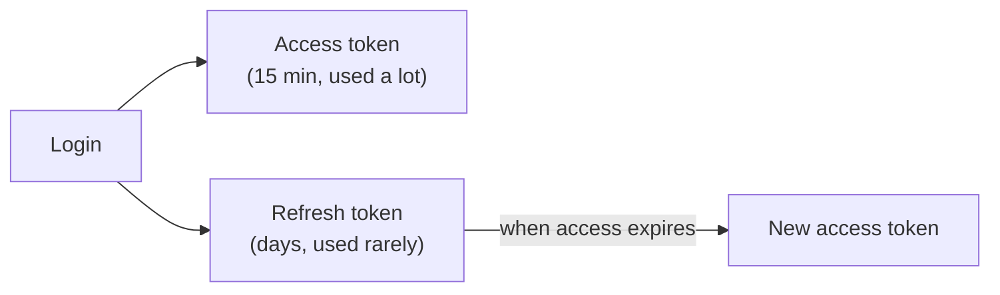
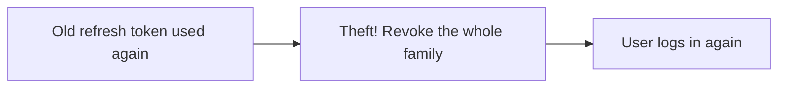
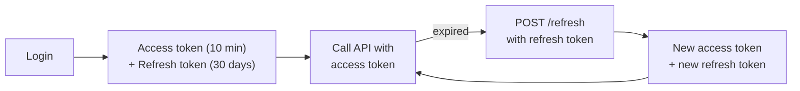
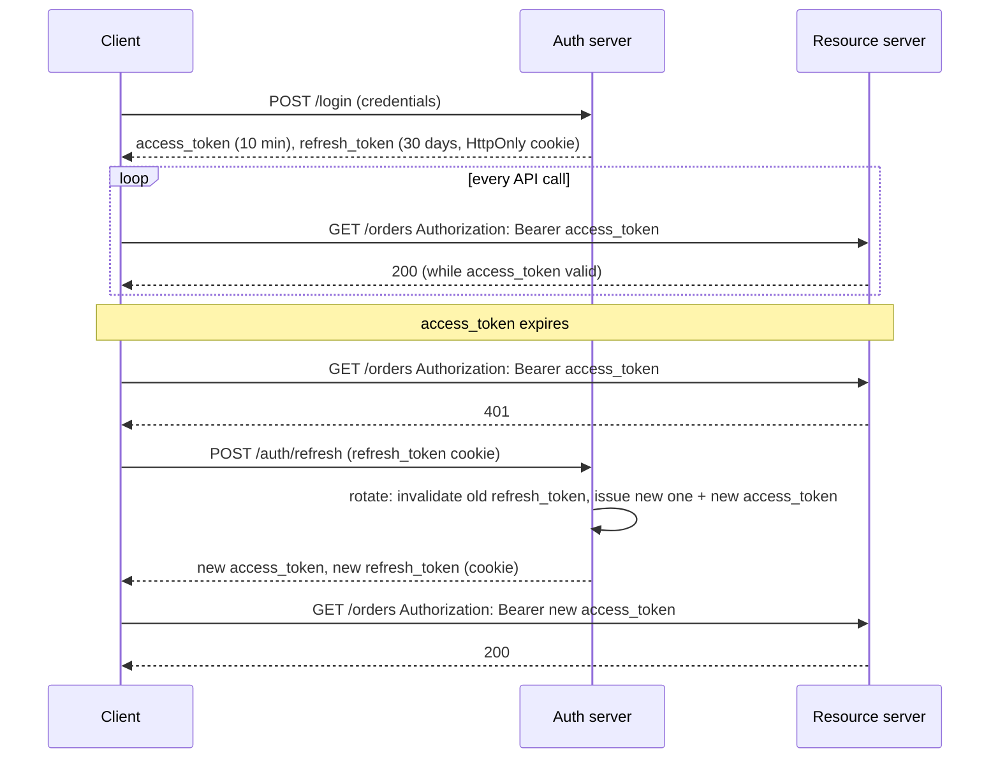
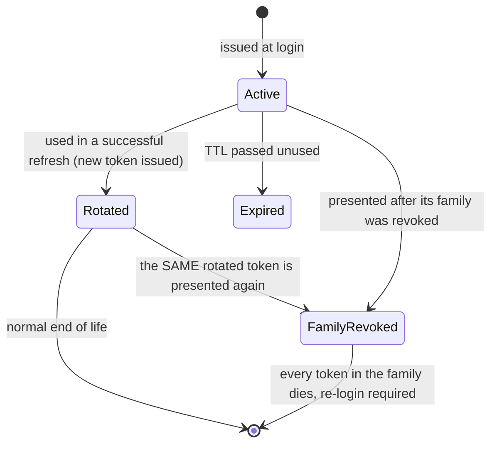
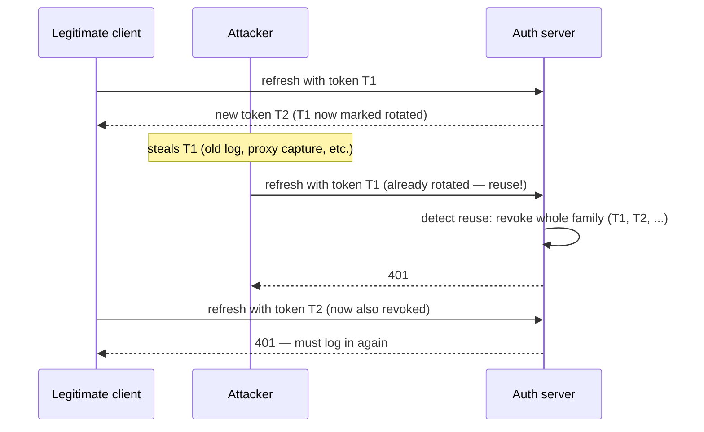

# Access and Refresh Tokens

> [!summary] TL;DR
> Split one login into two tokens: a short-lived **access token** sent on every API call, and a long-lived **refresh token** used only to get a new access token. A stolen access token expires in minutes; a stolen refresh token can be caught and revoked through rotation.

> [!abstract] Core idea
> - Access tokens live minutes (5–15), so the damage window from a stolen one is small; refresh tokens live days to weeks, so the user is not asked to log in constantly.
> - **Rotation with reuse detection**: every refresh call issues a brand-new refresh token and invalidates the old one. If the old (already-used) one is ever presented again, that is a stolen-and-replayed token, and the server kills every token descended from it.
> - Store the refresh token in an `HttpOnly`, `Secure`, `SameSite` cookie scoped to the refresh path, or in platform-secure storage on mobile — never in `localStorage`, which any XSS payload can read.
> - This is a session-management pattern, not a JWT-only one: the access token is often (but not necessarily) a JWT; the refresh token is normally an opaque random string looked up server-side.

## Start here: the basics 🟢

> [!info] How to read this note (pick your level)
> - 🟢 **New to this?** Read "From zero" below, then sections 1, 2 and 10 (why, mental model and the cheat sheet). Stop there, that is a full first pass.
> - 🟡 **Know the basics?** Add sections 3, 4, 5 and 6 (how it works, a worked example, options and trade-offs).
> - 🔴 **Interview / SDE-3 prep?** Add sections 7, 8 and 9 (production, deep dive and interview questions). Headings are tagged 🟢🟡🔴 so you always know where you are.

**From zero, in 60 seconds** 🟢

After login, an app gives you a pass to show on every request.
If that pass lasts for months and gets stolen, the thief is "you" for months.
So the app gives you two passes instead.
The **access token** is shown on every call but dies in about 15 minutes.
The **refresh token** is kept safe and used only to get a fresh access token.



Each refresh also swaps the refresh token for a new one. If an old one ever shows up again, someone copied it, so the app cancels the whole chain.



The rest of this note is just these 3 questions:
1. How are the two tokens issued and refreshed?
2. How does rotation catch a stolen refresh token?
3. Where should each client (browser, mobile, server) keep them?


**The problem in one story.**
You log into a shopping app on your phone.
You do not want to type your password every 10 minutes, so the app must remember you.
But if someone steals that "remember me" proof, they could act as you for weeks.
The fix: one short-lived pass for everyday calls and one long-lived pass used only to get fresh short ones.

**Words you need first**

| Word | Plain meaning | Tiny example |
| --- | --- | --- |
| Token | A string the server gives you that proves you logged in | `eyJhbGciOi...` or `r_8f3a...` |
| Access token | Short-lived token sent with every API call | Valid for 10 minutes |
| Refresh token | Long-lived token used only to get a new access token | Valid for 30 days |
| Expiry | The time after which a token stops working | `exp = 09:10` |
| Revoke | The server marking a token as dead before it expires | Logging out kills the refresh token |
| Cookie (`HttpOnly`) | Browser-stored value that page JavaScript cannot read | Refresh token stored safely from XSS |
| XSS | Attacker script running inside your page | Script reading `localStorage` |

**Picture it**



**Analogy.** A hotel gives you a room key card that works for one day (access token) and keeps your booking at the front desk (refresh token). When the card stops working, the desk checks your booking and prints a new card.
Where it breaks: a hotel desk sees your face; a refresh endpoint only sees the token, so rotation and reuse detection are needed to notice a thief.

**How the rest of this note builds up**

- First, why one token cannot be both short and convenient (section 1) and the two-token mental model (section 2).
- Then issuing and refreshing, rotation with reuse detection, and where each client stores tokens (section 3).
- Then a Go implementation with tests (section 4) and a comparison of variants (section 5).
- Finally the SDE-3 deep dive: trade-offs, production failure modes, race conditions on refresh and revocation (sections 6-8).

> [!tip] Remember
> Short access token for every call, long refresh token for one endpoint, and rotate the refresh token each time so a replay exposes theft.

## 1. Why it exists 🟢

A single long-lived token is a single point of failure: make it short enough to limit a theft's damage, and users re-authenticate every few minutes; make it long enough to be convenient, and a stolen token works for days.

Two tokens resolve the conflict: the access token (what every request actually carries) stays short, and the refresh token (presented rarely, only to a single trusted endpoint) carries the convenience.

A concrete scenario: a mobile app with a 10-minute access token and a 30-day refresh token lets a user stay logged in for a month without re-entering a password, while a leaked access token — say, captured in a proxy log — is worthless 10 minutes later.

The refresh token is the one credential that must survive theft detection, which is what rotation is for.

## 2. Mental model 🟢

Think of a **hotel key card system with a front-desk reissue**. The access token is the card in your pocket: it works at your room door for a limited time window before it's deactivated by the lock's clock.

The refresh token is your reservation confirmation at the front desk: present it, and the desk clerk deactivates your old card and hands you a freshly coded one. If someone steals your reservation confirmation and tries to use it *after* you already picked up your new card, the front desk notices a confirmation being used twice and locks the whole reservation — forcing everyone holding a card under it to come back to the desk and prove who they are again.

## 3. How it works 🟡

### Issuing and refreshing

**In plain words:** login gives both tokens. Calls use the short one. When it expires, the app quietly trades the long one for a new pair.



### Rotation with reuse detection

**In plain words:** every refresh token can be used only once. A second use of the same token means two people have it, so you shut the whole chain down.

Every refresh token belongs to a **family** started at login. Each rotation marks the presented token "used" and chains a new one into the same family. Presenting an already-used token is reuse — a strong signal of theft — and revokes the entire family at once, forcing re-login on every device sharing that family.





The legitimate user is forced to re-login too — an intentional trade-off. There is no way to tell, from the server's side alone, which of the two presenters of T1 was the attacker, so the safe default is to trust neither.

### Storage per client

**In plain words:** where to keep the tokens depends on the app. Browsers should use HttpOnly cookies; mobile apps use the phone's secure storage.

| Client | Access token | Refresh token |
| --- | --- | --- |
| Browser SPA | In memory (a JS variable), never `localStorage` | `HttpOnly`, `Secure`, `SameSite=Strict` cookie, path-scoped to `/auth/refresh` |
| Server-rendered web app | Session cookie or in the server session | Same `HttpOnly` cookie approach, since the browser already holds cookies |
| Mobile app | In memory or app-private storage | OS-backed secure storage (Android Keystore, iOS Keychain) |
| Service-to-service | In memory, short-lived | Not used — see [[Service-to-Service Auth - API Keys, HMAC, mTLS]] instead |

`localStorage` (and any JS-readable storage) is rejected for tokens because any successful XSS on the page can read it directly; an `HttpOnly` cookie is invisible to JavaScript, so the same XSS payload cannot exfiltrate the refresh token (CSRF defenses are still needed for the cookie itself — see [[CSRF, XSS and Security Headers]]).

## 4. Worked example 🟡

### Whiteboard version

The shape of rotation: look up the token's hash, check if it was already used, and if so burn the whole family.

```go
rec := store[hash(presented)]
if rec.rotated {
    revokeFamily(rec.familyID) // reuse: assume theft
    return ErrReuseDetected
}
rec.rotated = true
next := issueInSameFamily(rec.familyID)
```

### Full version

**In plain words:** complete Go code with tests. It stores only a hash of each refresh token, like a password.

Built and tested in a scratch module on Go 1.24; `go vet` and `go test -race` both pass. Only the token's SHA-256 hash is stored, never the raw value, the same way a password hash is stored instead of the password (see [[Password Storage and Login Security]]).

```go
// Package refresh shows refresh-token rotation with reuse detection: each
// refresh token belongs to a "family", only its hash is stored, and any
// attempt to reuse an already-rotated token revokes the whole family.
package refresh

import (
	"crypto/rand"
	"crypto/sha256"
	"encoding/base64"
	"encoding/hex"
	"errors"
	"sync"
	"time"
)

var (
	// ErrReuseDetected means a rotated-out token was presented again: a
	// strong signal the token was stolen. The whole family must be revoked.
	ErrReuseDetected = errors.New("refresh token reuse detected: family revoked")
	ErrInvalidToken  = errors.New("refresh token invalid or expired")
	ErrFamilyRevoked = errors.New("refresh token family already revoked")
)

type tokenRecord struct {
	familyID string
	rotated  bool
	expires  time.Time
}

type family struct {
	userID  string
	revoked bool
}

// Store is a server-side, in-memory refresh-token store. A real service
// backs this with a database table keyed by token hash, with an index on
// family_id for fast family-wide revocation.
type Store struct {
	mu        sync.Mutex
	tokens    map[string]*tokenRecord // hash -> record
	families  map[string]*family      // family id -> family
	ttl       time.Duration
	idCounter int
}

func NewStore(ttl time.Duration) *Store {
	return &Store{
		tokens:   make(map[string]*tokenRecord),
		families: make(map[string]*family),
		ttl:      ttl,
	}
}

func hashToken(raw string) string {
	sum := sha256.Sum256([]byte(raw))
	return hex.EncodeToString(sum[:])
}

func randomToken() (string, error) {
	b := make([]byte, 32)
	if _, err := rand.Read(b); err != nil {
		return "", err
	}
	return base64.RawURLEncoding.EncodeToString(b), nil
}

// Issue starts a new token family at login and returns the raw refresh token.
// Only its hash is kept server-side.
func (s *Store) Issue(userID string, now time.Time) (raw, familyID string, err error) {
	s.mu.Lock()
	defer s.mu.Unlock()
	s.idCounter++
	familyID = "fam_" + hex.EncodeToString([]byte{byte(s.idCounter)})
	s.families[familyID] = &family{userID: userID}
	raw, err = randomToken()
	if err != nil {
		return "", "", err
	}
	s.tokens[hashToken(raw)] = &tokenRecord{familyID: familyID, expires: now.Add(s.ttl)}
	return raw, familyID, nil
}

// Rotate exchanges a raw refresh token for a new one. If the presented token
// was already rotated (or its family already revoked), this is reuse: the
// whole family is revoked and every session in it must re-authenticate.
func (s *Store) Rotate(raw string, now time.Time) (newRaw string, userID string, err error) {
	s.mu.Lock()
	defer s.mu.Unlock()

	rec, ok := s.tokens[hashToken(raw)]
	if !ok {
		return "", "", ErrInvalidToken
	}
	fam, ok := s.families[rec.familyID]
	if !ok || fam.revoked {
		return "", "", ErrFamilyRevoked
	}
	if rec.rotated {
		fam.revoked = true // reuse of a rotated token: assume theft, kill the family
		return "", "", ErrReuseDetected
	}
	if now.After(rec.expires) {
		return "", "", ErrInvalidToken
	}

	rec.rotated = true
	newRaw, err = randomToken()
	if err != nil {
		return "", "", err
	}
	s.tokens[hashToken(newRaw)] = &tokenRecord{familyID: rec.familyID, expires: now.Add(s.ttl)}
	return newRaw, fam.userID, nil
}

// RevokeFamily logs out everywhere for one session family (explicit logout).
func (s *Store) RevokeFamily(familyID string) {
	s.mu.Lock()
	defer s.mu.Unlock()
	if fam, ok := s.families[familyID]; ok {
		fam.revoked = true
	}
}
```

The reuse-detection test:

```go
func TestReuseDetectionRevokesFamily(t *testing.T) {
	s := NewStore(7 * 24 * time.Hour)
	now := time.Date(2026, 11, 7, 12, 0, 0, 0, time.UTC)

	raw1, _, err := s.Issue("user_42", now)
	if err != nil {
		t.Fatalf("issue: %v", err)
	}
	raw2, _, err := s.Rotate(raw1, now.Add(time.Minute))
	if err != nil {
		t.Fatalf("rotate: %v", err)
	}

	// Attacker (or the legitimate client racing a retry) replays the
	// already-rotated raw1. This must be detected as reuse.
	if _, _, err := s.Rotate(raw1, now.Add(2*time.Minute)); !errors.Is(err, ErrReuseDetected) {
		t.Fatalf("got err %v, want ErrReuseDetected", err)
	}

	// The whole family, including the legitimately rotated raw2, is now dead.
	if _, _, err := s.Rotate(raw2, now.Add(3*time.Minute)); !errors.Is(err, ErrFamilyRevoked) {
		t.Fatalf("got err %v, want ErrFamilyRevoked after family revocation", err)
	}
}
```

**Measured:** `go test -race ./refresh/...` on Go 1.24.4 — 4 tests, all pass: happy-path rotation, reuse detection revokes the family, expired token rejected, explicit logout revokes the family (2026-11-07).

## 5. Variants and comparison 🟡

| Approach | How it works | Use when | Cost |
| --- | --- | --- | --- |
| Access + refresh, with rotation | Short access token, refresh token rotated and reuse-checked on every use | The general default for SPAs, mobile apps, and OAuth clients | A token-family table and a rotation check on every refresh call |
| Access + refresh, no rotation | Same refresh token reused until it expires | Low-stakes internal tools where theft detection matters less | A stolen refresh token works until it naturally expires — no reuse alarm |
| Server session only (no tokens) | One opaque session ID, server holds all state | Monolith, single data center, instant revocation required | A lookup on every request; harder to scale across services |
| Sliding session | Each successful request (or each refresh) pushes the expiry further out | "Stay logged in while active" products | A session can live forever if the user never stops using it — pair with an absolute cap |
| Sender-constrained tokens (DPoP, mTLS) | The token is bound to a private key the client holds; a bare stolen token is useless without it | High-value APIs (banking, payments) wanting theft resistance beyond rotation | Extra cryptographic proof on every request; client complexity |

> [!warning] Interview trap
> "Rotation prevents token theft" is wrong — rotation does not stop the first use of a stolen token; it **detects theft after the fact**, once the legitimate owner's next refresh collides with the attacker's. The damage window is bounded by the access token's short lifetime, not eliminated.

## 6. Trade-offs and when not to use 🟡

- **Sliding sessions trade security for convenience.** A refresh token whose expiry keeps resetting on use can keep a compromised session alive indefinitely if the attacker also keeps using it; pair sliding expiry with an absolute maximum (for example, forced re-login after 90 days regardless of activity).
- **Rotation adds a race to handle.** Two near-simultaneous refresh calls from the same legitimate client (a flaky network causing a silent retry) can look exactly like reuse. A short grace window — accept the immediately-prior token once, within a few seconds, without treating it as theft — avoids false positives; anything presented after that grace window is treated as reuse.
- **When one access token alone is fine:** short-lived, service-to-service calls with no interactive user (use [[Service-to-Service Auth - API Keys, HMAC, mTLS]] instead), or internal tools behind a VPN where a single session cookie with server-side revocation is simpler and the added rotation machinery buys little.

## 7. In production 🔴

- **Real systems:** Auth0 and Okta implement refresh token rotation with reuse detection by default for SPA clients; Google and Microsoft OAuth both rotate refresh tokens for public clients; AWS Cognito offers configurable refresh-token revocation. RFC 9700 (OAuth 2.0 Security BCP) requires rotation with reuse detection for public clients that cannot keep a secret.
- **Failure modes → fixes:**
  - Concurrent refresh calls from one client both treated as reuse → add a short single-flight grace window so a near-simultaneous retry doesn't nuke a legitimate session.
  - Refresh token stored in `localStorage` → move it to an `HttpOnly` cookie or platform secure storage; this closes the XSS exfiltration path.
  - No absolute cap on sliding sessions → add a hard expiry alongside the sliding one.
  - Family revoked but access tokens already issued keep working → keep access-token `exp` short enough that the blast radius after revocation is minutes, not hours.
- **What to monitor:** refresh-reuse events (each one is a likely theft or a client bug — alert on any volume), refresh failure rate, average and p99 time between refreshes, and the distribution of family sizes (an unusually long family can mean a client that never truly logs out).

## 8. Deep dive 🔴

- **Why hash, not store, the raw refresh token.** The token store is a prime target if the database leaks; storing only `SHA-256(raw)` means a database leak alone does not hand out usable tokens, mirroring why passwords are hashed rather than stored plain (see [[Password Storage and Login Security]]). Unlike passwords, refresh tokens are high-entropy random strings, so a fast hash (no salt, no slow KDF) is sufficient — there is no dictionary attack to defend against.
- **Concurrent refresh races in SPAs.** A page with several tabs, or a mobile app resuming from background, can fire two refresh calls near-simultaneously with the same (not-yet-rotated) token. The common fix is a short-lived grace record: when a token is rotated, keep it valid for a few more seconds for exactly one more "it's probably the same client" refresh, while still treating any reuse after that window — or any reuse of a token older than one generation — as theft.
- **Absolute vs sliding expiry, together.** Sliding expiry (reset the clock on activity) optimizes for "don't log out an active user"; an absolute cap (force re-login after N days regardless) bounds how long a quietly-compromised session can persist. Production systems use both: slide the expiry on each refresh, but refuse to issue a refresh token past the absolute cap from the original login.
- **DPoP and mTLS as the next step up.** Rotation detects theft of the refresh token itself; it does nothing if the attacker steals and uses the token before the legitimate client's next refresh. Sender-constrained tokens bind the token to a private key (DPoP, RFC 9449) or a TLS client certificate (mTLS), so a copied token is useless without the key it was issued to — the attacker would need both.
- **401 → refresh → retry once.** Clients should treat exactly one 401 as "try a refresh, then retry the original request once"; a second 401 after a successful-looking refresh should not loop — it should surface as a real auth failure (expired family, revoked session) rather than retry forever.

## 9. Interview questions 🔴

> [!question]- Why two tokens instead of one?
> A single long-lived token is a long theft window; a single short-lived token means constant re-login. Splitting lets the token actually sent on every request (access) stay short, while the token presented rarely (refresh) carries the long lifetime and gets the extra protection of rotation.

> [!question]- What exactly does refresh token rotation protect against?
> It does not stop the first fraudulent use of a stolen refresh token. It detects theft: once an already-rotated (used) token is presented again — which only happens if someone other than the current legitimate holder has a copy — the server revokes the whole token family, limiting the damage to the window since the last legitimate refresh.

> [!question]- Where should a browser SPA store its refresh token, and why not `localStorage`?
> In an `HttpOnly`, `Secure`, `SameSite` cookie scoped to the refresh endpoint's path. `localStorage` is readable by any JavaScript running on the page, so a single XSS vulnerability can exfiltrate the token; `HttpOnly` cookies are invisible to JavaScript entirely.

> [!question]- Two refresh requests arrive from the same client almost simultaneously. What happens, and how do you avoid breaking the legitimate session?
> Naively, the second request sees an already-rotated token and looks like reuse, revoking a legitimate session. The fix is a short grace window: accept the immediately-prior token once within a few seconds as a likely retry, and only treat reuse outside that window (or of an older generation) as theft.

> [!question]- What is a sliding session, and what is its risk?
> Each successful refresh (or request) extends the session's expiry further into the future, so an actively used session never times out. Unbounded, this lets a quietly compromised session live indefinitely; pair it with an absolute expiry cap from the original login.

> [!question]- A refresh token is leaked in a server log. What do you do, and what should have prevented it in the first place?
> Immediately revoke that token's family (and ideally force re-login for the affected user) and rotate any logging configuration that captured it. Prevention: never log full tokens or cookies — log only a token's hash or id, and ensure proxies and access logs are configured to redact `Authorization` and `Cookie` headers.

> [!question]- Is rotation still needed if access tokens are already short-lived?
> Yes — the access token's short lifetime bounds the damage of *that* token's theft, but the refresh token is what a long-term attacker actually wants, since it keeps minting new access tokens. Rotation is what makes a stolen refresh token detectable rather than silently useful for its entire (days-to-weeks) lifetime.

## 10. Cheat sheet 🟢

- Access token: short (5–15 min), sent on every request. Refresh token: long (days–weeks), sent only to the refresh endpoint.
- Rotate the refresh token on every use; chain rotations into a family.
- Reuse of an already-rotated token = assume theft = revoke the whole family, forcing re-login.
- Store the refresh token hashed server-side (never the raw value); store it client-side in an `HttpOnly` cookie or platform secure storage, never `localStorage`.
- Add a short grace window for near-simultaneous refreshes to avoid false reuse alarms.
- Sliding expiry needs an absolute cap alongside it, or a compromised session never dies.
- Rotation detects theft after the fact; it does not stop the first fraudulent use — that's what the access token's short `exp` bounds.

## Links

- **Before this:** [[JWT - Structure, Validation and Pitfalls]], [[Sessions and Cookies]]
- **Next:** [[OAuth 2.0 and OpenID Connect]]
- **Compare with:** [[Authentication and Authorization in Go]] (wiring the refresh endpoint and middleware), [[Secrets Management]] (protecting the hashing/signing keys involved)

### Watch on YouTube

- [What are JWT Access token & Refresh token and why we need them? / Understanding JWT Tokens...](https://www.youtube.com/watch?v=ahDQI7msr0A) · Rahul Ahire · 9 min · 73,529 views
- [What is the difference between Access Tokens & Refresh Tokens? OAuth 2.0 & OIDC (OpenID Connect)](https://www.youtube.com/watch?v=PX90GNc7xo8) · Ubisecure · 3 min · 29,524 views
