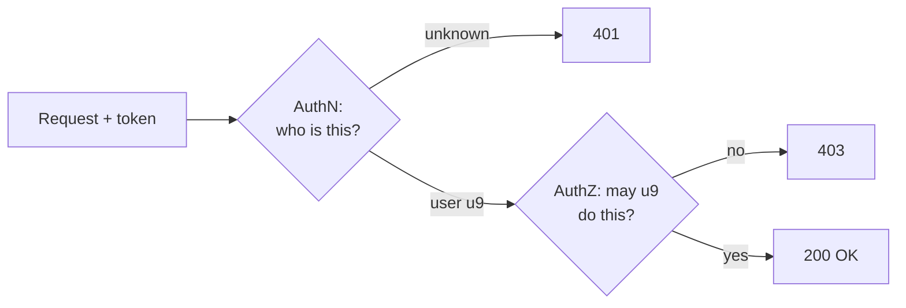
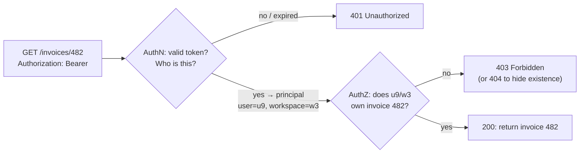
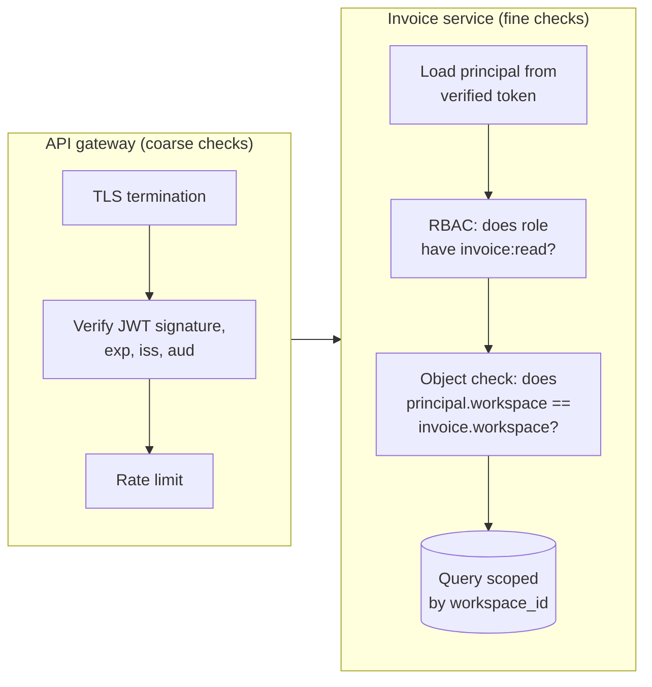

# Authentication vs Authorization

> [!summary] TL;DR
> Authentication (AuthN) answers "who are you?" — it checks a credential and issues an identity. Authorization (AuthZ) answers "what are you allowed to do?" — it checks that identity against a permission model on every request. Mixing them up is how one tenant reads another tenant's data while fully logged in.

> [!abstract] Core idea
> - AuthN runs once (at login) and produces a principal; AuthZ runs on every request against that principal.
> - A failed AuthN check returns 401; a failed AuthZ check returns 403 (or a disguised 404).
> - "Logged in" is not "allowed": every object a request touches needs its own ownership/permission check, or you get BOLA.
> - RBAC (role → permission), ABAC (attribute rules), and ReBAC (relationship graphs, à la Google Zanzibar) are three different ways to answer the AuthZ question; pick the simplest one that fits the data shape.
> - Where the check runs matters: coarse checks belong at the edge (gateway), object-level checks belong in the service that owns the data.

## Start here: the basics

**The problem in one story.**
At an office building, the front desk checks your ID and gives you a badge.
That proves who you are, but it does not mean you may enter every room.
Each door still checks: "is this badge allowed in *this* room?"
Websites need the same two steps: who are you, and are you allowed to do this?

**Words you need first**

| Word | Plain meaning | Tiny example |
| --- | --- | --- |
| Credential | Something you present to prove identity | Password, passkey, API key |
| Authentication (AuthN) | Checking who you are | Login with email + password |
| Authorization (AuthZ) | Checking what you may do | Only the author may delete a post |
| Principal | The identity the server works with after login | `user=u9, workspace=w3` |
| Role | A named bundle of permissions | `admin`, `viewer` |
| HTTP 401 | "I do not know who you are" | Missing or expired token |
| HTTP 403 | "I know who you are, but no" | Viewer tries to delete |

**Picture it**



**Analogy.** Airport: passport control checks who you are (AuthN); your boarding pass decides which plane you may board (AuthZ).
Where it breaks: an airport checks once per trip, but an API must run the AuthZ check on every request and every object it touches.

**How the rest of this note builds up**

- First, why "logged in" is not "allowed" (section 1) and the two-gate mental model (section 2).
- Then issuing an identity, 401 vs 403 vs 404, and where checks live (section 3).
- Then RBAC vs ABAC vs ReBAC on one request and a Go object-level check (section 4), with a comparison (section 5).
- Finally the SDE-3 deep dive: trade-offs, production failures like BOLA, and policy engines (sections 6-8).

> [!tip] Remember
> AuthN answers "who are you?" once; AuthZ answers "may you do this to this object?" on every request.

### Whiteboard version

A request for one invoice, with both checks drawn as gates:



If the service skips the second gate and trusts "the token was valid" as "the request is allowed", any logged-in user can read `/invoices/1`, `/invoices/2`, … for every workspace. That single missing gate is OWASP's API1:2023, Broken Object Level Authorization (BOLA), consistently the most reported API vulnerability class.

## 1. Why it exists

A public blogging API has two endpoints: `GET /posts/{id}` (anyone can read a published post) and `DELETE /posts/{id}` (only the author can delete it). A single "is this user logged in?" check cannot express that difference — it collapses two separate questions into one:

1. **Authentication:** is there a valid session or token at all, and whose is it?
2. **Authorization:** given that identity, is *this* action on *this* post allowed?

Concretely: user `u9` is authenticated (their JWT is valid, not expired, correctly signed). They send `DELETE /posts/482`. Post 482 belongs to user `u77`. A server that only checks "is the token valid" returns 204 and deletes someone else's post.

A server with both checks runs the second gate — "does `u9` own post 482, or hold a role that may delete any post?" — and returns 403.

This is not a hypothetical: unauthorized object access is the single most common API vulnerability reported in Postman and Salt Security's annual API security surveys, and it is OWASP's #1 API risk for two editions running.

## 2. Mental model

A nightclub analogy makes the split concrete:

- **Authentication** = showing ID at the door. The bouncer confirms you are who your ID says you are. That's it — it says nothing about what you can do inside.
- **Authorization** = the wristband. A green wristband gets the main floor; a VIP wristband also gets the upstairs lounge. The bouncer at the lounge door checks the wristband, not your ID again.

The crucial corollary: checking ID at the front door once does not let you into every room. Every door (every object, every action) needs its own wristband check. That's the whole story behind BOLA — a system that checks ID once at login and then trusts every subsequent door.

## 3. How it works

### Issuing an identity

Authentication ends with the server minting a **principal**: a value that says who the caller is, derived from one of:

- **Something you know** — password, PIN.
- **Something you have** — a TOTP device, a hardware security key, a phone receiving an SMS/push.
- **Something you are** — biometrics (fingerprint, face), used almost always as a *local* unlock for a stored key, not transmitted to the server.

Multi-factor authentication (MFA) combines two different categories — password (know) + TOTP code (have) — because compromising both at once is much harder than compromising one. See [[Password Storage and Login Security]] for how the password half is verified, and [[Sessions and Cookies]] / [[JWT - Structure, Validation and Pitfalls]] for how the resulting identity is carried on later requests.

### Status codes: 401 vs 403 vs 404

| Code | Means | Example |
| --- | --- | --- |
| 401 Unauthorized | No valid identity at all: missing, expired or malformed credential | No `Authorization` header, or an expired JWT |
| 403 Forbidden | Identity is known and valid, but this action/object is not allowed | A `member` role calling an `admin`-only endpoint |
| 404 Not Found | Used deliberately *instead of* 403 to avoid confirming a resource exists | `GET /invoices/482` for an invoice in someone else's workspace |

The 403-vs-404 choice is itself an authorization decision: for a resource whose existence is sensitive (another tenant's record, a private repo), a 403 confirms "object 482 exists, you just can't see it" — an information leak. Returning 404 for "exists but not yours" closes that leak at the cost of a slightly less informative error for genuine permission mistakes.

### Where the checks live



The gateway can reject a forged or expired token cheaply, before it reaches any service. It cannot know whether *this* principal owns *that specific* invoice — that check needs the invoice's row, which only the owning service has.

So coarse, identity-shaped checks (is the token valid? does this role exist?) belong at the edge; object-level checks belong in the service, scoped by a `WHERE workspace_id = $1` (or equivalent) on every query that touches tenant data.

A policy engine like OPA (Rego policies evaluated as a sidecar or library call) or Casbin can centralize the *rule* while the *object lookup* still happens where the data lives.

## 4. Worked example

### RBAC vs ABAC vs ReBAC on the same request

`GET /invoices/482`, requested by user `u9` in workspace `w3`, role `member`.

**RBAC (role-based access control).** A fixed table of role → permission:

| Role | `invoice:read` | `invoice:write` | `invoice:delete` |
| --- | --- | --- | --- |
| member | yes | no | no |
| admin | yes | yes | yes |

Check: "does `u9`'s role (`member`) include `invoice:read`?" Yes — but RBAC alone never looked at *which* invoice. It must always be paired with an object-level check (does invoice 482 belong to `w3`?), or every member can read every workspace's invoices.

**ABAC (attribute-based access control).** A rule over attributes of the principal, the resource, and the environment:

```text
allow invoice:read if
    principal.workspace_id == resource.workspace_id
    and principal.role in {"member", "admin"}
    and request.time between resource.visible_from and resource.visible_until
```

ABAC folds the object check and the time-window check into the same rule language, which is why policy engines like OPA express rules this way: one evaluation covers role, tenant, and context together.

**ReBAC (relationship-based access control).** Google's Zanzibar model (used by Google Drive, and the open-source OpenFGA/SpiceDB) stores authorization as a graph of relationship tuples:

```text
(object: invoice:482, relation: viewer, user: workspace:w3#member)
(object: invoice:482, relation: owner,  user: user:u77)
```

"Can `u9` view invoice 482?" becomes a graph walk: is `u9` a member of `w3`, and does `w3#member` have the `viewer` relation on `invoice:482`? ReBAC shines when permissions follow a sharing graph (folder → subfolder → file, team → sub-team → member) rather than a flat role list — exactly Google Drive's "anyone with this folder shared with them can see its files" model.

### Go: the object-level check

The gate every handler needs is the tenant/ownership check, with the role check layered on top. It belongs in the service, not the gateway, because only the service has the resource row:

```go
package authz

import "errors"

// Role to allowed actions. A real system loads this from config or a
// policy engine (OPA, Casbin); it is hardcoded here only to keep the
// example self-contained.
var rolePermissions = map[string]map[string]bool{
	"member": {"invoice:read": true},
	"admin":  {"invoice:read": true, "invoice:write": true, "invoice:delete": true},
}

// Principal is the authenticated caller: who they are (set by
// authentication) plus their role and tenant (used by authorization).
type Principal struct {
	UserID      string
	WorkspaceID string
	Role        string
}

// Resource is the object being accessed. OwnerWorkspaceID scopes every
// lookup so one tenant can never reach another tenant's row.
type Resource struct {
	ID               string
	OwnerWorkspaceID string
}

var ErrWrongWorkspace = errors.New("authz: resource belongs to a different workspace")
var ErrNoPermission = errors.New("authz: role lacks this permission")

// Can reports whether principal may perform action on resource. It checks
// the tenant boundary first (object-level authorization, the fix for
// BOLA/IDOR) and only then the role's permission (RBAC) — a correct role
// can never bypass the tenant check.
func Can(p Principal, action string, r Resource) error {
	if r.OwnerWorkspaceID != p.WorkspaceID {
		return ErrWrongWorkspace
	}
	if !rolePermissions[p.Role][action] {
		return ErrNoPermission
	}
	return nil
}
```

The test that proves the BOLA case is actually blocked:

```go
package authz

import (
	"errors"
	"testing"
)

func TestCanBlocksCrossWorkspaceAccess(t *testing.T) {
	// This is the BOLA/IDOR case: a valid, authenticated admin from one
	// tenant reaching another tenant's invoice by guessing its ID.
	admin := Principal{UserID: "u1", WorkspaceID: "ws1", Role: "admin"}
	otherTenantInv := Resource{ID: "inv2", OwnerWorkspaceID: "ws2"}

	err := Can(admin, "invoice:read", otherTenantInv)
	if !errors.Is(err, ErrWrongWorkspace) {
		t.Fatalf("want ErrWrongWorkspace, got %v", err)
	}
}

func TestCanBlocksMemberFromWriting(t *testing.T) {
	member := Principal{UserID: "u2", WorkspaceID: "ws1", Role: "member"}
	inv := Resource{ID: "inv1", OwnerWorkspaceID: "ws1"}

	err := Can(member, "invoice:write", inv)
	if !errors.Is(err, ErrNoPermission) {
		t.Fatalf("want ErrNoPermission, got %v", err)
	}
}
```

Both tests pass under `go test -race` on Go 1.24 (no shared mutable state in this example, so `-race` mainly confirms there is nothing to flag). The full HTTP middleware that extracts the principal from a token and calls `Can` on every handler is in [[Authentication and Authorization in Go]] — this module is deliberately the pure decision function, kept framework-free so it is trivial to unit test.

## 5. Variants and comparison

| Model | How it works | Use when | Cost |
| --- | --- | --- | --- |
| RBAC | Role → fixed permission set | Small number of roles, permissions don't depend on resource attributes | Simple to reason about; role explosion if you need many fine-grained combinations |
| ABAC | Rule evaluated over principal/resource/environment attributes | Permissions depend on context: tenant, time window, resource sensitivity | Rule language and evaluator needed (OPA/Rego, Casbin); rules can become hard to audit if unconstrained |
| ReBAC (Zanzibar-style) | Relationship tuples + graph walk ("is A related to B via path P?") | Permissions follow a sharing/ownership graph (folders, teams, sub-teams) | Needs a tuple store and a graph-walk engine (OpenFGA, SpiceDB); overkill for a flat role list |
| ACL (access control list) | Per-object list of (principal, permission) pairs | Small number of objects each shared individually (a single document's share list) | Simple per object; doesn't scale to "which of my 10,000 files can user X see" without an index |
| Policy engine (OPA) | Centralizes RBAC/ABAC rules as Rego, queried via a sidecar or library | You want one audited policy source instead of permission checks scattered across services | Extra moving part (policy distribution, bundle updates); still needs the service to fetch the resource |

## 6. Trade-offs and when not to use

- RBAC alone never substitutes for an object-level check — a role answers "can a member read invoices", never "can this specific member read this specific invoice". Skipping the object check is exactly BOLA.
- ABAC's flexibility is also its risk: a rule language powerful enough to express "time window" and "attribute match" is powerful enough to express a rule nobody can audit by reading it. Keep rules small and tested.
- ReBAC/Zanzibar is the right tool for Google-Drive-shaped sharing graphs; it is the wrong tool for "there are 3 roles and 5 permissions" — plain RBAC is simpler and has fewer moving parts.
- A policy engine centralizes the *rule*, not the *data lookup*. OPA still needs the service to hand it the resource's attributes (owner, tenant, visibility) — it does not remove the need to fetch and scope the row.
- Checking authorization only at the gateway (coarse, role-only) and trusting every downstream service is the architecture that produces BFLA (Broken Function Level Authorization, OWASP API5): an admin-only route reachable because a downstream service never re-checked the role itself.

## 7. In production

- **Real systems:** Google Drive and Google Cloud IAM run on Zanzibar-derived ReBAC internally. GitHub repo permissions (direct, team, organization) are a ReBAC-shaped graph. Most SaaS back ends run RBAC with an added per-row tenant filter, which is ABAC in miniature (`tenant_id = current_tenant`). OPA is widely used as a sidecar in Kubernetes admission control and as a library inside Go services for exactly this kind of decision.
- **Failure modes → fixes:**
  - Missing object-level check (BOLA) → scope every query with the tenant/owner ID from the verified principal, never from a client-supplied field.
  - Trusting a client-supplied `role` or `tenant_id` field in the request body → derive both from the verified token/session server-side, never from request input.
  - Admin routes reachable by a lower role because only the gateway checks roles (BFLA) → re-check authorization in the service that owns the action, not only at the edge.
  - 403 leaking existence of a resource the caller shouldn't know about → return 404 for "not yours" when existence itself is sensitive.
- **What to monitor:** 401 vs 403 rate per route (a spike in 403 on one endpoint often means a new client bug, not an attack; a spike in 401 can mean an expired-token rollout bug); repeated 403s from one principal against sequential IDs (`/invoices/480`, `/invoices/481`, `/invoices/482` …) — a strong BOLA-probing signal; audit log of every authorization denial with principal, action and resource ID.

## 8. Deep dive

- **Default deny.** The permission check should start from "deny" and require an explicit grant, never the reverse. A rule set that fails open (an unmatched case defaults to allow) is a standing vulnerability waiting for a new endpoint to be added without a matching rule.
- **Row-level security as a second line of defense.** Postgres row-level security (RLS) policies tied to a session variable (`current_setting('app.workspace_id')`) enforce the tenant boundary inside the database itself, so an application bug that forgets the `WHERE workspace_id = $1` clause still cannot leak another tenant's rows. This is a backstop, not a substitute for the application-level check — RLS alone doesn't know about role-based action permissions like `invoice:delete`.
- **Service identity vs user identity.** A background job or a service calling another service on a user's behalf needs its own principal shape: either the user's token propagated through (on-behalf-of), or a service identity (mTLS client certificate, signed service JWT) with its own, narrower permission set. Conflating "this call came from our billing service" with "this call came from user u9" produces privilege-escalation bugs when the service account's permissions are broader than any single user's.
- **Caching authorization decisions.** A ReBAC graph walk or an ABAC rule evaluation is not free; high-traffic reads often cache "yes" decisions for a few seconds keyed by (principal, resource, action), but a permission *revocation* must still take effect promptly — Zanzibar's answer is a "zookie"/consistency token that ties a read to a known-fresh point in the permission graph, trading a little latency for correctness.
- **Multi-tenant isolation beyond the row filter.** At higher assurance levels (regulated data, enterprise contracts), tenants get separate database schemas, separate encryption keys, or fully separate database instances, so a missing `WHERE` clause cannot cross a tenant boundary even in principle. That is a deployment-topology decision layered on top of the same authorization model, not a replacement for it.

## 9. Interview questions

> [!question]- What is the one-sentence difference between authentication and authorization?
> Authentication establishes who the caller is; authorization decides what that caller may do, checked again on every request against every resource it touches.

> [!question]- A user is fully authenticated — valid token, not expired, correctly signed — and still gets a 403. What happened, and is that correct behavior?
> Yes, that's correct: authentication only confirms identity. The 403 means the authorization check (role, object ownership, or both) rejected this specific action on this specific resource. A valid token never implies "allowed to do anything."

> [!question]- Trap: "If I check that the user is logged in before every handler, is my API secure against object-level access bugs?"
> No. A login check is authentication, not authorization. Without also checking that the logged-in user owns or is permitted to access the exact object/ID in the request, you have BOLA (OWASP API1): `GET /invoices/{id}` serves any ID to any logged-in user regardless of ownership.

> [!question]- When would you pick RBAC over ABAC, or vice versa?
> Pick RBAC when permissions map cleanly onto a small number of roles independent of the specific resource (member vs admin). Pick ABAC when the decision depends on resource or context attributes the role alone can't express (tenant match, time window, data sensitivity). Most real systems run RBAC for the coarse role gate and an attribute check (tenant/owner match) for the object gate — which is ABAC in miniature.

> [!question]- What does a policy engine like OPA actually centralize, and what does it not replace?
> It centralizes the *rule* — one audited, testable policy source instead of permission logic scattered across services. It does not replace the service's job of fetching the resource and handing OPA the right attributes (owner, tenant, sensitivity); OPA cannot authorize what it never sees.

> [!question]- Why return 404 instead of 403 for some authorization failures?
> A 403 confirms the resource exists but the caller may not see it — an information leak when existence itself is sensitive (another tenant's record, a private repository). Returning 404 for "exists but not yours" avoids that leak, at the cost of a slightly less informative error for legitimate permission mistakes.

> [!question]- What is Broken Function Level Authorization (BFLA), and how does it differ from BOLA?
> BOLA is a per-object failure: the right permission check on the wrong (or missing) object scope, e.g. reading someone else's invoice by ID. BFLA is a per-function failure: an entire privileged operation (an admin-only endpoint) reachable by a lower-privileged role because only the gateway checked the role and the service never re-checked it.

## 10. Cheat sheet

- AuthN = who; AuthZ = what they can do. AuthN runs once at login; AuthZ runs on every request.
- 401 = no valid identity; 403 = valid identity, action/object not allowed; 404 = deliberately hides existence.
- RBAC = role → permission table. ABAC = rule over attributes. ReBAC = relationship graph (Zanzibar). Pick the simplest one the data shape needs.
- RBAC alone never checks the specific object — pair every role check with an ownership/tenant check, or you have BOLA (OWASP API1).
- Coarse checks (token valid? role exists?) belong at the gateway; object-level checks belong in the service that owns the resource.
- Default deny: an unmatched case in the policy must reject, never allow.
- Service identity (mTLS, service JWT) is a separate principal shape from user identity — never let a broad service account stand in for a narrower user permission set.

## Links

- **Before this:** [[HTTP Fundamentals - Methods, Status Codes, Headers, Cookies]]
- **Next:** [[Password Storage and Login Security]], [[Sessions and Cookies]]
- **Compare with:** [[JWT - Structure, Validation and Pitfalls]] (bearer tokens as one way to carry the authenticated identity), [[Authentication and Authorization in Go]] (full middleware wiring), [[OAuth 2.0 and OpenID Connect]] (delegated authentication/authorization across services)

### Watch on YouTube

- [8. Authentication and authorization for backend engineers](https://www.youtube.com/watch?v=A95rliroC8Q) · Sriniously · 95 min · 191,525 views
- [Authentication vs Authorization Explained](https://www.youtube.com/watch?v=7ijBiXddB7w) · xplodivity · 3 min · 43,758 views
