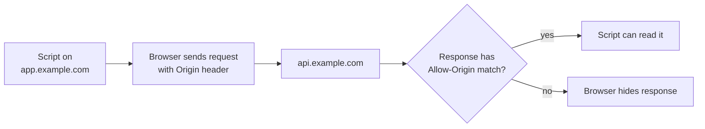
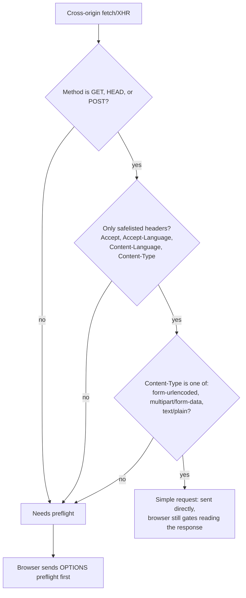
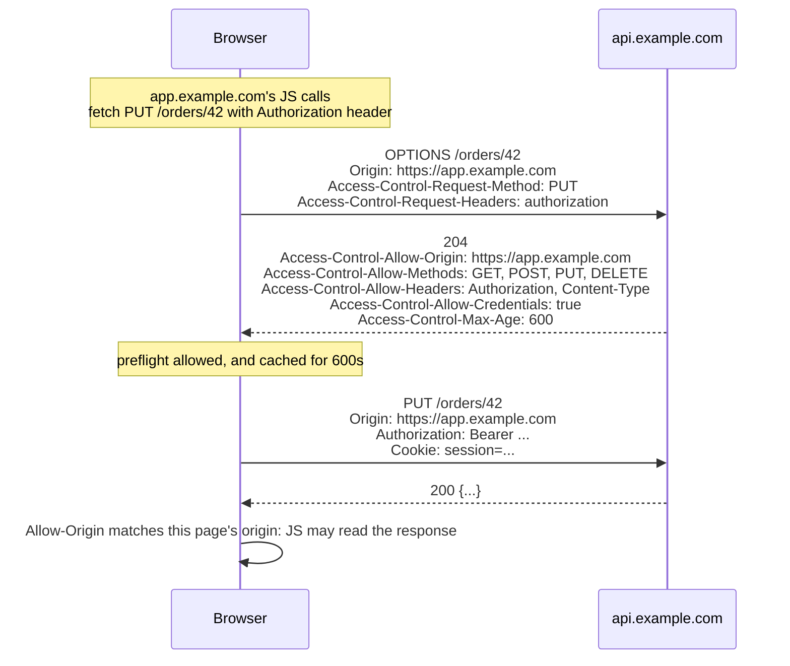
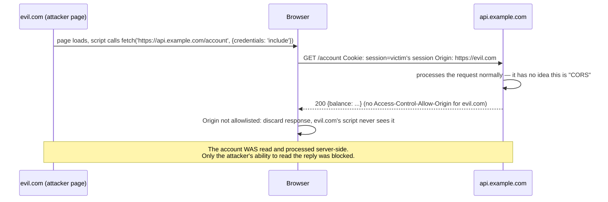

# CORS and Same-Origin Policy

> [!summary] TL;DR
> The browser's **same-origin policy (SOP)** stops JavaScript on one site from reading responses from another. **CORS** is the opt-in mechanism that lets a server say "this other origin may read my responses." Both are enforced only by browsers — they do nothing to stop a server from being called directly.

> [!abstract] Core idea
> - An **origin** is scheme + host + port; `https://app.example.com` and `http://app.example.com` are different origins, and so are `:443` and `:8443`.
> - SOP blocks **reading** a cross-origin response, not **sending** the request — the request still reaches the server either way.
> - A **simple request** (GET/HEAD/POST with only safelisted headers and content types) goes straight through; anything else triggers a **preflight** `OPTIONS` first.
> - Credentialed requests (cookies, `Authorization`) can never be paired with a wildcard origin — only an exact, validated origin.
> - CORS is not authentication, not authorization, and not CSRF protection. It only decides who may read a response in a browser.

## Start here: the basics

**The problem in one story.**
You are logged into your bank in one browser tab.
In another tab you open a random website.
That website's JavaScript must not be able to read your bank balance using your logged-in session.
Browsers block this by default; CORS is how a server allows the sites it trusts to read its responses.

**Words you need first**

| Word | Plain meaning | Tiny example |
| --- | --- | --- |
| Origin | Scheme + host + port of a page | `https://app.example.com:443` |
| Cross-origin | A request from one origin to a different one | `app.example.com` calling `api.example.com` |
| Same-origin policy (SOP) | Browser rule: scripts may not read other origins' responses | `evil.com` cannot read `bank.com` data |
| HTTP header | A key-value line sent with a request or response | `Origin: https://app.example.com` |
| Preflight | A browser's `OPTIONS` check before a non-simple request | Asking "may I send `PUT` with JSON?" |
| Credentials | Cookies or `Authorization` sent with a request | Session cookie |

**Picture it**



**Analogy.** A mailroom delivers every letter, but only hands the reply to the person the sender's letter names as allowed.
Where it breaks: the letter was still delivered; CORS never stops the request from reaching the server, and non-browser clients ignore it entirely.

**How the rest of this note builds up**

- First, why SOP exists and what CORS relaxes (section 1), then the browser-as-gatekeeper mental model (section 2).
- Then simple vs preflighted requests, the preflight exchange, the credentials rule, and why CORS is not server protection (section 3).
- Then a Go CORS middleware with tests (section 4) and a comparison of setups (section 5).
- Finally the SDE-3 deep dive: trade-offs, production misconfigurations, caching and `Vary: Origin` (sections 6-8).

> [!tip] Remember
> CORS only decides which origins' scripts may *read* a response in a browser; it is not authentication and does not stop the request.

## 1. Why it exists

Before CORS, the same-origin policy simply blocked all cross-origin reads: `https://app.example.com`'s JavaScript could not read a response from `https://api.example.com`, full stop, even when the two services belonged to the same company.

That protected users from a malicious page silently reading their bank's dashboard in a background tab, but it also made splitting a frontend and API across subdomains or domains impossible for legitimate apps.

CORS is the server's way to carve out exceptions to SOP: `api.example.com` can tell the browser "responses to `app.example.com` may be read by its scripts," while still blocking `evil.com` from reading the same response if a user happens to visit both.

A concrete failure mode this prevents: without any CORS header, if `evil.com` embeds a `<script>` that calls `https://api.example.com/account` with the user's existing session cookie, the request still fires and the server still processes it — but the browser discards the response before `evil.com`'s JavaScript can read it, because no origin was allowlisted.

## 2. Mental model

Same-origin policy is the browser acting as a **mail carrier who also has to approve who's allowed to open the mail**. Any script can address an envelope (send the request) to any origin — the carrier always delivers it, and the destination (the server) still opens and answers it.

But when the response envelope comes back addressed to the page's own origin, the carrier only hands it to that page's script if the destination explicitly wrote the page's origin on an approval sticker (the `Access-Control-Allow-Origin` header).

No sticker, or the wrong origin on it, and the carrier keeps the envelope sealed from the calling script — even though the destination already did whatever the letter asked.

## 3. How it works

### Simple vs preflighted requests



A JSON `POST` (`Content-Type: application/json`) is **not** simple — it needs a preflight, because `application/json` is not in the safelisted content-type set. A form `POST` with `application/x-www-form-urlencoded` is simple and goes straight out; the browser still withholds the response from script unless the origin is allowed.

### The preflight exchange



`Access-Control-Max-Age` lets the browser skip repeating the preflight for the same method/headers combination for that many seconds, which matters because a preflight is a full extra round trip before every distinct write.

### Response headers, and the credentials rule

| Header | Purpose |
| --- | --- |
| `Access-Control-Allow-Origin` | The one origin (or `*` for non-credentialed public responses) allowed to read this response |
| `Access-Control-Allow-Methods` | Methods the preflighted request may use |
| `Access-Control-Allow-Headers` | Request headers the actual request may send |
| `Access-Control-Allow-Credentials` | `true` if cookies/`Authorization` may be included — **requires** an exact origin, never `*` |
| `Access-Control-Expose-Headers` | Response headers, beyond the small default safelist, that JS may read |
| `Access-Control-Max-Age` | How long the browser may cache a preflight result |
| `Vary: Origin` | Tells any cache (CDN, reverse proxy) that the response differs per `Origin`, so it must not serve one origin's CORS headers to another |

**The credentials + wildcard rule, precisely:** the Fetch spec forbids `Access-Control-Allow-Origin: *` together with `Access-Control-Allow-Credentials: true` — browsers reject that combination outright rather than silently downgrading it. The real, exploitable mistake is not the wildcard; it is **reflecting whatever `Origin` header arrived** (`Access-Control-Allow-Origin: <echoed Origin>`) while also setting `Allow-Credentials: true`. That passes the spec's letter (one exact origin, not literally `*`) while in effect allowing every origin to make credentialed requests and read the response — any site a logged-in user visits can read their authenticated data.

### Why "CORS is not server protection"



The request completed; the server did real work. If that endpoint had a side effect (a state-changing `GET`, or no CSRF defense on a cookie-authenticated `POST`), CORS did nothing to stop it — that is what [[CSRF, XSS and Security Headers]] defends against, with `SameSite` cookies and CSRF tokens, independent of CORS entirely.

## 4. Worked example

### Whiteboard version

The one rule that matters: match the origin **exactly**, never by suffix.

```go
if allowedOrigins[origin] {
    w.Header().Set("Access-Control-Allow-Origin", origin)
}
```

A `strings.HasSuffix(origin, "example.com")` check instead would also match `https://evil-example.com`.

### Full version

An allowlist CORS middleware, built and tested in a scratch module on Go 1.24; `go vet` and `go test -race` both pass.

```go
// Package cors is a minimal CORS allowlist middleware: exact-origin
// matching (never a suffix or substring check), Vary: Origin, and a
// refusal to combine credentials with a reflected or wildcard origin.
package cors

import "net/http"

// Config controls which cross-origin browser requests may read responses.
type Config struct {
	AllowedOrigins   map[string]bool // exact origins, e.g. "https://app.example.com"
	AllowedMethods   string
	AllowedHeaders   string
	AllowCredentials bool
	MaxAgeSeconds    string
}

// Middleware wraps next with CORS handling for both preflight (OPTIONS)
// and actual requests.
func Middleware(cfg Config, next http.Handler) http.Handler {
	return http.HandlerFunc(func(w http.ResponseWriter, r *http.Request) {
		origin := r.Header.Get("Origin")
		w.Header().Add("Vary", "Origin") // caches must not serve one origin's CORS headers to another

		if origin != "" && cfg.AllowedOrigins[origin] {
			// Exact match only. A suffix check such as strings.HasSuffix(origin,
			// "example.com") would also match "evil-example.com".
			w.Header().Set("Access-Control-Allow-Origin", origin)
			if cfg.AllowCredentials {
				w.Header().Set("Access-Control-Allow-Credentials", "true")
			}
		}
		// No match: no CORS headers are set. The browser will block the
		// script from reading the response, but the request still reached
		// this handler — CORS is not an auth check (see the note's text).

		if r.Method == http.MethodOptions {
			w.Header().Set("Access-Control-Allow-Methods", cfg.AllowedMethods)
			w.Header().Set("Access-Control-Allow-Headers", cfg.AllowedHeaders)
			w.Header().Set("Access-Control-Max-Age", cfg.MaxAgeSeconds)
			w.WriteHeader(http.StatusNoContent)
			return
		}
		next.ServeHTTP(w, r)
	})
}

// IsVulnerableReflection reports the classic misconfiguration: reflecting
// whatever Origin header arrived, combined with credentials. A config
// linter can call this to fail a bad configuration before deploy.
func IsVulnerableReflection(reflectsAnyOrigin, allowCredentials bool) bool {
	return reflectsAnyOrigin && allowCredentials
}
```

Tests proving exact matching and the credentials path:

```go
func TestAllowedOriginGetsHeaders(t *testing.T) {
	h := Middleware(testConfig(), newOKHandler())
	req := httptest.NewRequest(http.MethodGet, "/orders", nil)
	req.Header.Set("Origin", "https://app.example.com")
	rec := httptest.NewRecorder()
	h.ServeHTTP(rec, req)

	if got := rec.Header().Get("Access-Control-Allow-Origin"); got != "https://app.example.com" {
		t.Fatalf("Access-Control-Allow-Origin = %q, want the exact allowed origin", got)
	}
	if got := rec.Header().Get("Access-Control-Allow-Credentials"); got != "true" {
		t.Fatalf("Access-Control-Allow-Credentials = %q, want true", got)
	}
}

// TestSuffixLookalikeOriginRejected proves exact matching: a lookalike
// origin such as "https://evil-example.com" must not be reflected just
// because it shares a suffix with an allowed domain.
func TestSuffixLookalikeOriginRejected(t *testing.T) {
	h := Middleware(testConfig(), newOKHandler())
	req := httptest.NewRequest(http.MethodGet, "/orders", nil)
	req.Header.Set("Origin", "https://evil-example.com")
	rec := httptest.NewRecorder()
	h.ServeHTTP(rec, req)

	if got := rec.Header().Get("Access-Control-Allow-Origin"); got != "" {
		t.Fatalf("Access-Control-Allow-Origin = %q, want empty for an unlisted origin", got)
	}
	// The request still reaches the handler: CORS is a browser read-block,
	// not server-side access control.
	if rec.Code != http.StatusOK {
		t.Fatalf("status = %d, want 200: the server still processed the request", rec.Code)
	}
}
```

**Measured:** `go test -race ./cors/...` on Go 1.24.4 — 5 tests, all pass: allowed origin gets headers, suffix lookalike rejected, preflight returns methods/headers, `Vary: Origin` always set, reflection-plus-credentials flagged as vulnerable (2026-11-07).

## 5. Variants and comparison

| Approach | How it works | Use when | Cost |
| --- | --- | --- | --- |
| Exact origin allowlist | A fixed set (or DB-backed set) of exact origins checked with `==` | Known frontends, including multiple environments | Must update the list when a new frontend domain ships |
| Regex/suffix allowlist | `*.example.com` or a regex pattern | Many subdomains under one organization | Easy to write a pattern that also matches `evil-example.com` or `example.com.evil.com` — validate carefully |
| `rs/cors` or equivalent library | A configured middleware (Go: `github.com/rs/cors`) handling preflight, caching, and headers | Most production Go services | One more dependency, but avoids hand-rolled header bugs |
| Public, non-credentialed `*` | `Access-Control-Allow-Origin: *`, no cookies/`Authorization` | Public, unauthenticated read APIs (open data, public CDNs) | Cannot be combined with credentials at all |
| No CORS (server-to-server only) | No `Access-Control-*` headers; only non-browser clients call the API | Internal APIs never called from a browser | Browser-based frontends simply cannot call it |

> [!warning] Interview trap
> "CORS stops attackers from calling my API" is the trap answer. CORS only stops a **browser script on another origin from reading the response**; the request still reaches the server, curl and Postman are never subject to it, and a cookie-authenticated endpoint without CSRF defenses is still exploitable through a simple (non-preflighted) cross-site request.

## 6. Trade-offs and when not to use

- **Preflight cost.** Every distinct method/header combination not covered by a cached preflight costs one extra round trip before the real request. `Access-Control-Max-Age` amortizes this, but a very short cache (or a CDN that strips it) means paying the preflight on every call.
- **CDNs and proxies can silently break or cache CORS wrong.** A CDN that caches a response without varying by `Origin` can serve one origin's allowed headers to a different origin, or strip `Access-Control-*` headers entirely, turning a working API into one every browser client rejects. Always set `Vary: Origin` and test through the actual CDN path, not just origin-to-origin.
- **When to skip it:** a same-origin frontend and API (no cross-origin calls happen at all) or an API with no browser clients need no CORS configuration — adding a permissive one "just in case" only adds attack surface.

## 7. In production

- **Real systems:** `rs/cors` and `gorilla/handlers` are the common Go middleware choices; Express's `cors` package and Spring's `@CrossOrigin`/`CorsConfiguration` are the equivalents elsewhere; most API gateways (Kong, AWS API Gateway, NGINX) can also terminate CORS at the edge instead of in application code.
- **Failure modes → fixes:**
  - API works in Postman, fails in the browser → expected; Postman is not subject to SOP. Check the preflight response and the exact `Access-Control-Allow-*` values instead of re-testing with Postman.
  - `localhost` works, production origin does not → the allowlist was never updated for the deployed frontend domain; keep it per-environment and in configuration, not hardcoded.
  - A CDN or reverse proxy strips or caches CORS headers → set `Vary: Origin`, and confirm the CDN config passes `Access-Control-*` headers through unmodified.
  - Reflected-origin-plus-credentials misconfiguration → run a config linter (like `IsVulnerableReflection` above) in CI against the deployed CORS configuration.
- **What to monitor:** preflight failure rate and latency, origin-allowlist changes (should be a reviewed, logged config change), and 4xx responses with a cross-origin `Origin` header that was not in the allowlist (useful signal for both misconfigurations and probing).

## 8. Deep dive

- **CORS vs CSRF — read the same-origin request carefully.** CORS governs whether a script may *read* a cross-origin response. It does nothing to stop the browser from *sending* a simple cross-site request with the user's cookies attached in the first place — a plain HTML `<form method="POST">` cross-site submission needs no preflight and no `Access-Control-Allow-Origin` to fire. That request still carries the session cookie and still executes server-side. The actual defense against this class of attack is `SameSite=Lax`/`Strict` cookies and CSRF tokens, covered in [[CSRF, XSS and Security Headers]] — not CORS.
- **Allowlist implementation pitfalls in Go.** A handwritten check like `strings.HasSuffix(origin, allowedDomain)` matches `https://evil-example.com` against an intended `example.com` suffix; a check like `strings.Contains(origin, allowedDomain)` matches `https://example.com.evil.com` too. The only safe pattern is exact string equality against a known set, or a carefully anchored regex that matches the full origin string including scheme and optional port.
- **`Access-Control-Expose-Headers`.** By default, JavaScript can read only a small safelist of response headers (`Cache-Control`, `Content-Language`, `Content-Type`, `Expires`, `Last-Modified`, `Pragma`) even when the origin is allowed. A custom header like `X-Request-Id` needs an explicit `Access-Control-Expose-Headers: X-Request-Id` or the frontend's `response.headers.get('X-Request-Id')` silently returns null.
- **DevTools debugging in practice.** The browser console error names the exact missing piece — "No 'Access-Control-Allow-Origin' header," "method PUT is not allowed," or "header Authorization is not allowed." The Network tab's preflight `OPTIONS` entry shows precisely what was requested (`Access-Control-Request-Method/Headers`) versus what the server actually allowed, which is almost always where the mismatch sits.
- **Server-to-server calls bypass SOP/CORS entirely** — they are not made by a browser, so there is no script to protect from reading the response. This is why a public API with legitimate server-to-server consumers may need no CORS configuration at all for those callers, while still needing one for a browser-based frontend.

## 9. Interview questions

> [!question]- What exactly is an "origin"?
> Scheme, host, and port together. `https://app.example.com` and `http://app.example.com` are different origins (different scheme); `https://app.example.com:8443` is a third, different origin (different port). Path never matters.

> [!question]- Does CORS stop the request from reaching the server?
> No. The request is sent either way (for a simple request) or sent after a preflight is approved. CORS only controls whether the calling script is allowed to **read the response**. The server still processes the request regardless.

> [!question]- What triggers a preflight, and what doesn't?
> A request is "simple" (no preflight) only if it's GET/HEAD/POST, uses only the safelisted headers (`Accept`, `Accept-Language`, `Content-Language`, `Content-Type`), and if `Content-Type` is one of `application/x-www-form-urlencoded`, `multipart/form-data`, or `text/plain`. A JSON `POST`, a custom header like `Authorization`, or any non-GET/HEAD/POST method all force a preflight `OPTIONS` first.

> [!question]- Why can't `Access-Control-Allow-Origin: *` be combined with credentials?
> Browsers reject that combination by specification — it would let any site read an authenticated user's data. The more dangerous real-world bug is a server that reflects the request's `Origin` header verbatim while also setting `Access-Control-Allow-Credentials: true`: it satisfies the letter of "not literally a wildcard" while functionally allowing every origin, credentialed, to read authenticated responses.

> [!question]- Is CORS a form of API authentication or authorization?
> No. It is a browser-side read restriction, enforced entirely client-side and trivially bypassed by any non-browser client (curl, Postman, a server). Real protection still needs authentication, authorization, input validation, and rate limiting on the server.

> [!question]- An API works perfectly in Postman but fails for the frontend team in the browser. What's the first thing to check?
> The preflight response in the browser's Network tab — specifically whether `Access-Control-Allow-Origin` matches the frontend's exact origin and whether `Access-Control-Allow-Headers` includes every header the request sends (commonly missing `Authorization`). Postman is not a browser and never runs the same-origin policy, so it offers no signal either way.

## 10. Cheat sheet

- Origin = scheme + host + port. SOP blocks reading a cross-origin response; it never blocks sending the request.
- Simple request (GET/HEAD/POST + safelisted headers/content-type): no preflight. Anything else: `OPTIONS` preflight first.
- Response headers: `Allow-Origin`, `Allow-Methods`, `Allow-Headers`, `Allow-Credentials`, `Expose-Headers`, `Max-Age`; always add `Vary: Origin`.
- Credentials require one exact origin, never `*` — and never a reflected `Origin` header either.
- Match origins by exact string equality; a suffix or substring check is a vulnerability (`evil-example.com`).
- CORS is not authentication, authorization, or CSRF protection — it is a browser read-block only.
- Debug with the browser's Network tab preflight entry; Postman and curl tell you nothing about CORS.

## Links

- **Before this:** [[HTTP Fundamentals - Methods, Status Codes, Headers, Cookies]], [[Authentication vs Authorization]]
- **Next:** [[CSRF, XSS and Security Headers]]
- **Compare with:** [[Access and Refresh Tokens]] (cookie storage this note's credentials rule applies to), [[TLS and HTTPS]] (origin scheme is part of what makes an origin)

### Watch on YouTube

- [CORS Explained Clearly / Same-Origin Policy, Preflight & Credentials](https://www.youtube.com/watch?v=ZQ_d3IadtyM) · BMR EDUCATION · 10 min · 934 views
- [Same-origin policy / CORS / Web Security model 🌍](https://www.youtube.com/watch?v=b1EFZUcYvb0) · Dev Academy · 9 min · 6,707 views
