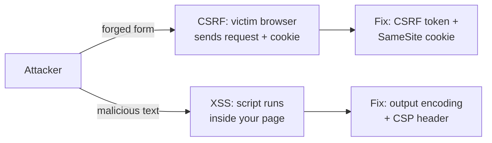
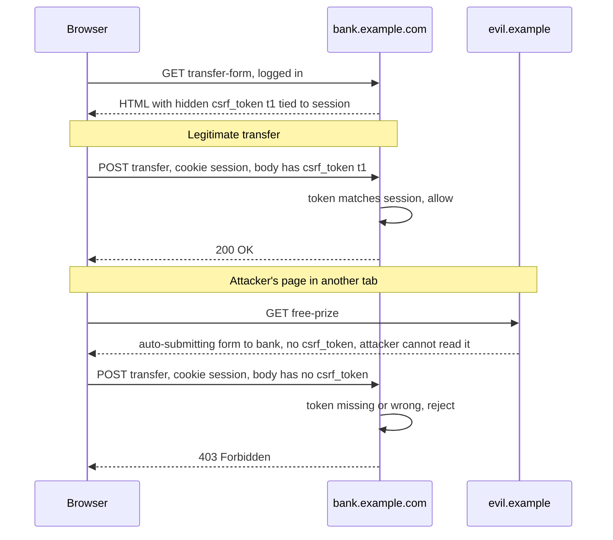
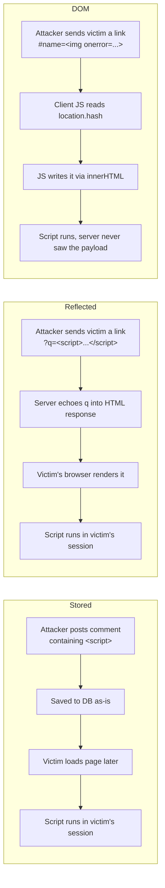
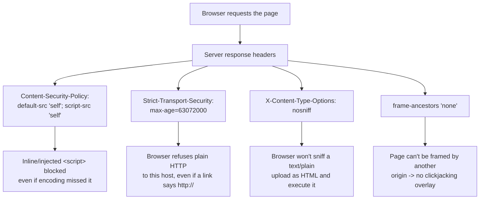

# CSRF, XSS and Security Headers

> [!summary] TL;DR
> CSRF tricks a logged-in victim's browser into sending a request they never meant to send; XSS tricks their browser into running an attacker's script on your page. Stop CSRF by making every state-changing request prove it came from your own page (a token, or `SameSite` cookies). Stop XSS by never putting untrusted data into HTML without encoding it, backed by a Content-Security-Policy that blocks inline scripts even if encoding fails somewhere.

> [!abstract] Core idea
> - CSRF abuses the browser's habit of attaching cookies to every request to your site, even ones triggered by another site.
> - XSS abuses a page that renders attacker-controlled text as HTML or JavaScript instead of as plain text.
> - The fix for each is structural: CSRF tokens + `SameSite` cookies for the first, output encoding + CSP for the second. Neither fixes the other.
> - Security headers (CSP, HSTS, `X-Content-Type-Options`, `frame-ancestors`) are a second line of defense: they contain the damage when a specific encoding or validation bug slips through.

## Start here: the basics

**The problem in one story.**
You are logged into your bank in one tab.
You open a bad website in another tab, and it secretly submits a "send money" form to your bank; your browser adds your bank cookie for you (CSRF).
Or a bad comment on a site contains a script that runs in every visitor's browser (XSS).
This note shows how to block both and how browser security headers limit the damage.

**Words you need first**

| Word | Plain meaning | Tiny example |
| --- | --- | --- |
| Cookie | Small value the browser stores and sends back to a site automatically | `session=abc123` |
| Session | The server remembering you are logged in | Session ID mapped to user 42 |
| CSRF | Another site making your browser send a request you did not mean | Hidden form posting to `/transfer` |
| XSS | Attacker JavaScript running inside your page | `<script>` saved in a comment |
| Encoding (escaping) | Turning special characters into safe text | `<` becomes `&lt;` |
| `SameSite` | Cookie flag limiting when cookies go on cross-site requests | `SameSite=Lax` |
| CSP | A header listing which scripts the page may run | `script-src 'self'` |

**Picture it**



**Analogy.** CSRF is someone slipping a signed cheque into your stack for you to hand over; XSS is someone sneaking into your office and acting from your desk.
Where it breaks: real cheques need your signature each time; browsers attach cookies automatically, which is exactly why CSRF works.

**How the rest of this note builds up**

- First, the bank-transfer attacks for CSRF and XSS (section 1) and the mental model (section 2).
- Then CSRF tokens with `SameSite`, the three XSS types, output encoding, and security headers (section 3).
- Then Go code: a stateless CSRF token and a security-headers middleware (section 4), plus a comparison (section 5).
- Finally the SDE-3 deep dive: trade-offs, production rollout of CSP, and edge cases (sections 6-8).

> [!tip] Remember
> CSRF: prove the request came from your page (token + `SameSite`). XSS: encode untrusted output and back it with CSP.

## 1. Why it exists

Say `bank.example.com` lets a logged-in user move money with:

```text
POST /transfer HTTP/1.1
Host: bank.example.com
Cookie: session=abc123
Content-Type: application/x-www-form-urlencoded

to=mallory&amount=5000
```

The browser attaches the `session` cookie automatically to *any* request to `bank.example.com`, no matter which page triggered it. So an attacker hosts a page with:

```html
<form id="f" action="https://bank.example.com/transfer" method="POST">
  <input type="hidden" name="to" value="mallory">
  <input type="hidden" name="amount" value="5000">
</form>
<script>document.getElementById('f').submit()</script>
```

If the victim is logged into the bank in another tab and visits that page, their browser submits the form, cookie and all. The bank sees a perfectly authenticated request — it just never came from the bank's own UI. That is **Cross-Site Request Forgery (CSRF)**: the attacker forges a request, the victim's browser supplies the proof of identity.

**Cross-Site Scripting (XSS)** is the other direction: instead of forging a request, the attacker gets *their own JavaScript* to run inside your page, in the victim's authenticated session. If a comment box echoes `<script>fetch('/transfer?to=mallory&amount=5000',{method:'POST'})</script>` back into the page without encoding it, every visitor who views that comment runs the attacker's script with their own cookies and permissions. The output above is itself a CSRF-less transfer, launched by XSS instead of a forged form.

## 2. Mental model

- **CSRF**: the browser is a courier that stamps every envelope to your bank with your signature (the cookie), regardless of who hands it the envelope. The fix is to also require a one-time password written only on the bank's own paperwork (the CSRF token) or to tell the courier not to deliver on behalf of other senders at all (`SameSite`).
- **XSS**: your page is a whiteboard; untrusted input is a marker someone else hands you. If you write their text onto the board as *marker strokes you draw* (HTML), they can draw a `<script>` tag. If you write it as *quoted text in a sealed envelope* (HTML-encoded), their input can never become new markup.

## 3. How it works

### CSRF: tokens and SameSite together



The synchronizer-token pattern works because of the **same-origin policy**: `evil.example`'s JavaScript cannot read a token embedded in `bank.example.com`'s page or in a non-HttpOnly cookie set by the bank, so it cannot forge a matching value, even though it can still *send* a request with the ambient cookie.

`SameSite` is a second, independent control set on the cookie itself: `Strict` withholds the cookie on every cross-site request, `Lax` sends it only on top-level `GET` navigation, and `None` always sends it (the full attribute table lives in [[Sessions and Cookies]]).

`SameSite=Lax` alone stops the form-POST example, because the cookie is withheld on a cross-site `POST`. It does **not** stop a cross-site `GET` that has a side effect (`GET /transfer?to=mallory&amount=5000`, which is also just bad API design — see [[OWASP API Security Top 10]]), and it does not stop XSS running same-origin.

Use CSRF tokens and `SameSite=Lax`/`Strict` together, not one instead of the other, and never put state-changing actions behind `GET`.

### XSS: three places the attacker's string lands

| Variant | Where the payload is stored | Who gets hit |
| --- | --- | --- |
| **Stored XSS** | Saved server-side (a comment, a profile bio, a support ticket) and rendered to other users later | Every user who later views that page |
| **Reflected XSS** | Bounced straight back in the response from a request parameter (a search box echoing `?q=` into "No results for …") | Only the victim who clicks a crafted link |
| **DOM XSS** | Never touches the server at all; client-side JS reads something attacker-controlled (`location.hash`, `document.referrer`) and writes it into the DOM with `innerHTML` or `document.write` | Only the victim who loads the crafted URL |



All three share one root cause: untrusted data crossed from "data" to "markup/code" without encoding for the context it landed in.

### Output encoding: the actual fix

Encoding must match the **context** the data lands in — HTML body, HTML attribute, URL, or JavaScript string — because each context has different special characters:

| Context | Example sink | What must be encoded |
| --- | --- | --- |
| HTML body | `<div>{{text}}</div>` | `< > & " '` → entities |
| HTML attribute | `<input value="{{text}}">` | Quotes especially; never leave an attribute unquoted |
| URL | `<a href="{{url}}">` | Percent-encode; also validate the scheme (reject `javascript:`) |
| JavaScript string literal | `var x = "{{text}}";` | JS string escaping, not HTML escaping — a common mix-up |

Go's `html/template` (unlike `text/template`) does exactly this automatically, picking the encoding based on where in the HTML tree the value sits:

```go
package render

import (
	"html/template"
	"strings"
)

var tmpl = template.Must(template.New("comment").Parse(
	`<div class="comment">{{.Body}}</div>`))

// Render returns the comment rendered as safe HTML; html/template
// context-encodes .Body for the HTML-body position automatically.
func Render(body string) (string, error) {
	var sb strings.Builder
	if err := tmpl.Execute(&sb, struct{ Body string }{Body: body}); err != nil {
		return "", err
	}
	return sb.String(), nil
}
```

`<script>alert(1)</script>` comes back as `&lt;script&gt;alert(1)&lt;/script&gt;` — text, not markup. The bug class this fixes is using `text/template` (or raw string concatenation, or React's `dangerouslySetInnerHTML`, or Vue's `v-html`) to build HTML from untrusted input.

### Security headers: the second line of defense

Encoding bugs still happen — a new template, a `v-html`, a third-party widget. Security headers assume one will, and cap the damage:



- **Content-Security-Policy (CSP)**: an allowlist for where scripts, styles and resources may load from. `script-src 'self'` means an injected `<script>` tag or `onerror="..."` attribute simply does not execute, because inline script isn't on the allowlist — this is what actually contains most real-world stored XSS, on top of encoding.
- **frame-ancestors**: part of CSP (`frame-ancestors 'none'` or a list of trusted origins); it tells the browser which origins may embed this page in an `<iframe>`. It replaces the older `X-Frame-Options: DENY`/`SAMEORIGIN` header and stops clickjacking — an attacker overlaying your page in a transparent iframe to trick a click into, say, approving a transfer.
- **HSTS (`Strict-Transport-Security`)**: once a browser has seen this header over HTTPS, it refuses to connect over plain HTTP to that host for `max-age` seconds, even if the user types `http://` or clicks an old link. This closes the window for a network attacker to downgrade the connection and steal the session cookie; see [[TLS and HTTPS]] for the handshake it protects. `preload` submits the host to browsers' built-in HSTS list, so even the very first request is HTTPS-only.
- **X-Content-Type-Options: nosniff**: stops the browser from guessing a response's type from its content instead of trusting `Content-Type`. Without it, a file uploaded as `Content-Type: text/plain` but containing HTML can be sniffed and rendered as HTML, reviving an XSS path through a file-upload feature.

## 4. Worked example

### Whiteboard version

The minimum you need to remember: generate an HMAC over the session ID and an expiry, hand it to the page, and check it (constant-time) on every state-changing request. Encode on output, always. Set the four headers once in middleware.

### Go: a stateless CSRF token

A synchronizer token that needs no server-side storage: it is an HMAC over the session ID plus an expiry, so any server instance holding the shared secret can validate it. Compiles and passes `go vet` and `go test -race` on Go 1.24.

```go
// Package csrf implements a stateless synchronizer-style CSRF token:
// an HMAC over the session ID plus a timestamp, so the server never has to
// store issued tokens.
package csrf

import (
	"crypto/hmac"
	"crypto/sha256"
	"crypto/subtle"
	"encoding/base64"
	"errors"
	"fmt"
	"strconv"
	"strings"
	"time"
)

var ErrInvalidToken = errors.New("csrf: invalid or expired token")

// Generate returns a token bound to sessionID, valid for maxAge from now.
func Generate(secret []byte, sessionID string, now time.Time, maxAge time.Duration) string {
	exp := now.Add(maxAge).Unix()
	mac := sign(secret, sessionID, exp)
	payload := fmt.Sprintf("%d.%s", exp, mac)
	return base64.RawURLEncoding.EncodeToString([]byte(payload))
}

// Validate checks the token against the session making the request.
// It is constant-time and rejects expired or tampered tokens.
func Validate(secret []byte, sessionID, token string, now time.Time) error {
	raw, err := base64.RawURLEncoding.DecodeString(token)
	if err != nil {
		return ErrInvalidToken
	}
	parts := strings.SplitN(string(raw), ".", 2)
	if len(parts) != 2 {
		return ErrInvalidToken
	}
	exp, err := strconv.ParseInt(parts[0], 10, 64)
	if err != nil {
		return ErrInvalidToken
	}
	if now.Unix() > exp {
		return ErrInvalidToken
	}
	want := sign(secret, sessionID, exp)
	if subtle.ConstantTimeCompare([]byte(want), []byte(parts[1])) != 1 {
		return ErrInvalidToken
	}
	return nil
}

func sign(secret []byte, sessionID string, exp int64) string {
	h := hmac.New(sha256.New, secret)
	fmt.Fprintf(h, "%s.%d", sessionID, exp)
	return base64.RawURLEncoding.EncodeToString(h.Sum(nil))
}
```

Test, including the tamper and expiry cases that matter for this design:

```go
package csrf

import (
	"testing"
	"time"
)

func TestValidateAcceptsFreshToken(t *testing.T) {
	secret := []byte("server-only-secret")
	now := time.Date(2026, 11, 7, 12, 0, 0, 0, time.UTC)
	tok := Generate(secret, "session-abc", now, 2*time.Hour)

	if err := Validate(secret, "session-abc", tok, now.Add(time.Minute)); err != nil {
		t.Fatalf("expected valid token, got %v", err)
	}
}

func TestValidateRejectsWrongSession(t *testing.T) {
	secret := []byte("server-only-secret")
	now := time.Date(2026, 11, 7, 12, 0, 0, 0, time.UTC)
	tok := Generate(secret, "session-abc", now, 2*time.Hour)

	if err := Validate(secret, "session-xyz", tok, now); err == nil {
		t.Fatal("expected error for mismatched session, got nil")
	}
}

func TestValidateRejectsTamperedToken(t *testing.T) {
	secret := []byte("server-only-secret")
	now := time.Date(2026, 11, 7, 12, 0, 0, 0, time.UTC)
	tok := Generate(secret, "session-abc", now, 2*time.Hour)
	tampered := tok[:len(tok)-1] + "x"

	if err := Validate(secret, "session-abc", tampered, now); err == nil {
		t.Fatal("expected error for tampered token, got nil")
	}
}

func TestValidateRejectsExpiredToken(t *testing.T) {
	secret := []byte("server-only-secret")
	now := time.Date(2026, 11, 7, 12, 0, 0, 0, time.UTC)
	tok := Generate(secret, "session-abc", now, time.Minute)

	if err := Validate(secret, "session-abc", tok, now.Add(2*time.Minute)); err == nil {
		t.Fatal("expected error for expired token, got nil")
	}
}
```

**Measured:** `go test -race ./csrf/...` on Go 1.24.4: 4/4 tests pass (fresh token, wrong session, tampered token, expired token all behave as asserted).

### Go: the security-headers middleware

```go
// Package secheaders sets the response headers that blunt XSS and
// clickjacking even if an encoding bug slips through.
package secheaders

import "net/http"

// Middleware sets CSP, HSTS, X-Content-Type-Options and a frame-ancestors
// policy on every response. Wrap your router with it once, at the top.
func Middleware(next http.Handler) http.Handler {
	return http.HandlerFunc(func(w http.ResponseWriter, r *http.Request) {
		h := w.Header()
		// default-src 'self' blocks inline/third-party script unless whitelisted;
		// frame-ancestors 'none' replaces the legacy X-Frame-Options: DENY.
		h.Set("Content-Security-Policy",
			"default-src 'self'; script-src 'self'; object-src 'none'; frame-ancestors 'none'; base-uri 'self'")
		// Only send on HTTPS responses; max-age is 2 years, as the preload list requires.
		h.Set("Strict-Transport-Security", "max-age=63072000; includeSubDomains; preload")
		// Stops the browser from guessing a text/plain upload is HTML/JS and running it.
		h.Set("X-Content-Type-Options", "nosniff")
		next.ServeHTTP(w, r)
	})
}
```

```go
package secheaders

import (
	"net/http"
	"net/http/httptest"
	"strings"
	"testing"
)

func TestMiddlewareSetsSecurityHeaders(t *testing.T) {
	inner := http.HandlerFunc(func(w http.ResponseWriter, r *http.Request) {
		w.WriteHeader(http.StatusOK)
	})
	ts := httptest.NewServer(Middleware(inner))
	defer ts.Close()

	resp, err := http.Get(ts.URL)
	if err != nil {
		t.Fatalf("request failed: %v", err)
	}
	defer resp.Body.Close()

	if got := resp.Header.Get("X-Content-Type-Options"); got != "nosniff" {
		t.Fatalf("X-Content-Type-Options = %q, want nosniff", got)
	}
	csp := resp.Header.Get("Content-Security-Policy")
	if !strings.Contains(csp, "frame-ancestors 'none'") {
		t.Fatalf("CSP missing frame-ancestors: %q", csp)
	}
	if !strings.Contains(resp.Header.Get("Strict-Transport-Security"), "max-age=63072000") {
		t.Fatalf("HSTS header missing or wrong: %q", resp.Header.Get("Strict-Transport-Security"))
	}
}
```

**Measured:** `go test -race ./secheaders/...` on Go 1.24.4: 1/1 test passes; all three headers present with the expected values.

In `06 Backend Engineering in Go`, [[Secure Coding for Go Services]] shows where this middleware sits in a full Go service's middleware chain, alongside input validation and the other hardening steps.

## 5. Variants and comparison

| Defense | Stops | Does not stop | Cost |
| --- | --- | --- | --- |
| CSRF synchronizer token | Cross-site forged state-changing requests | XSS (same-origin script can read the page's own token) | A token to generate, embed and verify per form/request |
| `SameSite=Lax`/`Strict` cookie | Cross-site forged `POST`/fetch requests carrying the cookie | Same-origin XSS; legitimate cross-site embeds need `None` | One attribute; breaks nothing for same-site apps |
| Double-submit cookie (token also set as a readable cookie, compared to a header/body value) | Cross-site forged requests, without server-side session storage | Needs the cookie to be readable by JS (not `HttpOnly`) unless combined with signing | Simpler infra than synchronizer tokens; slightly weaker if subdomains can set cookies |
| Output encoding (`html/template`, React/Vue default escaping) | Stored, reflected and DOM XSS at the point of render | A deliberate `dangerouslySetInnerHTML`/`v-html`/raw concatenation bypass | Essentially free; must be applied everywhere, every time |
| CSP (`script-src 'self'`) | Execution of injected inline scripts and scripts from unapproved origins | A payload hosted at an origin already on the allowlist | Requires auditing every inline script/style and third-party resource first |
| HSTS | Protocol-downgrade and cookie theft over a later plain-HTTP connection | Anything once TLS itself is compromised | One header; irreversible for `max-age` once a browser has seen it |

## 6. Trade-offs and when not to use

- A CSRF token on every GET is overkill: GET must never have side effects, so only state-changing requests (POST/PUT/PATCH/DELETE) need one.
- `SameSite=Strict` on the session cookie breaks "arrive via an external link while already logged in" flows (the cookie isn't sent on the first navigation); `Lax` is usually the right default.
- A strict CSP breaks any inline `<script>` or `onclick="..."` attribute in old templates; rolling it out needs an audit pass or a report-only phase (`Content-Security-Policy-Report-Only`) first.
- Pure API services authenticated only with a bearer token in an `Authorization` header (never a cookie) are not exposed to classic CSRF, because the browser does not attach that header automatically — but they still need XSS defenses if any browser client renders untrusted content.

## 7. In production

- **Real systems:** Django, Rails and Spring ship CSRF middleware on by default; GitHub and most banks pair CSRF tokens with `SameSite=Lax`; Gmail and most SPA-heavy sites run a strict CSP with nonces for the handful of scripts they must allow inline.
- **Failure modes → fixes:**
  - CSRF token not sent on an AJAX request because it isn't in the form body → read it from a cookie-readable, non-`HttpOnly` copy and attach it as a custom header (`X-CSRF-Token`), which also happens to be blocked by CORS for cross-origin callers.
  - A new feature uses `v-html`/`dangerouslySetInnerHTML` to render "rich" user bios → sanitize with an allowlist library (DOMPurify) or drop the feature; CSP `script-src` is the backstop, not the primary control.
  - CSP breaks a third-party widget → add its exact origin to the allowlist, never fall back to `'unsafe-inline'`.
  - A reverse proxy or CDN strips security headers → set them at the edge too, and test with the real public hostname, not `localhost`.
- **What to monitor:** CSP violation reports (`report-uri`/`report-to`), rate of 403s from CSRF validation (spikes mean a client bug, not just attacks), and any response missing the security headers (a header-set regression test in CI catches this before production).

## 8. Deep dive

- **Why `SameSite=Lax` still allows top-level GET navigation**: browsers special-cased top-level navigations (clicking a link) so that "log in via an emailed link" keeps working, while still blocking the cross-site auto-submitting `POST` form from the opening example. This is a deliberate compromise, not an oversight — don't rely on it for anything with a side effect.
- **Double-submit cookie vs synchronizer token**: double-submit avoids server-side token storage by setting the token as a cookie *and* requiring the client to also send it as a header or body field; same-origin JS can read the cookie and echo it back, but cross-site JS cannot read another origin's cookie, so it can't forge the matching header. It is weaker than a session-bound synchronizer token if an attacker can set cookies on a sibling subdomain, which is why signing the double-submit value (HMAC over a random value, as above) is the safer variant.
- **CSP nonces for necessary inline scripts**: when a script truly must be inline (a server-rendered bootstrap payload), generate a random nonce per response, put it in both the CSP header (`script-src 'nonce-<value>'`) and the `<script nonce="...">` tag; an attacker's injected script has no way to know the nonce in advance.
- **Trusted Types** (Chrome, behind a CSP directive) go one step further than CSP's origin allowlisting: they make the browser itself refuse to pass a plain string into `innerHTML`/`document.write` unless it was produced by a sanitizing function the page registered, closing off DOM XSS sinks at the API level rather than the network-origin level.
- **Why `X-Content-Type-Options` matters for uploads specifically**: a user-generated-content domain that serves an uploaded `.txt` file with a sniffable HTML-like payload can have it rendered as HTML by a browser that ignores the declared `Content-Type` — `nosniff` forces the browser to trust the header, which is also why that header must be set correctly in the first place.

## 9. Interview questions

> [!question]- Does `SameSite=Lax` make CSRF tokens unnecessary?
> No. `Lax` blocks cross-site `POST`/fetch requests from carrying the cookie, which stops the classic auto-submitting form attack, but it still sends the cookie on a top-level cross-site `GET` navigation. Keep CSRF tokens for state-changing endpoints and never let `GET` have side effects; use both controls together.

> [!question]- A teammate says "we use JWTs in an `Authorization` header, so we don't need CSRF protection." Are they right?
> Mostly yes, for that specific endpoint: a browser does not attach a custom header automatically the way it does a cookie, so a forged cross-site form or fetch can't make the request look authenticated. But if any token is also mirrored into a cookie (for SSR, for example), that endpoint is exposed again and needs the same defenses as a cookie-based session.

> [!question]- Trap: "We escape everything before storing it in the database, so we're safe from XSS." What's wrong with this?
> Encoding belongs at the **output** boundary, matched to the context it renders into (HTML body vs attribute vs URL vs JS string), not at the input/storage boundary. Encoding on input corrupts the stored data (search, exports, APIs all see mangled text) and still doesn't protect a different rendering context, like inserting the same stored value into a `<script>` block or an `href`.

> [!question]- What is the difference between stored, reflected and DOM XSS, and why does it matter which one you have?
> Stored XSS persists on the server and hits every viewer; reflected XSS only fires for someone who clicks a crafted link, because the payload lives in the request itself; DOM XSS never touches the server — a client-side script reads an attacker-controlled value (`location.hash`) and writes it unsafely into the DOM. It matters because the fix differs: stored and reflected need server-side encoding on render, while DOM XSS needs the client-side JavaScript itself to avoid unsafe sinks (`innerHTML`, `document.write`) regardless of what the server ever saw.

> [!question]- Why pair CSP with output encoding instead of picking one?
> Encoding stops the attacker's string from ever becoming markup in the first place; CSP stops injected markup from executing even if encoding was missed somewhere (a new template, a third-party widget, a `v-html`). They cover different failure points: encoding is the primary control, CSP is defense in depth for when encoding fails.

> [!question]- What does `frame-ancestors 'none'` actually prevent, concretely?
> It stops any other origin from embedding your page in an `<iframe>`. Without it, an attacker can overlay your page (say, a "delete account" confirmation) under a transparent decoy button on their own site, so a victim's genuine click lands on your page instead — a clickjacking attack. It supersedes the older `X-Frame-Options` header.

> [!question]- Your CSP blocks a legitimate third-party payment widget. What's the wrong fix, and what's the right one?
> The wrong fix is adding `'unsafe-inline'` or `*` to `script-src`, which defeats the policy for everything, not just the widget. The right fix is adding the widget's exact origin to the relevant directive (and, if it genuinely needs inline execution, giving it a per-response nonce instead of a blanket allowance).

## 10. Cheat sheet

- CSRF: browser forges a state-changing request using the victim's ambient cookie; fix with a session-bound token on every mutating request **and** `SameSite=Lax`/`Strict`.
- XSS: attacker's data becomes executable markup; fix by encoding for the exact output context, every time, at render — not at input.
- Stored XSS hits every viewer later; reflected XSS needs a crafted link per victim; DOM XSS never touches the server at all.
- `html/template` (not `text/template`) context-encodes automatically in Go; the equivalent trap elsewhere is `dangerouslySetInnerHTML`/`v-html`.
- CSP `script-src 'self'` is the backstop that blocks injected inline scripts even when encoding is missed.
- `frame-ancestors 'none'` stops clickjacking; HSTS stops protocol downgrade; `X-Content-Type-Options: nosniff` stops MIME sniffing turning an upload into HTML.
- Pure bearer-token APIs (no cookie) are largely CSRF-immune by construction, but still need XSS defenses wherever they render content in a browser.

## Links

- **Before this:** [[Sessions and Cookies]], [[HTTP Fundamentals - Methods, Status Codes, Headers, Cookies]]
- **Next:** [[OWASP API Security Top 10]], [[Secrets Management]]
- **Compare with:** [[CORS and Same-Origin Policy]] (a different browser control: who may *read* a response, not who may *send* a request), [[TLS and HTTPS]] (what HSTS is protecting), [[Secure Coding for Go Services]] (where this middleware sits in a full Go service)

### Watch on YouTube

- [API Security Explained: Rate Limiting, CORS, SQL Injection, CSRF, XSS & More](https://www.youtube.com/watch?v=FsB_nRGdeLs) · Hayk Simonyan · 8 min · 501,701 views
- [Why Your Token Storage Could Be Your Biggest Security Risk - XSS and CSRF Attack in Action](https://www.youtube.com/watch?v=vTroMvQy6K0) · LearnThatStack · 5 min · 18,388 views
