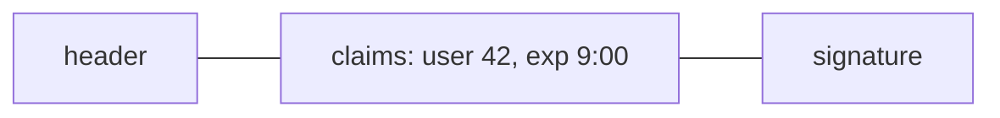
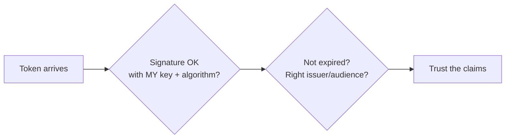
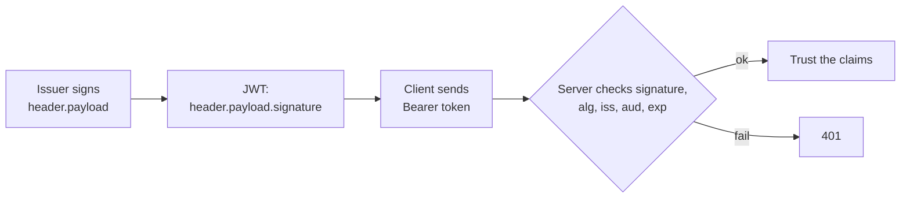
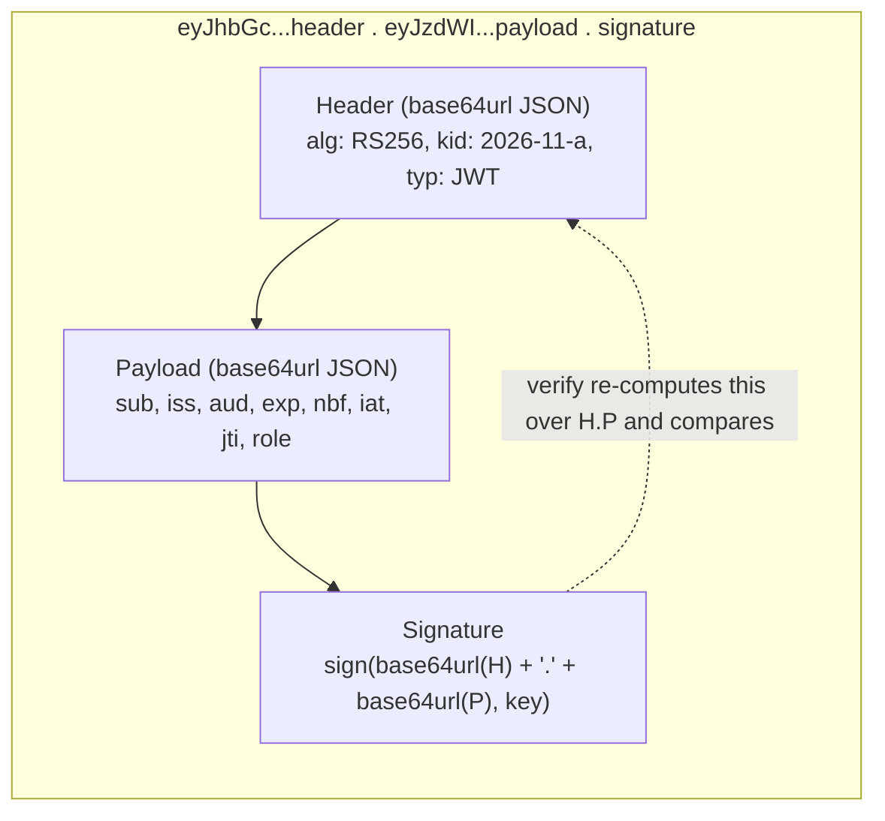
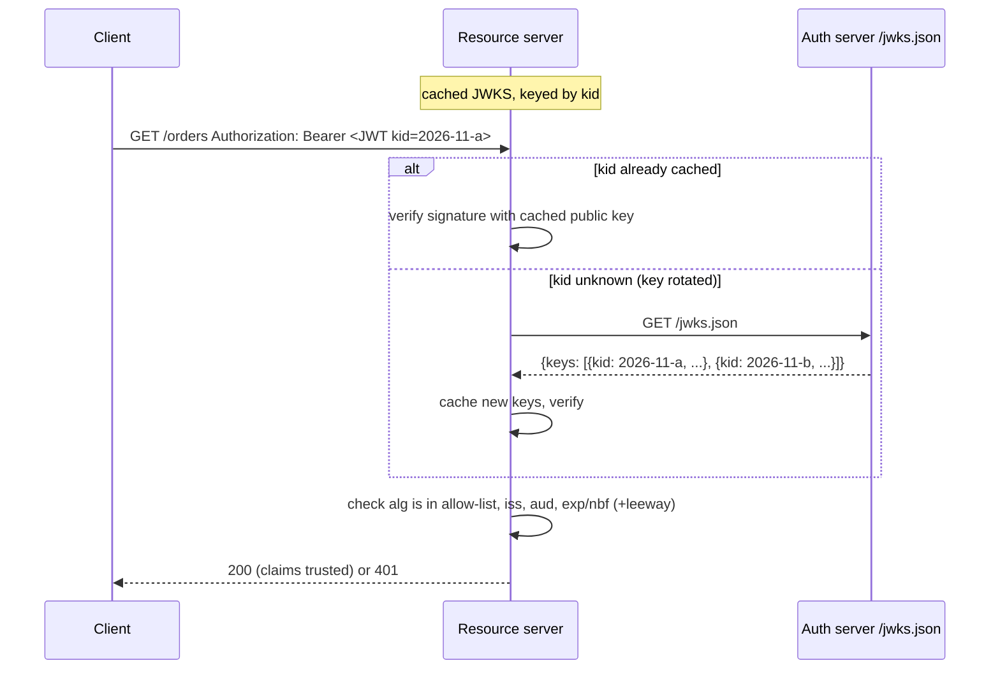
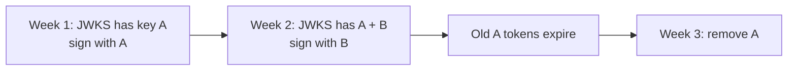
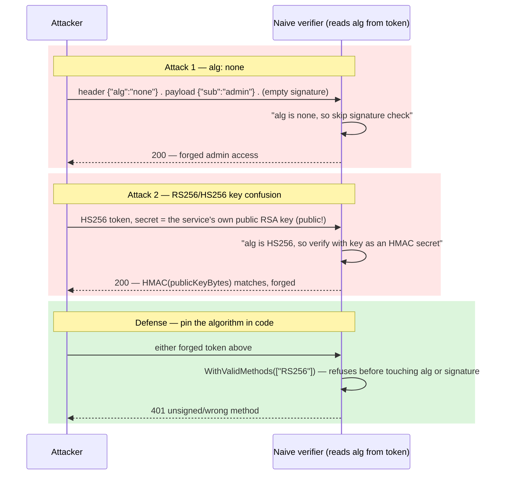

# JWT - Structure, Validation and Pitfalls

> [!summary] TL;DR
> A JWT (JSON Web Token) is a compact, **signed** (not encrypted) set of claims — small facts like "user 42, expires at 09:00" — that a server can verify without a database lookup. The signature proves the claims were not tampered with; it does not hide them.

> [!abstract] Core idea
> - A JWT is `header.payload.signature`, each part base64url-encoded; the signature covers the header and payload together.
> - The server must **pin which algorithm it accepts** and never let the token's own header choose it — that single rule stops the two most common forgeries.
> - HS256 uses one shared secret; RS256/EdDSA use a key pair, so many services can verify with a public key while only the issuer can sign.
> - A full validation checklist has six checks: signature, allowed algorithm, `iss`, `aud`, `exp`/`nbf` with leeway, and (if you issue them) `jti` against a denylist.
> - Revoking a single JWT early is the hard problem JWTs do not solve for free; short expiry plus a refresh token is the usual answer (see [[Access and Refresh Tokens]]).

## Start here: the basics 🟢

> [!info] How to read this note (pick your level)
> - 🟢 **New to this?** Read "From zero" below, then sections 1, 2 and 10 (why, mental model and the cheat sheet). Stop there, that is a full first pass.
> - 🟡 **Know the basics?** Add sections 3, 4, 5 and 6 (how it works, a worked example, options and trade-offs).
> - 🔴 **Interview / SDE-3 prep?** Add sections 7, 8 and 9 (production, deep dive and interview questions). Headings are tagged 🟢🟡🔴 so you always know where you are.

> [!note] Before this note
> - [[Authentication vs Authorization]]: after login the server needs a way to know "this request is from user 42" on every call.
> - [[Sessions and Cookies]]: one way is a random ID in a cookie that the server looks up; a JWT is the other way, where the facts travel inside the token.

**From zero, in 60 seconds** 🟢

A **JWT** (JSON Web Token) is a small text pass a server gives you after login.
It says things like "user 42, expires at 9:00". Those facts are called **claims**.
The server signs the pass. Anyone can read it, but nobody can change it without breaking the signature.



Any server that has the right key can check the pass without asking a database. That is why JWTs are popular with many servers.
The danger is in checking it badly: trusting the algorithm the token names, or forgetting to check the expiry.



The rest of this note is just these 3 questions:
1. What is inside a JWT?
2. Which signing method, and how do servers get the public keys?
3. What must every verifier check, and which attacks happen when it doesn't?


**The problem in one story.**
Your API runs on 20 servers behind a load balancer.
Each request may land on any server, and each server must know who is calling.
Asking a shared database on every request is slow and fragile.
A JWT is a signed note the client carries: "this is user 42, valid until 09:00", which any server can check by itself.

**Words you need first**

| Word | Plain meaning | Tiny example |
| --- | --- | --- |
| Claim | One fact inside a token | `"sub": "42"` |
| Base64url | A way to write bytes as URL-safe text (not encryption) | `eyJhbGciOiJIUzI1NiJ9` |
| Signature | Cryptographic proof the content was not changed | HMAC or RSA over header + payload |
| Secret / private key | The key only the issuer holds to sign | HS256 secret, RS256 private key |
| Public key | Key anyone can use to verify, but not to sign | Published in a JWKS URL |
| Stateless | The server stores nothing per user to check a request | Any pod can verify locally |
| Expiry (`exp`) | Time after which the token is rejected | `exp: 1700000000` |
| Issuer (`iss`) / Audience (`aud`) | Who made the token / which service it is meant for | `iss: auth.example.com`, `aud: orders-api` |
| `kid` (key id) | A label in the header saying which key signed this token | `kid: 2026-11-a` |
| HMAC | A hash that also needs a secret key, used for HS256 signatures | Same secret signs and checks |
| Clock skew / leeway | Server clocks differ by a few seconds; leeway is the grace period you allow | 30 s leeway on `exp` |
| Denylist | A list of tokens you have cancelled and must reject | Redis set of revoked `jti` values |
| Pod | One running copy of your service (Kubernetes word) | 20 pods behind a load balancer |

**Picture it**



**Analogy.** A tamper-proof wristband at a festival: staff can check the seal at any gate without phoning the ticket office.
Where it breaks: anyone can read the wristband print (JWTs are signed, not encrypted), and you cannot easily cancel one wristband before it expires.

**How the rest of this note builds up**

- First, why stateless tokens exist (section 1) and the signed-note mental model (section 2).
- Then the structure, HS256 vs RS256/EdDSA and JWKS, the validation checklist and the attacks it prevents (section 3).
- Then a Go validator with tests (section 4) and a comparison with other token types (section 5).
- Finally the SDE-3 deep dive: trade-offs, revocation, key rotation and production failures (sections 6-8).

> [!tip] Remember
> A JWT is signed, not secret: pin the algorithm, check `iss`, `aud` and `exp`, and keep it short-lived.

## 1. Why it exists 🟢

An API running behind a load balancer (the server that spreads requests across many copies) on 20 stateless pods needs to know who is calling on every request. A server-side session keyed by a session ID means every pod either shares one session store (a network hop and a single point of failure on every request) or sticks a client to one pod (breaks autoscaling, adding or removing pods with load, and rolling deploys, replacing pods one by one).

A JWT moves the session data into the request itself: the client sends `Authorization: Bearer <token>`, and any pod can verify the signature locally — against a shared secret (HS256) or a public key it already cached (RS256/EdDSA) — with no network call.

The cost is that the token now carries its own expiry and claims, and the server can no longer just "delete the session row" to log someone out early; see [[Access and Refresh Tokens]] for how real systems close that gap.

### Real-life example: one login, many Swiggy services 🟢

When you open Swiggy, your one login is used by many separate back-end services: menus, cart, orders, payments, delivery tracking. If each of them had to ask one central database "who is this?" on every tap, that database would become a choke point. Instead, after login the app gets a short-lived JWT saying "user 42, expires in 10 minutes", signed by the login service. Each service checks the signature with the login service's public key and gets the answer locally, in well under a millisecond.

### JWT vs session cookie 🟡

| | JWT | Session ID in a cookie |
| --- | --- | --- |
| Where the facts live | Inside the token | On the server, in a store like Redis |
| Check cost | Verify a signature, no network call | One store lookup per request |
| Log out one user right now | Hard: token works until `exp` | Easy: delete the row |
| Can the user read it? | Yes, anyone can decode it | No, it is just a random string |

## 2. Mental model 🟢

A JWT is a **boarding pass**, not a sealed envelope. The airline (the issuer) prints your name, flight, seat and a tamper-evident mark (the signature) on it. Anyone can read a boarding pass — the gate agent, you, a stranger glancing at your phone — but only someone holding the airline's stamp could have produced a valid one.

If you scribble "first class" onto economy seat 32B, the stamp no longer matches and the gate agent (the verifier) rejects it.

That is the one fact every JWT bug traces back to: **encoded, not encrypted**. Never put a password, a secret, or anything you would not want visible in a browser extension's network tab into a JWT payload.

## Common beginner mistakes 🟢

- **Thinking a JWT is encrypted** → anyone can paste it into a decoder and read it → never put passwords, card numbers or secrets in claims.
- **Decoding without verifying** → reading claims with a "decode" function skips the signature check, so a forged token is trusted → always use the library's verify/parse with a key.
- **Letting the token choose the algorithm** → attackers send `alg: none` → hard-code the allowed algorithm (`WithValidMethods`).
- **Giving tokens a 30-day expiry** → a stolen token works for a month and you cannot cancel it → keep access tokens to 5-15 minutes and use a refresh token.
- **Skipping the `aud` check** → a token for one service works on another → check that `aud` names this service.

## 3. How it works 🟡

> 🟢 → 🟡 **You now know** that a JWT is a signed, readable pass any server can check by itself. **Next we open the box**: what the three parts hold, how the signing keys work and reach every server, what a verifier must check, and which attacks hit a careless verifier.

### Structure

**In plain words:** three chunks of text joined by dots: a header (how it was signed), the claims (the facts), and the signature (the tamper seal).

**Step by step:**
1. The issuer writes a header: `{"alg":"RS256","kid":"2026-11-a"}`.
2. It writes the claims: `{"sub":"42","aud":"orders-api","exp":1700000600}`.
3. It base64url-encodes both (turns them into URL-safe text) and joins them with a dot.
4. It signs that text with its private key and adds the signature as the third part.
5. Any verifier re-computes the check over parts 1 and 2. If even one letter in the claims changed, the signature no longer matches.



The header names the algorithm and, for asymmetric signing, a key id (`kid`) telling the verifier which public key to use. The payload is a flat JSON object of **claims**: registered ones (`iss` issuer, `sub` subject, `aud` audience, `exp` expiry, `nbf` not-before, `iat` issued-at, `jti` a unique token id) plus whatever the application adds, such as `role`.

Keep the payload small and free of secrets — it is fully readable by anyone holding the token.

### HS256 vs RS256/EdDSA, and JWKS

**In plain words:** HS256 uses one shared password to sign and check. RS256/EdDSA use a private key to sign and a public key to check, so checkers can't forge passes. JWKS is just a URL that lists the public keys.

**Step by step:**
1. The auth server keeps one private key, labelled `kid = 2026-11-a`, and signs every token with it.
2. It publishes the matching public key at `/.well-known/jwks.json`.
3. The orders service fetches that file once and caches it.
4. A token arrives with `kid = 2026-11-a`; orders finds that key in its cache and checks the signature locally.
5. Next month the auth server adds key `2026-11-b`. A token with the new `kid` misses the cache, so orders fetches the file again and carries on, with no redeploy.

- **HS256** (HMAC-SHA256): one shared secret signs and verifies. Simple, but every verifier must hold the secret, so any verifying service could also forge tokens. Fine for a single service that both issues and checks its own tokens.
- **RS256** (RSA, the classic public-key method) and **EdDSA** (Ed25519, a newer, smaller and faster one): the issuer holds a private key and signs; every other service verifies with the matching **public** key. This is the right choice once more than one service needs to verify tokens, because a compromised verifier cannot forge new ones.
- A **JWKS** (JSON Web Key Set) is a small JSON document of public keys, normally served at `/.well-known/jwks.json`, each tagged with a `kid`. Verifiers fetch and cache it.



**Key rotation with overlap:** publish the new key in the JWKS alongside the old one, start signing new tokens with the new `kid`, and only remove the old key once every token signed with it has expired. A verifier that refreshes its JWKS cache on an unknown `kid` (shown above) never has to be redeployed for routine rotation.



### Validation checklist

**In plain words:** go through this list on every token. Skipping even one item is a real hole.

A verifier that skips any of these has a real vulnerability, not a theoretical one:

1. **Pin the allowed algorithm(s) in verifier code**, never read `alg` from the token to decide how to check it.
2. Verify the **signature** with the correct key for that algorithm.
3. Check **`iss`** matches the expected issuer.
4. Check **`aud`** matches this service (a token meant for `orders-api` must not work against `payments-api`).
5. Check **`exp`** has not passed and **`nbf`** has, both with a small leeway (20–60s) for clock skew (servers' clocks never agree exactly).
6. If the service tracks revocation, check **`jti`** (the token's unique ID) against a denylist (a list of cancelled tokens) or the user's token version.

### Attacks that skipping step 1 enables

**In plain words:** if you let the token pick its own algorithm, an attacker can pick "none" or trick you into using the public key as a password.

**Step by step (the `alg: none` attack):**
1. The attacker writes a header `{"alg":"none"}` and claims `{"sub":"admin"}`, with an empty signature.
2. A careless verifier reads `alg` from the token and thinks "none means nothing to check".
3. It trusts the claims, and the attacker is now admin.
4. The key-confusion attack works the same way: header says `HS256`, and the verifier uses its RSA public key, which everyone has, as the HMAC secret.
5. A safe verifier ignores the header's choice. It says "I only accept RS256" before looking at anything else, so both tricks fail with 401.



A third live risk is **`kid`/`jku` injection** (`jku` is a header field holding a URL to fetch keys from): a malicious `kid` like `../../dev/null` or a `jku` pointing at an attacker-controlled JWKS URL, if the verifier blindly fetches whatever URL or file path the token names.

The fix is the same shape as the others — never let the token tell the verifier where to find the key; the verifier's own configuration names the trusted JWKS URL, and `kid` only selects among keys that URL already returned.

## 4. Worked example 🟡

### Whiteboard version

The shape of a safe verifier, with the one line that matters marked:

```go
parser := jwt.NewParser(
    jwt.WithValidMethods([]string{"RS256"}), // the fix for both attacks above
    jwt.WithIssuer(iss),
    jwt.WithAudience(aud),
)
_, err := parser.ParseWithClaims(raw, claims, keyFunc)
```

### Full version

**In plain words:** the complete Go verifier with tests. The whiteboard version above is the part to remember.

Built and tested in a scratch module with `github.com/golang-jwt/jwt/v5` on Go 1.24; `go vet` and `go test -race` both pass.

```go
// Package jwtvalidate shows a minimal, safe JWT validation setup using
// github.com/golang-jwt/jwt/v5: pinned algorithm, issuer, audience, and
// clock-skew leeway, plus demonstrations that alg=none and algorithm-confusion
// forgeries are rejected.
package jwtvalidate

import (
	"crypto/rsa"
	"time"

	"github.com/golang-jwt/jwt/v5"
)

// Claims is the minimal claim set this service trusts.
type Claims struct {
	jwt.RegisteredClaims
	Role string `json:"role"`
}

// Issuer mints RS256-signed access tokens for a subject with a 10-minute expiry.
type Issuer struct {
	Key *rsa.PrivateKey
	Iss string
	Aud string
}

// Verifier validates tokens minted by an Issuer with the same iss/aud.
type Verifier struct {
	Pub *rsa.PublicKey
	Iss string
	Aud string
}

// Sign issues a short-lived access token for the given subject and role.
func (s *Issuer) Sign(sub, role string, now time.Time) (string, error) {
	claims := Claims{
		RegisteredClaims: jwt.RegisteredClaims{
			Subject:   sub,
			Issuer:    s.Iss,
			Audience:  jwt.ClaimStrings{s.Aud},
			ExpiresAt: jwt.NewNumericDate(now.Add(10 * time.Minute)),
			NotBefore: jwt.NewNumericDate(now),
			IssuedAt:  jwt.NewNumericDate(now),
		},
		Role: role,
	}
	tok := jwt.NewWithClaims(jwt.SigningMethodRS256, claims)
	return tok.SignedString(s.Key)
}

// Verify checks signature, allowed algorithm, issuer, audience, and expiry
// with 30s of leeway for clock skew. It never trusts the token's own "alg"
// header to decide how to verify it: WithValidMethods pins that decision here.
func (v *Verifier) Verify(raw string, now time.Time) (*Claims, error) {
	claims := &Claims{}
	parser := jwt.NewParser(
		jwt.WithValidMethods([]string{"RS256"}), // pin the algorithm: blocks alg=none and HS256 key confusion
		jwt.WithIssuer(v.Iss),
		jwt.WithAudience(v.Aud),
		jwt.WithExpirationRequired(),
		jwt.WithLeeway(30*time.Second),
		jwt.WithTimeFunc(func() time.Time { return now }),
	)
	_, err := parser.ParseWithClaims(raw, claims, func(t *jwt.Token) (interface{}, error) {
		return v.Pub, nil
	})
	if err != nil {
		return nil, err
	}
	return claims, nil
}
```

The attack tests that prove `WithValidMethods` closes both holes:

```go
// TestAlgNoneForgeryRejected crafts a classic alg=none token: a header and
// payload the attacker controls entirely, with an empty signature segment.
// A verifier that honors the token's own "alg" header would accept it as
// valid with no key at all; WithValidMethods must reject it outright.
func TestAlgNoneForgeryRejected(t *testing.T) {
	key := testKeyPair(t)
	ver := &Verifier{Pub: &key.PublicKey, Iss: "https://auth.example.com", Aud: "orders-api"}
	now := time.Date(2026, 11, 7, 12, 0, 0, 0, time.UTC)

	header := base64.RawURLEncoding.EncodeToString([]byte(`{"alg":"none","typ":"JWT"}`))
	payload := base64.RawURLEncoding.EncodeToString([]byte(
		`{"sub":"attacker","role":"admin","iss":"https://auth.example.com","aud":"orders-api","exp":4102444800}`))
	forged := header + "." + payload + "."

	if _, err := ver.Verify(forged, now); err == nil {
		t.Fatal("expected alg=none forgery to be rejected")
	}
}

// TestKeyConfusionAttackRejected simulates RS256/HS256 algorithm confusion:
// the attacker knows the RSA public key (it is public) and signs a forged
// token with HS256, using the public key's DER bytes as the HMAC secret.
// A naive verifier that picks its algorithm from the token header would
// treat the RSA public key as a valid HMAC secret and accept it.
// WithValidMethods([]string{"RS256"}) must refuse to even try HS256.
func TestKeyConfusionAttackRejected(t *testing.T) {
	key := testKeyPair(t)
	ver := &Verifier{Pub: &key.PublicKey, Iss: "https://auth.example.com", Aud: "orders-api"}
	now := time.Date(2026, 11, 7, 12, 0, 0, 0, time.UTC)

	pubDER := publicKeyBytes(t, &key.PublicKey)
	claims := Claims{
		RegisteredClaims: jwt.RegisteredClaims{
			Subject:   "attacker",
			Issuer:    "https://auth.example.com",
			Audience:  jwt.ClaimStrings{"orders-api"},
			ExpiresAt: jwt.NewNumericDate(now.Add(time.Hour)),
		},
		Role: "admin",
	}
	forgedTok := jwt.NewWithClaims(jwt.SigningMethodHS256, claims)
	forged, err := forgedTok.SignedString(pubDER)
	if err != nil {
		t.Fatalf("forge: %v", err)
	}

	_, verifyErr := ver.Verify(forged, now)
	if verifyErr == nil {
		t.Fatal("expected RS256/HS256 key-confusion forgery to be rejected")
	}
	if !strings.Contains(verifyErr.Error(), "signing method") {
		t.Fatalf("expected a signing-method error, got: %v", verifyErr)
	}
}
```

**Measured:** `go test -race ./jwt/...` on Go 1.24.4 — 5 tests, all pass: valid round trip, expired token rejected, wrong audience rejected, `alg=none` forgery rejected, RS256/HS256 key-confusion forgery rejected (2026-11-07).

## 5. Variants and comparison 🟡

| Scheme | How it works | Use when | Cost |
| --- | --- | --- | --- |
| HS256 (HMAC) | One shared secret signs and verifies | A single service issues and checks its own tokens | Any verifier can also forge; secret distribution is a single point of failure |
| RS256 (RSA-SHA256) | Private key signs, public key verifies | Many services must verify tokens from one issuer | Larger tokens and slower signing than EdDSA; needs JWKS distribution |
| EdDSA (Ed25519) | Private key signs, public key verifies | Same as RS256, with smaller/faster keys | Less universal library support than RS256, though golang-jwt/v5 supports it |
| JWE (encrypted JWT) | Payload is encrypted, not just signed | The payload itself must be hidden from the client or an intermediary | More moving parts (key management for encryption too); rarely needed for access tokens |
| Opaque token + session store | A random string looked up server-side | You need instant, reliable revocation | A database or cache hit on every request; no local verification |

> [!warning] Interview trap
> "JWTs are more secure than sessions" is not a real claim — they trade a lookup for a revocation problem. Pick JWTs for statelessness and cross-service verification, not for security per se.

## 6. Trade-offs and when not to use 🟡

- **Revocation is the real cost.** A plain JWT remains valid until `exp` no matter what the server does, because nothing is "deleted" on logout. Fixes: keep access-token `exp` short (5–15 min), pair with a refresh token (see [[Access and Refresh Tokens]]), or maintain a `jti` denylist or a per-user token version checked on each request — both of which add back the lookup JWTs were meant to avoid.
- **Size and cost.** A JWT with a handful of claims runs 200–500 bytes, sent on every request in a header; a session cookie is a short opaque ID. At high request volume this is real, if small, bandwidth and CPU (RSA/EdDSA verification) overhead versus a cache lookup.
- **When a session is simply better:** a single monolith, low request volume, or a requirement for instant, certain revocation (banking logout, admin-disable-user) — use server-side sessions or an opaque token and skip the added complexity.

## 7. In production 🔴

> 🟡 → 🔴 **You now know** the token's parts, how keys are published and rotated, the six checks and the attacks they block. **Next we look at real systems**: how JWT setups fail in production, what to monitor, and the deeper questions on revocation, audience and key sources that SDE-3 interviews dig into.


- **Real systems:** Auth0, Okta and Keycloak issue RS256/EdDSA access and ID tokens with JWKS endpoints; AWS Cognito and Firebase Auth do the same; most OIDC (OpenID Connect, the "log in with Google" standard) providers (see [[OAuth 2.0 and OpenID Connect]]) use JWTs for ID tokens by specification.
- **Failure modes → fixes:**
  - Verifier accepts `alg=none` or lets the token pick its algorithm → pin `WithValidMethods` in code, never derive trust from the header.
  - `kid` rotation breaks verification fleet-wide → always fetch-on-unknown-`kid` with a short cache TTL, and keep the old key published during the overlap window.
  - A stolen but unexpired token keeps working → short `exp`, `jti` denylist in Redis for emergency revocation, or a per-user token version bumped on password change.
  - Secrets in the payload show up in logs or a browser extension → payload is never encrypted; audit what goes into claims during code review.
- **What to monitor:** 401 rate by cause (expired vs bad signature vs wrong audience), JWKS fetch latency and cache-miss rate, denylist size and lookup latency, and a spike in tokens with unknown `kid` (possible rotation bug or attack probing).

## 8. Deep dive 🔴

- **Why `aud` matters even with one issuer.** If the same authorization server issues tokens for both `orders-api` and `payments-api`, a token meant for the (lower-trust) orders service must not be accepted by payments. Without an `aud` check, a token leaked to or stolen from orders-api works everywhere that issuer is trusted — this is exactly the class of bug OWASP API Security Top 10 2023 names under API2 Broken Authentication.
- **The revocation problem, properly.** Three real strategies, in order of operational cost: (1) accept the delay — keep `exp` to 5–15 minutes and let the natural expiry be the revocation; (2) a `jti` denylist in Redis with TTL equal to the token's remaining lifetime, checked on every request — brings back a lookup but only for the (rare) revoked set; (3) a per-user `token_version` claim, bumped in the user record on logout-everywhere or password change, checked against the current stored version — one lookup per request again, but cheap and simple to reason about. There is no way to get instant, free revocation from a bare JWT; something must be checked server-side.
- **`kid`/`jku`/`x5u` injection in the wild.** Several 2018–2022 CVEs (publicly numbered security bugs) in JWT libraries stemmed from trusting a `jku` (JWK Set URL) or `x5u` (X.509 URL) header claim and fetching whatever URL it named, or treating `kid` as a filesystem path. RFC 8725 §3.9 names this explicitly: never resolve an untrusted URL or path from inside the token; keep the set of trusted key sources in verifier configuration.
- **Clock skew and leeway.** Distributed systems never have perfectly synced clocks; 20–60 seconds of leeway on `exp`/`nbf` absorbs normal NTP drift (NTP: the protocol servers use to sync their clocks) without materially extending the attack window on a stolen token.
- **Minimal claims, by design.** Every byte in the payload is sent on every request and is fully readable; keep it to what authorization actually needs (`sub`, `role` or scopes, tenant id) and resolve anything larger (full user profile) by a lookup keyed on `sub`.

## 9. Interview questions 🔴

> [!question]- Is a JWT encrypted?
> No. It is base64url-encoded and signed. Anyone holding the token can decode and read every claim; the signature only proves the claims were not altered. Never put secrets in the payload.

> [!question]- How does `alg=none` forge a token, and how do you stop it?
> The attacker sends a header claiming `alg: none` with an empty signature. A verifier that reads the algorithm from the token and skips verification for `none` accepts it. The fix is to pin the accepted algorithm(s) in verifier code (`WithValidMethods` in golang-jwt) so the token's own header can never choose "no check."

> [!question]- What is the RS256/HS256 key-confusion attack?
> If a verifier picks its verification algorithm from the token header, an attacker can send an HS256 token "signed" using the service's own RSA **public** key (which is, by design, public) as the HMAC secret. A naive verifier that does `if alg == HS256: hmacVerify(publicKey)` accepts it. Pinning the expected algorithm in code, independent of the token, closes this.

> [!question]- Why pair a JWT with a refresh token instead of just using a long `exp`?
> A long-lived JWT cannot be revoked early without extra machinery, so a stolen one stays valid for its full lifetime. Keeping the access token's `exp` short and using a separate, rotated refresh token (see [[Access and Refresh Tokens]]) bounds how long a stolen access token works while avoiding frequent re-logins.

> [!question]- What does `aud` protect against that `iss` does not?
> `iss` says who issued the token; `aud` says who it is for. One issuer can mint tokens for several services. Checking only `iss` lets a token meant for a low-trust service work against a high-trust one; checking `aud` stops that.

> [!question]- How do you revoke a single compromised JWT before it expires?
> A bare JWT cannot be revoked by itself. Add a `jti` denylist (Redis, TTL'd to the token's remaining lifetime) checked on every request, or a per-user token-version claim bumped on logout-everywhere and compared against the stored current version.

> [!question]- Your service's JWKS endpoint starts returning 5xx. What happens to already-cached keys, and what should the verifier do?
> A verifier with a reasonable JWKS cache keeps using its last-known-good keys and continues verifying tokens signed with them; it should log the fetch failure and alert, but must not fail-open (accept everything) just because it cannot refresh. New keys introduced during the outage (from a rotation) will fail to verify until the JWKS endpoint recovers — an argument for a generous overlap window during rotation.

## 10. Cheat sheet 🟢

- `header.payload.signature`, each base64url; **signed, not encrypted** — never put secrets in the payload.
- Pin the accepted algorithm(s) in verifier code. Never let the token's `alg` header decide how it gets checked.
- HS256 = one shared secret (one issuer, one verifier); RS256/EdDSA = key pair (one issuer, many verifiers).
- JWKS serves public keys by `kid`; rotate with overlap (publish new + old, fetch-on-unknown-`kid`, retire old after max token lifetime).
- Validation checklist: signature, allowed alg, `iss`, `aud`, `exp`/`nbf` (+leeway), optionally `jti` against a denylist.
- Known attacks: `alg=none`, RS256/HS256 key confusion, `kid`/`jku` injection — all fixed by never trusting the token to pick its own verification method or key source.
- Revocation needs extra state: short `exp` + refresh token, a `jti` denylist, or a token-version check. A bare JWT alone cannot be revoked early.

## Self-check 🟢🟡

> [!question]- (easy) What are the three parts of a JWT?
> Header, payload (claims) and signature, joined by dots.

> [!question]- (easy) Can a user read the claims in their JWT?
> Yes. It is only encoded and signed, not encrypted.

> [!question]- (easy) Why do JWTs suit many servers behind a load balancer?
> Any server can check the signature by itself, with no shared session store.

> [!question]- (medium) Why use RS256 instead of HS256 when five services verify tokens?
> With HS256 every verifier holds the signing secret and could forge tokens; with RS256 they hold only the public key.

> [!question]- (medium) A token for `orders-api` is sent to `payments-api`. Which check stops it?
> The `aud` (audience) check.

> [!question]- (medium) How do you rotate signing keys without breaking live tokens?
> Publish the new key next to the old one, sign with the new one, and remove the old key only after its last tokens expire.

## Links

- **Before this:** [[Authentication vs Authorization]], [[Sessions and Cookies]]
- **Next:** [[Access and Refresh Tokens]], [[OAuth 2.0 and OpenID Connect]]
- **Compare with:** [[Secrets Management]] (where the signing keys themselves live), [[Authentication and Authorization in Go]] (wiring this into Go middleware)

### Watch on YouTube

- [JWT Explained Simply 🔐 / JSON Web Token Architecture, Flow & Security Pitfalls](https://www.youtube.com/watch?v=etJ5IgtPY_Y) · EasyDev · 9 min · 6 views
