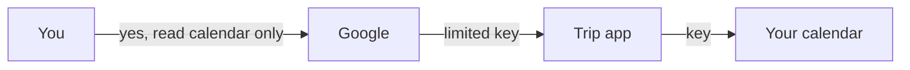
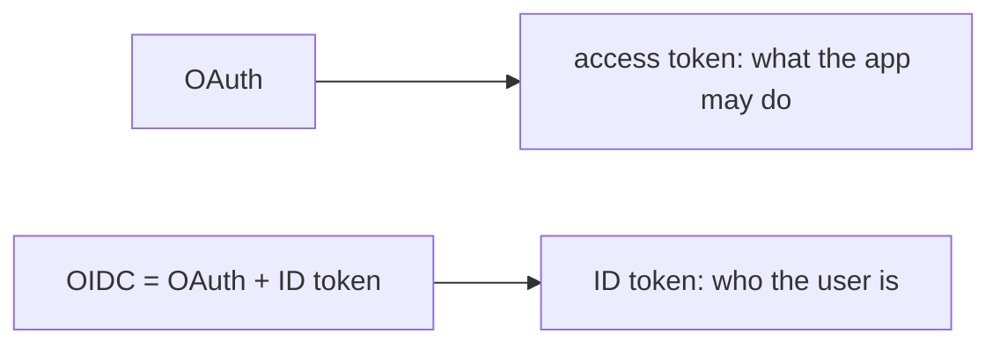
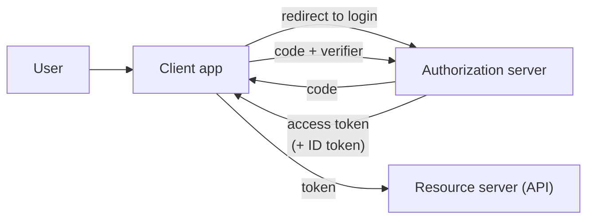
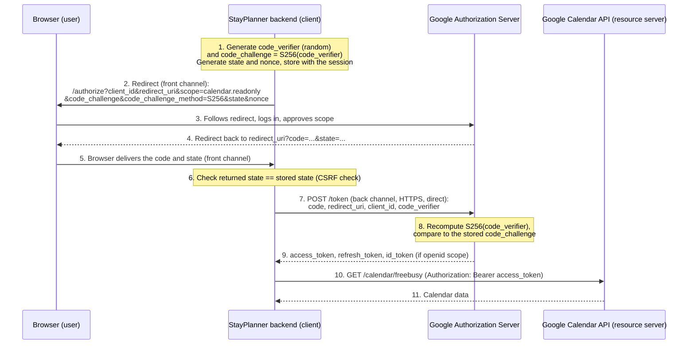
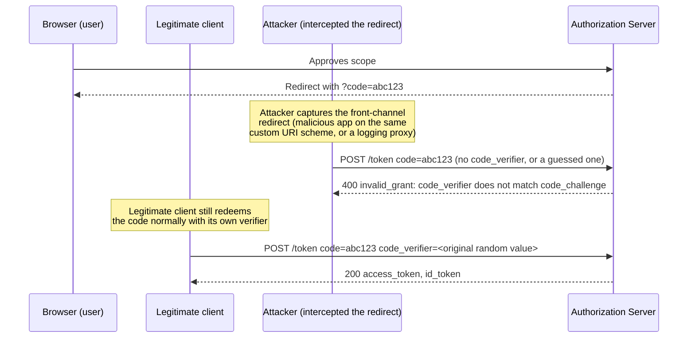
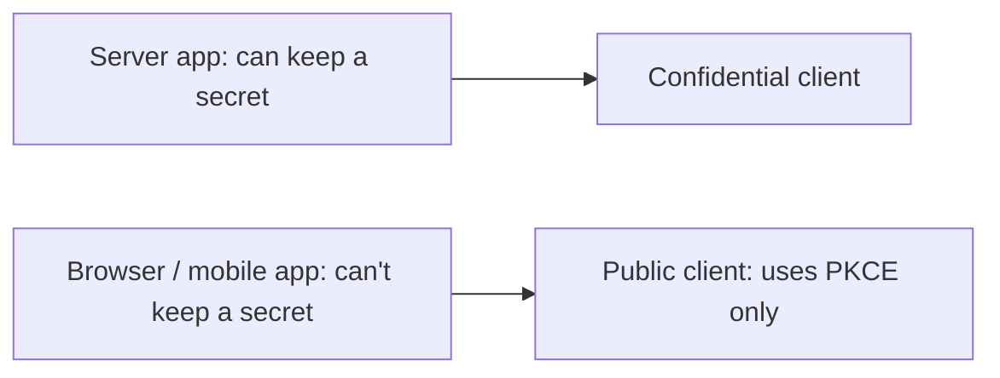
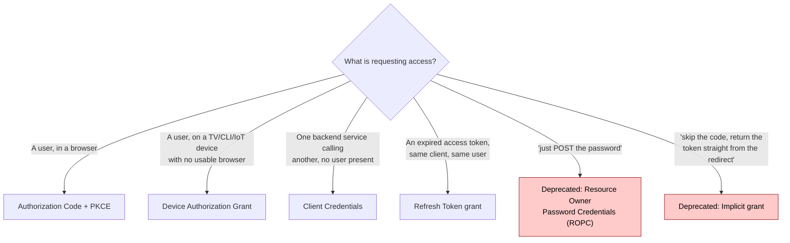
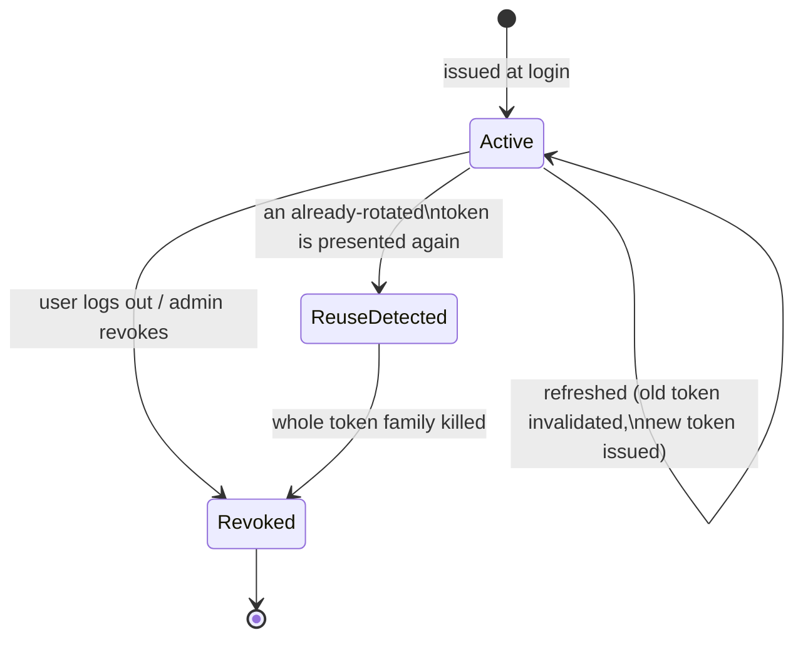

# OAuth 2.0 and OpenID Connect

> [!summary] TL;DR
> OAuth 2.0 lets a user grant one application limited, revocable access to their data on another service, without ever handing over a password. OpenID Connect (OIDC) is a thin identity layer on top of OAuth that adds a signed ID token, so "Login with Google" is OIDC, not plain OAuth.

> [!abstract] Core idea
> - OAuth hands out a scoped, expiring **access token**, not a password. The client never sees the user's credentials.
> - The authorization code is fetched over the browser (front channel) but exchanged for tokens over a direct server call (back channel) that an attacker watching the browser cannot see.
> - PKCE binds the code exchange to the client that started the flow, so an intercepted code is useless on its own.
> - OIDC adds the **ID token**: a signed, machine-readable answer to "who is this user", separate from the access token that says "what can this app do".
> - Classic mistake: treating OAuth as a login protocol. OAuth proves *authorization*; only OIDC's ID token proves *authentication*.

## Start here: the basics 🟢

> [!info] How to read this note (pick your level)
> - 🟢 **New to this?** Read "From zero" below, then sections 1, 2 and 10 (why, mental model and the cheat sheet). Stop there, that is a full first pass.
> - 🟡 **Know the basics?** Add sections 3, 4, 5 and 6 (how it works, a worked example, options and trade-offs).
> - 🔴 **Interview / SDE-3 prep?** Add sections 7, 8 and 9 (production, deep dive and interview questions). Headings are tagged 🟢🟡🔴 so you always know where you are.

**From zero, in 60 seconds** 🟢

Say a trip app wants to read your Google Calendar.
The bad way: you give the trip app your Google password. Now it can do anything as you.
**OAuth** is the good way: Google asks you "allow trip app to read your calendar?", and then gives the app a limited key.



The app never sees your password, and you can cancel the key any time.
**OpenID Connect** (OIDC) adds one more thing: a signed note saying who you are. That is what "Login with Google" uses.



The rest of this note is just these 3 questions:
1. Who are the players, and what is the main login flow (code + PKCE)?
2. What are scopes, claims, access tokens and ID tokens?
3. Which small checks (state, nonce, PKCE) stop real attacks?


**The problem in one story.**
You want a photo-printing site to read your Google Photos.
You should not give it your Google password.
Instead Google asks you "allow this site to view photos?" and hands the site a limited pass.
OAuth is that pass system; OpenID Connect adds "and here is who the user is".

**Words you need first**

| Word | Plain meaning | Tiny example |
| --- | --- | --- |
| Client | The app that wants access | The photo-printing site |
| Authorization server | The service that logs you in and issues passes | Google's login page |
| Resource server | The API holding your data | Google Photos API |
| Access token | A short-lived pass to call the API | `Bearer eyJ...` valid 1 hour |
| Scope | What the pass is allowed to do | `photos.readonly` |
| Redirect URI | Where the browser is sent back after login | `https://app.example/callback` |
| ID token | A signed note saying who logged in (OIDC) | A JWT with `sub` and `email` |
| PKCE | A one-time secret proving the same app finishes the flow | `code_verifier` + `code_challenge` |

**Picture it**



**Analogy.** A hotel key card. Reception (authorization server) checks your ID once and gives you a card that opens only your room and the gym (scopes), and it expires at checkout.
Where it breaks: a key card does not prove who you are to anyone else; that identity part is exactly what OpenID Connect's ID token adds on top.

**How the rest of this note builds up**

- First, why it exists (section 1) and the mental model (section 2).
- Then the authorization code flow with PKCE step by step (section 3) and a full worked example (section 4).
- Then the other grant types and how OAuth differs from OIDC (section 5).
- Finally the SDE-3 deep dive: token validation, redirect URI and state attacks, production pitfalls (sections 6-8), then interview questions and a cheat sheet.

> [!tip] Remember
> OAuth hands out limited passes (authorization); OpenID Connect adds a signed ID token saying who the user is (authentication).

## 1. Why it exists 🟢

StayPlanner, a trip-planning app, wants a feature: "Import busy slots from your Google Calendar." The crude way to build this is to ask the user for their Google password, store it, and log in as them whenever the import job runs.

That design has three concrete problems:

1. **No scoping.** The stored password unlocks Gmail, Drive, and Calendar together. StayPlanner only needed read access to busy/free times.
2. **No revocation path.** The user cannot take back StayPlanner's access without changing their Google password everywhere else they use it.
3. **A second copy of the user's most sensitive secret.** Every app that does this multiplies the attack surface for credential theft; a breach at StayPlanner now leaks Google passwords too.

OAuth 2.0 replaces "hand over the password" with "redirect the user to Google, let them approve a specific, named scope (`calendar.readonly`), and give StayPlanner a token that only does that, only for a while, and that Google can revoke on its own without touching the user's password."

## 2. Mental model 🟢

Think of a **valet key**: a car key that starts the engine and goes 20 mph but cannot open the trunk or glovebox. The valet never gets the owner's real key, the car dealer (not the valet) decided exactly what the valet key can do, and the owner can deactivate it without re-cutting their own key.

- The **owner** is the resource owner (the user).
- The **valet** is the client (StayPlanner).
- The **dealer who programmed the key** is the authorization server (Google's OAuth endpoint).
- The **car** is the resource server (Google Calendar's API).
- The **valet key itself** is the access token: limited, time-boxed, revocable, and never the owner's real credential.

## 3. How it works 🟡

### Roles and channels

**In plain words:** four players: you (owner), the app asking, the login server (Google), and the place holding your data. "Front channel" means through your browser; "back channel" means server to server.

| Role | Who it is in the example | Job |
| --- | --- | --- |
| Resource owner | The StayPlanner user | Owns the data and approves access |
| Client | StayPlanner's backend | Wants access, never sees the password |
| Authorization server | Google's `accounts.google.com` | Authenticates the user, issues tokens |
| Resource server | Google Calendar API | Accepts the access token, serves data |

Two channels matter throughout OAuth:

- **Front channel**: anything that travels through the user's browser via redirects (the authorization request, the authorization code). An attacker who controls the user's network or a malicious browser extension can observe this.
- **Back channel**: a direct HTTPS call from the client's server straight to the authorization server, never touching the browser. The code-for-token exchange happens here.

### Authorization Code + PKCE, step by step

**In plain words:** the browser carries a short one-time code back to the app. The app swaps that code for tokens, and proves it is the same app that started the flow.

This is the flow OAuth 2.1 and RFC 9700 require for **every** client, confidential or public:



Step 2 and step 4–5 are front channel: the authorization request and the code travel through the browser. Step 7 is back channel: only the client's server and the authorization server ever see the `code_verifier`, over a direct TLS connection.

### The attack PKCE stops

**In plain words:** if someone steals the one-time code on the way back, it is useless to them. Only the app holding the matching secret can cash it in.

Without PKCE, step 7 would only need the `code`. Anything that can observe the front channel — a logging proxy, a malicious app registered with the same custom URL scheme on mobile, a referrer leak — can steal the code and redeem it itself:



The attacker has the code but not the `code_verifier`, which never left the legitimate client's memory. The authorization server recomputes `S256(code_verifier)` and rejects any mismatch, so the stolen code is worthless on its own. This is exactly `VerifyPKCE` in the worked example below.

### Confidential vs. public clients



- **Confidential client**: a server-side app (StayPlanner's backend) that can hold a `client_secret` safely. It authenticates itself at the token endpoint with that secret.
- **Public client**: a mobile app or single-page app (SPA) that ships its binary or JS to the user's device. Anything embedded in it can be extracted, so it has **no** usable secret. PKCE was built for this case and, since RFC 9700, is required for confidential clients too, as defense in depth.

### Scopes vs. claims

**In plain words:** scopes are what the app asks to do ("read calendar"). Claims are facts inside a token ("user is ana@x.com").

These are two different lists and the most common point of confusion:

- **Scopes** are requested *before* consent and describe **what the client may do**: `calendar.readonly`, `payments.write`. The authorization server uses them to build the consent screen and to limit what the resulting access token can call.
- **Claims** are facts about the authenticated user, carried *inside* the ID token (and sometimes the userinfo endpoint): `sub`, `email`, `email_verified`, `name`. A scope like `openid email` tells the authorization server which claims to *include*; the claims themselves are the payload, not the request.

### ID token vs. access token

**In plain words:** the ID token is for the app to learn who you are. The access token is for calling an API. Never mix them up.

| | Access token | ID token |
| --- | --- | --- |
| Audience | The resource server (Calendar API) | The client itself |
| Format | Opaque string or JWT, API-specific | Always a JWT, defined by OIDC |
| Question it answers | "What can this request do?" | "Who logged in, and when?" |
| Who should read it | The resource server | The client, once, to establish a session |
| Send it to Calendar API? | Yes | Never — it was not issued for that audience |

A client should **never** send the ID token to an API as a bearer credential, and never use the access token to decide who the user is: the access token for a third-party API may not even be readable by the client.

### `state` and `nonce`

- **`state`**: an opaque, per-request random value the client generates, stores server-side (or in a signed cookie) before the redirect, and checks against what comes back. It defeats CSRF: without it, an attacker can start their own OAuth flow, capture the resulting code, and trick the victim's browser into completing the redirect — binding the *victim's* session to the *attacker's* account at the client.
- **`nonce`**: a value OIDC carries inside the ID token itself. The client generates it, sends it in the authorization request, and checks it against the `nonce` claim in the returned ID token. It stops replay of an old, previously-issued ID token being submitted as if it were fresh.

### Other grants

**In plain words:** other flows for special cases: machine-to-machine, TV-style devices. The old password and implicit flows are retired.



- **Client credentials**: the client authenticates with its own `client_id` + secret (or a signed JWT assertion) and gets a token representing *itself*, not a user. This is the OAuth grant used for service-to-service calls; see [[Service-to-Service Auth - API Keys, HMAC, mTLS]] for how that is actually operated (key rotation, mTLS-bound tokens, JWT client assertions).
- **Device authorization grant** (RFC 8628): the device shows a short code and a URL, the user approves on a second device (phone, laptop) by typing the code in a browser, and the device polls the token endpoint until the authorization server reports success.
- **Refresh token**: redeems a long-lived refresh token for a new access token without the user re-authenticating. Covered in depth, including rotation and reuse detection, in [[Access and Refresh Tokens]].
- **Deprecated: Implicit grant** returned the access token directly in the redirect URL fragment, with no code and no back channel, so the token itself traveled the front channel and leaked into browser history, referrer headers, and server logs. **Deprecated: ROPC** (Resource Owner Password Credentials) had the client collect the user's password and POST it directly, defeating the entire point of OAuth. OAuth 2.1 and RFC 9700 remove the implicit grant and disallow ROPC for new clients: use Authorization Code + PKCE for anything with a browser, and the device grant for anything without one.

## 4. Worked example 🟡

### Whiteboard version

The two checks that matter most, stripped to their essence: PKCE binds the token exchange to whoever started the flow, and `state` binds the redirect back to the same browser session.

```go
package wb

import (
	"crypto/rand"
	"crypto/sha256"
	"encoding/base64"
)

func newVerifierAndChallenge() (verifier, challenge string) {
	b := make([]byte, 32)
	rand.Read(b)
	verifier = base64.RawURLEncoding.EncodeToString(b)
	sum := sha256.Sum256([]byte(verifier))
	challenge = base64.RawURLEncoding.EncodeToString(sum[:])
	return
}
```

The full version below adds the state (CSRF) check and OIDC ID token claim validation, and is exactly what the tests exercise.

A Go package for the three checks a client must make on every Authorization Code + PKCE flow: generating and verifying PKCE, checking `state`, and validating an ID token's claims. It compiles and passes `go vet` and `go test -race` on Go 1.24.

```go
package oauth

import (
	"crypto/rand"
	"crypto/sha256"
	"crypto/subtle"
	"encoding/base64"
	"errors"
	"time"
)

// NewPKCE returns a fresh (verifier, S256 challenge) pair per RFC 7636.
// The verifier is 256 bits of randomness, base64url-encoded with no padding,
// well above the 43-character minimum the RFC requires.
func NewPKCE() (verifier, challenge string, err error) {
	b := make([]byte, 32)
	if _, err = rand.Read(b); err != nil {
		return "", "", err
	}
	verifier = base64.RawURLEncoding.EncodeToString(b)
	challenge = s256(verifier)
	return verifier, challenge, nil
}

func s256(verifier string) string {
	sum := sha256.Sum256([]byte(verifier))
	return base64.RawURLEncoding.EncodeToString(sum[:])
}

// VerifyPKCE is what the authorization server runs at the token endpoint: it
// recomputes the challenge from the verifier the client now reveals and
// compares it to the challenge the client sent earlier at the /authorize
// step. Only the party that held the original verifier can pass this, so a
// stolen authorization code is useless without it.
func VerifyPKCE(verifier, expectedChallenge string) bool {
	got := s256(verifier)
	return subtle.ConstantTimeCompare([]byte(got), []byte(expectedChallenge)) == 1
}

// ErrStateMismatch means the state round-tripped through the redirect does
// not match what this app sent, which is the sign of a CSRF attempt: an
// attacker started their own authorization flow and tricked the victim's
// browser into completing it against the attacker's account.
var ErrStateMismatch = errors.New("state mismatch: possible CSRF")

// CheckState is the redirect-time CSRF check. sentState must have been
// generated per-request and stored in the user's browser session (for
// example in a signed cookie) before the redirect to the authorization
// server, then compared here against what the redirect brought back.
func CheckState(sentState, returnedState string) error {
	if sentState == "" || returnedState == "" || sentState != returnedState {
		return ErrStateMismatch
	}
	return nil
}

// IDTokenClaims is the minimal set of OpenID Connect ID token claims this
// note validates. A real client gets these from a verified JWS (see
// coreos/go-oidc), never from an unverified token.
type IDTokenClaims struct {
	Issuer   string `json:"iss"`
	Subject  string `json:"sub"`
	Audience string `json:"aud"`
	Expiry   int64  `json:"exp"`
	Nonce    string `json:"nonce"`
}

var (
	ErrIssuer   = errors.New("unexpected issuer")
	ErrAudience = errors.New("id token was not issued for this client")
	ErrExpired  = errors.New("id token expired")
	ErrNonce    = errors.New("nonce mismatch: possible replay of an old ID token")
)

// ValidateIDToken runs the claim checks OpenID Connect Core and RFC 9700 both
// require once the token's signature is already verified against the
// provider's JWKS. Skipping any one of these turns a valid signature into a
// token that was never meant for this login.
func ValidateIDToken(c IDTokenClaims, wantIssuer, wantAudience, wantNonce string, now time.Time) error {
	if c.Issuer != wantIssuer {
		return ErrIssuer
	}
	if c.Audience != wantAudience {
		return ErrAudience
	}
	if now.Unix() > c.Expiry {
		return ErrExpired
	}
	if wantNonce != "" && subtle.ConstantTimeCompare([]byte(c.Nonce), []byte(wantNonce)) != 1 {
		return ErrNonce
	}
	return nil
}
```

The test that proves both the happy path and the attack from the sequence diagram above:

```go
func TestPKCERejectsWrongVerifier(t *testing.T) {
	_, challenge, err := NewPKCE()
	if err != nil {
		t.Fatalf("NewPKCE: %v", err)
	}
	stolenVerifier, _, err := NewPKCE() // an attacker's own, unrelated verifier
	if err != nil {
		t.Fatalf("NewPKCE: %v", err)
	}
	if VerifyPKCE(stolenVerifier, challenge) {
		t.Fatal("a stolen authorization code must not redeem with the wrong verifier")
	}
}
```

**Measured:** `go test -race ./...` on this package, Go 1.24.4, darwin/arm64, 2026-11-07: 4 tests, all pass, including `TestPKCERoundTrip`, `TestPKCERejectsWrongVerifier`, `TestCheckState`, and `TestValidateIDToken` (which separately exercises wrong issuer, wrong audience, expired, and replayed-nonce cases).

### Mapping a login to a local account

When step 11's resource call is instead `GET /userinfo` (an OIDC login, not a Calendar import), StayPlanner must create or find a local account. The field to key on is the ID token's `sub` claim, **never the email**:

- `sub` is stable and scoped to this client (or globally unique, depending on the provider); it never changes for a given user at a given provider.
- Email can change, can be reused after an account is deleted and recreated at the provider, and some providers let a user have multiple unverified addresses. Keying on email risks one person silently taking over another's StayPlanner account if the provider ever reassigns that address.

Store `(issuer, sub) → local_user_id` and look up by that pair on every login.

## 5. Variants and comparison 🟡

| Grant | How it works | Use when | Cost / risk |
| --- | --- | --- | --- |
| Authorization Code + PKCE | Browser redirect → code → back-channel exchange with `code_verifier` | Any client with a user and a browser: web app, mobile app, SPA via BFF | One extra redirect round trip; needs a redirect URI to defend |
| Client Credentials | Client authenticates with its own secret or signed assertion, gets a token for itself | Service-to-service calls, no user present | See [[Service-to-Service Auth - API Keys, HMAC, mTLS]] for the full trade-offs |
| Device Authorization | Device shows a code, user approves on another device, device polls | Smart TVs, CLIs, IoT with no browser | Polling load on the token endpoint; short code reuse window |
| Refresh Token | Long-lived token redeems new access tokens without re-login | Keeping a session alive past access-token expiry | Theft gives standing access; needs rotation + reuse detection |
| Implicit (deprecated) | Token returned directly in the redirect fragment | Nothing — removed in OAuth 2.1 | Token exposed on the front channel, in history and referrers |
| ROPC (deprecated) | Client collects and POSTs the user's password | Nothing — removed for new clients in OAuth 2.1 | Client sees the password; defeats OAuth's purpose entirely |

> [!warning] Interview trap
> "OAuth is how Google login works" is half right and the half that is wrong matters. OAuth alone only proves the client has limited access to an API. The part that proves who logged in — the ID token, the `nonce`, the `/userinfo` endpoint — is OpenID Connect, a separate specification layered on top.

## 6. Trade-offs and when not to use 🟡

- A first-party monolith with its own username/password login and server-side sessions does not need OAuth internally — it adds a redirect hop, a second server to trust, and a consent screen for a problem (your own login) that a signed session cookie already solves. Reach for [[Sessions and Cookies]] there, and for OAuth only when a *separate* service or a *third-party* identity provider is genuinely involved.
- Device Authorization trades user convenience for server load: the device polls the token endpoint every few seconds until the user approves, so a flood of unapproved TV logins is a real capacity planning input.
- Validating access tokens by introspection (RFC 7662) adds a network round trip to the authorization server on every request unless the result is cached; a local JWT access token avoids that call but makes revocation harder (see [[JWT - Structure, Validation and Pitfalls]]).

## 7. In production 🔴

- **Real systems:**
  - "Login with Google / GitHub / Microsoft" buttons are OIDC, using Authorization Code + PKCE.
  - Identity providers such as Auth0, Okta, and Keycloak implement the authorization server role so product teams do not run their own.
  - Kubernetes `kubectl` uses the Device Authorization Grant for `kubectl oidc-login` style CLI auth against a cluster's identity provider.
  - The Backend-for-Frontend (BFF) pattern: since the implicit grant is gone, an SPA no longer holds tokens in JS at all. A thin backend owns the Authorization Code + PKCE flow, keeps tokens server-side, and gives the browser only an HttpOnly session cookie.
- **Failure modes → fixes:**
  - Redirect URI left as a loose prefix match → an attacker registers `https://app.example.com.evil.com/callback` or abuses an open redirect on the real host to steal the code. Fix: exact string match on the registered redirect URI, no wildcards.
  - "Mix-up attack": a client talks to the wrong authorization server (possible when one client is registered with several providers) and sends a code meant for one provider to another. Fix: the client stores *which* issuer it started the flow with and validates the ID token's `iss` against exactly that issuer.
  - Authorization server outage mid-flow → the client has a code but the token endpoint is down. Fix: treat the exchange as retryable with backoff, and fail the login with a clear retry message rather than silently creating a half-authenticated session.
  - Consent screen shows an overly broad scope list → treat scopes as a cost; request the narrowest scope the feature needs (`calendar.readonly`, not `calendar`).
- **What to monitor:**
  - Authorization and token-exchange error rates, broken down by `error` code (`invalid_grant`, `invalid_client`).
  - State/PKCE/nonce validation failures — these should be near zero in normal traffic, so a spike is a signal, not noise.
  - Refresh-token redemption rate and reuse-detection triggers (see [[Access and Refresh Tokens]]).
  - Time between `/authorize` and `/token` calls for a given `state` — an unusually long gap suggests the code sat somewhere it should not have.

## 8. Deep dive 🔴

- **Discovery and JWKS.** OIDC providers publish a discovery document at `/.well-known/openid-configuration` listing their endpoints and signing key set (JWKS) location. Clients fetch and cache the JWKS, keyed by `kid`, and refresh it (with a cache-miss retry) when they see an unknown `kid` — this is how key rotation happens without a deploy on the client side. See [[JWT - Structure, Validation and Pitfalls]] for the signature-verification mechanics this feeds.
- **Refresh token rotation and reuse detection.** Each refresh exchange returns a *new* refresh token and invalidates the old one. If the old (already-rotated) refresh token is ever presented again, that is a signal it was stolen and used by someone else before the legitimate client's next refresh — the authorization server should revoke the entire token family, not just the one token.



- **JWT access tokens vs. introspection.** A resource server can validate a JWT access token locally (fast, no network call, but a stolen-and-still-valid token lives until `exp`) or call the authorization server's introspection endpoint (RFC 7662) for every request (slower, but revocation is instant). Many production systems use short-lived JWTs (1–15 minutes) as a middle ground: local validation most of the time, with a short enough blast radius that instant revocation matters less.
- **Confidential client authentication at the token endpoint.** A plain `client_secret` is a long-lived shared secret that can leak from config or logs. RFC 9700 recommends `private_key_jwt`: the client signs a short-lived JWT assertion with its own private key instead of sending a secret at all — the same client-assertion mechanism covered in [[Service-to-Service Auth - API Keys, HMAC, mTLS]].
- **Go libraries for this in practice.** `golang.org/x/oauth2` implements the client side of the standard grants (code exchange, token refresh); `coreos/go-oidc` adds OIDC discovery, JWKS caching, and ID token verification on top of it. The hand-written checks in this note's worked example are what those libraries do internally — useful to know, rarely worth reimplementing in a production client.

## 9. Interview questions 🔴

> [!question]- Is OAuth a login protocol?
> No. OAuth proves a client has limited, scoped access to a resource — it says nothing about who the user is. OpenID Connect adds that: the ID token, signed by the authorization server, is the piece that proves authentication. "Login with Google" is OIDC, not bare OAuth.

> [!question]- Why does PKCE matter even for a confidential client with a client_secret?
> The secret proves the client's identity at the token endpoint, but the authorization *code* still travels the front channel and can be intercepted independently of the secret. PKCE ties the code redemption to whoever started the flow, regardless of whether a secret is also in play. RFC 9700 requires it for all clients for exactly this reason.

> [!question]- What does `state` protect against that PKCE does not?
> `state` stops CSRF: an attacker tricking a victim's browser into completing the attacker's own OAuth flow, which would bind the victim's session to the attacker's account. PKCE protects the code-exchange step itself. They defend different steps and neither substitutes for the other.

> [!question]- How should a client map a Google (or any OIDC) login to a local user account?
> By `(issuer, sub)`, not email. `sub` is stable per user per provider; email can change, be reused after deletion, or be unverified, any of which can let one person silently take over another's local account if email is the join key.

> [!question]- When would you choose the Device Authorization Grant over Authorization Code + PKCE?
> When the device initiating the login has no usable browser to redirect through — a smart TV, a CLI tool, an IoT device. The user instead approves on a second device by visiting a short URL and typing a code, while the first device polls the token endpoint.

> [!question]- Why are the implicit grant and ROPC deprecated?
> Implicit returns the access token directly in the redirect URL fragment, so the token itself travels the front channel and ends up in browser history, referrer headers, and server logs. ROPC has the client collect the user's password directly, defeating OAuth's entire purpose of never exposing the password to the client. OAuth 2.1 removes implicit and disallows ROPC for new clients.

> [!question]- A resource server receives a valid-looking access token. What must it still check before trusting it?
> That the token's audience is this resource server (not a token meant for a different API), that it has not expired, that its scopes actually cover the requested operation, and — if validating locally — that the signature verifies against a currently-trusted key, not a revoked or rotated one.

> [!question]- Trap: your SPA needs to call a third-party API directly from the browser. Where do you store the access token?
> Nowhere in the browser, if you can avoid it. Since the implicit grant is gone, the recommended shape is a Backend-for-Frontend: the SPA talks to its own backend over an HttpOnly session cookie, and that backend holds the real OAuth tokens server-side and proxies the calls. Storing tokens in `localStorage` or JS-reachable memory exposes them to any XSS on the page.

## 10. Cheat sheet 🟢

- OAuth = scoped, revocable, expiring access, not a password hand-off; OIDC = the identity layer (ID token) on top of it.
- Authorization Code + PKCE is the one flow to use for anything with a browser, confidential or public client.
- Front channel = through the browser (authorization request, code); back channel = direct server-to-server (token exchange).
- `state` stops CSRF on the redirect; PKCE (`code_verifier`/`code_challenge`) stops code interception; `nonce` stops ID token replay.
- Scopes = what the client may do; claims = facts about who the user is, carried in the ID token.
- Map logins by `(issuer, sub)`, never by email.
- Client credentials grant = service-to-service, no user; device grant = no browser available; both deprecate implicit and ROPC.
- Rotate refresh tokens on every use and revoke the whole family on reuse detection.

## Links
- **Before this:** [[Access and Refresh Tokens]], [[JWT - Structure, Validation and Pitfalls]], [[Secrets Management]]
- **Next:** [[Service-to-Service Auth - API Keys, HMAC, mTLS]]
- **Compare with:** [[Service-to-Service Auth - API Keys, HMAC, mTLS]] (no user present, machine identity instead), [[Authentication and Authorization in Go]] (implementing the client/resource-server side in Go)

### Watch on YouTube

- [OAuth 2.0 and OpenID Connect (in plain English)](https://www.youtube.com/watch?v=996OiexHze0) · OktaDev · 62 min · 2,051,848 views
- [An Illustrated Guide to OAuth and OpenID Connect](https://www.youtube.com/watch?v=t18YB3xDfXI) · OktaDev · 16 min · 828,851 views
