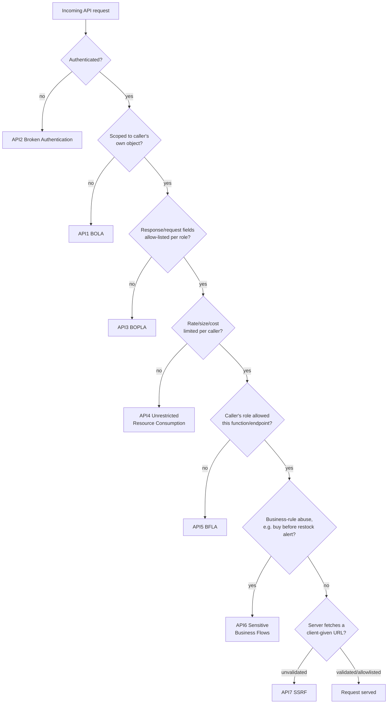
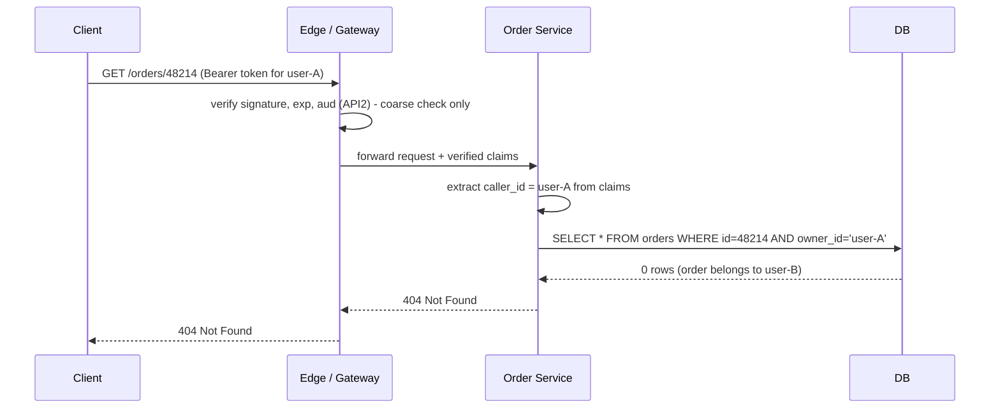

# OWASP API Security Top 10

> [!summary] TL;DR
> OWASP's 2023 list of the ten most common ways APIs get broken into, ranked by how often each one shows up in real incidents. Most of the list is one idea repeated at different layers: the server trusted something the client said about *who it is* or *what it's allowed to touch*, instead of checking it against the authenticated caller's own permissions on every single request.

> [!abstract] Core idea
> - Seven of the ten items are variations on "the server checked the wrong thing, or didn't check at all" — object ownership, function access, request volume, business-flow abuse.
> - The fix pattern repeats too: authorize by resource, not just by endpoint; scope every query by the caller's own identity; never trust a client-supplied ID, role, or price.
> - API1 (BOLA) and API5 (BFLA) are the two most common and most expensive to get wrong — they are an authorization bug one query away from a direct fix.
> - This note owns the security *concepts*; the Go implementation of authz middleware lives in [[Authentication and Authorization in Go]], and request-shape hardening lives in [[Secure Coding for Go Services]].

## 1. Why it exists

A ride-hailing API exposes `GET /api/v1/trips/{tripId}`. The backend checks that the caller has a valid session, loads the trip by `tripId`, and returns it:

```go
trip, _ := db.GetTripByID(tripID) // no ownership check
json.NewEncoder(w).Encode(trip)
```

Trip IDs are sequential integers. An authenticated user who was shown trip `48213` for their own ride can change the URL to `48214`, `48215`, … and read every other rider's pickup and drop-off addresses, fare, and driver's name. Nothing was "hacked" — the attacker used their own valid login and the documented endpoint. The bug is that the server authenticated *who is calling* but never authorized *whether they may see this specific object*. This single pattern — **Broken Object Level Authorization (BOLA)** — has been OWASP's #1 API risk in both the 2019 and 2023 editions, because it is easy to introduce (one missing `WHERE owner_id = ?`) and devastating once found (every sequential ID is a free enumeration).

## 2. Mental model

Think of each API endpoint as a door with two separate locks: an **authentication** lock (do you have a valid key at all?) and an **authorization** lock (does *this specific key* open *this specific door*?). Most of this list is incidents where only the first lock was installed. BOLA is "any valid key opens every room's door." BFLA is "any valid key opens the staff-only doors too." Unrestricted resource consumption is "the door has no limit on how many times per second you can walk through it." Treat every item below as: which lock is missing, and on what resource?

## 3. How it works

### The 2023 list, each with the one-line bug and the one-line fix



| # | Name | Typical bug | Typical fix |
| --- | --- | --- | --- |
| **API1** | Broken Object Level Authorization (BOLA) | `GET /orders/{id}` returns any order for any logged-in caller | Scope every query by `owner_id`/`tenant_id` derived from the token, never from the path |
| **API2** | Broken Authentication | Weak JWT validation (`alg: none`), no token expiry, password reset leaks via timing, no MFA on sensitive accounts | Validate signature + `alg` allowlist + `exp`/`aud`/`iss` on every token (see [[JWT - Structure, Validation and Pitfalls]]); short-lived tokens; rate-limit auth endpoints |
| **API3** | Broken Object Property Level Authorization (BOPLA, merges old "Excessive Data Exposure" + "Mass Assignment") | `PATCH /users/{id}` accepts a JSON body that happens to include `"role":"admin"` and the server binds it straight onto the model; or a `GET` response includes a `passwordHash` field the UI just doesn't render | Allow-list request fields per endpoint (a DTO struct with only the editable fields) and allow-list response fields per caller role — never serialize the whole DB row |
| **API4** | Unrestricted Resource Consumption | No cap on page size (`?limit=5000000`), no request timeout, no per-caller rate limit, an endpoint that triggers an expensive join or a PDF render | Enforce max page size, request body size, timeouts, and per-account/IP/API-key rate limits (see [[Rate Limiting - Algorithms and Distributed Design]]) |
| **API5** | Broken Function Level Authorization (BFLA) | A regular user calls `POST /admin/users/{id}/promote` directly — the endpoint exists and only the UI hides the button | Check role/permission inside the handler for every privileged function, never rely on "the frontend doesn't show the button" |
| **API6** | Unrestricted Access to Sensitive Business Flows | A bot buys out all event tickets in a flash sale via the public purchase API, bypassing the intended "one human, one purchase" assumption | Rate-limit and add friction (CAPTCHA, device/behavioral checks, purchase caps) on flows where *volume itself* is the business risk, not just the data |
| **API7** | Server-Side Request Forgery (SSRF) | An endpoint fetches a URL the client provides (an "import avatar from URL" feature) and the server requests `http://169.254.169.254/latest/meta-data/` — the cloud metadata endpoint — instead | Validate and allowlist destination schemes/hosts, block link-local/private ranges, fetch through an isolated proxy with no credentials attached |
| **API8** | Security Misconfiguration | Verbose stack traces in production error responses, default credentials left on an admin panel, permissive CORS (`Access-Control-Allow-Origin: *` with credentials), unpatched dependencies | Harden defaults, a config baseline enforced in CI, generic error bodies with a request ID, automated dependency/CVE scanning |
| **API9** | Improper Inventory Management | A `v1` endpoint was supposed to be retired, still runs with no monitoring, and skipped the authz fix that `v2` got; a staging API is reachable from the internet with test data | Maintain a live API inventory (every version, every environment), decommission old versions, apply security fixes to all live versions equally |
| **API10** | Unsafe Consumption of APIs | The backend calls a third-party API and trusts its response unvalidated — following its redirects, parsing its data without size/schema limits, logging its raw payload including secrets it echoed back | Treat third-party API responses like any other untrusted input: validate, size-limit, timeout, and don't propagate their errors verbatim to your own clients |

### Where authorization actually has to happen



The gateway can confirm the token is genuine (API2) and even do coarse role checks, but it cannot know which specific order belongs to which user — that object-level check has to run in the service, against the database, on every single request. This is why BOLA keeps recurring in audits: teams correctly centralize authentication at the edge and then assume authorization is "handled," when object-level authorization is a per-endpoint, per-query responsibility that a gateway structurally cannot do for you.

## 4. Worked example

### Whiteboard version

The bare fix for BOLA: never query by the ID alone. Always add the caller's own identity to the `WHERE` clause (or the in-memory lookup), and return "not found," not "forbidden," so the response doesn't even confirm the ID exists.

### Go: BOLA and BOPLA, vulnerable vs fixed

Compiles and passes `go vet` and `go test -race` on Go 1.24.

```go
// Package owasp demonstrates two OWASP API Security Top 10 (2023) fixes:
// API1 Broken Object Level Authorization (BOLA) and API3 Broken Object
// Property Level Authorization (BOPLA, formerly "mass assignment").
package owasp

import "errors"

var ErrNotFound = errors.New("order not found for this user")

// Order is what the store persists. Role and Balance are server-controlled
// and must never be settable from a client request body (API3/BOPLA).
type Order struct {
	ID      string
	OwnerID string
	Amount  int // minor units
	Status  string
}

type Store struct {
	orders map[string]Order
}

func NewStore(orders ...Order) *Store {
	s := &Store{orders: make(map[string]Order)}
	for _, o := range orders {
		s.orders[o.ID] = o
	}
	return s
}

// VulnerableGet is the BOLA bug: it trusts the path parameter alone.
// Any authenticated user can read any order by guessing/incrementing the ID.
func (s *Store) VulnerableGet(orderID string) (Order, error) {
	o, ok := s.orders[orderID]
	if !ok {
		return Order{}, ErrNotFound
	}
	return o, nil
}

// Get is the fix: every query is scoped by the caller's own user ID, taken
// from the authenticated session/token, never from client input.
func (s *Store) Get(callerUserID, orderID string) (Order, error) {
	o, ok := s.orders[orderID]
	if !ok || o.OwnerID != callerUserID {
		return Order{}, ErrNotFound // 404, not 403: don't reveal the ID exists
	}
	return o, nil
}

// OrderUpdateRequest is the allow-listed shape a client is permitted to
// send. There is no Role or Balance field here, so BOPLA/mass-assignment
// has nothing to bind into even if the client sends extra JSON keys.
type OrderUpdateRequest struct {
	Status string `json:"status"`
}

// ApplyUpdate patches only the allow-listed fields onto the stored order.
func (s *Store) ApplyUpdate(callerUserID, orderID string, req OrderUpdateRequest) (Order, error) {
	o, err := s.Get(callerUserID, orderID)
	if err != nil {
		return Order{}, err
	}
	o.Status = req.Status
	s.orders[orderID] = o
	return o, nil
}
```

```go
package owasp

import "testing"

func TestVulnerableGetLeaksOtherUsersOrder(t *testing.T) {
	s := NewStore(Order{ID: "ord-1", OwnerID: "user-A", Amount: 500, Status: "paid"})

	// "user-B" never appears: VulnerableGet has no notion of caller identity.
	o, err := s.VulnerableGet("ord-1")
	if err != nil {
		t.Fatalf("unexpected error: %v", err)
	}
	if o.OwnerID != "user-A" {
		t.Fatalf("got owner %q", o.OwnerID)
	}
}

func TestGetIsScopedToOwner(t *testing.T) {
	s := NewStore(Order{ID: "ord-1", OwnerID: "user-A", Amount: 500, Status: "paid"})

	if _, err := s.Get("user-B", "ord-1"); err != ErrNotFound {
		t.Fatalf("expected ErrNotFound for a different user's order, got %v", err)
	}
	if _, err := s.Get("user-A", "ord-1"); err != nil {
		t.Fatalf("owner should be able to read their own order: %v", err)
	}
}

func TestApplyUpdateCannotEscalatePrivilege(t *testing.T) {
	s := NewStore(Order{ID: "ord-1", OwnerID: "user-A", Amount: 500, Status: "pending"})

	// The request type has no Amount/Role field, so there is nothing for an
	// attacker to smuggle in even if the raw JSON body contains one.
	got, err := s.ApplyUpdate("user-A", "ord-1", OrderUpdateRequest{Status: "cancelled"})
	if err != nil {
		t.Fatalf("unexpected error: %v", err)
	}
	if got.Status != "cancelled" {
		t.Fatalf("status = %q, want cancelled", got.Status)
	}
	if got.Amount != 500 {
		t.Fatalf("amount changed to %d, want unchanged 500", got.Amount)
	}

	if _, err := s.ApplyUpdate("user-B", "ord-1", OrderUpdateRequest{Status: "cancelled"}); err != ErrNotFound {
		t.Fatalf("expected ErrNotFound updating another user's order, got %v", err)
	}
}
```

**Measured:** `go test -race ./owasp/...` on Go 1.24.4: 3/3 tests pass. `TestVulnerableGetLeaksOtherUsersOrder` demonstrates the bug (it succeeds, which is the point — the vulnerable path has no caller check to fail); `TestGetIsScopedToOwner` and `TestApplyUpdateCannotEscalatePrivilege` prove the fix rejects cross-owner access and that the request DTO cannot carry an unauthorized field.

For the full Go middleware chain this check sits in — request-ID, auth, rate limiting, body-size limits — see [[Authentication and Authorization in Go]] and [[Secure Coding for Go Services]].

## 5. Variants and comparison

| Risk | Layer it's checked at | Caught by a pentest? | Caught by code review? |
| --- | --- | --- | --- |
| API1 BOLA | Per-request, in the data layer | Only if the tester owns two accounts and tries cross-account IDs | Yes, if reviewers specifically check every query's `WHERE` clause |
| API2 Broken Authentication | Gateway/middleware | Yes, standard token-fuzzing tests | Yes, if JWT validation config is reviewed |
| API3 BOPLA | Request/response (de)serialization | Sometimes, via fuzzing extra JSON fields | Yes, if DTOs are reviewed against the DB model |
| API4 Unrestricted Resource Consumption | Gateway + service | Yes, via load testing | Rarely — looks fine until load |
| API5 BFLA | Per-endpoint, in the handler | Only if the tester enumerates admin-shaped URLs | Yes, if role checks are reviewed per handler |
| API6 Sensitive Business Flows | Business logic + anti-automation | Rarely — needs domain knowledge of what "abuse" means here | Rarely — it's a product-risk question, not a code bug |
| API7 SSRF | Any outbound fetch the server makes on the client's behalf | Yes, standard SSRF payloads | Yes, if outbound URL handling is reviewed |

## 6. Trade-offs and when not to use

- This list is not a checklist to run once; BOLA and BFLA must be re-verified on every new endpoint, because each one is a fresh place to forget the check — static analysis catches syntax, not "did you scope this query."
- Allow-listing response fields (API3) costs more upfront engineering than serializing the whole model, but the alternative is auditing every model change for a new sensitive field forever.
- Aggressive anti-automation for API6 (CAPTCHA, hard rate limits) adds friction for legitimate users too; apply it to the specific flows where abuse is the actual business risk (checkout, ticket purchase), not uniformly across the whole API.

## 7. In production

- **Real systems:** large BOLA breaches have hit ride-hailing, fintech and social apps via exactly the sequential-ID pattern above; SSRF via a "fetch this URL" feature reaching cloud metadata endpoints has been behind several well-known cloud account compromises; API6-style ticket/sneaker bot abuse is a standing arms race for e-commerce and events platforms.
- **Failure modes → fixes:**
  - A new endpoint ships without an object-level authz check because the reviewer assumed the gateway "already handles auth" → make the per-object check a required line item in the API review checklist, not implicit.
  - An internal admin endpoint is reachable because a role check was only enforced in the frontend → every privileged handler re-checks the role server-side (API5).
  - A "retired" `v1` endpoint still runs with the old, unfixed authz bug (API9) → maintain an actual inventory with an owner and a kill date per version.
  - An "import from URL" feature is repurposed to probe internal services (API7) → resolve and validate the destination before fetching, block RFC 1918/link-local ranges, and fetch via an egress proxy with no cloud credentials attached.
- **What to monitor:** 403/404 rates per endpoint (a spike on one object ID pattern suggests enumeration), request volume per account/IP on sensitive flows, outbound request destinations from any "fetch a URL" feature, and the set of live API versions against what's actually monitored.

## 8. Deep dive

- **Why BOLA keeps winning #1.** It's not a framework bug or a missing library — `authMiddleware.Required()` runs fine, the token is valid, the user genuinely is who they say they are. The missing step is a second, independent check — "does this caller own this specific row" — that has to be written per query, so it scales with the number of endpoints rather than being solved once centrally. Policy engines (OPA, Casbin — see [[Authentication vs Authorization]]) help by moving the *rule* out of each handler, but someone still has to call the check on every object access.
- **BOPLA subsumes two 2019 categories** ("Excessive Data Exposure" and "Mass Assignment") because OWASP 2023 recognized they're the same bug from opposite directions: a response that serializes too many fields out, and a request that binds too many fields in. The single fix — an explicit, allow-listed DTO per direction, per role — covers both.
- **API6 is the odd one out on this list**: it isn't a missing technical check so much as a missing *product* threat model — "what happens if this flow runs a million times per second by a bot, not a human." The defense (rate limits, device signals, purchase caps, deliberate friction) overlaps heavily with [[API Abuse and Bot Protection]], which this note defers to for the detection and mitigation mechanics.
- **SSRF and cloud metadata.** The specific danger of API7 inside a cloud deployment is that `169.254.169.254` (AWS/GCP/Azure instance metadata) often serves short-lived credentials with no additional auth required from inside the VM/container network — so a single unvalidated outbound fetch can turn into full credential theft. IMDSv2-style hop-limited, token-gated metadata APIs and network policies that block the metadata address from application containers are the infrastructure-side mitigation, independent of fixing the application's URL validation.

## 9. Interview questions

> [!question]- What's the difference between API1 (BOLA) and API5 (BFLA)?
> BOLA is about *which object* a caller may access — they're allowed to call the endpoint, but not for someone else's resource. BFLA is about *which function/endpoint* a caller may invoke at all — a regular user calling an admin-only endpoint, regardless of whose object it touches. The fix for BOLA is scoping the query by owner; the fix for BFLA is a role/permission check before the handler runs at all.

> [!question]- Trap: "We validate every JWT at the gateway, so authorization is handled." What's missing?
> Validating a JWT's signature and claims is authentication plus, at most, coarse role-level checks (API2/part of API5) — it proves who the caller is. It cannot know, generically, whether `/orders/48214` belongs to that caller; that object-level check (API1/BOLA) has to run in the service against the actual data, per request, because only the service has the ownership information.

> [!question]- How would you design the fix for BOLA at the data-access layer, not just the handler?
> Make it structurally hard to forget: every repository method that fetches a single resource takes the caller's identity as a required parameter and includes it in the query (`WHERE id = ? AND owner_id = ?`), rather than a separate "check ownership" step a reviewer has to remember to call. Return "not found" rather than "forbidden" so the response doesn't confirm the object exists.

> [!question]- What is BOPLA and how does it unify two of the old Top 10 categories?
> Broken Object Property Level Authorization covers both over-exposing fields in a response (old "Excessive Data Exposure" — serializing a password hash or internal flag the UI just doesn't show) and over-accepting fields in a request (old "Mass Assignment" — a client setting `role: admin` on a profile update the server blindly binds). Both are fixed the same way: an explicit allow-listed DTO per direction and per caller role, never serializing/binding the raw model.

> [!question]- Why is SSRF especially dangerous in a cloud environment?
> Cloud providers expose an instance metadata endpoint (`169.254.169.254`) that can hand out short-lived credentials to anything running on the instance/container, with no extra authentication in older configurations. An SSRF bug lets an attacker make the server fetch that address on their behalf, turning a "fetch this image URL" feature into full credential theft for the instance's cloud role.

> [!question]- How does API4 (Unrestricted Resource Consumption) differ from classic rate limiting?
> Rate limiting (see [[Rate Limiting - Algorithms and Distributed Design]]) covers request *count* per caller over time, but API4 also covers per-request cost: unbounded page sizes, unbounded body sizes, no query timeout, no cap on an expensive join or file render. A caller making one request per minute can still exhaust the server if that one request asks for 10 million rows — count-based rate limiting alone doesn't catch that.

> [!question]- Give an example of API6 (Unrestricted Access to Sensitive Business Flows) that isn't really a "security bug" in the traditional sense.
> A ticket-sale API correctly authenticates every request and never leaks another user's data, but a bot farm buys 95% of a flash-sale inventory in the first second using thousands of real, individually-registered accounts. Nothing was "hacked" — every single request was valid and authorized — but the business rule "one human gets a fair shot at one ticket" was never enforced. The fix lives in anti-automation and business-rule design, not in authentication or object-level authorization.

## 10. Cheat sheet

- API1 BOLA: scope every object query by the caller's own identity; return 404, not 403.
- API2 Broken Auth: validate signature + alg allowlist + exp/aud/iss on every token; short TTLs; rate-limit auth endpoints.
- API3 BOPLA: allow-list fields both in (request DTO) and out (response DTO) per role; never serialize/bind the raw model.
- API4 Unrestricted Resource Consumption: cap page size, body size, timeouts, and per-caller rate — count AND per-request cost.
- API5 BFLA: re-check role/permission inside every privileged handler; the UI hiding a button is not a control.
- API6 Sensitive Business Flows: identify flows where volume itself is the risk (purchases, signups) and add friction/limits there specifically.
- API7 SSRF: validate and allowlist any server-made outbound request to a client-given URL; block link-local/private ranges.
- API8/9/10: config hardening + a live inventory of every API version + treat third-party API responses as untrusted input.
- The recurring theme: authenticate once at the edge, but authorize per object, per field, and per function — every time, in the service.

## Links

- **Before this:** [[CSRF, XSS and Security Headers]], [[Authentication vs Authorization]]
- **Next:** [[Secrets Management]], [[API Abuse and Bot Protection]]
- **Compare with:** [[CSRF, XSS and Security Headers]] (browser-side attack surface vs this note's server-side authorization surface), [[Rate Limiting - Algorithms and Distributed Design]] (the algorithms behind API4's limits), [[Authentication and Authorization in Go]] and [[Secure Coding for Go Services]] (the Go implementation of these checks)
