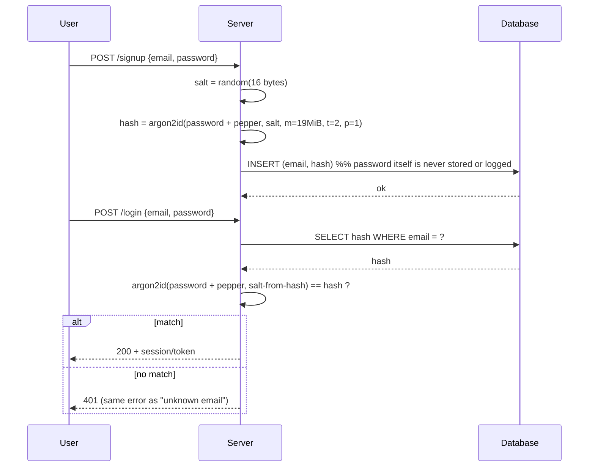
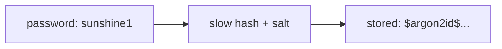
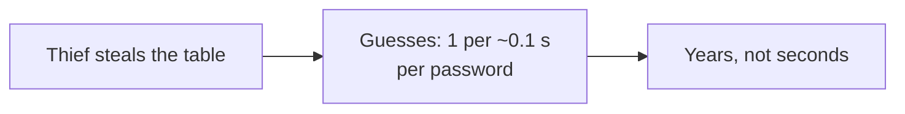
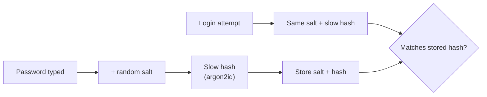
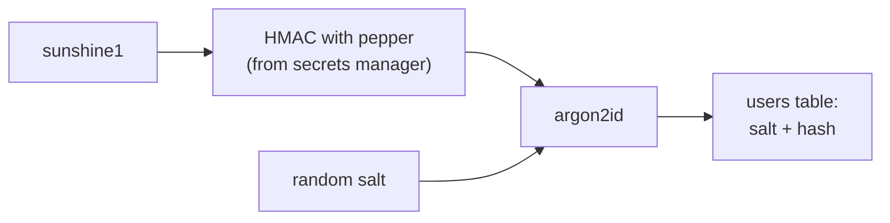
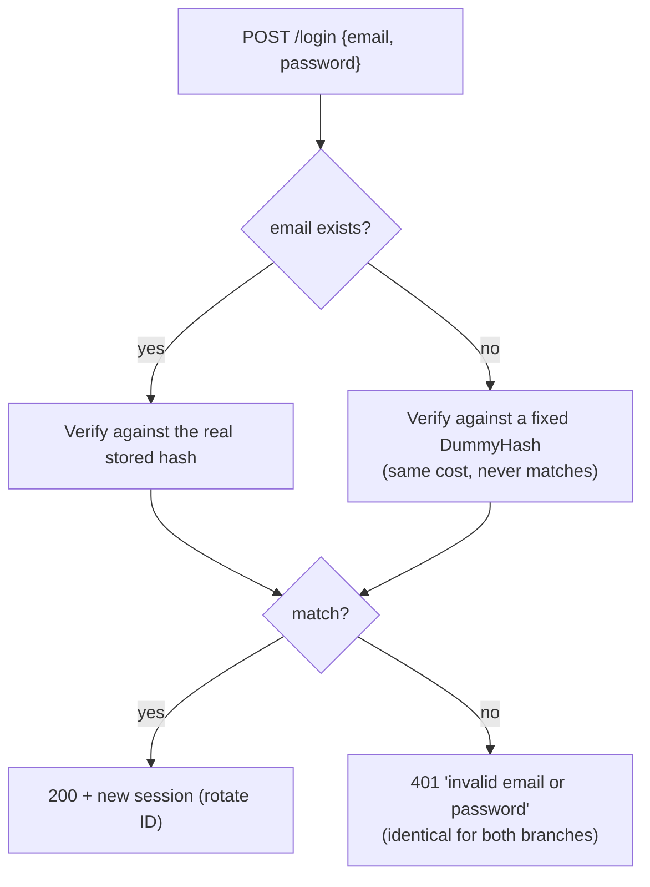
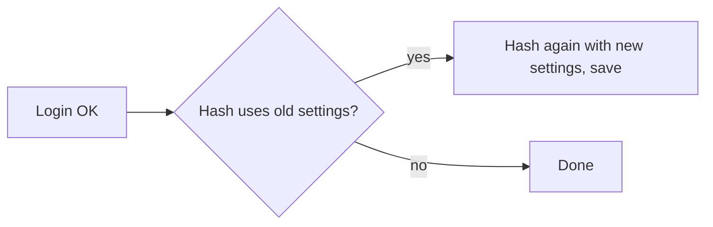
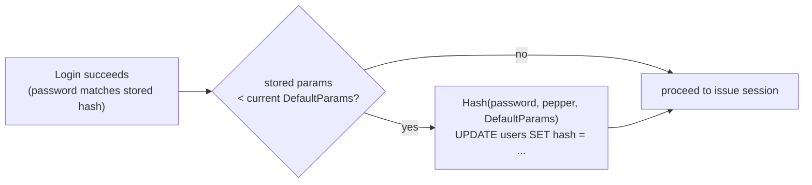

# Password Storage and Login Security

> [!summary] TL;DR
> Never store a password, and never store a fast hash of one. Store a slow, memory-hard hash (argon2id, bcrypt or scrypt) with a unique random salt per password, so that even a full database leak costs an attacker days-to-years per password instead of seconds for all of them at once.

> [!abstract] Core idea
> - A fast hash (SHA-256, MD5) lets a GPU try billions of candidate passwords per second against a leaked hash — it was never designed to be slow.
> - A slow, memory-hard hash (argon2id) costs real time and real RAM per guess, so the same GPU tries thousands per second instead of billions.
> - A salt (random per password) stops one precomputed rainbow table from cracking every row in the database at once.
> - A pepper (one secret shared by the whole server, stored outside the database) means a stolen database alone is still not enough to even start guessing — the attacker also needs the pepper.
> - Login security is a system, not just a hash function: it also needs MFA, rate limiting, breach checks and a response that never confirms whether an email exists.

### Whiteboard version

Signup and login, with the hash as the only thing that ever touches storage:



## Start here: the basics 🟢

> [!info] How to read this note (pick your level)
> - 🟢 **New to this?** Read "From zero" below, then sections 1, 2 and 10 (why, mental model and the cheat sheet). Stop there, that is a full first pass.
> - 🟡 **Know the basics?** Add sections 3, 4, 5 and 6 (how it works, a worked example, options and trade-offs).
> - 🔴 **Interview / SDE-3 prep?** Add sections 7, 8 and 9 (production, deep dive and interview questions). Headings are tagged 🟢🟡🔴 so you always know where you are.

> [!note] Before this note
> - [[Authentication vs Authorization]]: login (authentication) is the step that proves who you are; this note is about doing that step safely when the proof is a password.

**From zero, in 60 seconds** 🟢

A website needs to check your password, but it should never keep the password itself.
Instead it keeps a scrambled version, called a **hash**. You can make a hash from a password, but you can't turn a hash back into the password.



At login, the site hashes what you typed and compares it with the stored hash. Same result means right password.
Each password also gets its own random **salt** (a few random bytes mixed in). So two people with the same password get different hashes.
The hash is made slow on purpose. One login waits a tiny bit, but a thief trying billions of guesses waits for years.



The rest of this note is just these 3 questions:
1. Which slow hash to use, and with what settings?
2. What are salt and pepper, and how do you compare safely?
3. How do you protect the login form itself (rate limits, lockout, MFA)?


**The problem in one story.**
A website's database gets stolen.
If passwords were stored as plain text, every account is gone instantly, and people reuse passwords elsewhere.
If they were stored as slow, salted hashes, attackers must guess each password one by one, very slowly.
This note is how to store passwords and protect the login form.

**Words you need first**

| Word | Plain meaning | Tiny example |
| --- | --- | --- |
| Hash | A one-way function: easy to compute, can't be reversed | `sha256("cat")` -> fixed 64 hex chars |
| Salt | Random bytes mixed into each password before hashing | 16 random bytes stored with the hash |
| Slow hash / KDF | A hash deliberately made expensive to compute | argon2id, bcrypt, scrypt |
| Brute force | Trying many guesses until one works | Testing billions of passwords offline |
| Credential stuffing | Trying leaked email/password pairs from other sites | Leaked LinkedIn list tried on your login |
| Rate limiting | Capping attempts per user or IP | 5 failures then wait |
| MFA | A second proof beyond the password | A 6-digit code from an app |
| Rainbow table | A huge ready-made list of "hash → password" pairs, built once and reused | Look up a stolen SHA-256 hash, get `password123` |
| Pepper | One secret value for the whole server, kept outside the database and mixed into every password | Stored in a secrets manager, not in the users table |
| GPU | A graphics chip with thousands of small cores; great at trying many guesses in parallel | One gaming card ≈ 10 billion SHA-256 guesses/sec |
| Constant-time compare | Comparing two values in a way that always takes the same time | `subtle.ConstantTimeCompare` in Go |
| User enumeration | Finding out which emails have accounts from how the login page answers | "No such user" vs "wrong password" |
| Passkey / WebAuthn | Login with a key pair stored on your phone or laptop; the server keeps only the public half | Face ID unlock to sign in |

**Picture it**



**Analogy.** A paper shredder that always shreds the same page into the same pattern. You keep only the shreds; to check a page you shred it again and compare. Salt is a unique sticker on each page so two identical pages shred differently.
Where it breaks: real shredding is fast; a password hash is made slow on purpose so an attacker can't try billions of guesses per second.

**How the rest of this note builds up**

- First, why it exists (section 1) and the mental model (section 2).
- Then how hashing, salting and verification work (section 3) and a full Go login example (section 4).
- Then argon2id vs bcrypt vs scrypt vs plain SHA (section 5).
- Finally the SDE-3 deep dive: tuning cost parameters, rate limiting, credential stuffing defense and migration of old hashes (sections 6-8), then interview questions and a cheat sheet.

> [!tip] Remember
> Never store passwords; store a salted, deliberately slow hash and compare in constant time.

## 1. Why it exists 🟢

🟢 **Plain version:** Normal hash functions like SHA-256 are built to be very fast. That is great for checking files, but bad for passwords: if a thief steals the table, one graphics card can try about 10 billion guesses a second. A password hash like argon2id is built to be slow and to need a lot of memory, so the same card manages only a few thousand guesses a second. On top of that, each password gets its own random salt, so the thief has to attack every row separately instead of all of them at once.

Suppose a database of 10 million user rows leaks, each storing `SHA256(password)` with no salt. SHA-256 is designed to be *fast* — that is exactly the wrong property for password storage. A single consumer GPU computes roughly 10 billion SHA-256 hashes per second.

An attacker precomputes a rainbow table once (a big lookup list of hash → common password) and instantly recovers every user whose password appears in any common wordlist — because with no salt, two users with the same password produce the same stored hash, and one table attack breaks both.

Argon2id with the OWASP-minimum parameters (19 MiB memory, 2 iterations) costs roughly 20–50 ms of CPU time and 19 MiB of RAM *per guess*, on the same hardware. The same GPU that did 10 billion SHA-256 guesses a second manages a few thousand argon2id guesses a second, because the algorithm is deliberately memory-hard (each guess must fill and read a big block of RAM): GPUs have thousands of weak cores but comparatively little fast memory per core, so forcing every guess to touch 19 MiB defeats the GPU's main advantage.

That difference — SHA-256 at ~10,000,000,000 guesses/sec vs argon2id at a few thousand — is the entire reason password hashing functions exist as a separate category from general-purpose cryptographic hashes.

Each password also gets its own random salt. Without a salt, two users who both pick "password123" produce an identical hash, so cracking one row cracks every row sharing that password — and a precomputed table works across the whole database at once.

With a unique salt per password, the attacker must redo the expensive computation for every single row, even for repeated passwords.

### Real-life example: when a food app's database leaks 🟢

Imagine a food delivery app like Swiggy loses a copy of its users table. Many people use the same password for their email and their UPI app. If the table held plain passwords, thieves would try them on Gmail and bank apps the same evening. With argon2id hashes and salts, each row costs real time and memory to guess, so most strong passwords stay safe, and the app has days to force resets and warn users. This is why every breach report asks one question first: "how were the passwords stored?"

### Hashing vs encryption 🟡

People often say "we encrypt passwords". That is usually wrong, and the difference matters.

| | Hashing (argon2id) | Encryption (AES) |
| --- | --- | --- |
| Can you get the password back? | No, one-way only | Yes, with the key |
| What a thief needs | Years of guessing per password | Just the key, then all passwords at once |
| How login checks it | Hash the typed password again, compare | Decrypt and compare (the server can read every password) |
| Right for passwords? | Yes | No |

## 2. Mental model 🟢

Think of the hash function as a lock that is deliberately slow to pick, and the salt as making every lock a different shape even if two people chose the "same" key. A pepper is a master factor the locksmith (the server) keeps in their own safe, never handed out with the lock itself (the database) — so stealing the lock (the database) alone is not enough; you also need the thing in the safe.

## Common beginner mistakes 🟢

- **Storing `sha256(password)`** → it is fast, so a GPU tries billions of guesses a second → use argon2id (or bcrypt/scrypt).
- **One salt for the whole table** → two people with the same password still get the same hash → make a new random 16-byte salt for every password.
- **Encrypting passwords instead of hashing** → whoever gets the key reads every password → hash them; you never need the original back.
- **Saying "no account with that email"** → attackers learn which emails exist → always answer "invalid email or password".
- **Comparing hashes with `==`** → tiny timing differences can leak how many bytes matched → use `subtle.ConstantTimeCompare`.

## 3. How it works 🟡

> 🟢 → 🟡 **You now know** that passwords are stored as slow, salted hashes and never as the real text. **Next we open the box**: which hash tool to pick and with what settings, how salt and pepper are mixed in, and how the final compare avoids leaking clues.

### Algorithm choice and parameters

**In plain words:** pick one of three slow hash tools (argon2id first). The numbers in the table just say how slow and how much memory each guess must cost.

**Step by step:**
1. For a new app, pick argon2id.
2. Set memory to 19 MiB (about 19 MB of RAM per hash) and iterations to 2. That is the OWASP minimum.
3. Time one hash on your real server. Aim for about 20-50 ms; if it is faster, raise memory or iterations.
4. Save the settings inside the stored hash string (`$argon2id$v=19$m=19456,t=2,p=1$...`), so you can tell old hashes from new ones later.
5. Only if you are stuck with an older library or a compliance rule, fall back to bcrypt, scrypt or PBKDF2 with the numbers in the table.

| Algorithm | OWASP 2025 minimum | Mechanism | Notes |
| --- | --- | --- | --- |
| **argon2id** | memory=19 MiB, iterations=2, parallelism=1 | Hybrid of argon2i (side-channel resistant: does not leak clues through timing or memory access patterns) and argon2d (GPU resistant); fills a memory array each guess | Winner of the 2015 Password Hashing Competition; OWASP's current default recommendation |
| bcrypt | cost ≥ 10 (2^10 rounds) | Blowfish-based, CPU-hard but not memory-hard | **72-byte input limit** — `golang.org/x/crypto/bcrypt` returns `ErrPasswordTooLong` above 72 bytes, so very long passphrases must be pre-hashed (e.g. SHA-256) before bcrypt, or truncated with disclosure to the user |
| scrypt | N=2^17, r=8, p=1 | Memory-hard like argon2id but older and less tunable for side-channel resistance | Still solid; argon2id is generally preferred for new systems |
| PBKDF2-HMAC-SHA256 | 600,000 iterations | Simple iterated HMAC, not memory-hard | Use only where FIPS-140 (a US government crypto standard some customers require) compliance mandates it; GPU-crackable faster than argon2id/bcrypt per guess |

Memory-hardness is the key property that separates argon2id/scrypt from bcrypt and PBKDF2: forcing every guess to touch tens of megabytes of RAM caps how much an attacker's parallel hardware (GPU, or FPGA/ASIC: custom chips built for one job) can speed up cracking, because fast memory doesn't scale the way fast arithmetic cores do.

### Salt and pepper

**In plain words:** salt is a random extra stored next to each hash, so every password is unique. Pepper is one secret kept outside the database, so a stolen database alone is not enough.

**Step by step:**
1. Riya signs up with `sunshine1`. The server makes 16 random bytes: her salt.
2. It mixes `sunshine1` with the app's pepper using HMAC (a keyed scramble; the pepper is the key).
3. It feeds that result plus the salt into argon2id and gets her hash.
4. It stores the salt and the hash together in the users table. The pepper stays in the secrets manager.
5. Arjun also picks `sunshine1`. He gets a different salt, so his stored hash looks nothing like Riya's.



- **Salt:** a random value (16 bytes is standard) generated per password with a cryptographically secure source (`crypto/rand`, never `math/rand`), stored alongside the hash (it does not need to be secret — its job is uniqueness, not secrecy).
- **Pepper:** one secret value for the whole application, stored in config or a secrets manager — never in the database next to the hashes it protects. Mixed in via HMAC (a hash that also takes a secret key; used instead of plain concatenation, to avoid length-extension ambiguity, where glued-together strings can be confused or extended) before the password reaches the hash function. A pepper means a database-only leak (SQL injection, a stolen backup) is not enough on its own to start guessing; the attacker also needs the application's secret store.

### Constant-time comparison and user enumeration

**In plain words:** compare hashes in a way that always takes the same time, and give the same answer for "wrong email" and "wrong password". Otherwise attackers learn which emails exist.

**Step by step:**
1. A login arrives for `ghost@example.com`, an email with no account.
2. Instead of answering at once, the server still runs argon2id, against a fixed dummy hash. This takes the same ~25 ms as a real check.
3. A login arrives for `riya@example.com` with a wrong password. The server runs argon2id against her real hash: also ~25 ms.
4. Both compares use `subtle.ConstantTimeCompare`, so the time does not depend on how many bytes matched.
5. Both get the same reply, "invalid email or password", with the same status, 401. An attacker learns nothing.

The final comparison between a freshly computed hash and the stored one must run in constant time (`subtle.ConstantTimeCompare`, never `==` or `bytes.Equal`), so that an attacker cannot use response-timing differences to learn how many leading bytes of a guess matched.

A second, higher-level timing channel is user enumeration: if `POST /login` returns "fast 401, no such user" for an unknown email but runs the full argon2id computation (slow) for a known email with a wrong password, the response time alone reveals which emails exist.

The fix is a **dummy hash**: for an unknown email, run `Verify` against a precomputed, fixed, never-issued hash anyway, so both paths cost the same time and return the same generic error ("invalid email or password").



## 4. Worked example 🟡

### Go: argon2id with salt, pepper, and rehash-on-login

**In plain words:** this code hashes on signup, checks on login, and upgrades old weak hashes when the user logs in next. The result is one text string in the PHC format (a standard layout like `$argon2id$v=19$m=...$salt$hash`, so the settings travel with the hash).

```go
// Package pwhash hashes and verifies passwords with Argon2id, encoded in the
// PHC string format so the parameters travel with the hash.
package pwhash

import (
	"crypto/hmac"
	"crypto/rand"
	"crypto/sha256"
	"crypto/subtle"
	"encoding/base64"
	"errors"
	"fmt"
	"strings"

	"golang.org/x/crypto/argon2"
)

// Params are the Argon2id cost parameters. The OWASP Password Storage Cheat
// Sheet's 2025 minimum for argon2id is memory=19 MiB, iterations=2,
// parallelism=1 (or, for a stronger single-threaded profile, memory=47 MiB,
// iterations=1). We default to the 19 MiB / t=2 profile and tune per host.
type Params struct {
	Memory      uint32 // KiB
	Iterations  uint32
	Parallelism uint8
	SaltLen     uint32
	KeyLen      uint32
}

// DefaultParams is the OWASP minimum profile for argon2id.
var DefaultParams = Params{
	Memory:      19 * 1024, // 19 MiB
	Iterations:  2,
	Parallelism: 1,
	SaltLen:     16,
	KeyLen:      32,
}

var ErrInvalidHash = errors.New("pwhash: hash is not a recognized argon2id PHC string")
var ErrMismatchedVersion = errors.New("pwhash: argon2 version mismatch")

// Hash derives a PHC-encoded argon2id hash of password+pepper under the
// given parameters, with a fresh random salt.
//
// pepper is a server-side secret (from config/KMS, never the database) mixed
// in via HMAC before hashing. It protects an offline database-only leak but
// is not a substitute for a per-password salt.
func Hash(password, pepper string, p Params) (string, error) {
	salt := make([]byte, p.SaltLen)
	if _, err := rand.Read(salt); err != nil {
		return "", fmt.Errorf("pwhash: reading salt: %w", err)
	}
	peppered := pepperMAC(password, pepper)
	key := argon2.IDKey(peppered, salt, p.Iterations, p.Memory, p.Parallelism, p.KeyLen)

	return fmt.Sprintf("$argon2id$v=%d$m=%d,t=%d,p=%d$%s$%s",
		argon2.Version, p.Memory, p.Iterations, p.Parallelism,
		base64.RawStdEncoding.EncodeToString(salt),
		base64.RawStdEncoding.EncodeToString(key),
	), nil
}

// pepperMAC mixes a server-side pepper into the password with HMAC-SHA256
// before it reaches argon2id. Using HMAC (not string concatenation) keeps a
// fixed-length input regardless of pepper length and avoids ambiguity
// between "password" and "pepper" boundaries.
func pepperMAC(password, pepper string) []byte {
	if pepper == "" {
		return []byte(password)
	}
	mac := hmac.New(sha256.New, []byte(pepper))
	mac.Write([]byte(password))
	return mac.Sum(nil)
}

// Verify checks password+pepper against an encoded hash in constant time and
// reports whether it matched. needsRehash is true when the hash's embedded
// parameters are weaker than want, so the caller can re-hash on successful
// login without forcing a password reset.
func Verify(password, pepper, encoded string, want Params) (ok bool, needsRehash bool, err error) {
	version, p, salt, key, err := decode(encoded)
	if err != nil {
		return false, false, err
	}
	if version != argon2.Version {
		return false, false, ErrMismatchedVersion
	}

	peppered := pepperMAC(password, pepper)
	candidate := argon2.IDKey(peppered, salt, p.Iterations, p.Memory, p.Parallelism, uint32(len(key)))

	match := subtle.ConstantTimeCompare(candidate, key) == 1
	weaker := p.Memory < want.Memory || p.Iterations < want.Iterations || p.Parallelism < want.Parallelism
	return match, match && weaker, nil
}

func decode(encoded string) (version int, p Params, salt, key []byte, err error) {
	parts := strings.Split(encoded, "$")
	// "$argon2id$v=19$m=19456,t=2,p=1$<salt>$<key>" splits into
	// ["", "argon2id", "v=19", "m=...,t=...,p=...", "<salt>", "<key>"].
	if len(parts) != 6 || parts[1] != "argon2id" {
		return 0, Params{}, nil, nil, ErrInvalidHash
	}
	if _, err = fmt.Sscanf(parts[2], "v=%d", &version); err != nil {
		return 0, Params{}, nil, nil, fmt.Errorf("%w: %v", ErrInvalidHash, err)
	}
	if _, err = fmt.Sscanf(parts[3], "m=%d,t=%d,p=%d", &p.Memory, &p.Iterations, &p.Parallelism); err != nil {
		return 0, Params{}, nil, nil, fmt.Errorf("%w: %v", ErrInvalidHash, err)
	}
	if salt, err = base64.RawStdEncoding.DecodeString(parts[4]); err != nil {
		return 0, Params{}, nil, nil, fmt.Errorf("%w: %v", ErrInvalidHash, err)
	}
	if key, err = base64.RawStdEncoding.DecodeString(parts[5]); err != nil {
		return 0, Params{}, nil, nil, fmt.Errorf("%w: %v", ErrInvalidHash, err)
	}
	return version, p, salt, key, nil
}

// DummyHash is a precomputed valid hash of a constant, never-issued
// password. A login handler runs Verify against this for an unknown email so
// that an unknown-user response takes the same code path and roughly the
// same time as a known-user wrong-password response, closing a
// user-enumeration timing side channel.
const DummyHash = "$argon2id$v=19$m=19456,t=2,p=1$c29tZXNhbHRzb21lc2FsdA$Jye5y1XWgF1+dqRyfiuV2bxcVJ5a5p1dTj3f8+8aOlI"
```

The tests that prove the properties that matter — correct password accepted, wrong password and wrong pepper rejected, and weaker stored parameters correctly trigger a rehash recommendation:

```go
package pwhash

import "testing"

// fastParams keeps the test suite quick; production uses DefaultParams.
var fastParams = Params{Memory: 8 * 1024, Iterations: 1, Parallelism: 1, SaltLen: 16, KeyLen: 32}

func TestHashAndVerifyRoundTrip(t *testing.T) {
	hash, err := Hash("correct horse battery staple", "server-pepper", fastParams)
	if err != nil {
		t.Fatalf("Hash: %v", err)
	}

	ok, rehash, err := Verify("correct horse battery staple", "server-pepper", hash, fastParams)
	if err != nil {
		t.Fatalf("Verify: %v", err)
	}
	if !ok {
		t.Fatal("correct password rejected")
	}
	if rehash {
		t.Fatal("should not need rehash: params match")
	}
}

func TestVerifyRejectsWrongPepper(t *testing.T) {
	hash, err := Hash("correct horse battery staple", "server-pepper", fastParams)
	if err != nil {
		t.Fatalf("Hash: %v", err)
	}
	ok, _, err := Verify("correct horse battery staple", "different-pepper", hash, fastParams)
	if err != nil {
		t.Fatalf("Verify: %v", err)
	}
	if ok {
		t.Fatal("hash verified under the wrong pepper")
	}
}

func TestVerifyFlagsWeakerHashForRehash(t *testing.T) {
	weak := Params{Memory: 4 * 1024, Iterations: 1, Parallelism: 1, SaltLen: 16, KeyLen: 32}
	hash, err := Hash("correct horse battery staple", "", weak)
	if err != nil {
		t.Fatalf("Hash: %v", err)
	}

	stronger := Params{Memory: 8 * 1024, Iterations: 1, Parallelism: 1, SaltLen: 16, KeyLen: 32}
	ok, rehash, err := Verify("correct horse battery staple", "", hash, stronger)
	if err != nil {
		t.Fatalf("Verify: %v", err)
	}
	if !ok {
		t.Fatal("password should still verify under the old hash")
	}
	if !rehash {
		t.Fatal("weaker memory param should trigger a rehash recommendation")
	}
}

func TestVerifyRejectsWrongPassword(t *testing.T) {
	hash, err := Hash("correct horse battery staple", "server-pepper", fastParams)
	if err != nil {
		t.Fatalf("Hash: %v", err)
	}
	ok, _, err := Verify("wrong password", "server-pepper", hash, fastParams)
	if err != nil {
		t.Fatalf("Verify: %v", err)
	}
	if ok {
		t.Fatal("wrong password verified")
	}
}

func TestVerifyRejectsMalformedHash(t *testing.T) {
	_, _, err := Verify("anything", "", "not-a-valid-hash", fastParams)
	if err == nil {
		t.Fatal("expected error for malformed hash")
	}
}

func TestDummyHashIsWellFormed(t *testing.T) {
	ok, _, err := Verify("anything at all", "", DummyHash, DefaultParams)
	if err != nil {
		t.Fatalf("DummyHash should decode and verify without error: %v", err)
	}
	if ok {
		t.Fatal("DummyHash should never match any real password")
	}
}
```

**Measured:** on this machine (Go 1.24.4, darwin/arm64, 2026-11-07), hashing one password with `DefaultParams` (19 MiB, t=2, p=1) took approximately 25 ms wall-clock — in the target 20–50 ms OWASP range for an interactive login. All six tests in the module (round-trip, wrong password, wrong pepper, rehash detection, malformed-hash rejection, dummy-hash well-formedness) pass under `go test -race`.

### Rehash-on-login

**In plain words:** computers get faster, so yesterday's settings get weak. When a user logs in, you have their real password for a moment, so you hash it again with today's settings.



Parameters that were adequate in 2020 (lower memory, fewer iterations) become weak as hardware improves. Storing the parameters *inside* the PHC string (as the code above does) lets the server detect a weak hash on a successful login and transparently re-hash the password with current parameters — the user never has to reset anything, because the plaintext password is available at the exact moment of a successful login and nowhere else:



## 5. Variants and comparison 🟡

| Approach | Mechanism | Use when | Cost |
| --- | --- | --- | --- |
| argon2id | Memory-hard, tunable memory/time/parallelism | New systems; the current OWASP default | Needs a non-stdlib dependency (`x/crypto/argon2`); tune memory to available RAM per request |
| bcrypt | CPU-hard, fixed internal 72-byte limit | Simpler systems, long operational track record (since 1999) | Not memory-hard, so more GPU-friendly than argon2id at equivalent wall-clock cost; truncation footgun above 72 bytes |
| scrypt | Memory-hard, older than argon2 | Legacy systems already using it | Fewer tuning knobs for side-channel resistance than argon2id |
| PBKDF2-HMAC-SHA256 | Simple iterated HMAC | FIPS-140 compliance requirement | Not memory-hard; needs a much higher iteration count to compensate, and even then is more GPU-crackable per guess than argon2id |
| Passkeys / WebAuthn | No shared secret at all: a device-bound key pair, server stores only a public key | Phishing-resistant login is the priority | No password to steal or hash at all, but needs platform/browser support and a fallback for devices without it |

## 6. Trade-offs and when not to use 🟡

- Memory-hard hashing costs real server RAM per concurrent login (19 MiB × concurrent logins). At very high login throughput this is a genuine capacity-planning input, not a rounding error — budget for peak concurrent logins, and consider a login rate limit as the real defense against a volumetric attack rather than lowering the hash parameters.
- A pepper adds operational cost (one more secret to manage and rotate) for a benefit that only matters if the database leaks *without* the application's secret store also leaking — still a very common real-world pattern (SQL injection, a stolen backup) that peppers specifically defend against.
- Passwords are not the only option: passkeys (WebAuthn/FIDO2) remove the shared-secret problem entirely by storing only a public key server-side, and TOTP or a push-based authenticator adds a strong second factor on top of whichever first factor you keep. New systems should offer passkeys/WebAuthn as a first-class option, not an afterthought, because they eliminate password-specific risk (credential stuffing, phishing, reuse) rather than mitigating it.

## 7. In production 🔴

> 🟡 → 🔴 **You now know** how to hash, salt, pepper and compare passwords, and how to upgrade old hashes at login. **Next we look at real attacks** on the login form (credential stuffing, brute force, timing tricks) and the deeper topics an SDE-3 interview probes: MFA types, breach checks and migrating old hashes.


- **Real systems:** 1Password and Bitwarden use argon2id to derive the vault key from a master password. Signal uses argon2id for key derivation. Microsoft and GitHub have driven adoption of WebAuthn/passkeys as a primary login method for high-value accounts.
- **Failure modes → fixes:**
  - **Credential stuffing:** attackers replay (email, password) pairs leaked from *other* breaches against your login endpoint, because many users reuse passwords. Fix: per-IP and per-account rate limits, a breached-password check at signup/change time (k-anonymity range query, where you send only a short prefix of the hash so the service cannot tell which password you asked about, against a service like Have I Been Pwned, a free database of leaked passwords, so the full password is never sent anywhere), and encourage/require MFA.
  - **Brute force against one account:** fix with account lockout *or*, better, rate limiting — see the distinction below.
  - **Timing-based user enumeration:** fix with the dummy-hash technique above, and identical error text/status for "unknown email" and "wrong password".
  - **Hash parameters becoming outdated:** fix with rehash-on-login, since the plaintext is only ever available at that moment.
- **What to monitor:** failed-login rate per account and per IP, rehash-on-login count (tracks how much of the user base is still on old parameters), MFA enrollment rate, time-to-hash (a gradual drop can mean a parameter misconfiguration, a sudden drop can mean someone deployed weaker params by mistake).

### Account lockout vs rate limiting

**In plain words:** locking an account after 5 tries lets attackers lock out real users. Slowing down attempts (rate limiting) blocks guessing without that harm.

| | Account lockout | Rate limiting |
| --- | --- | --- |
| Mechanism | N consecutive failures locks the account until reset/support | Caps attempts per IP, per account, or both, over a time window (see [[Rate Limiting - Algorithms and Distributed Design]] for the algorithms) |
| Attacker-caused denial of service | High — an attacker can lock out a *known* victim's account on purpose by deliberately failing their login | Low — the attacker is throttled, the victim is never locked out of their own account |
| Typical choice | Rarely used alone today | Preferred: throttle with exponential backoff per account+IP combination, add a progressive challenge (CAPTCHA, the "pick all the traffic lights" puzzle) rather than a hard lock |

Pure lockout is itself an attack vector: an attacker who wants to deny a specific user access just needs their email and a handful of wrong-password attempts. Rate limiting the login endpoint (per IP, per account, and the combination) with backoff avoids creating that self-inflicted denial-of-service path while still slowing down guessing.

## 8. Deep dive 🔴

- **MFA shapes.** TOTP (RFC 6238: a 6-digit code derived from a shared secret and the current 30-second time step) is simple and offline-capable but phishable (phishing: a fake look-alike login page; it can relay the code to the real site in real time). WebAuthn/passkeys bind the credential to the origin at the protocol level — a phishing site on the wrong domain cannot complete the challenge even if the user is fooled into trying, because the browser itself enforces the origin check before any credential is used. This is why passkeys are called phishing-resistant and TOTP is not.
- **Breach checks without sending the password.** The Have I Been Pwned Pwned Passwords API uses k-anonymity: the client sends only the first 5 hex characters of the password's SHA-1 hash, the service returns all suffixes matching that prefix, and the client checks locally whether its full hash is in the returned set. Neither the password nor its full hash ever leaves the client/server performing the check.
- **Why bcrypt's 72-byte limit matters in practice.** `golang.org/x/crypto/bcrypt.GenerateFromPassword` returns `ErrPasswordTooLong` for inputs over 72 bytes (verified against the package source). A system that silently truncates instead of erroring creates a subtle bug: two passwords differing only after byte 72 hash identically. The safe pattern when bcrypt must be kept (legacy compatibility) is to pre-hash the password with SHA-256 and pass that fixed-length digest to bcrypt, documented clearly so a security reviewer doesn't mistake it for key stretching.
- **Legacy hash migration.** Moving an existing user base from an old, weaker hash (say, salted SHA-256) to argon2id without forcing a mass password reset: wrap the old hash — store `argon2id(oldSHA256Hash)` — or, more commonly, verify against the old scheme on next login and transparently re-hash with argon2id at that moment (the same rehash-on-login mechanism, generalized to "migrate from any old scheme" rather than only "upgrade old argon2id parameters").
- **NIST SP 800-63B guidance** de-emphasizes forced periodic password rotation and arbitrary complexity rules (a password that must contain a digit and a symbol) in favor of length (8+ characters minimum, longer encouraged) and a breach check — rotation policies historically pushed users toward predictable incrementing patterns ("Password1", "Password2") that are easier, not harder, to guess.

## 9. Interview questions 🔴

> [!question]- Why is SHA-256 the wrong choice for hashing passwords, even with a salt?
> SHA-256 is designed to be fast, which is the opposite of what password hashing needs. A GPU computes roughly 10 billion SHA-256 hashes per second; a salt stops one rainbow table from cracking every row at once, but it does nothing to slow down cracking any individual row. A memory-hard, deliberately slow function like argon2id is needed to make each guess expensive regardless of salting.

> [!question]- What problem does a pepper solve that a salt doesn't?
> A salt (stored with the hash) stops one precomputed table from cracking every row at once, but an attacker who has the whole database still has every salt. A pepper is a secret kept *outside* the database (config, secrets manager), so a database-only leak — the far more common real-world breach, via SQL injection or a stolen backup — is not enough by itself to begin guessing.

> [!question]- Trap: "We use bcrypt with a long random passphrase for extra security — any problem with that?"
> Yes: `x/crypto/bcrypt` rejects (or, in other implementations, silently truncates) input beyond 72 bytes. A long passphrase may be cut short, meaning two different passphrases that agree on the first 72 bytes hash identically, and the extra length beyond 72 bytes buys zero additional security. Pre-hash with SHA-256 first, or use argon2id, which has no such limit.

> [!question]- How do you avoid revealing via timing whether an email address has an account at all?
> Run the password verification function against a precomputed, fixed, never-issued dummy hash on the "unknown email" path, so that path costs the same time as "known email, wrong password", and return an identical generic error for both.

> [!question]- Why is rate limiting generally preferred over account lockout for login brute-force defense?
> Account lockout lets an attacker deny a specific victim access just by deliberately failing their login a few times — the defense becomes the denial-of-service vector. Rate limiting per IP and per account (with backoff) slows down guessing without ever locking the legitimate user out of their own account.

> [!question]- What is "rehash on login" and why does it only work at that specific moment?
> It is re-hashing a user's password with stronger current parameters the moment they successfully log in, because the plaintext password is only ever available to the server at that instant — never afterward, since only the hash is stored. The server compares the stored parameters against current defaults and, if weaker, computes and stores a fresh hash transparently, with no user action required.

> [!question]- Why is TOTP considered weaker than WebAuthn/passkeys against phishing, even though both are "a second factor"?
> TOTP is just a time-based code; a phishing page can relay it to the real site in real time (an adversary-in-the-middle proxy), because nothing binds the code to the origin the user intended. WebAuthn/passkeys bind the credential to the requesting origin at the protocol level, so the browser itself refuses to complete the challenge on the wrong domain — phishing resistance is built into the protocol, not dependent on user vigilance.

## 10. Cheat sheet 🟢

- Never store plaintext or a fast general-purpose hash (SHA-256, MD5) — use a slow, memory-hard function.
- argon2id (OWASP minimum: m=19 MiB, t=2, p=1) is the default choice for new systems; bcrypt (cost ≥10, 72-byte limit) and scrypt (N=2^17,r=8,p=1) remain acceptable.
- Unique random salt per password (uniqueness, not secrecy); optional pepper (server-side secret, separate from the database) adds a second line of defense against a database-only leak.
- Constant-time comparison for the final check; a dummy hash on the "unknown email" path closes the timing side channel.
- Rehash on successful login when stored parameters are weaker than current defaults — never force a reset just to upgrade parameters.
- Rate limit login per account + IP with backoff; avoid hard account lockout, which an attacker can use to lock out a victim on purpose.
- Add MFA (TOTP for convenience, WebAuthn/passkeys for phishing resistance); check new/changed passwords against known-breached lists via k-anonymity.

## Self-check 🟢🟡

> [!question]- (easy) Why not store the password itself?
> A database leak would expose every password at once, and people reuse passwords on other sites.

> [!question]- (easy) What does a salt stop?
> It stops two users with the same password from having the same hash, so one rainbow table cannot crack the whole table.

> [!question]- (easy) Which hash should a new system use?
> argon2id, with at least 19 MiB memory, 2 iterations, 1 thread.

> [!question]- (medium) Where is the pepper kept, and why there?
> Outside the database (config or secrets manager), so a stolen database or backup alone is not enough to start guessing.

> [!question]- (medium) Why run argon2id against a dummy hash for an unknown email?
> So "no such user" takes as long as "wrong password"; otherwise the response time reveals which emails exist.

> [!question]- (medium) Why upgrade hash settings at login and not in a nightly job?
> Only at login does the server have the real password; a nightly job only has hashes, which cannot be re-hashed with new settings.

## Links

- **Before this:** [[Authentication vs Authorization]]
- **Next:** [[Sessions and Cookies]], [[JWT - Structure, Validation and Pitfalls]]
- **Compare with:** [[API Abuse and Bot Protection]] (credential stuffing and login-abuse defenses at the edge), [[Authentication and Authorization in Go]] (wiring this hash into a full login handler), [[Rate Limiting - Algorithms and Distributed Design]] (the algorithms behind login throttling)

### Watch on YouTube

- [Password Storage Tier List: encryption, hashing, salting, bcrypt, and beyond](https://www.youtube.com/watch?v=qgpsIBLvrGY) · Studying With Alex · 10 min · 339,130 views
- [🔐 Password Security for Beginners: Storage & Protection Explained!](https://www.youtube.com/watch?v=hXX91VlfbLw) · CodeLucky · 8 min · 77 views
