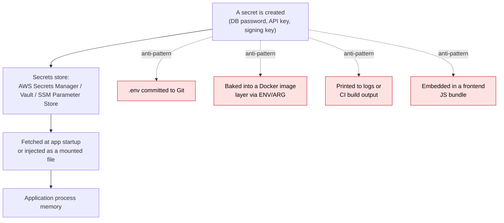
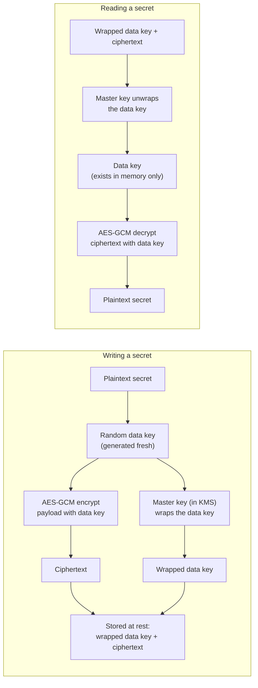
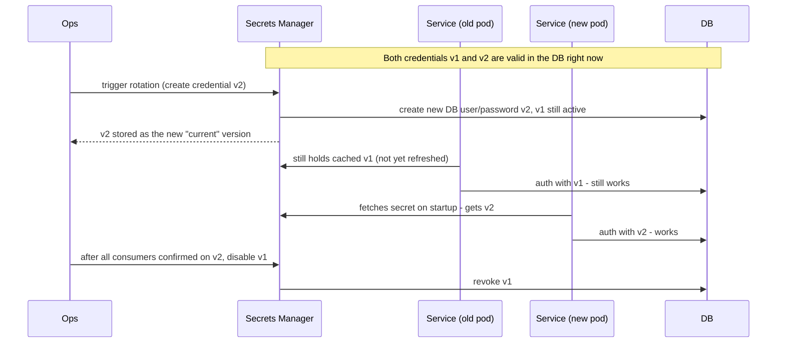

# Secrets Management

> [!summary] TL;DR
> A secret (a password, API key, signing key or certificate) must exist in exactly one authoritative, access-controlled place, never in source code, logs or container images, and must be rotatable without a deploy. The two standing problems are *where does it live* (a secrets manager or Vault, not an env file) and *what happens when it leaks anyway* (revoke, rotate, audit — in that order, fast).

> [!abstract] Core idea
> - A secret committed to Git, baked into an image layer, or printed to a log is compromised the moment it's written, whether or not anyone has read it yet — git history and image layers don't forget.
> - Envelope encryption (a data key encrypts the payload, a master key in a KMS encrypts only the data key) is how secrets managers protect data at rest without ever handing out the master key itself.
> - Rotation without downtime needs two active credentials at once — the old one keeps working until every consumer has picked up the new one.
> - The strongest fix for "a service needs a secret" is often to need no long-lived secret at all: workload identity (IRSA, GitHub OIDC) lets a service assume a cloud role instead of holding a credential.

## 1. Why it exists

A production incident, reconstructed from common cases: a developer debugging a flaky integration adds `fmt.Println(cfg)` to print the loaded config, ships it, and the log line includes the database password because the config struct has no `json:"-"` tag hiding it. The log is shipped to a log aggregator that a wider team has read access to than the database itself. Separately, a `.env` file with a staging AWS key was committed "temporarily" eight months ago and never removed — `git log -p` still shows it in the history even though the file was deleted in a later commit, because Git preserves every version it has ever seen.

Neither path required a sophisticated attacker. Both are "a secret existed somewhere it shouldn't have, for however briefly," and in both cases the fix only starts after the leak: revoke the credential, issue a new one, and audit what it was used for while it was exposed. Secrets management is the set of practices that make the *leak path* narrow (so secrets rarely end up in Git, logs or images in the first place) and the *response path* fast (so a leak that happens anyway is cheap to close).

## 2. Mental model

A secret is like a house key: it should exist in as few physical copies as possible, each copy should be traceable to who holds it, and if one copy goes missing you change the lock rather than hoping the missing key is never found. A secrets manager is the key safe: it hands out a key only to an identity that's allowed to have one, logs every time it does so, and lets you swap the lock (rotate) without reprinting the house's address on every door.

## 3. How it works

### Where a secret should and shouldn't live



Every anti-pattern on the right shares one trait: the secret ends up somewhere with a *much wider audience* than the one process that needs it — anyone with repo clone access, anyone who can `docker history` the image, anyone with log-read access, anyone who opens dev tools on the website. The store on the left is built around narrowing that audience to exactly the identities that need the secret, with every access logged.

A specific, frequently missed layer: `docker history --no-trunc` reveals every `ENV`/`ARG`/`RUN` value baked into an image, even from a layer a later `RUN rm` tried to delete — the earlier layer is still in the image. The fix is BuildKit's `--mount=type=secret`, which makes a secret available to a single `RUN` step's filesystem without ever writing it into a layer.

### Env vars vs mounted files vs runtime fetch

Once a secret has reached the one process that needs it, there are still three different ways to hand it that value, with different exposure:

- **Environment variable.** The simplest to wire up, and the most commonly recommended default, but it has one sharp edge: on Linux, anything with permission to read `/proc/<pid>/environ` for that process — a co-located debugging tool, a crash/core-dump collector that captures the environment block, or another process in the same container/namespace after a container-escape bug — can read every environment variable the process was started with, for its entire lifetime. A child process also inherits the full parent environment by default unless the code explicitly strips it, so a secret meant for one service can leak into a logging shim or a subprocess it shells out to.
- **Mounted file (e.g. a `tmpfs` volume populated by Vault Agent, the AWS Secrets Manager/SSM CSI driver, or an External Secrets sync).** Narrows exposure to filesystem permissions on that one path rather than every reader of `/proc/<pid>/environ`, and a file can be rotated in place without restarting the process, which an environment variable cannot (env vars are fixed at process start). The trade-off is extra moving parts: something has to keep the file in sync with the store.
- **Runtime fetch (the app calls the secrets manager/Vault directly, on startup or per-request, instead of reading from its own environment or filesystem).** Keeps the secret out of both the process environment and disk entirely, and lets the app pick up a rotated value without a restart or a file-sync sidecar, at the cost of making the secrets manager a runtime dependency — if it's unreachable, the app can't start or refresh.

None of the three eliminates risk; they trade *where* the narrowest remaining exposure is. A mounted file or runtime fetch is the stronger default for anything handling a high-value secret; an environment variable is a reasonable choice for lower-sensitivity config where the operational simplicity is worth the `/proc` exposure.

### Envelope encryption

Secrets managers don't encrypt every stored secret directly with one master key — that would mean every decrypt call needs the master key material available, and rotating the master key means re-encrypting everything it has ever touched. Instead they use **envelope encryption**: generate a random, one-time **data key** for the payload, encrypt the payload with it, then encrypt (*wrap*) only that small data key with the **master key**, which usually lives inside a dedicated key-management service (KMS) and never leaves it in plaintext.



Only the small, fixed-size wrapped data key ever needs the master key to touch it; the bulk payload is encrypted with a key that exists in memory for the duration of one operation. Rotating the master key only means re-wrapping data keys (cheap), not re-encrypting every payload (expensive). This is exactly what AWS KMS `GenerateDataKey`, Vault's `transit` engine, and Google Cloud KMS's envelope-encryption pattern do; the Go example below reproduces the mechanism locally so it can be tested without a live KMS.

### Rotation without downtime



The key invariant: **two credentials are valid at once** for an overlap window. A rotation that immediately invalidates the old credential will break every process still holding a cached copy — which, with no coordination mechanism, is every long-running process until its next restart. AWS Secrets Manager's built-in rotation Lambda follows exactly this create-new → test → mark-current → (later) delete-old sequence; Vault's dynamic database credentials sidestep the problem differently, by generating a short-lived, unique credential per consumer with a lease, so there's no single shared secret to rotate at all — each lease simply expires.

## 4. Worked example

### Whiteboard version

AES-GCM twice: once to encrypt the real secret with a random data key, once to wrap that data key with a longer-lived master key. Store only the wrapped key and the ciphertext; the data key itself never touches disk.

### Go: envelope encryption, tested end to end

Compiles and passes `go vet` and `go test -race` on Go 1.24. This reproduces the KMS envelope-encryption pattern locally — `MasterKey` stands in for a KMS customer master key, and in a real deployment the wrap/unwrap calls would be a network round trip to KMS instead of a local AES call, with the master key material never leaving KMS at all.

```go
// Package envelope demonstrates envelope encryption: a random per-secret
// data key encrypts the payload, and a separate, rarely-rotated master key
// (standing in for a KMS key) encrypts only the data key. This mirrors what
// AWS KMS GenerateDataKey / Vault transit do; no network calls are made.
package envelope

import (
	"crypto/aes"
	"crypto/cipher"
	"crypto/rand"
	"errors"
	"fmt"
)

var ErrDecrypt = errors.New("envelope: decryption failed")

// MasterKey stands in for a KMS customer master key (CMK). In production
// this call is a KMS Encrypt/Decrypt API round trip; the raw key material
// never leaves KMS. keyVersion lets old ciphertexts decrypt during rotation.
type MasterKey struct {
	version int
	key     [32]byte // AES-256 key
}

func NewMasterKey(version int, key [32]byte) MasterKey {
	return MasterKey{version: version, key: key}
}

// Sealed is what gets stored at rest: the encrypted data key plus the
// encrypted payload. Only this ever touches disk or a database row.
type Sealed struct {
	MasterKeyVersion int
	WrappedDataKey   []byte // data key, encrypted under the master key
	Nonce            []byte
	Ciphertext       []byte // plaintext, encrypted under the (unwrapped) data key
}

// Seal generates a fresh data key, encrypts plaintext with it, then wraps
// the data key with mk. The data key exists in memory only for this call.
func Seal(mk MasterKey, plaintext []byte) (Sealed, error) {
	var dataKey [32]byte
	if _, err := rand.Read(dataKey[:]); err != nil {
		return Sealed{}, fmt.Errorf("generate data key: %w", err)
	}

	ciphertext, nonce, err := aesGCMEncrypt(dataKey[:], plaintext)
	if err != nil {
		return Sealed{}, fmt.Errorf("encrypt payload: %w", err)
	}

	wrapped, wrapNonce, err := aesGCMEncrypt(mk.key[:], dataKey[:])
	if err != nil {
		return Sealed{}, fmt.Errorf("wrap data key: %w", err)
	}
	// Prefix the wrap nonce so Open can unwrap without a second stored field.
	wrapped = append(wrapNonce, wrapped...)

	return Sealed{
		MasterKeyVersion: mk.version,
		WrappedDataKey:   wrapped,
		Nonce:            nonce,
		Ciphertext:       ciphertext,
	}, nil
}

// Open unwraps the data key with mk, then decrypts the payload. mk must be
// the version that sealed this record; a rotation-aware caller keeps the
// last few master key versions available for exactly this lookup.
func Open(mk MasterKey, s Sealed) ([]byte, error) {
	if s.MasterKeyVersion != mk.version {
		return nil, fmt.Errorf("%w: sealed with master key v%d, have v%d", ErrDecrypt, s.MasterKeyVersion, mk.version)
	}
	if len(s.WrappedDataKey) < 12 {
		return nil, ErrDecrypt
	}
	wrapNonce, wrapped := s.WrappedDataKey[:12], s.WrappedDataKey[12:]
	dataKey, err := aesGCMDecrypt(mk.key[:], wrapNonce, wrapped)
	if err != nil {
		return nil, fmt.Errorf("%w: unwrap data key: %v", ErrDecrypt, err)
	}

	plaintext, err := aesGCMDecrypt(dataKey, s.Nonce, s.Ciphertext)
	if err != nil {
		return nil, fmt.Errorf("%w: decrypt payload: %v", ErrDecrypt, err)
	}
	return plaintext, nil
}

func aesGCMEncrypt(key, plaintext []byte) (ciphertext, nonce []byte, err error) {
	block, err := aes.NewCipher(key)
	if err != nil {
		return nil, nil, err
	}
	gcm, err := cipher.NewGCM(block)
	if err != nil {
		return nil, nil, err
	}
	nonce = make([]byte, gcm.NonceSize())
	if _, err := rand.Read(nonce); err != nil {
		return nil, nil, err
	}
	return gcm.Seal(nil, nonce, plaintext, nil), nonce, nil
}

func aesGCMDecrypt(key, nonce, ciphertext []byte) ([]byte, error) {
	block, err := aes.NewCipher(key)
	if err != nil {
		return nil, err
	}
	gcm, err := cipher.NewGCM(block)
	if err != nil {
		return nil, err
	}
	return gcm.Open(nil, nonce, ciphertext, nil)
}
```

```go
package envelope

import (
	"bytes"
	"testing"
)

func TestSealOpenRoundTrip(t *testing.T) {
	var key [32]byte
	copy(key[:], []byte("this-is-a-32-byte-master-key!!!"))
	mk := NewMasterKey(1, key)

	plaintext := []byte("db-password-super-secret")
	sealed, err := Seal(mk, plaintext)
	if err != nil {
		t.Fatalf("Seal: %v", err)
	}
	if bytes.Contains(sealed.Ciphertext, plaintext) {
		t.Fatal("ciphertext contains the plaintext verbatim")
	}

	got, err := Open(mk, sealed)
	if err != nil {
		t.Fatalf("Open: %v", err)
	}
	if !bytes.Equal(got, plaintext) {
		t.Fatalf("got %q, want %q", got, plaintext)
	}
}

func TestOpenFailsAfterMasterKeyRotationWithoutOldVersion(t *testing.T) {
	var keyV1 [32]byte
	copy(keyV1[:], []byte("this-is-a-32-byte-master-key!!!"))
	mkV1 := NewMasterKey(1, keyV1)

	sealed, err := Seal(mkV1, []byte("secret"))
	if err != nil {
		t.Fatalf("Seal: %v", err)
	}

	var keyV2 [32]byte
	copy(keyV2[:], []byte("a-different-32-byte-master-key!"))
	mkV2 := NewMasterKey(2, keyV2)

	if _, err := Open(mkV2, sealed); err == nil {
		t.Fatal("expected Open to fail with the wrong master key version")
	}
	// The rotation-aware path: keep v1 available and it still opens.
	if _, err := Open(mkV1, sealed); err != nil {
		t.Fatalf("Open with the correct master key version should succeed: %v", err)
	}
}

func TestOpenFailsOnTamperedCiphertext(t *testing.T) {
	var key [32]byte
	copy(key[:], []byte("this-is-a-32-byte-master-key!!!"))
	mk := NewMasterKey(1, key)

	sealed, err := Seal(mk, []byte("secret"))
	if err != nil {
		t.Fatalf("Seal: %v", err)
	}
	sealed.Ciphertext[0] ^= 0xFF

	if _, err := Open(mk, sealed); err == nil {
		t.Fatal("expected Open to fail on tampered ciphertext")
	}
}
```

**Measured:** `go test -race ./envelope/...` on Go 1.24.4: 3/3 tests pass — the round trip recovers the exact plaintext without it ever appearing in the ciphertext, decryption fails cleanly when the wrong master-key version is used (simulating a rotation where the old version wasn't kept available), and tampering with even one ciphertext byte is detected by AES-GCM's authentication tag rather than silently returning corrupted data.

## 5. Variants and comparison

| Store | Model | Rotation | Use when |
| --- | --- | --- | --- |
| AWS Secrets Manager | Encrypted blob per secret, versioned, with built-in rotation Lambdas for RDS/common databases | Automated, scheduled, create-new → test → promote | AWS-native apps needing managed rotation with minimal custom code |
| AWS SSM Parameter Store | Simple key-value, `SecureString` type uses KMS | Manual or custom automation | Config + a few secrets, lower cost, no built-in rotation workflow |
| HashiCorp Vault | Pluggable secrets engines; can issue **dynamic**, per-request credentials with a TTL instead of storing a static secret at all | Dynamic secrets expire on their own; static secrets rotated via API/automation | Multi-cloud, short-lived per-consumer credentials, fine-grained policy (Vault's own access-control language) |
| Kubernetes Secrets (native) | Base64-encoded values in etcd — **not encrypted** by default | Manual; no built-in rotation | Only with encryption at rest enabled and paired with External Secrets Operator or Sealed Secrets; base64 alone is not protection |
| Workload identity (ECS task roles, IRSA on EKS, GitHub OIDC → AWS, GCP Workload Identity Federation) | No long-lived secret at all — the workload's platform identity is exchanged for short-lived cloud credentials | N/A — nothing to rotate | Any workload-to-cloud-API call; strictly preferred over a stored credential when available |

> [!warning] Interview trap
> A raw Kubernetes `Secret` is base64-*encoded*, not encrypted. Anyone with `get secrets` RBAC access or etcd access can decode it trivially. It needs encryption at rest configured on the cluster, and is usually paired with an operator (External Secrets, Sealed Secrets) that syncs from a real secrets manager rather than storing the authoritative copy in Kubernetes itself.

## 6. Trade-offs and when not to use

- Dynamic, per-request credentials (Vault-style) eliminate rotation as a concept but add a dependency: if Vault is unreachable, new leases can't be issued, so the blast radius of a Vault outage is wider than one static secret failing to rotate on schedule.
- Workload identity removes the secret-storage problem entirely but only works where the cloud and the workload's identity provider both support it — it doesn't help a third-party SaaS API that only accepts a static API key.
- Short credential lifetimes shrink the leak window but increase load on the secrets manager and add a failure mode (a service that can't refresh in time gets `401`s) that a long-lived credential doesn't have; pick a lifetime the service's retry/backoff logic can tolerate.
- For a single local development script, a short-lived `.env.local` that is `.gitignore`d is a reasonable trade-off — the failure mode to prevent is that file reaching a shared repo or a shared machine, not the existence of a local file at all.

## 7. In production

- **Real systems:** AWS Secrets Manager rotates RDS/Redshift/DocumentDB credentials out of the box; HashiCorp Vault's dynamic database secrets engine issues a unique, time-boxed credential per application instance; GitHub Actions' OIDC-to-AWS integration lets a CI job assume an AWS role with zero stored AWS keys in the repository at all.
- **Failure modes → fixes:**
  - A secret is committed to Git → revoke/rotate the credential immediately (treat the commit as compromised regardless of whether the repo is private — history persists even after `git rm`), then clean history if the repo must stay public, and add `gitleaks`/GitHub push protection to catch the next one before merge.
  - A secret appears in application logs → fix the logging code (exclude the field, mask it), rotate the leaked value, and audit log-retention/access to estimate exposure.
  - A rotation breaks a consumer that cached the old credential and didn't expect it to stop working → always keep the old version valid for an overlap window, and alert on auth-failure rate spikes right after a rotation so a bad rollout is caught in minutes, not hours.
  - A Kubernetes Secret is readable by far more service accounts than intended → tighten RBAC on `get`/`list` for secrets, and move the authoritative copy to a real secrets manager with an operator sync.
- **What to monitor:** failed authentication rate right after a rotation, age of the oldest active credential per secret (flag anything past its rotation SLA), secrets-manager access logs for an identity reading a secret it's never read before, and CI/scanner alerts (gitleaks, push protection) as a leading indicator rather than waiting for an incident.

## 8. Deep dive

- **Why envelope encryption instead of encrypting directly with the master key.** If every secret were encrypted directly with the master key, decrypting *anything* requires the master key material to be available to the decrypting process — which either means distributing it widely (defeating the point) or routing every decrypt through the KMS as a live network call carrying the full payload. Envelope encryption routes only the small, fixed-size data key through the KMS; the (potentially large) payload is encrypted locally with a key that exists only for the duration of one operation and is never persisted in plaintext.
- **Key rotation vs. secret rotation are two different operations.** Rotating the *master key* (the KMS key) only requires re-wrapping existing data keys — cheap, and AWS KMS supports this transparently by keeping old key material available for decrypt while a new key version handles new wraps. Rotating a *secret itself* (a database password) requires coordinating with every consumer of that secret, which is the harder, application-level problem the overlap-window sequence above addresses.
- **Dynamic secrets change the leak-response calculus.** A static secret that leaks is valid until someone notices and revokes it. A Vault dynamic database credential with a 1-hour lease is only useful to an attacker for, at most, that hour — the response process (revoke → rotate → audit) still applies, but the window it's limiting is already small by design, which is why Vault documentation treats dynamic secrets as a security control in their own right, not just an operational convenience.
- **Workload identity removes an entire class of risk**, not just a leak-response cost: an ECS task role, IAM Roles for Service Accounts (IRSA) on EKS, and GitHub's OIDC-to-cloud integration all mean the workload authenticates as itself (via a signed, short-lived token or the platform's own instance/task metadata, rather than a credential anyone had to generate and store) and the cloud provider hands back temporary credentials — there is no standing secret for `gitleaks` to find, no rotation schedule to maintain, and no static credential that outlives the workload that needed it.
- **The order of leak response matters: revoke before rotate before audit.** Revoking first stops the credential from being usable the instant it's flagged, even before a replacement exists (accepting brief service disruption over continued exposure); rotating issues the replacement; auditing (what did this credential touch while it was live) comes last because it doesn't need to block service recovery, but it determines whether downstream systems also need a response.

## 9. Interview questions

> [!question]- Why does AWS KMS use envelope encryption instead of encrypting data directly with the master key?
> The master key's raw material never needs to leave KMS: only the small data key is sent to KMS to be wrapped/unwrapped, while the (potentially large) payload is encrypted locally with that data key. This keeps the expensive or sensitive operation (touching the master key) to a small, fixed-size value, and means re-encrypting everything on master-key rotation is replaced by re-wrapping small data keys.

> [!question]- How do you rotate a database credential used by a fleet of long-running services with zero downtime?
> Create the new credential while the old one is still active, update the secrets manager's "current" pointer, and let each service instance pick up the new credential on its own refresh cycle (cached-with-TTL or triggered reload) — then only revoke the old credential once monitoring confirms no instance is still authenticating with it. Skipping the overlap window breaks every instance that hasn't refreshed yet.

> [!question]- Trap: "We base64-encode secrets before storing them in Kubernetes, so they're encrypted." What's wrong with this claim?
> Base64 is an encoding, not encryption — it's trivially reversible with no key at all. A native Kubernetes Secret is only as protected as RBAC access to it and whether the cluster has encryption at rest enabled for etcd; neither is base64. Production setups pair it with cluster-level encryption at rest and usually sync the authoritative secret from a real secrets manager via an operator.

> [!question]- A secret was just committed and pushed to a private GitHub repo, then deleted in the next commit. Is the team safe?
> No. Git preserves every version of a file in its history; `git rm` only removes it from the latest tree, not from history, and anyone who already cloned or fetched the repo has the old commit locally regardless. The credential must be treated as compromised and rotated immediately; history can be rewritten/purged separately, but that doesn't undo exposure to anyone who already has it.

> [!question]- What does Vault's "dynamic secrets" model change about the rotation problem?
> Instead of one shared, long-lived secret that every consumer uses and that must be rotated in coordination with all of them, Vault issues a unique, short-lived credential per consumer on request, backed by a lease. There's no shared secret to rotate — each lease simply expires (or can be revoked individually) — which shrinks both the coordination problem and the blast radius of any single leaked credential.

> [!question]- When is workload identity (IRSA, GitHub OIDC-to-cloud) strictly better than a stored secret, and when can't you use it?
> It's strictly better whenever the workload and the target API are both within a cloud/identity ecosystem that supports federating the workload's own platform identity into temporary credentials — there's no standing secret to leak, store, or rotate at all. It doesn't apply when the target is a third-party SaaS API that only accepts a static API key with no federation support; that case still needs full secrets-manager treatment.

## 10. Cheat sheet

- A secret lives in exactly one authoritative store (Secrets Manager, Vault, SSM) — never in Git, image layers, logs, or frontend bundles.
- Envelope encryption: a one-time data key encrypts the payload; a master key in a KMS only ever wraps/unwraps the small data key.
- Rotation needs an overlap window — two valid credentials at once — or every cached consumer breaks the moment the old one is revoked.
- Dynamic, per-consumer credentials (Vault leases) remove the "shared secret to rotate" problem by expiring instead.
- Workload identity (IRSA, GitHub OIDC) is strictly preferred over a stored credential wherever the platform supports it — no secret, no rotation, no leak surface.
- A Kubernetes Secret's base64 is encoding, not encryption; it needs cluster encryption at rest plus RBAC, usually synced from a real store.
- Leak response order: revoke, then rotate, then audit — stop the exposure before you investigate it.
- `docker history --no-trunc` and `git log -p` both reveal values from earlier layers/commits even after a later one "removes" them.

## Links

- **Before this:** [[OWASP API Security Top 10]]
- **Next:** [[OAuth 2.0 and OpenID Connect]], [[Service-to-Service Auth - API Keys, HMAC, mTLS]]
- **Compare with:** [[OAuth 2.0 and OpenID Connect]] (tokens as a different kind of credential, with their own rotation story), [[CSRF, XSS and Security Headers]] (protecting a session secret in the browser rather than a backend secret at rest)
