# Security Incident Response - When Your Website Is Hacked

> [!summary] TL;DR
> When a site is compromised, do not start by deleting things. Confirm the breach, contain it to stop the damage, preserve evidence, find how the attacker got in, remove all their access, rebuild from clean sources, notify who the law requires, then fix the root cause. The order matters: a rushed clean-up destroys the evidence you need and usually leaves a backdoor behind.

> [!abstract] Core idea
> - Treat a suspected hack as an incident with phases: detect, contain, preserve, investigate, eradicate, recover, notify, learn.
> - Contain first, but snapshot before you change anything, because disks and memory hold the proof.
> - Assume every credential the attacker could have touched is burned and rotate it.
> - You are not finished when the site looks normal. You are finished when you know how they got in and that door is closed.
> - Never reuse the compromised machine. Rebuild from a known-good image and restore data from a backup older than the intrusion.

## Start here: the basics 🟢

> [!info] How to read this note (pick your level)
> - 🟢 **New to this?** Read "From zero" below, then sections 1, 2 and 10 (why, mental model and the cheat sheet). Stop there, that is a full first pass.
> - 🟡 **Know the basics?** Add sections 3, 4, 5 and 6 (how it works, a worked example, options and trade-offs).
> - 🔴 **Interview / SDE-3 prep?** Add sections 7, 8 and 9 (production, deep dive and interview questions). Headings are tagged 🟢🟡🔴 so you always know where you are.

> [!note] Before this note
> - [[Authentication vs Authorization]]: attackers usually win by getting someone's identity (a password, key or session) and then doing what that identity is allowed to do.
> - [[Incident Response]]: outages are handled with a fixed playbook (declare, assign an incident commander, communicate, fix, review); a security incident uses the same habits plus evidence and legal steps.

**From zero, in 60 seconds** 🟢

Your site has been hacked. The natural reaction is to delete the bad stuff fast. Don't.
Rushing wipes out the clues and usually leaves a hidden way back in (a **backdoor**).
Instead, follow a fixed order, like firefighters do.

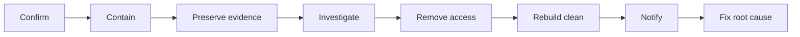

First stop the damage without destroying evidence. Then find out how they got in.
Then remove every way back, rebuild from clean sources, and tell the people the law says you must tell.

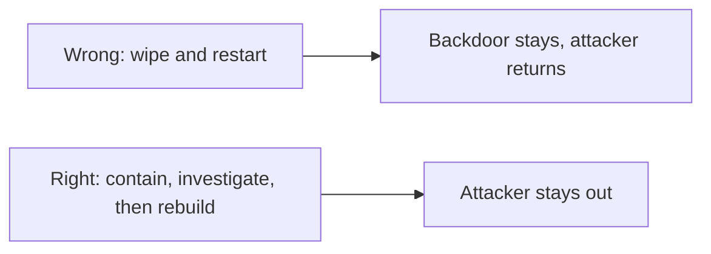

The rest of this note is just these 3 questions:
1. What are the steps, in order, and why that order?
2. How do you find out what the attacker did?
3. When and whom must you notify?


**The problem in one story.**
One morning your site shows a strange page, or users report unknown charges.
Panicking and wiping the server destroys the evidence of how the attacker got in.
Leaving it running lets them keep stealing.
Incident response is the calm, ordered plan for exactly this moment.

**Words you need first**

| Word | Plain meaning | Tiny example |
| --- | --- | --- |
| Incident | A security event that actually harms or threatens the system | Attacker reading the users table |
| Containment | Stopping the damage from spreading without destroying evidence | Blocking an IP, isolating a server |
| Eradication | Removing the attacker's access and the hole they used | Patching the bug, deleting a backdoor |
| Recovery | Bringing clean systems back into service | Redeploying from a known-good image |
| Indicator of compromise (IOC) | A clue that shows an attack happened | Unknown admin account, odd outbound IP |
| Forensics | Collecting and preserving evidence to learn what happened | Snapshotting a disk before rebuild |
| Postmortem | A blameless write-up of cause and fixes | "Root cause: leaked key in CI log" |
| Web shell | A small script the attacker uploads to your server so they can run commands through a web page | `/uploads/img_cache.php?cmd=ls` |
| Persistence | Hidden ways the attacker set up to get back in later | Extra SSH key, cron job, admin user |
| Exfiltration | Copying data out of your systems to the attacker | Dumping the customers table to their server |
| Dwell time | How long the attacker was inside before you noticed | 14 days |
| Security group | A cloud firewall rule list attached to a server | "allow only the forensic host" |
| Chain of custody | A written log of who copied which evidence, when, so it holds up legally | "10:02 Asha snapshotted vol-123" |
| IaC | Infrastructure as code: servers described in files, so you can rebuild them exactly | Terraform, container images |

**Picture it**

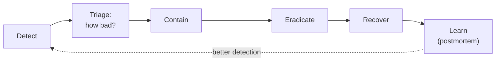

**Analogy.** A kitchen fire. Get people out and stop it spreading (contain), put it out at the source (eradicate), check the wiring before cooking again (recover), then figure out why it started (learn).
Where it breaks: a fire does not fight back; an attacker may still be inside and watching, so you must act quietly and assume every credential is known.

**How the rest of this note builds up**

- First, why it exists (section 1) and the mental model (section 2).
- Then the response phases step by step (section 3) and a walked-through breach (section 4).
- Then how response differs by attack type (section 5).
- Finally the SDE-3 deep dive: evidence handling, credential rotation at scale, disclosure duties and the deeper forensics (sections 6-8), then interview questions and a cheat sheet.

> [!tip] Remember
> Contain first, preserve evidence, rotate everything the attacker could have seen, then learn.

## 1. Why it exists 🟢

Picture a shop owner who arrives to find the back window broken. If they sweep up the glass, repaint, and reopen, the police find no fingerprints, the thief still has a copy of the keys, and the owner never learns what was stolen.

The same thing happens to websites every day: someone sees a defaced page, restores it from a backup, and carries on, while the attacker still has a web shell (an uploaded script that lets them run commands through a web page), a stolen database password and a hidden admin account.

A concrete scenario. An online store with 200,000 customers notices three signs in one morning: a spike in outbound traffic at 03:10 UTC, a customer complaint about a strange redirect to a pharmacy site, and an unfamiliar admin user created two days ago.

Each sign alone could be a glitch. Together they indicate compromise. The team has to answer five questions fast: how did they get in, what did they touch, are they still in, what data left, and who must we tell and by when.

This note is the playbook for those hours. It is a response guide; preventing the incident in the first place is covered in [[Website Security Hardening Checklist]].

> [!tip] Remember
> A hacked site is a crime scene first and a broken site second.

### Real-life example: strange orders on a shopping app 🟢

Imagine a shopping app like Flipkart or Myntra gets a flood of complaints one morning: "my saved address changed" and "I got an order confirmation I never placed". A careless team would reset the database and move on. A prepared team declares a security incident, keeps the affected servers running but cut off, copies the logs, and discovers a leaked admin password let someone change addresses. They lock that account, rotate every admin password and key, check which customers were touched, tell those customers and the regulator within the legal deadline, and add MFA for all admins so it cannot happen the same way again.

### Security incident vs a normal outage 🟡

| | Normal outage | Security incident |
| --- | --- | --- |
| Main goal | Get the service back fast | Stop the attacker, then get back safely |
| Restart / wipe the server? | Often fine | Not before you snapshot it (evidence) |
| Who is involved | On-call engineers | Engineers + security + legal + leadership |
| Deadlines from law | Usually none | Often yes (GDPR 72 hours, CERT-In 6 hours) |
| Done when | Service is healthy | The way in is closed and every credential is rotated |

## 2. Mental model 🟢

Think of a fire brigade, not a handyman. Firefighters do not start by repainting. They arrive, size up the fire (confirm and scope), stop it spreading (contain), protect evidence for the investigator (preserve), put out hidden embers (eradicate), and only then let people back in (recover). Afterwards the fire marshal finds the cause so it cannot happen again (post-incident review).

The analogy breaks in one way: a fire stops on its own once the fuel is gone, but an attacker can come back through a door you did not find. That is why "eradicate" is about finding every door, not only the one you saw.

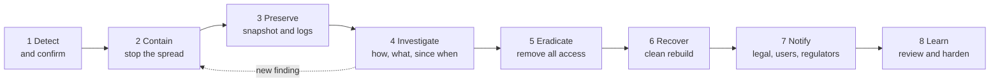

The dotted arrow is important: investigation often reveals more compromised hosts, which sends you back to containment.

## Common beginner mistakes 🟢

- **Wiping the server right away** → the clues about how they got in are gone and the hole stays open → snapshot and copy logs first, then rebuild.
- **Rotating passwords before cutting the attacker off** → if they still control a server, they read the new password too → isolate first, then rotate.
- **Powering off the hacked server** → running processes and keys in memory vanish → isolate it from the network but keep it running.
- **Restoring the newest backup** → it may already contain the backdoor → restore from a backup older than the first sign of attack.
- **Talking about it on the normal company chat or email** → that may be compromised too → use a separate channel, like a phone bridge.

## 3. How it works 🟡

> 🟢 → 🟡 **You now know** the fixed order (detect, contain, preserve, investigate, eradicate, recover, notify, learn) and why rushing hurts. **Next we open the box**: what each phase looks like in practice, with the real commands and checks engineers run.

### 3.1 Detect and confirm

In plain words: you need to decide whether this is a real compromise, a bug, or a false alarm, and how big it is. Do this in minutes, not hours, but do not declare "all clear" from one clean check.

**Step by step:**
1. 03:10 an alert fires: outbound traffic from one web server is 40 times normal.
2. The on-call engineer looks for a second, independent sign: a process run by the web user is talking to an unknown IP.
3. Two signs together → declare a security incident and name an incident commander.
4. Open a private channel the attacker cannot see, like a phone bridge, in case chat or email is also hacked.
5. Start containment now; keep confirming the scope in parallel.

Common detection sources:

| Source | What it looks like |
| --- | --- |
| Monitoring or alerts | Sudden CPU spike (crypto miner), outbound traffic spike, new process |
| Users or customers | "Your site redirected me", spam from your domain, account takeovers |
| Security tools | WAF block spike, IDS (intrusion detection system: a tool that watches for attack patterns) alert, dependency scanner, cloud threat detection |
| External | Google Safe Browsing warning, hosting provider abuse notice, a researcher's email, ransom note |
| Audit logs | Login from a new country, new IAM user, disabled logging |

Confirm with two independent signals before declaring a breach, but start containment at the first strong signal. A false alarm costs minutes; a real breach left running costs data.

Declare an incident, assign an incident commander, and open a private channel (not the possibly compromised chat or email). If email or SSO (single sign-on: one company login for all tools) might be compromised, use an out-of-band channel (a separate route the attacker does not control) such as a phone bridge.

### 3.2 Contain

In plain words: stop the attacker from doing more damage while keeping the evidence. Containment is about reducing blast radius, not cleaning up.

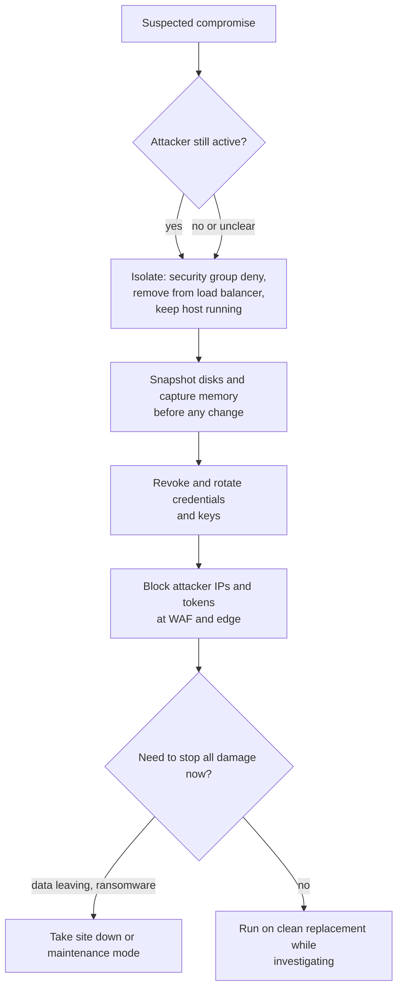

Containment actions, in typical order:

1. **Isolate, do not power off.** Remove the host from the load balancer and apply a deny-all security group that keeps only your forensic access. Powering off loses memory contents (running processes, network connections, keys in RAM).
   Note: security groups are stateful, so a connection that is already established (such as a reverse shell, where the hacked server calls out to the attacker and takes commands) can stay open after you change the group. Kill it by also using a network ACL, or by terminating the connection on the host (for example `ss -K` or `tcpkill`), or by detaching the network interface.
2. **Snapshot before you change anything.** Take a disk snapshot (for example an EBS snapshot, a point-in-time copy of an AWS disk) and, if you can, a memory image. This is your forensic copy.
3. **Revoke and rotate credentials.** Cloud access keys, database passwords, API keys, session signing secrets, CI tokens, SSH keys. Invalidate all user sessions if session theft is possible. See [[Secrets Management]].
4. **Block at the edge.** Add attacker IPs, user agents or paths to the WAF. Treat this as a speed bump only, since attackers change IPs.
5. **Decide on downtime.** If data is actively leaving or ransomware is spreading, take the site down or show a maintenance page. A few hours of downtime is cheaper than a larger breach.

> [!warning] Common mistake
> Rotating credentials before isolating. If the attacker still controls a host, they simply read the new secret. Isolate first, then rotate.

Rotation in AWS, as an example:

```bash
# list and disable a possibly leaked access key (do not delete yet; keep for the audit trail)
aws iam list-access-keys --user-name deploy-bot
aws iam update-access-key --user-name deploy-bot --access-key-id AKIAEXAMPLE --status Inactive
# create a new key for the legitimate use after the environment is clean
aws iam create-access-key --user-name deploy-bot
```

### 3.3 Preserve evidence

In plain words: copy the logs and disks somewhere the attacker cannot reach, before they are overwritten or deleted. Attackers often clear logs, and normal log rotation will eventually erase them.

**Step by step:**
1. Take a snapshot of `web-2`'s disk and, if possible, a copy of its memory.
2. Copy web, login, database and cloud audit logs into write-once storage that nobody can edit or delete.
3. Compute a SHA-256 fingerprint of each copied file and write it down.
4. Note who copied what and when (the chain of custody).
5. Do all later analysis on copies mounted read-only on a separate machine, never on the original.

| Evidence | How to preserve | Why |
| --- | --- | --- |
| Disk | Snapshot the volume; mount a copy read-only on a separate analysis host | Files, web shells, timestamps |
| Memory | Capture with a tool such as LiME (Linux) | Live processes, injected code, network sockets |
| Logs | Copy web, auth, database, cloud audit logs to write-once storage | Timeline and scope |
| Network | Flow logs, proxy logs, packet capture if available | What left and where it went |
| Config | Export current WAF, IAM, security group and DNS state | Shows attacker changes |

Record a hash of each artifact and a chain of custody note (who copied what, when). If lawyers or police may be involved, this keeps the evidence usable.

```bash
sha256sum auth.log access.log.1 > evidence-hashes.txt
```

Keep working on copies, never on the original evidence.

### 3.4 Investigate

In plain words: reconstruct what the attacker did, in time order. You want the entry point, the actions taken, the data accessed, and the first moment of compromise (the start of the dwell time).

**Step by step:**
1. Web logs: find odd requests, e.g. `UNION SELECT` in `/search?q=` 14 days ago, then a `200` on a strange `.php` file in uploads.
2. Server: look for new users, new SSH keys, new cron jobs (scheduled commands) and files changed recently.
3. Network: look for long-lived connections from the web user to unknown IPs.
4. Cloud audit log: look for the server's cloud keys being used from an outside IP to copy storage buckets.
5. Put every finding on one timeline: entry → foothold → spread → data taken.

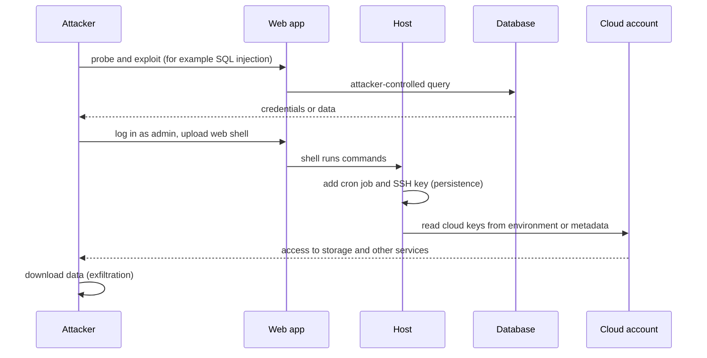

This is the typical chain. Your job is to find which links happened, using evidence from each layer.

Where to look, with commands. All are standard Linux and AWS CLI commands; adapt paths to your distribution.

**Web access logs: the entry point.**

```bash
# top requesting IPs
awk '{print $1}' /var/log/nginx/access.log | sort | uniq -c | sort -rn | head
# SQL injection probes
grep -Ei "union(\+|%20| )select|sleep\(|information_schema|or(\+|%20| )1=1" /var/log/nginx/access.log | head
# path traversal and shell access
grep -Ei "\.\./|/etc/passwd|cmd=|\.php\?.*=(http|ftp)" /var/log/nginx/access.log | head
# requests that returned 200 to suspicious upload-type files
grep -Ei "\.(php|jsp|aspx)" /var/log/nginx/access.log | grep " 200 " | grep -Ei "upload|uploads|tmp"
```

A line meaning: many 200 responses to the same odd file in an uploads directory is a strong sign of a web shell.

**Authentication and users.**

```bash
last -a | head -30                       # recent logins
lastb | head                             # failed logins (needs root, file may not exist)
grep -E "Accepted|Failed" /var/log/auth.log | tail -50   # Debian/Ubuntu; /var/log/secure on RHEL
awk -F: '$3 == 0 {print $1}' /etc/passwd # accounts with UID 0 should be only root
ls -la /home/*/.ssh/authorized_keys /root/.ssh/authorized_keys
```

New users, new `authorized_keys` entries or an extra UID 0 account are persistence.

**Persistence: cron, services, startup.**

```bash
crontab -l; ls -la /etc/cron.* /var/spool/cron/ 2>/dev/null
systemctl list-unit-files --state=enabled | head -50
ls -lat --time=ctime /etc/systemd/system | head   # newest change first (GNU ls)
```

**Changed files and web shells.**

```bash
# files modified in the last 7 days under the web root
find /var/www -type f -mtime -7 -printf '%TY-%Tm-%Td %TH:%TM %p\n' | sort | tail -50
# PHP files containing common web-shell functions
grep -RIlE "eval\(base64_decode|gzinflate\(base64|shell_exec\(|passthru\(|system\(\$_" /var/www
# executables in temp dirs
find /tmp /var/tmp /dev/shm -type f -perm -u+x 2>/dev/null
# verify package-managed files against the package database (Debian)
debsums -c 2>/dev/null | head
```

If the site is in git, compare the deployed tree with the repository: `git diff --stat` or `git status` on the deploy directory shows files the attacker changed.

**Processes and outbound network.**

```bash
ps auxf | head -50                                    # process tree
ss -tunap | grep ESTAB                                # established connections and owning process
lsof -i -P -n | grep -v LISTEN | head -30             # open network sockets
top -b -n1 | head -15                                 # unexplained CPU (miner)
```

A long-lived outbound connection from `www-data` to an unknown IP is a reverse shell or a command-and-control channel (the line the attacker uses to send orders to the hacked machine).

**Cloud audit trail (AWS).**

```bash
# who created users or keys since the suspected start (adjust the timestamp; lookup-events only takes ONE lookup attribute per call)
aws cloudtrail lookup-events --start-time 2026-11-01T00:00:00Z --lookup-attributes AttributeKey=EventName,AttributeValue=CreateUser --max-results 20
aws cloudtrail lookup-events --lookup-attributes AttributeKey=EventName,AttributeValue=CreateAccessKey --max-results 20
# console logins and failures
aws cloudtrail lookup-events --lookup-attributes AttributeKey=EventName,AttributeValue=ConsoleLogin --max-results 20
# was logging turned off?
aws cloudtrail lookup-events --lookup-attributes AttributeKey=EventName,AttributeValue=StopLogging --max-results 5
```

`lookup-events` covers about the last 90 days of management events, per region (repeat for each region, and check `us-east-1` for global services like IAM); for larger or longer searches use the CloudTrail logs in S3 (with Athena) as the source. Also check S3 data event logs and access logs for bulk downloads, and VPC Flow Logs for large outbound transfers.

**Database.**

```sql
-- PostgreSQL: who is connected right now and from where
SELECT usename, client_addr, state, query_start, left(query, 80)
FROM pg_stat_activity ORDER BY query_start;
-- new roles or privilege changes
SELECT rolname, rolsuper, rolcreaterole, rolcreatedb FROM pg_roles;
```

Look for odd roles, bulk `SELECT` on user tables, and large exports (`COPY ... TO`) in the database log if statement logging was enabled.

> [!tip] Remember
> Build a timeline: first malicious request, first foothold, first lateral move (jumping from the first hacked machine to others), first data access. Every later step needs a log line.

### 3.5 Eradicate

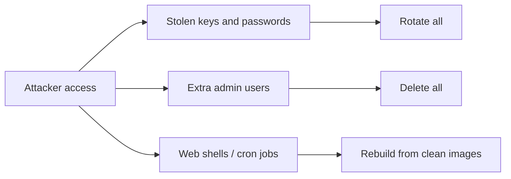

In plain words: remove every way the attacker could get back, not just the visible malware.

Checklist:

1. Remove web shells, rogue users, SSH keys, cron jobs, systemd units and unknown IAM users, roles and access keys.
2. Close the entry point: patch the vulnerable component, fix the injection, remove the leaked key from the repository and history.
3. Rotate every secret the attacker might have read, including database passwords, signing keys (JWT secrets), OAuth client secrets, third-party API keys and CI/CD secrets. See [[JWT - Structure, Validation and Pitfalls]] for why rotating signing keys invalidates tokens.
4. Reset passwords for admin accounts and, if user credentials were exposed, force resets for affected users. Check that stored hashes use a slow algorithm; see [[Password Storage and Login Security]].
5. Review third-party integrations and OAuth grants for malicious additions.

Because a compromised server cannot be trusted, the strongest eradication is to rebuild rather than clean.

### 3.6 Recover

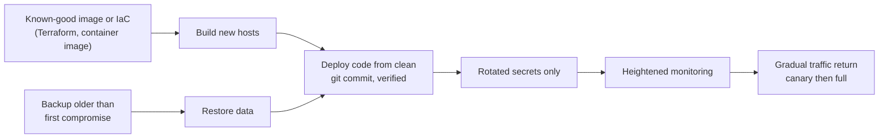

Steps:

1. Rebuild hosts from a clean image or infrastructure as code. Do not "clean in place".
2. Deploy code from a commit you have verified, using rotated secrets.
3. Restore data from a backup that predates the earliest compromise time you found. If you cannot know when it started, restore the oldest backup you can tolerate, then replay legitimate transactions from logs. See [[Backup, PITR and Disaster Recovery]].
4. Check the restored database for attacker-created rows (admin users, modified prices, injected script tags in content).
5. Bring traffic back gradually and watch closely for the same indicators. Attackers often return within hours if you missed a door.
6. Keep the temporary extra logging on for at least several weeks.

### 3.7 Notify

In plain words: some laws and contracts set deadlines. Involve legal counsel and your security or privacy officer early. The clock usually starts when you become aware of the breach, not when it is fully understood.

**Step by step:**
1. Write down the exact time you became reasonably sure personal data was touched, e.g. 04:10. Deadlines count from here.
2. Tell leadership and legal at once; agree who speaks outside the company.
3. Legal checks which rules apply: GDPR (72 hours to the regulator), CERT-In in India (6 hours), card brands if card data was involved.
4. File the first report on time, even if facts are incomplete, and update it later.
5. Send affected users a plain message: what happened, what data, what you did, what they should do.

| Who | When or rule | Notes |
| --- | --- | --- |
| Internal leadership, legal | Immediately | Decide who speaks externally |
| EU/UK data regulator (GDPR Art. 33) | Within 72 hours of becoming aware, where feasible, if the breach risks people's rights | Can be filed in phases; document reasons for delay |
| Affected individuals (GDPR Art. 34) | Without undue delay if high risk to them | Plain language: what happened, what data, what to do |
| CERT-In (India) | Within 6 hours of noticing certain cyber incidents (2022 directions) | Applies to service providers, intermediaries, and body corporates in India; confirm applicability with counsel |
| Payment card brands and acquiring bank | Per your merchant agreement and PCI DSS incident response plan, when card data may be involved | They may require a forensic investigator (PFI, a PCI-approved breach investigator) |
| Cloud or hosting provider | When their infrastructure or abuse reports are involved | May help with logs and takedown |
| Law enforcement | On advice of counsel, especially for extortion | Keep evidence intact |
| Business partners and customers | Per contract | Prepare a clear statement |

Different countries and US states have their own breach laws and deadlines. This table is a starting point, not legal advice.

A good user notification states: what happened, what information was involved, what you did, what users should do (change passwords, watch for phishing), and how to contact you.

### 3.8 Post-incident review and hardening

In plain words: once things are calm, write down what happened without blaming people, and turn each lesson into a fix with an owner.

**Step by step:**
1. Within two weeks, gather everyone involved for a blameless review.
2. Walk the timeline and name the root cause (e.g. string-built SQL plus an over-broad cloud role).
3. Note what detected the attack and what was too slow.
4. Write action items with owners and dates, and add them to the hardening checklist.

Within one to two weeks, hold a blameless review. Produce a timeline, root cause, what detection worked and what was too slow, and action items with owners and dates. Follow the process in [[Postmortems and Root Cause Analysis]]. Fold the lessons into [[Website Security Hardening Checklist]].

Useful metrics: time to detect, time to contain, time to recover, and dwell time (how long the attacker was inside before detection). Reducing dwell time is usually the best investment.

## 4. Worked example 🟡

An online store, "ShopCo", Friday 03:10 UTC. All times are illustrative.

| Time | Event |
| --- | --- |
| 03:10 | Alert: outbound traffic from `web-2` is 40 times its normal level |
| 03:18 | On-call engineer sees a `www-data` process connected to an unknown IP; declares an incident, opens a phone bridge |
| 03:25 | Isolates `web-2`: removes it from the load balancer, applies a deny-all security group except the forensic bastion (the one locked-down machine investigators log in through), takes an EBS snapshot |
| 03:40 | Reviews nginx logs: 14 days ago, repeated `UNION SELECT` requests against `/search?q=`, then a `200` on `/uploads/img_cache.php` |
| 03:55 | Finds the web shell `img_cache.php`, a cron job running a script from `/tmp`, and a new SSH key in `authorized_keys` |
| 04:10 | CloudTrail shows the instance role's credentials used from an external IP to list and copy S3 buckets, including `customer-exports` |
| 04:20 | Uses IAM "Revoke active sessions" on the instance role (attaches a deny policy for tokens issued before now) and replaces the instance, rotates DB passwords and the JWT signing secret, invalidates all sessions |
| 04:45 | Stands up clean hosts from the previous release image; restores DB from a snapshot taken 20 days ago, then replays orders from the order log after verifying them |
| 06:00 | Traffic returns on a canary, with extra logging and an alert on outbound bytes |
| 09:00 | Legal confirms personal data of EU customers was in the exported bucket; counts the 72-hour regulator notice clock conservatively from 04:10 (when the team first had reasonable certainty of data access) and prepares customer emails |
| Next week | Review: root cause was string-concatenated SQL in the search endpoint and an over-broad instance role; actions are parameterised queries, least-privilege role, WAF rule, egress filtering, IMDSv2 required |

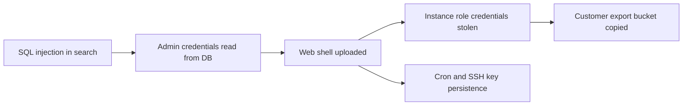

What the example shows: detection came from outbound traffic, not from the injection; the real dwell time was 14 days; and the damage grew because of a broad cloud role. Each lesson maps to a hardening item.

## 5. Variants and comparison 🟡

### 5.1 Common attack types and their tell-tale signs

| Attack | How it works | Signs in your logs and system | First containment move |
| --- | --- | --- | --- |
| SQL injection | Untrusted input changes a SQL query | `UNION SELECT`, `sleep(`, quotes and `--` in parameters; DB errors in app logs; bulk row reads | WAF rule, patch to parameterised queries, rotate DB credentials |
| Cross-site scripting (XSS) | Attacker script runs in victims' browsers | Unexpected `<script>` or `onerror=` in stored content or logs; session theft | Sanitise or remove stored payloads, add CSP, invalidate sessions. See [[CSRF, XSS and Security Headers]] |
| Credential stuffing | Leaked username and password pairs tried at scale | Spike in login failures across many accounts, many IPs, normal-looking requests | Rate limits, MFA, force resets. See [[API Abuse and Bot Protection]] |
| Leaked key or secret | Key committed to a repo or exposed in logs | Cloud API calls from unfamiliar IP or region; keys used outside normal hours | Deactivate key, rotate, audit CloudTrail. See [[Secrets Management]] |
| Vulnerable dependency | A known CVE in a library or framework is exploited | Exploit-pattern requests matching a recent advisory; new processes spawned by the app | Patch or virtual-patch via WAF; rebuild |
| SSRF to cloud metadata | App fetches a URL chosen by the attacker, which points to the metadata endpoint | App making requests to `169.254.169.254`; instance credentials used from outside | Require IMDSv2, block link-local egress, restrict URL fetches, shorten role scope |
| Ransomware | Files encrypted; ransom note | Mass file renames, high disk I/O, ransom note, backups deleted | Isolate network segments, protect backups, do not pay by reflex; involve counsel and law enforcement |
| Defacement | Pages replaced or content altered | Changed pages, new files in web root, hosting alert | Take down, preserve, find the foothold; defacement is often a symptom, not the whole attack |
| SEO spam or malware injection | Hidden links or redirects added | Content differs for crawlers vs visitors; Search Console security warnings | Compare to git, clean from a known-good build, fix the entry point |
| Cryptomining | Attacker runs a miner on your compute | Sustained high CPU, connections to mining pools | Isolate, find initial access, rebuild |

> [!warning] Common mistake
> Treating defacement or a miner as "just a nuisance". These are loud signs; the attacker often has quieter access to data too. Always investigate for exfiltration.

### 5.2 SSRF to cloud metadata in detail

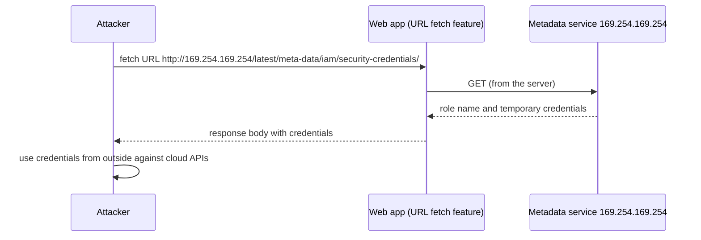

With IMDSv1, a simple GET returns credentials. IMDSv2 requires a session token obtained by a PUT request with a custom header, which most SSRF bugs cannot perform. Requiring IMDSv2 and limiting the role's permissions shrinks the damage. Indicators: CloudTrail events using the instance role's credentials from IPs outside your VPC or NAT addresses.

### 5.3 Severity triage

| Level | Example | Response |
| --- | --- | --- |
| Critical | Active data exfiltration, ransomware, admin takeover | Immediate full response, likely downtime, legal and executives |
| High | Web shell found, credentials leaked but usage unconfirmed | Full response, no downtime unless needed |
| Medium | Vulnerability exploited with no evidence of access | Patch, hunt for follow-up activity |
| Low | Blocked scanning | Monitor, tune rules |

## 6. Trade-offs and when not to use 🟡

Response choices cost something, and the right one depends on the situation.

| Decision | Benefit | Cost |
| --- | --- | --- |
| Take the site fully offline | Stops damage immediately | Revenue loss, user impact |
| Keep running while investigating | Business continues | Attacker may continue; risk of tipping them off |
| Clean in place | Fast | Likely misses backdoors; not recommended |
| Rebuild from clean image | Trustworthy | Takes time and needs good IaC and backups |
| Notify early | Meets deadlines, builds trust | Incomplete facts; may need updates |
| Notify late | More facts | Possible legal penalty and loss of trust |
| Pay a ransom | Might recover data | No guarantee, funds crime, may be illegal; consult counsel and law enforcement |

When not to follow the standard sequence strictly: if data is leaving right now or ransomware is spreading, containment (including shutdown) comes before evidence collection. Preserve what you can, but stop the damage.

## 7. In production 🔴

> 🟡 → 🔴 **You now know** each phase of the response and how the ShopCo breach played out. **Next we look at real practice**: the preparation that decides how an incident goes, what to monitor so you catch attackers sooner, and the deeper topics (order of volatility, CI/CD and supply-chain compromise, the legal clock) that senior engineers are expected to know.


Preparation decides how the incident goes. Before anything happens, have:

- An incident response plan with roles (commander, communications, technical lead, legal contact) and phone numbers.
- Logs centralised and write-protected: web, auth, DB, CloudTrail (AWS's record of every API call in your account) with log file validation, VPC Flow Logs (records of network connections in your cloud network), with at least 90 days of retention (a common guideline). CERT-In's 2022 directions require keeping ICT system logs for 180 days within India's jurisdiction, and PCI DSS v4.0 requires 12 months of audit log history (3 months immediately available).
- Backups that are immutable or offline and tested by restoring. Ransomware attackers often delete reachable backups. See [[Backup, PITR and Disaster Recovery]].
- Infrastructure as code so you can rebuild.
- A contact list for your hosting provider, payment processor and legal counsel.
- Alerts for the early indicators in section 3.1: outbound traffic spikes, new IAM users, disabled logging, login anomalies. See [[Alerting and On-Call]].

Real-world patterns, from public breach reports and well-known guides rather than any one company: most web breaches start with a known vulnerability, stolen or reused credentials, or a misconfiguration; dwell time before detection is often measured in weeks or months, which is why centralised logs matter; and attackers frequently reach cloud credentials through the application host.

Verizon's Data Breach Investigations Report is the standard annual source for the statistics.

Monitoring examples (Prometheus, where you export these metrics):

```promql
# auth_login_failures_total is an example custom metric name; node_network_* comes from node_exporter
# login failures per second across the fleet
sum(rate(auth_login_failures_total[5m]))
# outbound traffic compared with the same time last week
sum(rate(node_network_transmit_bytes_total[5m]))
  / sum(rate(node_network_transmit_bytes_total[5m] offset 1w))
```

Alert when the second ratio stays above a threshold you choose (for example 5) for 10 minutes. The threshold is a starting point to tune against your normal variance.

## 8. Deep dive 🔴

### 8.1 Why snapshot before changing

File timestamps, deleted-file remnants, shell history and process memory change the moment you touch the system. Even logging in can overwrite `last` records and update access times. A snapshot taken first lets analysis happen on a copy, so you can answer legal and root-cause questions later without the evidence having been altered by your own investigation.

### 8.2 Order of volatility

Collect the most short-lived evidence first: CPU registers and memory, then network connections and running processes, then disk, then remote logs, then backups. In practice, for cloud workloads: capture memory if you can, list connections and processes, snapshot the disk, then export logs.

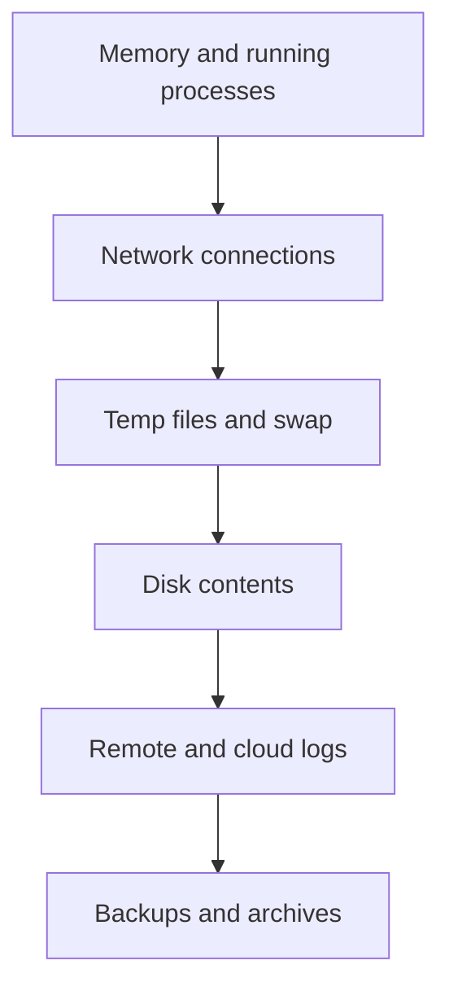

### 8.3 Compromise of the identity provider or CI/CD

If an attacker reaches your CI system or SSO, they can plant code or mint tokens that survive a server rebuild. Check pipeline definitions, deploy keys, OAuth apps and recent changes to build scripts. Rotate CI secrets and review artifacts built during the intrusion window. See [[Service-to-Service Auth - API Keys, HMAC, mTLS]] for credential hygiene between systems.

### 8.4 Supply chain and dependency compromise

If a malicious package version is the source, pin versions, check lock files and checksums, and look at what the package could access at build and run time. Rebuild without the bad version and rotate secrets that were available to the build environment.

### 8.5 Session and token invalidation

If an attacker could read session data or a signing key, deleting their account is not enough. Invalidate all sessions (delete the server session store or bump a global session version) and rotate signing keys. See [[Sessions and Cookies]] and [[Access and Refresh Tokens]].

### 8.6 Legal clock and awareness

Under GDPR, "becoming aware" generally means having a reasonable degree of certainty that a security incident has led to personal data being compromised. Write down when and how you became aware, since that time anchors your deadlines. Seek counsel; interpretation varies by regulator.

### Whiteboard version

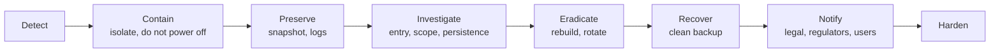

Say it as: "I confirm and scope, isolate without powering off, snapshot, then work from copies to find entry, persistence and data touched. I rotate every secret in reach, rebuild from clean images and a pre-compromise backup, notify within the legal windows, and finish with a blameless review."

## 9. Interview questions 🔴

> [!question]- Your website was defaced this morning. What do you do first?
> Confirm and scope, then contain: isolate the affected host (remove from the load balancer, restrict network) without powering off, and snapshot disks. Defacement is often a symptom, so I look for the foothold, persistence and data access before restoring anything. Then I rotate credentials, rebuild from a clean image, and restore data from a pre-compromise backup.

> [!question]- Why not just restore from backup and move on?
> The attacker's access path is still open: the vulnerability, stolen credentials and any backdoors persist unless I find and close them. Also, if the backup contains the backdoor (taken after compromise), restoring reintroduces it. I need the timeline to pick a clean backup and the root cause to prevent a repeat.

> [!question]- How do you find out how the attacker got in?
> Build a timeline from web access logs, auth logs, cloud audit logs and file changes. Look for exploit patterns in requests, newly created files in the web root, new users and keys, cron jobs, and the first suspicious cloud API call. The earliest malicious event usually marks the entry.

> [!question]- What do you rotate after a suspected breach, and in what order?
> Isolate first, so the attacker cannot read the new secrets. Then rotate everything they could have reached: cloud keys, database credentials, API keys, JWT signing keys, CI tokens, SSH keys and admin passwords, and invalidate sessions.

> [!question]- What are the notification obligations?
> Depend on jurisdiction and data. Under GDPR, notify the supervisory authority within 72 hours of becoming aware if there is a risk to individuals, and notify affected people if the risk is high. In India, CERT-In asks for reporting within 6 hours for specified incidents. Where card data is involved, notify the acquirer and follow PCI DSS. Involve legal early.

> [!question]- What is SSRF to metadata and how do you stop it?
> A feature that fetches attacker-supplied URLs can be pointed at the cloud metadata endpoint to steal the instance role credentials. Stop it with IMDSv2, blocking link-local addresses in egress and URL validation, and a least-privilege instance role so stolen credentials do little.

> [!question]- Why does dwell time matter?
> The longer attackers stay, the more data they collect and the more persistence they build. Centralised logs, alerts on outbound traffic and identity anomalies, and regular access reviews cut detection time, which is the best predictor of damage.

## 10. Cheat sheet 🟢

- Order: detect, contain, preserve, investigate, eradicate, recover, notify, learn.
- Isolate rather than power off; snapshot before changing anything.
- Isolate before rotating secrets, or the attacker reads the new ones.
- Hunt for persistence: web shells, cron, systemd, SSH keys, new users and IAM keys.
- Entry points to check: injection, leaked key, vulnerable dependency, SSRF, stolen credentials.
- Rebuild from clean images; restore data from before the first compromise.
- Notify by the clock: GDPR 72 hours, CERT-In 6 hours, card brands per contract.
- End with a blameless review and hardening items with owners.

## Self-check 🟢🟡

> [!question]- (easy) Why not wipe a hacked server straight away?
> It destroys the evidence of how the attacker got in, and the hole usually stays open.

> [!question]- (easy) What is a web shell?
> A script the attacker uploads so they can run commands on your server through a web page.

> [!question]- (easy) Isolate or power off the hacked machine?
> Isolate it from the network but keep it running, so memory evidence survives.

> [!question]- (medium) Why isolate before rotating secrets?
> If the attacker still controls a host, they can read the new secrets as soon as you set them.

> [!question]- (medium) Which backup do you restore from?
> One taken before the earliest sign of compromise, so it does not include the backdoor.

> [!question]- (medium) Under GDPR, when does the 72-hour clock start?
> When you become reasonably sure that personal data was affected, not when the investigation ends.

## Links

- Prevention: [[Website Security Hardening Checklist]], [[OWASP API Security Top 10]], [[CSRF, XSS and Security Headers]]
- Related security notes: [[Secrets Management]], [[Password Storage and Login Security]], [[API Abuse and Bot Protection]], [[Sessions and Cookies]], [[Access and Refresh Tokens]], [[JWT - Structure, Validation and Pitfalls]], [[Service-to-Service Auth - API Keys, HMAC, mTLS]]
- Operations: [[Incident Response]], [[Postmortems and Root Cause Analysis]], [[Production Debugging Playbook]], [[Alerting and On-Call]], [[Backup, PITR and Disaster Recovery]]

### Watch on YouTube

- [8 Security Layers Explained - HTTPS Won’t Stop Your Website From Getting Hacked](https://www.youtube.com/watch?v=_ZY8SvgfuXE) · Webmind · 12 min · 140 views
- [Cybersecurity IDR: Incident Detection & Response / Google Cybersecurity Certificate](https://www.youtube.com/watch?v=MsGl6lX-YaI) · Grow with Google · 103 min · 248,536 views
