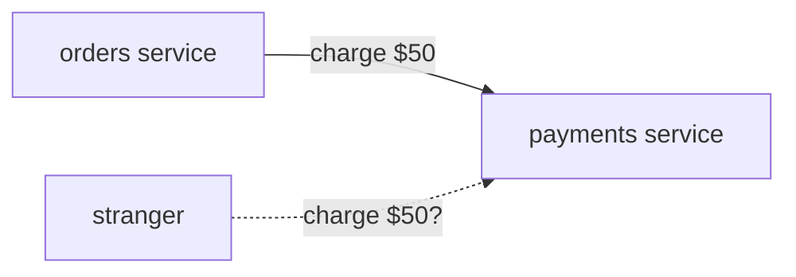
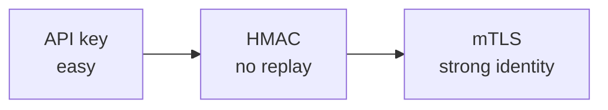
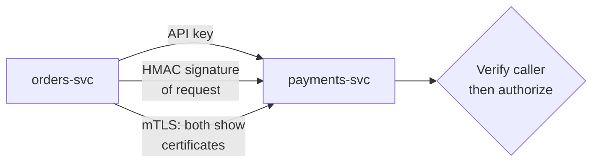
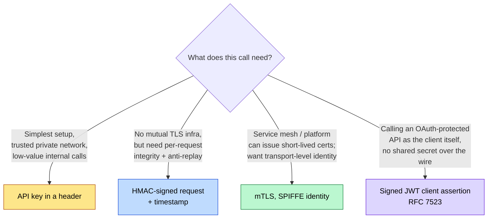
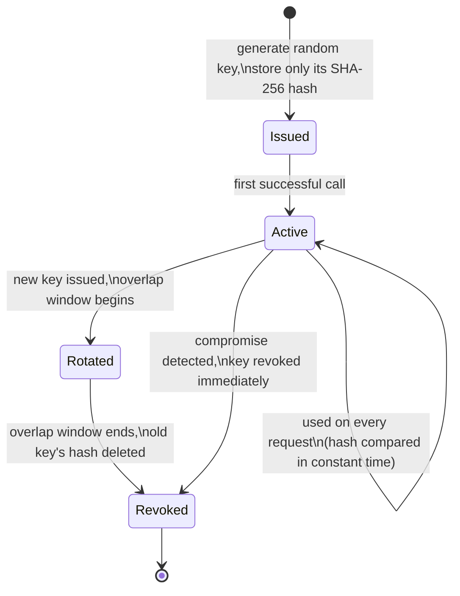
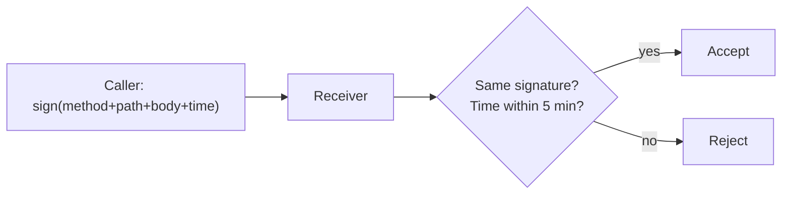
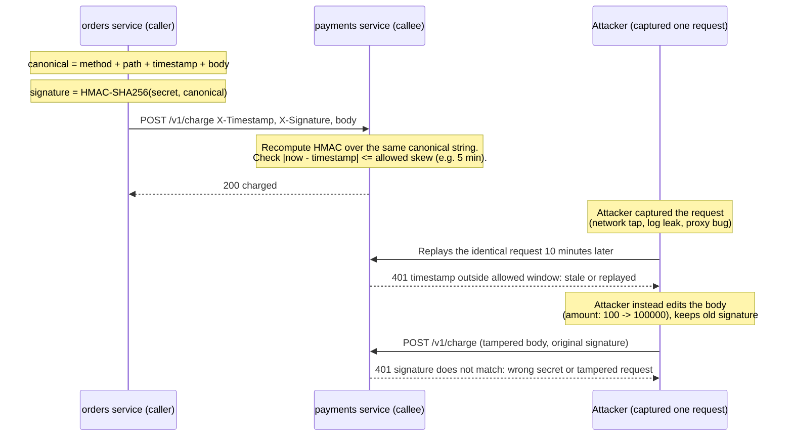
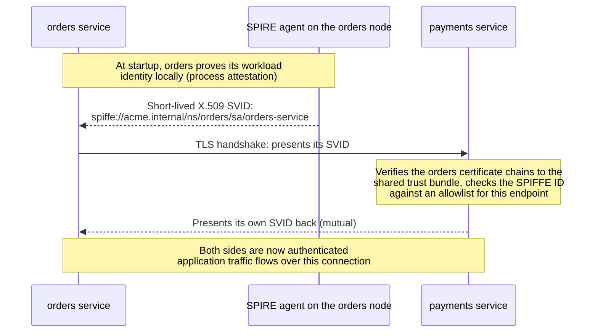
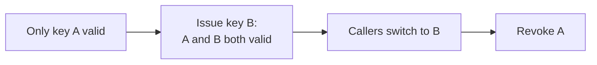

# Service-to-Service Auth - API Keys, HMAC, mTLS

> [!summary] TL;DR
> When one backend service calls another, there is no user to log in — the service itself needs an identity. The four common ways to prove it are a shared **API key**, an **HMAC-signed request**, a **mutual-TLS (mTLS) certificate**, and a **signed JWT client assertion**, each trading off setup cost, replay resistance, and how well it scales across many services.

> [!abstract] Core idea
> - A user proves identity with something they know or hold; a service proves identity with a secret or certificate baked into its deployment.
> - API keys are the simplest: one static secret per caller, hashed at rest like a password, looked up by a non-secret prefix.
> - HMAC signing adds per-request integrity: sign the method, path, timestamp and body, so a captured request cannot be replayed or altered.
> - mTLS moves identity into the TLS handshake itself: both sides present certificates, so every connection — not just every request — is authenticated.
> - SPIFFE standardizes *what* a workload's certificate identity looks like (`spiffe://trust-domain/workload`) so a mesh of services can issue and trust short-lived certificates automatically.
> - Classic mistake: treating a static API key as if it were a session token — it never expires, so a leaked key is a leaked identity until someone notices and rotates it.

## Start here: the basics 🟢

> [!info] How to read this note (pick your level)
> - 🟢 **New to this?** Read "From zero" below, then sections 1, 2 and 10 (why, mental model and the cheat sheet). Stop there, that is a full first pass.
> - 🟡 **Know the basics?** Add sections 3, 4, 5 and 6 (how it works, a worked example, options and trade-offs).
> - 🔴 **Interview / SDE-3 prep?** Add sections 7, 8 and 9 (production, deep dive and interview questions). Headings are tagged 🟢🟡🔴 so you always know where you are.

> [!note] Before this note
> - [[Authentication vs Authorization]]: first prove who is calling, then check what that caller may do; here the caller is a program, not a person.
> - [[JWT - Structure, Validation and Pitfalls]]: a JWT is a signed token with an expiry, checked with a key; one of the four methods here is a JWT the service signs for itself.

**From zero, in 60 seconds** 🟢

When one of your services calls another, no human is typing a password.
The calling service still needs to prove who it is. Otherwise anyone on the network could call "charge card".



There are four common ways to prove it:
an **API key** (a long shared password), an **HMAC** signature (a stamp made with a shared secret on every request), **mTLS** (both sides show certificates), or a signed token.
Each one is stronger than the last, and also more work to set up.



The rest of this note is just these 3 questions:
1. Which method fits which situation?
2. How does each one work, step by step?
3. How do you stop stolen or replayed requests?


**The problem in one story.**
Your orders service calls the payments service.
No human logs in, yet payments must know the caller really is orders.
Without a check, any program on the network could ask payments to refund money.
This note covers the three common ways machines prove who they are to each other.

**Words you need first**

| Word | Plain meaning | Tiny example |
| --- | --- | --- |
| Service | A program that answers requests from other programs | `payments-svc` |
| API key | A long random string sent with each request | `X-API-Key: sk_live_...` |
| HMAC | A signature made from the message plus a shared secret | `HMAC-SHA256(secret, body)` |
| Replay attack | Re-sending a captured valid request | Repeating a refund call twice |
| Timestamp / nonce | Values that make each request unique and fresh | `X-Timestamp`, a random ID |
| TLS certificate | A signed file binding a public key to a name | `CN=orders.internal` |
| mTLS | TLS where both sides show certificates | Orders and payments both verify each other |
| Allowlist | A list of callers that are allowed; everyone else is refused | Only `orders` may call `/charge` |
| Canonical string | One exact, agreed text layout of the request that both sides sign | `POST\n/v1/charge\n1700000000\n{...}` |
| Clock skew | How far apart two servers' clocks are | Orders says 10:00:00, payments says 10:00:03 |
| Service mesh | A layer of helper proxies that handle security and routing between all services | Istio, Linkerd |
| Sidecar | A small helper process running next to each service, often part of a mesh | Envoy proxy beside `orders` |
| SPIFFE ID | A standard name for a service, written as a URL | `spiffe://acme.internal/ns/payments/sa/payments-service` |

**Picture it**



**Analogy.** Getting into an office. An API key is a password at the door; HMAC is signing every note you pass in with ink only you and reception have; mTLS is both you and reception showing ID badges issued by the same company.
Where it breaks: office badges are checked once at the door; services must check every single request, because there is no door.

**How the rest of this note builds up**

- First, why it exists (section 1) and the mental model (section 2).
- Then how API keys, HMAC signing and mTLS each work (section 3) and Go code for all three (section 4).
- Then a side-by-side comparison (section 5).
- Finally the SDE-3 deep dive: key rotation, replay windows, certificate lifetimes and service mesh identity (sections 6-8), then interview questions and a cheat sheet.

> [!tip] Remember
> API keys say "I know the secret", HMAC proves this exact request wasn't changed, mTLS proves identity at the connection.

## 1. Why it exists 🟢

An e-commerce platform's `orders` service needs to call its `payments` service to charge a card. There is no browser, no user to redirect, and no password to type. If `orders` simply calls `payments` over plain HTTP with no credential, then anything on the internal network — a compromised sidecar (helper process next to a service), a misconfigured proxy (a middle server that forwards traffic), a pod (one running copy of a service) that should not have network access but does — can call `payments` and charge or refund at will.

The service needs to prove three things on every call, in increasing order of strength:

1. **Who is calling** (an identity the receiver can check against an allowlist, the list of callers it accepts).
2. **That this exact request was not altered in transit** (method, path, and body all match what the caller sent).
3. **That this exact request is not a captured copy of an old one being replayed** (a request from ten minutes ago being resent now).

A single static secret in a header (an API key) gives you (1). Signing the request with that secret over a timestamp gives you (1) and (2) and (3). A certificate-based handshake (mTLS) gives you (1) and (2) for free at the transport layer, for every byte of every connection, not just a chosen header.

### Real-life example: Swiggy's order service calling payments 🟢

When you pay for a Swiggy order, the order service, not you, asks the payments service to charge your card or UPI. Your login token proved who *you* are to the app, but now payments must check who *this caller* is: is it really the order service, or some other program inside the network that got hacked? Big apps like this usually give every service its own short-lived certificate (mTLS), so payments can see "this connection is from `orders`" before it reads a single byte. Partners outside the company, like a restaurant's billing system, are more often given an API key or HMAC-signed requests, because they are not part of the internal mesh.

## 2. Mental model 🟢

Think of three ways a courier company can prove the delivery person really works for them:

- **API key** = a laminated ID badge. Anyone who looks at it (reads the header) can later make a copy and use it. Good enough if you also control exactly where it can be shown (a private internal network) and rotate it regularly.
- **HMAC-signed request** = a wax seal on every single parcel, stamped with details unique to that parcel (what's inside, when it was sealed). Even if someone captures one sealed parcel, they cannot reseal a different one — they would need the original stamp (the shared secret), and the recipient checks the stamp matches the one parcel in hand.
- **mTLS** = the courier and the warehouse check each other's government ID at the door, before a single parcel changes hands. The identity check happens once per visit (connection), not once per parcel (request), and neither side can be impersonated without stealing an actual ID (private key).

### TLS vs mTLS 🟡

| | Normal TLS (HTTPS) | mTLS |
| --- | --- | --- |
| Who shows a certificate | Only the server | Both server and client |
| What the server learns about the caller | Just an IP address | A verified service name |
| Typical use | Browsers talking to websites | Services talking to services inside a company |

## Common beginner mistakes 🟢

- **No auth on internal calls ("it's a private network")** → any hacked pod can call `/refund` → every service call needs a credential.
- **Storing API keys in plain text** → a database leak hands out every key → store only the SHA-256 hash and show the key once.
- **HMAC without a timestamp** → a captured request can be replayed forever → sign a timestamp and reject anything older than a few minutes.
- **Comparing signatures with `==`** → timing differences can leak the right value → use `hmac.Equal` or `subtle.ConstantTimeCompare`.
- **Thinking mTLS means "allowed to do anything"** → mTLS only says which service is calling → still check if that service may do this action.

## 3. How it works 🟡

> 🟢 → 🟡 **You now know** that a calling service must prove who it is, and that there are four ways to do it. **Next we open the box**: how to pick one, and how API keys, HMAC signatures, mTLS certificates and signed JWT assertions each work, step by step.

### Choosing a mechanism

**In plain words:** follow the arrows: few partners and simple needs means API key; need to stop tampering means HMAC; many internal services means mTLS.



These are not mutually exclusive: a common production shape is mTLS for the transport (every connection authenticated) *plus* a signed JWT or HMAC header for fine-grained per-request authorization, because mTLS proves "this is the `orders` service" but not "this specific request is allowed to refund $500."

### API keys: hashed storage and prefixes

**In plain words:** treat an API key like a password: show it once, store only its hash, and add a short readable prefix so you can tell keys apart in logs.

**Step by step:**
1. A partner asks for a key. The server makes `sk_live_7f3a9c...` (a prefix plus 32 random bytes).
2. It shows the full key to the partner once, and stores only the first 12 characters (for lookup) and the SHA-256 hash.
3. The partner sends `X-API-Key: sk_live_7f3a9c...` on every call.
4. The server finds the row by the prefix, hashes the presented key, and compares the hashes in constant time.
5. Match → the caller is that partner. No match, or a revoked key → 401.

An API key is a long random secret, generated once and shown to the caller exactly one time. The server never stores the plaintext key — it stores a hash, exactly like a password, with one important difference: API keys are machine-generated with hundreds of bits of entropy, so a fast cryptographic hash (SHA-256) is the right tool, unlike human-chosen passwords, which need a slow, memory-hard KDF (key derivation function: a deliberately slow hash) such as argon2id specifically because they carry so little entropy on their own (see the OWASP Password Storage Cheat Sheet and [[Password Storage and Login Security]]).

The key is shaped `<prefix>_<random>`, for example `sk_live_7f3a9c...`. The prefix is deliberately **not secret**:

- It lets the server find the candidate row by an indexed, non-secret lookup column instead of hashing the presented key against every stored hash.
- It lets a dashboard display "key `sk_live_7f3a...`" for the user to recognize, without ever showing the secret again.
- It can encode environment (`sk_live_` vs `sk_test_`) so a test key pasted into a production config fails loudly instead of silently working.



### HMAC request signing with a timestamp

**In plain words:** both sides know a secret. The caller stamps each request with that secret plus the time. The receiver redoes the stamp, and old stamps are rejected.

**Step by step:**
1. `orders` wants to send `POST /v1/charge` with body `{"amount":100}` at time 1700000000.
2. It joins method, path, time and body into one line of text and computes `HMAC-SHA256(secret, that text)`.
3. It sends the request with headers `X-Timestamp: 1700000000` and `X-Signature: <result>`.
4. `payments` checks the time is within 5 minutes of its own clock, rebuilds the same text, and computes the HMAC with its copy of the secret.
5. Same result → accept. Changed amount, wrong secret or a 10-minute-old copy → 401.



The caller and the callee share a secret out of band (handed over through a separate safe route, such as a secrets manager, never in source control). For every request, the caller builds a **canonical string** — a fixed, unambiguous representation of exactly what is being signed — and computes `HMAC-SHA256(secret, canonical_string)`:



Signing the **timestamp** bounds how long a captured request stays valid — typically a few minutes, matched to realistic clock skew between services. Signing the **body** means any edit, even to a single byte, breaks the signature, so a man-in-the-middle (someone sitting between the two services, reading and changing traffic) cannot alter amounts or fields and keep the original signature valid.

Neither check alone is enough: a signature without a timestamp can be replayed forever; a timestamp without a signature can be forged outright.

### mTLS and SPIFFE

**In plain words:** normal HTTPS proves the server is real. mTLS makes the client show a certificate too. SPIFFE is a standard way to name and hand out those certificates.

**Step by step:**
1. When `orders` starts, a local helper (the SPIRE agent) checks it really is the orders program and hands it a certificate named `spiffe://acme.internal/ns/orders/sa/orders-service`, valid for about an hour.
2. `orders` opens a connection to `payments`. Payments shows its certificate, as in normal HTTPS.
3. Payments asks for the client's certificate too; `orders` shows its own.
4. Payments checks that the certificate was issued by the company's trusted issuer and that the name is on its allowlist.
5. Both sides are now sure who is on the other end, and requests flow over that connection.

In ordinary (server-only) TLS, the client verifies the server's certificate but the server has no cryptographic idea who the client is beyond its IP. **Mutual TLS** adds a second certificate check in the other direction: the server also requests and verifies a client certificate during the handshake, so both sides authenticate before a single application byte is exchanged.

The handshake mechanics themselves — the key exchange, cipher negotiation, certificate chain validation — belong to [[TLS and HTTPS]]; what matters here is the extra step mTLS adds and what identity it carries.

A raw X.509 certificate's (the standard certificate file format) subject (`CN=payments.internal`) is just a string with no standard shape for "which service, in which trust domain, run by which platform." **SPIFFE** (Secure Production Identity Framework for Everyone) standardizes that shape as a URI: `spiffe://acme.internal/ns/payments/sa/payments-service`.

A SPIFFE-aware platform (commonly SPIRE as the issuer) hands every workload (a running service) a short-lived X.509 certificate (an "SVID", SPIFFE's name for an identity document) carrying that URI as a Subject Alternative Name (an extra name field inside the certificate), rotated automatically every few hours — so compromise of one certificate has a short blast radius, with no manual rotation step.



### JWT client assertions

**In plain words:** the service signs a short-lived token with its private key and sends that instead of a shared secret.

**Step by step:**
1. Ahead of time, `billing` registers its public key with the login server.
2. When it needs a token, it writes a tiny JWT: "I am `billing`, for `https://auth.example/token`, expires in 2 minutes, id `a91`".
3. It signs that JWT with its private key and sends it to the token endpoint.
4. The login server checks the signature with the registered public key, plus audience and expiry, and returns an access token.
5. A copied assertion is useless 2 minutes later, and the private key never left `billing`.

RFC 7523 defines a fourth option, mainly for authenticating to an OAuth token endpoint without ever sending a shared secret over the wire: the calling service signs a short-lived JWT with its own private key and sends that JWT as the credential (`client_assertion`).

The authorization server verifies it against the client's previously-registered public key (or JWKS). This is the `private_key_jwt` method mentioned in [[OAuth 2.0 and OpenID Connect]]'s deep dive, and RFC 9700 recommends it over a plain `client_secret` for exactly this reason: a leaked assertion is useless after its short `exp`, while a leaked `client_secret` is valid until manually rotated.

## 4. Worked example 🟡

### Whiteboard version

The shape every HMAC scheme shares: build one unambiguous string, sign it, and make the signature cover everything that must not change.

```go
package wb

import (
	"crypto/hmac"
	"crypto/sha256"
	"encoding/hex"
	"fmt"
)

func sign(secret []byte, method, path string, timestamp int64, body []byte) string {
	canonical := fmt.Sprintf("%s\n%s\n%d\n%s", method, path, timestamp, body)
	mac := hmac.New(sha256.New, secret)
	mac.Write([]byte(canonical))
	return hex.EncodeToString(mac.Sum(nil))
}
```

The full version below adds the three mechanisms covered above — hashed, prefixed API keys; HMAC signing with a timestamp window; and Ed25519-signed JWT client assertions in the shape of RFC 7523 — and is exactly what the tests exercise. It compiles and passes `go vet` and `go test -race` on Go 1.24.

```go
package s2s

import (
	"crypto/rand"
	"crypto/sha256"
	"crypto/subtle"
	"encoding/base64"
	"encoding/hex"
	"errors"
	"strings"
)

// GenerateAPIKey returns a new plaintext key (shown to the caller exactly
// once) and the SHA-256 hash that is the only thing the database stores.
// The key has the shape "<prefix>_<32 random bytes, base64url>", e.g.
// "sk_live_7f3a...". The prefix is never secret: it identifies the key's
// environment and lets the server find the matching hash row without
// scanning the whole table, similar to how Stripe and GitHub key prefixes
// (sk_live_, ghp_) work.
func GenerateAPIKey(prefix string) (plaintext, lookupPrefix, storedHash string, err error) {
	raw := make([]byte, 32)
	if _, err = rand.Read(raw); err != nil {
		return "", "", "", err
	}
	secretPart := base64.RawURLEncoding.EncodeToString(raw)
	plaintext = prefix + "_" + secretPart
	lookupPrefix = keyLookupPrefix(plaintext)
	storedHash = hashAPIKey(plaintext)
	return plaintext, lookupPrefix, storedHash, nil
}

// keyLookupPrefix is the short, non-secret slice of the key used as a DB
// index: enough to find candidate rows fast, never enough to reconstruct
// the key.
func keyLookupPrefix(plaintext string) string {
	const lookupLen = 12
	if len(plaintext) < lookupLen {
		return plaintext
	}
	return plaintext[:lookupLen]
}

func hashAPIKey(plaintext string) string {
	sum := sha256.Sum256([]byte(plaintext))
	return hex.EncodeToString(sum[:])
}

var ErrInvalidAPIKey = errors.New("invalid api key")

// VerifyAPIKey re-hashes the presented plaintext key and compares it in
// constant time to the hash stored for that lookup prefix. API keys are
// high-entropy random secrets (not human-chosen passwords), so a fast
// cryptographic hash is the correct tool here — unlike passwords, which
// need a slow, memory-hard KDF such as argon2id precisely because they
// carry so little entropy of their own (see the OWASP Password Storage
// Cheat Sheet, and the vault's Password Storage and Login Security note).
func VerifyAPIKey(presented, storedHash string) error {
	if !strings.Contains(presented, "_") {
		return ErrInvalidAPIKey
	}
	got := hashAPIKey(presented)
	if subtle.ConstantTimeCompare([]byte(got), []byte(storedHash)) != 1 {
		return ErrInvalidAPIKey
	}
	return nil
}
```

```go
package s2s

import (
	"crypto/hmac"
	"crypto/sha256"
	"encoding/hex"
	"errors"
	"fmt"
	"time"
)

// canonicalString builds the exact bytes both sides sign: the HTTP method,
// the path, the Unix timestamp, and the raw request body, newline-joined.
// Signing the timestamp is what makes the signature expire; signing the
// body is what stops a man-in-the-middle from replaying a valid signature
// over a modified payload.
func canonicalString(method, path string, timestamp int64, body []byte) string {
	return fmt.Sprintf("%s\n%s\n%d\n%s", method, path, timestamp, body)
}

// SignRequest returns a hex HMAC-SHA256 signature over the canonical
// string, the way a caller signs an outbound service-to-service request.
func SignRequest(secret []byte, method, path string, timestamp int64, body []byte) string {
	mac := hmac.New(sha256.New, secret)
	mac.Write([]byte(canonicalString(method, path, timestamp, body)))
	return hex.EncodeToString(mac.Sum(nil))
}

var (
	ErrClockSkew    = errors.New("request timestamp outside the allowed window: stale or replayed")
	ErrBadSignature = errors.New("signature does not match: wrong secret or tampered request")
)

// VerifyRequest is what the receiving service runs: reject anything whose
// timestamp has drifted too far from "now" (catching both replay of an old
// signed request and simple clock skew), then recompute the HMAC and
// compare it in constant time.
func VerifyRequest(secret []byte, method, path string, timestamp int64, body []byte, signature string, now time.Time, maxSkew time.Duration) error {
	delta := now.Unix() - timestamp
	if delta < 0 {
		delta = -delta
	}
	if time.Duration(delta)*time.Second > maxSkew {
		return ErrClockSkew
	}
	want := SignRequest(secret, method, path, timestamp, body)
	if !hmac.Equal([]byte(want), []byte(signature)) {
		return ErrBadSignature
	}
	return nil
}
```

```go
package s2s

import (
	"crypto/ed25519"
	"encoding/base64"
	"encoding/json"
	"errors"
	"fmt"
	"strings"
	"time"
)

// clientAssertionClaims mirrors the registered claims RFC 7523 (JWT
// Profile for OAuth 2.0 Client Authentication) requires of a private_key_jwt
// client assertion: the client asserts its own identity by signing a JWT
// with the private key half of a key pair the authorization server already
// trusts, instead of sending a shared secret over the wire.
type clientAssertionClaims struct {
	Issuer   string `json:"iss"` // the client's own client_id
	Subject  string `json:"sub"` // also the client_id, by RFC 7523
	Audience string `json:"aud"` // the token endpoint URL
	Expiry   int64  `json:"exp"`
	IssuedAt int64  `json:"iat"`
	JWTID    string `json:"jti"` // unique per assertion: stops replay of the same assertion
}

func b64(b []byte) string { return base64.RawURLEncoding.EncodeToString(b) }

// BuildClientAssertion signs a short-lived, single-use JWT with the
// client's Ed25519 private key. A real client registers the matching public
// key (or a JWKS URL serving it) with the authorization server in advance.
func BuildClientAssertion(priv ed25519.PrivateKey, issuer, audience string, now time.Time, jti string) (string, error) {
	header := map[string]string{"alg": "EdDSA", "typ": "JWT"}
	headerJSON, err := json.Marshal(header)
	if err != nil {
		return "", err
	}
	claims := clientAssertionClaims{
		Issuer:   issuer,
		Subject:  issuer,
		Audience: audience,
		Expiry:   now.Add(2 * time.Minute).Unix(), // RFC 7523: keep assertions short-lived
		IssuedAt: now.Unix(),
		JWTID:    jti,
	}
	claimsJSON, err := json.Marshal(claims)
	if err != nil {
		return "", err
	}
	signingInput := b64(headerJSON) + "." + b64(claimsJSON)
	sig := ed25519.Sign(priv, []byte(signingInput))
	return signingInput + "." + b64(sig), nil
}

var (
	ErrAssertionFormat    = errors.New("malformed client assertion")
	ErrAssertionSignature = errors.New("client assertion signature invalid")
	ErrAssertionAudience  = errors.New("client assertion not issued for this token endpoint")
	ErrAssertionExpired   = errors.New("client assertion expired")
)

// VerifyClientAssertion is what the authorization server's token endpoint
// runs: check the signature against the client's registered public key,
// then check audience and expiry. A JWT library would also enforce a
// single allowed "alg" rather than trusting the token's own header, which
// this hand-rolled version does by never reading "alg" from the input at
// all — it only ever verifies with Ed25519.
func VerifyClientAssertion(pub ed25519.PublicKey, token, wantAudience string, now time.Time) (clientAssertionClaims, error) {
	var claims clientAssertionClaims
	parts := strings.Split(token, ".")
	if len(parts) != 3 {
		return claims, ErrAssertionFormat
	}
	signingInput := parts[0] + "." + parts[1]
	sig, err := base64.RawURLEncoding.DecodeString(parts[2])
	if err != nil {
		return claims, fmt.Errorf("%w: %v", ErrAssertionFormat, err)
	}
	if !ed25519.Verify(pub, []byte(signingInput), sig) {
		return claims, ErrAssertionSignature
	}
	claimsJSON, err := base64.RawURLEncoding.DecodeString(parts[1])
	if err != nil {
		return claims, fmt.Errorf("%w: %v", ErrAssertionFormat, err)
	}
	if err := json.Unmarshal(claimsJSON, &claims); err != nil {
		return claims, fmt.Errorf("%w: %v", ErrAssertionFormat, err)
	}
	if claims.Audience != wantAudience {
		return claims, ErrAssertionAudience
	}
	if now.Unix() > claims.Expiry {
		return claims, ErrAssertionExpired
	}
	return claims, nil
}
```

The tests that prove the attacks in the diagrams above are actually blocked:

```go
func TestHMACRejectsReplayOutsideWindow(t *testing.T) {
	secret := []byte("shared-secret-between-two-services")
	signedAt := time.Unix(1_700_000_000, 0)
	body := []byte(`{"order_id":"o_1"}`)
	sig := SignRequest(secret, "POST", "/v1/orders", signedAt.Unix(), body)

	replayedAt := signedAt.Add(10 * time.Minute) // captured and replayed later
	err := VerifyRequest(secret, "POST", "/v1/orders", signedAt.Unix(), body, sig, replayedAt, 5*time.Minute)
	if err != ErrClockSkew {
		t.Fatalf("a replayed request outside the skew window must be rejected, got %v", err)
	}
}

func TestHMACRejectsTamperedBody(t *testing.T) {
	secret := []byte("shared-secret-between-two-services")
	now := time.Unix(1_700_000_000, 0)
	sig := SignRequest(secret, "POST", "/v1/orders", now.Unix(), []byte(`{"amount":100}`))

	tampered := []byte(`{"amount":100000}`)
	err := VerifyRequest(secret, "POST", "/v1/orders", now.Unix(), tampered, sig, now, 5*time.Minute)
	if err != ErrBadSignature {
		t.Fatalf("a modified body must invalidate the signature, got %v", err)
	}
}
```

**Measured:** `go test -race ./...` on this package, Go 1.24.4, darwin/arm64, 2026-11-07: 8 tests, all pass — covering API key round-trip and wrong-key rejection, HMAC signing, replay-outside-window rejection, tampered-body rejection, and JWT client-assertion round-trip, wrong-key rejection, and expiry rejection.

## 5. Variants and comparison 🟡

| Mechanism | How it works | Use when | Cost |
| --- | --- | --- | --- |
| API key | Static secret in a header, hashed at rest, verified by lookup + constant-time compare | Simple internal calls, third-party API consumers, low setup cost | No per-request integrity or replay protection on its own; a leaked key is valid until rotated |
| HMAC-signed request | Shared secret signs method + path + timestamp + body per request | Need per-request integrity and anti-replay without a mesh/mTLS | Both sides must agree on canonicalization exactly, including byte-for-byte body handling |
| mTLS | Certificates exchanged during the TLS handshake, both directions | Service mesh or platform that can issue and rotate certs automatically | Operational weight: cert issuance, rotation, revocation, trust bundle distribution |
| JWT client assertion (RFC 7523) | Caller signs a short-lived JWT with its private key, sent as the credential | Authenticating to an OAuth token endpoint without a shared secret | Needs a key pair and JWKS/registration step per client; verification needs clock sync |

> [!warning] Interview trap
> "We use an API key, so we're secure" ignores that a static API key never expires on its own. It proves *who* is calling, once, at issuance time — it says nothing about whether this particular request was altered or replayed. Pair it with TLS in transit and, for anything sensitive, add request signing or move to mTLS.

## 6. Trade-offs and when not to use 🟡

- API keys are the cheapest to build but the weakest: no built-in expiry, no per-request integrity. Fine for low-risk, easily rotated internal calls; wrong for anything handling money or PII (personally identifiable information: names, phone numbers, addresses) without additional layers.
- HMAC signing requires both sides to build byte-identical canonical strings — a client library that re-serializes JSON differently than the server expects (key ordering, whitespace) breaks every signature. Keep the canonical string to method, path, timestamp, and the *raw* body bytes, never a re-encoded structure.
- mTLS is the strongest default for a mesh of many services but is the heaviest to operate without platform support (SPIRE, a service mesh's sidecar-managed certs, or a cloud provider's managed mTLS). Standing it up for two services calling each other directly is usually more operational burden than the risk justifies.
- JWT client assertions need clock-synced verification and a key-registration step per client; they solve a narrower problem (OAuth client authentication) than general service-to-service calls.

## 7. In production 🔴

> 🟡 → 🔴 **You now know** how each of the four methods works and when to pick which. **Next we look at real systems**: what Stripe, AWS and service meshes do, how these setups fail (leaked keys, clock drift, expired certificates), and the deeper design ideas such as tokens tied to certificates and rotation without downtime.


- **Real systems:**
  - Stripe, GitHub, and most SaaS platforms use prefixed, hashed API keys (`sk_live_`, `ghp_`) for third-party integrations.
  - AWS Signature Version 4 is the best-known production HMAC request-signing scheme, signing method, path, headers, and a hash of the body.
  - Istio, Linkerd, and Consul Connect issue and rotate mTLS certificates automatically for every service in the mesh, commonly backed by SPIRE for SPIFFE identity.
  - Google and Okta both support `private_key_jwt` client authentication for their OAuth token endpoints.
- **Failure modes → fixes:**
  - API key committed to a public repo → automated secret scanning (tools that search code for anything that looks like a key: GitHub secret scanning, truffleHog) plus immediate revocation and a short time-to-detect target; design keys to be cheap to rotate.
  - Clock drift between services makes valid HMAC-signed requests look replayed → monitor NTP sync, and choose a skew window (commonly 1–5 minutes) wide enough for realistic drift but narrow enough to bound replay risk.
  - A rotated API key breaks callers that cached the old one → issue the new key with an overlap window where both the old and new hash validate, then revoke the old one after callers have migrated.
  - mTLS certificate expires mid-incident because rotation silently failed → alert on certificate expiry well before the deadline, not only on handshake failures after the fact.
- **What to monitor:**
  - Per-credential request rate and failure rate (wrong signature, expired timestamp, unknown key) — a spike in failures from one credential is often a sign of a bug or an attack, not noise.
  - API key age and last-used timestamp, to find stale keys worth revoking.
  - Certificate expiry dates across the fleet, alerted well ahead of expiry.
  - Clock skew between calling and receiving services.

## 8. Deep dive 🔴

- **Why sign the body and not just the headers.** AWS SigV4 and most serious HMAC schemes include a hash of the body in the signed string specifically so a proxy or load balancer that can read (but should not alter) the payload cannot tamper with it silently; signing only headers would leave the body open to modification while the signature still "matches."
- **Certificate-bound access tokens (RFC 8705).** mTLS and OAuth can combine: the authorization server binds an issued access token to the client's TLS certificate (via a thumbprint claim, a short hash of the certificate), so even if the token itself leaks, it cannot be used over a different connection without also presenting the matching private key. This closes the classic "stolen bearer token works from anywhere" gap.
- **Key rotation without downtime.** Both API keys and HMAC secrets should support an overlap window: issue the new credential, accept both old and new for a bounded period, then revoke the old one. The alternative — rotate and revoke atomically — guarantees an outage for any caller that has not redeployed in time.


- **SPIFFE beyond certificates.** The same SPIFFE ID can also back JWT-SVIDs (signed JWTs carrying the `spiffe://` identity) for contexts where a full TLS handshake is not the transport, such as authenticating a message on a queue.
- **Defense in depth.** Production systems rarely pick exactly one of these. A common real shape: mTLS for every connection inside the mesh (transport-level identity), plus a signed JWT or HMAC header carrying the specific action being authorized (field-level authorization, since "this is really the orders service" does not by itself say "and it is allowed to issue a $10,000 refund").

## 9. Interview questions 🔴

> [!question]- Why hash an API key with SHA-256 instead of argon2id, when passwords need argon2id?
> Argon2id's cost (deliberately slow, memory-hard) exists to resist offline guessing of low-entropy, human-chosen passwords. An API key is generated with hundreds of bits of randomness, so guessing it is already infeasible; a fast hash is enough, and using a slow KDF would only add needless latency to every authenticated request.

> [!question]- What does signing the timestamp in an HMAC scheme actually protect against, that signing the body alone does not?
> Signing the body stops a captured request from being modified and replayed. It does not stop the exact same, unmodified request from being replayed verbatim later. The timestamp, checked against a tolerance window, bounds how long a captured request stays valid at all.

> [!question]- How is mTLS different from ordinary TLS, in one sentence?
> Ordinary TLS has the client verify the server's certificate; mTLS adds the reverse — the server also requests and verifies a client certificate — so both sides are cryptographically authenticated before any application data is exchanged.

> [!question]- What problem does SPIFFE solve that a plain X.509 certificate doesn't?
> A certificate's subject field has no standard shape for workload identity, so every platform would invent its own naming scheme. SPIFFE standardizes the identity as a URI (`spiffe://trust-domain/workload`) and defines how that identity is attested and issued, so a mesh of many services and the tooling around it (like SPIRE) can agree on what "this certificate belongs to the payments service" means.

> [!question]- Trap: a teammate says "our internal API key is fine because it only travels over our private VPC." What's missing from that argument?
> A private network reduces exposure but does not grant expiry, rotation, or per-request integrity. Anyone with access to that VPC segment — a misconfigured workload, a compromised sidecar, an internal attacker — can replay the key indefinitely. Network isolation is a layer, not a substitute for a credential that can be scoped, rotated, and monitored.

> [!question]- When would you reach for a JWT client assertion instead of a plain client secret for OAuth client authentication?
> When you want to avoid a long-lived shared secret traveling over the network on every token request at all. A signed assertion is short-lived and tied to a private key the client never transmits, so a captured assertion is useless once it expires, unlike a captured `client_secret`, which is valid until someone manually rotates it. RFC 9700 recommends this over a plain secret for exactly that reason.

> [!question]- Your service calls another over mTLS. Do you still need request-level authorization checks?
> Yes. mTLS proves which *service* is on the other end of the connection; it says nothing about whether this specific request — this action, on this resource — is something that service is allowed to do. Pair mTLS's connection-level identity with object- and action-level checks in the application, the same BOLA/BFLA concern covered in [[Authentication vs Authorization]].

## 10. Cheat sheet 🟢

- API key: static secret, hashed at rest (SHA-256, not argon2id — it's already high-entropy), looked up by a non-secret prefix.
- HMAC: sign method + path + timestamp + raw body; check the timestamp window and compare signatures in constant time.
- mTLS: both sides present certificates during the handshake; identity lives at the connection level, not per request.
- SPIFFE: standardizes workload identity as `spiffe://trust-domain/workload`; SPIRE commonly issues short-lived certs automatically.
- JWT client assertion (RFC 7523): sign a short-lived JWT with your own private key instead of sending a shared secret.
- None of these alone is "secure" — pair transport-level identity (mTLS) with request-level authorization, and rotate every secret with an overlap window.
- A leaked static API key is valid until someone notices and revokes it; that is the core weakness every other mechanism here addresses in a different way.

## Self-check 🟢🟡

> [!question]- (easy) Why does a service need its own identity when no user is involved?
> Otherwise any program on the network could call sensitive endpoints like "charge card".

> [!question]- (easy) What does the server store for an API key?
> A non-secret prefix for lookup and the SHA-256 hash, never the key itself.

> [!question]- (easy) In mTLS, who shows a certificate?
> Both sides: the server and the calling client.

> [!question]- (medium) What two things must an HMAC signature cover to stop replay and tampering?
> A timestamp (to limit how long a copy works) and the raw body (so any edit breaks the signature).

> [!question]- (medium) Why can API keys use fast SHA-256 while passwords need argon2id?
> API keys are long random values, so guessing is already hopeless; passwords are short human choices that must be made slow to guess.

> [!question]- (medium) Why rotate keys with an overlap window?
> So callers that still use the old key keep working while they switch; revoking at once causes an outage.

## Links
- **Before this:** [[OAuth 2.0 and OpenID Connect]], [[JWT - Structure, Validation and Pitfalls]]
- **Next:** [[API Abuse and Bot Protection]]; for Go implementation see [[Authentication and Authorization in Go]] and [[Secure Coding for Go Services]]
- **Compare with:** [[OAuth 2.0 and OpenID Connect]] (user-present delegated access vs machine-to-machine identity), [[TLS and HTTPS]] (the handshake mTLS builds on), [[Webhooks - Sending and Receiving]] (HMAC signing applied to inbound webhook deliveries)

### Watch on YouTube

- [API Authentication EXPLAINED! 🔐 OAuth vs JWT vs API Keys 🚀](https://www.youtube.com/watch?v=GcVtElYa17s) · SoftsWeb · 9 min · 682,551 views
- [OAuth vs JWT vs API Keys vs mTLS: Why One Request Uses Three](https://www.youtube.com/watch?v=XFIujZGk6tY) · The Control Plane · 5 min · 66 views
