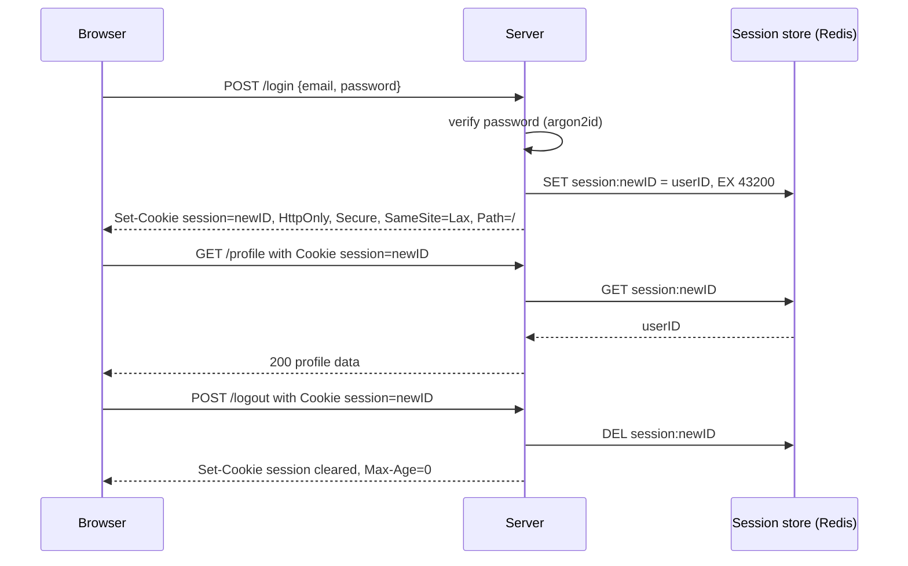
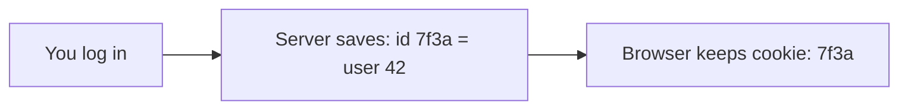
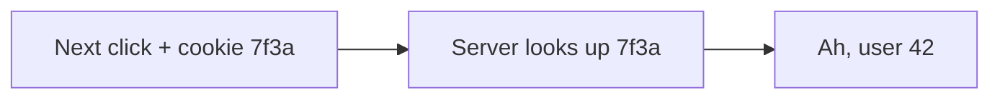
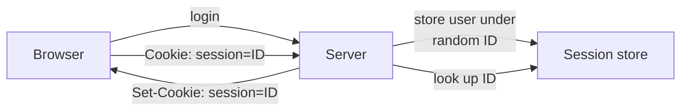
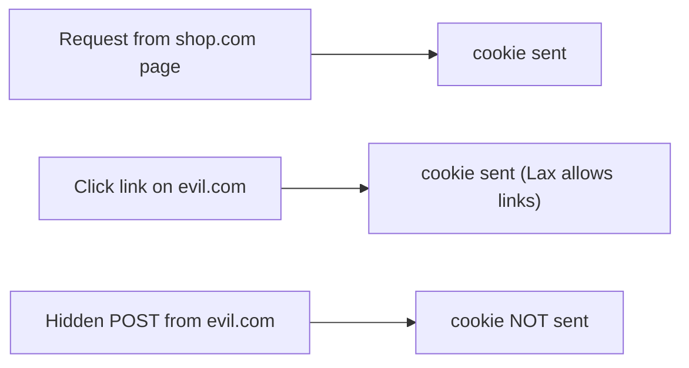
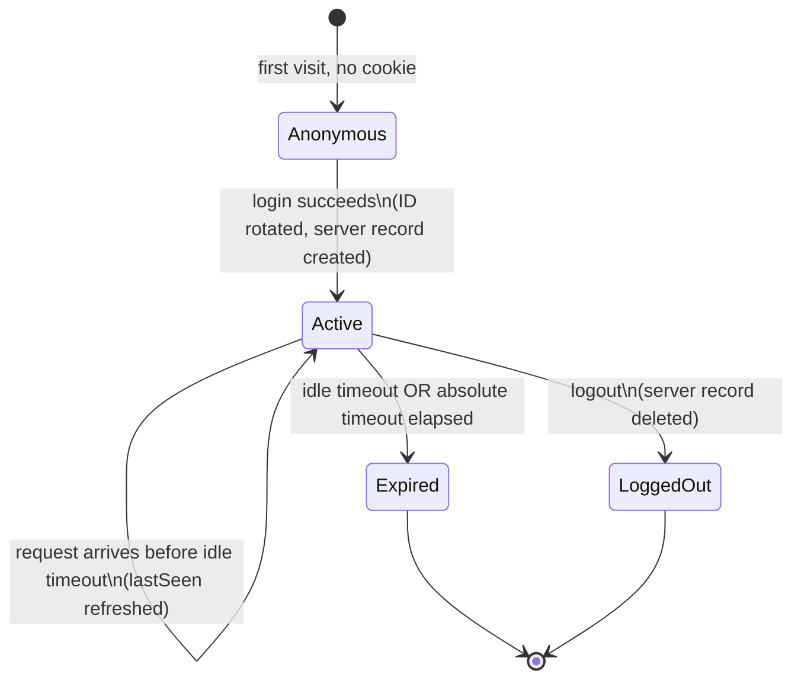
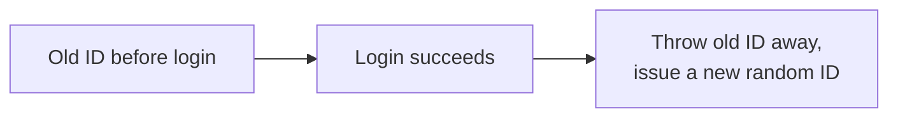
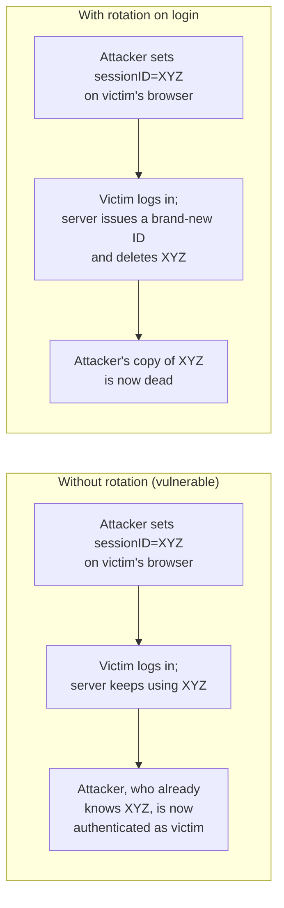

# Sessions and Cookies

> [!summary] TL;DR
> HTTP is stateless, so a session gives a login state somewhere to live between requests: a random opaque ID travels in a cookie, and the actual data (which user, when it expires) lives server-side, looked up by that ID on every request.

> [!abstract] Core idea
> - A session ID is a random, meaningless token; the server looks it up in a store (Redis, Postgres) to find out who it belongs to.
> - Cookie attributes — `HttpOnly`, `Secure`, `SameSite`, `Path`, the `__Host-` prefix — are the actual security boundary, not an afterthought.
> - Session fixation: an attacker who can plant a session ID on the victim before login wins if the server keeps using that same ID after login. The fix is to rotate the ID on every privilege change.
> - Logout must delete the server-side record, not just clear the cookie — otherwise a stolen copy of the ID still works.
> - Sessions revoke instantly (delete one row); JWTs don't, by design — that trade-off is the main reason to pick one over the other.

### Whiteboard version



## Start here: the basics 🟢

> [!info] How to read this note (pick your level)
> - 🟢 **New to this?** Read "From zero" below, then sections 1, 2 and 10 (why, mental model and the cheat sheet). Stop there, that is a full first pass.
> - 🟡 **Know the basics?** Add sections 3, 4, 5 and 6 (how it works, a worked example, options and trade-offs).
> - 🔴 **Interview / SDE-3 prep?** Add sections 7, 8 and 9 (production, deep dive and interview questions). Headings are tagged 🟢🟡🔴 so you always know where you are.

> [!note] Before this note
> - [[Authentication vs Authorization]]: login proves who you are once; after that, the server must remember it on every later request.
> - [[HTTP Fundamentals - Methods, Status Codes, Headers, Cookies]]: the server can send a `Set-Cookie` header, and the browser sends that value back in a `Cookie` header next time.

**From zero, in 60 seconds** 🟢

A web server forgets you after every request. Each click arrives like a stranger.
So after you log in, the server hands your browser a random number to show next time. That number is the **session ID**.
The browser keeps it in a **cookie**: a small note the browser sends back to the same site on every request, by itself.



The number means nothing on its own. The real facts (who you are, when it ends) stay on the server.



Log out, and the server just deletes that row. The cookie becomes useless.

The rest of this note is just these 3 questions:
1. Which cookie settings keep the ID from leaking?
2. How does a session start, stay alive and end?
3. How do attackers steal or plant session IDs, and how do you stop them?


**The problem in one story.**
You log into a shop, then click to another page.
HTTP forgets everything between requests, so how does the shop still know it's you?
The server gives your browser a random ticket (session ID) in a cookie.
The browser shows that ticket on every request, and the server looks it up.

**Words you need first**

| Word | Plain meaning | Tiny example |
| --- | --- | --- |
| HTTP | The request/response protocol browsers use | `GET /profile` |
| Stateless | Each request carries no memory of earlier ones | Server forgets you after each response |
| Cookie | A small named value the browser stores and sends back | `session=abc123` |
| Session ID | A random, meaningless key to server-side data | 32 random bytes, base64 |
| Session store | Where the server keeps session data | Redis key `session:abc123` |
| Cookie attributes | Flags limiting how a cookie is sent and read | `HttpOnly; Secure; SameSite=Lax` |
| Session fixation | Attacker plants a known ID before you log in | Server keeps that ID after login |
| XSS | Cross-site scripting: an attacker's JavaScript runs inside your page | A comment box that runs `<script>` |
| CSRF | Cross-site request forgery: another site makes your browser send a request to this site, cookie attached | A hidden form on evil.com posting to bank.com |
| Same-site / cross-site | Same-site means the request comes from your own site; cross-site means from a different one | evil.com → shop.com is cross-site |
| TTL | Time to live: how long a stored record lasts before it is deleted | Session key expires after 12 h |
| JWT | A signed token that holds the user's data inside it, so the server need not store anything | `eyJhbGci...` |
| Sticky session | The load balancer sends a user back to the same server every time | User 42 always hits server B |

**Picture it**



**Analogy.** A coat check. You hand over your coat and get a numbered ticket; the ticket means nothing alone, the coat stays behind the counter.
Where it breaks: a coat ticket is hard to copy; a cookie can be stolen and replayed, which is why the attributes and ID rotation matter.

**How the rest of this note builds up**

- First, why it exists (section 1) and the mental model (section 2).
- Then the request flow and cookie attributes (section 3) and a full Go session implementation (section 4).
- Then sessions vs JWTs (section 5).
- Finally the SDE-3 deep dive: session fixation, logout and revocation, scaling the store (sections 6-8), then interview questions and a cheat sheet.

> [!tip] Remember
> The cookie holds only a random ticket; the real login state lives on the server and can be deleted instantly.

## 1. Why it exists 🟢

HTTP has no memory: every request arrives as if the server had never seen that browser before. A shopping cart, a "logged in as Priya" banner, and an authorization decision on the next request all need *some* state to persist across requests from the same browser.

Two options exist: put the state in the client (a signed/encrypted cookie, or a JWT, a signed token that holds the data itself) or put the state on the server and hand the client only a lookup key.

A session is the second option. The server generates a random, opaque (it means nothing if you look inside it) ID — say 128 bits of entropy (randomness; 128 bits is far too many options to guess), about `qF3x9K2m...` — that carries no meaning of its own. It stores `{sessionID: {userID: "u9", createdAt: ..., lastSeen: ...}}` in a fast store (Redis, a very fast in-memory key-value database, is the common choice) and gives the browser only the ID, inside a cookie, which the browser automatically resends on every request to that origin (origin: the scheme + domain + port, like `https://shop.com`).

The server's lookup on each request (`GET session:<id>` from Redis, typically sub-millisecond) is what turns "an anonymous HTTP request with a cookie attached" back into "a request from user u9".

The alternative — a JWT the client holds and the server never stores — trades that lookup away for statelessness, at the cost of harder revocation (see [[JWT - Structure, Validation and Pitfalls]] and the comparison table below). Sessions and JWTs solve the same problem with opposite trade-offs; neither is simply "the modern one".

### Real-life example: staying logged in on Amazon or BookMyShow 🟢

You log in to BookMyShow once on your laptop and can browse, pick seats and pay for the next hour without typing your password again. Behind the scenes, the site set a cookie holding a long random session ID. Each click sends that ID, and the server looks it up to find "this is you". When you tap "Log out of all devices" after losing your phone, the server deletes those session rows, and the phone's cookie stops working on its very next request.

## 2. Mental model 🟢

A cookie is a coat-check ticket. The ticket itself (the session ID) means nothing — it's just a random number. The coat (your actual identity and permissions) stays at the coat check (the server's session store).

Anyone holding the ticket gets the coat, which is exactly why the ticket must be unguessable (random, high entropy) and must never be readable by a stranger glancing at your pocket (`HttpOnly` keeps it out of reach of page JavaScript, including injected XSS scripts, i.e. attacker code that sneaked into the page) or usable from across the street (`SameSite` and `Secure` limit which sites and which connections can present it).

## Common beginner mistakes 🟢

- **Putting user data in the cookie (`user=42; role=admin`)** → the user can just edit it → keep only a random ID in the cookie and the data on the server.
- **Forgetting `HttpOnly`** → any injected script can read `document.cookie` and send the ID away → always set `HttpOnly` on login cookies.
- **Logout that only clears the cookie** → a copied ID still works → delete the server-side record.
- **Keeping the same ID after login** → a planted ID becomes a logged-in ID (session fixation) → issue a new ID when login succeeds.
- **Building the ID from `math/rand` or a counter** → IDs can be guessed → use `crypto/rand` with 16+ random bytes.

## 3. How it works 🟡

> 🟢 → 🟡 **You now know** that the cookie carries only a random ticket and the server keeps the real data. **Next we open the box**: the cookie switches that stop the ticket leaking, how a session is born and dies, and how attackers try to plant or steal tickets.

### Cookie attributes

**In plain words:** each cookie comes with a few switches: "only over HTTPS", "JavaScript may not read me", "don't send me from other sites". Turn all of them on for a login cookie.

**Step by step:**
1. After login, the server replies `Set-Cookie: __Host-session=7f3a; HttpOnly; Secure; SameSite=Lax; Path=/`.
2. `Secure`: the browser will only ever send `7f3a` over HTTPS.
3. `HttpOnly`: page JavaScript cannot read `7f3a`, so an injected script cannot copy it.
4. `SameSite=Lax`: if evil.com secretly posts a form to your site, the browser leaves the cookie off.
5. `__Host-` in the name: the browser refuses the cookie unless it is `Secure`, `Path=/` and has no `Domain`, so a sub-site cannot overwrite it.




| Attribute | What it does | Why it matters |
| --- | --- | --- |
| `HttpOnly` | JavaScript (`document.cookie`) cannot read or write this cookie | The main defense that keeps an XSS bug from directly exfiltrating (copying out to the attacker) the session ID — contrast `localStorage`, which any script on the page can always read, so a token stored there is one XSS bug away from full exfiltration ([[JWT - Structure, Validation and Pitfalls]] covers this trade-off for token storage) |
| `Secure` | Browser sends the cookie only over HTTPS | Stops the cookie leaking over an accidental plain-HTTP request or a network-level eavesdropper |
| `SameSite=Strict` | Never sent on any cross-site request, including top-level navigation from another site | Strongest CSRF protection; breaks "click a link from an email and land logged in" flows |
| `SameSite=Lax` (browser default since Chrome 80 / Firefox 96) | Sent on top-level cross-site navigation (clicking a link) but not on cross-site subresource loads or cross-site POSTs | Good default: blocks most CSRF (forged cross-site POSTs) while keeping normal link-following logged in |
| `SameSite=None` | Sent on every cross-site request | Required for legitimate cross-site embedding (a widget on a partner's site); must be paired with `Secure` or the browser rejects it outright |
| `Domain` | Cookie is sent to this domain and subdomains | Omit it when you don't need subdomain sharing — a narrower cookie is a smaller attack surface |
| `Path` | Cookie is sent only for matching URL paths | Rarely tightened in practice; `/` is the common choice |
| `Max-Age` / `Expires` | Browser deletes the cookie after this long (or treats it as a session-only cookie if omitted) | Sets the client-side lifetime; the server-side TTL on the session record is the real enforcement point |
| `__Host-` prefix | Browser *refuses* to set the cookie unless `Secure` is set, `Path=/`, and no `Domain` attribute is present | Makes a whole class of cookie-injection and subdomain-takeover attacks (a hijacked sub-site like `old.shop.com` setting cookies for `shop.com`) structurally impossible, enforced by the browser itself rather than by code review |
| 4 KB limit | Browsers cap total cookie size per cookie (and often per domain) | A reason to store only an opaque ID in the cookie, never the full session payload |

### Session lifecycle

**In plain words:** a session is born at login, gets a little longer each time you use it, and dies at logout, after idle time, or at a hard maximum age.

**Step by step:**
1. 9:00 Priya logs in. The server stores `session:7f3a → user 42` with created = 9:00, last seen = 9:00.
2. 9:10 she clicks a page. Last seen becomes 9:10; her 30-minute idle clock restarts.
3. 9:45 she has been away 35 minutes. The next request finds the session idle too long, deletes it, and sends her to login.
4. If she had kept clicking all day, the 12-hour absolute limit would still end it at 21:00.
5. If she clicks "Log out" instead, the server deletes `session:7f3a` at once.



Two separate timers matter: an **idle timeout** (say 30 minutes of no activity) protects an unattended, still-logged-in browser tab; an **absolute timeout** (say 12 hours) caps a session's total lifetime even if the user is continuously active, so a stolen cookie doesn't stay valid forever.

Logout must delete the server-side record — not merely tell the browser to drop the cookie — because an attacker who already copied the cookie value keeps a session that only the server can kill.

### Session fixation and ID rotation

**In plain words:** an attacker can plant a known ID in your browser before you log in. The fix is simple: give a brand-new ID the moment login succeeds.

**Step by step:**
1. The attacker gets a session ID `XYZ` from your site, while logged out.
2. They trick Priya's browser into using `XYZ` (for example through a weak sub-site that shares the cookie).
3. Priya logs in. A bad server just marks `XYZ` as "user 42".
4. The attacker, who knows `XYZ`, now browses as Priya.
5. A good server, at step 3, deletes `XYZ` and gives Priya a fresh ID `Q81`. The attacker's `XYZ` is now dead.



Session fixation is an attack where the attacker *sets* a victim's session ID before they log in (for example, by sending a link containing a pre-chosen session ID, if the server accepts a client-supplied ID at all, or by planting it via a subdomain that shares the cookie's `Domain`).

If the server keeps using that same ID after the victim authenticates, the attacker — who already knows the ID — is now authenticated as the victim too.



The fix: **rotate the session ID on every privilege change** — most importantly right after successful login, and again on any role/permission elevation — issuing a fresh random ID and deleting the old record, never just updating the data behind the old ID.

## 4. Worked example 🟡

### Go: a session store with rotation, timeouts, and correct cookie attributes

**In plain words:** this code stores sessions on the server, swaps the ID at login, and expires old ones. Read the comments, not every line.

```go
// Package sessions is a minimal server-side session store: random opaque
// IDs, an idle + absolute timeout, and ID rotation on login to defend
// against session fixation.
package sessions

import (
	"crypto/rand"
	"encoding/base64"
	"errors"
	"net/http"
	"sync"
	"time"
)

// CookieName uses the "__Host-" prefix, which the browser enforces for us:
// it refuses to set or send the cookie unless Secure is set, Path is "/",
// and no Domain attribute is present. That rules out a whole class of
// subdomain cookie-injection bugs for free.
const CookieName = "__Host-session"

const (
	idleTimeout     = 30 * time.Minute
	absoluteTimeout = 12 * time.Hour
)

// Session is the server-side record. The ID itself is the only thing that
// travels to the browser; everything else never leaves the server.
type Session struct {
	ID        string
	UserID    string
	CreatedAt time.Time
	LastSeen  time.Time
}

var (
	ErrNotFound = errors.New("sessions: not found")
	ErrExpired  = errors.New("sessions: expired")
)

// Store is an in-memory session store guarded by a mutex. A production
// deployment with more than one API replica swaps this for Redis (SETEX
// sessionID userJSON ttl) so every replica shares the same session state.
type Store struct {
	mu              sync.Mutex
	byID            map[string]*Session
	idleTimeout     time.Duration
	absoluteTimeout time.Duration
}

// NewStore returns a store using the production timeouts (30 min idle,
// 12 h absolute).
func NewStore() *Store {
	return NewStoreWithTimeouts(idleTimeout, absoluteTimeout)
}

// NewStoreWithTimeouts lets callers (tests, or a different deployment's
// policy) set both timeouts explicitly.
func NewStoreWithTimeouts(idle, absolute time.Duration) *Store {
	return &Store{byID: make(map[string]*Session), idleTimeout: idle, absoluteTimeout: absolute}
}

// newID returns a random 128-bit, URL-safe session ID. 128 bits of entropy
// makes the ID unguessable; it carries no embedded meaning (contrast a JWT,
// which encodes claims in the token itself).
func newID() (string, error) {
	b := make([]byte, 16)
	if _, err := rand.Read(b); err != nil {
		return "", err
	}
	return base64.RawURLEncoding.EncodeToString(b), nil
}

// Create starts a new session for userID, for example right after password
// verification succeeds.
func (s *Store) Create(userID string) (*Session, error) {
	id, err := newID()
	if err != nil {
		return nil, err
	}
	now := time.Now()
	sess := &Session{ID: id, UserID: userID, CreatedAt: now, LastSeen: now}

	s.mu.Lock()
	s.byID[id] = sess
	s.mu.Unlock()
	return sess, nil
}

// Rotate replaces oldID with a fresh ID for the same user and deletes the
// old record, without changing CreatedAt. Call it on every privilege change
// — most importantly right after a successful login — so that a session ID
// an attacker planted on the victim before login (session fixation) stops
// working the instant the victim authenticates.
func (s *Store) Rotate(oldID string) (*Session, error) {
	s.mu.Lock()
	defer s.mu.Unlock()

	old, ok := s.byID[oldID]
	if !ok {
		return nil, ErrNotFound
	}
	newID, err := newID()
	if err != nil {
		return nil, err
	}
	rotated := &Session{ID: newID, UserID: old.UserID, CreatedAt: old.CreatedAt, LastSeen: time.Now()}
	delete(s.byID, oldID)
	s.byID[newID] = rotated
	return rotated, nil
}

// Get looks up a session by ID, enforcing the idle and absolute timeouts,
// and (on success) slides the idle window forward.
func (s *Store) Get(id string) (*Session, error) {
	s.mu.Lock()
	defer s.mu.Unlock()

	sess, ok := s.byID[id]
	if !ok {
		return nil, ErrNotFound
	}
	now := time.Now()
	if now.Sub(sess.LastSeen) > s.idleTimeout || now.Sub(sess.CreatedAt) > s.absoluteTimeout {
		delete(s.byID, id)
		return nil, ErrExpired
	}
	sess.LastSeen = now
	return sess, nil
}

// Delete removes a session, for logout. It is idempotent: deleting an
// already-gone ID is not an error.
func (s *Store) Delete(id string) {
	s.mu.Lock()
	delete(s.byID, id)
	s.mu.Unlock()
}

// SetCookie writes the session cookie with the attributes a session cookie
// needs: HttpOnly (JavaScript cannot read it, so XSS cannot steal it
// directly), Secure (never sent over plain HTTP), SameSite=Lax (sent on
// top-level navigation but not on cross-site POSTs or subresource loads,
// which blocks most CSRF while keeping normal link-following working), and
// Path=/ with no Domain (required by the __Host- prefix).
func SetCookie(w http.ResponseWriter, id string) {
	http.SetCookie(w, &http.Cookie{
		Name:     CookieName,
		Value:    id,
		Path:     "/",
		HttpOnly: true,
		Secure:   true,
		SameSite: http.SameSiteLaxMode,
		MaxAge:   int(absoluteTimeout.Seconds()),
	})
}

// ClearCookie expires the session cookie on logout.
func ClearCookie(w http.ResponseWriter) {
	http.SetCookie(w, &http.Cookie{
		Name:     CookieName,
		Value:    "",
		Path:     "/",
		HttpOnly: true,
		Secure:   true,
		SameSite: http.SameSiteLaxMode,
		MaxAge:   -1,
	})
}
```

The tests that prove the properties that matter — fixation is actually closed by rotation, idle timeout actually expires the session, and the cookie actually carries the right attributes:

```go
package sessions

import (
	"errors"
	"net/http"
	"net/http/httptest"
	"testing"
	"time"
)

func TestRotatePreventsFixation(t *testing.T) {
	s := NewStore()
	preLogin, err := s.Create("") // anonymous session, e.g. holding a CSRF token pre-login
	if err != nil {
		t.Fatalf("Create: %v", err)
	}

	// An attacker who planted preLogin.ID on the victim before login must
	// find it dead the instant the victim authenticates.
	postLogin, err := s.Rotate(preLogin.ID)
	if err != nil {
		t.Fatalf("Rotate: %v", err)
	}
	if postLogin.ID == preLogin.ID {
		t.Fatal("Rotate must issue a new ID")
	}

	if _, err := s.Get(preLogin.ID); !errors.Is(err, ErrNotFound) {
		t.Fatalf("old session ID should be gone after rotation, got err=%v", err)
	}
	if _, err := s.Get(postLogin.ID); err != nil {
		t.Fatalf("new session ID should be live: %v", err)
	}
}

func TestGetExpiresAfterIdleTimeout(t *testing.T) {
	s := NewStoreWithTimeouts(20*time.Millisecond, time.Hour)
	sess, err := s.Create("user-1")
	if err != nil {
		t.Fatalf("Create: %v", err)
	}

	time.Sleep(40 * time.Millisecond)

	if _, err := s.Get(sess.ID); !errors.Is(err, ErrExpired) {
		t.Fatalf("want ErrExpired after idle timeout, got %v", err)
	}
}

func TestSetCookieAttributes(t *testing.T) {
	rec := httptest.NewRecorder()
	SetCookie(rec, "abc123")

	c := rec.Result().Cookies()[0]
	if c.Name != CookieName {
		t.Fatalf("got name %q, want %q", c.Name, CookieName)
	}
	if !c.HttpOnly || !c.Secure {
		t.Fatal("session cookie must be HttpOnly and Secure")
	}
	if c.SameSite != http.SameSiteLaxMode {
		t.Fatalf("got SameSite %v, want Lax", c.SameSite)
	}
	if c.Path != "/" {
		t.Fatalf("__Host- cookies require Path=/, got %q", c.Path)
	}
}

func TestCreateAndGetRoundTrip(t *testing.T) {
	s := NewStore()
	sess, err := s.Create("user-1")
	if err != nil {
		t.Fatalf("Create: %v", err)
	}
	got, err := s.Get(sess.ID)
	if err != nil {
		t.Fatalf("Get: %v", err)
	}
	if got.UserID != "user-1" {
		t.Fatalf("got UserID %q, want user-1", got.UserID)
	}
}

func TestGetUnknownID(t *testing.T) {
	s := NewStore()
	if _, err := s.Get("does-not-exist"); !errors.Is(err, ErrNotFound) {
		t.Fatalf("want ErrNotFound, got %v", err)
	}
}

func TestGetSlidesIdleWindow(t *testing.T) {
	s := NewStoreWithTimeouts(30*time.Millisecond, time.Hour)
	sess, err := s.Create("user-1")
	if err != nil {
		t.Fatalf("Create: %v", err)
	}
	// Access it before the idle window would expire, which should slide it
	// forward and keep it alive past the original idle deadline.
	time.Sleep(20 * time.Millisecond)
	if _, err := s.Get(sess.ID); err != nil {
		t.Fatalf("Get (first, within idle window): %v", err)
	}
	time.Sleep(20 * time.Millisecond)
	if _, err := s.Get(sess.ID); err != nil {
		t.Fatalf("Get (second, idle window should have slid forward): %v", err)
	}
}

func TestDeleteIsIdempotent(t *testing.T) {
	s := NewStore()
	sess, err := s.Create("user-1")
	if err != nil {
		t.Fatalf("Create: %v", err)
	}
	s.Delete(sess.ID)
	s.Delete(sess.ID) // must not panic or error on a repeat delete
	if _, err := s.Get(sess.ID); !errors.Is(err, ErrNotFound) {
		t.Fatalf("want ErrNotFound after delete, got %v", err)
	}
}

func TestClearCookie(t *testing.T) {
	rec := httptest.NewRecorder()
	ClearCookie(rec)

	c := rec.Result().Cookies()[0]
	if c.Name != CookieName {
		t.Fatalf("got name %q, want %q", c.Name, CookieName)
	}
	if c.MaxAge >= 0 {
		t.Fatalf("got MaxAge %d, want negative (expire immediately)", c.MaxAge)
	}
}
```

**Measured:** all 8 tests in this module (round-trip create/get, unknown-ID lookup, fixation rotation, idle expiry, idle-window sliding, idempotent delete, cookie attributes, clear-cookie) pass under `go test -race` on Go 1.24.4.

## 5. Variants and comparison 🟡

| Approach | Where state lives | Revocation | Scaling | Good for |
| --- | --- | --- | --- | --- |
| Server-side session (opaque ID + store) | Server (Redis/Postgres); cookie carries only the ID | Instant: delete one row | Needs a shared store across replicas (Redis), or sticky sessions (worse: uneven load, a dead node strands its sessions) | Browser apps where instant revocation (logout, ban, password change) matters |
| Signed/encrypted cookie session | Entirely in the cookie, integrity-protected (HMAC) or encrypted | Hard: the cookie is self-contained and valid until it expires, unless you also track a server-side denylist | No shared store needed, so it's the simplest model to scale horizontally | Low-stakes state (a signed "cart ID") where instant revocation doesn't matter |
| JWT access token | Entirely in the token, signed | Hard for the same reason — same trade-off as above, discussed fully in [[JWT - Structure, Validation and Pitfalls]] | No lookup needed to validate the signature, so it scales without a shared store | APIs and mobile clients where a short expiry (minutes) makes "hard to revoke early" an acceptable risk |

## 6. Trade-offs and when not to use 🟡

- A server-side session needs a shared store (Redis) reachable from every replica; without one, sticky sessions (routing a user back to the same instance) become necessary, which complicates load balancing and loses all in-flight sessions on that instance's restart.
- Sessions do not fit mobile or cross-domain API clients as naturally as a bearer token: cookies are browser-and-origin-scoped by design, so a native mobile app has no cookie jar tied to your API's origin in the same way a browser does. Token-based auth (JWT or an opaque API token in an `Authorization` header) is the more natural fit there.
- "JWT for APIs/mobile, sessions for browser apps" is a reasonable default, not a law: nothing stops a browser app from using short-lived JWTs with a refresh flow, and nothing stops a mobile app from calling a session-cookie-based API if it manages its own cookie jar. The real decision driver is whether instant revocation matters more than avoiding a shared server-side store.

## 7. In production 🔴

> 🟡 → 🔴 **You now know** the cookie switches, the session life cycle and why IDs rotate at login. **Next we look at real systems**: the failures that hit production session stores, what to watch, and the harder design trade-offs (timeouts, scaling, CSRF and XSS) that come up in SDE-3 interviews.


- **Real systems:** Django, Rails and most traditional server-rendered frameworks default to server-side sessions. Go has no stdlib session package; `alexedwards/scs` and `gorilla/sessions` are the common choices, both pluggable with a Redis store.
- **Failure modes → fixes:**
  - Session fixation (attacker pre-sets an ID) → rotate the ID on login and on every privilege change, never accept a client-supplied session ID as valid without first verifying it belongs to an existing server record.
  - Stolen cookie via XSS → `HttpOnly` stops direct JavaScript theft; it does not stop an XSS payload from making authenticated requests *as* the victim in the same browser, so XSS prevention itself (output encoding, and CSP: a header that tells the browser which scripts may run) is still required — see [[CSRF, XSS and Security Headers]].
  - CSRF (a forged cross-site request riding the browser's automatically attached cookie) → `SameSite=Lax` or `Strict` plus a synchronizer or double-submit CSRF token (a secret value the page must send back, which another site cannot know) for state-changing requests.
  - Logout that only clears the client cookie → always delete the server-side record too, or a copied cookie value remains valid.
  - One Redis node holding all sessions with no replication → a single point of failure that logs out the entire user base on a crash; run Redis with replication/Sentinel (copies on other machines plus a watcher that promotes a copy if the main node dies; [[Redis Replication, Sentinel and Cluster]]) for session stores at any real scale.
- **What to monitor:** active session count, session creation rate (a spike can mean a credential-stuffing campaign producing many successful logins, or a bug double-creating sessions), average and p99 (the slowest 1 in 100 requests) session-store lookup latency (every authenticated request pays this), session-store error rate (a Redis blip here locks out every logged-in user at once).

## 8. Deep dive 🔴

- **Idle vs absolute timeout, chosen independently.** Idle timeout protects against "walked away from an unlocked laptop"; absolute timeout caps how long a stolen cookie (via a sync backup, a shared machine, a browser extension bug) stays useful even with continuous activity. Banking applications commonly set idle timeouts in single-digit minutes and absolute timeouts in hours; a low-stakes app might use 30 minutes idle and multi-day absolute.
- **Sticky sessions vs a shared store, at scale.** Sticky sessions (the load balancer routes a client back to the instance that created their session, usually via a cookie or consistent hashing, a way to map each user to the same server) avoid needing a shared store but couple the user's session lifetime to one instance's uptime and complicate autoscaling (new instances start with zero sessions, a terminated instance strands its sessions). A shared Redis store decouples session data from any one instance entirely, at the cost of a network hop on every request and a new single point of failure to make highly available.
- **CSRF is a separate problem `SameSite` only partly solves.** Even with `SameSite=Lax`, a *same-site* subdomain compromise, or a request type exempted by `Lax` (certain GET-triggered navigations), can still ride the cookie. Defense in depth for state-changing requests pairs `SameSite` with an explicit CSRF token (synchronizer pattern: a per-session token embedded in forms/headers and checked server-side) or an `Origin`/`Referer` check — see [[CSRF, XSS and Security Headers]] for the full defense.
- **XSS vs cookie theft, precisely.** `HttpOnly` stops `document.cookie` from reading the session ID — it does not stop an XSS payload from issuing `fetch('/api/transfer', {credentials: 'include', ...})` from within the victim's browser, which rides the cookie automatically because the browser (not the script) attaches it. This is why XSS is a serious vulnerability even against fully `HttpOnly` cookies: the attacker doesn't need to *read* the cookie if they can make authenticated requests through it directly.
- **Session storage format choice.** A session record can hold just a `userID` (minimal; every other field is re-fetched from the primary database on each request) or a fuller cached profile (fewer database round trips per request, at the cost of staleness — a role change doesn't take effect until the session is refreshed or expires). Most systems start minimal and add caching only where the extra database round trip is measured to matter.

## 9. Interview questions 🔴

> [!question]- What exactly is stored in the cookie, and what is stored on the server?
> The cookie holds only a random, meaningless session ID. All actual data — which user, when the session was created, when it was last active — lives server-side in a session store (Redis or a database), looked up by that ID on every request.

> [!question]- What is session fixation, and how does ID rotation fix it?
> It's an attack where the attacker sets a victim's session ID before login (for example via a crafted link), hoping the server keeps using that same ID after authentication — if so, the attacker, who already knows the ID, becomes authenticated as the victim. Rotating to a brand-new ID on login (and deleting the old record) makes the attacker's copy of the ID dead the instant the victim logs in.

> [!question]- Trap: "We set HttpOnly on our session cookie, so we're safe from XSS." True?
> No. `HttpOnly` stops JavaScript from *reading* the cookie value directly, but an XSS payload running in the victim's browser can still issue authenticated requests — the browser attaches the cookie automatically regardless of what script triggered the request. `HttpOnly` blocks cookie theft, not XSS-driven actions taken as the victim; XSS prevention itself is still required.

> [!question]- Why does logout need a server-side delete, not just clearing the browser's cookie?
> Because an attacker who already copied the cookie value (via XSS, a shared machine, or a backup) holds a working credential independent of what the victim's own browser does. Deleting the server-side session record is what actually invalidates it; clearing the client's cookie only stops that one browser from presenting it again.

> [!question]- What does the `__Host-` cookie prefix guarantee, and why is that stronger than a code-review rule?
> The browser itself refuses to set a cookie named with the `__Host-` prefix unless `Secure` is set, `Path=/`, and no `Domain` attribute is present. That makes a class of subdomain cookie-injection attacks (a compromised subdomain setting a cookie that the main domain accidentally trusts) structurally impossible to introduce, rather than merely discouraged by a convention a future change could violate.

> [!question]- Given the same login, why might one team pick server-side sessions and another pick JWTs?
> It comes down to how much instant revocation matters versus how much a shared server-side store is worth avoiding. Sessions revoke instantly (delete one row) but need a store every replica can reach. JWTs need no store to validate, but revoking one early (before its signed expiry) needs an extra mechanism (a denylist, a token version) that works against the format's whole selling point of statelessness.

> [!question]- How do idle timeout and absolute timeout differ, and why have both?
> Idle timeout expires a session after a period of no activity, protecting an unattended logged-in session. Absolute timeout expires a session after a fixed span regardless of activity, capping how long a stolen cookie stays useful even if it's used continuously. A session needs both: idle timeout alone never bounds a continuously-active attacker; absolute timeout alone doesn't help an abandoned-but-not-yet-expired tab.

## 10. Cheat sheet 🟢

- A session cookie carries only a random opaque ID; the actual state lives server-side, looked up on every request.
- Required cookie attributes: `HttpOnly`, `Secure`, `SameSite` (Lax by default, Strict for the most sensitive flows), `Path=/`, and prefer the `__Host-` prefix.
- Rotate the session ID on login and every privilege change — this is the fix for session fixation.
- Logout must delete the server-side record, not just clear the client cookie.
- Use both an idle timeout (unattended session) and an absolute timeout (bounds a stolen cookie's lifetime).
- `HttpOnly` stops cookie theft via JavaScript; it does not stop XSS from riding the cookie to make authenticated requests — pair with CSP and output encoding.
- Sessions revoke instantly but need a shared store; JWTs need no store but are hard to revoke early. Pick based on which trade-off you can live with.
- Scale sessions with a shared Redis store (made highly available) rather than sticky sessions where possible.

## Self-check 🟢🟡

> [!question]- (easy) What does the session cookie actually contain?
> Only a random, meaningless ID; the user data stays on the server.

> [!question]- (easy) Which cookie switch stops page JavaScript from reading the cookie?
> `HttpOnly`.

> [!question]- (easy) What must logout do on the server?
> Delete the session record, so any copied ID stops working.

> [!question]- (medium) Why rotate the session ID right after login?
> So an ID an attacker planted before login (session fixation) is thrown away and cannot become a logged-in session.

> [!question]- (medium) Why have both an idle timeout and an absolute timeout?
> Idle ends a forgotten tab; absolute caps how long a stolen but busy cookie can keep working.

> [!question]- (medium) Why is a shared Redis store usually better than sticky sessions?
> Any server can serve any user, and a server restart does not log everyone on it out; the cost is one network hop per request.

## Links

- **Before this:** [[Authentication vs Authorization]], [[Password Storage and Login Security]]
- **Next:** [[JWT - Structure, Validation and Pitfalls]], [[Access and Refresh Tokens]]
- **Compare with:** [[CORS and Same-Origin Policy]] (why a cross-site request can or can't read the response), [[CSRF, XSS and Security Headers]] (the full defense against cookie-riding forged requests), [[HTTP Fundamentals - Methods, Status Codes, Headers, Cookies]] (cookie basics)

### Watch on YouTube

- [Web App Pentesting - HTTP Cookies & Sessions](https://www.youtube.com/watch?v=zHBpJA5XfDk) · HackerSploit · 34 min · 71,398 views
- [Cookies and Sessions / Differences / WT / Web Technology / Lec-43 / Bhanu Priya](https://www.youtube.com/watch?v=Ae3WBXMMlXA) · Education 4u · 5 min · 194,522 views
