# Website Security Hardening Checklist

> [!summary] TL;DR
> Hardening means making a website expensive to attack and cheap to recover. Work in priority order: stop the common, automated attacks first (TLS, patched software, no leaked secrets, no default passwords, parameterized queries), then add layers (rate limits, a WAF, least privilege), then make sure you will notice and survive a breach (logs, alerts, tested backups, a written response plan).

> [!abstract] Core idea
> - Most real website compromises are not clever. They are an unpatched library, a leaked key, a weak admin password, or an injectable query. Fix the boring things first.
> - Assume one layer will fail. Each control (input validation, least privilege, network rules, monitoring) should limit the damage when another one fails. This is called **defense in depth**.
> - A control you have never tested is a guess. Restore a backup, trigger an alert, and try to log in with a revoked key before you call the item done.
> - Hardening is a loop, not a launch task. Dependencies, people and cloud settings change every week.

## Start here: the basics 🟢

> [!info] How to read this note (pick your level)
> - 🟢 **New to this?** Read "From zero" below, then sections 1, 2 and 10 (why, mental model and the cheat sheet). Stop there, that is a full first pass.
> - 🟡 **Know the basics?** Add sections 3, 4, 5 and 6 (how it works, a worked example, options and trade-offs).
> - 🔴 **Interview / SDE-3 prep?** Add sections 7, 8 and 9 (production, deep dive and interview questions). Headings are tagged 🟢🟡🔴 so you always know where you are.

**From zero, in 60 seconds** 🟢

Most websites are not hacked by geniuses. They are hacked by scripts that scan millions of sites for easy mistakes.
**Hardening** means closing those easy doors, one by one, in order of how often they get used.
Think of a house: lock the front door first, then the windows, then add a camera and an alarm.

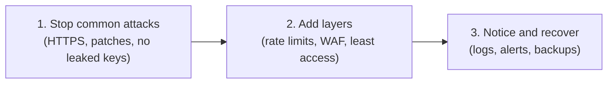

No single lock is enough. Each layer catches what the one before missed.
And you also plan for the day something gets through: backups you have tested, alerts someone reads.

The rest of this note is just these 3 questions:
1. Which items come first, and why?
2. For each layer, what do you do and how do you check it?
3. How do you notice a break-in and recover from it?


**The problem in one story.**
You launch a website and it works.
Within hours, bots start scanning it for open admin pages, old software and weak passwords.
Hardening is going through a checklist that closes the easy doors before they find one.
No single item makes you safe; together they make you a hard target.

**Words you need first**

| Word | Plain meaning | Tiny example |
| --- | --- | --- |
| Attack surface | Everything an attacker can reach and poke at | Public ports, URLs, forms |
| Hardening | Reducing that surface and tightening defaults | Closing unused ports |
| TLS / HTTPS | Encryption between browser and server | The padlock in the address bar |
| Security headers | Response headers telling the browser to be strict | `Content-Security-Policy` |
| Least privilege | Give each thing only the access it needs | DB user can't drop tables |
| Patching | Installing security fixes for software you run | Upgrading a vulnerable library |
| WAF | Web Application Firewall: filters bad requests | Blocking obvious SQL injection |

**Picture it**

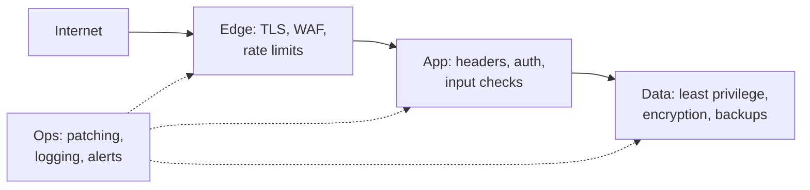

**Analogy.** Locking up a house: door locks, window latches, an alarm, a safe for valuables, and checking them regularly. Each layer stops a different kind of burglar.
Where it breaks: a house is attacked occasionally by people; a website is attacked constantly by automated bots, so checks must be automated too.

**How the rest of this note builds up**

- First, why it exists (section 1) and the mental model (section 2).
- Then the checklist layer by layer (section 3) and a worked hardening pass (section 4).
- Then how priorities change by site type (section 5).
- Finally the SDE-3 deep dive: prioritizing under limited time, monitoring and keeping the checklist true over time (sections 6-8), then interview questions and a cheat sheet.

> [!tip] Remember
> Layer the defenses, close what you don't use, patch what you do, and watch the logs.

## 1. Why it exists 🟢

Picture a small online shop launched on a Friday. By Monday its owner sees a defaced home page and a customer email saying "I got a strange login alert." The investigation finds three facts. The admin panel used the password `admin123`.

The site ran a plugin with a known, published vulnerability that had been fixed four months earlier. The database was reachable from the public internet on port 5432.

None of these needed a skilled attacker. Automated scanners probe every public IP address continuously, looking for exactly these mistakes. A new server on a public address typically receives probes within minutes (this is an observation common in security write-ups, not a precise figure).

The checklist exists because the mistakes are repetitive. The same ten categories of mistake cause most breaches, so a checklist catches most of them before an attacker does.

> [!tip] Remember
> You are not defending against "hackers". You are defending against scripts that try the same twenty mistakes on every site.

## 2. Mental model 🟢

Think of a building. You do not rely on one lock. You have a fence (network rules), a front door (TLS and authentication), badge readers on inner doors (authorization and least privilege), cameras (logs and alerts), a safe for valuables (secrets and encryption), and a fire plan with a backup site (backups and incident response).

The analogy breaks down in one place. A burglar must be physically present, so one person attacks one building at a time. On the internet, one script attacks a million sites at once, so even a low-value site gets attacked. Being "too small to target" is not a defense.

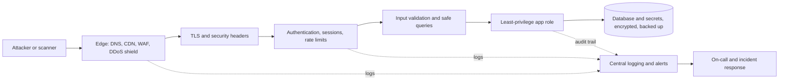

## 3. How it works 🟡

The checklist has ten layers. Each layer below follows the same pattern: what to do, how to check it, and why it matters. Priority tags are **P0** (do before launch), **P1** (do in the first month) and **P2** (do as the system matures).

### 3.1 Priority map

In plain words: you cannot do everything at once, so rank the items by how often they cause real breaches and how cheap they are to fix.

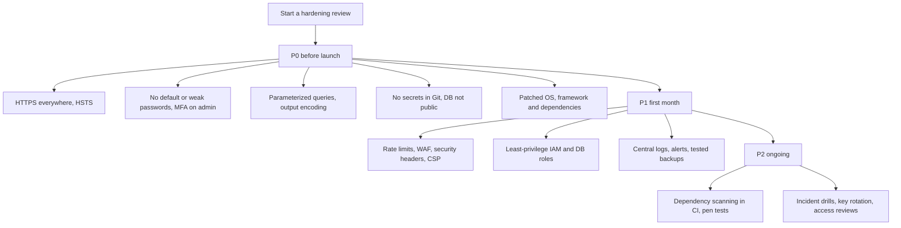

> [!tip] Remember
> P0 items are cheap and stop the most attacks. Do not start P2 work while a P0 item is open.

### 3.2 TLS and security headers

In plain words: TLS encrypts traffic between the browser and your server so nobody on the network path can read or change it. Security headers are instructions your server sends so the browser itself refuses risky behavior.

Example response headers (a good baseline, tune the CSP for your own site):

```text
Strict-Transport-Security: max-age=63072000; includeSubDomains; preload
Content-Security-Policy: default-src 'self'; script-src 'self'; object-src 'none'; frame-ancestors 'none'; base-uri 'self'
X-Content-Type-Options: nosniff
Referrer-Policy: strict-origin-when-cross-origin
Permissions-Policy: camera=(), microphone=(), geolocation=()
```

Checks you can run in 30 seconds:

```bash
# Headers actually sent by production
curl -sI https://example.com | grep -i -E 'strict-transport|content-security|x-content-type|referrer-policy|permissions-policy'

# Certificate subject, issuer and validity dates (add -tls1_2 or -tls1_3 to s_client to test one protocol version)
openssl s_client -connect example.com:443 -servername example.com </dev/null 2>/dev/null \
  | openssl x509 -noout -subject -issuer -dates

# Plain HTTP must redirect to HTTPS
curl -sI http://example.com | head -n 3
```

| Item | Target | Why |
| --- | --- | --- |
| TLS versions | 1.2 and 1.3 only, no SSLv3, TLS 1.0 or 1.1 | Older versions have known attacks |
| HSTS | `max-age` of at least one year once stable | Stops downgrade to plain HTTP and cookie theft on first-hop redirects |
| Certificate | Automated renewal, alert 21 days before expiry | An expired certificate is an outage and trains users to click through warnings |
| CSP | No `unsafe-inline` for scripts if you can avoid it | Limits the damage of an XSS bug |
| `frame-ancestors` or `X-Frame-Options` | Deny or allow-list | Blocks clickjacking |
| `nosniff` | Always | Stops the browser from running a file as a script because of how it looks |

> [!warning] Common mistake
> Adding `preload` to HSTS before every subdomain supports HTTPS. Preload lists are slow to undo, so a forgotten HTTP-only subdomain becomes unreachable. Start with a short `max-age`, raise it as you gain confidence, and add `preload` last.

More detail: [[TLS and HTTPS]] and [[CSRF, XSS and Security Headers]].

### 3.3 Authentication, sessions and rate limits

In plain words: attackers do not break passwords one at a time by hand. They replay millions of leaked username and password pairs from other sites, which is called **credential stuffing**. Your defenses are strong hashing, MFA, rate limits and safe sessions.

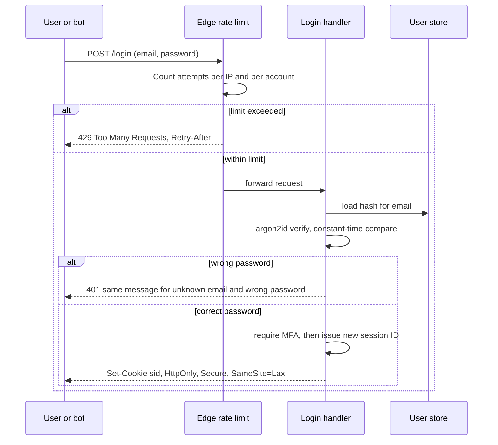

Checklist:

- **Password storage:** argon2id (or bcrypt or scrypt) with a per-user salt. Never MD5, SHA-1 or unsalted SHA-256. See [[Password Storage and Login Security]].
- **MFA:** required for every admin and for any account that can move money or data. Prefer authenticator apps or passkeys over SMS.
- **Lockout and rate limit:** limit by IP and by account, with a slowly growing delay instead of a permanent lock (a permanent lock lets an attacker lock out real users on purpose).
- **Same error message** for "no such user" and "wrong password", and similar response time, so attackers cannot list valid accounts.
- **Session cookie flags:** `HttpOnly; Secure; SameSite=Lax` (or `Strict`). The `__Host-` cookie name prefix adds a rule that the cookie must be `Secure`, have `Path=/` and no `Domain` attribute.
- **New session ID after login** and after privilege change, to stop session fixation.
- **Short idle timeout and an absolute timeout** for sessions, and a real server-side logout that invalidates the session.
- **Password reset:** single-use token, short expiry (for example 15 to 60 minutes), stored hashed, never reveal whether the email exists.
- **Breached-password check:** reject passwords found in known breach lists (for example, using the Have I Been Pwned range API, which only needs the first 5 characters of the SHA-1 hash).

An example login rate limit in Nginx (a per-IP limit; add per-account limits in the app):

```nginx
limit_req_zone $binary_remote_addr zone=login:10m rate=5r/m;

location = /login {
    limit_req zone=login burst=5 nodelay;
    limit_req_status 429;
    proxy_pass http://app;
}
```

> [!warning] Common mistake
> Rate limiting only by IP. A botnet rotates through thousands of IPs, each making one attempt. Also limit per account and per password-guess pattern, and use bot signals. See [[API Abuse and Bot Protection]] and [[Rate Limiting - Algorithms and Distributed Design]].

More detail: [[Sessions and Cookies]], [[Authentication vs Authorization]], [[JWT - Structure, Validation and Pitfalls]].

### 3.4 Input validation and injection

In plain words: every value that comes from a user is untrusted text, even from your own mobile app. **Injection** happens when untrusted text is mixed into a command (SQL, shell, HTML, a URL fetch) so the data is read as code.

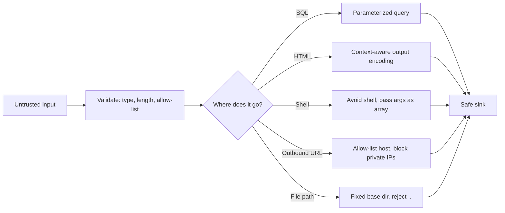

The unsafe and safe version of the same query:

```go
// Unsafe: attacker sends  ' OR '1'='1  as email
row := db.QueryRowContext(ctx, "SELECT id FROM users WHERE email = '"+email+"'")

// Safe: the driver sends the value separately from the SQL text
row := db.QueryRowContext(ctx, "SELECT id FROM users WHERE email = $1", email)
```

| Attack | Where it hits | Primary fix |
| --- | --- | --- |
| SQL injection | Database queries | Parameterized queries, least-privilege DB role |
| XSS (cross-site scripting) | HTML pages | Output encoding by context, CSP, `HttpOnly` cookies |
| SSRF (server-side request forgery) | Server fetching a user-given URL | Allow-list hosts, block private and link-local ranges, require IMDSv2 |
| Command injection | Shell calls | Do not use a shell, pass arguments as a list |
| Path traversal | File reads and uploads | Resolve to a fixed base directory and reject escapes |
| Mass assignment | JSON bound onto a model | Bind to an explicit input struct with only allowed fields |
| File upload abuse | Upload endpoints | Check type by content, random filenames, store outside web root, size limit, scan |

> [!warning] Common mistake
> Validating only in the browser. Client-side checks are a usability feature. Attackers call your API directly, so the server must validate everything again.

More detail: [[OWASP API Security Top 10]] and [[CSRF, XSS and Security Headers]].

### 3.5 Secrets, dependencies and patching

In plain words: your code is mostly other people's code. A single vulnerable library or a single leaked key can undo every other control.

Secrets rules:

- No secrets in Git, container images, front-end bundles or logs. Use a secrets manager. See [[Secrets Management]].
- Run a secret scanner in CI and as a pre-commit hook, for example `gitleaks detect --source .`.
- Give each environment and each service its own credential, so one leak has a small blast radius.
- Rotate on a schedule and immediately on any suspected exposure.

Dependency and patch rules:

```bash
# Go: scan for known vulnerabilities that are actually reachable from your code
govulncheck ./...

# Node: list known vulnerable packages
npm audit --omit=dev

# Container image: scan OS packages and language dependencies
trivy image myorg/api:1.4.2

# Pin and verify
go mod verify
```

- Subscribe to security advisories for your framework, your CMS and plugins, and your base image.
- Keep a patch service level: for example critical issues within 48 hours, high within 7 days (these are example targets; set yours based on risk).
- Remove unused plugins, packages and services. Code you do not run cannot be exploited.
- Pin base images to a version or digest, use minimal images, and run as a non-root user. See [[Docker 09 - Container Security and Hardening]].
- Protect the build pipeline: least-privilege CI tokens, no long-lived cloud keys in CI (use OIDC federation), required code review on the main branch.

> [!tip] Remember
> You are responsible for the vulnerabilities in every package you ship, not just the code you wrote.

### 3.6 Least-privilege access (IAM and database)

In plain words: every identity (a person, a service, a CI job) should be able to do only what it needs, so a stolen identity cannot do everything. This is the **principle of least privilege**.

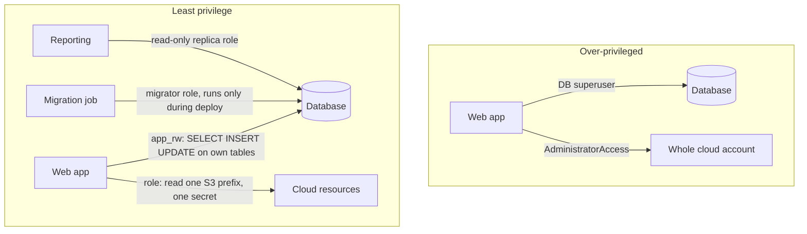

Checklist:

- Application database user cannot `DROP`, `CREATE ROLE` or read tables it does not use. Use a separate role for migrations.
- Cloud: no `*:*` policies, no long-lived access keys on laptops, humans use SSO with MFA, workloads use roles (instance profile, IRSA on Kubernetes, OIDC from CI).
- Enable **IMDSv2** on EC2 so an SSRF bug cannot read instance credentials with a single simple GET request. Example: `aws ec2 modify-instance-metadata-options --instance-id i-0123456789abcdef0 --http-tokens required --http-endpoint enabled`.
- Turn on S3 Block Public Access at the account level, and check with `aws s3api get-public-access-block --bucket my-bucket`.
- Review access every quarter: list users, roles, keys and API tokens, and delete what is unused. In AWS, `aws iam generate-credential-report` and `aws iam get-credential-report` show key age and last use.
- Admin tools (database consoles, dashboards, Kubernetes API) are not on the public internet. Put them behind a VPN, bastion, or identity-aware proxy.

More detail: [[AWS 02 - IAM]] and [[Service-to-Service Auth - API Keys, HMAC, mTLS]].

### 3.7 Network, WAF and DDoS protection

In plain words: the fewer doors you expose, the fewer you must guard. A **WAF** (web application firewall) filters known-bad HTTP requests. A **DDoS** shield absorbs floods of traffic so real users still get through.

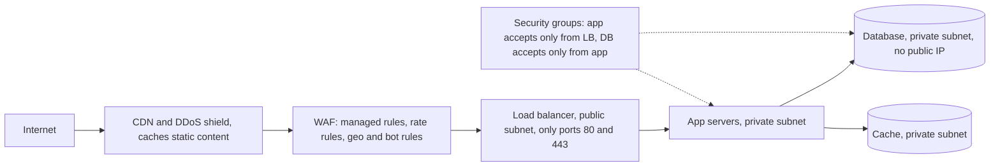

Checklist:

- Only 80 and 443 are open to the internet. SSH and database ports are closed or limited to a bastion or VPN.
- Databases and caches have no public IP. Verify with `ss -tlnp` on the host and an external scan such as `nmap -Pn -p 22,3306,5432,6379,9200,27017 <public-ip>` from outside (only scan systems you own).
- Put the origin server behind the CDN and restrict the origin to accept traffic from the CDN only, so attackers cannot bypass the shield by hitting the origin IP directly.
- Enable the WAF's managed rule sets (for example the OWASP core rules) in monitor mode first, review false positives, then block.
- Rate-limit expensive endpoints (login, search, password reset, checkout) separately from cheap ones.
- Have a DDoS runbook: who to call at the CDN or cloud provider, how to turn on stricter rules, how to serve a static fallback page.

> [!warning] Common mistake
> Trusting a WAF as the fix for an application bug. A WAF is a speed bump that buys time. The injectable query still has to be fixed in the code.

More detail: [[CDN and Edge]], [[API Abuse and Bot Protection]], [[Load Shedding and Graceful Degradation]].

### 3.8 Backups and recovery

In plain words: ransomware, a bad deploy, a deleted table or a hacked admin all end the same way. You need a clean copy you can restore. Backups the attacker can also delete are not backups.

- Automated daily backups plus point-in-time recovery for the main database. See [[Backup, PITR and Disaster Recovery]].
- Keep at least one copy in a separate account or region with write-once or versioned storage (for example S3 Object Lock), so a compromised production account cannot erase it.
- **Test the restore** on a schedule. Record how long it took. That number is your real recovery time.
- Encrypt backups and restrict who can read them. A backup is a copy of all your data.
- Write down your recovery objectives: **RPO** (how much data you can lose) and **RTO** (how long you can be down).

> [!tip] Remember
> A backup is only real after a restore has worked. Until then it is a hope.

### 3.9 Logging, alerting and compromise monitoring

In plain words: you cannot respond to what you cannot see. Many breaches are discovered by outsiders (customers, researchers, banks) long after they start, partly because nobody was looking at the logs.

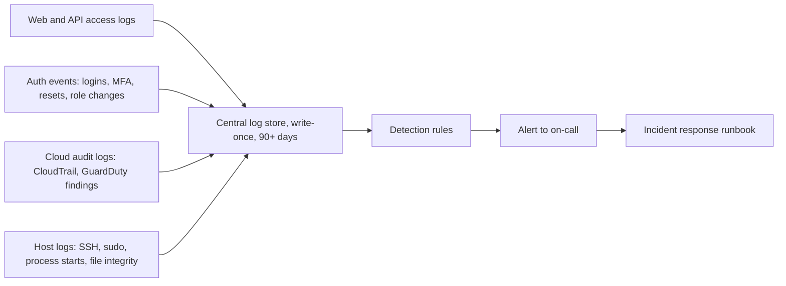

What to log (without logging secrets, passwords, full card numbers or tokens):

- Authentication: successes, failures, MFA challenges, password resets, new device, role or permission changes.
- Admin actions and data export or bulk-read actions, with user ID, IP and request ID.
- Cloud control-plane activity: CloudTrail enabled in all regions, with log file validation.
- Outbound connections from servers (an attacker's data theft and command channel show up here).

Alerts worth having on day one:

| Signal | Example detection | Why it matters |
| --- | --- | --- |
| Login failures spike | Failed logins per minute well above baseline | Credential stuffing |
| Impossible travel or new country for admin | Same user from two distant IPs within minutes | Stolen session or password |
| New IAM user, access key or SSH key | Any create event outside a deploy | Persistence after compromise |
| Disabled logging or security tooling | `StopLogging`, GuardDuty disabled | Attacker covering tracks |
| Unusual outbound volume | Bytes out far above baseline | Data exfiltration |
| New cron job, new binary in web root | File integrity change on a web server | Web shell or backdoor |
| Spike of 4xx or 5xx on one path | Rate of 404 or 500 on `/wp-login.php`, `/.env`, `/admin` | Scanning and exploitation attempts |

Useful host checks during a review (run on a Linux server you own):

```bash
# Recent logins and failed logins
last -n 20
sudo lastb -n 20

# Listening sockets and the process behind each
sudo ss -tlnp

# Cron jobs for all users (look for unknown entries)
for u in $(cut -f1 -d: /etc/passwd); do sudo crontab -l -u "$u" 2>/dev/null; done
ls -la /etc/cron.d /etc/cron.daily /etc/cron.hourly 2>/dev/null

# Files in the web root modified in the last 2 days
find /var/www -type f -mtime -2 -ls
```

See [[Structured Logging]] and [[Alerting and On-Call]].

### 3.10 Incident-response readiness

In plain words: the worst time to decide who is in charge is during the attack. Prepare before.

Checklist:

- A written plan: who declares an incident, who decides to take the site offline, who talks to customers and regulators. See [[Security Incident Response - When Your Website Is Hacked]] and [[Incident Response]].
- An up-to-date contact list: on-call engineers, security lead, legal, communications, hosting provider, CDN, payment processor.
- A way to rotate every secret quickly. If rotation takes a week, a leak is a week-long incident.
- A way to take a forensic snapshot of a server or volume before changing it.
- A tabletop drill at least twice a year ("the database was dumped, what do we do in the first hour?").
- Know your legal duties up front: for example GDPR's 72-hour window (from becoming aware, where feasible, if people's rights are at risk), India's CERT-In 6-hour reporting rule for specified incidents, and obligations to your acquirer and card brands if card data is involved (PCI DSS v4.0 requires a documented incident response plan, requirement 12.10). Details in [[Security Incident Response - When Your Website Is Hacked]].
- A responsible disclosure channel: a `security.txt` file at `/.well-known/security.txt` and a monitored security email address.

> [!tip] Remember
> Fast containment depends on preparation you did when nothing was wrong.

## 4. Worked example 🟡

A small team, "ShopFast", runs a Go API and a React shop on AWS. A new engineer runs this checklist before the launch.

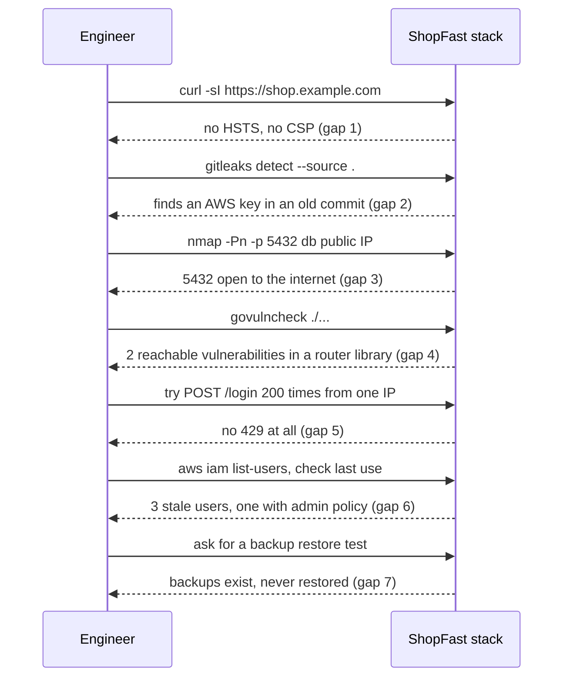

The engineer ranks the seven gaps and fixes them in this order:

| Order | Gap | Fix | Time (estimate) |
| --- | --- | --- | --- |
| 1 | AWS key in Git history | Deactivate and rotate the key first, then add gitleaks to CI, then purge history | 1 hour |
| 2 | Database public on 5432 | Move to a private subnet, security group allows only the app | 1 hour |
| 3 | Vulnerable router library | `go get` the fixed version, run tests, redeploy | 1 hour |
| 4 | No login rate limit | Edge rule 5 per minute per IP plus per-account limit in the app | half a day |
| 5 | Missing HSTS and CSP | Add headers at the load balancer, CSP in report-only mode first | half a day |
| 6 | Stale admin IAM user | Delete users, switch humans to SSO with MFA | half a day |
| 7 | Untested backups | Restore into a scratch instance and time it | half a day |

Why this order: the first three can be exploited by a scanner today with no skill. The rest reduce damage or raise attacker cost.

### Whiteboard version

If asked "how would you secure a new web app?" in an interview, draw the layers and talk in this order:

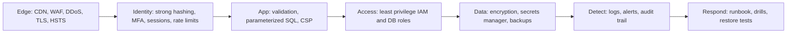

Say: "I would start with what causes most breaches (TLS, patched dependencies, no leaked secrets, no weak admin credentials), then add rate limits and a WAF, then least privilege, and finally monitoring and a tested recovery plan, because I assume one layer will fail."

## 5. Variants and comparison 🟡

How the same checklist changes by system type:

| System | Extra focus | Typical extra controls |
| --- | --- | --- |
| Marketing or content site (CMS) | Plugins, admin login, file permissions | Auto-updates, remove unused plugins, admin behind VPN or SSO, read-only file system where possible |
| API backend | Authorization (object and function level), tokens, rate limits | See [[OWASP API Security Top 10]], short-lived tokens, per-client quotas |
| E-commerce | Payment data, fraud, bot checkouts | Use a hosted payment page to reduce PCI scope, bot protection, order-velocity checks |
| Internal admin tool | Exposure, SSO | No public access, identity-aware proxy, full audit log |
| SaaS multi-tenant | Tenant isolation | Tenant ID enforced in every query, row-level security, per-tenant keys for sensitive data |
| Kubernetes workload | Pod and network policy | Non-root, read-only root file system, network policies, no privileged pods, secrets from an external store |

Where to place the WAF:

| Option | How it works | Best for | Cost |
| --- | --- | --- | --- |
| CDN-integrated WAF (Cloudflare, CloudFront with AWS WAF) | Filters at the edge before traffic reaches you | Most public sites | Per-request or monthly fee |
| Load-balancer WAF (AWS WAF on ALB) | Filters at your entry point | Apps already behind an ALB | Per rule and per request |
| In-process or Nginx module (ModSecurity) | Filters on your own server | Strict control, on-premises | Your CPU and tuning time |

## 6. Trade-offs and when not to use 🟡

- **Strict CSP vs developer speed.** A strict CSP breaks inline scripts and some third-party widgets. Start in report-only mode (`Content-Security-Policy-Report-Only`), collect reports, then enforce.
- **Rate limits vs real users.** Offices and mobile carriers share IPs behind NAT. A tight per-IP limit blocks real customers. Combine IP, account and device signals.
- **MFA friction vs safety.** Requiring MFA on every action hurts conversion. Require it for login from a new device and for sensitive actions (change email, payout, export).
- **WAF false positives.** A rule meant to stop SQL injection can block a legitimate search for a phrase like "select from". Run new rules in count mode first.
- **Logging vs privacy.** More logging helps investigations but increases the data you must protect and the regulations you fall under. Log events and identifiers, not secrets or whole request bodies.
- **Cost.** Managed WAF, SIEM and bot services cost money. For a tiny site, a CDN with free tier protection, automatic updates, MFA and tested backups give most of the value.
- **When not to over-engineer.** A static brochure site without logins or user data does not need an HSM, a SIEM or a pen test each quarter. It needs HTTPS, patched hosting, a locked-down admin account and backups.

> [!tip] Remember
> Spend security effort in proportion to what an attacker could steal or break, and always do the cheap P0 items.

## 7. In production 🔴

Real-world habits that separate mature teams:

- **Security in the pipeline.** CI runs secret scanning, dependency scanning (`govulncheck`, `npm audit`, `trivy`), and static analysis on every pull request. A failing high-severity finding blocks the merge.
- **A security header regression test.** A small test calls the staging site and asserts the expected headers, so a proxy change cannot silently remove HSTS.
- **Continuous attack-surface review.** Regularly list public DNS records, open ports and public buckets. Forgotten staging sites and old subdomains are common entry points (**subdomain takeover** happens when a DNS record points at a cloud service nobody owns anymore).
- **Vulnerability disclosure.** Publish `/.well-known/security.txt`, triage reports within days, and thank reporters. Some teams run a bug bounty.
- **Access reviews and offboarding.** When someone leaves, their SSO account, cloud access, GitHub, and any shared passwords are revoked the same day.
- **Metrics to watch.** Failed logins per minute, 4xx and 5xx rates, WAF blocked requests, certificate days until expiry, age of the oldest access key, time since last successful restore test, count of critical unpatched vulnerabilities.

Example PromQL for two of these (names assume a typical HTTP exporter and `blackbox_exporter`; adjust to your metric names):

```text
# Share of login requests that fail with 401 in the last 5 minutes
sum(rate(http_requests_total{path="/login", status="401"}[5m]))
  / sum(rate(http_requests_total{path="/login"}[5m]))

# Days until the TLS certificate expires (blackbox_exporter metric)
(probe_ssl_earliest_cert_expiry - time()) / 86400
```

Failure modes:

| Failure | How it appears | Fix |
| --- | --- | --- |
| Certificate expired | Browser warning, API clients fail | Automated renewal and an alert at 21 days |
| WAF rule blocks checkout | Conversion drops, support tickets | Count mode before block, easy per-rule disable |
| Secret rotated but one service missed | One service gets 401 from a dependency | Inventory of consumers, overlap window during rotation |
| Backup job silently failing | No recent backup file | Alert on "no successful backup in 26 hours" |
| Alert fatigue | On-call ignores security alerts | Tune thresholds, route only actionable alerts to pagers |

## 8. Deep dive 🔴

### 8.1 Why HSTS needs a first visit, and how preload helps

HSTS tells the browser "only use HTTPS for this domain for the next N seconds." On the very first visit the browser has not seen the header yet, so a network attacker could strip the redirect to HTTPS.

The browser preload list ships a built-in list of domains, so even the first visit is HTTPS. The cost is that removal from the list takes a long time, which is why you must be sure first.

### 8.2 SameSite and CSRF

`SameSite=Lax` makes the browser skip the cookie on cross-site POST requests and most embedded requests, which blocks most CSRF (cross-site request forgery) by default. It does not protect you from same-site attacks (a vulnerable subdomain) and it does not replace CSRF tokens for sensitive actions. See [[CSRF, XSS and Security Headers]].

### 8.3 Why parameterized queries work

With a parameterized query, the SQL text and the values travel separately: the database parses the SQL structure first, then plugs in values as data. A quote character in a value is just a quote character, never a way to end the string and add a new command.

This is a structural fix. Escaping functions try to patch each special character and are easy to get wrong.

### 8.4 SSRF and cloud metadata

SSRF makes your server fetch a URL chosen by the attacker. If the attacker asks for `http://169.254.169.254/latest/meta-data/iam/security-credentials/`, a vulnerable server may return its cloud credentials. IMDSv2 requires a session token obtained by a `PUT` request with a header, and it limits hop count by default, which blocks most simple SSRF paths.

Defense is layered: allow-list outbound hosts, block link-local ranges in the HTTP client, require IMDSv2, and give the instance role minimal permissions.

### 8.5 Supply chain risk

A dependency can be malicious or taken over. Reduce risk by pinning versions, committing lock files, verifying checksums (`go mod verify`, the Go checksum database), reviewing new dependencies, limiting install-time scripts in package managers, and building in a clean CI environment with minimal secrets.

### 8.6 Measuring hardening

Pick measurable indicators: percent of services behind the WAF, median time to patch critical vulnerabilities, number of long-lived keys, percent of admin accounts with MFA, time to rotate all secrets (tested), and restore time from the last drill. Track them monthly; the trend matters more than the exact value.

## 9. Interview questions 🔴

> [!question]- You are asked to secure a new public web application before launch. What do you do, in what order?
> Start with the P0 items that stop automated attacks: HTTPS with HSTS, no default or weak credentials and MFA for admins, parameterized queries and output encoding, no secrets in the repo and a private database, and patched dependencies. Then add rate limits, a WAF, security headers and CSP, least-privilege IAM and database roles. Then logging, alerting, tested backups and an incident runbook. Name the principle: defense in depth, because any single layer can fail.

> [!question]- What is the difference between authentication hardening and session hardening?
> Authentication hardening protects the moment of proving identity: strong password hashing (argon2id), MFA, rate limits and generic error messages against credential stuffing. Session hardening protects the proof after login: `HttpOnly`, `Secure` and `SameSite` cookies, a fresh session ID after login, idle and absolute timeouts, and server-side invalidation on logout. A site can have a perfect login and still lose accounts if the session cookie is readable by JavaScript.

> [!question]- Why is a WAF not a substitute for fixing an injection bug?
> A WAF matches known patterns, and attackers can encode or restructure payloads to evade it. It gives temporary protection while you fix the code (virtual patching). The real fix is structural: parameterized queries so data can never be read as SQL. Also, a WAF only protects traffic that goes through it, and an attacker who finds the origin IP can bypass it.

> [!question]- Your cloud account has one IAM role with `AdministratorAccess` used by every service. What is the risk and what do you change?
> A single compromised service, for example through SSRF or a leaked key, gives the attacker full control of the account, including the ability to delete backups and logs. Split into one role per service with only the actions and resources it needs, use short-lived credentials (instance or workload roles, OIDC from CI), protect backups in a separate account, and monitor for privilege escalation events such as new policies or access keys.

> [!question]- How would you detect that a web server has already been compromised?
> Look for changes and unusual activity: new or modified files in the web root (`find /var/www -mtime -2`), unknown cron jobs and systemd units, new users or SSH keys, unexpected listening ports or outbound connections (`ss -tlnp`, flow logs), spikes of requests to odd paths in access logs, new IAM keys or logging being disabled in CloudTrail, and large outbound data volumes. Central logs, file integrity monitoring and an alert on each of these let you find it in hours rather than months.

> [!question]- Trap: "We have HTTPS, so our site is secure." What is wrong with that?
> HTTPS only protects data in transit between the browser and your server. It says nothing about whether the application is vulnerable to SQL injection or XSS, whether passwords are hashed correctly, whether secrets are leaked, or whether the database is open to the internet. Attackers use HTTPS too. TLS is one item on the checklist, not the whole checklist.

> [!question]- How do you decide how much security effort a small project needs?
> Rank by what could be stolen or broken and how likely it is. Always do the cheap P0 items: HTTPS, patching, MFA on admin, no secrets in Git, tested backups. Add layers such as a WAF, SIEM or pen tests as the value of the data and the traffic grow. A static brochure site and a payment platform need very different amounts of work, but both need the P0 items.

## 10. Cheat sheet 🟢

- Order of work: P0 (HTTPS and HSTS, strong auth and MFA, parameterized queries, no leaked secrets, patched software, private database) then P1 (rate limits, WAF, headers, least privilege, logs, backups) then P2 (CI scanning, drills, rotation, access reviews).
- Headers to ship: `Strict-Transport-Security`, `Content-Security-Policy`, `X-Content-Type-Options: nosniff`, `Referrer-Policy`, `Permissions-Policy`.
- Cookies: `HttpOnly; Secure; SameSite=Lax`, new session ID on login, idle and absolute timeouts.
- Passwords: argon2id, per-user salt, breached-password check, generic error, rate limit per IP and per account.
- Injection: parameterized queries, output encoding, allow-list outbound URLs, no shell calls.
- Scanners: `govulncheck ./...`, `npm audit`, `trivy image`, `gitleaks detect`.
- Cloud: least-privilege roles, IMDSv2 required, S3 Block Public Access, no public database, CloudTrail in all regions.
- Backups: separate account, write-once, encrypted, and restore-tested with a recorded time.
- Detect: alert on login failure spikes, new IAM keys, disabled logging, odd outbound volume and new files in the web root.
- Prepare: a written response plan, a contact list, fast secret rotation, and a drill twice a year.

## Links

- **Before this:** [[OWASP API Security Top 10]], [[Authentication vs Authorization]]
- **Next:** [[Security Incident Response - When Your Website Is Hacked]], [[Incident Response]]
- **Go deeper:** [[TLS and HTTPS]], [[CSRF, XSS and Security Headers]], [[Sessions and Cookies]], [[Password Storage and Login Security]], [[JWT - Structure, Validation and Pitfalls]], [[Secrets Management]], [[Service-to-Service Auth - API Keys, HMAC, mTLS]], [[API Abuse and Bot Protection]], [[CORS and Same-Origin Policy]]
- **Related:** [[AWS 02 - IAM]], [[Docker 09 - Container Security and Hardening]], [[CDN and Edge]], [[Backup, PITR and Disaster Recovery]], [[Structured Logging]], [[Alerting and On-Call]], [[Rate Limiting - Algorithms and Distributed Design]]

### Watch on YouTube

- [Website Security Checklist](https://www.youtube.com/watch?v=p0aZL3nwC2I) · Verpex · 5 min · 359 views
- [Hardening Techniques - CompTIA Security+ SY0-701 - 2.5](https://www.youtube.com/watch?v=wXoC46Qr_9Q) · Professor Messer · 12 min · 212,552 views
