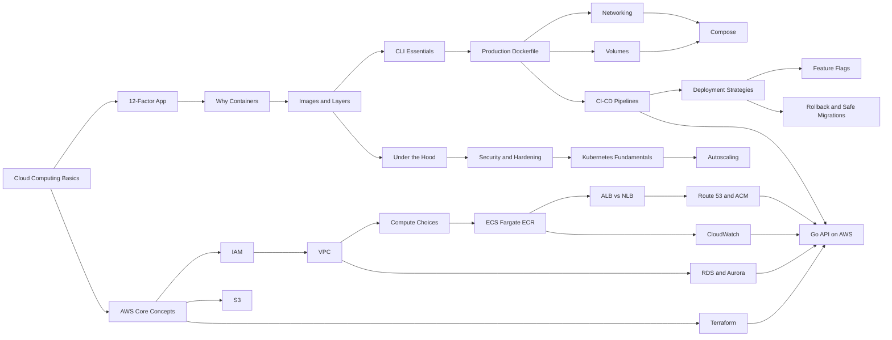

# 13 DevOps & Cloud MOC

> [!summary] What this folder covers
> How to package a Go service into a container, ship it safely through CI/CD, run it on Kubernetes or AWS, and describe the whole setup as code. After this folder you can design and defend a production deployment of a Go API.

## Before and after

- **Before this:** [[06 Backend Engineering in Go MOC]]
- **After this:** [[14 Observability & SRE MOC]]

## Learning path

1. [[Cloud Computing Basics]] · basic. The service models and building blocks every later note assumes.
2. [[Cloud Native and the 12-Factor App]] · intermediate. The design rules that make a service easy to containerize, scale and replace.

### Docker

3. [[Docker 01 - Why Containers]] · basic. What problem containers solve and how they differ from virtual machines.
4. [[Docker 02 - Images, Layers and Containers]] · basic. The image, layer and container model behind every Docker command.
5. [[Docker 03 - CLI Essentials]] · basic. The everyday commands for building, running, inspecting and cleaning up.
6. [[Docker 04 - Writing a Production Dockerfile for Go]] · intermediate. Multi-stage builds, cache ordering and tiny static Go images.
7. [[Docker 05 - Networking and Port Publishing]] · intermediate. Bridge networks, embedded DNS and how ports reach a container.
8. [[Docker 06 - Volumes and Bind Mounts]] · intermediate. Where container data lives and how to keep it across restarts.
9. [[Docker 07 - Docker Compose for Local Development]] · intermediate. Running a Go API with its database and cache using one file.
10. [[Docker 08 - How Docker Works Under the Hood]] · advanced. Namespaces, cgroups, overlayfs and the containerd/runc stack.
11. [[Docker 09 - Container Security and Hardening]] · advanced. Non-root users, minimal images, scanning, SBOMs and signing.

### Delivery and Kubernetes

12. [[CI-CD Pipelines (GitHub Actions for Go)]] · intermediate. A pipeline that tests, builds, scans and pushes a Go image.
13. [[Deployment Strategies - Rolling, Blue-Green, Canary]] · intermediate. How to replace running versions without downtime and limit the blast radius.
14. [[Feature Flags]] · intermediate. Separating deploy from release so features can be turned off without a redeploy.
15. [[Rollback and Safe Migrations]] · intermediate → advanced. Getting back to a good state when the schema has already changed.
16. [[Kubernetes Fundamentals]] · intermediate. Pods, Deployments, Services, probes and the reconciliation loop.
17. [[Autoscaling]] · intermediate → advanced. HPA, cluster autoscaling and the limits that scaling hits downstream.

### AWS

18. [[AWS 01 - Core Concepts (Regions, AZs, Accounts, Shared Responsibility)]] · basic. The geography and account model all AWS designs rest on.
19. [[AWS 02 - IAM]] · basic → intermediate. Users, roles and policies, and why workloads should use roles.
20. [[AWS 03 - VPC Networking]] · intermediate. Subnets, route tables, NAT and security groups for a private service.
21. [[AWS 04 - Compute Choices - EC2, ECS-Fargate, EKS, Lambda]] · intermediate. Choosing where the Go binary actually runs.
22. [[AWS 05 - ECS, Fargate and ECR]] · intermediate. Task definitions, services and the image registry.
23. [[AWS 06 - Load Balancing (ALB vs NLB)]] · intermediate. Layer 7 versus layer 4 load balancers and target groups.
24. [[AWS 07 - S3]] · basic → intermediate. Object storage, presigned URLs, lifecycle rules and events.
25. [[AWS 08 - RDS and Aurora]] · intermediate. Managed Postgres, Multi-AZ, read replicas and RDS Proxy.
26. [[AWS 09 - Route 53 and ACM]] · basic. DNS records, routing policies and free managed TLS certificates.
27. [[AWS 10 - CloudWatch]] · intermediate. Logs, metrics and alarms for services running on AWS.
28. [[Infrastructure as Code with Terraform]] · intermediate. State, modules and plans for reproducible infrastructure.
29. [[Deploying a Go API on AWS (Reference Architecture)]] · advanced. Every piece above assembled into one production design.

## Concept map

## Interview focus

- How is a container different from a virtual machine, and what do namespaces and cgroups do? See [[Docker 01 - Why Containers]] and [[Docker 08 - How Docker Works Under the Hood]].
- How would you write a small, secure Dockerfile for a Go service? See [[Docker 04 - Writing a Production Dockerfile for Go]].
- Compare rolling, blue-green and canary deployments. See [[Deployment Strategies - Rolling, Blue-Green, Canary]].
- How do you roll back a release that already ran a database migration? See [[Rollback and Safe Migrations]].
- Explain Pods, Deployments, Services and liveness versus readiness probes. See [[Kubernetes Fundamentals]].
- How does the Horizontal Pod Autoscaler decide to scale, and what breaks when it does? See [[Autoscaling]].
- What makes an app "12-factor", and why does it matter for containers? See [[Cloud Native and the 12-Factor App]].
- Design the VPC for a private API with a public load balancer. See [[AWS 03 - VPC Networking]].
- When would you pick an ALB over an NLB? See [[AWS 06 - Load Balancing (ALB vs NLB)]].
- Walk through deploying a Go API on AWS end to end. See [[Deploying a Go API on AWS (Reference Architecture)]].

## Sources worth reading

- [The Twelve-Factor App](https://12factor.net/)
- [Docker documentation: Dockerfile best practices](https://docs.docker.com/build/building/best-practices/)
- [Kubernetes documentation: Concepts](https://kubernetes.io/docs/concepts/)
- [AWS Well-Architected Framework](https://docs.aws.amazon.com/wellarchitected/latest/framework/welcome.html)
- [Terraform documentation](https://developer.hashicorp.com/terraform/docs)
- *Kubernetes Up and Running* by Burns, Beda, Hightower and Evenson.
