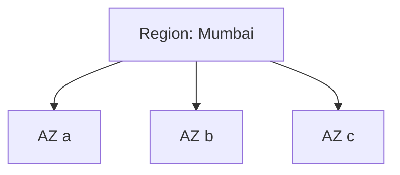
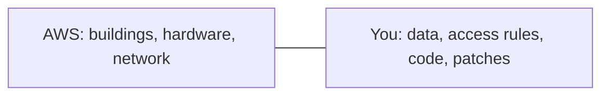
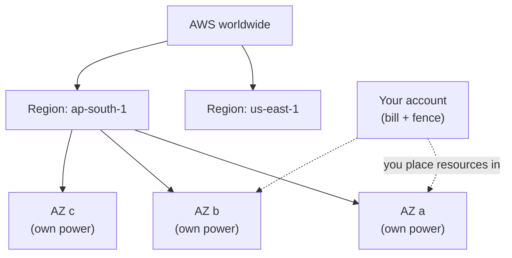
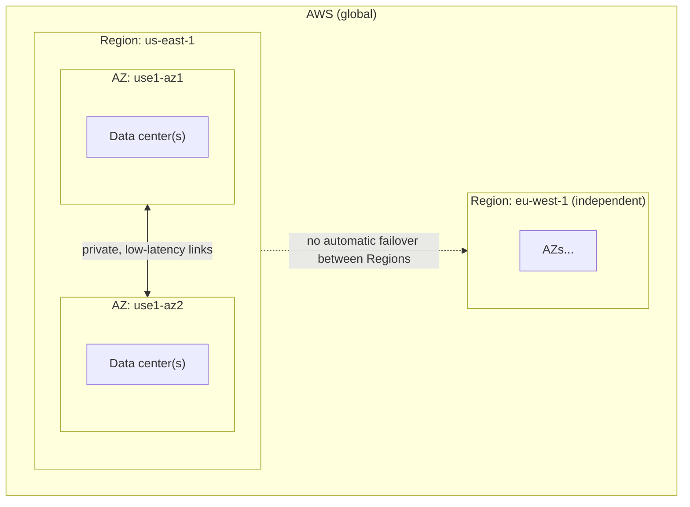
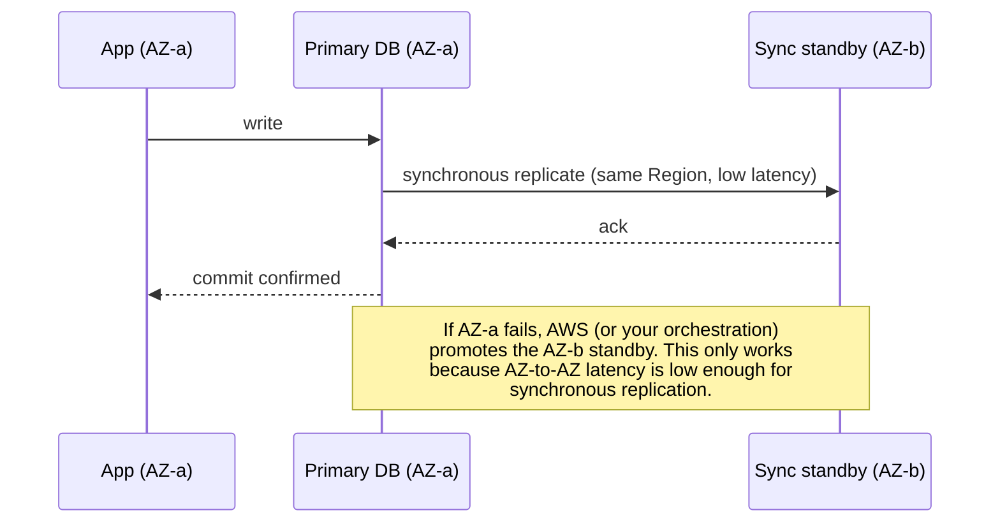
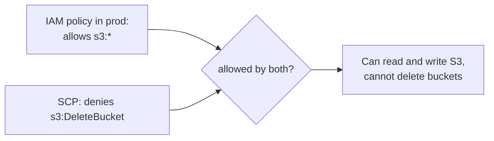
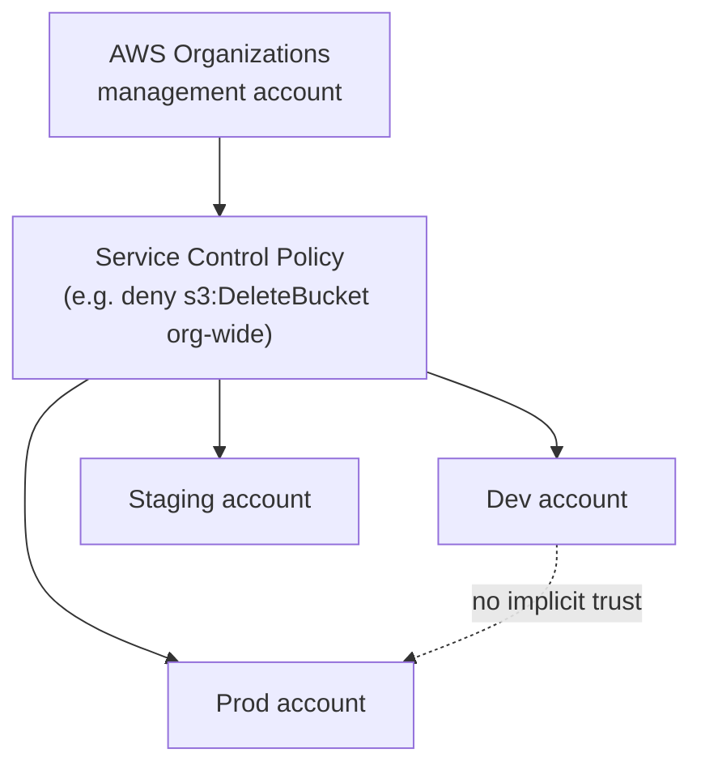
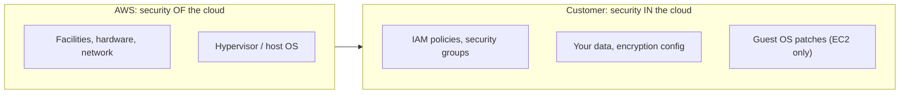

# AWS 01 - Core Concepts (Regions, AZs, Accounts, Shared Responsibility)

> [!summary] TL;DR
> AWS rents out compute, storage and networking from data centers grouped into **Regions** (independent, geographically separate) and **Availability Zones**, or **AZs** (physically separate data centers inside one Region, connected by low-latency private links). Every resource you create lives inside one **account**, and the **Shared Responsibility Model** draws the line between what AWS secures (the hardware and the services themselves) and what you secure (your data, your configuration, your access controls).

> [!abstract] Core idea
> - A **Region** is a self-contained cluster of data centers in one geography (for example `us-east-1`); nothing fails over between Regions automatically.
> - An **Availability Zone** is one or more data centers inside a Region, isolated from the other AZs' power and flooding risk, linked by a private network fast enough to run a synchronous database replica across two of them.
> - An **account** is AWS's billing and isolation boundary: every resource, every IAM policy, every service limit is scoped to one account unless you explicitly share across accounts.
> - **Shared responsibility**: AWS secures "of the cloud" (facilities, hardware, the host OS and hypervisor, and the managed service's own code); you secure "in the cloud" (your data, your IAM policies, your guest OS if you run one, your network configuration).
> - As of this writing AWS documents 39 Regions and 124 Availability Zones (AWS Global Infrastructure page, accessed 2026-11-07) — the exact count keeps growing, so treat it as a magnitude, not a fact to memorize precisely.

## Start here: the basics 🟢

> [!info] How to read this note (pick your level)
> - 🟢 **New to this?** Read "From zero" below, then sections 1, 2 and 10 (why, mental model and the cheat sheet). Stop there, that is a full first pass.
> - 🟡 **Know the basics?** Add sections 3, 4, 5 and 6 (how it works, a worked example, options and trade-offs).
> - 🔴 **Interview / SDE-3 prep?** Add sections 7, 8 and 9 (production, deep dive and interview questions). Headings are tagged 🟢🟡🔴 so you always know where you are.

> [!note] Before this note
> - Nothing. This note starts from zero. If you want the general picture of renting servers first, [[Cloud Computing Basics]] is a gentle warm-up, but it is not required.

**From zero, in 60 seconds** 🟢

AWS has huge data centers all over the world. You rent pieces of them.
They are grouped into **Regions**: whole separate areas, like Mumbai or Ireland. Pick the one near your users.
Each Region has a few **Availability Zones** (AZs): separate buildings, far enough apart that one fire or power cut won't hit them all.



Put copies of your app in 2-3 AZs. If one building goes down, the others keep serving.
Everything you create lives in an **account**, which is also a wall: things in one account can't touch another by default.
And security is split: AWS guards the buildings and hardware; you guard your settings, data and code.



The rest of this note is just these 3 questions:
1. How do Regions and AZs help you stay up?
2. How do accounts and Organizations keep teams apart?
3. What exactly is your job vs AWS's job on security?


**The problem in one story.**
You build a small shop website and run it on one computer in your office.
One night the power goes out, and the shop is offline until morning.
You could buy more computers, more buildings and more staff, but that is slow and expensive.
AWS rents you computers in many buildings around the world, so you can spread your site out and pay only for what you use.

**Words you need first**

| Word | Plain meaning | Tiny example |
| --- | --- | --- |
| Server | A computer that runs your program for other people | The machine serving your shop's web pages |
| Data center | A building full of servers, power and cooling | One warehouse of racks in Mumbai |
| Region | A group of AWS data centers in one geography | `ap-south-1` (Mumbai) |
| Availability Zone (AZ) | One isolated data center (or group) inside a Region | `ap-south-1a` |
| Account | Your private AWS space: login, bill and limits | A "prod" account separate from "dev" |
| Latency | Time for a message to travel and come back | ~1 ms between AZs vs ~100 ms across oceans |
| Replication | Keeping copies of data in more than one place | A database copy in a second AZ |
| Blast radius | How much breaks when one thing goes wrong | One bad deploy only hits the dev account |
| SLA | A written uptime promise from the provider | 99.99% per month ≈ 4 minutes down |
| IAM | AWS's system for who may do what | "this role may read this bucket" |
| AWS Organizations | A way to group many AWS accounts under one owner | dev, staging, prod accounts under one company |
| SCP (service control policy) | An org-wide rule that caps what any account can do | "nobody may delete S3 buckets" |
| Shared Responsibility Model | The split of security work between AWS and you | AWS guards the hardware; you guard your settings |
| Multi-AZ | Running copies in two or more AZs so one can fail | DB primary in AZ a, standby in AZ b |

**Picture it**



**Analogy.** AWS is like a bank with branches in many cities (Regions), each branch spread over a few separate buildings (AZs); your account is your private locker in the bank.
Where it breaks: a bank moves your money between branches for you, but AWS never copies your data to another Region unless you set it up.

**How the rest of this note builds up**

- First, why the cloud exists (section 1) and the utility-company mental model (section 2).
- Then how Regions, AZs, accounts, Organizations/SCPs and the Shared Responsibility Model work (section 3).
- Then a worked availability calculation for one vs two AZs (section 4) and comparisons (section 5).
- Finally the SDE-3 view: trade-offs, production practice and the deep dive on correlated failures (sections 6-8).

> [!tip] Remember
> Region = a city, AZ = a separate building in that city, account = your private fence; you, not AWS, decide how far your app is spread out.

## 1. Why it exists 🟢

Before cloud providers, a growing company bought its own servers, racked them in a data center it leased or built, and staffed people to replace failed disks and patch operating systems at 3 a.m. Capacity planning meant guessing demand months ahead and over-provisioning (buying more than you normally need) for a peak that might not arrive; under-provisioning meant an outage during a sale.

AWS turns that capital expense (a big up-front purchase) and operational burden into a rented, metered service: you pick a Region close to your users, and AWS already owns the buildings, the power, the network, and the staff rotation. Two specific things it buys you, concretely:

- **Elasticity**: spin up a server in minutes and delete it when traffic drops, instead of a six-month hardware procurement cycle.
- **Engineered-in redundancy**: AWS publishes a 99.5% monthly uptime commitment for a *single* EC2 instance, but 99.99% once you run instances concurrently across two or more AZs in the same Region (AWS Compute SLA, accessed 2026-11-07) — the AZ boundary is the unit redundancy is built around.

The trade is that you now depend on AWS's regional and account boundaries working the way they're documented, and you take on the "in the cloud" half of security yourself. Misunderstanding either boundary is the single most common root cause of AWS outages and AWS breaches that are self-inflicted rather than AWS's fault.

### Whiteboard version



A Region failure (rare, but it has happened) does not fail over to another Region unless you built that yourself. An AZ failure inside a Region is the scenario AWS's own redundancy and SLAs are built to absorb.

### Real-life example: a UPI payments app in Mumbai 🟢

Picture a payments app like PhonePe that serves users across India.
It picks the Mumbai Region (`ap-south-1`) so requests travel a short distance and data stays in India.
Inside Mumbai it runs copies of its servers and database in three AZs, so a power failure in one building does not stop payments.
It keeps separate AWS accounts for dev and prod, so a mistake made while testing cannot touch real money.
And it remembers that AWS guards the buildings, while the app team must still lock down who can read the payment data.

## 2. Mental model 🟢

Think of AWS as a utility company with branch offices in many cities (Regions), and each branch office actually runs out of two or three separate buildings on opposite sides of town (AZs) so that one building catching fire doesn't take down the branch.

Your **account** is your personal contract with that utility company — your bill, your login, your own private fence around everything you've asked them to run for you.

Nobody else's resources appear inside your fence unless you explicitly invite them in (cross-account sharing).

The **Shared Responsibility Model** is the line in that contract: the utility company is responsible for the power plant, the wires, and the meter box being safe and working (security *of* the cloud); you are responsible for locking your own front door, deciding who gets a key, and not leaving sensitive documents on the porch (security *in* the cloud).

## Common beginner mistakes 🟢

- **Running production in a single AZ** → one building's power cut takes you down → spread servers and the database across at least 2 AZs.
- **Assuming AWS copies data to another Region for you** → it never does → set up cross-Region replication yourself if you need it.
- **Thinking "AWS is secure, so my setup is secure"** → an open bucket or a wide security group is your half of the deal → review your access rules and network settings.
- **Putting dev, staging and prod in one account** → one leaked key or one bad script can reach everything → use separate accounts, grouped under AWS Organizations.
- **Expecting an SCP to give someone access** → an SCP only takes powers away → grant access with IAM policies inside the account.

## 3. How it works 🟡

> 🟢 → 🟡 **You now know** that AWS is split into Regions (cities) and AZs (separate buildings), that accounts are fences, and that security is shared. **Next we open the box**: why AZs can copy data instantly but Regions cannot, how accounts and Organizations keep teams apart, and exactly where AWS's security job ends and yours begins.

### Regions, AZs, and why the distinction matters operationally

**In plain words:** a Region is a city, an AZ is one building in it. Spread across buildings for safety; spread across cities only if you truly need it.

**Step by step:**
1. You choose `ap-south-1` (Mumbai). Everything you create there stays there unless you copy it elsewhere.
2. Mumbai has 3 AZs, a few kilometres apart, linked by private fibre that takes well under a millisecond.
3. Your database writes to its main copy in AZ a and waits for the copy in AZ b to confirm. That wait is tiny, so every write can be copied safely.
4. AZ a loses power. The copy in AZ b is promoted, and your app keeps going.
5. Copying to Singapore instead would add tens of milliseconds per write, so cross-Region copies are done later, not on every write.

A **Region** (`us-east-1`, `ap-south-1`, `eu-west-1`, …) is an independent cluster of data centers with its own copy of most AWS services, its own separate set of endpoints (the web addresses its APIs answer on), and — by design — no automatic data replication to any other Region.

If you need disaster recovery across Regions, you build and test that yourself (cross-region replication, Route 53 failover, and so on).

Inside a Region, AWS groups data centers into **Availability Zones**.

Each AZ has independent power, cooling, and physical location (different flood plain, different power substation), but AZs within one Region are linked by private fiber with latency low enough to run synchronous replication (each write is copied and confirmed before it counts as done) across them.

This is what makes a Multi-AZ RDS deployment or a load balancer spanning two AZs practical, where spanning two separate Regions would add tens to hundreds of milliseconds and would not be synchronous.

| Boundary | Independent failure domain? | Typical link latency | What it's for |
| --- | --- | --- | --- |
| Availability Zone | Yes (power, cooling, flood risk) | Sub-millisecond, private fiber | The default unit of high availability: spread instances, database replicas, and load balancer targets across 2–3 AZs |
| Region | Yes (fully separate infrastructure) | Tens to hundreds of ms over the public internet or Direct Connect/transit (private network links into or between AWS) | Disaster recovery, data residency/compliance, latency to distant user populations |



### Accounts and Organizations

**In plain words:** an account is a separate locked box for resources and bills. An Organization groups many boxes and sets rules for all of them.

**Step by step:**
1. The company creates three accounts: dev, staging and prod. Each has its own bill, limits and logins.
2. A role in dev cannot touch prod unless prod's role says "I trust dev" in writing (its trust policy).
3. All three sit under one AWS Organization owned by a management account.
4. The org adds an SCP: "nobody may turn off audit logging". Now even an admin inside prod cannot do it.



Every resource — an EC2 instance, an S3 bucket, an IAM role — belongs to exactly one **account**, which is also the unit of billing, the unit of most service quotas (limits such as "at most N servers of this type"), and the default IAM trust boundary (an IAM role in account A cannot be assumed from account B unless its trust policy explicitly allows it).

A single engineer's side project might use one account; a real company almost always uses several: one per environment (dev/staging/prod) or one per team, to limit the blast radius of a mistake or a compromised credential.

**AWS Organizations** lets you link many accounts under one management account and apply a **Service Control Policy (SCP)** — a guardrail that caps what any identity in a member account can ever do, no matter what its own IAM policies say.

An SCP that excludes `s3:DeleteBucket` means no IAM policy in that account, however permissive, can grant that action; SCPs can only take permissions away, never grant them (AWS Organizations User Guide, Service control policies).

[[AWS 02 - IAM]] covers how an SCP combines with identity and resource policies in the full evaluation logic.



### The Shared Responsibility Model

**In plain words:** the more managed the service, the less you have to secure yourself. But your data and who can access it are always your job.

**Step by step:**
1. You rent an EC2 server. AWS guards the building, hardware and hypervisor (the layer that splits one machine into many VMs). You patch the operating system inside your VM, set its firewall and protect your data.
2. You move the app to containers on ECS. AWS now also runs the orchestration layer; you still own the images and their permissions.
3. You store files in S3. AWS runs everything underneath; you still decide who can read the bucket and whether it is encrypted.
4. In every case, your data and your access rules stay your job.

AWS draws the line differently depending on how much of the stack is "yours":

| Service model | AWS secures | You secure |
| --- | --- | --- |
| IaaS (EC2) | Physical facilities, host hardware, hypervisor, host OS, network infrastructure | Guest OS patching, firewall rules via security groups (AWS's virtual firewall around each server), IAM, your application and its data, encryption choices |
| Containers (ECS/EKS) | Everything EC2 covers, plus the control plane (EKS) or the orchestration layer (ECS) | Container images, IAM roles for tasks/pods, network policy, what runs inside the container |
| Abstracted / managed services (S3, DynamoDB, Lambda, RDS) | Infrastructure, operating system, and the platform that runs the service | Your data, your access policies (bucket policies, IAM), encryption-at-rest key choices, and — for RDS — database-level users and parameter choices | 

(AWS's own Shared Responsibility Model page documents the EC2 and S3/DynamoDB rows explicitly; the general pattern — AWS takes more of the stack as a service gets more "managed" — is the same one AWS's service-specific security docs describe for Lambda, RDS and container services.)



## 4. Worked example 🟡

### Whiteboard version

The reasoning behind "spread it across AZs" is just independent-failure probability: if one AZ is up with probability `p`, and `n` AZs fail independently, the probability that *at least one* is up is `1 - (1-p)^n`.

```go
func compositeUp(p float64, n int) float64 {
    down := 1.0
    for i := 0; i < n; i++ {
        down *= 1 - p
    }
    return 1 - down
}
```

The full version below adds the downtime-per-year conversion and is the exact code tested for this note.

**What this code does, in plain words:** it multiplies the chance that each AZ is down to get the chance that all of them are down at once, subtracts that from 1 to get "at least one is up", and turns the result into hours of downtime per year.

```go
// Package awsavail computes composite uptime across independent Availability
// Zones. It is the arithmetic behind "why spread an app across AZs": the
// classic availability-math result of combining independent failure domains.
package awsavail

import "time"

// CompositeAvailability returns the probability that at least one of n
// independent zones, each with per-zone availability azAvail (0..1), is up.
// It assumes failures are independent, which is an idealization: see the
// caveat in "Trade-offs" about correlated failures.
func CompositeAvailability(azAvail float64, n int) float64 {
    failProb := 1 - azAvail
    allFail := 1.0
    for i := 0; i < n; i++ {
        allFail *= failProb
    }
    return 1 - allFail
}

// AnnualDowntime converts an availability fraction (0..1) into expected
// downtime per non-leap year, assuming downtime is spread evenly over time.
func AnnualDowntime(availability float64) time.Duration {
    const hoursPerYear = 365.25 * 24
    downHours := (1 - availability) * hoursPerYear
    return time.Duration(downHours * float64(time.Hour))
}
```

Test, using AWS's own documented EC2 SLA tiers as the inputs:

**What this code does, in plain words:** the tests plug in 99.5% for one instance and check that two independent AZs give about 99.9975%, and that the downtime numbers match the table below.

```go
func TestCompositeAvailabilityTwoAZs(t *testing.T) {
    got := CompositeAvailability(0.995, 2)
    want := 0.999975 // 1 - 0.005^2
    if !almostEqual(got, want, 1e-9) {
        t.Fatalf("CompositeAvailability(0.995, 2) = %v, want %v", got, want)
    }
    if got <= 0.9999 {
        t.Fatalf("two independent 99.5%% AZs should clear the 99.99%% bar, got %v", got)
    }
}

func TestAnnualDowntimeMatchesSLATiers(t *testing.T) {
    cases := []struct {
        name    string
        avail   float64
        wantHrs float64
        tol     float64
    }{
        {"single instance 99.5%", 0.995, 43.83, 0.01},
        {"two AZ 99.99%", 0.9999, 0.8766, 0.001},
    }
    for _, c := range cases {
        d := AnnualDowntime(c.avail)
        if !almostEqual(d.Hours(), c.wantHrs, c.tol) {
            t.Errorf("%s: got %v hours, want %v", c.name, d.Hours(), c.wantHrs)
        }
    }
}
```

**Measured (Go 1.24.4, darwin/arm64, 2026-11-07):** `go test -race -v` — all 4 tests pass (2 shown above; 2 more cover the `n=1` identity case and the 0%/100% boundaries).

| Deployment | Per-unit availability | Composite (independence assumed) | Expected downtime/year |
| --- | --- | --- | --- |
| 1 instance, 1 AZ | 99.5% (AWS's documented single-instance SLA) | 99.5% | ~43.8 hours |
| 2 instances, 2 AZs | 99.5% each | 99.9975% (computed) | ~2.2 hours |
| AWS's own commitment, 2+ AZs | — | 99.99% (documented) | ~52.6 minutes |

Two lessons: the raw independence math (99.9975%) actually beats AWS's own documented commitment (99.99%) — AWS's SLA is conservative on purpose, because real AZ failures are not perfectly independent (see "Trade-offs").

And going from one AZ to two is where almost all of the availability gain happens; adding a third AZ helps far less in percentage terms than the first redundant AZ did.

## 5. Variants and comparison 🟡

| Topology | How it works | Use when | Cost |
| --- | --- | --- | --- |
| Single-Region, single-AZ | Everything in one data center cluster | A dev/test environment, or a workload where an hours-long outage is tolerable | Cheapest; no redundancy |
| Single-Region, multi-AZ | Resources spread across 2–3 AZs; load balancer and database replicas span them | The default for any production service | Modest: cross-AZ data transfer charges, a second/third instance or replica |
| Multi-Region, active-passive | A second Region sits warm or cold, promoted on a Region-wide failure | Regulatory DR requirements, or a Region outage is unacceptable even if rare | Doubles most infrastructure costs; needs tested failover runbooks |
| Multi-Region, active-active | Both Regions serve live traffic, data replicated bidirectionally | Global low-latency requirements, or extreme availability targets | Highest complexity: conflict resolution, data consistency across Regions |

## 6. Trade-offs and when not to use 🟡

- **AZ failures are not perfectly independent in practice.** A regional power-grid event, a bad control-plane deployment, or a shared upstream network provider can correlate failures across AZs in ways the simple `1 - (1-p)^n` model ignores — which is exactly why AWS's own documented SLA (99.99%) is more conservative than the raw math (99.9975%) above.
- **Multi-Region is expensive and operationally heavy** for most workloads: data replication lag, split-brain risk (two Regions both acting as the main copy and accepting conflicting writes), and doubled infrastructure cost are rarely worth it unless a Region-wide outage genuinely cannot be tolerated or compliance requires geographic data residency.
- **Over-segmenting accounts** (one account per microservice, say) multiplies IAM, networking and billing overhead; AWS Organizations and SCPs exist precisely so many accounts don't mean many disconnected security postures.
- **A startup with light traffic and no compliance requirement** often doesn't need multi-AZ for every tier on day one — a single-AZ dev environment is a reasonable, explicit trade-off, as long as production is multi-AZ.

## 7. In production 🔴

> 🟡 → 🔴 **You now know** why AZs are the unit of high availability, how accounts, Organizations and SCPs fence teams in, and where the shared-responsibility line falls for each kind of service. **Next is the advanced part**: the outages and breaches teams cause themselves, what to watch, and deeper details like AZ name shuffling, Local Zones and control-plane vs data-plane failures.


- **Real systems:** every AWS customer running anything above a hobby project uses at least one Region and relies on Multi-AZ for its database and compute tier; AWS Organizations with SCPs is the standard way large companies manage many teams' accounts under one umbrella.
- **Failure modes → fixes:**
  - A full Region outage with no cross-Region plan → service is down until AWS restores the Region; the fix is deciding ahead of time whether your RTO/RPO requirements (RTO: how long you may be down; RPO: how much recent data you may lose) justify multi-Region, not discovering the answer during the outage.
  - An over-permissive root account or a lone account with no Organizations guardrails → one compromised credential can affect everything; the fix is separate accounts per environment plus SCPs denying the most dangerous actions org-wide (for example, disabling CloudTrail, or deleting the Organizations trail itself).
  - Confusing "AWS secures" with "I don't need to configure this" → misconfigured S3 bucket policies and overly broad security groups are self-inflicted and are explicitly called out as the customer's half of the Shared Responsibility Model.
- **What to monitor:** AWS Health Dashboard events scoped to your Region(s) and account; CloudTrail (AWS's log of every API call made in your account) for account-level and Organizations-level changes (especially SCP edits); per-account service quota usage, since quotas are per-account and per-Region.

## 8. Deep dive 🔴

- **Why AZs are "AZ-a" to you but not globally identical across accounts.** AWS deliberately randomizes the mapping from an AZ's human-readable suffix (`us-east-1a`) to its underlying physical AZ ID (`use1-az1`) per account, so that if every customer picked "the first AZ" by habit, load wouldn't concentrate on one physical building. Use the AZ ID, not the suffix, when you need to guarantee two resources in different accounts are truly in the same physical AZ (for VPC peering latency-sensitive designs, for example).
- **Local Zones and Wavelength Zones** extend a Region's compute closer to end users (a metro area, or a telecom's 5G network edge) for latency-sensitive workloads, without being a full Region — they're an AWS-documented middle ground between "one Region" and "build your own edge."
- **Why SCPs are an intersection, not a substitute for IAM.** An SCP that allows `s3:*` org-wide does not grant anyone `s3:GetObject` — it only means IAM policies *may* grant it. The org admin team and the account team manage two genuinely separate layers, which is a common interview trap: "an SCP is a ceiling, not a grant."
- **Control-plane vs data-plane blast radius.** Even within "a Region failure," AWS's control plane (the APIs that create/modify resources) and data plane (the already-running resources themselves) can degrade independently — a control-plane issue can mean you can't launch new instances even though existing ones keep serving traffic, which changes what "the Region is down" actually means for your incident response.

## 9. Interview questions 🔴

> [!question]- What's the difference between a Region and an Availability Zone?
> A Region is a fully independent cluster of AWS data centers in one geography, with no automatic replication to other Regions. An Availability Zone is one or more physically separate data centers inside a Region, linked by private, low-latency fiber fast enough for synchronous replication — which is why "spread across AZs" is the default unit of high availability, while "spread across Regions" is a deliberate, heavier disaster-recovery decision.

> [!question]- Trap: "AWS being 'shared responsibility' means AWS is responsible for my data's security."
> No — the model splits responsibility by what layer you control. AWS secures "of the cloud" (facilities, hardware, hypervisor, and a managed service's own platform code); you secure "in the cloud" (your IAM policies, your data, your bucket/security-group configuration, and — for EC2 — your guest OS patches). A misconfigured public S3 bucket is a customer failure under this model, not an AWS one.

> [!question]- Can an SCP grant a permission an IAM policy doesn't already allow?
> No. An SCP only ever narrows what's possible — it intersects with identity and resource policies, it never unions with them. If an SCP allows `s3:*` org-wide but no IAM policy in the account grants any S3 action, nobody in that account can touch S3. See [[AWS 02 - IAM]] for the full evaluation order.

> [!question]- Why does a Multi-AZ RDS deployment use synchronous replication, but cross-Region read replicas use asynchronous replication?
> AZ-to-AZ links inside one Region have sub-millisecond-to-low-single-digit-millisecond latency, low enough that waiting for the standby's acknowledgment before committing doesn't meaningfully hurt write latency. Cross-Region links add tens to hundreds of milliseconds; synchronous replication at that distance would make every write wait that long, so cross-Region replicas are asynchronous and accept some replication lag instead.

> [!question]- Your composite-availability math says two 99.5% AZs should give 99.9975% uptime, but AWS's own SLA only commits to 99.99%. Why the gap?
> Because `1 - (1-p)^n` assumes AZ failures are statistically independent, and in practice they aren't perfectly — a regional network event, a shared control-plane bug, or correlated power-grid conditions can take out more than one AZ's worth of capacity at once. AWS's documented SLA is intentionally more conservative than the idealized math to account for that correlation.

> [!question]- Why does AWS randomize which physical AZ maps to "us-east-1a" per account?
> To prevent every customer from picking "the first AZ in the list" out of habit and concentrating load on one physical building. If you need to guarantee two resources in different accounts sit in the same physical AZ (for a latency-sensitive peered design), use the AZ ID (`use1-az1`), which is consistent across accounts, not the per-account letter suffix.

## 10. Cheat sheet 🟢

- Region = fully independent infrastructure cluster; no automatic cross-Region failover.
- AZ = physically separate data center(s) inside a Region, linked fast enough for synchronous replication; the default redundancy unit.
- Account = the billing, quota, and default IAM trust boundary; use Organizations + SCPs to govern many accounts without merging their trust.
- SCPs only narrow permissions (intersection); they never grant anything by themselves.
- Shared responsibility: AWS secures "of" the cloud; you secure "in" the cloud — and that split shrinks for you as a service gets more managed (EC2 → ECS/EKS → S3/Lambda/DynamoDB).
- `1 - (1-p)^n` models independent-AZ availability gains, but real AZ failures correlate somewhat, which is why AWS's documented SLA is more conservative than the raw math.
- Use the AZ ID, not the per-account letter suffix, to compare AZs across accounts.

## Self-check 🟢🟡

🟢 Easy

> [!question]- What is the difference between a Region and an AZ?
> A Region is a whole geographic area like Mumbai; an AZ is one separate data-center site inside it.

> [!question]- Does AWS copy your data to another Region automatically?
> No. You must set up cross-Region copies yourself.

> [!question]- A public S3 bucket leaks data. Is that AWS's fault or yours?
> Yours. Bucket access settings are your side of the Shared Responsibility Model.

🟡 Medium

> [!question]- Why can a database copy writes synchronously across AZs but not across Regions?
> AZs are under a millisecond apart, so waiting for the copy is cheap; Regions are tens of milliseconds apart, which would slow every write.

> [!question]- Two servers each have 99.5% uptime in two AZs. What is the combined uptime if failures are independent?
> 1 − 0.005² = 99.9975%.

> [!question]- An SCP allows `s3:*`, but no IAM policy grants any S3 action. Can anyone use S3?
> No. An SCP is only a ceiling; IAM must still grant the action.

## Links

- **Before this:** none — this is the entry point for 13 DevOps & Cloud's AWS sequence.
- **Next:** [[AWS 02 - IAM]], [[AWS 03 - VPC Networking]]
- **Compare with:** [[Load Balancing]] (how traffic is actually spread across the AZs described here)

### Watch on YouTube

- [AWS Shared Responsibility Model for Beginners / Understanding Cloud Security (2025)](https://www.youtube.com/watch?v=WopTpel6DUY) · BeSA Cloud Academy · 7 min · 8,296 views
- [AWS Shared Responsibility Model Explained / AWS Best Practices / Tech Concept Hub](https://www.youtube.com/watch?v=a25ZkQ00oFQ) · TECH CONCEPT HUB · 5 min · 937 views
