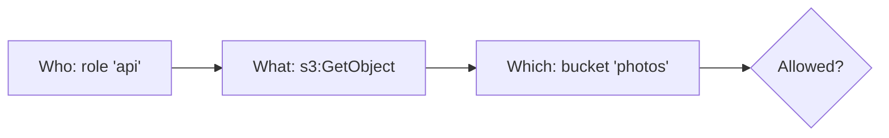
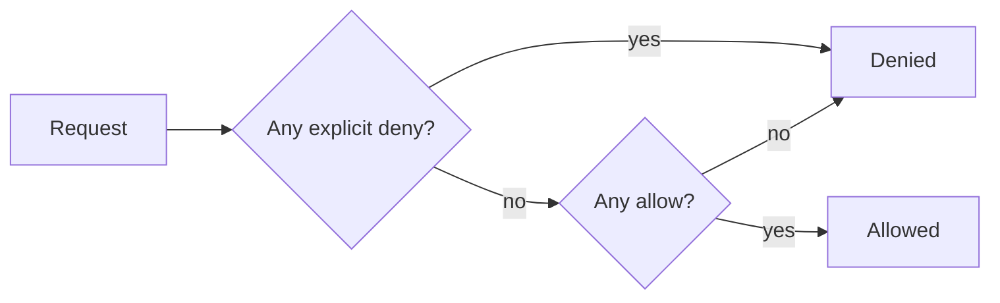
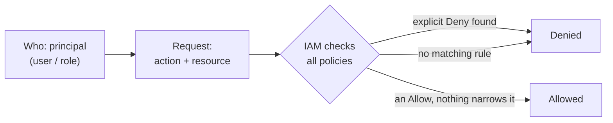
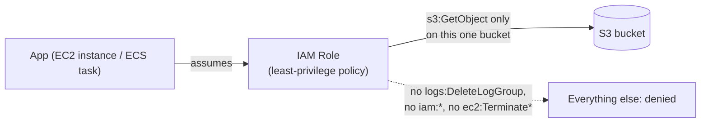
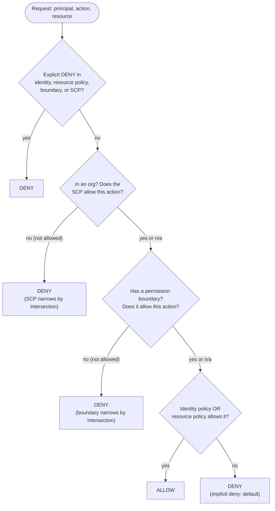
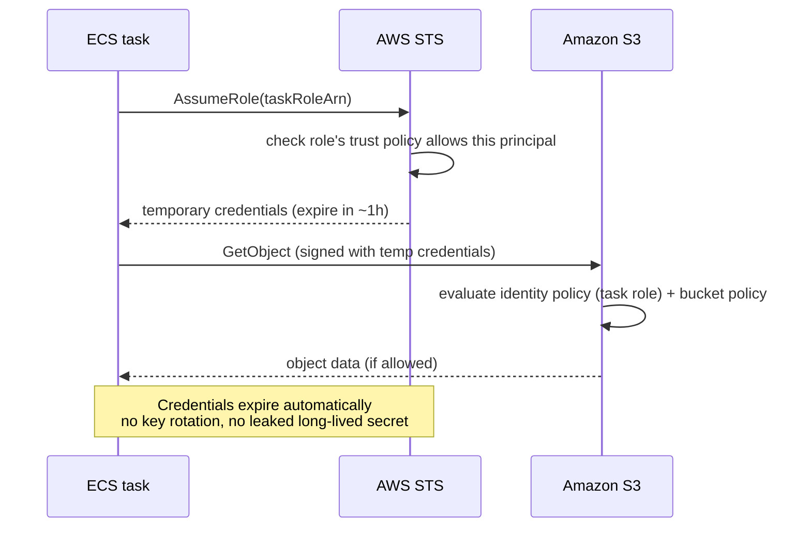

# AWS 02 - IAM

> [!summary] TL;DR
> IAM (Identity and Access Management) decides **who** (a user, a role, or a federated identity) can do **what** (an action like `s3:GetObject`) to **which resource**, by evaluating JSON policy documents attached to identities, resources, permission boundaries, and (if the account belongs to an organization) service control policies. An explicit deny anywhere always wins; everything else defaults to denied unless something explicitly allows it.

> [!abstract] Core idea
> - **Principals** are who's asking: the root user (never use day-to-day), IAM users, IAM roles, or federated identities (SSO, OIDC).
> - A **policy** is a JSON document of statements, each with an `Effect` (`Allow`/`Deny`), `Action`, `Resource`, and optionally `Condition`.
> - Evaluation order: an **explicit deny anywhere wins**; an **SCP** and a **permission boundary** each narrow permissions by intersection (they can only take away, never grant); identity-based and resource-based policies combine by **union**; anything left unmatched is an **implicit deny**.
> - **Roles**, not long-lived access keys, are how a workload gets credentials: `sts:AssumeRole` hands out short-lived, auto-expiring temporary credentials.
> - The most common real mistake is `"Action": "*", "Resource": "*"` granted "to get it working," followed by never narrowing it.

## Start here: the basics 🟢

> [!info] How to read this note (pick your level)
> - 🟢 **New to this?** Read "From zero" below, then sections 1, 2 and 10 (why, mental model and the cheat sheet). Stop there, that is a full first pass.
> - 🟡 **Know the basics?** Add sections 3, 4, 5 and 6 (how it works, a worked example, options and trade-offs).
> - 🔴 **Interview / SDE-3 prep?** Add sections 7, 8 and 9 (production, deep dive and interview questions). Headings are tagged 🟢🟡🔴 so you always know where you are.

**From zero, in 60 seconds** 🟢

In AWS, every action is a request: "read this file", "start this server".
**IAM** decides if that request is allowed. It answers: who is asking, what do they want to do, and on which thing?
The rules are written as small JSON documents called **policies**.



By default, everything is denied. You must allow things on purpose.
If any rule anywhere says "deny", that wins over every "allow".
Apps should use **roles**: identities with short-lived keys handed out automatically, instead of long-lived passwords.



The rest of this note is just these 3 questions:
1. What is inside a policy?
2. In what order does AWS check all the policies?
3. How do roles and temporary keys work for ECS, EC2 and Lambda?


**The problem in one story.**
Your company has 50 engineers and 30 services running in AWS.
The payments service must read one bucket; the intern must not delete the production database.
Without a permission system, everyone holds the master key, and one leaked key can wipe out everything.
IAM is the system that hands each person or program exactly the keys it needs, and nothing more.

**Words you need first**

| Word | Plain meaning | Tiny example |
| --- | --- | --- |
| Identity / principal | Whoever is making a request | An engineer, or your Go service |
| Permission | Being allowed to do one action | "May read files from bucket X" |
| Policy | A JSON list of allow/deny rules | `{"Effect":"Allow","Action":"s3:GetObject",...}` |
| Action | One API operation in AWS | `s3:GetObject`, `ec2:StartInstances` |
| Resource / ARN | The exact thing being acted on, named by an ARN | `arn:aws:s3:::invoices/*` |
| Role | An identity anyone trusted can "wear" for a short time | The role your ECS task assumes |
| Credentials | The secret proof of who you are | An access key, or a temporary token |
| Least privilege | Give only the permissions actually needed | Read-only, one bucket, not `*` |

**Picture it**



**Analogy.** IAM is an office access-card system: each card opens a listed set of doors, and a "never this door" rule beats any "yes".
Where it breaks: real cards rarely expire in an hour, but IAM role credentials are designed to expire automatically.

**How the rest of this note builds up**

- First, why IAM exists (section 1, including the Capital One breach) and the access-card mental model (section 2).
- Then policies, principals, roles and the full evaluation order with SCPs and boundaries (section 3).
- Then a Go policy-evaluator you can run and test (section 4), and variants like ABAC and identity center (section 5).
- Finally the SDE-3 view: trade-offs, production practice, deep dive and interview questions (sections 6-9).

> [!tip] Remember
> Everything is denied by default, an explicit Deny always wins, and workloads should use short-lived roles, not stored keys.

## 1. Why it exists 🟢

A backend service needs to read objects from an S3 bucket, write logs to CloudWatch, and nothing else.

Without a permissions system, the two options are "give it the account's root credentials" (catastrophic if the service is compromised — it can do literally anything, including deleting every resource and disabling billing alarms) or "write custom access-control code per service" (a security team's nightmare to audit consistently across hundreds of services).

IAM exists to give every principal exactly the permissions it needs and nothing more — the **principle of least privilege** — enforced centrally and auditable in one place.

Concretely: the 2019 Capital One breach is the textbook case.

An SSRF bug in a misconfigured web application firewall running on EC2 let an attacker make that WAF query the instance metadata service and retrieve the temporary credentials for its attached IAM role.

That role, by several public post-incident analyses, had far more S3 access than a WAF needs, which is what let the attacker list and read private buckets once they had those credentials.

The attacker didn't need to break IAM itself; IAM did exactly what its policy said, and the policy said too much. This is the recurring theme in nearly every IAM-related incident.

### Whiteboard version



## 2. Mental model 🟢

Think of IAM as a building's access-card system.

A **principal** is a person holding a card. A **policy** is the list of doors that card opens — and a policy can also explicitly say "this card must never open that door," which overrides any other card or door-list that would have let them in.

A **role** is a visitor badge issued at the front desk for a limited time, rather than a permanent employee card — exactly what a workload gets when it calls `AssumeRole` instead of embedding a permanent key.

And an **Organizations SCP** is a building-wide rule the landlord sets that applies on top of every tenant's own door list — the landlord can say "no tenant's card may ever open the roof access door," and no tenant's own policy can override that.

## 3. How it works 🟡

### Principals and policy anatomy

**In plain words:** a policy line says: Effect (allow/deny), Action (what), Resource (which thing), and maybe a Condition (only when...).

A **principal** is the IAM user, role, or federated identity making a request. A policy **statement** has this shape:

```json
{
  "Version": "2012-10-17",
  "Statement": [
    {
      "Sid": "ReadOneBucket",
      "Effect": "Allow",
      "Action": ["s3:GetObject"],
      "Resource": "arn:aws:s3:::my-app-bucket/*",
      "Condition": {
        "StringEquals": { "aws:RequestedRegion": "us-east-1" }
      }
    }
  ]
}
```

- **Identity-based policies** attach to a user, group, or role.
- **Resource-based policies** attach to the resource itself (an S3 bucket policy, an SQS queue policy). These are the only kind that can grant *cross-account* access without the other account assuming a role.
- **Condition** keys scope a statement further: source IP, MFA presence, request time, tag values, and dozens more.

### Evaluation logic

**In plain words:** AWS checks layers in order. A deny anywhere stops it. Otherwise, every layer that applies must allow it.

AWS's own documentation (IAM User Guide, "Policy evaluation logic", accessed 2026-11-07) specifies this order, and it is one of the most commonly misremembered things in an AWS interview:

1. **Explicit deny anywhere** — in the identity policy, a resource policy, a permission boundary, or an SCP — overrides every allow and ends evaluation immediately.
2. If the account is in an **Organizations SCP** scope, the SCP must *also* allow the action, or it's denied. SCPs only intersect; they can never grant a permission an identity policy doesn't already have.
3. If the identity has a **permission boundary** attached, the boundary must *also* allow the action — same intersection rule, scoped to one identity instead of a whole account.
4. Otherwise, the request is allowed if the **identity-based policy OR the resource-based policy** allows it — this step is a **union**, which is why a bucket policy alone can grant a different account's role access even if that role's own policy says nothing about the bucket.
5. If nothing explicitly allowed it, the default is an **implicit deny**.



### Roles, STS, and temporary credentials

**In plain words:** a role is a hat you put on. Wearing it gives you keys that expire in about an hour, so a leaked key doesn't last.

A **role** has no permanent credentials of its own. A principal calls `sts:AssumeRole` (or a service does it on your behalf), STS verifies the role's trust policy allows that principal to assume it, and returns a temporary access key, secret key, and session token — valid for anywhere from 15 minutes to 12 hours, then automatically useless.



### Workload identity: where this shows up in real infrastructure

**In plain words:** each AWS service gives your code a role in its own way. ECS has two roles that people often mix up.

- **ECS**: a task has *two* roles, commonly confused. The **task execution role** is what ECS itself uses to pull the container image from ECR and write logs to CloudWatch before your code even starts; the **task role** is what your application code uses at runtime (e.g., to call S3). Giving your app code the execution role's permissions — or vice versa — is a common, over-broad misconfiguration.
- **EC2**: an **instance profile** attaches a role to an EC2 instance; the instance metadata service hands temporary credentials to anything running on the instance, which is why SSRF vulnerabilities that can reach the metadata endpoint are a serious IAM-adjacent risk (the historical reason AWS pushes IMDSv2, which requires a signed session token for metadata requests).
- **EKS**: **IRSA** (IAM Roles for Service Accounts) maps a Kubernetes service account to an IAM role via OIDC federation between the cluster's OIDC provider and AWS; **EKS Pod Identity** (newer) does the same mapping without requiring the cluster to expose an OIDC provider URL, simplifying the trust relationship.
- **CI/CD (GitHub Actions)**: federate GitHub's own OIDC provider directly into IAM with an identity provider trust, and scope the role's trust policy to a specific repository and branch (via `Condition` on the `sub` claim, e.g. `repo:my-org/my-repo:ref:refs/heads/main`). This removes the need to store `AWS_ACCESS_KEY_ID`/`AWS_SECRET_ACCESS_KEY` as long-lived pipeline secrets entirely — a GitHub Actions run gets a one-off, minutes-long credential instead.

## 4. Worked example 🟡

### Whiteboard version

The core of evaluation logic is: check for an explicit deny anywhere first, then intersect with any narrowing policy (boundary, SCP), then union the identity and resource policies.

```go
func evaluate(identityAllows, resourceAllows, boundaryAllows, explicitDeny bool) bool {
    if explicitDeny {
        return false
    }
    if !boundaryAllows {
        return false
    }
    return identityAllows || resourceAllows
}
```

The full version below models statements with wildcard actions/resources (`s3:*`, `*`), handles SCPs separately from permission boundaries, and is the exact code tested for this note.

```go
// Package iamsim is a deliberately simplified model of the IAM policy
// evaluation logic described in the AWS IAM User Guide, "Policy evaluation
// logic" (accessed 2026-11-07): explicit deny anywhere wins; a permission
// boundary or an SCP narrows permissions by intersection; identity-based and
// resource-based policies combine by union. It supports prefix wildcards
// ("s3:*") the way IAM actions and ARNs use them, but drops condition keys
// and NotAction/NotResource for clarity.
package iamsim

import "strings"

// Effect is a statement's effect.
type Effect int

const (
    EffectAllow Effect = iota
    EffectDeny
)

// Statement is one policy statement: it matches a request when both the
// action and the resource are listed (or the policy uses "*" for either).
type Statement struct {
    Effect    Effect
    Actions   []string
    Resources []string
}

// Policy is an ordered list of statements, as IAM evaluates them.
type Policy struct {
    Statements []Statement
}

// matches reports whether want is covered by any pattern in list. A pattern
// of "*" matches anything; a pattern ending in "*" (e.g. "s3:*") matches by
// prefix, the same way IAM action and ARN wildcards work; anything else must
// match exactly.
func matches(list []string, want string) bool {
    for _, v := range list {
        switch {
        case v == "*":
            return true
        case strings.HasSuffix(v, "*") && strings.HasPrefix(want, strings.TrimSuffix(v, "*")):
            return true
        case v == want:
            return true
        }
    }
    return false
}

func (s Statement) matches(action, resource string) bool {
    return matches(s.Actions, action) && matches(s.Resources, resource)
}

func (p Policy) hasExplicitDeny(action, resource string) bool {
    for _, s := range p.Statements {
        if s.Effect == EffectDeny && s.matches(action, resource) {
            return true
        }
    }
    return false
}

func (p Policy) allows(action, resource string) bool {
    for _, s := range p.Statements {
        if s.Effect == EffectAllow && s.matches(action, resource) {
            return true
        }
    }
    return false
}

// Decision is the outcome of Evaluate.
type Decision int

const (
    Deny Decision = iota
    Allow
)

func (d Decision) String() string {
    if d == Allow {
        return "Allow"
    }
    return "Deny"
}

// Request bundles the policies that can apply to one call, mirroring the
// inputs IAM's evaluation logic considers.
type Request struct {
    Identity        Policy  // the caller's identity-based policies (required)
    ResourcePolicy  *Policy // e.g. an S3 bucket policy; nil if none attached
    PermissionBound *Policy // the caller's permission boundary; nil if none set
    SCP             *Policy // the effective Organizations SCP for the account; nil if not in an org
}

// Evaluate implements, in order:
//  1. Explicit deny anywhere (identity, resource policy, boundary, or SCP) wins immediately.
//  2. An SCP must allow the request too, or it is denied (SCPs only ever narrow, never grant).
//  3. A permission boundary must allow the request too, or it is denied (same reason).
//  4. Otherwise the request is allowed if the identity policy OR the resource
//     policy allows it (that step is a union, not an intersection).
//  5. If nothing allowed it, the default is an implicit deny.
func Evaluate(r Request, action, resource string) Decision {
    if r.Identity.hasExplicitDeny(action, resource) {
        return Deny
    }
    if r.ResourcePolicy != nil && r.ResourcePolicy.hasExplicitDeny(action, resource) {
        return Deny
    }
    if r.PermissionBound != nil && r.PermissionBound.hasExplicitDeny(action, resource) {
        return Deny
    }
    if r.SCP != nil && r.SCP.hasExplicitDeny(action, resource) {
        return Deny
    }

    if r.SCP != nil && !r.SCP.allows(action, resource) {
        return Deny // SCP narrows by intersection: not listed there means not allowed.
    }
    if r.PermissionBound != nil && !r.PermissionBound.allows(action, resource) {
        return Deny // same intersection rule for a permission boundary.
    }

    identityOrResourceAllows := r.Identity.allows(action, resource) ||
        (r.ResourcePolicy != nil && r.ResourcePolicy.allows(action, resource))
    if !identityOrResourceAllows {
        return Deny // implicit deny: nothing granted it
    }
    return Allow
}
```

Tests covering each rule in the evaluation order:

```go
// allowAll builds a single-statement policy that allows one action pattern
// against one resource pattern, to keep the tests below terse.
func allowAll(action, resource string) Policy {
    return Policy{Statements: []Statement{{
        Effect:    EffectAllow,
        Actions:   []string{action},
        Resources: []string{resource},
    }}}
}

// An identity policy with a matching allow statement and nothing else
// involved is the base case: it grants access by itself.
func TestIdentityAllowAloneGrantsAccess(t *testing.T) {
    identity := allowAll("s3:GetObject", "arn:x")
    got := Evaluate(Request{Identity: identity}, "s3:GetObject", "arn:x")
    if got != Allow {
        t.Fatalf("got %v, want Allow", got)
    }
}

// An explicit deny statement overrides an allow statement in the same
// policy, regardless of which one appears first.
func TestExplicitDenyOverridesAllow(t *testing.T) {
    identity := Policy{Statements: []Statement{
        {Effect: EffectAllow, Actions: []string{"*"}, Resources: []string{"*"}},
        {Effect: EffectDeny, Actions: []string{"s3:GetObject"}, Resources: []string{"arn:x"}},
    }}
    got := Evaluate(Request{Identity: identity}, "s3:GetObject", "arn:x")
    if got != Deny {
        t.Fatalf("got %v, want Deny: explicit deny must override the allow", got)
    }
}

// An SCP narrows by intersection even when the identity policy is fully
// permissive: it can only take an action away, never grant one.
func TestSCPIntersectsEvenWithFullIdentityAllow(t *testing.T) {
    identity := allowAll("*", "*")
    scp := allowAll("ec2:*", "*") // SCP never grants s3 actions

    got := Evaluate(Request{Identity: identity, SCP: &scp}, "s3:GetObject", "arn:x")
    if got != Deny {
        t.Fatalf("got %v, want Deny: SCP narrows by intersection even against a fully-permissive identity policy", got)
    }
}

// Nothing allowing the request, anywhere, falls through to the implicit
// deny that is IAM's default.
func TestImplicitDenyWhenNothingMatches(t *testing.T) {
    got := Evaluate(Request{Identity: Policy{}}, "s3:GetObject", "arn:x")
    if got != Deny {
        t.Fatalf("got %v, want Deny: nothing allowed it, so the default is implicit deny", got)
    }
}

// A permission boundary intersects with identity policies: it can only take
// permissions away, never grant new ones.
func TestPermissionBoundaryIntersectsAndCanOnlyNarrow(t *testing.T) {
    identity := allowAll("*", "*") // identity allows everything
    boundary := allowAll("s3:GetObject", "*")

    allowedCall := Evaluate(Request{Identity: identity, PermissionBound: &boundary}, "s3:GetObject", "arn:x")
    if allowedCall != Allow {
        t.Fatalf("s3:GetObject within the boundary: got %v, want Allow", allowedCall)
    }

    deniedCall := Evaluate(Request{Identity: identity, PermissionBound: &boundary}, "ec2:TerminateInstances", "arn:x")
    if deniedCall != Deny {
        t.Fatalf("ec2:TerminateInstances outside the boundary: got %v, want Deny", deniedCall)
    }
}

// Identity and resource policies combine by union: a resource policy alone
// (e.g. a cross-account S3 bucket policy) can grant access even when the
// caller's own identity policy says nothing about the resource.
func TestResourcePolicyGrantsCrossAccountAccessByUnion(t *testing.T) {
    identity := Policy{} // no statements at all
    resourcePolicy := allowAll("s3:GetObject", "arn:aws:s3:::shared-bucket/report.csv")

    got := Evaluate(Request{Identity: identity, ResourcePolicy: &resourcePolicy},
        "s3:GetObject", "arn:aws:s3:::shared-bucket/report.csv")
    if got != Allow {
        t.Fatalf("got %v, want Allow via the resource policy alone", got)
    }
}
```

**Measured (Go 1.24.4, darwin/arm64, 2026-11-07):** `go test -race -v` output — all 6 tests pass:

1. An identity allow alone grants access.
2. An explicit deny overrides an allow at the same scope.
3. A permission boundary narrows by intersection.
4. An SCP narrows by intersection even against a fully-permissive identity policy.
5. A resource policy grants cross-account access by union.
6. No matching statement anywhere falls through to an implicit deny.

```text
=== RUN   TestIdentityAllowAloneGrantsAccess
--- PASS: TestIdentityAllowAloneGrantsAccess (0.00s)
=== RUN   TestExplicitDenyOverridesAllow
--- PASS: TestExplicitDenyOverridesAllow (0.00s)
=== RUN   TestPermissionBoundaryIntersectsAndCanOnlyNarrow
--- PASS: TestPermissionBoundaryIntersectsAndCanOnlyNarrow (0.00s)
=== RUN   TestSCPIntersectsEvenWithFullIdentityAllow
--- PASS: TestSCPIntersectsEvenWithFullIdentityAllow (0.00s)
=== RUN   TestResourcePolicyGrantsCrossAccountAccessByUnion
--- PASS: TestResourcePolicyGrantsCrossAccountAccessByUnion (0.00s)
=== RUN   TestImplicitDenyWhenNothingMatches
--- PASS: TestImplicitDenyWhenNothingMatches (0.00s)
PASS
ok  	aws02	1.428s
```

## 5. Variants and comparison 🟡

| Mechanism | How it works | Use when | Cost |
| --- | --- | --- | --- |
| IAM user + long-lived access key | A permanent key pair tied to one human or legacy app | Rarely — legacy systems that can't assume roles; avoid for anything new | Leaked keys never expire on their own; rotation is manual |
| IAM role + `AssumeRole` | Temporary credentials fetched on demand, auto-expiring | The default for any workload: EC2, ECS, Lambda, CI/CD | A moment of setup complexity (trust policy); vastly lower blast radius |
| Identity-based policy | Attached to a user/role; governs what that identity can do | The normal way to grant permissions | None, beyond writing and reviewing the JSON |
| Resource-based policy | Attached to the resource (bucket policy, queue policy) | Cross-account access without the other account assuming a role | Resource owner must track who else can reach it |
| Permission boundary | A ceiling on one identity's *maximum* possible permissions | Letting a team self-serve IAM role creation within a safe ceiling | Easy to forget it exists and wonder why a seemingly-correct policy still denies |
| Service Control Policy (SCP) | A ceiling applied to every identity in one or more accounts | Org-wide guardrails (e.g., "no one can disable CloudTrail") | Applies even to the account's own admins; a mistake here is wide-reaching |

> [!warning] Interview trap
> "An SCP can grant extra permissions to an account that needs them" is wrong. SCPs are a **ceiling**, never a grant — the same trap applies to permission boundaries at the identity level. Both only ever remove what would otherwise be allowed.

## 6. Trade-offs and when not to use 🟡

- Fine-grained, resource-scoped policies are more secure but slower to write and review than `"Resource": "*"` — the real cost of least privilege is the human review time, not runtime overhead.
- Permission boundaries and SCPs add a second (or third) place a denial can originate from, which makes debugging "why was this denied?" harder; `aws iam simulate-principal-policy` and CloudTrail's `errorMessage` field are the practical tools for that, not guesswork.
- For a genuinely single-developer side project with no sensitive data, perfect least-privilege IAM is often not worth the setup time — a scoped-down role is still worth the ten minutes it takes, but exhaustive per-action policies are over-engineering at that scale.
- IAM Access Analyzer (which flags resources shared outside your account/org, and can generate least-privilege policies from CloudTrail activity) is worth running continuously in any real account — skipping it just because it's "one more tool to configure" is a common false economy.

## 7. In production 🔴

- **Real systems:** every production AWS workload authenticates through IAM in some form; GitHub Actions' own documentation recommends OIDC federation over static keys for exactly the reasons above; EKS's IRSA and Pod Identity are both AWS-documented, supported mechanisms used widely by teams running Kubernetes on AWS.
- **Failure modes → fixes:**
  - `"Action": "*", "Resource": "*"` left in place after prototyping → the single most common real-world over-permission; fix by running IAM Access Analyzer's policy generation against actual CloudTrail activity, then narrowing.
  - Long-lived access keys committed to a repo or embedded in a container image → rotate immediately, then migrate that workload to a role; enable IAM Access Analyzer's unused-access findings to catch stale keys before they're exploited.
  - Confusing the ECS task role with the task execution role → the application gets permissions meant for image pulls/logging (or vice versa); fix by naming and reviewing the two roles separately in every task definition.
  - No MFA on the root account, or routine use of the root account → root should be used only for the handful of actions that require it (closing the account, certain billing changes) and otherwise locked away with MFA.
- **What to monitor:** CloudTrail events for `AssumeRole`, policy changes (`PutUserPolicy`, `AttachRolePolicy`, SCP edits), IAM Access Analyzer findings (external access, unused permissions), and failed authorization attempts (`AccessDenied` spikes often indicate either an attack or a broken deployment).

## 8. Deep dive 🔴

- **Why evaluation checks SCPs/boundaries before the identity-resource union, not after.** If AWS evaluated identity+resource first and then applied the ceiling, the net result would be identical for a simple allow/deny outcome — but conceptually, treating the ceiling as an earlier, independent gate is what makes it correct that an SCP denial is indistinguishable from "this account was never given S3 at all," which is the guarantee organizations rely on for security boundaries.
- **Why resource-based policies are the only in-account path to cross-account access without role assumption.** An identity-based policy can only ever grant permissions to the account's own principals (you can't write an identity policy in account A that grants account B's user anything) — permissions flow outward from an identity policy only to resources, never to other accounts' principals. A resource-based policy flips that: it names a principal ARN from *any* account, which is what makes S3 bucket policies and SQS queue policies usable for direct cross-account sharing, as an alternative to cross-account role assumption.
- **IMDSv2 and the SSRF connection.** EC2's instance metadata service (used to fetch a role's temporary credentials from inside the instance) originally had no required authentication (IMDSv1), so an SSRF bug that could make the server fetch an arbitrary URL could silently exfiltrate the instance's IAM credentials. IMDSv2 requires a short-lived, non-forwardable session token fetched via a `PUT` request first, which most SSRF payloads (which only control the target URL of a `GET`) can't produce — closing off a whole class of credential-theft bugs without changing IAM policy at all.
- **OIDC federation's trust is entirely in the `Condition` block, not the identity provider registration alone.** Registering GitHub's OIDC provider with IAM is necessary but not sufficient — without a `Condition` restricting the trust policy's `sub` claim to a specific `repo:org/repo:ref:refs/heads/main` pattern, *any* repository in *any* GitHub org could assume that role, since the OIDC provider itself is shared infrastructure, not scoped to your organization.

## 9. Interview questions 🔴

> [!question]- Walk through IAM's full policy evaluation order.
> Explicit deny anywhere (identity, resource, boundary, or SCP) wins immediately. Then an SCP, if the account is in an organization, must also allow the action — it only narrows, never grants. Then a permission boundary, if attached to the identity, must also allow it — same intersection rule. Then identity-based and resource-based policies combine by union: either one allowing it is enough. If nothing allowed it by that point, the default is an implicit deny.

> [!question]- Trap: "If I give an identity a permission boundary with `s3:*`, that identity now has full S3 access."
> No — a permission boundary only sets a ceiling. The identity still needs its own identity-based policy to actually grant `s3:*`; the boundary just guarantees it can never exceed that ceiling even if someone later attaches an over-broad identity policy to it.

> [!question]- What's the difference between an ECS task role and a task execution role?
> The task execution role is what the ECS agent itself uses before your application starts: pulling the container image from ECR, writing to CloudWatch Logs, and retrieving secrets referenced in the task definition. The task role is what your application code uses at runtime to call other AWS services. Swapping their scopes — giving the execution role S3 access your app needs, say — is a common misconfiguration that either breaks the app or over-permissions the agent.

> [!question]- Why use GitHub Actions OIDC federation instead of storing AWS access keys as pipeline secrets?
> Stored access keys are long-lived: if a workflow log or a compromised dependency leaks them, they work until someone manually rotates them. OIDC federation lets a GitHub Actions run present a short-lived, cryptographically signed token to STS, which AssumeRole exchanges — scoped by a trust-policy condition to a specific repo and branch — for credentials that expire with the job. There is no static secret to leak in the first place.

> [!question]- How does IRSA differ from EKS Pod Identity?
> Both map a Kubernetes identity to an IAM role via STS, but IRSA requires the EKS cluster to expose an OIDC provider URL that IAM's identity provider trusts, with the trust policy scoped to a specific Kubernetes service account via OIDC claims. EKS Pod Identity is a newer, simpler mechanism that performs the same mapping through an EKS-managed agent, without requiring the cluster to register and maintain its own OIDC provider in IAM.

> [!question]- A developer says their identity policy clearly allows `s3:GetObject`, but every call is still denied. What do you check?
> In order: is there an explicit deny anywhere (a stray statement, a group policy, a boundary, or an SCP) that matches this action/resource — that alone would explain it. If not, check whether the identity has a permission boundary that doesn't include S3, and whether the account's SCP (if any) excludes it. `aws iam simulate-principal-policy` evaluates all of these together and will name exactly which policy produced the deny.

## 10. Cheat sheet 🟢

- Evaluation order: explicit deny anywhere → SCP intersects → permission boundary intersects → identity ∪ resource policies → implicit deny by default.
- SCPs and permission boundaries only ever narrow; they never grant a permission by themselves.
- Use roles and `AssumeRole` for workloads, never long-lived access keys; GitHub Actions and EKS both have OIDC-based alternatives to static keys.
- ECS has two roles: task execution role (image pull, logging) vs task role (your app's own calls) — don't conflate them.
- A resource-based policy is the only way to grant cross-account access without the other account assuming a role.
- IMDSv2 closes the classic SSRF → stolen-credentials path that plain IMDSv1 metadata requests allowed.
- Run IAM Access Analyzer continuously; it flags external sharing and generates least-privilege policies from real CloudTrail activity.
- MFA and no routine root-account use remain the baseline, not an advanced practice.

## Links

- **Before this:** [[AWS 01 - Core Concepts (Regions, AZs, Accounts, Shared Responsibility)]]
- **Next:** [[AWS 03 - VPC Networking]]
- **Compare with:** [[Secrets Management]] (storing the application secrets IAM doesn't cover), [[OAuth 2.0 and OpenID Connect]] (the federation protocol IAM's OIDC identity providers rely on), [[Service-to-Service Auth - API Keys, HMAC, mTLS]] (auth between services that aren't both inside IAM's trust boundary)

### Watch on YouTube

- [AWS IAM Core Concepts You NEED to Know](https://www.youtube.com/watch?v=_ZCTvmaPgao) · Be A Better Dev · 21 min · 348,776 views
