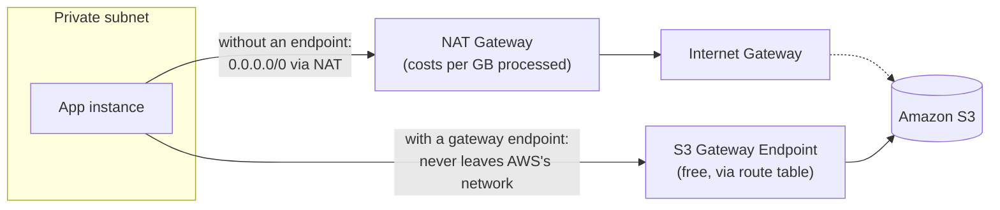
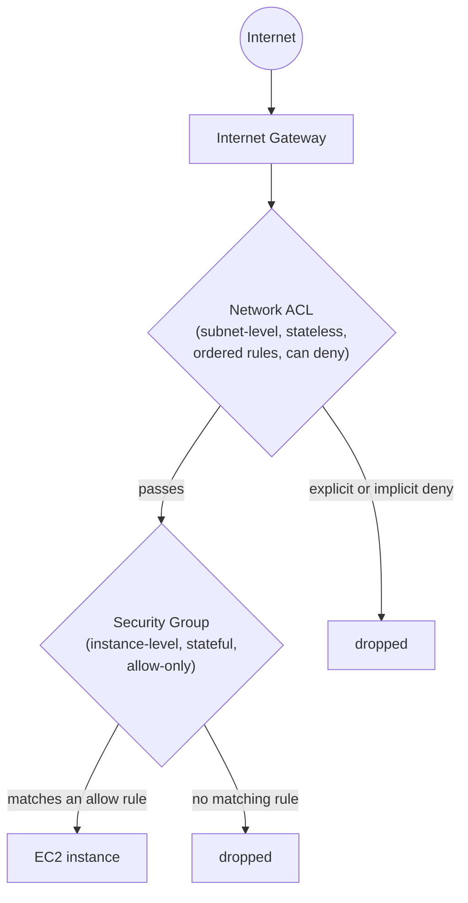
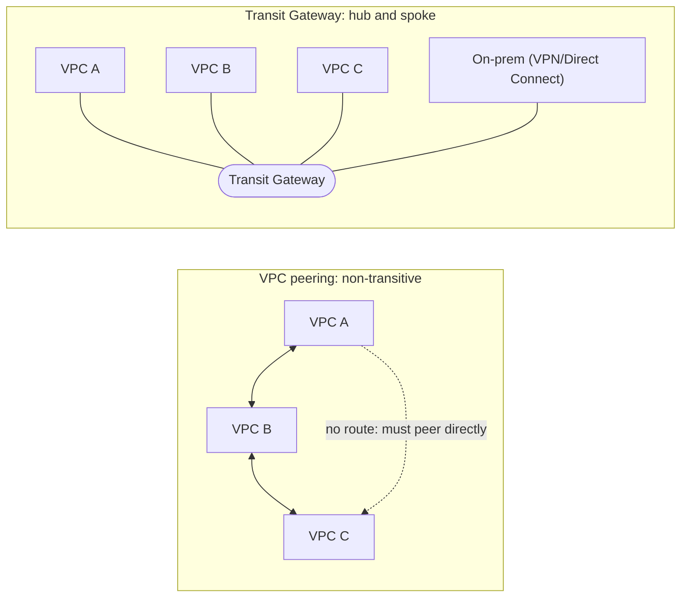
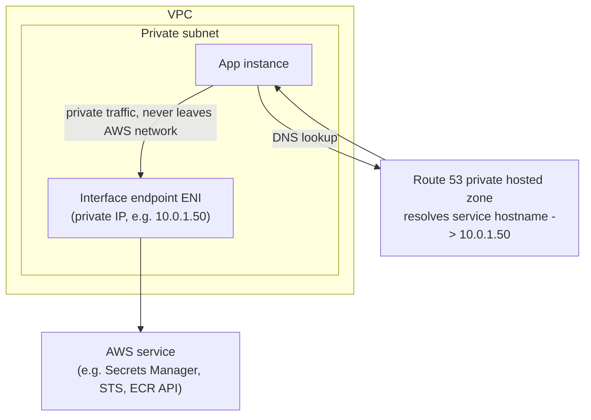

# AWS 03 - VPC Networking

> [!summary] TL;DR
> A VPC is your private network inside AWS. [[IP Addressing, Subnets, NAT and VPC Basics]] already covers how subnets, route tables, internet gateways, and NAT gateways work; this note covers what's specific to running a VPC as an AWS service: the two firewall layers (security groups and network ACLs), how VPCs connect to each other and to AWS's own services (peering, Transit Gateway, VPC endpoints and PrivateLink), and how to observe what a VPC is actually doing (Flow Logs).

> [!abstract] Core idea
> - **Security groups** are stateful, allow-only, and attach to individual resources (an ENI); **network ACLs** are stateless, support explicit deny, evaluate ordered rules per subnet, and are a second, coarser layer behind security groups.
> - **VPC peering** is a direct, non-transitive link between two VPCs' route tables; **Transit Gateway** is a hub that lets many VPCs (and on-prem networks) route through one place, including transitively.
> - **VPC endpoints** let traffic reach an AWS service without leaving AWS's network or going through a NAT gateway: **Gateway endpoints** (S3, DynamoDB only, free, via route table entries) and **Interface endpoints** (most other services, priced per hour and per GB, powered by AWS PrivateLink, an ENI with a private IP in your subnet).
> - **VPC Flow Logs** record accepted and rejected traffic metadata (not payloads) per ENI, subnet, or VPC — the primary tool for diagnosing "why can't this reach that."

## 1. Why it exists

[[IP Addressing, Subnets, NAT and VPC Basics]] explains why a VPC is sliced into subnets with route tables deciding public vs private. What that note doesn't cover is what happens once you have multiple VPCs that need to talk to each other, or a private subnet that needs to call an AWS service like S3 without a NAT gateway in the path, or a security incident where you need to know exactly which rule let (or blocked) a specific flow of traffic.

Concretely: a private subnet with EC2 instances that need to pull images from ECR and read from S3 has two options. Route that traffic through a NAT gateway to the internet and back (which costs per-GB NAT processing charges and, more importantly, means that traffic technically transits a path that *could* reach the public internet) — or use VPC endpoints, which keep the traffic entirely inside AWS's network and, for S3/DynamoDB specifically, cost nothing extra. Many real AWS bills include a NAT gateway data-processing line item that would shrink significantly just by adding S3 and DynamoDB gateway endpoints, which take minutes to set up and have no additional charge.

### Whiteboard version



## 2. Mental model

Think of a VPC's two firewall layers as a building's two checkpoints. The **security group** is the badge reader on each office door: it only has an allow list ("these badge types may enter"), it doesn't care what order the rules were added in, and once you're let in, you're free to leave without being re-checked at the door on the way out (that's "stateful" — the return traffic from an allowed connection is automatically permitted). The **network ACL** is the guard at the building's main entrance checking a numbered list of rules in order, and that guard can say "no" explicitly, not just "not on the list" — and crucially, the guard checks you again on your way *out* too (that's "stateless" — inbound and outbound are independently evaluated).

A **VPC endpoint** is a private service elevator that goes straight from your floor to a specific AWS service's floor, bypassing the building's public front doors (the internet gateway) entirely.

## 3. How it works

### Security groups vs network ACLs

| | Security group | Network ACL |
| --- | --- | --- |
| Statefulness | Stateful: return traffic for an allowed connection is automatically allowed | Stateless: inbound and outbound rules are evaluated independently |
| Rule types | Allow only (no deny rules exist) | Allow and explicit deny |
| Evaluation | Every rule is checked; a match on any allow rule is enough | Rules are numbered and checked in ascending order; the first match (allow or deny) wins |
| Applies to | Individual ENIs (so, per-instance, per-load-balancer, per-RDS-instance) | An entire subnet — every ENI in it |
| Default | Default SG denies all inbound, allows all outbound | Default NACL allows all traffic both ways; a custom NACL denies everything until you add rules |

(AWS's VPC User Guide recommends both layers together: security groups to control traffic to EC2 instances, and NACLs to control traffic at the subnet level, as complementary, not redundant, defenses.)



The ordering trap: a network ACL rule numbered 100 that denies a specific CIDR is checked *before* a rule numbered 200 that broadly allows everything — so a narrow, low-numbered deny rule silently blocks traffic that a later, broader allow rule would otherwise have let through. Security groups have no such ordering concern, since there are no deny rules to conflict with.

### VPC peering vs Transit Gateway

**VPC peering** connects exactly two VPCs: each side adds a route pointing the other VPC's CIDR at the peering connection. It is **not transitive** — if VPC A peers with B, and B peers with C, A cannot reach C through B; A needs its own direct peering connection to C. For more than a handful of VPCs, the number of peering connections needed grows quadratically (`n(n-1)/2` for `n` fully-meshed VPCs), which is exactly the problem **Transit Gateway** solves: one regional hub that every VPC (and on-premises network, via VPN or Direct Connect) attaches to once, with Transit Gateway's own route tables deciding who can reach whom — including transitively, if you want that.



### VPC endpoints and PrivateLink

A **Gateway endpoint** only works for Amazon S3 and DynamoDB. It's a route table entry: traffic to those services' IP ranges goes directly to the endpoint instead of to a NAT gateway or internet gateway, and there is no additional charge for a Gateway endpoint itself (AWS PrivateLink User Guide, accessed 2026-11-07, draws this distinction explicitly — Gateway endpoints "do not use AWS PrivateLink," unlike every other endpoint type).

An **Interface endpoint** covers most other AWS services (and third-party or your own services published via PrivateLink) by placing an actual elastic network interface, with a private IP address, inside your subnet. DNS for the service's normal hostname resolves to that private IP from within the VPC (private hosted zone / split-horizon DNS), so application code doesn't need to change its endpoint URL — only the resolved address changes. Interface endpoints are billed hourly plus per-GB processed, unlike Gateway endpoints.



### VPC Flow Logs

Flow Logs capture metadata for IP traffic at the ENI, subnet, or VPC level — source/destination IP and port, protocol, byte/packet counts, and whether the traffic was `ACCEPT` or `REJECT` — without capturing payloads. Sent to CloudWatch Logs or S3, they're the primary tool for answering "is this security group or NACL actually blocking the traffic I think it is," since a `REJECT` record with the identifying 5-tuple tells you exactly what was denied, even though it doesn't say *which* rule denied it (you still have to check the SG/NACL rules by hand, or use AWS's Reachability Analyzer / Network Access Analyzer for that).

## 4. Worked example

### Whiteboard version

The core difference in code: a security group is enough for ANY allow rule to match; a NACL checks rules in order and the FIRST match (allow or deny) wins.

```go
func sgAllows(rules []Rule, srcIP string, port int) bool {
    for _, r := range rules {
        if r.matches(srcIP, port) {
            return true // any match is enough
        }
    }
    return false
}
```

The full version below sorts NACL rules by number before checking, which is the detail that produces the ordering trap described above, and is the exact code tested for this note.

```go
// Package vpcsec contrasts how a VPC's two firewall layers actually decide a
// packet's fate: a security group (stateful, allow rules only, every rule
// checked) versus a network ACL (stateless, ordered allow/deny rules, first
// match by rule number wins, default deny at the end).
package vpcsec

import "net"

// Rule is one firewall rule. Num is the NACL evaluation order (ignored by
// security groups, which have no order). CIDR is the matching source block;
// Port is the single destination port this rule covers, for simplicity.
type Rule struct {
    Num   int
    CIDR  string
    Port  int
    Allow bool
}

func (r Rule) matches(srcIP string, port int) bool {
    if r.Port != port {
        return false
    }
    _, block, err := net.ParseCIDR(r.CIDR)
    if err != nil {
        return false
    }
    ip := net.ParseIP(srcIP)
    return ip != nil && block.Contains(ip)
}

// SecurityGroupAllows models a security group: stateful and allow-only.
// There is no such thing as a security group deny rule, and rule order
// doesn't matter — the request is allowed if ANY rule matches. (The return
// traffic for an allowed outbound connection is let back in automatically,
// which is exactly what "stateful" means; this model only covers the
// one-directional check since that part needs no extra code.)
func SecurityGroupAllows(rules []Rule, srcIP string, port int) bool {
    for _, r := range rules {
        if r.matches(srcIP, port) {
            return true // SG rules are implicitly Allow-only; matching is enough.
        }
    }
    return false // default: deny
}

// NACLAllows models a network ACL: stateless, with both allow AND deny
// rules, evaluated in ascending Num order. The FIRST matching rule decides,
// even if a later rule would have allowed it. No matching rule is an
// implicit deny, mirroring the real "*" rule AWS adds at the highest number.
func NACLAllows(rules []Rule, srcIP string, port int) bool {
    ordered := append([]Rule(nil), rules...)
    for i := 1; i < len(ordered); i++ {
        for j := i; j > 0 && ordered[j].Num < ordered[j-1].Num; j-- {
            ordered[j], ordered[j-1] = ordered[j-1], ordered[j]
        }
    }
    for _, r := range ordered {
        if r.matches(srcIP, port) {
            return r.Allow
        }
    }
    return false // implicit "* deny" rule at the end
}
```

Tests proving the ordering trap and the any-match behavior:

```go
// A NACL's first matching rule (by ascending Num) wins, even if a later,
// broader rule would have allowed the request. This is the classic trap:
// a tightly scoped deny rule placed before a wide-open allow still blocks it.
func TestNACLFirstMatchByNumWins(t *testing.T) {
    rules := []Rule{
        {Num: 200, CIDR: "0.0.0.0/0", Port: 443, Allow: true},       // broad allow, higher number
        {Num: 100, CIDR: "203.0.113.0/24", Port: 443, Allow: false}, // narrow deny, lower number
    }
    got := NACLAllows(rules, "203.0.113.9", 443)
    if got {
        t.Fatalf("NACLAllows = true, want false: rule 100 (deny) must be checked before rule 200 (allow)")
    }
    // A source outside the deny rule's block still hits the broad allow.
    got2 := NACLAllows(rules, "198.51.100.9", 443)
    if !got2 {
        t.Fatalf("NACLAllows = false, want true for a source the deny rule doesn't cover")
    }
}

// No matching rule at all falls through to the implicit "* deny" NACLs add
// at the highest rule number.
func TestNACLDefaultDenyWhenNoRuleMatches(t *testing.T) {
    rules := []Rule{
        {Num: 100, CIDR: "203.0.113.0/24", Port: 443, Allow: true},
    }
    if NACLAllows(rules, "198.51.100.9", 443) {
        t.Fatalf("expected implicit deny when no rule matches the source")
    }
}

// A security group has no deny rules and no order: it is enough for ANY
// rule to match, regardless of how the rules are listed.
func TestSecurityGroupAnyMatchAllowsRegardlessOfOrder(t *testing.T) {
    rules := []Rule{
        {CIDR: "172.31.0.0/16", Port: 5432, Allow: true},
        {CIDR: "10.0.0.0/8", Port: 443, Allow: true},
    }
    if !SecurityGroupAllows(rules, "10.0.1.5", 443) {
        t.Fatalf("expected the second rule to allow the request")
    }
}

// With no rule naming the port at all, a security group defaults to deny.
func TestSecurityGroupRejectsOutOfBlockSource(t *testing.T) {
    rules := []Rule{
        {CIDR: "172.31.0.0/16", Port: 5432, Allow: true},
        {CIDR: "10.0.0.0/8", Port: 443, Allow: true},
    }
    if SecurityGroupAllows(rules, "10.0.1.5", 22) {
        t.Fatalf("expected default deny: no rule opens port 22")
    }
}
```

**Measured (Go 1.24.4, darwin/arm64, 2026-11-07):** `go test -race -v` output — all 4 tests pass: a NACL's low-numbered deny rule blocks traffic a later broad allow rule would have let through, a non-matching source still hits the broad allow, a security group allows on any matching rule regardless of list order, and a security group correctly rejects a source CIDR that no rule covers.

```text
=== RUN   TestNACLFirstMatchByNumWins
--- PASS: TestNACLFirstMatchByNumWins (0.00s)
=== RUN   TestNACLDefaultDenyWhenNoRuleMatches
--- PASS: TestNACLDefaultDenyWhenNoRuleMatches (0.00s)
=== RUN   TestSecurityGroupAnyMatchAllowsRegardlessOfOrder
--- PASS: TestSecurityGroupAnyMatchAllowsRegardlessOfOrder (0.00s)
=== RUN   TestSecurityGroupRejectsOutOfBlockSource
--- PASS: TestSecurityGroupRejectsOutOfBlockSource (0.00s)
PASS
ok  	aws03	1.474s
```

## 5. Variants and comparison

| Connectivity option | How it works | Use when | Cost |
| --- | --- | --- | --- |
| VPC peering | Direct route between two VPCs, non-transitive | Two or a handful of VPCs that must talk privately | Free for the connection itself; standard data transfer rates apply |
| Transit Gateway | One hub; every attached VPC/on-prem network routes through it | More than a handful of VPCs, or you need transitive routing | Per-attachment hourly charge plus per-GB processed |
| Gateway VPC endpoint | Route table entry; S3 and DynamoDB only | Any private subnet calling S3 or DynamoDB | Free |
| Interface VPC endpoint (PrivateLink) | An ENI with a private IP in your subnet, DNS-transparent | Most other AWS services, or your own published services | Hourly per endpoint, plus per-GB processed |
| NAT gateway (fallback) | Outbound-only internet access via PAT | Any destination without a dedicated endpoint | Hourly plus per-GB processed, and higher per-GB than most endpoints |

## 6. Trade-offs and when not to use

- Security groups and NACLs overlap in purpose; adding strict NACL rules on top of already-correct security groups mostly adds operational complexity and a second place to debug a denial — many teams run with the default "allow all" NACL and do all their filtering in security groups, reserving custom NACLs for subnet-wide guardrails (e.g., blocking a known-bad CIDR range entirely).
- Transit Gateway is overkill for two or three VPCs that will never grow much — direct peering is simpler to reason about and has fewer moving parts for a small, static topology.
- Interface endpoints cost money per hour per endpoint per AZ; adding one for every AWS service "just in case" adds a real, recurring bill — add them for services your private subnets actually call without a NAT path, not speculatively.
- VPC Flow Logs at full verbosity (every ENI, every connection) generate large volumes of log data and CloudWatch Logs ingestion costs; scope them to what you're actually debugging or a security-relevant subset, not blanket-enabled everywhere by default.

## 7. In production

- **Real systems:** large AWS deployments nearly universally use Transit Gateway once they exceed a handful of VPCs; AWS's own documentation positions Gateway endpoints for S3/DynamoDB as a default cost-saving recommendation for any private subnet that talks to either service; GuardDuty's foundational threat detection explicitly consumes VPC Flow Logs as one of its core data sources.
- **Failure modes → fixes:**
  - "I added a peering connection but traffic still doesn't flow" → peering also requires each side's security groups to allow the peer's CIDR, and each side's route table to have the peering route added; the connection existing isn't enough by itself.
  - A private subnet's app can't reach S3 after removing its NAT gateway to save cost → add an S3 Gateway endpoint and confirm the subnet's route table has the new route; a common mistake is enabling the endpoint but forgetting it only attaches to route tables you explicitly associate it with.
  - An NACL rule meant to block one bad actor's CIDR silently blocks a legitimate wider range too → the ordering trap: a low-numbered deny with an accidentally broad CIDR match is checked before any later allow.
  - VPC peering across accounts fails silently → confirm both the peering connection's acceptance and DNS resolution settings (`allowDnsResolutionFromRemoteVpc`) are both configured, not just the route tables.
- **What to monitor:** VPC Flow Logs `REJECT` rate per ENI/subnet as a signal of misconfigured rules or active scanning; Transit Gateway attachment and route table changes via CloudTrail; Interface endpoint hourly cost accumulation across AZs (each AZ you attach one in bills separately).

## 8. Deep dive

- **Why Gateway endpoints are free but Interface endpoints aren't.** A Gateway endpoint is purely a route table entry — AWS adds no new network interface or compute to process your traffic differently, it just directs traffic that would have gone to the internet gateway toward S3/DynamoDB's internal network instead. An Interface endpoint provisions an actual ENI (with its own private IP, subject to ENI limits per subnet) and runs it through AWS PrivateLink's infrastructure, which is real provisioned capacity AWS bills for.
- **Why NACLs must be stateless by their nature as a subnet-wide guard.** If NACLs tracked connection state, they'd need to track state for every flow through the subnet at once, for every ENI in it — a much larger state-tracking burden than a security group tracking state for the handful of connections to one instance. Keeping NACLs stateless (checking inbound and outbound rules independently every time) is what makes them a cheap, simple, subnet-wide backstop rather than a second full connection-tracking firewall.
- **VPC endpoint policies as IAM resource policies, not network rules.** A VPC endpoint can have an IAM resource policy attached (like an S3 bucket policy) that further restricts which principals or actions are allowed to use *that specific endpoint* — a VPC-level restriction independent of the IAM identity policy the caller otherwise has, giving you a way to say "even an identity with full S3 access can only use S3 through this endpoint for these specific buckets."
- **Transit Gateway route tables are not automatically shared.** Each attachment to a Transit Gateway associates with one of the Transit Gateway's own route tables (you can have several), and propagation between attachments is explicit — two VPCs attached to the same Transit Gateway do *not* automatically reach each other unless their attachments are associated with route tables that propagate each other's routes, which is what lets Transit Gateway enforce network segmentation (e.g., a "prod" route table that production VPCs use, separate from a "dev" route table) even though everything shares one hub.

## 9. Interview questions

> [!question]- What's the practical difference between a security group and a network ACL?
> A security group is stateful, allow-only, and attaches to individual resources (ENIs) — any matching allow rule is enough, and return traffic for an allowed connection is automatically permitted. A network ACL is stateless, supports explicit deny, applies to an entire subnet, and evaluates numbered rules in order, with the first match (allow or deny) deciding — including separately checking inbound and outbound traffic.

> [!question]- Trap: "A security group can explicitly block a specific bad IP address."
> No — security groups have no deny rules at all; they are purely an allow list. To explicitly block a specific source, you need a network ACL rule (lower-numbered than any allow rule that would otherwise match it), since NACLs are the only layer of the two that supports deny.

> [!question]- Why can't VPC A reach VPC C if A is peered with B and B is peered with C?
> VPC peering is not transitive — each peering connection is a direct route between exactly two VPCs' route tables, and AWS does not propagate reachability through an intermediate VPC. A needs its own direct peering connection to C, or all three need to attach to a Transit Gateway instead, which does support transitive routing through its own route tables.

> [!question]- When would you choose a Gateway endpoint over an Interface endpoint, and why can't you always choose Gateway?
> Gateway endpoints only exist for S3 and DynamoDB, and they're free since they're just a route table entry rather than provisioned infrastructure. Every other AWS service (Secrets Manager, STS, ECR, SSM, and so on) requires an Interface endpoint, which provisions an actual ENI with a private IP per subnet/AZ and is billed hourly plus per-GB — there's no Gateway option for those services.

> [!question]- A private subnet lost internet access after its NAT gateway was deleted to cut costs, and an app that reads from S3 now fails. What's the fix, and why is it usually free?
> Add an S3 Gateway endpoint and associate it with the subnet's route table (this step is easy to miss — creating the endpoint alone doesn't help until a route table points at it). Gateway endpoints for S3 and DynamoDB carry no additional charge, so this both restores connectivity and is typically cheaper than the NAT gateway it replaces for that specific traffic — though a NAT gateway (or another endpoint) is still needed for anything that isn't S3/DynamoDB.

> [!question]- What does a VPC Flow Log actually capture, and what can't it tell you?
> It captures connection metadata — source/destination IP and port, protocol, packet/byte counts, and whether the traffic was accepted or rejected — per ENI, subnet, or VPC, without capturing the packet payload. A `REJECT` entry tells you exactly which flow was blocked, but not which specific security group or NACL rule blocked it; you still have to check the rules directly, or use a tool like Reachability Analyzer to trace the exact path and rule.

## 10. Cheat sheet

- Security groups: stateful, allow-only, per-resource, no rule order. NACLs: stateless, allow+deny, per-subnet, numbered rules, first match wins.
- A low-numbered NACL deny rule blocks traffic even if a higher-numbered allow rule would otherwise have matched it.
- VPC peering is a direct, non-transitive link between exactly two VPCs; Transit Gateway is a hub supporting many VPCs and transitive routing.
- Gateway VPC endpoints (S3, DynamoDB only) are free, route-table-based; Interface endpoints (PrivateLink, most other services) provision a billed ENI per subnet/AZ.
- VPC endpoints keep traffic off the public internet path entirely, often replacing a NAT gateway's cost and attack surface for that specific service.
- VPC Flow Logs show accepted/rejected flow metadata, not payloads, and don't name which rule caused a reject.
- An endpoint can carry its own IAM resource policy, independent of the caller's identity policy, narrowing what that specific endpoint allows.

## Links

- **Before this:** [[AWS 02 - IAM]], [[IP Addressing, Subnets, NAT and VPC Basics]]
- **Next:** [[AWS 04 - Compute Choices - EC2, ECS-Fargate, EKS, Lambda]], [[Load Balancing]]
- **Compare with:** [[Forward and Reverse Proxies - L4 vs L7]] (where a load balancer sits relative to these subnets), [[DNS - Resolution, Records and Caching]] (how private hosted zones resolve an Interface endpoint's hostname)
