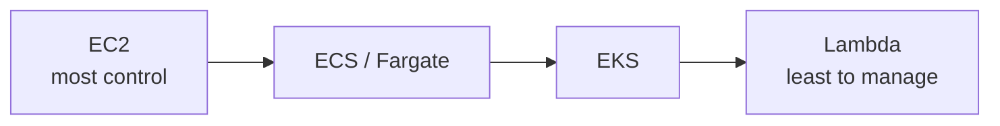
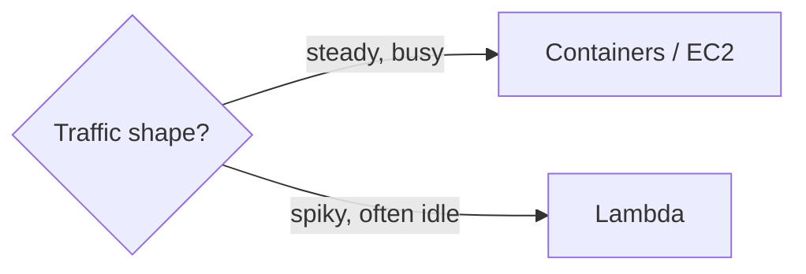
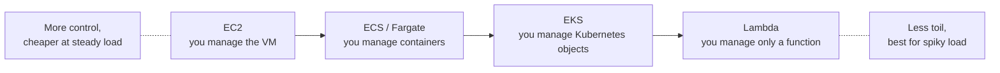
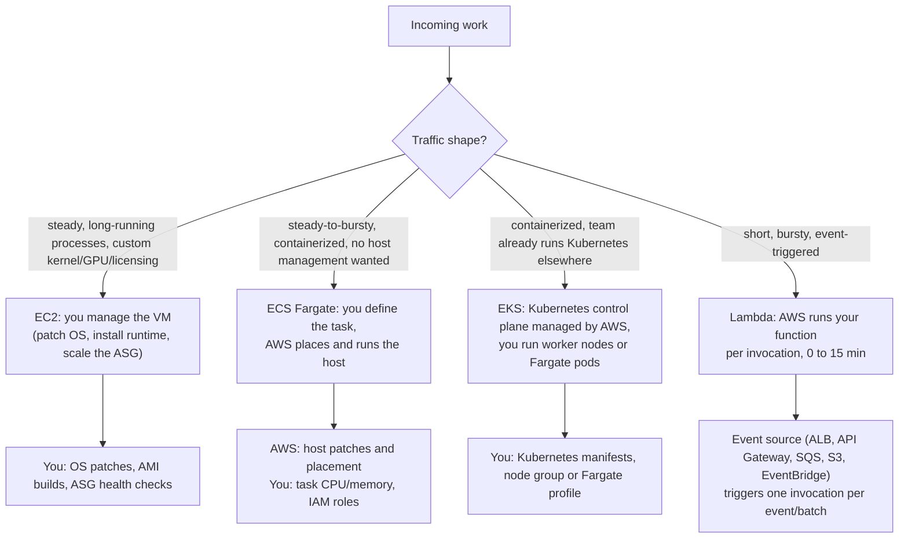
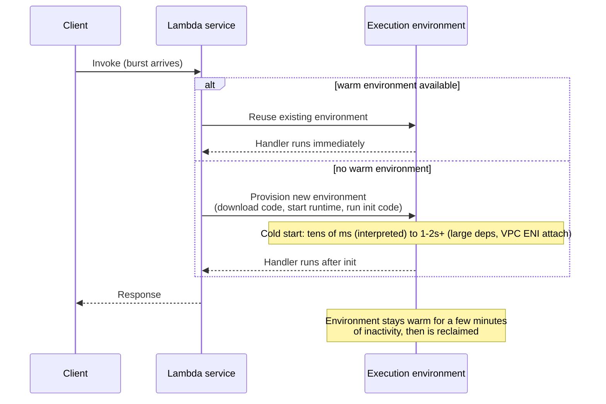

# AWS 04 - Compute Choices - EC2, ECS-Fargate, EKS, Lambda

> [!summary] TL;DR
> AWS gives you four places to run code: **EC2** (you manage the VM), **ECS/Fargate** (you manage containers, AWS manages the VM), **EKS** (you run Kubernetes on AWS), and **Lambda** (you manage neither; AWS runs your function per request). Each trades operational control for less toil, and the right pick depends on your traffic shape, your team's Kubernetes appetite, and how long a single unit of work runs.

> [!abstract] Core idea
> - Four layers of "who manages what": EC2 (you patch the OS) → ECS/Fargate (AWS runs the host, you define tasks) → EKS (you adopt Kubernetes, AWS runs the control plane) → Lambda (AWS runs everything, you ship a function).
> - Moving up the list trades control and raw cost-efficiency for less operational burden.
> - Lambda's unit is a single invocation with a cold start; ECS/Fargate and EC2 keep a process warm and serve many requests.
> - A pricing shape question decides more of this than a technology question: steady, high-throughput traffic favors EC2/Fargate; spiky or rare traffic favors Lambda.

## Start here: the basics 🟢

> [!info] How to read this note (pick your level)
> - 🟢 **New to this?** Read "From zero" below, then sections 1, 2 and 10 (why, mental model and the cheat sheet). Stop there, that is a full first pass.
> - 🟡 **Know the basics?** Add sections 3, 4, 5 and 6 (how it works, a worked example, options and trade-offs).
> - 🔴 **Interview / SDE-3 prep?** Add sections 7, 8 and 9 (production, deep dive and interview questions). Headings are tagged 🟢🟡🔴 so you always know where you are.

**From zero, in 60 seconds** 🟢

AWS gives you four main places to run your code.
**EC2**: you rent a whole virtual machine and look after it yourself.
**ECS/Fargate**: you hand AWS a container; it finds a machine for you.
**EKS**: AWS runs Kubernetes for you.
**Lambda**: you hand over just a function; AWS runs it only when a request comes.



More control means more work for you. Less work usually means less control and sometimes higher cost at steady high traffic.
Lambda's catch: the first request after a quiet spell is slow while it starts up. That is a **cold start**.



The rest of this note is just these 3 questions:
1. What do you manage vs AWS in each option?
2. What is a cold start and when does it hurt?
3. How do you pick, with real numbers?


**The problem in one story.**
You wrote a Go web API and now it needs to run somewhere, all day, for real users.
You also wrote a tiny script that resizes a photo whenever someone uploads one, a few times a day.
Paying for a full computer to sit idle waiting for that script is wasteful; running the busy API as tiny on-demand functions is wasteful too.
AWS offers four ways to run code, and this note is about choosing the right one for each job.

**Words you need first**

| Word | Plain meaning | Tiny example |
| --- | --- | --- |
| Virtual machine (VM) | A software-made computer carved out of a real one | One EC2 instance |
| Container | Your app plus everything it needs, packed to run anywhere | A Docker image of your Go API |
| Orchestrator | Software that starts, places and restarts containers for you | ECS or Kubernetes |
| Kubernetes | A popular open-source orchestrator with its own API | `kubectl apply -f deploy.yaml` |
| Serverless function | Code that AWS runs only when an event arrives | A Lambda handler per upload |
| Cold start | Extra delay when a new copy of your code must start up | First request after idle takes 300 ms |
| vCPU | One virtual CPU core you rent | "2 vCPU, 8 GiB" task size |
| Concurrency | How many requests are being handled at the same moment | 40 requests in flight at once |

**Picture it**



**Analogy.** EC2 is renting a whole flat, Fargate is renting a furnished room, EKS is renting a room in a co-living building with its own house rules, and Lambda is a hotel room by the hour.
Where it breaks: a hotel never makes you wait for the room to "warm up", but Lambda can add a cold-start delay.

**How the rest of this note builds up**

- First, why four options exist and what they cost (section 1), then the "smaller slices of a computer" mental model (section 2).
- Then how each option works under the hood (section 3).
- Then Go sizing helpers for task counts, Little's Law concurrency and cold starts (section 4), plus a comparison table (section 5).
- Finally the SDE-3 view: trade-offs, production patterns, deep dive and interview questions (sections 6-9).

> [!tip] Remember
> Steady traffic → keep warm processes (EC2/Fargate/EKS); rare or spiky work → Lambda; pick EKS only if you want Kubernetes itself.

## 1. Why it exists 🟢

A Go API that serves 2,000 requests/sec around the clock has a predictable, continuous workload: it is cheapest and simplest to keep a fixed pool of warm processes running and let a load balancer spread traffic across them.

A webhook handler that fires 50 times a day, each one finishing in 200ms, is the opposite: keeping a server warm 24 hours a day to handle 10 seconds of actual work a day wastes almost all of the spend.

AWS's compute services exist because no single operational model fits both.

EC2 gives full control of the box (useful for unusual OS/kernel requirements, GPU workloads, or licensing that is per-host).

ECS and Fargate package the app as a container and let AWS place and restart it. EKS gives you the actual Kubernetes API when your team already standardizes on it or needs its ecosystem (operators, CRDs, multi-cloud portability). Lambda removes the server entirely and bills per invocation and per millisecond.

**Concrete numbers (estimate, AWS pricing as of late 2026, prices vary by region — always confirm in the AWS Pricing Calculator before committing to a choice):**
- An `m7g.large` EC2 on-demand instance (2 vCPU, 8 GiB) runs roughly $0.08/hour ≈ $58/month, continuously, whether or not it serves traffic.
- A Fargate task with the same 2 vCPU / 8 GiB (Linux/x86) runs roughly $0.04/vCPU-hour + $0.004/GiB-hour ≈ $0.12/hour ≈ $85/month if kept at 1 task around the clock — more than EC2 because you are paying AWS to manage the host, not for the compute.
- Lambda at 50 invocations/day × 200ms × 128 MB costs cents a month; the same function receiving 2,000 req/sec continuously costs far more than a warm EC2 fleet, because you are paying full price for every millisecond of every invocation with no amortization.

## 2. Mental model 🟢

Think of it as renting progressively smaller slices of "a computer":

- **EC2** rents the whole machine. You choose the OS, you patch it, you decide what runs on it.
- **ECS/Fargate** rents a container's worth of CPU and memory. AWS picks (Fargate) or you provide (EC2 launch type) the host underneath it.
- **EKS** rents the same container slice, but through the Kubernetes API instead of AWS's own ECS API — useful because Kubernetes is a portable, if more complex, lingua franca.
- **Lambda** rents a few hundred milliseconds of a CPU, on demand, per request. There is no "always on" at all: between invocations, nothing of yours is running (unless you pay separately for provisioned concurrency).

## 3. How it works 🟡

**In plain words:** the same picture four times: each step to the right, AWS takes over one more layer you used to manage.



### The cold-start mechanism (Lambda's defining cost)

**In plain words:** when no warm copy is ready, Lambda must start a fresh one before handling your request. That adds a pause, from tens of ms to a few seconds.

Lambda does not keep a process running between requests by default. When a new request arrives and no warm "execution environment" is free, AWS must provision one: download your code, start the runtime, run any top-level initialization, then call your handler.



A VPC-attached Lambda historically added ENI-attachment latency to cold starts; since 2019 AWS pre-creates and shares ENIs across functions in the same subnet/security-group combination, so this is no longer the dominant cost it was, but cold start still scales with package size and runtime (compiled Go binaries start faster than large interpreted-language bundles with many dependencies).

## 4. Worked example 🟡

### Whiteboard version

The question every compute decision reduces to: how many always-on workers do I need to serve my traffic, versus how much does bursty, pay-per-use compute cost at the same traffic? Little's Law gives the Lambda-side answer directly: `concurrent executions ≈ requests/sec × average duration (seconds)`.

```go
package capacity

func LambdaConcurrency(targetRPS, durationMS float64) int {
    seconds := durationMS / 1000
    return int(targetRPS * seconds) // round up in the real version
}
```

A slow handler needs much more concurrency than its request rate alone suggests: 50 req/s at 2,000ms/request needs 100 concurrent executions, not 50 — and each account has a default concurrency ceiling (1,000 as of late 2026, raisable by support request) shared across every function unless you reserve concurrency per function.

### Full version

**In plain words:** Go code that does the sizing math: how many always-on workers a steady load needs, and how cold starts change things.

Two sizing problems, modeled and tested together: how many warm Fargate/EC2 task copies a steady workload needs (with headroom for a lost AZ or a rolling deploy), and how much concurrency a Lambda workload needs by Little's Law.

A third helper shows why cold starts matter less as traffic grows: a fixed burst of cold invocations is a shrinking fraction of a growing total.

```go
// Package capacity models the two capacity-planning questions that come up
// when choosing between always-on compute (EC2/ECS/Fargate) and
// request-triggered compute (Lambda): how many warm workers you need, and
// how much concurrency a bursty Lambda function needs to avoid throttling.
package capacity

import "math"

// FargateTasks returns the number of always-on task copies needed to serve
// targetRPS requests/sec, where each task sustains perTaskRPS requests/sec,
// plus headroom (e.g. 0.3 for 30% spare capacity so a single AZ loss or a
// deploy's rolling-update dip does not cause 5xxs). It rounds up: fractional
// tasks do not exist.
func FargateTasks(targetRPS, perTaskRPS, headroom float64) int {
    if perTaskRPS <= 0 {
        return 0
    }
    need := (targetRPS * (1 + headroom)) / perTaskRPS
    return int(math.Ceil(need))
}

// LambdaConcurrency applies Little's Law (L = λ × W) to estimate how many
// concurrent executions a Lambda function needs at targetRPS requests/sec
// with an average handler duration of durationMS milliseconds. This is the
// number that must fit under the account's concurrency limit (minus other
// functions' reserved concurrency) or requests start getting throttled
// (HTTP 429 / TooManyRequestsException).
func LambdaConcurrency(targetRPS, durationMS float64) int {
    if targetRPS <= 0 || durationMS <= 0 {
        return 0
    }
    seconds := durationMS / 1000
    return int(math.Ceil(targetRPS * seconds))
}

// ColdStartImpact estimates the fraction of requests that pay the cold-start
// penalty right after a burst of newBurstRPS requests/sec arrives with no
// warm execution environments available, given that each cold start takes
// coldStartMS to provision before it can serve. It is a simplified model
// (first "coldStartMS of wall-clock time" worth of arrivals all start cold)
// and is only meant to show the shape of the trade-off, not a precise figure.
func ColdStartImpact(newBurstRPS, coldStartMS, totalRequests float64) float64 {
    if totalRequests <= 0 {
        return 0
    }
    coldRequests := newBurstRPS * (coldStartMS / 1000)
    if coldRequests > totalRequests {
        coldRequests = totalRequests
    }
    return coldRequests / totalRequests
}
```

Tests (Go 1.24, `go vet` and `go test -race` pass):

```go
package capacity

import "testing"

func TestFargateTasks(t *testing.T) {
    cases := []struct {
        rps, perTask, headroom float64
        want                   int
    }{
        {1000, 150, 0.3, 9}, // 1000*1.3/150 = 8.67 -> 9
        {300, 150, 0.0, 2},  // exact fit, no headroom
        {1, 150, 0.3, 1},    // always at least 1 task if there's any traffic
    }
    for _, c := range cases {
        got := FargateTasks(c.rps, c.perTask, c.headroom)
        if got != c.want {
            t.Errorf("FargateTasks(%v, %v, %v) = %d, want %d", c.rps, c.perTask, c.headroom, got, c.want)
        }
    }
}

func TestLambdaConcurrency(t *testing.T) {
    // 500 req/s, 200ms average duration -> 100 concurrent executions (Little's Law).
    got := LambdaConcurrency(500, 200)
    if got != 100 {
        t.Errorf("LambdaConcurrency(500, 200) = %d, want 100", got)
    }
}

func TestLambdaConcurrencyBeatsNaiveRPSCount(t *testing.T) {
    // A slow handler needs far more concurrency than its RPS alone suggests:
    // 50 req/s at 2s/request needs 100 concurrent executions, not 50.
    got := LambdaConcurrency(50, 2000)
    if got != 100 {
        t.Errorf("LambdaConcurrency(50, 2000) = %d, want 100", got)
    }
}

func TestColdStartImpactShrinksAsTrafficGrows(t *testing.T) {
    small := ColdStartImpact(200, 800, 1000)   // small batch: cold starts dominate
    large := ColdStartImpact(200, 800, 100000) // same burst, much more steady traffic after it
    if !(small > large) {
        t.Fatalf("expected cold-start fraction to shrink as total traffic grows: small=%v large=%v", small, large)
    }
    if large <= 0 || large >= 0.01 {
        t.Fatalf("expected large-volume cold-start fraction to be small, got %v", large)
    }
}
```

**Measured (this test run, Go 1.24.4, 2026-11-07):** `FargateTasks(1000, 150, 0.3)` returns 9 (needs 8.67 tasks, rounded up); `LambdaConcurrency(500, 200)` returns 100; the cold-start fraction for a fixed 200 req/s × 800ms burst drops from 16% of 1,000 total requests to under 1% of 100,000 total requests — the same absolute cold-start cost, amortized over more steady-state traffic.

## 5. Variants and comparison 🟡

| Option | How it works | Use when | Cost shape |
| --- | --- | --- | --- |
| EC2 | You provision VMs, choose the AMI, patch the OS, run an Auto Scaling Group | Custom kernel modules, GPU/specialized instance families, per-host licensing, workloads needing full OS control | Pay per instance-hour regardless of utilization; cheapest raw compute at steady, high utilization |
| ECS, EC2 launch type | You run ECS-managed containers on EC2 instances you still patch | You want container orchestration but also want to pack several task types onto owned hosts for cost efficiency | Instance-hour cost, but bin-packed across tasks |
| ECS, Fargate launch type | AWS runs the host; you define task CPU/memory and AWS places it | You want containers with zero host management | Per-task vCPU/memory-second; pricier per unit than EC2 but no host ops |
| EKS | Managed Kubernetes control plane; you run worker nodes (EC2, Fargate, or Karpenter-managed) | Team already standardizes on Kubernetes, needs its operator ecosystem, or wants portability across clouds | Control-plane fee (~$0.10/hour/cluster) plus node cost (EC2 or Fargate pricing) |
| Lambda | AWS provisions an execution environment per burst of concurrent invocations, bills per invocation and per GB-second | Short, bursty, event-driven work (webhooks, S3/SQS triggers, scheduled jobs, API Gateway backends with spiky traffic) | Per-invocation + per-ms; cheap at low/bursty volume, expensive at sustained high volume |

> [!warning] Interview trap
> "Serverless is always cheaper" is wrong. Lambda is cheaper per unit of **idle time avoided**, not per unit of compute. A function handling 2,000 steady requests/sec, each taking 100ms, is paying for 200 seconds of compute every second — that is nowhere near idle, and a warm ECS/Fargate or EC2 fleet sized for that exact load wins on cost every time.

## 6. Trade-offs and when not to use 🟡

- **EC2**: most operational burden (patching, AMI pipeline, kernel CVEs) but the most control and often the best steady-state price.
- **ECS/Fargate**: no host management, but Fargate's per-vCPU/GB pricing is a real premium over EC2 at scale — reach for the EC2 launch type if host ops are acceptable and the bill matters.
- **EKS**: brings Kubernetes's power (and its learning curve) — not worth it for a single small service; valuable once you run many services and want one control plane and one set of operational tools.
- **Lambda**: a 15-minute hard execution-time limit, no good fit for long-lived connections (WebSockets need API Gateway's separate WebSocket support, not a long-running Lambda), and cost scales badly past a certain sustained request volume. Cold starts also make it a poor fit for strict single-digit-millisecond p99 latency budgets unless you pay for provisioned concurrency.
- A small team with one Go API and predictable traffic is very often best served by ECS/Fargate alone — EKS adds operational surface you do not need yet.

## 7. In production 🔴

- **Real systems:** Most AWS-hosted backend APIs with steady traffic run on ECS/Fargate or EKS behind an ALB (see [[AWS 05 - ECS, Fargate and ECR]] and [[AWS 06 - Load Balancing (ALB vs NLB)]]). Lambda dominates event-driven glue: S3 upload processing, SQS consumers for bursty background work, and API Gateway backends for low-to-moderate-traffic APIs. EKS is common where a platform team already runs Kubernetes across multiple clouds or on-prem and wants one control plane for AWS workloads too.
- **Failure modes → fixes:**
  - Lambda throttling (`TooManyRequestsException`) under a traffic spike → request a concurrency limit increase ahead of a known launch, or reserve concurrency per critical function so noisy neighbors cannot starve it.
  - EC2 Auto Scaling Group too slow to add capacity during a spike → use Lambda or Fargate for the bursty portion of traffic, keep EC2 for the steady baseline (a hybrid pattern).
  - A "lift and shift" of a long-running batch job to Lambda hits the 15-minute timeout → split the job or move it to Fargate/EC2 for anything that can run long.
  - Choosing EKS for a one-service team → operational overhead (node upgrades, CNI/IAM-for-service-accounts plumbing) outweighs the Kubernetes ecosystem benefit; ECS/Fargate does the same container job with less to manage.
- **What to monitor:** EC2/Fargate CPU and memory utilization versus requested capacity (right-sizing); Lambda concurrent executions versus the account/function limit, throttle count, and p50/p99 duration (cold start tells on duration's tail); EKS node CPU/memory pressure and pod eviction rate.

## 8. Deep dive 🔴

- **Fargate is not magic**: under the hood it still runs your container on an EC2-class VM managed by AWS using Firecracker microVMs for isolation — this is why Fargate has its own (slightly higher) per-vCPU/GB price instead of being free.
- **EKS control-plane isolation**: the managed control plane runs per-cluster in AWS-owned accounts; what you operate is the data plane (worker nodes or Fargate profiles) and the Kubernetes objects you deploy to it. Multiple clusters do not share a control plane, which is part of why many small clusters cost more than fewer large ones.
- **Lambda's execution environment reuse** is why global/package-level initialization (opening a DB connection pool, loading a config file) is cheap per-invocation but expensive per-cold-start: code outside the handler runs once per environment, not once per request, so a warm environment amortizes that cost across many invocations — but a sudden concurrency spike provisions many environments at once, each paying that cost fresh.
- **Graviton (ARM) instances** (the `m7g`/`c7g` family, and Lambda's `arm64` architecture option) typically cost ~20% less than the equivalent x86 instance type for compatible workloads — Go cross-compiles trivially to `arm64`, making this one of the easiest cost wins available.
- **Provisioned concurrency** pre-warms a fixed number of Lambda execution environments so the first request after idle does not pay the cold-start cost — it converts part of Lambda's bill back into an always-on cost, blurring the line with Fargate for latency-sensitive, bursty workloads.

## 9. Interview questions 🔴

> [!question]- You have a Go API serving a steady 2,000 req/sec. Which compute option, and why?
> ECS/Fargate (or EC2 if host ops are acceptable and cost matters more). Steady, high-throughput traffic is the case where always-on compute beats Lambda's per-invocation billing; Lambda would charge for every millisecond of sustained 100%+ utilization with no amortization advantage.

> [!question]- What exactly causes a Lambda cold start, and what shrinks it?
> AWS has no warm execution environment free, so it must provision one: download the deployment package, start the runtime, run top-level init code, then call the handler. Smaller deployment packages, compiled languages (Go, Rust) over large interpreted-language bundles, and provisioned concurrency all shrink it; VPC ENI attachment used to add to it but AWS pre-creates shared ENIs since 2019, removing most of that cost.

> [!question]- When would you reach for EKS over plain ECS/Fargate?
> When the team already standardizes on Kubernetes (shared tooling, operators, Helm charts) or needs portability across clouds/on-prem. For a single AWS-only service with no existing Kubernetes investment, ECS/Fargate gives the same container orchestration with a simpler control plane and less to operate.

> [!question]- Trap: "Serverless always saves money." True or false?
> False. Lambda saves money by eliminating idle-time billing for bursty or low-volume workloads. At sustained high request rates, Lambda's per-invocation and per-ms pricing usually costs more than an equivalently-sized warm fleet, because there is no idle time left to eliminate.

> [!question]- How do you size how many Fargate tasks or EC2 instances you need for a target throughput?
> Divide target requests/sec by one task's sustained requests/sec (measured under load testing, not guessed), add headroom (commonly 20-30%) for an AZ loss or a rolling deployment's temporary capacity dip, and round up — `FargateTasks` above is exactly this calculation.

> [!question]- How do you size Lambda concurrency for a target throughput?
> Apply Little's Law: concurrent executions ≈ requests/sec × average duration in seconds. A slow handler needs proportionally more concurrency even at a modest request rate, and that number must fit under your account's concurrency limit minus any other functions' reserved concurrency, or you get throttled.

> [!question]- What is Fargate actually running on, under the hood?
> AWS-managed EC2-class hosts, with each task isolated in its own Firecracker microVM. You never see or patch the host; that management is exactly what Fargate's price premium over the EC2 launch type buys.

## 10. Cheat sheet 🟢

- EC2 → ECS/Fargate → EKS → Lambda: progressively less operational control, progressively less "always on."
- Lambda bills per invocation and per-ms; EC2/Fargate bill per hour regardless of utilization.
- Steady, high-throughput traffic favors EC2/Fargate; bursty, event-driven, low-volume traffic favors Lambda.
- Cold start = no warm execution environment free → provision one (download code, start runtime, run init) before the handler runs.
- Little's Law sizes Lambda concurrency: `concurrency ≈ RPS × avg duration (s)`.
- EKS earns its complexity only once you operate many services or need the Kubernetes ecosystem specifically.
- Fargate runs on AWS-managed hosts via Firecracker microVMs; that host management is what you pay its premium for.
- Graviton (`arm64`) instances and Lambda functions are typically ~20% cheaper for compatible workloads — an easy win for Go.

## Links

- **Before this:** [[AWS 01 - Core Concepts (Regions, AZs, Accounts, Shared Responsibility)]], [[AWS 03 - VPC Networking]]
- **Next:** [[AWS 05 - ECS, Fargate and ECR]], [[AWS 06 - Load Balancing (ALB vs NLB)]]
- **Compare with:** [[Kubernetes Fundamentals]] (EKS runs this), [[Autoscaling]] (how each compute option scales out), [[Containerizing Go Services]] (building the image these options run)

### Watch on YouTube

- [AWS Compute Services: EC2, Lambda, ECS, EKS, Fargate, Beanstalk Explained (CLF-C02)](https://www.youtube.com/watch?v=13Yv1LTjebg) · BiteSizedCerts · 4 min · 94 views
- [AWS Compute Explained: EC2, Lambda, ECS, EKS and Fargate / Ch.5](https://www.youtube.com/watch?v=PWzvP3O_yuw) · PM Techhub · 9 min · 1 views
