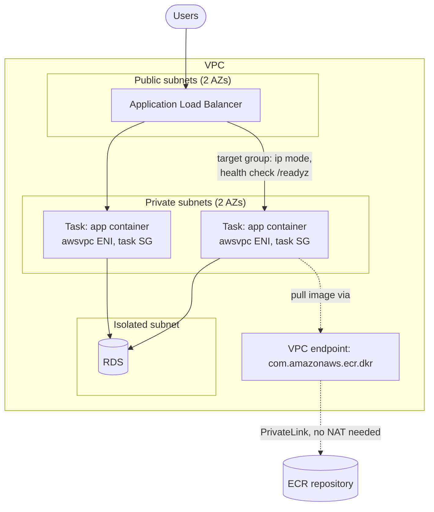
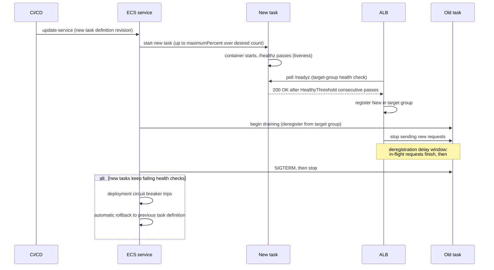

# AWS 05 - ECS, Fargate and ECR

> [!summary] TL;DR
> **ECR** stores your container images. **ECS** runs them: a **task definition** describes one or more containers, a **task** is one running copy of that definition, and a **service** keeps a target number of tasks running and replaces ones that die. **Fargate** is a launch type that removes the EC2 host from your side of the fence entirely.

> [!abstract] Core idea
> - ECR is a private, versioned Docker registry; ECS is the orchestrator that runs images from it.
> - A task definition is a blueprint; a task is one running instance of it; a service keeps N tasks alive and replaces failures.
> - Fargate vs EC2 launch type is the same compute-choice trade-off as the rest of 13: who patches the host.
> - Rolling deployments and the deployment circuit breaker are what make `ecs update-service` safe to run without a human watching it.

## 1. Why it exists

A container image sitting on your laptop does nothing for users. You need somewhere durable and access-controlled to store it (ECR), and something that keeps a target number of copies of it running, replaces ones that crash, and routes traffic to only the healthy ones (ECS). Doing this by hand — SSH to a box, `docker run`, watch it, restart it when it dies — does not survive a host failure, does not scale past one person's attention, and has no audit trail for who deployed what.

ECS solves the "keep N copies running" problem with a **service**, which continuously reconciles the actual running task count against the desired count — the same control-loop idea Kubernetes uses, applied through AWS's own, simpler API.

## 2. Mental model

Four nested ideas, in the order AWS introduces them:

- **ECR** is a Docker registry — `docker push`/`pull`, just hosted by AWS with IAM-based access control instead of a username/password.
- A **task definition** is a JSON blueprint: which image, how much CPU/memory, which ports, which environment variables and secrets, which IAM roles. It does not run anything by itself.
- A **task** is one running copy of a task definition — and, importantly, a task can hold **several containers** (an app container plus sidecars for logging or a service-mesh proxy), all scheduled together on the same host or Fargate slot.
- A **service** wraps a task definition with a desired count and keeps that many tasks running, replacing any that stop, and (if attached to a load balancer) only registering tasks that pass their health check.

## 3. How it works



Each task runs in **awsvpc** networking mode: it gets its own elastic network interface and its own security group, as if it were a small EC2 instance, instead of sharing the host's network namespace. That is what lets the ALB target group use **ip** target type (routing straight to the task's ENI IP) and what lets you scope a security group per task rather than per host.

### Pulling the image

Logging in to ECR is a two-step process; the common mistake is running only the first step:

```bash
# Step 1: get a short-lived password (expires in 12 hours)
aws ecr get-login-password --region ap-south-1 \
  # Step 2: pipe it straight into `docker login` — the password is never on disk
  | docker login --username AWS --password-stdin \
      123456789012.dkr.ecr.ap-south-1.amazonaws.com

docker build -t my-api .
docker tag my-api:$(git rev-parse --short HEAD) \
  123456789012.dkr.ecr.ap-south-1.amazonaws.com/my-api:$(git rev-parse --short HEAD)
docker push 123456789012.dkr.ecr.ap-south-1.amazonaws.com/my-api:$(git rev-parse --short HEAD)
```

Running `get-login-password` alone prints a token to your terminal; it does not log Docker in. Forgetting the pipe into `docker login` is the single most common reason a first-time ECR push fails with "no basic auth credentials."

### Rolling deployment



`minimumHealthyPercent` and `maximumPercent` control how aggressively this happens: the common default (100/200) keeps all old tasks running while launching up to a full second set of new ones, so capacity never drops during the swap. The **deployment circuit breaker** watches for new tasks repeatedly failing to reach a healthy state and automatically rolls the service back to the last working task definition instead of looping forever.

## 4. Worked example

### Whiteboard version

The deployment-safety contract in one picture: a task must stop **accepting new work** before it stops **running**, so the ALB's deregistration delay has time to drain in-flight requests.

```go
func (a *App) Shutdown(ctx context.Context) error {
    a.ready.Store(false)      // readyz now returns 503: ALB stops routing new traffic here
    return a.srv.Shutdown(ctx) // waits for in-flight requests, then closes the listener
}
```

### Full version

A minimal ECS-ready Go HTTP service with a liveness probe (`/healthz`, always 200 while the process is alive), a readiness probe (`/readyz`, the one the ALB target-group health check polls), and a graceful `Shutdown` that flips readiness off before draining. This is what task definitions wire up as the ALB health-check path plus a `stopTimeout` long enough to let `Shutdown` finish.

```go
// Package ecsapp shows the shutdown sequence an ECS/Fargate task must
// implement so a rolling deployment or scale-in does not drop in-flight
// requests: go unready before you stop accepting connections, so the ALB's
// next health check fails and stops sending new traffic during the
// deregistration delay, then drain and exit.
package ecsapp

import (
    "context"
    "net/http"
    "sync/atomic"
)

// App is a minimal HTTP service with a liveness probe, a readiness probe
// the ALB target-group health check polls, and a graceful Shutdown that
// flips readiness off before closing the listener.
type App struct {
    mux   *http.ServeMux
    ready atomic.Bool
    srv   *http.Server
}

func New(addr string, handler http.Handler) *App {
    a := &App{mux: http.NewServeMux()}
    a.ready.Store(true)

    a.mux.HandleFunc("/healthz", func(w http.ResponseWriter, r *http.Request) {
        w.WriteHeader(http.StatusOK) // liveness: process is alive, always 200
    })
    a.mux.HandleFunc("/readyz", func(w http.ResponseWriter, r *http.Request) {
        if a.ready.Load() {
            w.WriteHeader(http.StatusOK)
            return
        }
        w.WriteHeader(http.StatusServiceUnavailable) // ALB health check fails -> target drained
    })
    if handler != nil {
        a.mux.Handle("/", handler)
    }

    a.srv = &http.Server{Addr: addr, Handler: a.mux}
    return a
}

func (a *App) Handler() http.Handler { return a.mux }

// Shutdown marks the task not-ready, then waits (up to ctx's deadline) for
// in-flight requests to finish before closing the listener. Call this from
// a SIGTERM handler. The ALB keeps routing new traffic away for as long as
// its deregistration delay (default 300s) exceeds the time between this
// call returning unready and the health check's next poll.
func (a *App) Shutdown(ctx context.Context) error {
    a.ready.Store(false)
    return a.srv.Shutdown(ctx)
}

// Ready reports the current readiness state (test hook).
func (a *App) Ready() bool { return a.ready.Load() }
```

The test proves the property that actually matters in production: a request already in flight when `Shutdown` is called completes successfully, because `Shutdown` stops accepting new connections before it closes anything.

```go
func TestShutdownDrainsInFlightRequest(t *testing.T) {
    started := make(chan struct{})
    release := make(chan struct{})
    slow := http.HandlerFunc(func(w http.ResponseWriter, r *http.Request) {
        close(started)
        <-release
        w.WriteHeader(http.StatusOK)
    })

    a := New("127.0.0.1:0", slow)
    ln, _ := net.Listen("tcp", "127.0.0.1:0")
    go a.srv.Serve(ln)

    go http.Get("http://" + ln.Addr().String() + "/")
    <-started // request is now in flight

    shutdownDone := make(chan error, 1)
    go func() {
        ctx, cancel := context.WithTimeout(context.Background(), 2*time.Second)
        defer cancel()
        shutdownDone <- a.Shutdown(ctx)
    }()

    time.Sleep(50 * time.Millisecond)
    close(release) // let the in-flight handler finish
    if err := <-shutdownDone; err != nil {
        t.Fatalf("Shutdown: %v", err)
    }
}
```

**Result (this test run, Go 1.24.4, `go test -race`, 2026-11-07):** `TestHealthzAlwaysOK`, `TestReadyzFlipsOnShutdown`, and `TestShutdownDrainsInFlightRequest` all pass — including under the race detector, which matters here because readiness is read from the HTTP handler goroutine while `Shutdown` writes it from the signal-handling goroutine; `atomic.Bool` is what makes that safe.

### ECS concepts (corrected)

| Concept | Meaning |
| --- | --- |
| Cluster | Logical grouping of tasks/services; with Fargate it holds no actual EC2 capacity of its own |
| Task definition | Versioned blueprint: image, CPU/memory, port mappings, env vars, secrets, IAM roles, log config |
| Task | **One running copy of a task definition — and a task can hold more than one container** (app + sidecars) |
| Service | Keeps a desired task count running; drives rolling deployments and (optionally) auto scaling |
| Fargate | Launch type where AWS runs the underlying host; you never see or patch it |
| Task execution role | Lets the ECS agent pull the image from ECR and ship logs/secrets — the infrastructure's permissions |
| Task role | Permissions the application code itself assumes at runtime (e.g. to call S3 or RDS) — the app's permissions |

The old table's "Task | running container instance" line was wrong: a task is a running copy of the **task definition**, and one task commonly holds several containers started together.

### Task definition contains

- Container image URI (by digest or an immutable tag, never floating `latest`)
- CPU and memory, at the task level and optionally per container
- Container port mappings
- Environment variables (plain config) and secrets (references into Secrets Manager or SSM Parameter Store — see [[Secrets Management]])
- Log configuration (`awslogs` driver to CloudWatch Logs, or FireLens for custom routing)
- Health check command (container-level) and, separately, the ALB target-group health check path

## 5. Variants and comparison

| Option | How it works | Use when | Cost / operational trade-off |
| --- | --- | --- | --- |
| ECS, Fargate launch type | AWS places and runs the host per task | Default choice: no host management wanted | Higher per-vCPU/GB price, zero host ops |
| ECS, EC2 launch type | You run ECS-managed containers on EC2 instances you own | Need to bin-pack many tasks tightly onto owned capacity, or need instance types Fargate doesn't offer (GPU, bare metal) | Lower raw compute cost, you patch the hosts |
| ECR private repository | Image storage with IAM-based push/pull permissions, image scanning, lifecycle policies | Always, for any image your account builds | Storage + data transfer cost; scanning is free for basic scanning |
| ECR pull-through cache | ECR proxies and caches an upstream public registry (e.g. Docker Hub) on first pull | You depend on public base images and want to avoid rate limits and have them scanned | One extra repository configuration per upstream |
| CodeDeploy blue/green for ECS | Spins up a fully separate new task set behind a second (or shifted) target group, then cuts traffic over | Need instant rollback via traffic shift rather than task-by-task replacement | More complex pipeline, doubles capacity briefly |

> [!warning] Interview trap
> "A task is a running container" is the wrong mental model. A task is a running copy of a **task definition**, which can describe multiple containers (for example an app container plus an OpenTelemetry collector sidecar) that are scheduled and scaled together as one unit.

## 6. Trade-offs and when not to use

- Fargate removes host patching but costs more per unit of CPU/memory than the EC2 launch type at scale — re-evaluate once a service is large and stable.
- `awsvpc` networking gives each task its own ENI, which is safer (per-task security groups) but consumes one VPC IP address per task; very large clusters can exhaust a subnet's IP space faster than expected — size subnets generously or use ENI trunking.
- The deployment circuit breaker protects against a broken new revision looping forever, but it only catches failures visible to the ECS health check; a revision that deploys healthy but silently returns wrong data needs its own smoke tests in the pipeline (see [[CI-CD Pipelines (GitHub Actions for Go)]]).
- For a single, small, rarely-changing service with no need for per-task networking or fine-grained IAM, a single EC2 instance running `docker compose` is simpler and cheaper — ECS earns its complexity once you need zero-downtime deploys, multiple replicas, or auto scaling.

## 7. In production

- **Real systems:** ECS/Fargate behind an ALB is one of the most common ways to run a containerized Go API on AWS without adopting Kubernetes; EKS (see [[Kubernetes Fundamentals]]) is the alternative once a team already runs Kubernetes elsewhere.
- **Failure modes → fixes:**
  - Task fails to start: "CannotPullContainerError" → usually missing NAT gateway or VPC endpoint for a task in a private subnet (add a `com.amazonaws.<region>.ecr.dkr` and `ecr.api` VPC endpoint, or a NAT gateway).
  - Task starts then is immediately killed → wrong container port in the task definition versus what the app actually listens on, or a failing container-level `HEALTHCHECK`.
  - ALB shows targets unhealthy forever → health-check path mismatch, or the app takes longer to become ready than `HealthyThreshold × interval` allows — raise the grace period (`healthCheckGracePeriodSeconds`) for slow-starting apps.
  - Deployment stuck "in progress" → new tasks keep failing health checks; the circuit breaker (if enabled) rolls back automatically after its failure threshold, otherwise the service retries indefinitely.
  - Secrets Manager/SSM throttling during a large scale-out → ECS caches secret values per task start, but a burst of many simultaneous task starts can still hit API rate limits; stagger large scale-outs.
- **What to monitor:** service desired vs. running task count (a persistent gap means something is failing to start), target-group healthy host count, task stop reason codes (CloudWatch `ECS Task State Change` events), deployment circuit-breaker trip events, and ECR image scan findings.

## 8. Deep dive

- **Capacity providers** decouple a service from a single launch type: a capacity provider strategy can mix Fargate and Fargate Spot (steeply discounted, interruptible capacity) in a ratio, so steady-state traffic runs on standard Fargate and burst capacity runs on cheaper Spot.
- **Service auto scaling** attaches a target-tracking policy to the service's desired count — most commonly on average CPU utilization or on `ALBRequestCountPerTarget`, which scales based on load the ALB actually measures per task rather than a proxy metric like CPU (closer to real saturation for I/O-bound Go services); see [[Autoscaling]] for the general target-tracking mechanics.
- **ECR image immutability**: marking a repository's tags immutable prevents `my-api:v1.2.0` from silently being overwritten later, which otherwise breaks the guarantee that a given task definition always pulls the same bytes — combine with lifecycle policies that expire untagged or old images to control storage cost.
- **ECS vs EKS vs Lambda, revisited**: ECS is the simplest path to "run this container reliably" on AWS; it lacks Kubernetes's broader ecosystem (CRDs, operators, service mesh integrations) but also lacks its operational surface. See [[AWS 04 - Compute Choices - EC2, ECS-Fargate, EKS, Lambda]] for the full comparison.

## 9. Interview questions

> [!question]- What is the difference between a task definition, a task, and a service?
> A task definition is a versioned blueprint (image, resources, roles, env). A task is one running copy of that blueprint, which can contain several containers scheduled together. A service keeps a target number of tasks running, replacing failures and driving rolling deployments.

> [!question]- Why does `aws ecr get-login-password` alone not let you push an image?
> It only prints a short-lived authentication token to stdout. You must pipe that token into `docker login --username AWS --password-stdin <registry>` to actually authenticate the Docker client; skipping that step gives a "no basic auth credentials" error on push.

> [!question]- Trap: is a task the same thing as a running container?
> No. A task is a running copy of a task definition and can hold multiple containers (for example, an app container and a logging sidecar) that scale and restart together as one unit — "task" and "container" are not interchangeable.

> [!question]- What is the difference between the task execution role and the task role?
> The task execution role is the infrastructure's permission set: it lets the ECS agent pull the image from ECR, fetch secrets, and ship logs. The task role is the application's own permission set, assumed by your code at runtime to call other AWS services like S3 or DynamoDB. Conflating them over-grants either the agent or the app.

> [!question]- How does ECS avoid a bad deployment taking down a service?
> Rolling deployment keeps old tasks serving until new tasks pass their health checks and register with the load balancer; `minimumHealthyPercent`/`maximumPercent` control how much capacity exists during the swap. If enabled, the deployment circuit breaker detects new tasks repeatedly failing to become healthy and automatically rolls the service back to the previous task definition.

> [!question]- Why does a Go service need both a liveness and a readiness endpoint, not just one `/health`?
> Liveness answers "is the process alive" (restart it if not); readiness answers "can it currently serve traffic" (stop routing to it, but don't necessarily restart it). During graceful shutdown the process is still alive but should stop receiving new traffic, which only a separate readiness flip expresses correctly.

## 10. Cheat sheet

- ECR stores images; ECS runs them.
- Task definition = blueprint; task = running copy (can hold several containers); service = keeps N tasks alive.
- `aws ecr get-login-password | docker login --username AWS --password-stdin <registry>` — the pipe is mandatory.
- Tag images by Git commit SHA, not `latest`; mark ECR repositories immutable.
- `awsvpc` mode gives every task its own ENI and security group — enables `ip` target-group mode and per-task network isolation.
- Task execution role = pull image/ship logs/fetch secrets; task role = the app's own AWS permissions.
- Readiness flips off before the listener closes, so the ALB's deregistration delay has time to drain in-flight requests.
- The deployment circuit breaker auto-rolls-back a revision whose new tasks keep failing health checks.

## Links

- **Before this:** [[AWS 04 - Compute Choices - EC2, ECS-Fargate, EKS, Lambda]], [[Docker 02 - Images, Layers and Containers]]
- **Next:** [[AWS 06 - Load Balancing (ALB vs NLB)]], [[Autoscaling]]
- **Compare with:** [[Kubernetes Fundamentals]] (the orchestrator alternative), [[Deployment Strategies - Rolling, Blue-Green, Canary]] (deploy-level strategy this note's rolling deployment is one instance of), [[Secrets Management]] (how task-definition secrets are stored and rotated)
