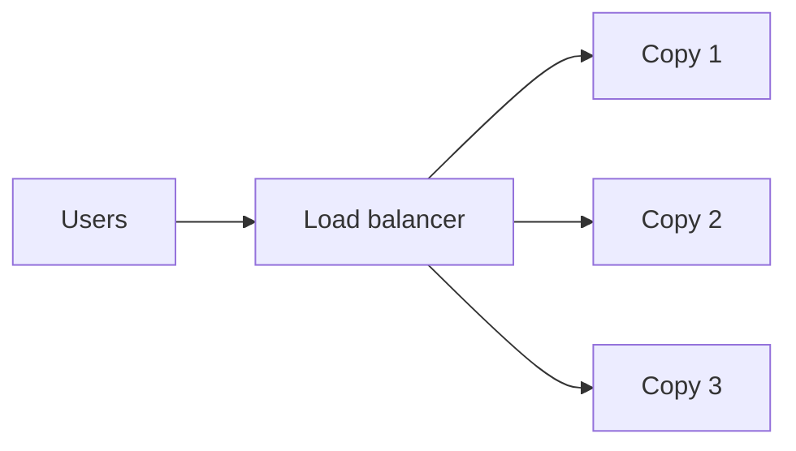
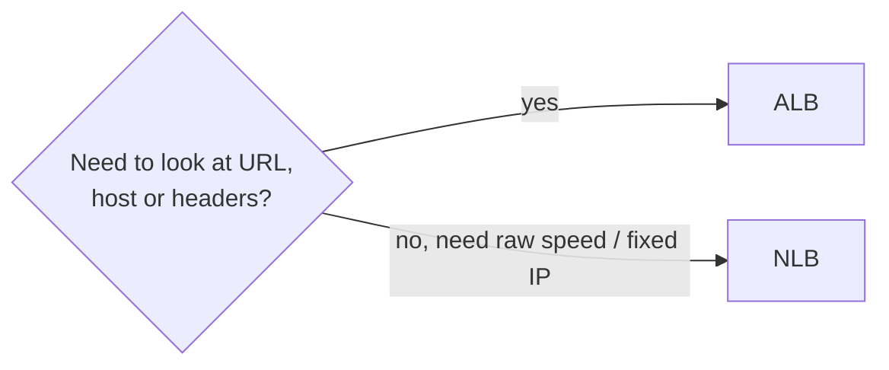
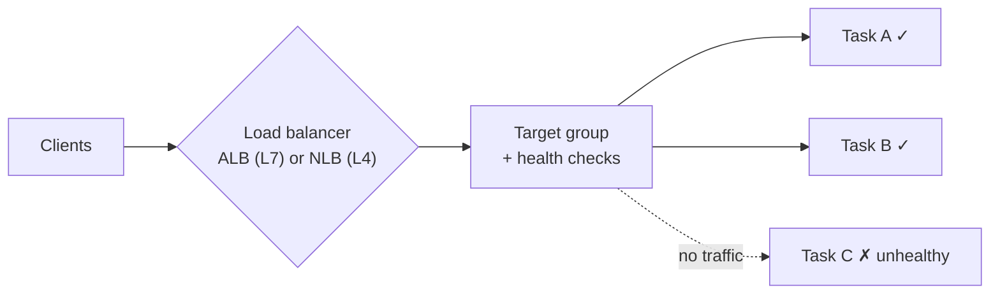
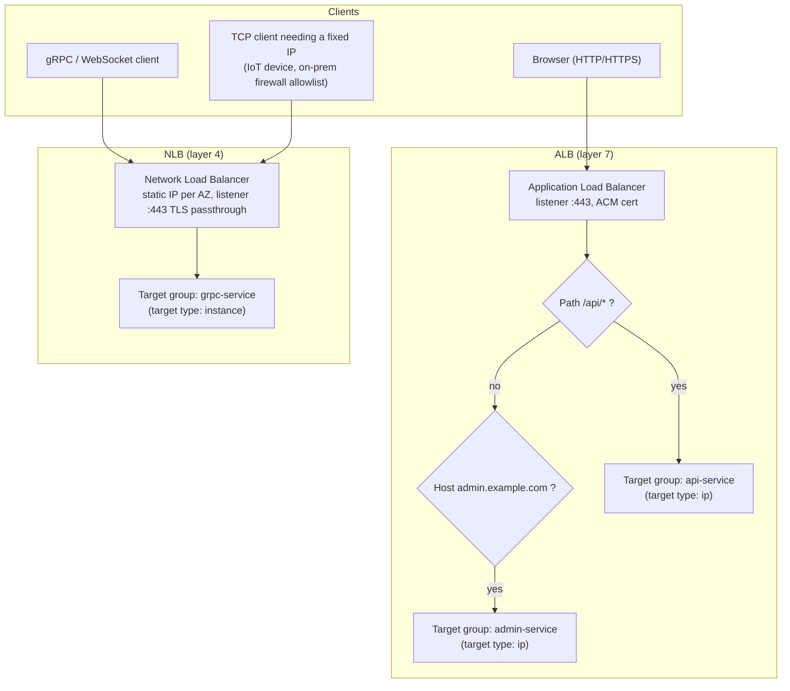
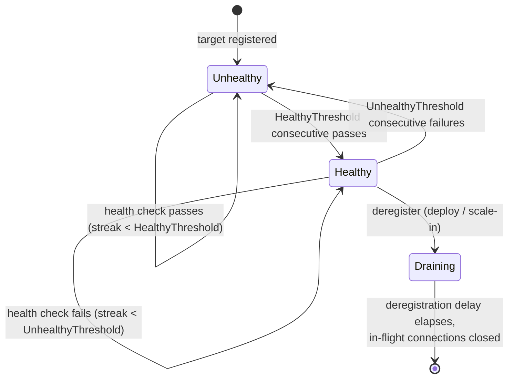

# AWS 06 - Load Balancing (ALB vs NLB)

> [!summary] TL;DR
> AWS's Elastic Load Balancing has two load balancer types you choose between for new designs: the **ALB** (Application Load Balancer, layer 7 — understands HTTP/HTTPS/gRPC and routes on path, host, or header) and the **NLB** (Network Load Balancer, layer 4 — routes raw TCP/UDP/TLS connections at very high throughput with a static IP per AZ). This note covers AWS's specific products, target groups, and health checks; the routing **algorithms** (round robin, least connections, consistent hashing) are covered once in [[Load Balancing]] and apply the same way regardless of cloud provider.

> [!abstract] Core idea
> - ALB = layer 7 (HTTP-aware: path/host routing, WebSockets, gRPC); NLB = layer 4 (raw TCP/UDP/TLS, preserves client IP, static IP per AZ, much higher throughput).
> - Both route traffic to **target groups**, not directly to servers; a target group decides instance, IP, or Lambda targets and owns the health-check configuration.
> - A target's health state is its own small state machine: `HealthyThreshold`/`UnhealthyThreshold` consecutive passes/fails, independent of which algorithm picked it.
> - Deregistration delay is what makes a rolling deployment or scale-in safe: a draining target keeps serving in-flight connections for a grace period before it is removed.

## Start here: the basics 🟢

> [!info] How to read this note (pick your level)
> - 🟢 **New to this?** Read "From zero" below, then sections 1, 2 and 10 (why, mental model and the cheat sheet). Stop there, that is a full first pass.
> - 🟡 **Know the basics?** Add sections 3, 4, 5 and 6 (how it works, a worked example, options and trade-offs).
> - 🔴 **Interview / SDE-3 prep?** Add sections 7, 8 and 9 (production, deep dive and interview questions). Headings are tagged 🟢🟡🔴 so you always know where you are.

**From zero, in 60 seconds** 🟢

Your app runs as several copies. Users need one address to hit, not six.
A **load balancer** is that one address. It takes each request and passes it to a healthy copy.



AWS has two main kinds.
The **ALB** reads the web request itself, so it can route by path (/api to one group, /images to another).
The **NLB** doesn't read the content; it just forwards raw connections, very fast, with a fixed IP.



The rest of this note is just these 3 questions:
1. How do ALB and NLB differ?
2. What are target groups, and how do health checks decide who gets traffic?
3. How do you avoid dropping requests during deploys?


**The problem in one story.**
Your API runs as 6 copies on different machines, so one crash should not take the site down.
But users type one address, not six, and someone has to pick which copy answers each request.
If a copy dies, traffic must stop going to it within seconds.
A load balancer is that single front door that spreads requests over healthy copies.

**Words you need first**

| Word | Plain meaning | Tiny example |
| --- | --- | --- |
| Load balancer | One entry point that spreads traffic across many servers | `api.example.com` → 6 tasks |
| Target | One backend that can receive traffic | An ECS task's IP on port 8080 |
| Target group | A named set of targets plus their health-check rules | `orders-api-tg` |
| Health check | A periodic probe to see if a target is OK | `GET /readyz` every 10 s |
| Layer 7 (L7) | Understands the HTTP request itself | Route `/images/*` elsewhere |
| Layer 4 (L4) | Only sees connections: IPs, ports, TCP/UDP | Forward any TCP on port 443 |
| TLS termination | Decrypting HTTPS at the load balancer | ALB holds the certificate |
| Draining | Letting a target finish current requests before removal | 30 s grace during a deploy |

**Picture it**



**Analogy.** An ALB is a receptionist who reads each letter before choosing a department; an NLB is a mail sorter who looks only at the envelope and forwards it fast.
Where it breaks: a receptionist handles one letter at a time, while both load balancers scale out across many nodes automatically.

**How the rest of this note builds up**

- First, why managed load balancing exists (section 1) and the two-receptionists mental model (section 2).
- Then how listeners, target groups, health checks and deregistration delay work (section 3).
- Then a Go health-check state machine you can test (section 4), and ALB vs NLB vs others (section 5).
- Finally the SDE-3 view: trade-offs, production practice, client IP preservation deep dive and interview questions (sections 6-9).

> [!tip] Remember
> ALB for HTTP-aware routing, NLB for raw connections and static IPs; both send traffic only to healthy targets in a target group.

## 1. Why it exists 🟢

An ECS service with 6 tasks across 2 AZs needs one stable entry point that clients and DNS can point at, one place to terminate TLS (or not), and one place to decide which of those 6 tasks gets each new request or connection.

AWS could ask every team to run their own load-balancing software (HAProxy, Envoy, Nginx) on EC2, but that means patching it, scaling it, and making it highly available — undifferentiated work every team would otherwise duplicate.

Elastic Load Balancing is a managed, horizontally-scaling product that does this instead, and AWS offers two shapes of it because HTTP-aware routing and raw-connection throughput have genuinely different implementations and trade-offs.

## 2. Mental model 🟢

Picture two different employees at a reception desk:

- **ALB** reads the letter inside the envelope (the HTTP request: path, host header, cookies) before deciding which department to route it to. It can also open a new envelope and staple on a response (TLS termination, redirects, fixed responses) and understands HTTP semantics like WebSocket upgrades.
- **NLB** looks only at the envelope's address (the TCP/UDP connection: source/destination IP and port) and forwards the whole, unopened envelope. It does not read HTTP at all — it just moves connections, extremely fast, and optionally passes TLS straight through without decrypting it.

## 3. How it works 🟡

**In plain words:** both kinds sit in front of target groups. The ALB opens each request and decides; the NLB just passes the connection along.



### Target groups and health checks

**In plain words:** a target group is a list of servers plus a health test. A server gets traffic only after passing several tests in a row.

Both ALB and NLB route to **target groups**, never directly to an instance or task. A target group owns:

- **Target type**: `instance` (EC2 instance ID), `ip` (any routable IP, including ECS `awsvpc` task ENIs), or, ALB only, `lambda`.
- **Health check**: protocol, path (HTTP/HTTPS target groups), interval, timeout, `HealthyThreshold`, `UnhealthyThreshold`.
- **Deregistration delay** (default 300 seconds): when a target is removed (deploy, scale-in, failed health check), the load balancer keeps routing its existing in-flight connections to it for up to this long before force-closing them, giving the app time to finish requests that were already in progress.

A target only flips state after consecutive passes or failures, not after a single probe — this is what stops one slow response from briefly marking a healthy task as down:



## 4. Worked example 🟡

### Whiteboard version

The health-check state machine, stripped to its core rule: a streak of consecutive results, not a single probe, flips the state.

```go
func (t *TargetHealth) Report(passed bool) bool {
    if passed {
        t.consecutivePass++
        if t.consecutivePass >= t.HealthyThreshold {
            t.healthy = true
        }
    } else {
        t.consecutiveFail++
        if t.consecutiveFail >= t.UnhealthyThreshold {
            t.healthy = false
        }
    }
    return t.healthy
}
```

### Full version

**In plain words:** Go code that copies how AWS counts health-check passes and fails before flipping a target in or out.

A faithful model of an ALB/NLB target group's health-check thresholds, independent of whatever algorithm picked the target in the first place (that part is [[Load Balancing]]'s job, not this note's).

```go
// Package alb models an Application Load Balancer target's health-check
// state machine: the HealthyThreshold/UnhealthyThreshold counters that
// decide when a target flips between healthy and unhealthy, independent of
// which routing algorithm picked it (that belongs to the general load
// balancing note, not this one).
package alb

// TargetHealth tracks one target's consecutive pass/fail streak against its
// target group's configured thresholds, exactly as ALB/NLB health checks
// do: a target only changes state after HealthyThreshold consecutive
// successes or UnhealthyThreshold consecutive failures, so one flaky probe
// does not flip it.
type TargetHealth struct {
    HealthyThreshold   int // consecutive passes to become healthy
    UnhealthyThreshold int // consecutive failures to become unhealthy

    healthy         bool
    consecutivePass int
    consecutiveFail int
}

// NewTargetHealth returns a target that starts unhealthy, matching a newly
// registered ECS task: it is not routed traffic until it first passes
// HealthyThreshold checks.
func NewTargetHealth(healthyThreshold, unhealthyThreshold int) *TargetHealth {
    return &TargetHealth{
        HealthyThreshold:   healthyThreshold,
        UnhealthyThreshold: unhealthyThreshold,
    }
}

// Report records the result of one health-check probe and returns the
// target's health state afterward.
func (t *TargetHealth) Report(passed bool) bool {
    if passed {
        t.consecutivePass++
        t.consecutiveFail = 0
        if t.consecutivePass >= t.HealthyThreshold {
            t.healthy = true
        }
    } else {
        t.consecutiveFail++
        t.consecutivePass = 0
        if t.consecutiveFail >= t.UnhealthyThreshold {
            t.healthy = false
        }
    }
    return t.healthy
}

// Healthy reports the current state without recording a new probe.
func (t *TargetHealth) Healthy() bool { return t.healthy }
```

Tests (Go 1.24, `go vet` and `go test -race` pass) proving the three behaviors that matter operationally: a target starts unhealthy, a single failure does not erase progress toward healthy from scratch in a confusing way (it resets the streak, as AWS's own thresholds do), and reaching the opposite threshold actually flips state:

```go
func TestStartsUnhealthy(t *testing.T) {
    th := NewTargetHealth(3, 2)
    if th.Healthy() {
        t.Fatal("a freshly registered target must start unhealthy")
    }
}

func TestBecomesHealthyAfterThresholdPasses(t *testing.T) {
    th := NewTargetHealth(3, 2)
    th.Report(true)
    th.Report(true)
    if !th.Report(true) {
        t.Fatal("should become healthy on the 3rd consecutive pass")
    }
}

func TestOneFailureResetsThePassStreak(t *testing.T) {
    th := NewTargetHealth(3, 2)
    th.Report(true)
    th.Report(true)
    th.Report(false) // breaks the streak
    if th.Healthy() {
        t.Fatal("not healthy yet, streak was broken")
    }
    th.Report(true)
    th.Report(true)
    if !th.Report(true) {
        t.Fatal("needs a fresh run of 3 consecutive passes after the streak broke")
    }
}

func TestBecomesUnhealthyAfterThresholdFailures(t *testing.T) {
    th := NewTargetHealth(2, 2)
    th.Report(true)
    th.Report(true)
    th.Report(false)
    if !th.Healthy() {
        t.Fatal("one failure must not flip a healthy target")
    }
    if th.Report(false) {
        t.Fatal("expected unhealthy after 2 consecutive failures")
    }
}
```

**Result (this test run, Go 1.24.4, `go test -race`, 2026-11-07):** all four tests pass, confirming the state machine matches AWS's documented threshold behavior: a target needs a clean streak of `HealthyThreshold` or `UnhealthyThreshold` consecutive results, and any opposite result anywhere in that streak resets it.

## 5. Variants and comparison 🟡

| Load balancer | Layer | Routes on | Static IP | Preserves client IP | Typical use |
| --- | --- | --- | --- | --- | --- |
| **ALB** | 7 (HTTP/HTTPS/HTTP2/gRPC/WebSocket) | Path, host, header, query string, source IP rules | No (use an Elastic IP-backed NLB or a Global Accelerator in front if one is required) | Via `X-Forwarded-For` header (connection itself is re-originated) | Web APIs, microservice path/host routing, Lambda targets, WAF integration |
| **NLB** | 4 (TCP/UDP/TLS) | Destination IP/port only | Yes — one static or Elastic IP per AZ | `instance` targets and UDP `ip` targets: yes, on by default. TCP/TLS `ip` targets (the ECS `awsvpc` case): off by default — enable `preserve_client_ip.enabled` on the target group | Extreme throughput/low latency, non-HTTP protocols, clients needing a fixed IP to allowlist, TLS passthrough to the app |
| **Classic Load Balancer (CLB)** | Mixed, legacy | Basic HTTP or TCP | No | Partial | Legacy only — AWS recommends ALB or NLB for all new designs |
| **Gateway Load Balancer (GWLB)** | 3 (IP) | Transparently inserts third-party virtual appliances (firewalls, IDS/IPS) into the traffic path | N/A | Yes | Security-appliance insertion, not a general app load balancer |

> [!warning] Interview trap
> "ALB is just a faster, newer version of NLB" is wrong — they operate at different OSI layers and are not drop-in replacements. Choosing ALB for a raw TCP protocol that isn't HTTP, or choosing NLB when you need path-based routing, both fail outright rather than just underperforming.

## 6. Trade-offs and when not to use 🟡

- ALB cannot route non-HTTP TCP/UDP traffic (a raw database protocol, custom binary protocol) — NLB or a target-level proxy is required there.
- NLB cannot read HTTP at all, so it cannot do path/host-based routing, cannot terminate TLS and inspect the plaintext request, and cannot attach AWS WAF — anything needing HTTP awareness needs ALB in front, or behind, it.
- Cross-zone load balancing is enabled by default (and free) for ALB but, for NLB, is optional and (when enabled) billed for the inter-AZ data transfer — leaving it off with very unevenly distributed AZ capacity can concentrate load on one AZ's targets.
- A single, low-traffic internal service sometimes does not need a load balancer at all — a private DNS record pointing straight at one ECS task (through Cloud Map service discovery) is simpler, though it loses health-check-based failover.

## 7. In production 🔴

- **Real systems:** Most AWS-hosted HTTP APIs sit behind an ALB that terminates TLS (ACM-issued certificate — see [[AWS 09 - Route 53 and ACM]]) and forwards to an ECS or EKS target group in `ip` mode. NLB shows up for gRPC services that want a static IP for client allowlisting, for extreme-throughput use cases, and whenever TLS must pass through unterminated to the backend (mutual TLS to the app itself).
- **Failure modes → fixes:**
  - 502 from the ALB → the target closed the connection before responding, often because the app's keep-alive idle timeout is shorter than the ALB's idle timeout (default 60s) — set the app's HTTP server idle timeout higher than the ALB's.
  - All targets unhealthy right after a deploy → health-check path/port mismatch, or the app needs longer than `HealthyThreshold × interval` to start — raise `healthCheckGracePeriodSeconds` on the ECS service.
  - Uneven load across AZs → cross-zone load balancing disabled on an NLB with unbalanced target counts per AZ.
  - Dropped connections during a deploy → deregistration delay set too low for the app's longest-running request; raise it to exceed the slowest expected request duration.
- **What to monitor:** `HealthyHostCount`/`UnHealthyHostCount` per target group, `HTTPCode_Target_5XX_Count` and `HTTPCode_ELB_5XX_Count` (distinguishing backend errors from load-balancer-level errors), `TargetResponseTime`, and (NLB) `ActiveFlowCount`/`NewFlowCount`.

## 8. Deep dive 🔴

- **ALB's `X-Forwarded-For`/`X-Forwarded-Proto`**: because ALB terminates the client connection and opens a new one to the target, the target never sees the real client IP or scheme directly — it must read `X-Forwarded-For` and `X-Forwarded-Proto` instead, and must trust them only because they come from the ALB (never trust these headers from a client that could reach the app directly).
- **NLB and client IP preservation**: NLB operates by rewriting at layer 4 without re-originating the TCP connection in the same way ALB does, so the target *can* see the real client IP in the packet itself — but this is not universal. It is on by default for `instance` targets and for UDP `ip` targets; for TCP/TLS `ip` targets (the target type ECS `awsvpc` tasks must use) it is **off by default** and must be turned on with the `preserve_client_ip.enabled` target-group attribute, and enabling it on an internal NLB breaks hairpinning (a target cannot then call back into the same NLB). This is also why NLB's health check protocol can be plain TCP, HTTP, or HTTPS independent of what the listener itself forwards.
- **Target type `ip` vs `instance`**: ECS/Fargate's `awsvpc` networking mode gives each task its own ENI, so its target group must use `ip` target type (pointing at the ENI's private IP) rather than `instance` (which only makes sense when a target group routes to whole EC2 hosts).
- **Listener rules evaluate in priority order** on an ALB: the first matching rule (by priority number, lowest first) wins; a catch-all default rule (no conditions) always exists as the last fallback, so path/host rules must be ordered deliberately when more than one could match the same request.
- **Why the general load-balancing note lives elsewhere**: round robin, least connections, and consistent-hashing algorithms (see [[Load Balancing]]) describe *which* healthy target gets the next request/connection. ALB and NLB each implement some of these internally, but that implementation detail is secondary to the AWS-specific concerns this note covers: which product to pick, how target groups and health checks are configured, and what AWS-specific failure modes to watch for.

## 9. Interview questions 🔴

> [!question]- When would you choose NLB over ALB?
> When the protocol is not HTTP (a raw TCP/UDP service, gRPC over an unusual setup, a custom binary protocol), when clients need a static IP to allowlist, when ultra-low latency/extreme throughput matters more than HTTP-aware routing, or when TLS must pass through to the backend unterminated.

> [!question]- Why does a target behind an ALB see a different client IP than the one that connected?
> ALB operates at layer 7 and terminates the client's TCP connection itself, then opens a new connection to the target. The target only learns the original client's IP through the `X-Forwarded-For` header, which the app must read explicitly and must only trust when it can guarantee the ALB is the only path to it.

> [!question]- What does deregistration delay actually protect against?
> When a target is deregistered (scale-in, failed health check, or a deploy replacing it), the load balancer keeps routing its already-open connections to it for up to the deregistration delay (default 300s) instead of cutting them off immediately, so in-flight requests can finish before the target disappears.

> [!question]- Trap: does ALB load-balance based on source IP hashing by default?
> No — ALB's default algorithm is round robin (with a least-outstanding-requests option available), not IP hashing. Sticky sessions via an ALB-generated cookie are opt-in per target group, not automatic.

> [!question]- Why would ECS tasks on Fargate need an `ip`-type target group instead of `instance`?
> Fargate tasks use `awsvpc` networking mode, so each task gets its own ENI and IP rather than sharing the host's network namespace — there is no meaningful "instance" to route to, only the task's own IP, which is exactly what `ip` target type routes to.

> [!question]- A deploy causes a burst of 502s from the ALB right after new tasks register. What's the likely cause?
> The new tasks probably passed the ALB's health check but their application server's keep-alive idle timeout is shorter than the ALB's idle timeout, so the app closes idle connections the ALB still considers open; the fix is to set the app's HTTP server idle timeout strictly higher than the ALB's configured idle timeout.

## 10. Cheat sheet 🟢

- ALB = layer 7, HTTP-aware, path/host routing, WAF, Lambda targets. NLB = layer 4, raw TCP/UDP/TLS, static IP, client-IP preserved.
- Both route to target groups, never directly to a server; a target group owns the health check and target type (`instance`/`ip`/ALB-only `lambda`).
- Health state flips only after `HealthyThreshold`/`UnhealthyThreshold` *consecutive* results — one flaky probe does not flip it.
- Deregistration delay (default 300s) drains in-flight connections before a removed target disappears.
- ECS `awsvpc` tasks need `ip`-type target groups, since each task has its own ENI.
- Cross-zone load balancing is free and default on ALB, optional and billed on NLB.
- Routing algorithms (round robin, least connections, consistent hashing) live in [[Load Balancing]] — this note is the AWS product layer on top of them.
- Set the app's HTTP idle timeout higher than the ALB's to avoid spurious 502s.

## Links

- **Before this:** [[AWS 05 - ECS, Fargate and ECR]], [[Load Balancing]]
- **Next:** [[AWS 09 - Route 53 and ACM]], [[Autoscaling]]
- **Compare with:** [[Forward and Reverse Proxies - L4 vs L7]] (the general L4/L7 distinction this note applies to AWS's products), [[TLS and HTTPS]] (what ALB terminates and NLB can pass through)

### Watch on YouTube

- [AWS Elastic Load Balancing Explained / ALB vs NLB vs GLB Features & Use Cases / Uplatz](https://www.youtube.com/watch?v=k_COzzYvxYU) · Uplatz · 5 min · 180 views
