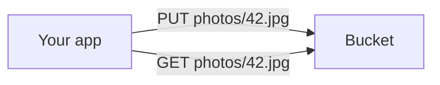
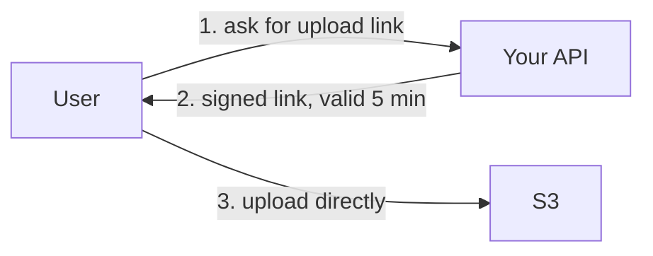
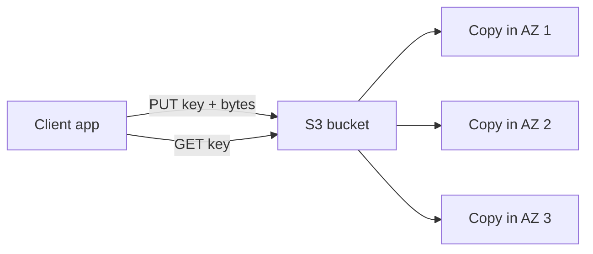
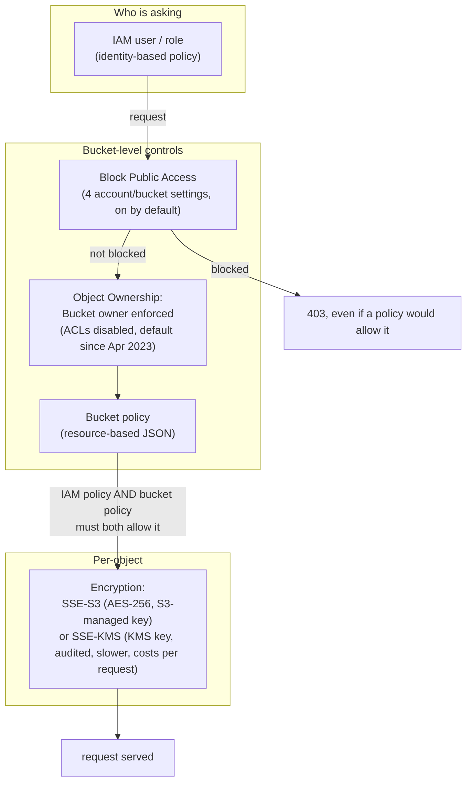
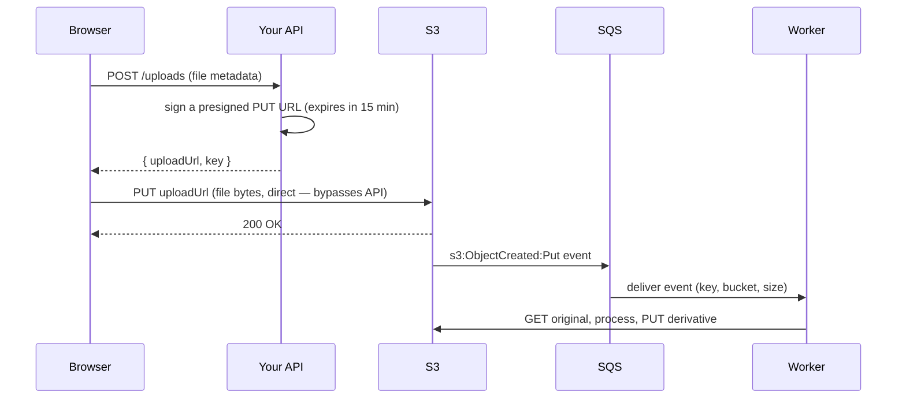
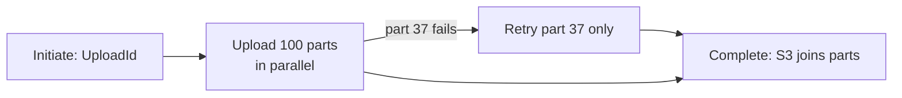
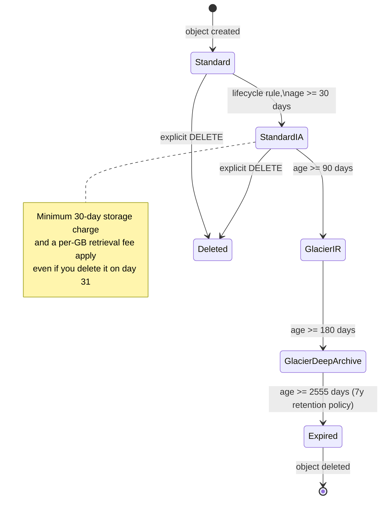

# AWS 07 - S3

> [!summary] TL;DR
> S3 is an object store: you put whole files ("objects") under string keys inside flat containers ("buckets") and get back one of the few AWS services with **11 nines of annual durability**.
>
> There is no real folder tree, no partial-file edits, and no server to patch; every read and write goes over HTTPS to an API, and almost every production feature (presigned URLs, lifecycle rules, event notifications, replication) exists to keep bytes out of your own servers.

> [!abstract] Core idea
> - A bucket is a flat namespace of key → object. "Folders" are just keys containing `/`, rendered as a tree by the console.
> - Since December 2020, S3 gives **strong read-after-write consistency**: a `GET` right after a successful `PUT` (even an overwrite) always sees the new object, with no "eventually consistent" window to code around.
> - Durability (11 nines: an object almost never disappears) and availability (99.9–99.99%: S3 might reject a request right now) are different guarantees — don't confuse "my data is safe" with "my request will succeed".
> - Upload and download directly between the client and S3 with presigned URLs; never proxy file bytes through your own API.
> - Storage class + lifecycle rules move cold data to cheaper tiers automatically; security defaults as of 2023 are "everything private, no ACLs, IAM/bucket-policy only".

## Start here: the basics 🟢

> [!info] How to read this note (pick your level)
> - 🟢 **New to this?** Read "From zero" below, then sections 1, 2 and 10 (why, mental model and the cheat sheet). Stop there, that is a full first pass.
> - 🟡 **Know the basics?** Add sections 3, 4, 5 and 6 (how it works, a worked example, options and trade-offs).
> - 🔴 **Interview / SDE-3 prep?** Add sections 7, 8 and 9 (production, deep dive and interview questions). Headings are tagged 🟢🟡🔴 so you always know where you are.

> [!note] Before this note
> - [[AWS 01 - Core Concepts (Regions, AZs, Accounts, Shared Responsibility)]]: a Region has several AZs, and who can read your data is your half of the security job.
> - [[AWS 02 - IAM]]: access is granted by policies (on the caller or on the resource), everything starts as "no", and an explicit deny always wins.

**From zero, in 60 seconds** 🟢

**S3** is AWS's storage for files of any size: photos, backups, logs, videos.
You put each file (an **object**) into a **bucket** under a name (a key), like photos/42.jpg.
It almost never loses data: AWS keeps several copies across buildings.



It is not a normal disk. You can't edit part of a file; you replace the whole object.
A neat trick: your server can give a user a short-lived signed link, so the user uploads straight to S3 without passing through your server.



The rest of this note is just these 3 questions:
1. How does S3 store and scale objects?
2. How do you keep buckets private but still share files safely?
3. How do you save money (storage classes) and protect data (versioning)?


**The problem in one story.**
Your app lets users upload profile photos.
If you save them on your server's disk, the disk fills up, and if the server dies the photos die too.
You want a place that never loses files, never runs out of space, and serves them to millions of people.
S3 is that place: you hand it a file and a name, and later ask for the file back by name.

**Words you need first**

| Word | Plain meaning | Tiny example |
| --- | --- | --- |
| Object | One whole file plus some info about it | `user-7.jpg` and its content-type |
| Bucket | A named container that holds objects | `myapp-uploads` |
| Key | The full name of an object inside a bucket | `tenants/42/avatars/user-7.jpg` |
| HTTP API | Talking to a service by web requests | `PUT` to upload, `GET` to download |
| Availability Zone (AZ) | One separate data center group in a region | `ap-south-1a` |
| Durability | Chance your data is never lost | 11 nines = almost never |
| Availability | Chance a request works right now | 99.99% of requests succeed |
| IAM policy | Rules saying who may do what | "this role may read this bucket" |
| Prefix | The start of a key, used like a folder name | `tenants/42/` |
| Presigned URL | A link your server signs that allows one upload or download for a few minutes | Valid for 15 minutes, one key |
| Multipart upload | Sending a big file in many parts, in parallel | 1 GB as 100 parts of 10 MB |
| Storage class | A price/speed tier for stored objects | Standard, Standard-IA, Glacier |
| Lifecycle rule | A bucket rule that moves or deletes objects as they age | Move to Glacier after 90 days |
| Versioning | Keeping every old copy when an object is overwritten or deleted | Undo an accidental overwrite |

**Picture it**



**Analogy.** S3 is a giant coat check: you hand over a coat (the file), get a ticket with a name on it (the key), and get the exact coat back when you show the ticket.
Where it breaks: a coat check has no pricing per visit or storage tier, and you can't edit part of a coat in place; in S3 you also replace the whole object, never a piece of it.

**How the rest of this note builds up**

- First, why S3 exists and the key-value mental model (sections 1-2).
- Then how it works: prefix scaling, the security model, presigned URLs, multipart upload, storage classes, events and CloudFront (section 3).
- Then a Go worked example and comparisons with other storage (sections 4-6).
- Finally the SDE-3 deep dive: production pitfalls, how strong consistency was built, throttling, and ETag gotchas (sections 7-9).

> [!tip] Remember
> S3 is a key → file store over HTTPS: whole files in, whole files out, almost never lost.

## 1. Why it exists 🟢

A backend team needs somewhere to put user uploads, static assets, logs, and backups — files that do not fit a row in a relational database and that traffic can spike on without warning (a viral post with 50,000 image views in a minute).

Running your own file servers means provisioning disks for peak size, replicating them for durability, writing your own backup process, and scaling read bandwidth by hand.

S3 replaces all of that with an HTTP API over effectively unlimited storage: single objects up to **5 TiB** (about 5.5 TB), buckets with no size or object-count limit, data replicated across a minimum of three Availability Zones in the region by design. You pay per GB stored per month, per request, and per GB transferred out — nothing for the servers underneath.

**Concrete numbers (documented, AWS S3 User Guide, ap-south-1 pricing as of late 2026 — confirm current rates in the AWS Pricing Calculator):**
- S3 Standard: designed for **99.999999999%** (11 nines) annual durability and **99.99%** availability.
- S3 Standard storage: ~$0.025/GB-month for the first 50 TB; S3 Standard-IA: ~$0.0138/GB-month plus a $0.01/GB retrieval fee; S3 Glacier Deep Archive: ~$0.00099/GB-month (roughly 1/25th of Standard) with retrieval taking up to 12 hours.
- Requests: PUT/COPY/POST/LIST ~$0.005 per 1,000; GET/SELECT ~$0.0004 per 1,000 — cheap per call, but a service that lists a bucket per request rather than caching the listing can rack up millions of requests a day for free.
- A single PUT caps at 5 GiB; above that (and AWS recommends it above ~100 MB) you must use multipart upload.

### Real-life example: dish photos on a food app 🟢

Think of the dish photos on an app like Zomato.
When a restaurant uploads a photo, the app's API hands the phone a presigned link, and the phone uploads straight to S3, so the API servers never carry the image bytes.
S3 then sends an event, and a worker creates small thumbnails for the menu screen.
Customers load those images through a CDN (servers in many cities that keep copies near users), while the bucket itself stays private.
Old order invoices nobody opens any more move to a cheap archive tier automatically after a few months.

## 2. Mental model 🟢

Think of S3 as a single, planet-scale **key-value store for blobs** (blob: any chunk of bytes, such as an image or a zip file), not a filesystem:

- The **bucket** is the namespace (globally unique name, created in one region).
- The **key** is the whole string after the bucket, e.g. `tenants/42/avatars/user-7.jpg` — there is no real directory `tenants/42/avatars/`, only a key that happens to contain slashes.
- The **object** is the bytes plus metadata (content-type, custom headers, a version ID if versioning is on).
- There is no partial write: an object is replaced atomically (all at once; readers see either the old or the new, never a mix) by a full PUT, or read back as a whole (or a byte range).

Because there's no real hierarchy, S3 can shard (split into separately served pieces) by key prefix behind the scenes and scale write and read throughput by adding more prefixes — which is exactly what the request-rate guidance in §3 is about.

## Common beginner mistakes 🟢

- **Making a bucket public to share a few files** → everything in it can leak → keep Block Public Access on and share with presigned URLs or a CDN.
- **Sending uploads through your own API** → your servers carry every byte and hit size and time limits → let clients upload directly with a presigned URL.
- **Uploading a 2 GB file as one PUT** → one network blip means starting over → use multipart upload above about 100 MB.
- **Forgetting abandoned multipart uploads** → unfinished parts are billed forever → add a lifecycle rule that aborts them after a few days.
- **Treating S3 like a disk** → you cannot edit part of a file or rename a folder cheaply → write whole objects, or use EBS/EFS for disk-like needs.

## 3. How it works 🟡

> 🟢 → 🟡 **You now know** that S3 stores whole files under names in buckets, almost never loses them, and can hand out short-lived links. **Next we open the box**: how S3 scales by key prefix, how access is checked, how presigned and multipart uploads work, how storage classes save money, and how versioning, events and the CDN fit in.

### Request-rate scaling by prefix

**In plain words:** S3 splits busy buckets by the start of the key name. Spread keys across many prefixes to get more speed.

**Step by step:**
1. One prefix, say `uploads/`, handles about 3,500 writes and 5,500 reads per second.
2. You store keys as `tenants/1/...`, `tenants/2/...`, and so on: each tenant is its own prefix.
3. As traffic grows, S3 splits the busy key ranges into separate partitions on its own.
4. Total speed grows with the number of busy prefixes. A sudden jump on one brand-new prefix can briefly see "503 Slow Down" while S3 splits it.

S3 automatically partitions a bucket's keyspace to spread load, and the official guidance is **3,500 PUT/COPY/POST/DELETE and 5,500 GET/HEAD requests per second, per prefix** — and a bucket can have many prefixes, so total throughput scales with how your keys are distributed.

Before mid-2018 you had to randomize a hash prefix (`a3f9/photo.jpg`) to force S3 to split partitions early; since then S3 scales automatically regardless of key naming, so the old "randomize your prefix" advice is no longer required, though spreading high-throughput key ranges (e.g. `tenants/{id}/...` instead of one shared prefix for all tenants) still helps if you expect to burst past the per-prefix numbers immediately rather than ramping into them.

### Security model

**In plain words:** buckets should be private by default. Access comes from IAM rules and bucket policies, not from making things public.

**Step by step (one GET request):**
1. Block Public Access is checked first. If the request relies on public access and that is blocked, the answer is 403 (forbidden), whatever any policy says.
2. Object Ownership "bucket owner enforced" means old-style ACLs (per-object access lists) are ignored.
3. The caller's IAM policy and the bucket policy are checked; any explicit Deny wins, otherwise one of them must allow it.
4. The object is decrypted (SSE-S3 with an S3-managed key, or SSE-KMS with a key in KMS, AWS's key management service) and returned.



- **Block Public Access** is four switches (block public ACLs/policies, ignore public ACLs, restrict public buckets) that override everything else — a bucket policy that grants `s3:GetObject` to `*` still 403s if Block Public Access is on. New buckets have it on by default.
- **Object Ownership: Bucket owner enforced** (the default for buckets created since April 2023) disables ACLs entirely; access is granted only through IAM identity policies and bucket policies, which is simpler to reason about than the old ACL + policy + ownership mix.
- **IAM policy vs bucket policy**: an IAM policy is attached to a principal (user/role) and can reference many buckets; a bucket policy is attached to the bucket and can grant access to other accounts. S3 evaluates both (plus Block Public Access and any Service Control Policy) and denies if any explicit `Deny` matches, so **an explicit `Deny` in either one wins**.
- **SSE-S3** (`AES256`, a standard strong encryption method) encrypts with a key S3 manages entirely; no extra cost, no audit trail of individual key uses.

  **SSE-KMS** (`aws:kms`) encrypts with a KMS key you control (rotation, audit via CloudTrail, cross-account grants) at the cost of a KMS API call per object GET/PUT (billed, and rate-limited by KMS request quotas) — use it when you need to prove who decrypted what, or a customer-managed key you can revoke.

### Presigned URLs and direct upload

**In plain words:** your server signs a link that works for a few minutes. Anyone holding the link can do that one upload or download, and nothing else.

**Step by step:**
1. The browser tells your API "I want to upload `photo.jpg`, image/jpeg".
2. Your API signs a PUT link for exactly one key, valid for 15 minutes, using its own role. No network call is needed to sign.
3. The browser PUTs the bytes straight to S3 with that link.
4. S3 sends an "object created" event to a queue, and a worker picks it up to make thumbnails.

A presigned URL is a normal S3 URL with a signature and expiry baked into the query string, generated by *your* backend using *its* IAM credentials, so the browser can call S3 directly without ever holding an AWS credential:



This is the pattern [[File Upload Architecture]] builds the whole upload flow around; S3's part of it is: sign the URL with a short expiry, restrict it to one key and content-type, and let S3 itself fan the completion out as an event instead of your API polling for it.

### Multipart upload

**In plain words:** big files go up in pieces, in parallel. If one piece fails, only that piece is resent.

**Step by step (a 1 GB video):**
1. Start the upload; S3 returns an `UploadId`.
2. Split the file into 100 parts of 10 MB and upload them in parallel. Each part returns an ETag (a fingerprint of that part).
3. Part 37 fails: resend only part 37.
4. Send "complete" with the list of part numbers and ETags. S3 joins them into one object.



Required above 5 GiB, recommended above ~100 MB:

- Initiate → get an `UploadId` → upload parts in parallel (each part **5 MiB–5 GiB, except the last**, up to **10,000 parts**) → complete with the list of part ETags.

  The **5 TiB max object size** is a separate, independent cap — 10,000 parts at 5 GiB each would in principle sum to far more than 5 TiB, so it is not derived from multiplying part count by max part size; S3 enforces the 5 TiB ceiling directly.
- A failed part just gets re-uploaded; you never restart the whole object.
- Abandoned multipart uploads **still bill for storage** until completed or aborted — add a **lifecycle rule to abort incomplete multipart uploads** after N days, or orphaned parts quietly accumulate cost forever.

### Storage classes and lifecycle

**In plain words:** old, rarely read files can move to cheaper shelves automatically. Cheaper shelves are slower or cost more to read.

**Step by step (one invoice PDF):**
1. Day 0: stored in Standard, about $0.025 per GB per month.
2. Day 30: a lifecycle rule moves it to Standard-IA, cheaper to keep but with a fee each time you read it.
3. Day 180: moved to Glacier Deep Archive, about 1/25th of Standard's price; reading it back can take up to 12 hours.
4. Year 7: the rule deletes it. Each tier still bills its minimum days even if you delete early.



A lifecycle rule is a bucket-level policy (prefix or tag filter → transition after N days → class), evaluated once a day; it is not instant, and a transition still bills at least the source class's minimum storage duration (30 days for Standard-IA, 90 for Glacier classes) even if you delete the object the day after it moves.

### Versioning, Object Lock, replication

**In plain words:** versioning keeps old copies when files are overwritten. Object Lock stops deletes. Replication copies to another region.

**Step by step:**
1. Turn versioning on. Overwriting `report.pdf` now keeps the old version with its own version ID.
2. Deleting it only adds a "delete marker"; the old versions can still be restored, and are still billed.
3. Add Object Lock in compliance mode: nobody, not even root, can delete it before the retention date.
4. Turn on replication to another Region: from now on, new writes are copied there. Old objects need a one-off Batch Replication job.

- **Versioning**: once enabled on a bucket it can only be **suspended**, never fully turned off; every PUT to an existing key creates a new version ID instead of overwriting, and a DELETE just adds a "delete marker" (the old versions are still there and billed until a lifecycle rule expires noncurrent versions).
- **Object Lock** (WORM: write once, read many) needs versioning on. **Governance mode**: users with `s3:BypassGovernanceRetention` can still delete/overwrite early. **Compliance mode**: nobody, including the root account, can shorten or delete until the retention date — used for audit/compliance data, not casual use.
- **Replication** (same-region SRR or cross-region CRR) needs versioning on both buckets and only replicates **new** writes going forward; objects that existed before replication was turned on need an explicit **S3 Batch Replication** job to be copied retroactively.

### Event notifications

**In plain words:** S3 can ring a bell (send an event) whenever a file is added or removed, so other code can react.

**Step by step:**
1. A file lands in `uploads/`. S3 creates an `ObjectCreated` event with the bucket, key and size.
2. Exactly one worker needs it? Send it to an SQS queue.
3. Several independent consumers (resizer, audit log, metrics)? Send it to EventBridge, and give each consumer its own rule.

S3 can push `s3:ObjectCreated:*` / `s3:ObjectRemoved:*` (and more) events to **SQS** (a queue), **SNS** (a publish/subscribe fan-out), **Lambda**, or **EventBridge** (an event bus with routing rules).

EventBridge is the usual default for anything non-trivial because one event can fan out to many independent rules/consumers (a processing worker, an audit log, a metrics counter) without you wiring up separate SNS topics per consumer; plain SQS is simplest when there is exactly one queue of work to process.

### CloudFront in front of S3

**In plain words:** put the CDN in front so users get files from nearby, and keep the bucket itself private.

**Step by step:**
1. A user in Chennai asks for `logo.png`. CloudFront (AWS's CDN) answers from a nearby edge if it has a copy.
2. If not, CloudFront fetches it from the private bucket, signing its request with Origin Access Control.
3. The bucket allows only CloudFront's signed requests, so nobody can bypass the CDN and read the bucket directly.

Static assets (built frontend bundles, processed images, public downloads) go behind **CloudFront** with an **Origin Access Control (OAC)** — the modern replacement for the older Origin Access Identity — so the S3 bucket itself stays fully private (Block Public Access on) and only CloudFront's signed requests can read it.

Private content uses CloudFront **signed URLs/cookies** instead of S3 presigned URLs when you want one signing key to cover many paths or a whole CDN session rather than one object.

## 4. Worked example 🟡

### Whiteboard version

The shape of a presigned-upload call, stripped to the essentials: build an S3 client, ask it to presign a `PutObject`, hand the URL to the browser.

```go
presigner := s3.NewPresignClient(s3.NewFromConfig(cfg))
req, err := presigner.PresignPutObject(ctx, &s3.PutObjectInput{
    Bucket: aws.String("uploads-bucket"),
    Key:    aws.String("tenant-42/orig/photo.jpg"),
})
// req.URL is what the browser PUTs the file bytes to.
```

The full version below adds content-type pinning and an explicit expiry, and ships with a test.

**What this code does, in plain words:** given a bucket, a key, a content type and an expiry time, it asks the AWS SDK to build a signed PUT link that only works for that one key and type, until it expires. The test checks the link carries a 900-second expiry and a signature.

**Full code**, Go 1.24, using `github.com/aws/aws-sdk-go-v2` (`aws-sdk-go-v2` v1.32.6, `credentials` v1.17.47, `service/s3` v1.69.0). Presigning only computes a SigV4 signature (AWS's standard way of signing a request with a secret key) locally — it makes no network call — so this compiles and runs with no real AWS account:

```go
package s3demo

import (
	"context"
	"time"

	"github.com/aws/aws-sdk-go-v2/aws"
	"github.com/aws/aws-sdk-go-v2/credentials"
	"github.com/aws/aws-sdk-go-v2/service/s3"
)

// newPresignClient builds an S3 presign client with static (fake) credentials.
// Presigning only computes a SigV4 signature locally; it makes no network call,
// so this works without real AWS credentials or connectivity.
func newPresignClient(region string) *s3.PresignClient {
	cfg := aws.Config{
		Region:      region,
		Credentials: credentials.NewStaticCredentialsProvider("AKIAEXAMPLE", "secretexample", ""),
	}
	client := s3.NewFromConfig(cfg)
	return s3.NewPresignClient(client)
}

// PresignedPut returns a time-limited URL a browser can PUT an object to
// directly, without the object's bytes ever passing through our API servers.
func PresignedPut(ctx context.Context, bucket, key, contentType string, ttl time.Duration) (*v4SignedURL, error) {
	presigner := newPresignClient("ap-south-1")
	req, err := presigner.PresignPutObject(ctx, &s3.PutObjectInput{
		Bucket:      aws.String(bucket),
		Key:         aws.String(key),
		ContentType: aws.String(contentType),
	}, s3.WithPresignExpires(ttl))
	if err != nil {
		return nil, err
	}
	return &v4SignedURL{URL: req.URL, Method: req.Method, SignedHeader: req.SignedHeader}, nil
}

type v4SignedURL struct {
	URL          string
	Method       string
	SignedHeader map[string][]string
}
```

```go
func TestPresignedPutIsTimeLimitedAndSigned(t *testing.T) {
	out, err := PresignedPut(context.Background(), "uploads-bucket", "tenant-42/orig/photo.jpg", "image/jpeg", 15*time.Minute)
	if err != nil {
		t.Fatalf("PresignedPut: %v", err)
	}
	if out.Method != "PUT" {
		t.Fatalf("method = %q, want PUT", out.Method)
	}
	if !strings.Contains(out.URL, "uploads-bucket") {
		t.Fatalf("URL missing bucket: %s", out.URL)
	}
	if !strings.Contains(out.URL, "X-Amz-Expires=900") {
		t.Fatalf("URL missing 900s expiry: %s", out.URL)
	}
	if !strings.Contains(out.URL, "X-Amz-Signature=") {
		t.Fatalf("URL missing SigV4 signature: %s", out.URL)
	}
}
```

**Measured:** `go test -race` passes in 1.5s; the generated URL for a 15-minute TTL carries `X-Amz-Expires=900` and a `X-Amz-Signature` query parameter, confirming the SDK signs a real SigV4 query-string request rather than returning a bare path.

A browser-direct upload from HTML instead uses a **presigned POST policy**, which (unlike a presigned PUT) can constrain multiple fields at once — exact key, content-type, and a `content-length-range` — in one signed form, which a single presigned PUT URL cannot do.

## 5. Variants and comparison 🟡

| Storage class | Durability | Retrieval | Minimum duration | Use when |
| --- | --- | --- | --- | --- |
| S3 Standard | 11 nines | Milliseconds | None | Actively read/written data |
| S3 Standard-IA | 11 nines | Milliseconds | 30 days | Backups, older versions, accessed monthly |
| S3 One Zone-IA | 11 nines (single AZ) | Milliseconds | 30 days | Re-creatable data, lower cost, AZ-loss risk accepted |
| S3 Glacier Instant Retrieval | 11 nines | Milliseconds | 90 days | Archives still needing instant reads |
| S3 Glacier Flexible Retrieval | 11 nines | Minutes–hours | 90 days | Archives read a few times a year |
| S3 Glacier Deep Archive | 11 nines | Up to 12 hours | 180 days | Compliance archives, 7-year retention |
| S3 Intelligent-Tiering | 11 nines | Milliseconds (hot tiers) | None | Unknown/changing access patterns; auto-moves between tiers, small monitoring fee per object |

| Upload path | How it works | Use when | Cost |
| --- | --- | --- | --- |
| Presigned PUT | One signed URL, one object, no extra constraints | Simple client uploads, mobile apps | One S3 PUT |
| Presigned POST policy | Signed form with conditions (key, content-type, size range) | Browser `<form>` uploads, tighter validation | One S3 PUT |
| Multipart upload | Parts uploaded in parallel, completed together | Objects > ~100 MB, unreliable networks, resumable uploads | N parts × PUT pricing |
| Proxy through API | API reads bytes, forwards to S3 | Needed only for synchronous validation/transformation before storage | API server memory/CPU/timeout cost, avoid at scale |

### S3 vs EBS vs a database: the storage people mix up 🟡

| Question | S3 | EBS (disk on one server) | Database (RDS) |
| --- | --- | --- | --- |
| What do you store? | Whole files: images, backups, logs | A disk the server's OS uses | Rows you query and update |
| Edit part of it? | No, replace the whole object | Yes, like any disk | Yes, update one row |
| Shared by many servers? | Yes, over HTTPS | No, one server at a time (usually) | Yes, over a DB connection |
| Grows without planning? | Yes | No, you pick a size | Partly, storage can autoscale |

## 6. Trade-offs and when not to use 🟡

- S3 is not a filesystem: no atomic rename across prefixes, no partial in-place edits, no POSIX locking (the standard Unix way for programs to lock a file) — anything that needs those semantics belongs on EBS/EFS (a network disk for one server / a shared network file system) or a database, not S3.
- Listing a bucket (`ListObjectsV2`) is **not a free count** — it's paginated API calls billed like any other request; track object counts in your own metadata store instead of listing to count.
- Strong read-after-write consistency means callers don't need to build staleness workarounds, but it does not mean S3 is always *available* for that read in the next second — plan for retries on 5xx/503 (Slow Down) the same as any other API.
- Minimum storage durations on IA/Glacier classes mean transitioning rarely-but-not-never-touched data to a cold tier can cost more than it saves if you then delete or re-read it early — model the access pattern before picking a lifecycle rule, not after.

## 7. In production 🔴

> 🟡 → 🔴 **You now know** how S3 scales, how access is checked, presigned and multipart uploads, storage classes, versioning, events and CloudFront. **Next is the advanced part**: the 403s, surprise bills and throttling teams actually hit, and how S3 achieved strong consistency, why prefix limits exist, and why an ETag is not always an MD5.


- **Real systems:** nearly every AWS-hosted SaaS backend uses S3 for user uploads, build artifacts (Terraform state, Lambda deployment packages), log archives, and as the origin behind a CloudFront CDN for static frontends.
- **Failure modes → fixes:**
  - 403 despite a bucket policy that should allow it → check Block Public Access and Object Ownership first; they override policy evaluation silently.
  - Runaway storage cost from abandoned multipart uploads → add the "abort incomplete multipart upload after N days" lifecycle rule.
  - SSE-KMS throttling (`ThrottlingException` from KMS) under high request volume → request a KMS quota increase or switch hot paths to SSE-S3 where the audit trail isn't required.
  - Replication silently missing old objects → remember CRR/SRR is forward-only; backfill with S3 Batch Replication.
- **What to monitor:** 4xx/5xx rate per bucket (CloudWatch request metrics, opt-in), bytes downloaded (egress cost, the per-GB fee for data leaving AWS), `NumberOfObjects`/`BucketSizeBytes` per storage class, and KMS `ThrottlingException` count if using SSE-KMS.

## 8. Deep dive 🔴

- **Why strong consistency was hard, and how S3 did it.** Before December 2020, a `GET` immediately after an overwrite `PUT` could return either the old or new version for a short window, because S3's metadata was served from multiple internal replicas that could momentarily disagree.

  AWS re-architected the metadata layer so every request is now strongly consistent across all AZs in the region, with no performance cliff and no new cost — this removed an entire class of "read my own write" workarounds application code used to need (retry loops, version stamping).
- **Why per-prefix throughput limits exist at all.** Internally S3 still partitions the keyspace to parallelize request handling; the per-prefix number is the ceiling on a single partition's handling capacity before it needs to split, and partition splitting is itself not instantaneous.

  A workload that suddenly jumps from near-zero to tens of thousands of requests/second on a brand-new prefix can briefly see throttling (503 Slow Down) while S3 catches up, even though a gradually-ramping workload to the same eventual rate would not.
- **ETag is not always an MD5.** For a single-part PUT, the ETag is the MD5 (a 128-bit fingerprint of the bytes) of the object. For a multipart upload, the ETag is `MD5-of-concatenated-part-MD5s-N` (a hash of hashes, suffixed with the part count) — it is still useful as a change-detection token, but code that assumes "ETag == MD5(object bytes)" to verify downloaded content will silently fail for every multipart-uploaded object.

## 9. Interview questions 🔴

> [!question]- What's the difference between S3's durability and its availability numbers?
> Durability (11 nines) is the chance an object you successfully stored is ever lost — effectively "never" at any realistic scale. Availability (99.9–99.99% depending on class) is the chance a given request succeeds right now. You can have a perfectly intact object and still get a 503 reading it during a brief availability dip.

> [!question]- Why upload through a presigned URL instead of your own API?
> The file's bytes go straight from the client to S3 instead of through your API process, so your servers never hold multi-gigabyte request bodies in memory, never hit their own request-size or timeout limits, and don't need to scale compute just to proxy bytes they don't inspect.

> [!question]- Trap: does enabling bucket versioning let you ever fully disable it again?
> No. Versioning can only be **suspended**, never turned back to "never versioned". New PUTs after suspension stop creating new version IDs, but all versions created while it was on remain and are still billed until a lifecycle rule expires them.

> [!question]- Your bucket policy clearly grants public read, but requests still 403. Why?
> Block Public Access is almost certainly on (the default for new buckets) and overrides any policy that would otherwise allow public access. Check the four Block Public Access settings before debugging the policy JSON itself.

> [!question]- When would you pick SSE-KMS over the default SSE-S3?
> When you need an audit trail of exactly which principal decrypted which object (via CloudTrail), a customer-managed key you can rotate or revoke independently of AWS, or cross-account key sharing through KMS grants — at the cost of a KMS API call (and its quota/rate limit) on every object read and write.

> [!question]- You turned on cross-region replication last week. Why are objects from two years ago still missing in the destination bucket?
> CRR/SRR only replicates writes that happen after replication is configured; it is not retroactive. Objects written before that point need an explicit **S3 Batch Replication** job to be copied across.

## 10. Cheat sheet 🟢

- Bucket = namespace, key = full path-like string, object = bytes + metadata; no real folders.
- Strong read-after-write consistency since December 2020 — no more eventual-consistency workarounds.
- 11 nines durability ≠ availability (99.9–99.99%): data safety and request success are different guarantees.
- Default security posture: Block Public Access on, Object Ownership "bucket owner enforced" (no ACLs), access via IAM + bucket policy only.
- SSE-S3 is free and simple; SSE-KMS adds audit trail and rotation at the cost of a KMS call per request.
- Multipart upload for >100 MB (required >5 GiB): 5 MiB–5 GiB per part, max 10,000 parts, 5 TiB max object — always add the abort-incomplete-upload lifecycle rule.
- Lifecycle rules move Standard → IA → Glacier tiers; each tier has a minimum storage duration that still bills if you delete early.
- Versioning can be suspended, never fully disabled; replication is forward-only.
- 3,500 writes / 5,500 reads per second per prefix, auto-scaled since 2018 — no need to randomize key prefixes anymore.

## Self-check 🟢🟡

🟢 Easy

> [!question]- Is `photos/2026/` a real folder in S3?
> No. It is just part of a key name; S3 has no real folders.

> [!question]- What is the difference between durability and availability?
> Durability is the chance the file is never lost; availability is the chance a request works right now.

> [!question]- How can a user upload straight to a private bucket without AWS keys?
> Your API gives them a short-lived presigned URL for one key.

🟡 Medium

> [!question]- A bucket policy allows public read but requests still return 403. What do you check first?
> Block Public Access; it overrides any policy that grants public access.

> [!question]- Why add a lifecycle rule that aborts incomplete multipart uploads?
> Unfinished parts are billed as storage until completed or aborted.

> [!question]- You turned on replication today. Will last year's objects be copied?
> No. Replication is forward-only; run S3 Batch Replication for old objects.

## Links

- **Before this:** [[AWS 01 - Core Concepts (Regions, AZs, Accounts, Shared Responsibility)]], [[AWS 02 - IAM]]
- **Next:** [[AWS 08 - RDS and Aurora]], [[AWS 09 - Route 53 and ACM]]
- **Compare with:** [[File Upload Architecture]] (the end-to-end upload flow this note's presigned-URL and event pieces slot into), [[AWS SQS, SNS and EventBridge]] (what receives S3's event notifications)

### Watch on YouTube

- [AWS re:Invent 2025 - How Netflix uses Amazon S3 Storage Lens to track exabytes of data (STG214)](https://www.youtube.com/watch?v=Q2YoHfhFuI8) · AWS Events · 51 min · 1,231 views
- [AWS re:Invent 2025 - Deep dive on Amazon S3 (STG407)](https://www.youtube.com/watch?v=S4swTRi1i0w) · AWS Events · 39 min · 4,944 views
