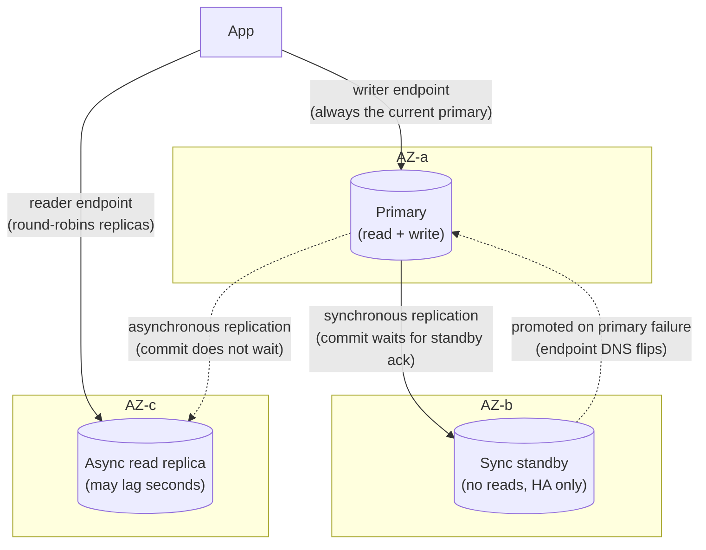
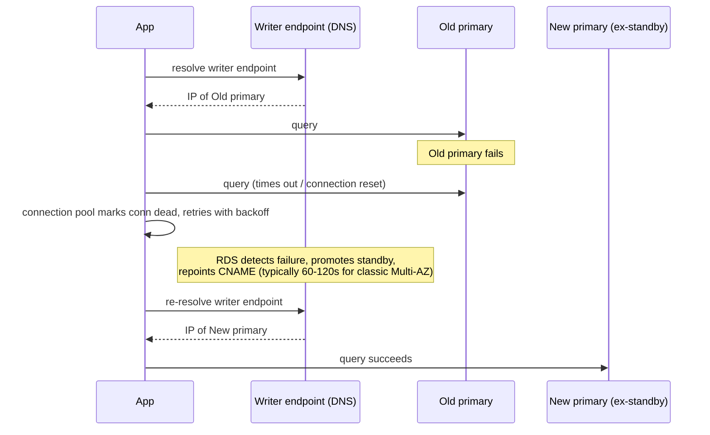

# AWS 08 - RDS and Aurora

> [!summary] TL;DR
> RDS runs PostgreSQL, MySQL and other engines for you — patching, backups, and failover are AWS's job, not yours. **Multi-AZ** gives you a synchronous standby for high availability (not for extra read capacity); **read replicas** give you extra read capacity (asynchronously, so they can lag); **Aurora** replaces both with a single shared, self-healing storage layer so a crashed writer can fail over to an existing reader in seconds instead of minutes.

> [!abstract] Core idea
> - Multi-AZ standby = HA for the *same* data, not more read throughput; it never serves reads.
> - Read replicas = more read throughput, with replication lag you must plan around; they are not a HA mechanism for writes.
> - On failover, the endpoint's DNS name flips to point at the new primary — your app does not get a new address, it has to notice the old connection died and reconnect.
> - Aurora's storage is the shared, replicated layer (6 copies, 3 AZs) underneath both the writer and all readers, so promoting a reader to writer is fast because the data is already there.
> - RDS Proxy sits between your app and the database to pool connections and bridge app traffic across a failover without every connection needing its own retry logic.

## 1. Why it exists

Running Postgres yourself means you own OS patching, Postgres minor-version upgrades, taking and testing backups, provisioning storage before you run out, and building a failover procedure before the primary actually dies at 3 a.m. Most of that work is identical across every team that runs Postgres, so RDS and Aurora exist to make it AWS's job: you get automated backups with point-in-time recovery, one-click Multi-AZ, and a managed failover path, in exchange for giving up host-level access (no SSH into the database box) and accepting the engine versions AWS currently supports.

**Concrete numbers (estimate / documented, ap-south-1 pricing as of late 2026 — confirm in the Pricing Calculator):**
- A `db.r6g.large` (2 vCPU, 16 GiB) Multi-AZ RDS Postgres instance runs roughly $0.35–0.40/hour ≈ $260–290/month for compute alone, **before** storage — Multi-AZ roughly doubles the single-instance compute cost because you're paying for the standby too.
- Aurora charges separately for compute (per-instance, similar to RDS) and for storage/IO (storage ~$0.10/GB-month, plus per-million-IO charges), which can cost more than provisioned RDS storage on IO-heavy workloads but removes the need to provision storage size and IOPS up front.
- RDS Multi-AZ failover is **typically 60–120 seconds**, measured as the window between the standby detecting the primary is unreachable and the endpoint DNS resolving to the new primary; Aurora failover is typically **under 30 seconds**, because Aurora replicas share storage with the writer and need only be promoted, not rehydrated.

## 2. Mental model



- The **writer endpoint** is one DNS name that always resolves to whichever instance is currently primary — your app never needs to know which physical instance that is, only that the name can change who it points to.
- The **synchronous standby** exists purely so a write is not considered durable until it's also on a second AZ; it is otherwise invisible to the app and never serves a query.
- **Read replicas** are a separate, asynchronous copy for scaling reads; because replication is async, a replica can be seconds behind the primary — a classic bug is reading your own just-written row from a replica and not seeing it yet.

## 3. How it works

### Multi-AZ deployment types

- **Multi-AZ DB instance** (the classic model): one primary, one synchronous standby in another AZ, standby is not readable. On failure, RDS promotes the standby, and the writer endpoint's CNAME is updated to point at it.
- **Multi-AZ DB cluster** (newer, for MySQL/Postgres): one writer plus **two readable standbys**, replicated with a quorum-based protocol instead of plain synchronous replication, giving both faster failover (typically under 35 seconds) and usable read capacity from the standbys — a middle ground between the classic Multi-AZ instance and Aurora.
- **Read replicas**: asynchronous, can be cross-region, can be promoted to a fully standalone primary (breaking replication permanently) but are not an automatic-failover target the way a Multi-AZ standby is.

### Failover, from the app's point of view



The endpoint name never changes — only what it resolves to. That means your app's database driver, or a layer like **RDS Proxy**, has to actually notice the connection died, drop the cached DNS resolution (connection pools and OS resolvers sometimes cache it longer than the TTL), and open a fresh connection with retries. A driver that silently keeps retrying the *same* dead TCP connection, or that pins a resolved IP indefinitely, will outlast the failover window with zero successful queries even though the database itself recovered in under two minutes.

### Aurora

Aurora decouples compute from storage: all instances (one writer, up to 15 readers) share a single **distributed storage volume replicated 6 ways across 3 AZs**, with writes considered durable once **4 of 6** copies acknowledge. Because every reader already has (nearly) the same data as the writer through this shared storage layer rather than through row-by-row replication, promoting a reader to writer on failover means repointing the writer role, not rehydrating a standby from a replication stream — which is why Aurora failover is typically faster than classic RDS Multi-AZ. Aurora also auto-heals corrupted storage segments in the background using the other replicas, without taking the database offline.

### RDS Proxy

RDS Proxy sits between your app and the database as a connection pooler and a failover-aware layer:

- Pools and multiplexes many app-side connections onto fewer actual database connections, so a fleet of Lambda functions or short-lived containers doesn't each open its own connection and exhaust the database's `max_connections`.
- Holds connections open across a failover and transparently re-establishes them against the new primary, so the app sees a pause rather than a hard connection error in many cases — though application code should still implement its own retry, because RDS Proxy reduces but does not eliminate the chance of a surfaced error.
- Required for IAM database authentication at scale in some setups, since it can cache and refresh the short-lived IAM auth tokens on the app's behalf.

### Backups, PITR, and storage

- **Automated backups** take a daily snapshot plus continuous transaction log shipping, giving **point-in-time recovery** to any second within the retention window (1–35 days) — PITR always restores to a **new** instance, it does not roll back the existing one in place.
- **Manual snapshots** persist until you delete them, independent of the retention window, and can be shared or copied cross-region.
- **gp3** storage lets you provision IOPS and throughput independently of volume size (unlike gp2, where IOPS scaled with size); **io2** is for the highest, most consistent IOPS workloads. Aurora has no separate "storage type" choice — storage scales automatically in 10 GiB increments.
- **Parameter groups** hold the engine configuration (`max_connections`, `shared_buffers`, and the rest of `postgresql.conf`/`my.cnf`-equivalent settings) outside the instance itself. **Dynamic** parameters apply immediately; **static** parameters need a reboot to take effect. You can't edit the AWS-managed default group — create a custom parameter group per environment so tuning changes are versioned and reviewable instead of hand-edited on a live instance.
- **Performance Insights** gives a free (at the basic retention tier) per-query load view (`Average Active Sessions` broken down by wait event, SQL, user) — the first place to look when "the database is slow" with no further detail.

### Security

- Put the database in an **isolated private subnet** (no route to an internet gateway) — only the app tier's security group should be allowed on port 5432/3306 in the DB's security group, and the DB's own security group should have no outbound rule needed for inbound traffic to reach it.
- **IAM database authentication** issues short-lived (15-minute) auth tokens instead of long-lived passwords, pulled via `rds-db:connect`, removing one more static secret from rotation duty — pair it with [[Secrets Management]] for the pieces that still need a real password (replication users, some drivers that don't support token auth).
- **Encryption at rest** (via KMS) must be set **at creation time** for RDS — you cannot turn it on for an existing unencrypted instance; migrating to encryption means snapshot → copy-with-encryption → restore.

### Blue/green deployments

For major version upgrades or risky schema changes, **RDS Blue/Green Deployments** create a full replica environment ("green") kept in sync with production ("blue") via logical replication, let you test and validate it in isolation, then do a near-zero-downtime switchover that promotes green and repoints the endpoint — safer than an in-place major-version upgrade because you can abandon the green environment if validation fails, with blue completely untouched. This is a deploy-level strategy; see [[Rollback and Safe Migrations]] for how the schema-migration side of that switchover should be sequenced.

## 4. Worked example

### Whiteboard version

The bare idea: retry a dial through a failover window with backoff.

```go
for {
    conn, err := dial(ctx)
    if err == nil {
        return conn, nil
    }
    time.Sleep(backoff)
    backoff *= 2
}
```

The full version below adds a max-wait deadline, jitter so a whole fleet doesn't reconnect in sync, and context cancellation — and ships with tests.

**Full code**, Go 1.24, standard library only. It compiles and passes `go vet` and `go test -race`:

```go
package rdsdemo

import (
	"context"
	"errors"
	"math/rand"
	"time"
)

// Dialer opens a connection to the current writer endpoint. During an RDS
// or Aurora failover it returns an error for the outage window, then starts
// succeeding again once DNS has flipped to the new primary and it accepts
// connections.
type Dialer func(ctx context.Context) (conn string, err error)

// ErrFailoverInProgress is what a driver typically surfaces while the old
// connection is torn down and the endpoint CNAME has not yet repointed.
var ErrFailoverInProgress = errors.New("connection refused: failover in progress")

// ConnectWithBackoff retries a dial through an RDS/Aurora failover window.
// It never retries context cancellation, and it jitters each backoff so a
// fleet of app instances does not reconnect in one synchronized burst
// against the new primary the moment it becomes reachable.
func ConnectWithBackoff(ctx context.Context, dial Dialer, maxWait time.Duration) (string, int, error) {
	backoff := 50 * time.Millisecond
	const maxBackoff = 2 * time.Second
	deadline := time.Now().Add(maxWait)
	attempts := 0

	for {
		attempts++
		conn, err := dial(ctx)
		if err == nil {
			return conn, attempts, nil
		}
		if ctx.Err() != nil {
			return "", attempts, ctx.Err()
		}
		if time.Now().After(deadline) {
			return "", attempts, errors.Join(errFailoverTimeout, err)
		}

		jittered := backoff/2 + time.Duration(rand.Int63n(int64(backoff)))
		timer := time.NewTimer(jittered)
		select {
		case <-ctx.Done():
			timer.Stop()
			return "", attempts, ctx.Err()
		case <-timer.C:
		}

		backoff *= 2
		if backoff > maxBackoff {
			backoff = maxBackoff
		}
	}
}

var errFailoverTimeout = errors.New("rds: gave up waiting for failover to complete")
```

```go
// TestConnectWithBackoffSurvivesAFailoverWindow simulates a typical Aurora
// failover: the endpoint refuses connections for ~500ms (failover window),
// then the new writer starts accepting.
func TestConnectWithBackoffSurvivesAFailoverWindow(t *testing.T) {
	start := time.Now()
	var calls int32
	dial := func(ctx context.Context) (string, error) {
		atomic.AddInt32(&calls, 1)
		if time.Since(start) < 500*time.Millisecond {
			return "", ErrFailoverInProgress
		}
		return "new-primary:5432", nil
	}

	conn, attempts, err := ConnectWithBackoff(context.Background(), dial, 5*time.Second)
	if err != nil {
		t.Fatalf("ConnectWithBackoff: %v", err)
	}
	if conn != "new-primary:5432" {
		t.Fatalf("conn = %q, want new-primary:5432", conn)
	}
	if attempts < 2 {
		t.Fatalf("attempts = %d, want at least 2 (first call should fail during failover)", attempts)
	}
}
```

**Measured:** against a simulated 500ms outage window (Go 1.24, `go test -race -count=1`, five runs), `ConnectWithBackoff` recovered in **5–6 attempts, taking roughly 500ms–1.3s** — `math/rand` is unseeded here, so each run's jitter differs and the exact attempt count and timing vary run to run; they do not converge on one fixed number. The backoff schedule (50/100/200/400ms, each randomized to roughly half to one-and-a-half times that value) lands the recovering attempt somewhere just past the 500ms mark, close to the minimum possible attempts for that window. A fixed 1-second retry loop instead of exponential backoff would have taken a similar number of attempts here but would hammer the new primary with a synchronized retry burst if many app instances failed over at once; the jitter spreads that burst out instead.

## 5. Variants and comparison

| Option | How it works | Use when | Cost |
| --- | --- | --- | --- |
| Single-AZ RDS | One instance, no standby | Dev/test only | Cheapest |
| Multi-AZ DB instance | Sync standby, not readable | Production HA, simple topology | ~2× single-instance compute |
| Multi-AZ DB cluster | Writer + 2 readable standbys, quorum replication | Production HA + extra read capacity, faster failover | ~3× single-instance compute |
| Read replica(s) | Async copy, can cross region | Scaling reads, offloading analytics/reporting queries | Per-replica compute + storage |
| Aurora | Shared 6-way replicated storage, writer + up to 15 readers | High write throughput, fast failover, read scaling to many replicas | Compute + storage/IO priced separately |
| RDS Proxy in front of any of the above | Connection pooling + failover-aware routing | Many short-lived app connections (Lambda, containers), smoothing failovers | Hourly charge per vCPU of the underlying instance |

## 6. Trade-offs and when not to use

- Multi-AZ (classic) doubles compute cost for an invisible standby that serves zero reads — if you need read scaling, that cost is better spent on read replicas or a Multi-AZ DB cluster instead.
- Read replica lag means "read my own write" can silently fail if the app reads right after writing; route read-after-write-sensitive queries to the primary, or poll the replica's replication lag metric before trusting it for that request.
- Aurora's per-IO pricing can cost more than plain RDS storage for IO-heavy, low-compute workloads (lots of small random reads); provisioned-IOPS RDS storage (io2) can be cheaper and more predictable there.
- No host access means no custom kernel tuning, no installing arbitrary extensions beyond what RDS/Aurora whitelists, and no SSH-based debugging — a workload that genuinely needs that control belongs on self-managed EC2, not RDS.
- Encryption must be chosen at creation — if you forgot it, there is no in-place toggle, only snapshot-copy-restore, which has its own downtime/cutover planning.

## 7. In production

- **Real systems:** most AWS-hosted backends that chose managed Postgres/MySQL run either Aurora (when write throughput or read-replica count matters) or Multi-AZ RDS (simpler topologies, predictable moderate load); RDS Proxy is common wherever the compute tier is Lambda or a frequently-scaling container fleet.
- **Failure modes → fixes:**
  - App hammers the old (dead) primary for the full failover window → use a driver/pool that actively detects dead connections and re-resolves DNS, or put RDS Proxy in front.
  - Replica lag spikes under a bulk write job → monitor `ReplicaLag`, route read-after-write paths to the primary during and shortly after bulk writes.
  - `max_connections` exhausted by a scaling container fleet → put RDS Proxy (or pgbouncer) in front instead of each instance holding its own pool.
  - Unencrypted instance discovered in production → plan a maintenance window for snapshot-copy-restore-to-encrypted; it cannot be toggled live.
- **What to monitor:** `CPUUtilization`, `FreeableMemory`, `DatabaseConnections` vs `max_connections`, `ReplicaLag`, `DiskQueueDepth`/`ReadLatency`/`WriteLatency`, and failover events in the RDS event subscription.

## 8. Deep dive

- **Why Aurora failover is faster than classic Multi-AZ.** Classic Multi-AZ synchronous replication keeps a full second copy of the data files up to date via block-level replication; promoting it still means that standby needs to finish applying any in-flight WAL and start accepting connections as a fresh primary, which plus DNS propagation lands in the 60-120 second range. Aurora's readers already read from the *same* shared storage volume the writer uses — promotion is a metadata/role change (which instance accepts writes) rather than a data-catch-up operation, which is the main reason it is typically well under 30 seconds.
- **The 4-of-6 write quorum.** Aurora writes to 6 storage copies across 3 AZs and considers a write durable once 4 acknowledge; reads need only 3 of 6 to be consistent. This tolerates losing an entire AZ (2 of 6 copies) without losing write availability, and losing up to 3 of 6 without losing read availability — a stronger loss tolerance than a single synchronous standby, which has exactly one other copy to lose before you're down to the primary alone.
- **DNS caching is the usual hidden cause of "failover didn't work for us".** RDS endpoint CNAMEs have a short TTL by design, but some connection pools, container base images, and JVM DNS caches override or ignore DNS TTLs; the fix is almost always at that caching layer (respect TTL, or force periodic re-resolution), not in RDS itself.

## 9. Interview questions

> [!question]- What's the actual difference between a Multi-AZ standby and a read replica?
> The Multi-AZ standby exists purely for durability and failover — it's synchronous, invisible to the app, and never serves a query. A read replica is asynchronous, serves real read traffic, and can lag behind the primary by seconds. Multi-AZ answers "how do we survive losing the primary"; read replicas answer "how do we scale reads".

> [!question]- Trap: if you add 3 read replicas, have you made your database more highly available?
> Not for writes. Read replicas scale read throughput, not write availability — if the primary dies, none of the plain async replicas automatically becomes the new writer the way a Multi-AZ standby does (a replica *can* be manually promoted, but that's a deliberate, slower operation, and it ends replication permanently). HA for writes still needs Multi-AZ.

> [!question]- Why does your app need its own retry/reconnect logic if RDS already handles failover automatically?
> RDS repoints the writer endpoint's DNS to the new primary, but an app's existing TCP connection to the old primary doesn't know that — it just breaks. Only a client that notices the error, drops the stale connection, re-resolves DNS, and retries will actually recover; a connection pool that keeps retrying the same dead socket will stay down for the whole failover window and beyond.

> [!question]- Why is Aurora failover typically faster than classic RDS Multi-AZ failover?
> Aurora readers already share the writer's storage layer, so promotion is a role change, not a data catch-up. Classic Multi-AZ standbys have their own separately replicated copy that still needs to finish applying any outstanding log records and come up as a fresh primary before DNS repoints, which takes longer (typically 60–120s vs Aurora's typically under 30s).

> [!question]- When would you still choose io2-provisioned RDS over Aurora?
> When the workload is IO-heavy with low-to-moderate compute needs and you want predictable, provisioned IOPS priced by volume rather than per-IO billing — Aurora's per-request IO charges can exceed plain provisioned storage cost on that kind of workload, and you may not need Aurora's read-replica-at-scale or fast-failover advantages.

> [!question]- Why can't you just enable encryption on an existing unencrypted RDS instance?
> RDS encryption is a property of the storage volume set at creation and cannot be toggled afterward. The only path is to take a snapshot, copy it with encryption enabled, restore a new instance from the encrypted copy, and cut the app over to the new endpoint — which needs its own maintenance window and cutover plan.

## 10. Cheat sheet

- Multi-AZ standby = HA, never serves reads; read replica = read scaling, async, can lag.
- Writer endpoint's DNS flips on failover; your driver/pool must detect the dead connection and re-resolve, not just retry the same socket.
- Classic Multi-AZ failover: typically 60–120s. Multi-AZ DB cluster / Aurora: typically under 30–35s.
- Aurora shares one 6-way-replicated storage volume (3 AZs) under writer + up to 15 readers; 4-of-6 write quorum, 3-of-6 read quorum.
- RDS Proxy pools connections and smooths failovers for fleets of short-lived app connections (Lambda, containers).
- Automated backups give PITR to any second in the retention window, always restoring to a new instance.
- Encryption at rest must be chosen at creation; there's no in-place toggle, only snapshot-copy-restore.
- Blue/green deployments validate a fully-synced replica environment before a near-zero-downtime switchover for major upgrades.

## Links

- **Before this:** [[AWS 01 - Core Concepts (Regions, AZs, Accounts, Shared Responsibility)]], [[AWS 03 - VPC Networking]], [[Replication]]
- **Next:** [[AWS 09 - Route 53 and ACM]], [[Deploying a Go API on AWS (Reference Architecture)]]
- **Compare with:** [[AWS 05 - ECS, Fargate and ECR]] (the app tier that connects through RDS Proxy), [[Secrets Management]] (the password/token side of DB auth), [[Rollback and Safe Migrations]] (deploy-level strategy around a blue/green cutover)
