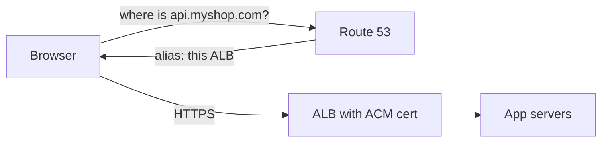
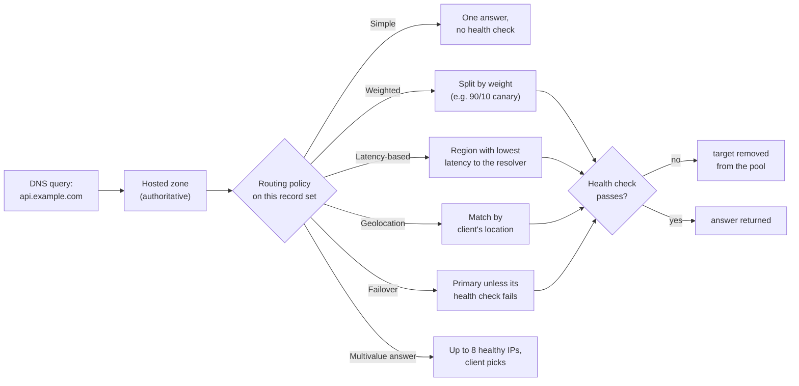
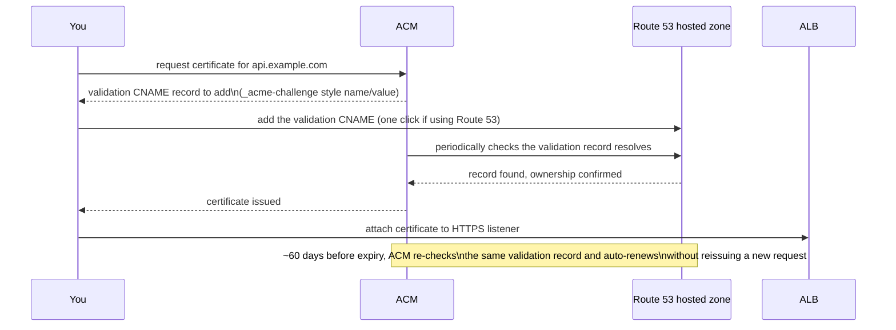
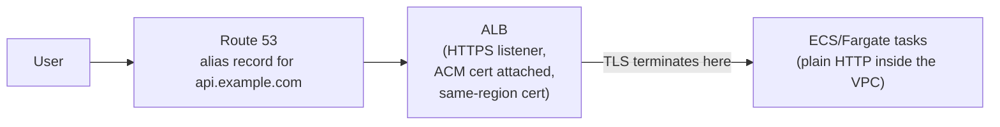

# AWS 09 - Route 53 and ACM

> [!summary] TL;DR
> Route 53 is AWS's DNS service: it answers "what IP/name does this domain point to right now", and can answer differently per client with routing policies like weighted or latency-based.
>
> ACM issues and auto-renews free TLS certificates for AWS-fronting services (ALB, CloudFront, API Gateway) as long as you let AWS prove you own the domain once.
>
> Together they're the "how do requests find us, and how is that connection encrypted" layer in front of an AWS architecture — the TLS handshake itself and general DNS theory live in [[TLS and HTTPS]] and [[DNS - Resolution, Records and Caching]]; this note is the AWS-specific plumbing.

> [!abstract] Core idea
> - A **hosted zone** is a container of DNS records for a domain; Route 53 is authoritative for it once you point the domain's registrar at Route 53's name servers.
> - An **alias record** is Route 53's AWS-only extension of a record: it looks like a CNAME but can be used at the zone apex, resolves with no extra lookup, and is free.
> - **Routing policies** (weighted, latency, geolocation, failover, multivalue) decide *which* answer a query gets, not *whether* a name resolves — health checks remove unhealthy targets from the pool entirely.
> - ACM certificates are **free but can't leave AWS** — you can't export the private key to install it on your own nginx box; they only attach to AWS resources (ALB, CloudFront, API Gateway, etc.).
> - A CloudFront certificate must be requested in **us-east-1** regardless of where your users or origin are; an ALB certificate must be in the **same region as the ALB**. Mixing these up is the most common ACM mistake.

## Start here: the basics

**The problem in one story.**
You type `api.myshop.com` in a browser, but computers only talk to numeric IP addresses.
Something must turn the name into an address, and the browser also needs proof the site is really yours.
Route 53 is the phone book that turns names into addresses.
ACM gives you the free certificate that proves your identity and turns on HTTPS.

**Words you need first**

| Word | Plain meaning | Tiny example |
| --- | --- | --- |
| DNS | The internet's name-to-address lookup system | `myshop.com` → `13.234.10.5` |
| Domain | A name you own on the internet | `myshop.com` |
| DNS record | One line in the phone book | `A api → 13.234.10.5` |
| TTL | How long others may cache an answer | 300 seconds |
| Zone apex | The bare domain with nothing in front | `myshop.com` (not `www.`) |
| TLS certificate | A signed file proving a site's identity | Enables the padlock in the browser |
| Load balancer (ALB) | A front door that spreads traffic to servers | Sends requests to 3 app tasks |
| Region | A geographic AWS location | `us-east-1`, `ap-south-1` |

**Picture it**



**Analogy.** Route 53 is a phone book, and ACM is the ID card a shopkeeper shows so you trust the shop.
Where it breaks: a phone book gives the same number to everyone, but Route 53 routing policies can give different answers to different users (by latency, weight, location, or health).

**How the rest of this note builds up**

- First, why DNS and certificates matter and a mental model of zones and records (sections 1-2).
- Then how it works: hosted zones, alias records, routing policies, health checks, ACM validation and regions (section 3).
- Then a worked example and comparisons with other DNS and certificate options (sections 4-6).
- Finally the SDE-3 deep dive: production traps like caching, TTLs and the us-east-1 rule (sections 7-9).

> [!tip] Remember
> Route 53 answers "where is this name?"; ACM answers "is this really you?"

## 1. Why it exists

A production service needs a name (`api.example.com`) that resolves to the right infrastructure, can be changed without every client needing to know a new IP, and can route different clients to different targets — a canary release at 10%, the nearest regional endpoint, or a healthy target when another has failed.

Running your own authoritative name servers means operating highly available, globally distributed DNS infrastructure yourself; Route 53 does that for you and layers routing policies and health checks on top, which is the part a self-hosted BIND setup would need the most custom work to replicate.

On top of a working name, that connection needs TLS, and a certificate that's installed on the wrong AWS resource, in the wrong region, or that silently expired is one of the most common ways a perfectly good deployment stops serving traffic.

ACM exists to make certificate issuance and renewal a non-event: request once, validate ownership once, and AWS renews it automatically for as long as the validation record still resolves — no cron job, no forgotten expiry.

**Concrete numbers (documented, AWS pricing as of late 2026 — confirm current rates):**
- Hosted zone: ~$0.50/month per zone; standard queries: ~$0.40 per million; alias record queries to AWS resources (ALB, CloudFront, S3 website endpoints) in the same account: **free**.
- Health checks: ~$0.50/month per HTTP(S) health check (endpoint-based), more for calculated/CloudWatch-alarm-based checks.
- ACM public certificates for use with AWS resources: **free**, with no limit tied to renewal — you pay nothing extra for the cert itself, only for the AWS resources it's attached to.

## 2. Mental model

Think of Route 53 as a **phone book that can give a different number to different callers**, and ACM as a **certificate office that only issues IDs usable inside the same building** (AWS):

- A query for `api.example.com` reaches Route 53, which looks in the hosted zone, applies whatever routing policy that record set uses, checks health if configured, and returns one or more answers.
- An **alias record** is Route 53 silently resolving an AWS resource's current address on your behalf at query time — so when an ALB's underlying IPs change (which they do, AWS doesn't document stable ALB IPs), your alias record doesn't need to change at all.
- ACM doesn't hand you a `.pem` file to install elsewhere; it proves domain ownership once, issues a certificate, and keeps renewing it as long as it stays attached to an AWS resource and the validation record is still in place.

## 3. How it works

### Record types and routing policies



- **Simple**: one record, one (or a static list of) value, no health check — the DNS equivalent of a hardcoded address.
- **Weighted**: split traffic across targets by relative weight (e.g. 90/10 for a canary); a weight of 0 means "never, unless it's the only healthy option left".
- **Latency-based**: answers with whichever region's resource has the lowest *measured* latency from AWS's network to the resolver making the query — useful for routing global users to their nearest regional deployment.
- **Geolocation**: answers based on the *querying resolver's* geographic location (country/continent/state) — used for content licensing or data-residency routing, not performance.
- **Failover**: one primary, one secondary; Route 53 only answers with the secondary while the primary's health check is failing.
- **Multivalue answer**: up to 8 healthy records returned per query, with the client choosing — simple client-side load spreading without needing a load balancer in front.

**A record set's routing policy decides which answer a client gets; a health check decides whether a given target is even in the pool to be picked.** These are independent: you can have weighted routing with no health checks (traffic still splits by weight even to a dead target), or failover routing is meaningless without one (there'd be nothing to trigger the switch).

### Alias vs CNAME

| | CNAME | Alias record |
| --- | --- | --- |
| Can be used at zone apex (`example.com`, not `www.example.com`) | No (DNS spec forbids a CNAME coexisting with other records at the apex, like the required `NS`/`SOA`) | Yes |
| Resolution | A separate DNS lookup each time, like any other CNAME | Resolved internally by Route 53, no extra round trip |
| Cost (AWS target) | Normal standard query pricing | Free when it points at a supported AWS resource (ALB, CloudFront, API Gateway, S3 website endpoint, another Route 53 record) |
| Points to | Any hostname | Only specific AWS resource types |

An alias record pointing at an ALB automatically tracks the ALB's IPs as AWS rotates them — you set it once as "alias to this ALB", not "alias to IP 203.0.113.5", so you never have to update it when the ALB's underlying addresses change.

### DNS cutover practice

Migrating a record to point somewhere new (a new load balancer, a new region) is a two-step operation if you want to avoid a visible outage: **lower the TTL well before the cutover** (e.g. from 3600s to 60s, at least one old-TTL period ahead of time, so caches holding the old long TTL expire naturally), then flip the record, then raise the TTL back once you've confirmed the new target is healthy.

Skipping the TTL-lowering step means some fraction of clients keep hitting the old target for up to the old TTL's duration after cutover — which matters if the old target is being decommissioned on a tight schedule.

### ACM: issuance, validation, and renewal



- **DNS validation** (the default and recommended method) adds one CNAME record proving you control the zone; as long as that record stays in the zone, ACM keeps renewing automatically — remove it, and the next renewal attempt fails silently until someone notices the cert is about to expire.
- **Email validation** is the older method (emails sent to WHOIS/admin addresses); it requires a human to click a link every renewal cycle, so it does not auto-renew unattended — DNS validation is the correct default for anything automated.
- ACM certificates **cannot be exported** — no private key download, no using the same cert on a self-hosted nginx box. They only attach to supported AWS resources (ALB/NLB listeners, CloudFront distributions, API Gateway custom domains, and a few others).
- **Region matters and is the most common ACM mistake:** a certificate for an **ALB** must be requested in the **same region as the ALB**; a certificate for **CloudFront** must be requested in **us-east-1**, regardless of where your users or origin servers are, because CloudFront's control plane is global but anchored in that region.

### Putting it together: Route 53 + ACM + ALB



TLS terminates at the ALB using the ACM certificate; traffic from the ALB to the ECS tasks inside the VPC is typically plain HTTP (the VPC boundary is the trust boundary), unless you specifically need end-to-end encryption, in which case the ALB re-encrypts to the target using a certificate the targets present — see [[TLS and HTTPS]] for when re-encryption or mTLS is worth the extra cost and complexity.

## 4. Worked example

### Whiteboard version

The core of weighted routing: pick a target in proportion to its weight, using a hash of the query key so the same client keeps landing on the same target.

```go
bucket := hash(queryKey) % totalWeight
// walk through healthy records, subtracting each one's weight,
// until bucket falls inside one record's range
```

The full version below only counts healthy targets toward the pool (matching how Route 53 health checks remove a target entirely rather than just deprioritizing it), and ships with tests that measure the actual traffic split.

**Full code**, Go 1.24, standard library only (`hash/fnv`). It compiles and passes `go vet` and `go test -race`:

```go
package r53demo

import (
	"errors"
	"hash/fnv"
)

// Record is one weighted resource record set, the same shape a weighted
// routing policy answer sends to Route 53: a target and a weight 0-255.
// A weight of 0 answers that target only when it is the one healthy
// target left (it is never picked while any other target has weight > 0
// and is healthy); Route 53 drops a target from the pool entirely only
// when its associated health check fails.
type Record struct {
	Target  string
	Weight  int
	Healthy bool
}

// Resolver picks a target per query the way Route 53's weighted routing
// policy does: weights act as relative probabilities among the healthy
// targets, and an unhealthy target is removed from the pool, not just
// deprioritized.
type Resolver struct {
	records []Record
}

func NewResolver(records []Record) *Resolver {
	return &Resolver{records: records}
}

// Resolve deterministically maps a query key (e.g. the resolver's own
// source IP, standing in for "which client asked") to one healthy target,
// in proportion to its weight. Using a hash instead of math/rand keeps the
// same client sticky to the same target across repeated calls, which is
// how Route 53 is often described to behave in practice at the resolver
// cache layer, and makes the function pure and easy to test.
func (r *Resolver) Resolve(queryKey string) (string, error) {
	total := 0
	for _, rec := range r.records {
		if rec.Healthy {
			total += rec.Weight
		}
	}
	if total == 0 {
		return "", errors.New("route53: no healthy targets with positive weight")
	}

	h := fnv.New32a()
	_, _ = h.Write([]byte(queryKey))
	bucket := int(h.Sum32()) % total
	if bucket < 0 {
		bucket += total
	}

	cursor := 0
	for _, rec := range r.records {
		if !rec.Healthy {
			continue
		}
		cursor += rec.Weight
		if bucket < cursor {
			return rec.Target, nil
		}
	}
	// Unreachable while total > 0, but keep the compiler and callers honest.
	return "", errors.New("route53: resolution fell through")
}
```

```go
func TestResolveSplitsTrafficByWeight(t *testing.T) {
	r := NewResolver([]Record{
		{Target: "10.0.1.10", Weight: 90, Healthy: true}, // old stack, draining
		{Target: "10.0.2.20", Weight: 10, Healthy: true}, // canary
	})

	counts := map[string]int{}
	const n = 100_000
	for i := 0; i < n; i++ {
		target, err := r.Resolve(fmt.Sprintf("client-%d", i))
		if err != nil {
			t.Fatalf("Resolve: %v", err)
		}
		counts[target]++
	}

	canaryPct := float64(counts["10.0.2.20"]) / float64(n) * 100
	if canaryPct < 8.5 || canaryPct > 11.5 {
		t.Fatalf("canary got %.2f%% of traffic, want close to 10%%", canaryPct)
	}
}

func TestResolveDropsUnhealthyTargets(t *testing.T) {
	r := NewResolver([]Record{
		{Target: "10.0.1.10", Weight: 50, Healthy: false}, // health check failing
		{Target: "10.0.2.20", Weight: 50, Healthy: true},
	})

	for i := 0; i < 1_000; i++ {
		target, err := r.Resolve(fmt.Sprintf("client-%d", i))
		if err != nil {
			t.Fatalf("Resolve: %v", err)
		}
		if target != "10.0.2.20" {
			t.Fatalf("resolved to unhealthy target %q", target)
		}
	}
}
```

**Measured:** 100,000 simulated clients against a 90/10 weighted split (Go 1.24, `go test -race`, 2026-11-07) resolved to **89,895 (89.9%)** on the 90-weight target and **10,105 (10.1%)** on the 10-weight target — within half a percentage point of the ideal 90/10, which is the statistical noise you'd expect from a hash-based split at this sample size, not a bug.

The unhealthy-target test (1,000 queries against a 50/50 split where one target is marked unhealthy) sent **100%** of traffic to the remaining healthy target, confirming the pool-removal behavior rather than mere deprioritization.

## 5. Variants and comparison

| Routing policy | What it optimizes for | Use when | Needs health checks to be useful? |
| --- | --- | --- | --- |
| Simple | Nothing — one static answer | Single target, no failover, no splitting | No |
| Weighted | Controlled traffic split by percentage | Canary releases, gradual migrations | Optional, but recommended |
| Latency-based | Lowest measured latency region | Multi-region deployments serving global users | Optional |
| Geolocation | Client's geographic location | Content licensing, data residency requirements | Optional |
| Failover | Primary/secondary with automatic switch | Active-passive DR setups | Required (it's the trigger) |
| Multivalue answer | Simple client-side spread across up to 8 healthy IPs | Lightweight load distribution without a load balancer | Recommended |

| Validation method | How it proves ownership | Auto-renews? | Use when |
| --- | --- | --- | --- |
| DNS validation | One CNAME record in the zone | Yes, as long as the record stays | Default for everything |
| Email validation | Human clicks a link in an inbox | No — needs a human every cycle | Legacy domains without Route 53 access |

## 6. Trade-offs and when not to use

- Route 53 health checks add real cost and complexity for a topology that genuinely never needs automatic failover — a single-region, single-target service gains nothing from them beyond alerting.
- Weighted and latency-based routing happen at the **DNS** layer, which is cached by resolvers for the record's TTL — this makes them coarser and slower to shift than an application-layer canary (like an ALB weighted target group), which can rebalance instantly without waiting for caches to expire.
- ACM's "can't export the private key" constraint means any workload outside AWS (an on-prem server, a non-AWS CDN) needs its own certificate from elsewhere (e.g. Let's Encrypt) — ACM is not a general-purpose certificate authority for your whole estate.
- Geolocation routing has gaps: not every resolver's location maps cleanly to a country, and a "default" catch-all record is required or some clients get no match at all.

## 7. In production

- **Real systems:** nearly every AWS-hosted web service puts an alias record in front of an ALB or CloudFront distribution; weighted routing is a common way to run a canary or a gradual region migration; failover routing backs active-passive DR architectures.
- **Failure modes → fixes:**
  - ACM renewal silently fails → the DNS validation CNAME was removed (often during an unrelated "zone cleanup"); restore it and re-trigger validation.
  - Wrong-region ACM certificate → a CloudFront distribution won't even let you attach a non-us-east-1 certificate; an ALB listener will reject a certificate from a different region at attach time — both fail loudly at configuration time, not silently in production.
  - Cutover causes a spike of errors → TTL wasn't lowered ahead of time, so a chunk of clients kept the old long-TTL answer past the point the old target was decommissioned.
  - Weighted canary isn't shifting traffic fast enough → remember DNS-layer weighting is bounded by resolver caching and TTL; for sub-second canary control, shift weight at the ALB target-group layer instead (see [[AWS 06 - Load Balancing (ALB vs NLB)]] and [[Load Balancing]]).
- **What to monitor:** Route 53 health check status per target, ACM certificate `DaysToExpiry` (CloudWatch metric), DNS query volume/latency per hosted zone, and any `ResourceRecordSet` change (via CloudTrail) to catch accidental validation-record deletion.

## 8. Deep dive

- **Why alias records exist at all.** The DNS spec requires a few record types (`NS`, `SOA`) to coexist at a zone's apex, and the spec forbids a `CNAME` from coexisting with any other record type at the same name — so a plain CNAME can never point the bare domain (`example.com`) anywhere; only a subdomain (`www.example.com`) could use one.

  Route 53's alias record is a proprietary extension that behaves like a CNAME from the outside but is resolved internally by Route 53 at query time, sidestepping that restriction and letting the apex domain point at an ALB, CloudFront distribution, or another AWS resource whose IPs can change.
- **Health check evaluation is itself distributed.** Route 53 runs each health check from multiple AWS regions' health checkers and requires a configurable minimum number of them to agree a target is unhealthy before acting — this avoids one region's transient network blip single-handedly failing a target out of the pool for everyone.
- **ACM's renewal check is the same validation record, not a fresh challenge.** Unlike some certificate authorities, renewing an ACM certificate does not ask you to redo validation from scratch each time — it periodically re-checks the *same* DNS validation record is still present and still resolves, and only fails renewal if that record is gone or the resource using the certificate was deleted, which is why "someone deleted an old-looking CNAME during cleanup" is the single most common cause of an unexpectedly expired ACM certificate.

## 9. Interview questions

> [!question]- Why would Route 53 answer the same query differently for two different clients?
> A routing policy like weighted, latency-based, or geolocation is attached to the record set, so Route 53 deliberately returns different answers depending on the policy's inputs (a hash/weight bucket, measured latency, or the resolver's location) — this is the intended behavior, not a caching bug.

> [!question]- Trap: does a weighted routing policy at 90/10 guarantee exactly 90% and 10% of requests go to each target?
> No — it's a probabilistic split based on hashing or random selection per query, converging toward the weight ratio at scale but never exact. With 100,000 simulated queries at a 90/10 split, a real measurement landed at 89.9%/10.1% — close, not exact, and smaller sample sizes show more variance.

> [!question]- Why does a CloudFront certificate have to be requested in us-east-1 even if every user and origin is in ap-south-1?
> CloudFront is a global service, but its control plane (where certificates are validated against distributions) is anchored in us-east-1 for historical reasons — ACM enforces this at certificate-attachment time, so a certificate requested in any other region simply won't appear as an option when configuring the distribution.

> [!question]- Why did your ACM certificate fail to auto-renew even though nothing about the certificate itself changed?
> ACM auto-renewal re-checks that the original DNS validation CNAME is still present and resolves. If that record was deleted (often by someone cleaning up "unused-looking" DNS records) or the underlying resource was removed, renewal fails silently until you notice the expiry approaching.

> [!question]- What's the practical difference between a CNAME and a Route 53 alias record for an ALB?
> A CNAME is a real extra DNS lookup each time, can't be used at the zone apex, and is billed as a normal query.
>
> An alias record is resolved by Route 53 internally (no extra lookup), works at the apex, automatically tracks the ALB's changing IPs, and is free — there's essentially no reason to use a CNAME instead when aliasing an AWS resource.

> [!question]- You need instant, fine-grained control over a canary's traffic split. Should you use Route 53 weighted routing?
> Not for sub-second control — DNS answers get cached by resolvers for the record's TTL, so shifting a DNS weighted split takes time to fully propagate as caches expire. An ALB weighted target group rebalances the split immediately at the request-routing layer, which is the better tool when canary speed matters.

## 10. Cheat sheet

- Hosted zone = authoritative DNS records for a domain; routing policy decides which answer; health check decides whether a target is even in the pool.
- Alias record: free, works at the apex, tracks AWS resource IP changes automatically — prefer it over CNAME for any AWS target.
- Weighted = percentage split; latency-based = nearest region; geolocation = client location; failover = primary/secondary; multivalue = up to 8 healthy answers.
- Lower TTL before a cutover, flip the record, raise TTL back once the new target is confirmed healthy.
- ACM certificates are free, auto-renew via the same DNS validation record, but cannot be exported — AWS resources only.
- CloudFront certs must be requested in us-east-1; ALB certs must match the ALB's own region.
- DNS-layer traffic shifts (Route 53 weighted/latency) are bounded by resolver TTL caching; for instant canary control use the load balancer's own weighted target groups instead.
- TLS terminates at the ALB using the ACM cert; traffic onward into the VPC is typically plain HTTP unless end-to-end encryption is specifically required.

## Links

- **Before this:** [[DNS - Resolution, Records and Caching]], [[TLS and HTTPS]]
- **Next:** [[AWS 10 - CloudWatch]], [[Deploying a Go API on AWS (Reference Architecture)]]
- **Compare with:** [[AWS 06 - Load Balancing (ALB vs NLB)]] and [[Load Balancing]] (traffic shifting at the load-balancer layer instead of DNS), [[Forward and Reverse Proxies - L4 vs L7]] (where TLS termination sits relative to a proxy)

### Watch on YouTube

- [(ACM) AWS Certificate Manager Course / Route 53 / Load Balancer - Part 16](https://www.youtube.com/watch?v=_bEPuvrjB5Y) · Rahul Wagh · 39 min · 71,139 views
- [AWS Route53 - Domain and SSL Certificate using Hosted Zones and ACM](https://www.youtube.com/watch?v=ookzXuMr8eY) · Endre Synnes · 7 min · 51,314 views
