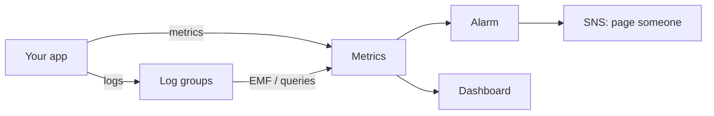
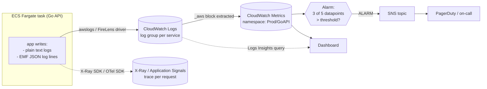
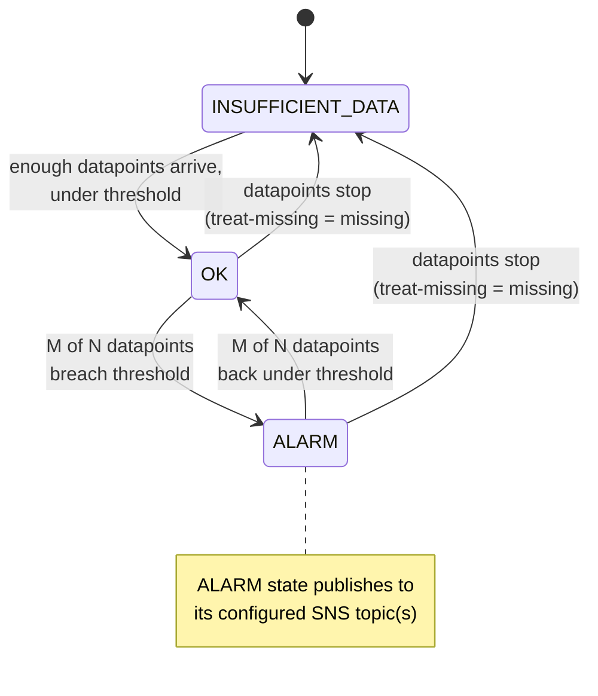

# AWS 10 - CloudWatch

> [!summary] TL;DR
> CloudWatch is AWS's built-in telemetry store: it collects **metrics** (numbers over time), **logs** (text events), and **traces** (request paths across services), and lets you turn any of them into an **alarm** that pages someone. Every other AWS service writes to it for free; your own code has to opt in.

> [!abstract] Core idea
> - Metrics live under a **namespace**, sliced by **dimensions** (key-value tags); every unique combination of dimension values is its own billed metric.
> - Logs are plain text in **log groups**/**log streams**; CloudWatch does nothing with them until you either run a **Logs Insights** query or extract numbers with **Embedded Metric Format (EMF)**.
> - An **alarm** watches one metric, waits for **M out of N** datapoints past a threshold, and flips to `ALARM`, firing an SNS notification.
> - Dashboards, Container Insights, and X-Ray/Application Signals all read the same metrics and traces back out.
> - Classic trap: ingesting everything at 1-second resolution with high-cardinality dimensions, which is both slow to query and expensive.

## Start here: the basics

**The problem in one story.**
Your API starts returning errors at 2 a.m.
Nobody notices until customers complain in the morning.
You needed numbers (how many errors?), logs (what went wrong?), and an alarm that wakes someone up.
CloudWatch is AWS's place for all three.

**Words you need first**

| Word | Plain meaning | Tiny example |
| --- | --- | --- |
| Metric | A number measured over time | Requests per minute |
| Dimension | A label that splits a metric | `Service=orders` |
| Log | A line of text your app writes | `error: db timeout` |
| Log group | A folder of related logs | `/ecs/orders-api` |
| Alarm | A rule that fires when a number crosses a line | Errors > 5% for 3 minutes |
| SNS | AWS's notification sender | Sends the alarm to email or Slack |
| Cardinality | How many unique label values exist | One per user ID = very high |

**Picture it**



**Analogy.** CloudWatch is a car dashboard: gauges are metrics, the trip log is the logs, and the warning light is the alarm.
Where it breaks: a car's gauges are free, but every extra CloudWatch metric (each unique dimension combination) costs money.

**How the rest of this note builds up**

- First, why monitoring is needed and the mental model of metrics, logs and alarms (sections 1-2).
- Then how it works: namespaces, dimensions, Logs Insights, EMF, alarms, dashboards and tracing (section 3).
- Then a Go worked example and comparisons with other tools (sections 4-6).
- Finally the SDE-3 deep dive: cost and cardinality traps and production alarm design (sections 7-9).

> [!tip] Remember
> Metrics say *that* something is wrong, logs say *why*, alarms make sure someone *knows*.

## 1. Why it exists

A Go API running as an ECS Fargate task has no disk anyone can SSH into and no fixed IP. When a task dies and is replaced, its stdout is gone unless something shipped it elsewhere.

CloudWatch is that elsewhere: the ECS agent attaches an `awslogs` (or FireLens) log driver to every task, so every `log.Println` ends up in a CloudWatch Logs group automatically, and every built-in AWS metric (ALB target 5xx count, RDS CPU, ECS task count) already flows into CloudWatch metrics with zero code.

Concretely: an ALB reports `HTTPCode_Target_5XX_Count` as a metric with `1-minute` resolution. An alarm watches it, and when **3 of 5** consecutive 1-minute datapoints exceed 10 errors/minute, the alarm goes to `ALARM` and publishes to an SNS topic that pages on-call. Without this wiring, the first signal of an outage is a user complaint.

## 2. Mental model

Think of CloudWatch as three separate warehouses with one loading dock (alarms) between them and the outside world:

- **Metrics warehouse:** rows of `(timestamp, value)` filed under `namespace → metric name → dimension set`. Cheap to query, fast, aggregated.
- **Logs warehouse:** raw text, filed under `log group → log stream`. Expensive to scan line-by-line (Logs Insights), but holds everything, including stack traces.
- **Traces warehouse (X-Ray):** one record per request showing every service hop and its latency, filed under `trace ID`.

An **alarm** is a standing query against exactly one metric. It does not look at logs or traces directly — if you want an alarm on "5xx rate in the logs," you first have to turn that log pattern into a metric (a **metric filter**, or EMF) and then alarm on the resulting metric.

## 3. How it works

### Metrics: namespace, dimensions, resolution

A metric's identity is `(Namespace, MetricName, Dimensions)`. `AWS/ECS` is a namespace AWS owns; `Prod/GoAPI` would be one you create.

Dimensions are plain key-value pairs — `{Service: checkout-api, Route: /v1/orders}` — and **every distinct combination of dimension values is billed and stored as its own metric stream**.

Standard resolution is one datapoint per minute; high resolution is one per second, at a much higher cost and only useful for metrics you page on within seconds.

Built-in AWS metrics (ALB request count, RDS CPU, ECS task CPU/memory) appear with zero code. Your own business metrics ("orders placed," "checkout latency broken down by payment method") need either:

1. `PutMetricData` API calls (one HTTP call per data point, or per batch — simple, but adds an AWS SDK dependency and network round trip to your request path), or
2. **Embedded Metric Format (EMF):** a structured JSON log line with an `_aws` block that tells the CloudWatch agent (or, on Fargate, the Firelens/awslogs pipeline feeding the CloudWatch agent) which fields to publish as metrics. You just write a JSON log line; CloudWatch extracts the metric asynchronously. This is what the worked example below builds.



### Logs: groups, streams, retention, Logs Insights

Each ECS service writes to one **log group** (e.g. `/ecs/checkout-api`); each running task gets its own **log stream** inside it. Retention defaults to **never expire**, which quietly becomes the single biggest CloudWatch bill line in a vault's worth of chatty services — set an explicit retention (30-90 days is typical; longer-lived audit logs go to S3 instead).

**Logs Insights** is a query language over log groups, evaluated at query time (not indexed ahead of time), so a query over a wide time range on a busy service can take tens of seconds. Representative query and output:

```text
fields @timestamp, @message
| filter @message like /status=5\d\d/
| parse @message "route=* status=* duration_ms=*" as route, status, duration_ms
| stats count(*) as errors, avg(duration_ms) as avg_ms by route
| sort errors desc
| limit 10
```

representative output (CloudWatch Logs Insights, run over the last 15 minutes):

| route | errors | avg_ms |
| --- | --- | --- |
| /v1/orders | 42 | 812.3 |
| /v1/payments | 11 | 1204.7 |
| /v1/inventory | 3 | 95.1 |

### Alarms: thresholds, M-of-N, missing data, composite

A basic alarm has a metric, a statistic (`Average`, `p99`, `Sum`), a threshold, and an **evaluation**: "M datapoints out of the last N breach the threshold." `3 of 5` is a common choice — it survives one noisy minute without paging, but still fires inside about 5 minutes.

CloudWatch also offers **anomaly detection** alarms, which compare against a learned band instead of a fixed number, useful for metrics with a strong daily/weekly shape (traffic, order volume) where a fixed threshold would either miss a quiet-hours spike or false-page every evening peak.

**Missing data treatment** matters more than it looks: if a task count metric simply stops reporting (because the service is down hard, not just slow), the default is `missing → not breaching`, which means the alarm can stay `OK` while the service is actually dead.

For anything safety-critical, set missing data to `breaching` or `as missing` with a tight period, so silence itself pages.



**Composite alarms** combine several alarms with AND/OR/NOT, e.g. "page only if `5xx-rate ALARM` AND `request-count ALARM` (so a quiet period with 100% errors on 2 requests doesn't page)." This is the standard fix for noisy single-metric alarms.

### Dashboards and Container Insights

Dashboards are just saved widgets over the same metrics and Logs Insights queries above — no separate storage.

**Container Insights** is a CloudWatch agent add-on for ECS/EKS that auto-collects per-task CPU, memory, network, and storage metrics plus a performance log, without instrumenting the app; it costs more per task than base ECS metrics, so it's usually enabled only where the extra granularity earns its cost.

### Traces: X-Ray / Application Signals vs an OpenTelemetry collector

X-Ray is CloudWatch's own tracing backend: the `aws-xray-sdk-go` package (or auto-instrumentation via Application Signals) attaches a trace ID header and reports segments.

An **OpenTelemetry (OTel) collector** is the vendor-neutral alternative: your Go service exports OTel spans, and the collector can fan them out to X-Ray, a self-hosted Jaeger/Tempo, or a third party, letting you switch backends without touching application code.

See [[Distributed Tracing with OpenTelemetry]] for the span model itself; this note only covers where AWS's own backend sits.

## 4. Worked example

### Whiteboard version

The core trick: a structured log line's `_aws` block tells CloudWatch which fields are metrics and which are their dimensions, so logging once gives you both a searchable event and a billed metric.

```go
log := map[string]any{
    "_aws": map[string]any{
        "Timestamp":        time.Now().UnixMilli(),
        "CloudWatchMetrics": []map[string]any{{
            "Namespace":  "Prod/GoAPI",
            "Dimensions": [][]string{{"Service", "Route"}},
            "Metrics":    []map[string]any{{"Name": "Duration", "Unit": "Milliseconds"}},
        }},
    },
    "Service": "checkout-api", "Route": "/v1/orders", "Duration": 42.5,
}
json.NewEncoder(os.Stdout).Encode(log) // the awslogs driver ships this line as-is
```

The full version below builds and parses this format, and demonstrates the cardinality trap in code instead of just describing it. It compiles and passes `go vet` and `go test -race` on Go 1.24.

```go
// Package cwemf builds and parses CloudWatch Embedded Metric Format (EMF)
// log lines: structured JSON logs that the CloudWatch agent (or Lambda/Fargate's
// built-in log router) reads to publish custom metrics without a separate
// PutMetricData API call.
package cwemf

import (
	"encoding/json"
	"fmt"
	"time"
)

// BuildEMF builds one EMF-formatted CloudWatch Logs line for an HTTP request.
// The "_aws" block tells the CloudWatch agent which top-level fields to
// publish as metrics and which fields to use as their dimension values.
func BuildEMF(service, route string, status int, durationMs float64, ts time.Time) ([]byte, error) {
	line := map[string]any{
		"_aws": map[string]any{
			"Timestamp": ts.UnixMilli(),
			"CloudWatchMetrics": []map[string]any{
				{
					"Namespace":  "Prod/GoAPI",
					"Dimensions": [][]string{{"Service", "Route"}},
					"Metrics": []map[string]any{
						{"Name": "Duration", "Unit": "Milliseconds"},
						{"Name": "RequestCount", "Unit": "Count"},
					},
				},
			},
		},
		"Service":      service,
		"Route":        route,
		"Status":       status,
		"Duration":     durationMs,
		"RequestCount": 1,
	}
	return json.Marshal(line)
}

// ExtractedMetric is one metric CloudWatch would publish from an EMF line.
type ExtractedMetric struct {
	Namespace  string
	Dimensions map[string]string
	Name       string
	Value      float64
}

// Extract mimics what the CloudWatch agent does: read the _aws directives,
// then pull each named metric's value and its declared dimension values out
// of the same JSON line.
func Extract(line []byte) ([]ExtractedMetric, error) {
	var raw map[string]json.RawMessage
	if err := json.Unmarshal(line, &raw); err != nil {
		return nil, fmt.Errorf("decode line: %w", err)
	}

	var aws struct {
		CloudWatchMetrics []struct {
			Namespace  string     `json:"Namespace"`
			Dimensions [][]string `json:"Dimensions"`
			Metrics    []struct {
				Name string `json:"Name"`
			} `json:"Metrics"`
		} `json:"CloudWatchMetrics"`
	}
	if err := json.Unmarshal(raw["_aws"], &aws); err != nil {
		return nil, fmt.Errorf("decode _aws block: %w", err)
	}

	var out []ExtractedMetric
	for _, directive := range aws.CloudWatchMetrics {
		for _, dimSet := range directive.Dimensions {
			dims := make(map[string]string, len(dimSet))
			for _, d := range dimSet {
				var v string
				if err := json.Unmarshal(raw[d], &v); err != nil {
					continue // dimension field wasn't a plain string; skip it
				}
				dims[d] = v
			}
			for _, m := range directive.Metrics {
				var v float64
				if err := json.Unmarshal(raw[m.Name], &v); err != nil {
					return nil, fmt.Errorf("metric %s missing or not numeric: %w", m.Name, err)
				}
				out = append(out, ExtractedMetric{
					Namespace:  directive.Namespace,
					Dimensions: dims,
					Name:       m.Name,
					Value:      v,
				})
			}
		}
	}
	return out, nil
}

// CustomMetricCardinality estimates how many distinct metric streams a set of
// dimensions produces: CloudWatch bills and limits every unique combination
// of dimension values as its own custom metric.
func CustomMetricCardinality(dimensionValueCounts ...int) int {
	total := 1
	for _, c := range dimensionValueCounts {
		if c <= 0 {
			continue
		}
		total *= c
	}
	return total
}
```

The test proves the round trip and the cardinality trap in numbers:

```go
func TestBuildAndExtractRoundTrip(t *testing.T) {
	ts := time.Date(2026, 11, 7, 10, 0, 0, 0, time.UTC)
	line, err := BuildEMF("checkout-api", "/v1/orders", 201, 42.5, ts)
	if err != nil {
		t.Fatalf("BuildEMF: %v", err)
	}
	metrics, err := Extract(line)
	if err != nil {
		t.Fatalf("Extract: %v", err)
	}
	if len(metrics) != 2 {
		t.Fatalf("got %d metrics, want 2 (Duration, RequestCount)", len(metrics))
	}
	// ... (see note's repo copy for the full field-by-field assertions)
}

func TestCustomMetricCardinalityExplodesWithHighCardinalityDimensions(t *testing.T) {
	sane := CustomMetricCardinality(20, 5) // 20 routes x 5 status buckets
	if sane != 100 {
		t.Fatalf("sane cardinality = %d, want 100", sane)
	}
	// Adding a per-user-id dimension with 50,000 distinct users turns the
	// same 100 streams into 5,000,000: the classic EMF cardinality trap.
	exploded := CustomMetricCardinality(20, 5, 50_000)
	if exploded != 5_000_000 {
		t.Fatalf("exploded cardinality = %d, want 5,000,000", exploded)
	}
}
```

Both tests pass (`go test -race ./cwemf/...`): the round trip recovers `Duration=42.5` under dimensions `{Service: checkout-api, Route: /v1/orders}`, and the cardinality test shows 100 sane metric streams becoming 5,000,000 the moment a user-ID dimension is added — never add a high-cardinality field (user ID, request ID, raw IP) as a CloudWatch dimension; put it in the log line's body instead and find it with Logs Insights.

## 5. Variants and comparison

| Tool | What it's for | Use when | Cost shape |
| --- | --- | --- | --- |
| CloudWatch Metrics | Numeric time series, alarms, dashboards | Any AWS-native service; custom business metrics via EMF/PutMetricData | Per metric-month, steep at high cardinality |
| CloudWatch Logs + Logs Insights | Full-text/structured log search | Debugging a specific request, ad hoc queries | Per-GB ingested + per-GB scanned per query |
| CloudWatch Container Insights | Per-task CPU/memory/network for ECS/EKS | You need per-task granularity beyond the service-level ECS metrics | Extra per-task metric cost |
| X-Ray / Application Signals | Request-level traces, service maps | You're staying inside the AWS ecosystem and want traces with no collector to run | Per trace recorded (with sampling) |
| OpenTelemetry collector → (X-Ray / Prometheus / Grafana / Datadog) | Vendor-neutral metrics, logs, and traces | You might move off AWS, or already run Prometheus/Grafana elsewhere | Collector compute cost + your chosen backend's cost |
| Prometheus + Grafana (self-run or AMP/AMG) | Pull-based metrics with PromQL, rich dashboards | Kubernetes-heavy stacks, teams that already know PromQL | Infra to run (or AWS-managed AMP/AMG per-metric cost) |
| Datadog / New Relic (third party) | Unified metrics+logs+traces+APM, one pane of glass | Budget allows it and you want less operational glue code | Per-host/per-GB, usually pricier than native CloudWatch |

## 6. Trade-offs and when not to use

- CloudWatch is the path of least resistance on AWS (zero setup for built-in metrics), but **PromQL is more expressive** than CloudWatch Metrics Insights for ad hoc queries across many services — a Kubernetes-first shop often prefers Prometheus even on AWS (EKS).
- **Logs Insights charges per GB scanned per query**, not just per GB stored — a wide-time-range query over a chatty service's logs can cost more per query than you expect. Narrow the time range and use `filter` early in the query.
- Default **never-expiring log retention** is the single most common CloudWatch cost surprise; set it explicitly on every log group at creation time.
- High-cardinality dimensions (user ID, request ID, IP) turn one metric into millions and can silently hit account **custom-metric limits**; keep high-cardinality identifiers in log fields, not dimensions.
- For a single-account, cost-sensitive hobby project, `journald` + `grep` and a cron-based health check beat standing up CloudWatch dashboards and alarms — the operational payoff of CloudWatch shows up once you have more than a couple of services or an on-call rotation.

## 7. In production

- **Real systems:** every ECS/Fargate and Lambda deployment on AWS gets CloudWatch Logs by default through the platform's log driver; RDS, ALB, and most managed services publish their health metrics there with zero configuration, which is why CloudWatch is usually the first dashboard an on-call engineer opens even in shops that run Datadog for everything else.
- **Failure modes → fixes:**
  - Alarm never fires because of `missing → not breaching` during a hard outage → set missing-data treatment to `breaching` for liveness-style alarms.
  - Single flaky-metric alarm pages every few minutes → wrap it in a composite alarm requiring a second confirming metric, or widen M-of-N.
  - Surprise bill from a log group nobody set retention on → enforce retention via an AWS Config rule or a Terraform module default (see [[Infrastructure as Code with Terraform]]).
  - Custom metric cardinality quietly exceeds account limits, new metrics silently stop appearing → audit dimension choices; never key a dimension on a user ID, session ID, or IP.
- **What to monitor:** CloudWatch's own `IncomingLogEvents`/`IncomingBytes` per log group (catches an unexpectedly chatty deploy), the count of custom metrics against your account's PutMetricData quota, and alarm state-change history (a flapping alarm is itself a signal something downstream is unstable).

## 8. Deep dive

- **EMF vs `PutMetricData`:** EMF piggybacks on the log pipeline you already have (one write, two outcomes), with up to a few minutes of extraction lag and no extra SDK call on the request's hot path.

  `PutMetricData` is synchronous (or fire-and-forget in a goroutine) and shows up in metrics faster, at the cost of an extra outbound call per batch and a dependency on the AWS SDK being configured correctly (IAM permissions for `cloudwatch:PutMetricData`).

  Most Go services on ECS default to EMF for exactly this reason: it only needs the task's existing log permissions.
- **Resolution economics:** standard (1-minute) resolution is effectively free as part of most AWS service metrics; high-resolution (1-second) custom metrics cost materially more per metric and are only worth it for metrics you'd actually page on within seconds — request-count-based autoscaling is the common legitimate use.
- **Cross-account/cross-region observability:** CloudWatch supports a **monitoring account** that pulls metrics and logs from member accounts via resource-level sharing, so a multi-account AWS Organization can still have one Grafana/dashboard view; this matters once you split prod/staging/sandbox into separate AWS accounts (the standard practice once an account outgrows a single team).
- **Anomaly detection internals:** the band is built from up to two weeks of history using a mix of time-of-day and day-of-week seasonality; it needs about two weeks of real traffic before it's trustworthy, so don't flip straight to anomaly-only alarms on a brand-new service.

## 9. Interview questions

> [!question]- What's the difference between CloudWatch Metrics, Logs, and Alarms?
> Metrics are numeric time series, filed by namespace/name/dimensions. Logs are raw text/JSON events in log groups and streams. An alarm is a standing threshold query against exactly one metric; if you want to alarm on something only visible in logs, first turn it into a metric with a metric filter or EMF.

> [!question]- Why does a log group's default retention matter so much?
> It defaults to never expire. On a busy service that's gigabytes a day accumulating forever, and it is the single most common CloudWatch cost surprise. Set an explicit retention (commonly 30-90 days) on every log group, ideally enforced by IaC rather than left to habit.

> [!question]- Your alarm didn't fire during an outage. What's the first thing you check?
> The metric's missing-data treatment. If it's `not breaching` (the default) and the service died hard enough to stop reporting entirely, the alarm can sit at `OK` or `INSUFFICIENT_DATA` through the whole outage. Liveness-style alarms should treat missing data as breaching.

> [!question]- What does EMF actually buy you over calling PutMetricData directly?
> You write one structured log line and get both a searchable log event and an extracted metric, using the log pipeline (awslogs/FireLens) your ECS task already has — no extra SDK call, no extra IAM permission beyond logging, and no added latency on the request path.
>
> The cost is a few minutes of extraction lag versus PutMetricData's near-immediate metric visibility.

> [!question]- Trap: "We add a dimension per user ID so we can see each user's latency in CloudWatch." What's wrong with this?
> Cardinality. Every distinct dimension-value combination is its own billed, stored metric; a modest 20-route/5-status dashboard at 100 metrics becomes 5,000,000 the moment a 50,000-user dimension is added. Keep high-cardinality identifiers (user ID, request ID, IP) in the log body and query them with Logs Insights instead of as dimensions.

> [!question]- When would you reach for an OpenTelemetry collector instead of X-Ray directly?
> When you want to stay backend-agnostic (able to switch from X-Ray to Jaeger, Tempo, or a third party without touching instrumented code), or when you already run OTel elsewhere and want one tracing pipeline instead of two. X-Ray directly is simpler when you're committed to AWS and want the least new infrastructure to run.

> [!question]- Composite alarms: what problem do they solve?
> A single metric's threshold alarm can be noisy — a 100% error rate on 2 requests out of a million looks identical to a real outage on that one metric alone. A composite alarm requires two or more alarms to agree (e.g. error rate AND request count both breaching) before it pages, cutting false pages without losing real-outage detection.

## 10. Cheat sheet

- Metric identity = namespace + metric name + dimension set; every unique dimension combination is billed separately.
- Alarms watch one metric with an M-of-N evaluation; set missing-data treatment to `breaching` for anything safety-critical.
- Logs are free-form text until you run Logs Insights or extract numbers via EMF; Logs Insights bills per GB scanned per query.
- Never leave log group retention at "never expire."
- EMF: one JSON log line with an `_aws` block gives you a searchable event plus an extracted metric, no extra API call.
- Never dimension on user ID, request ID, or IP — cardinality explodes and costs/limits follow.
- Composite alarms fix noisy single-metric pages by requiring two signals to agree.
- X-Ray/Application Signals is AWS-native tracing; an OTel collector is the vendor-neutral alternative with one extra hop.

## Links

- **Before this:** [[AWS 05 - ECS, Fargate and ECR]], [[Observability Fundamentals]]
- **Next:** [[Metrics and Prometheus]], [[Distributed Tracing with OpenTelemetry]], [[Alerting and On-Call]], [[Deploying a Go API on AWS (Reference Architecture)]]
- **Compare with:** [[Structured Logging]] (the log line conventions this note's EMF lines build on)

### Watch on YouTube

- [Basics of Amazon CloudWatch and CloudWatch Metrics / AWS Tutorials for Beginners](https://www.youtube.com/watch?v=Yxl7e88cTAQ) · Tiny Technical Tutorials · 11 min · 98,188 views
- [AWS CloudWatch Tutorial for Beginners / Metrics, Alarms, Dashboards & Logs Explained](https://www.youtube.com/watch?v=dQPXBohP0hw) · DheerajTechInsight · 39 min · 16,656 views
