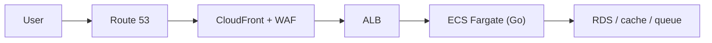
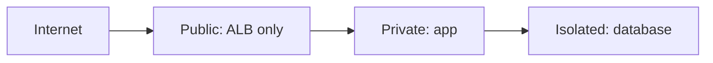
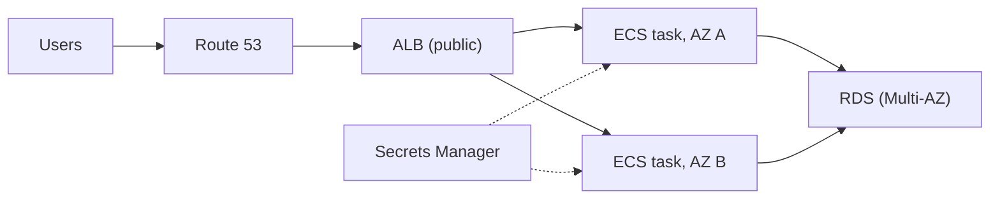
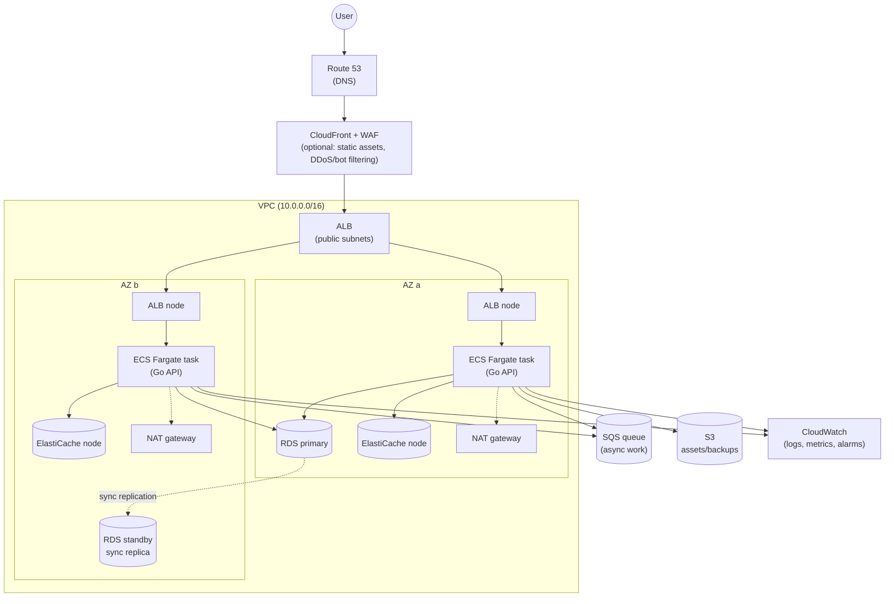
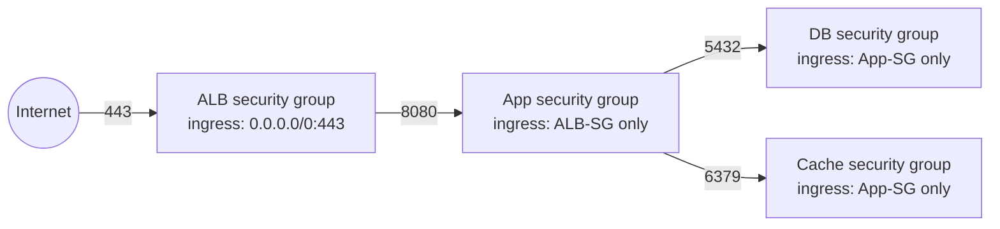
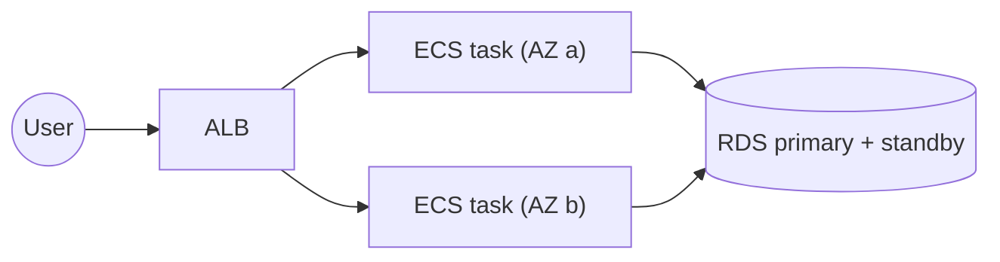

# Deploying a Go API on AWS (Reference Architecture)

> [!summary] TL;DR
> This is the end-to-end shape a production Go API takes on AWS: **Route 53 → CloudFront/WAF → ALB → ECS Fargate (your Go binary in a container) → RDS/ElastiCache/SQS**, spread across multiple Availability Zones, with CI/CD, secrets, observability, and a rollback path wired in from day one — not bolted on after the first outage.

> [!abstract] Core idea
> - The request path and the failure path are the same diagram: every box that can fail needs a health check and a fallback one hop earlier.
> - **Multi-AZ** means at least two independent copies of compute, and the database's standby, in physically separate data centers — losing one AZ should not page anyone.
> - **Security groups chain**: internet → ALB SG → app SG → DB SG, each only trusting the one before it, never the open internet.
> - Secrets and config are **injected at deploy time** (ECS task definition + Secrets Manager/SSM), never baked into the image.
> - Classic mistake: architecture diagrams that stop at "and then it's deployed," skipping the AZ layout, the security-group chain, and what happens when any one box dies.

## Start here: the basics 🟢

> [!info] How to read this note (pick your level)
> - 🟢 **New to this?** Read "From zero" below, then sections 1, 2 and 10 (why, mental model and the cheat sheet). Stop there, that is a full first pass.
> - 🟡 **Know the basics?** Add sections 3, 4, 5 and 6 (how it works, a worked example, options and trade-offs).
> - 🔴 **Interview / SDE-3 prep?** Add sections 7, 8 and 9 (production, deep dive and interview questions). Headings are tagged 🟢🟡🔴 so you always know where you are.

> [!note] Before this note
> - [[AWS 05 - ECS, Fargate and ECR]]: ECS services keep N container tasks running from images stored in ECR.
> - [[AWS 08 - RDS and Aurora]]: RDS runs the database with a standby in another AZ, and failover takes about 1-2 minutes.
> - [[AWS 06 - Load Balancing (ALB vs NLB)]]: an ALB spreads HTTP requests over healthy tasks in a target group.
> - [[Infrastructure as Code with Terraform]]: the whole setup is written as Terraform files and changed through reviewed plans.

**From zero, in 60 seconds** 🟢

This note puts all the AWS pieces together into one real setup for a Go API.
A request flows through a chain: name lookup, CDN and firewall, load balancer, your containers, then the database.



Every piece runs in at least 2 buildings (AZs), so one outage doesn't take you down.
Each layer only lets in traffic from the layer just in front of it.
Deploys, secrets, logs and rollback are planned from day one, not after the first outage.



The rest of this note is just these 3 questions:
1. What is the full request path and network layout?
2. How are security, config, scaling and deploys wired in?
3. What happens in a real failover, and what does it cost?


**The problem in one story.**
You built a Go API that works on your laptop.
Now real users must reach it over the internet, safely, and it must keep working if one machine or data center dies.
You need a front door, servers, a database, secrets, and logs, wired together correctly.
This note shows the standard AWS layout for that.

**Words you need first**

| Word | Plain meaning | Tiny example |
| --- | --- | --- |
| Container image | Your app packed with everything it needs to run | A Docker image in ECR |
| ECS / Fargate | AWS service that runs containers without you managing servers | Runs 3 copies of your API |
| ALB | Load balancer that spreads web traffic | Sends each request to a healthy task |
| VPC / subnet | Your private network and its slices | Public subnet for ALB, private for app |
| Security group | A firewall attached to a resource | DB only accepts the app's traffic |
| Availability Zone (AZ) | A separate data center group | Two AZs = survive one failing |
| Secrets Manager | Safe store for passwords and keys | DB password injected at start |
| NAT gateway | Lets private tasks call out to the internet without being reachable | Calling a payment API |
| Isolated subnet | A subnet with no route to the internet at all | Where RDS lives |
| Task definition | The blueprint ECS runs: image, CPU, memory, secrets | `checkout-api:42` |
| Target tracking | Auto scaling that keeps one number near a target | Keep CPU near 60% |
| Health check | A regular "are you alive?" request | `GET /healthz` returns 200 |

**Picture it**



**Analogy.** It's a restaurant: the host (ALB) seats guests, several cooks in two kitchens (tasks in two AZs) cook, the pantry (database) is locked so only cooks get in (security groups), and recipes with secret ingredients are handed out at shift start (secrets injection).
Where it breaks: a restaurant can't instantly clone cooks, but autoscaling can add tasks in about a minute.

**How the rest of this note builds up**

- First, why a reference architecture matters and the mental model of the request path (sections 1-2).
- Then how each box works: networking, security-group chain, ECS, ALB, RDS, secrets, observability (section 3).
- Then a full worked example and variants like Lambda or EKS (sections 4-6).
- Finally the SDE-3 deep dive: AZ failure, RPO/RTO, and production readiness (sections 7-9).

> [!tip] Remember
> Every box in the diagram can fail, so every box needs a copy in another AZ and a health check in front.

## 1. Why it exists 🟢

A single EC2 instance running a Go binary works until it doesn't: the instance's AZ has a power event, or the process crashes, or traffic triples during a sale, and there is no plan B.

This note is the plan B, assembled in advance: every AWS note this folder covers ([[AWS 01 - Core Concepts (Regions, AZs, Accounts, Shared Responsibility)]] through [[AWS 10 - CloudWatch]]) is one piece of this diagram, and this note is where they're wired together into something a team can actually run in production.

Concretely, this reference architecture answers five questions an interviewer — or an incident — will ask: Where does a request go on the happy path? What happens when one AZ disappears? Where do secrets come from? How does a bad deploy get undone? And roughly what does this cost per month?

### Real-life example: a checkout API for a sale 🟢

Picture the checkout API of a shopping app like Flipkart during a big sale.
Users reach it by name through Route 53, hit an ALB in two AZs, and land on Go containers in private subnets.
The containers talk to a Multi-AZ database and a cache that the internet cannot reach at all.
When traffic triples, more containers start; if one AZ fails, the other carries on and the database fails over in about a minute while the app retries.
A bad deploy is rolled back automatically by the ECS circuit breaker.

## 2. Mental model 🟢

Picture three concentric rings, each one only trusting the ring just inside it:

- **Edge ring (public):** Route 53 (DNS) → CloudFront + WAF (optional CDN/edge filtering) → ALB. This ring is the only one with a path from the open internet.
- **Compute ring (private):** ECS Fargate tasks running your Go binary, in private subnets with no direct internet route in or out (egress only via a NAT gateway).
- **Data ring (isolated):** RDS, ElastiCache, in subnets with no route to the internet at all, reachable only from the compute ring's security group.

Every arrow between rings is also a security-group rule and a potential health check. If you can draw the three rings and what crosses between them, you can draw this whole architecture from memory.

## Common beginner mistakes 🟢

- **Running everything in one AZ** → one building's outage takes the whole service down → spread the ALB, tasks and database over at least 2 AZs.
- **Opening the database security group to an IP range** → anything in that range can connect → allow only the app's security group.
- **Baking the DB password into the image or task env** → anyone who can read them sees it → reference it from Secrets Manager.
- **Pointing the ALB health check at a "deep" check** → one slow dependency pulls every task out of traffic → keep it to "is this task ready".
- **No retry around database connects** → every failover becomes a full outage until restart → retry with backoff for a bounded time.

## 3. How it works 🟡

> 🟢 → 🟡 **You now know** the three rings: public edge, private compute, isolated data. **Next we open the box**: the exact path of a request, the chain of security groups, where config and secrets come from, and how scaling, monitoring and deploys fit together.

### End-to-end request path and VPC/AZ layout

**In plain words:** follow one request from the user's browser to the database. Each box is a service with its own note.

**Step by step:**
1. The browser asks Route 53 for `api.example.com` and gets the ALB (through an alias record).
2. HTTPS reaches the ALB in public subnets in two AZs; it decrypts with the ACM certificate.
3. The ALB sends the request to a healthy Go task in a private subnet.
4. The task reads from the cache or queries RDS in an isolated subnet.
5. The answer goes back the same way. Outbound calls (say, to a payment API) leave through the NAT gateway.



Public subnets (one per AZ) hold only the ALB and NAT gateways.

Private subnets hold the ECS tasks: no public IP, outbound internet only through the NAT gateway (needed for pulling from public package registries or calling third-party APIs; **ECR and S3 are reached via VPC endpoints instead**, avoiding NAT entirely for those).

Isolated subnets hold RDS and ElastiCache, with no route to the internet in either direction. See [[AWS 03 - VPC Networking]] for subnet/route-table mechanics this diagram assumes.

### Security-group chain

**In plain words:** each layer's guard says "only let in the layer in front of me". The database only accepts the app; the app only accepts the ALB.

**Step by step:**
1. ALB group: allows 443 from anywhere.
2. App group: allows 8080 only from the ALB group.
3. DB group: allows 5432 only from the app group; cache group allows 6379 only from the app group.
4. A new task joins the app group, so it can reach the database without anyone editing rules.



Each security group names the **previous group as its allowed source**, not a CIDR range — so adding a new app task never requires editing the database's rules, and nothing can reach the database except traffic that already passed through the app tier.

A Network ACL at the subnet boundary is a second, stateless layer most teams leave at its default-allow setting and rely on security groups for the real enforcement, per the [[AWS 03 - VPC Networking]] discussion of SG vs NACL.

### Config, secrets, and health checks

**In plain words:** plain settings come from env vars, secrets come from Secrets Manager at start-up, and health URLs tell the ALB who is ready.

**Step by step:**
1. The task definition sets `LOG_LEVEL=info` as a plain environment variable.
2. It names the DB password's ARN in Secrets Manager; at task start, ECS fetches it with the execution role and injects it.
3. The container's own health check restarts it if the process hangs (liveness).
4. The ALB's `/healthz` check decides if the task gets traffic right now (readiness).

The ECS task definition pulls plain config from environment variables set directly in the task definition (region, log level, feature flags) and secrets (DB password, API keys) from AWS Secrets Manager or SSM Parameter Store **by reference** — the task execution role is granted `secretsmanager:GetSecretValue` for exactly those ARNs, and the value is injected into the container's environment at start time, never written to the image or to Terraform state in plaintext.

See [[Secrets Management]] for the rotation and access-pattern details this reuses rather than repeats.

Health checks exist at two layers with different meanings:
- **Liveness** (the container's own `HEALTHCHECK`, or ECS container health check): "is the process alive enough to keep running," restarts the container if it fails.
- **Readiness** (the ALB target health check against `/healthz`): "is this task ready to receive traffic right now," pulled out of rotation (not killed) if it fails — distinguishing the two matters because a task doing a slow startup migration check should fail readiness without being killed and restarted into a crash loop.

### Scaling, observability, CI/CD and rollback

**In plain words:** more tasks when busy, logs and metrics to CloudWatch, deploys by pipeline, and an automatic undo if health checks fail.

**Step by step:**
1. Requests per task climb past the target; ECS auto scaling adds tasks.
2. Every layer sends metrics and logs to CloudWatch; alarms page on-call.
3. A merge builds one image, pushes it to ECR, and updates the ECS service.
4. If the new tasks keep failing health checks, the circuit breaker rolls back.

ECS service auto scaling adds tasks on a target-tracking policy (CPU, or `ALBRequestCountPerTarget`); RDS read replicas and ElastiCache absorb read and cache load separately from compute scaling.

Every layer reports into CloudWatch — see [[AWS 10 - CloudWatch]] for the metrics/alarms/EMF mechanics this architecture relies on for its alarms and dashboards, and [[Distributed Tracing with OpenTelemetry]] for request-level tracing across the ALB → ECS → RDS hops.

CI/CD builds one container image per commit, pushes it to ECR, and updates the ECS service to a new task definition revision; [[CI-CD Pipelines (GitHub Actions for Go)]] covers the pipeline itself, [[Deployment Strategies - Rolling, Blue-Green, Canary]] covers how traffic shifts to the new revision, and [[Rollback and Safe Migrations]] covers undoing a bad deploy and the database-migration ordering that makes rollback safe in the first place.

## 4. Worked example 🟡

### Whiteboard version

The smallest version of this architecture that still has the right shape: one AZ pair, one ALB, one ECS service, one RDS instance with a standby — everything else in this note is detail layered onto this skeleton.



### A concrete failover: RDS Multi-AZ, numbers and code

**In plain words:** the database switches to its standby in about a minute. The Go code shows how to retry so users barely notice.

**Numbers (documented, AWS RDS User Guide):** an RDS Multi-AZ failover — triggered by an AZ outage, a patch, or a manual failover test — typically completes in **60-120 seconds**, during which the writer endpoint's DNS name resolves to nothing healthy.

A Go API holding a connection pool to that endpoint sees every in-flight query fail and every new connection attempt refused until DNS re-resolves to the promoted standby.

The fix is not "catch the error and give up" — it's a **bounded retry with backoff**, so the app self-heals the moment the standby promotes instead of needing a restart. This compiles and passes `go vet` and `go test -race` on Go 1.24:

```go
// Package resiliency models how a Go API's database layer should behave
// during an RDS Multi-AZ failover: the writer endpoint's DNS name does not
// change, but it stops resolving to a live primary for roughly 60-120
// seconds while the standby promotes. A single dial attempt fails during
// that window; the app must retry with backoff instead of crash-looping.
package resiliency

import (
	"context"
	"fmt"
	"math"
	"math/rand"
	"time"
)

// BackoffConfig controls ConnectWithBackoff's retry schedule.
type BackoffConfig struct {
	Base       time.Duration // delay before the first retry
	Max        time.Duration // cap on any single delay
	Multiplier float64       // growth factor applied per attempt
	Jitter     float64       // 0..1: fraction of the delay randomized
}

// DefaultBackoff is a reasonable schedule for reconnecting to RDS: start at
// 200ms, double each time, cap at 20s, and jitter by +/-20% so many task
// replicas reconnecting at once don't all hammer the new primary in lockstep.
func DefaultBackoff() BackoffConfig {
	return BackoffConfig{Base: 200 * time.Millisecond, Max: 20 * time.Second, Multiplier: 2, Jitter: 0.2}
}

func (c BackoffConfig) delay(n int, rng *rand.Rand) time.Duration {
	d := float64(c.Base) * math.Pow(c.Multiplier, float64(n-1))
	if d > float64(c.Max) {
		d = float64(c.Max)
	}
	jitter := d * c.Jitter * (rng.Float64()*2 - 1)
	d += jitter
	if d < 0 {
		d = 0
	}
	return time.Duration(d)
}

// ConnectWithBackoff retries dial until it succeeds, the context is
// cancelled, or maxAttempts is used up. sleep is injected so production
// code passes time.Sleep while tests pass a recorder and skip real waits.
func ConnectWithBackoff[T any](
	ctx context.Context,
	cfg BackoffConfig,
	maxAttempts int,
	sleep func(time.Duration),
	rng *rand.Rand,
	dial func(context.Context) (T, error),
) (T, int, error) {
	var zero T
	var lastErr error
	for attempt := 1; attempt <= maxAttempts; attempt++ {
		if err := ctx.Err(); err != nil {
			return zero, attempt - 1, err
		}
		conn, err := dial(ctx)
		if err == nil {
			return conn, attempt, nil
		}
		lastErr = err
		if attempt == maxAttempts {
			break
		}
		sleep(cfg.delay(attempt, rng))
	}
	return zero, maxAttempts, fmt.Errorf("after %d attempts: %w", maxAttempts, lastErr)
}
```

**What this code does, in plain words:** the code tries to connect, and on failure waits a little longer each time, up to a limit. The test makes the first 3 tries fail, like a failover, and checks the 4th succeeds.

Test, simulating the first 3 dials failing (the failover window) and the 4th succeeding (the standby is promoted and reachable):

```go
func TestConnectWithBackoffRetriesThroughASimulatedFailover(t *testing.T) {
	failures := 3
	attempts := 0
	dial := func(ctx context.Context) (*fakeConn, error) {
		attempts++
		if attempts <= failures {
			return nil, errors.New("dial tcp: connection refused")
		}
		return &fakeConn{id: attempts}, nil
	}
	var sleeps []time.Duration
	sleep := func(d time.Duration) { sleeps = append(sleeps, d) }
	rng := rand.New(rand.NewSource(1))

	conn, used, err := ConnectWithBackoff(context.Background(), DefaultBackoff(), 10, sleep, rng, dial)
	if err != nil {
		t.Fatalf("ConnectWithBackoff: %v", err)
	}
	if used != 4 {
		t.Fatalf("attempts used = %d, want 4", used)
	}
	if conn == nil || conn.id != 4 {
		t.Fatalf("conn = %+v, want the 4th dial's connection", conn)
	}
	if len(sleeps) != 3 {
		t.Fatalf("recorded %d sleeps, want 3 (one before each retry)", len(sleeps))
	}
}

func TestConnectWithBackoffGivesUpAfterMaxAttempts(t *testing.T) {
	dial := func(ctx context.Context) (*fakeConn, error) { return nil, errors.New("connection refused") }
	_, used, err := ConnectWithBackoff(context.Background(), DefaultBackoff(), 5, func(time.Duration) {}, rand.New(rand.NewSource(2)), dial)
	if err == nil {
		t.Fatal("want an error: dial always fails")
	}
	if used != 5 {
		t.Fatalf("attempts used = %d, want 5", used)
	}
}
```

Both tests pass (`go test -race ./resiliency/...`), including a third test that confirms the retry loop stops within one attempt of context cancellation (e.g. the task receiving ECS's `SIGTERM` during a deploy) rather than continuing to retry into a shutdown — the cancellation check runs at the top of each attempt, so at most one more dial-and-sleep happens after `ctx` is cancelled, not an unbounded number.

The schedule itself (200ms, 400ms, 800ms, ... capped at 20s, ±20% jitter) matters as much as the retry count: without jitter, every task in the service reconnects in lockstep and re-creates the exact connection storm the backoff was meant to avoid.

### Rough monthly cost (estimate, ap-south-1, 2026-11, illustrative traffic)

**In plain words:** a ballpark bill. The load balancer, NAT gateway and database are the big items.

| Component | Shape | Estimated monthly cost |
| --- | --- | --- |
| ECS Fargate | 4 tasks × 0.5 vCPU / 1 GB, 24/7 | ~$60 |
| ALB | 1 ALB, moderate traffic (LCUs) | ~$20 |
| NAT gateway | 2 (one per AZ), plus per-GB data processed | ~$65 + data |
| RDS (Multi-AZ, db.t4g.medium) | 1 primary + 1 standby, 100 GB gp3 | ~$140 |
| ElastiCache (cache.t4g.micro ×2) | Primary + replica | ~$25 |
| CloudWatch | Logs + custom metrics, moderate volume | ~$15-40 (see [[AWS 10 - CloudWatch]] cost traps) |
| S3 + CloudFront | Assets + egress, light traffic | ~$10-20 |
| **Total** | | **~$335-370/month (estimate)** |

**The NAT gateway trap:** a NAT gateway bills per-GB processed in addition to its hourly cost, and it's easy to miss that ECR image pulls and any outbound call route through it unless VPC endpoints are set up for ECR, S3, and CloudWatch Logs — those endpoints cost a small hourly fee each but eliminate the far larger per-GB NAT charge for that traffic, and are worth adding before, not after, the first surprising bill.

### AWS service glossary (quick reference)

Every service in the diagrams above has its own dedicated note; this table is only a one-line map from name to purpose and where to read more.

| Service | One-line purpose | Detail |
| --- | --- | --- |
| EC2 | Virtual servers you manage directly | [[AWS 04 - Compute Choices - EC2, ECS-Fargate, EKS, Lambda]] |
| ECS / Fargate | Runs your containers without managing servers | [[AWS 05 - ECS, Fargate and ECR]] |
| ECR | Private Docker image registry | [[AWS 05 - ECS, Fargate and ECR]] |
| ALB | Layer-7 load balancer, routes by host/path, runs health checks | [[AWS 06 - Load Balancing (ALB vs NLB)]] |
| RDS | Managed relational database (Multi-AZ, backups, PITR) | [[AWS 08 - RDS and Aurora]] |
| ElastiCache | Managed Redis/Memcached cache | [[AWS 08 - RDS and Aurora]] (cache sizing is covered alongside RDS failover) |
| S3 | Object storage for assets, backups, static files | [[AWS 07 - S3]] |
| CloudWatch | Logs, metrics, alarms, traces | [[AWS 10 - CloudWatch]] |
| IAM | Identities, roles, and permission policies | [[AWS 02 - IAM]] |
| Route 53 | DNS, including health-check-based failover records | [[AWS 09 - Route 53 and ACM]] |
| ACM | Free TLS certificates for ALB/CloudFront listeners | [[AWS 09 - Route 53 and ACM]] |

### Deploy-failure troubleshooting table

These are the failures that show up first when a new service goes to this architecture for the first time — before any of the harder failure modes in the sections below.

| Symptom | Likely cause | Fix |
| --- | --- | --- |
| ECS task cycles `PENDING` → `STOPPED` immediately | Container listens on a different port than the task definition/target group expects | Match `containerPort` in the task definition and the ALB target group's port |
| Task starts but ALB never marks it healthy | Health-check path returns non-2xx, or the container isn't listening yet when the first check fires | Fix the `/healthz` route; increase `startPeriod`/health-check grace time |
| Task stuck `PENDING`, no logs appear at all | Missing required environment variable or secret ARN, so the container exits before writing anything | Check the stopped task's "stopped reason" in the ECS console/CLI, not just CloudWatch Logs |
| ALB returns 503 with healthy-looking tasks | Security group blocks ALB → app traffic on the container port | Confirm the app security group's ingress rule names the ALB security group, not a stale CIDR |
| ECS service never reaches steady state, events show `CannotPullContainerError` | Task execution role lacks ECR pull permission, or the image tag doesn't exist in ECR | Grant `ecr:GetDownloadUrlForLayer`/`ecr:BatchGetImage` to the execution role; confirm the CI pipeline actually pushed that tag |

## 5. Variants and comparison 🟡

| Variant | Compute | Use when | Trade-off |
| --- | --- | --- | --- |
| This reference (ECS Fargate) | Serverless containers | Default for a team without deep Kubernetes needs | Less control over the underlying host; AWS-specific |
| EKS instead of ECS | Kubernetes on AWS | Team already runs Kubernetes elsewhere, wants portability | More operational surface (control plane, node groups, add-ons); see [[Kubernetes Fundamentals]] |
| Lambda instead of ECS | Functions, event-driven | Spiky/low-average traffic, short request durations | Cold starts, 15-minute max duration, different debugging model |
| Single-AZ (no standby) | Same, minus the second AZ | Dev/staging environments only | An AZ outage is a full outage; never acceptable for production |
| Add CloudFront in front of the ALB | Edge CDN + WAF | Public API with static assets, or needing DDoS/bot protection at the edge | Extra cache-invalidation and WAF-rule complexity |
| Multi-region active-passive | A second full stack in another region | RPO/RTO requirements stricter than Multi-AZ provides | Cross-region replication lag, much higher cost and complexity |

## 6. Trade-offs and when not to use 🟡

- This architecture is overbuilt for a side project or an internal tool with five users — a single EC2 instance (or even Lambda) behind a simple ALB is cheaper and simpler until there's a real availability requirement to justify the NAT gateways, Multi-AZ RDS, and the rest.
- Multi-AZ doubles your compute and database cost for availability, not performance — don't expect it to make anything faster, only more survivable.
- The security-group chain (ALB → app → DB) adds a layer of indirection that makes local reproduction of "why can't my service reach the database" genuinely harder to debug than a flat network; VPC Reachability Analyzer and clear naming conventions earn their keep here.
- CloudFront and WAF are optional for an internal API with no public static assets and no need for edge-level bot filtering — adding them without a reason to is extra surface to operate and pay for.

## 7. In production 🔴

> 🟡 → 🔴 **You now know** the full request path, the security-group chain, config and secrets, scaling, monitoring and rollback, plus how the app survives a database failover. **Next is the advanced part**: what breaks in real deployments, what to watch, and the deeper design choices interviewers probe.


- **Real systems:** this Route 53 → ALB → ECS Fargate → RDS/ElastiCache shape is the default AWS reference architecture referenced across AWS's own Well-Architected guidance and is what most mid-size SaaS companies run before any team-specific Kubernetes or multi-region investment; the SQS queue is the standard escape hatch for anything that shouldn't block the request (emails, webhooks, image processing).
- **Failure modes → fixes:**
  - **AZ loss:** the ALB and ECS service's tasks in the surviving AZ keep serving; RDS fails over to its standby in 60-120s (see the worked example above for the Go-side retry behavior this requires) — drilled by actually stopping one AZ's tasks in a game day, not just trusting the diagram.
  - **Bad deploy:** the ECS deployment circuit breaker detects tasks failing their health check mid-rollout and auto-rolls-back to the last healthy task definition revision; see [[Rollback and Safe Migrations]] for the database-migration ordering that must hold for this to be safe.
  - **Database failover:** covered above; the same backoff pattern should wrap every external call this service's dependents might make to it, not just this service's own calls to RDS.
  - **NAT gateway data spike:** a misbehaving dependency or a missed VPC endpoint can turn routine traffic into a large, unexpected bill; alarm on NAT gateway `BytesOutToDestination` the same way you'd alarm on an error rate.
- **What to monitor:** ALB target health (how many tasks are actually `healthy`), p50/p95/p99 latency at the ALB and at the database, ECS service running-vs-desired task count, RDS replica lag and failover events, NAT gateway bytes processed, and CloudWatch's own ingest volume (see [[AWS 10 - CloudWatch]]).
- **Backups and DR:** RDS automated backups + point-in-time recovery (PITR) cover "restore to any second in the last N days"; cross-region snapshot copies cover "the whole region is gone," with an explicit **RPO** (how much data you can afford to lose — typically bounded by snapshot/replication frequency) and **RTO** (how long restoring takes) written down and tested, not assumed.

  S3 versioning plus cross-region replication covers object storage the same way.
- **Dev/staging/prod parity:** the same Terraform modules (see [[Infrastructure as Code with Terraform]]) provision all three environments with different variable values (instance sizes, `desired_count`, Multi-AZ on/off for dev) — never a hand-maintained, drifted-apart staging environment that "mostly" matches prod.

## 8. Deep dive 🔴

- **Why the standby doesn't take read traffic:** an RDS Multi-AZ standby (the classic, non-cluster form) is a synchronous replication target purely for failover, not a readable replica — reading from it isn't possible.

  If you need both HA failover and extra read capacity, add asynchronous **read replicas** alongside the Multi-AZ pair, or move to **Multi-AZ DB clusters**, which do expose a readable secondary; see [[AWS 08 - RDS and Aurora]] for the full comparison.
- **Why ECR/S3/Logs get VPC endpoints but general internet access still needs a NAT gateway:** a VPC endpoint is a private, in-VPC route to one specific AWS service's API, with no public IP or internet gateway involved — cheaper and more isolated, but only exists for services AWS has published an endpoint for.

  Anything the app calls that isn't an AWS service (a third-party payment API, a public package registry at build time) has no endpoint and must route out through the NAT gateway.
- **Readiness vs liveness under load, not just at startup:** a task under heavy GC pressure or a database connection-pool exhaustion event can still answer a trivial liveness ping while genuinely unable to serve real requests — a readiness check worth trusting exercises a cheap but real dependency (e.g. `SELECT 1` with a short timeout), not just "process is running."
- **Cost vs availability isn't binary:** Single-AZ NAT (one gateway instead of two) halves the NAT cost at the price of all AZ-b egress traffic crossing an AZ boundary to reach AZ-a's NAT gateway during normal operation, and losing egress entirely if AZ-a goes down — a real trade-off some teams accept for non-critical environments and reject for production.

## 9. Interview questions 🔴

> [!question]- Walk me through what happens to a request from DNS lookup to database read.
> Route 53 resolves the domain to the ALB (optionally via CloudFront first). The ALB's listener matches the request to a target group and forwards it to a healthy ECS Fargate task in one of the private subnets.
>
> The Go process handles the request, querying RDS through the database security group (only reachable from the app security group) and optionally reading from ElastiCache first. Logs and metrics flow to CloudWatch throughout.

> [!question]- An entire Availability Zone goes dark. What keeps the service up, and what doesn't?
> The ALB stops routing to the dead AZ's targets automatically via health checks; the surviving AZ's ECS tasks keep serving (assuming `desired_count` and autoscaling account for one AZ's capacity disappearing).
>
> RDS fails over to its standby in the surviving AZ within roughly 60-120 seconds, during which the app must retry connections with backoff rather than treat the first failure as fatal.
>
> What doesn't survive automatically: anything pinned to a single AZ by configuration mistake, like a Multi-AZ-disabled RDS instance or a security group that only allowlists one AZ's subnet.

> [!question]- Where do database credentials live, and how do they get into the running container?
> Not in the image, not in the task definition's plain environment variables, and not in Terraform state in plaintext.
>
> They live in Secrets Manager (or SSM Parameter Store), referenced by ARN in the ECS task definition's `secrets` block; the task execution role is granted read access to exactly that secret, and ECS injects the resolved value into the container's environment at start time.

> [!question]- Trap: "We have an ALB and auto scaling, so we're highly available." What's missing from that claim?
> Compute HA alone doesn't cover the database: if RDS isn't Multi-AZ, losing its AZ takes down every app task's only data store regardless of how many app replicas exist across AZs. High availability has to be designed layer by layer — compute, database, cache, and the network path between them — not assumed from one layer's redundancy.

> [!question]- Why does a NAT gateway bill matter here, and how do you avoid most of it?
> NAT gateways charge both an hourly fee and per-GB of data processed, and by default all of a private-subnet task's outbound traffic — including pulling container images from ECR — routes through it.
>
> VPC endpoints for ECR, S3, and CloudWatch Logs give those services a private, in-VPC path that bypasses NAT entirely for that traffic, which is usually the majority of it.

> [!question]- How does a bad deploy get detected and undone automatically?
> The ECS deployment circuit breaker watches new tasks' health checks during a rolling deployment; if too many fail, it stops the rollout and rolls the service back to the previous task definition revision without a human needing to intervene first, though an alarm should still page so someone investigates why.
>
> See [[Rollback and Safe Migrations]] for the added care a database migration needs so this automatic rollback doesn't leave schema and code out of sync.

> [!question]- What's your RPO and RTO for this architecture, and how would you lower them?
> RPO (how much data you can lose) is bounded by your backup/replication frequency — RDS automated backups with PITR gets this down to seconds for in-region loss, but cross-region DR is bounded by your cross-region snapshot or replication cadence, often minutes to hours.
>
> RTO (how long recovery takes) is bounded by how long restoring a snapshot or promoting a cross-region replica takes, plus DNS cutover time.
>
> Lowering either costs more: tighter backup cadence, a warm cross-region standby instead of cold snapshots, and lower Route 53 TTLs ahead of time so a DNS failover actually takes effect quickly.

## 10. Cheat sheet 🟢

- Request path: Route 53 → (CloudFront/WAF) → ALB → ECS Fargate (Go) → RDS/ElastiCache/SQS.
- Multi-AZ means at least two AZs for compute and a synchronous standby for the database; it buys survivability, not speed.
- Security groups chain ALB → app → DB, each trusting only the group before it, never a raw CIDR for the backend tiers.
- Secrets come from Secrets Manager/SSM by reference, injected at ECS task start, never baked into the image.
- Liveness restarts a stuck process; readiness pulls a not-yet-ready task out of the ALB's rotation — they are not the same check.
- RDS Multi-AZ failover takes ~60-120s; the app must retry with backoff and jitter through that window, not fail hard.
- VPC endpoints for ECR/S3/Logs avoid most NAT gateway cost; the NAT gateway is the most commonly underestimated line item.
- RPO/RTO are explicit numbers you test (a failover drill), not assumptions you hope are true.

## Self-check 🟢🟡

🟢 Easy

> [!question]- Which ring is the only one reachable from the internet?
> The edge ring: Route 53, the optional CDN/WAF and the ALB.

> [!question]- Where does the DB password come from?
> Secrets Manager (or SSM), injected into the task at start.

> [!question]- Why run in two AZs?
> So one AZ failing does not take the service down.

🟡 Medium

> [!question]- Why does the DB security group name the app security group instead of an IP range?
> Only traffic that passed through the app tier can connect, and new tasks need no rule edits.

> [!question]- What does the Go app need to survive a 60-120 s RDS failover?
> Bounded retry with backoff on connects, so it reconnects once the standby is promoted.

> [!question]- What is the difference between the container health check and the ALB health check?
> The container check restarts a dead process; the ALB check only removes a task from traffic.

## Links

- **Before this:** [[AWS 01 - Core Concepts (Regions, AZs, Accounts, Shared Responsibility)]], [[AWS 02 - IAM]], [[AWS 03 - VPC Networking]], [[AWS 04 - Compute Choices - EC2, ECS-Fargate, EKS, Lambda]], [[AWS 05 - ECS, Fargate and ECR]], [[AWS 06 - Load Balancing (ALB vs NLB)]], [[AWS 07 - S3]], [[AWS 08 - RDS and Aurora]], [[AWS 09 - Route 53 and ACM]], [[AWS 10 - CloudWatch]], [[Infrastructure as Code with Terraform]]
- **Next:** [[CI-CD Pipelines (GitHub Actions for Go)]], [[Deployment Strategies - Rolling, Blue-Green, Canary]], [[Rollback and Safe Migrations]]
- **Compare with:** [[Kubernetes Fundamentals]] (EKS as the compute layer instead of ECS Fargate), [[Secrets Management]] (the full secrets lifecycle this note only injects), [[Containerizing Go Services]] (what's actually running inside each ECS task)

### Watch on YouTube

- [Go and AWS - Code and Deploy a Serverless API](https://www.youtube.com/watch?v=zHcef4eHOc8) · freeCodeCamp.org · 104 min · 93,187 views
- [Deploying Fleet on AWS using our Terraform reference architecture](https://www.youtube.com/watch?v=vMcP0tM6g_o) · Fleet · 11 min · 1,167 views
