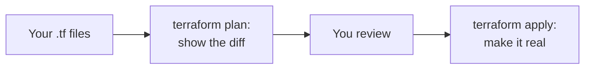
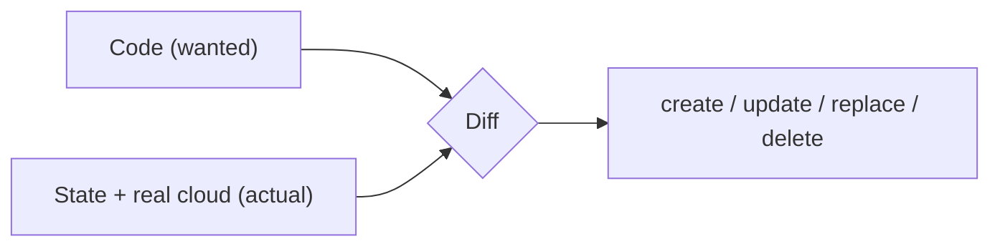
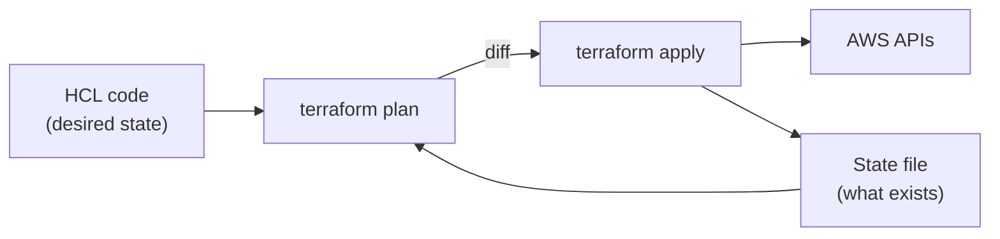
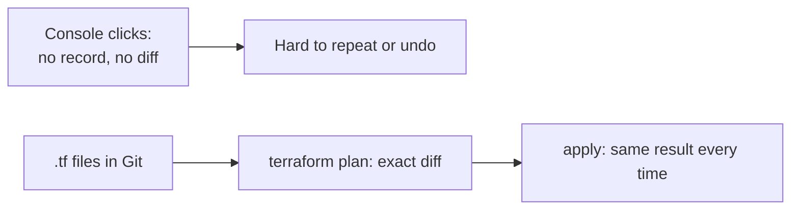
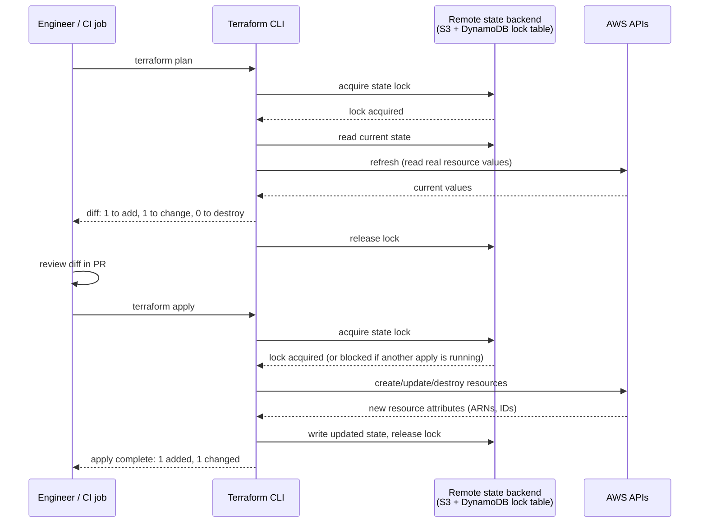
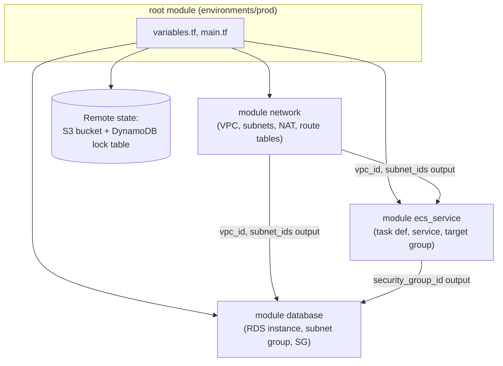

# Infrastructure as Code with Terraform

> [!summary] TL;DR
> Terraform lets you describe infrastructure (a VPC, an ECS service, an RDS instance) as declarative text files, then computes a **diff** between that text and the real world before changing anything. You review the diff (`terraform plan`), then apply it (`terraform apply`); Terraform tracks what it created in a **state file** so the next plan knows what already exists.

> [!abstract] Core idea
> - You write HCL describing the **desired end state**; Terraform figures out the steps to get there, not the other way around.
> - The **state file** is Terraform's memory of what it created — lose it or let two people apply from different copies of it, and Terraform's diff becomes wrong.
> - `plan` is a dry run; nothing changes until `apply`. Always read the plan.
> - **Modules** are reusable, parameterized bundles of resources (e.g. "an ECS service" as one module instantiated per microservice).
> - Classic mistake: running `apply` without a remote, locked state backend, so two engineers (or two CI runs) stomp on each other's state.

## Start here: the basics 🟢

> [!info] How to read this note (pick your level)
> - 🟢 **New to this?** Read "From zero" below, then sections 1, 2 and 10 (why, mental model and the cheat sheet). Stop there, that is a full first pass.
> - 🟡 **Know the basics?** Add sections 3, 4, 5 and 6 (how it works, a worked example, options and trade-offs).
> - 🔴 **Interview / SDE-3 prep?** Add sections 7, 8 and 9 (production, deep dive and interview questions). Headings are tagged 🟢🟡🔴 so you always know where you are.

> [!note] Before this note
> - [[AWS 01 - Core Concepts (Regions, AZs, Accounts, Shared Responsibility)]]: AWS resources (VPCs, load balancers, databases) live in an account and a Region, and you create them through AWS's APIs.
> - [[CI-CD Pipelines (GitHub Actions for Go)]]: every merge runs an automated pipeline with checks and an approval gate before production.

**From zero, in 60 seconds** 🟢

Setting up servers, databases and networks by clicking in a web console is slow and nobody remembers what was clicked.
**Infrastructure as code** means writing your setup in text files, kept in git like normal code.
**Terraform** reads those files, compares them with what really exists, and shows you the difference before changing anything.



Terraform keeps a **state file**: its memory of what it created. That is how the next plan knows what already exists.



The rest of this note is just these 3 questions:
1. How do plan, apply and state work together?
2. What are resources, data sources, modules and variables?
3. How do you spot a dangerous change (replace or delete) before it happens?


**The problem in one story.**
You built your AWS setup by clicking around the console.
Months later nobody remembers which settings were chosen, and building a copy for staging takes a week of guessing.
With Terraform you write the setup down as code, and a tool builds it the same way every time.
Changes go through code review like any other code.

**Words you need first**

| Word | Plain meaning | Tiny example |
| --- | --- | --- |
| Infrastructure | The servers, networks and databases your app runs on | A VPC, an ALB, an RDS instance |
| HCL | Terraform's config language | `resource "aws_s3_bucket" "logs" {}` |
| Resource | One thing Terraform manages | One S3 bucket |
| Provider | A plugin that talks to a cloud's API | The `aws` provider |
| State file | Terraform's record of what it built | `terraform.tfstate` |
| Plan / apply | Preview changes, then make them | `terraform plan`, `terraform apply` |
| Module | A reusable bundle of resources | One "ECS service" module per microservice |
| Lock | Stops two people changing state at once | DynamoDB or S3 lock |
| Drift | When the real cloud no longer matches what Terraform recorded | Someone edited a rule in the console |
| Data source | Something Terraform only reads, never creates | The company's existing VPC |
| Replace | Delete and recreate a resource because it cannot be changed in place | `-/+` on a database = data risk |
| Remote backend | Keeping the state file in shared storage instead of a laptop | An S3 bucket |
| IaC (infrastructure as code) | Describing servers and networks in files kept in Git | `main.tf` |

**Picture it**



**Analogy.** Terraform is an architect's blueprint plus a builder: you change the blueprint, the builder compares it to the house and only does the difference.
Where it breaks: a builder can see the house, but Terraform mostly trusts its state file, so a lost or out-of-date state file means it misjudges what exists.

**How the rest of this note builds up**

- First, why IaC exists and the desired-state mental model (sections 1-2).
- Then how it works: providers, state, plan/apply, remote backends and locking, modules (section 3).
- Then a full worked example and comparisons with other tools (sections 4-6).
- Finally the SDE-3 deep dive: state drift, refactoring, and running Terraform safely in CI (sections 7-9).

> [!tip] Remember
> Write what you want, read the plan, then apply; the state file is Terraform's memory, so guard it.

## 1. Why it exists 🟢

Before IaC, "provision an ECS service with its own ALB target group, RDS instance, and security groups" meant a person clicking through the AWS console, or a shell script calling the AWS CLI dozens of times with no way to know what already existed.

Two problems follow: nobody can diff "what we have" against "what we intended," and tearing down an environment means hunting down every resource by hand.

Terraform fixes both. You write what the 3 pieces should look like once:

```hcl
resource "aws_ecs_service" "api" {
  name            = "checkout-api"
  cluster         = aws_ecs_cluster.main.id
  task_definition = aws_ecs_task_definition.api.arn
  desired_count   = 3
  launch_type     = "FARGATE"
}
```

Run `terraform plan` and Terraform tells you, before touching anything: "this will create 1 ECS service, 1 target group, 0 changes to the VPC." Change `desired_count` to `5` and plan again, and it says: "this will update 1 resource (desired_count: 3 → 5), 0 creates, 0 destroys." That diff-before-you-touch-anything property is what makes infrastructure changes reviewable in a pull request the same way application code is.



### Real-life example: a new city environment in a day 🟢

Imagine a delivery company like Swiggy wants a full copy of its setup for load testing before a big sale.
By hand, that means hundreds of console clicks for networks, load balancers and databases, and something is always missed.
With Terraform, the team reuses the same modules with a different environment name, reads the plan, and applies it in under an hour.
After the test, one destroy command removes everything, so nothing is left running up the bill.
Every change is a reviewed pull request, so they always know who changed what and why.

## 2. Mental model 🟢

Terraform is a **reconciliation loop you run by hand**, not a continuously running controller like a Kubernetes operator:

1. Your `.tf` files describe the desired state.
2. The **state file** (`terraform.tfstate`) is Terraform's record of the actual state it last knew about, per resource.
3. `terraform plan` = diff(desired, state) refined by a live read of the actual cloud API (a "refresh"), producing a list of creates/updates/destroys.
4. `terraform apply` executes that diff, then writes the new reality back into the state file.

If someone changes a resource outside Terraform (clicks a button in the AWS console), the next `plan` shows that as **drift**: Terraform will plan to change it back unless you import the new reality or adjust your `.tf` files to match.

## Common beginner mistakes 🟢

- **Keeping state on a laptop when a team shares the infrastructure** → no locking, and two applies can corrupt it → use a remote backend with locking.
- **Clicking changes in the console** → the next plan tries to undo them (drift) → make every change in `.tf` files.
- **Applying without reading the plan** → a hidden `replace` can delete a database → always read the add/change/destroy line.
- **Committing secrets in `.tfvars`** → passwords end up in Git → read them from Secrets Manager or SSM at apply time.
- **Using `count` for a list that changes** → removing one item shifts the others and Terraform recreates them → use `for_each` with stable keys.

## 3. How it works 🟡

> 🟢 → 🟡 **You now know** that Terraform keeps your infrastructure in files, shows a plan, and applies it. **Next we open the box**: how state and locking keep a team safe, the building blocks (resources, data sources, modules, variables), and the three kinds of change a plan can contain.

### The core workflow and where state locking matters

**In plain words:** write, plan, apply. The state file is locked during apply so two people can't change things at once.

**Step by step:**
1. You change `desired_count` from 3 to 5 in a `.tf` file and open a pull request.
2. CI runs `terraform plan`: it locks the state in S3, reads it, checks the real AWS values, and prints "1 to change".
3. A reviewer reads the plan and approves.
4. `terraform apply` locks the state again, makes the change in AWS, writes the new state, and unlocks.
5. If a second apply starts meanwhile, it waits or fails instead of colliding.



If the lock is already held (another `apply` is mid-flight), the second run blocks or fails instead of racing against the first — this is the entire reason a remote backend with locking exists.

Local state files (the default, `terraform.tfstate` on disk) have no locking, which is fine for a solo experiment and actively dangerous the moment a second person or a CI pipeline touches the same infrastructure.

### Resources, data sources, modules, and variables

**In plain words:** resource = something Terraform creates. Data source = something it only reads. Module = a reusable bundle. Variable = an input.

**Step by step:**
1. A `network` module creates the VPC and subnets and outputs their IDs.
2. An `ecs_service` module takes those IDs as variables and creates the service and target group.
3. A `database` module takes the same IDs plus the service's security group and creates RDS.
4. A data source reads a VPC another team owns, without ever changing it.
5. The prod folder calls all three modules with prod values; staging calls them with staging values.

- A **resource** block (`resource "aws_ecs_service" "api" {...}`) is one thing Terraform manages end-to-end: create, update in place where possible, or destroy-and-recreate when a change can't be done in place (e.g. changing an RDS instance's `engine` family).
- A **data source** (`data "aws_vpc" "default" {...}`) reads something Terraform does *not* manage — useful for referencing a VPC or AMI that another team or process owns.
- A **module** is a directory of `.tf` files with declared input `variable`s and output `output`s, instantiated with `module "api" { source = "./modules/ecs-service" ... }`. Modules are how a reference architecture (VPC + ALB + ECS service + RDS) becomes a parameterized, reusable unit instead of copy-pasted HCL per environment.
- **Workspaces** (`terraform workspace new staging`) let one set of `.tf` files manage multiple state files (dev/staging/prod) from the same code; many teams instead prefer fully separate directories/backends per environment for a clearer blast radius, and reserve workspaces for things like per-feature-branch ephemeral environments.



### `plan` and `apply`, and the three change kinds

**In plain words:** each change is create, update in place, or replace. "Replace" deletes and recreates, so watch for it on databases.

**Step by step:**
1. New log group in the files → plan shows `+` create.
2. `desired_count` 3 → 5 → plan shows `~` update in place, no downtime.
3. Database storage type changed → plan shows `-/+` replace: the old database is deleted and a new one made.
4. Your CI rule: creates and updates may go ahead; any replace or destroy of stateful things waits for a human.

Every resource change in a plan is one of: **create**, **update in place**, or **replace** (destroy then create — shown as `-/+` and flagged because it usually means downtime or data loss for stateful resources).

A CI gate should always stop and ask a human before auto-applying a plan containing a replace of a database, not just any plan at all.

## 4. Worked example 🟡

### Whiteboard version

The smallest useful unit: a variable, a resource, and an output, wired together.

```hcl
variable "image_tag" {
  type = string
}

resource "aws_ecs_task_definition" "api" {
  family                   = "checkout-api"
  requires_compatibilities = ["FARGATE"]
  network_mode             = "awsvpc"
  cpu                      = "256"
  memory                   = "512"
  container_definitions = jsonencode([{
    name  = "api"
    image = "123456789012.dkr.ecr.ap-south-1.amazonaws.com/checkout-api:${var.image_tag}"
    portMappings = [{ containerPort = 8080 }]
  }])
}

output "task_definition_arn" {
  value = aws_ecs_task_definition.api.arn
}
```

The full version below is a representative module for the reference architecture: a VPC-aware ECS service behind an ALB target group, parameterized so one module serves every environment.

```hcl
# modules/ecs_service/variables.tf
variable "service_name"       { type = string }
variable "image"              { type = string }
variable "cluster_arn"        { type = string }
variable "vpc_id"             { type = string }
variable "private_subnet_ids" { type = list(string) }
variable "target_group_arn"   { type = string }
variable "alb_security_group_id" { type = string }

variable "desired_count" {
  type    = number
  default = 2
}

variable "cpu" {
  type    = number
  default = 256
}

variable "memory" {
  type    = number
  default = 512
}

# modules/ecs_service/main.tf
resource "aws_security_group" "app" {
  name   = "${var.service_name}-sg"
  vpc_id = var.vpc_id

  ingress {
    from_port       = 8080
    to_port         = 8080
    protocol        = "tcp"
    security_groups = [var.alb_security_group_id]
  }
  egress {
    from_port   = 0
    to_port     = 0
    protocol    = "-1"
    cidr_blocks = ["0.0.0.0/0"]
  }
}

resource "aws_ecs_task_definition" "this" {
  family                   = var.service_name
  requires_compatibilities = ["FARGATE"]
  network_mode             = "awsvpc"
  cpu                      = tostring(var.cpu)
  memory                   = tostring(var.memory)
  # aws_iam_role.execution / .task are defined in iam.tf (omitted here for
  # length): the execution role lets the ECS agent pull the image and ship
  # logs, the task role is what the running Go process can call AWS as.
  execution_role_arn       = aws_iam_role.execution.arn
  task_role_arn            = aws_iam_role.task.arn

  container_definitions = jsonencode([{
    name      = var.service_name
    image     = var.image
    essential = true
    portMappings = [{ containerPort = 8080, protocol = "tcp" }]
    healthCheck = {
      command     = ["CMD-SHELL", "curl -f http://localhost:8080/healthz || exit 1"]
      interval    = 30
      timeout     = 5
      retries     = 3
      startPeriod = 10
    }
    logConfiguration = {
      logDriver = "awslogs"
      options = {
        "awslogs-group"         = "/ecs/${var.service_name}"
        "awslogs-region"        = "ap-south-1"
        "awslogs-stream-prefix" = "ecs"
      }
    }
  }])
}

resource "aws_ecs_service" "this" {
  name            = var.service_name
  cluster         = var.cluster_arn
  task_definition = aws_ecs_task_definition.this.arn
  desired_count   = var.desired_count
  launch_type     = "FARGATE"

  network_configuration {
    subnets          = var.private_subnet_ids
    security_groups  = [aws_security_group.app.id]
    assign_public_ip = false
  }

  load_balancer {
    target_group_arn = var.target_group_arn
    container_name    = var.service_name
    container_port    = 8080
  }

  deployment_circuit_breaker {
    enable   = true
    rollback = true
  }

  lifecycle {
    ignore_changes = [desired_count] # let application autoscaling own this value
  }
}
```

### Go: gating a CI apply on what the plan actually changes

**In plain words:** Go code that reads the plan as JSON and blocks the pipeline if anything would be destroyed.

The reference architecture's CI/CD pipeline (see [[CI-CD Pipelines (GitHub Actions for Go)]]) runs `terraform plan -out=plan.tfplan`, then `terraform show -json plan.tfplan` to get a machine-readable plan.

A Go step parses that JSON to decide whether the change needs a human: any create/update auto-applies, but a delete or replace of a stateful resource (the database, its subnet group) must pause for approval, even in an otherwise fully automated pipeline.

It compiles and passes `go vet` and `go test -race` on Go 1.24.

**What this code does, in plain words:** it reads the JSON plan, sorts every change into create, update, delete or replace, and says "needs a human" if any database-like resource would be deleted or replaced. The test feeds a sample plan with one of each and checks the counts and the verdict.

```go
// Package tfplan parses the JSON that `terraform show -json <planfile>`
// produces and summarizes it, the way a CI gate would before `terraform
// apply` runs unattended.
package tfplan

import (
	"encoding/json"
	"fmt"
)

// ResourceChange is one entry in a Terraform plan's "resource_changes" array.
type ResourceChange struct {
	Address string `json:"address"`
	Type    string `json:"type"`
	Change  struct {
		// Actions is one of: ["no-op"], ["create"], ["update"], ["delete"],
		// or ["delete", "create"] / ["create", "delete"] for a replace.
		Actions []string `json:"actions"`
	} `json:"change"`
}

// Plan is the subset of `terraform show -json` this package reads.
type Plan struct {
	ResourceChanges []ResourceChange `json:"resource_changes"`
}

// Summary counts a plan's resource changes by kind and by resource type.
type Summary struct {
	Create  int
	Update  int
	Delete  int
	Replace int
	ByType  map[string]int // resource type -> count of non-no-op changes

	// Destructive lists the addresses of resources the plan would delete
	// or replace, so a human can look twice before an unattended apply.
	Destructive []string

	destructiveTypes map[string]int
}

func isReplace(actions []string) bool {
	if len(actions) != 2 {
		return false
	}
	hasCreate, hasDelete := false, false
	for _, a := range actions {
		switch a {
		case "create":
			hasCreate = true
		case "delete":
			hasDelete = true
		}
	}
	return hasCreate && hasDelete
}

// Summarize classifies every resource change in a `terraform show -json`
// document. Unknown or malformed input returns an error rather than a
// silently empty summary, since a CI gate must fail closed.
func Summarize(planJSON []byte) (Summary, error) {
	var plan Plan
	if err := json.Unmarshal(planJSON, &plan); err != nil {
		return Summary{}, fmt.Errorf("decode terraform plan json: %w", err)
	}

	s := Summary{ByType: make(map[string]int), destructiveTypes: make(map[string]int)}
	for _, rc := range plan.ResourceChanges {
		switch {
		case isReplace(rc.Change.Actions):
			s.Replace++
			s.ByType[rc.Type]++
			s.destructiveTypes[rc.Type]++
			s.Destructive = append(s.Destructive, rc.Address)
		case len(rc.Change.Actions) == 1 && rc.Change.Actions[0] == "create":
			s.Create++
			s.ByType[rc.Type]++
		case len(rc.Change.Actions) == 1 && rc.Change.Actions[0] == "update":
			s.Update++
			s.ByType[rc.Type]++
		case len(rc.Change.Actions) == 1 && rc.Change.Actions[0] == "delete":
			s.Delete++
			s.ByType[rc.Type]++
			s.destructiveTypes[rc.Type]++
			s.Destructive = append(s.Destructive, rc.Address)
		default: // "no-op" and "read" changes touch nothing
		}
	}
	return s, nil
}

// RequiresApproval reports whether a CI pipeline should pause for a human
// instead of auto-applying: any delete or replace of a stateful resource
// type (a database, its subnet group, or a cache cluster) does.
func (s Summary) RequiresApproval(statefulTypes ...string) bool {
	for _, t := range statefulTypes {
		if s.destructiveTypes[t] > 0 {
			return true
		}
	}
	return false
}
```

Test, using a representative plan JSON shaped like a real `terraform show -json` output (scale an ECS service, add a log group, replace an RDS instance because its storage type changed):

```go
func TestSummarizeClassifiesEachActionKind(t *testing.T) {
	s, err := Summarize([]byte(representativePlan))
	if err != nil {
		t.Fatalf("Summarize: %v", err)
	}
	if s.Create != 1 || s.Update != 1 || s.Delete != 0 || s.Replace != 1 {
		t.Fatalf("got Create=%d Update=%d Delete=%d Replace=%d, want 1,1,0,1",
			s.Create, s.Update, s.Delete, s.Replace)
	}
	if len(s.Destructive) != 1 || s.Destructive[0] != "aws_db_instance.primary" {
		t.Fatalf("Destructive = %v, want [aws_db_instance.primary]", s.Destructive)
	}
}

func TestRequiresApprovalGatesOnlyStatefulTypes(t *testing.T) {
	s, _ := Summarize([]byte(representativePlan))
	if !s.RequiresApproval("aws_db_instance", "aws_elasticache_replication_group") {
		t.Fatal("want true: plan replaces aws_db_instance")
	}
	if s.RequiresApproval("aws_ecs_task_definition") {
		t.Fatal("want false: no destructive change to that type")
	}
}
```

Both tests pass (`go test -race ./tfplan/...`): the summary correctly separates the harmless ECS update and log-group create from the RDS replace, and `RequiresApproval` only trips when the destructive change's type is in the caller's stateful list — exactly the gate a GitHub Actions job needs before calling `terraform apply` unattended.

**representative output (Terraform 1.9, `terraform plan`):**

```text
Terraform will perform the following actions:

  # aws_ecs_service.api will be updated in-place
  ~ resource "aws_ecs_service" "api" {
        desired_count = 3 -> 5
    }

  # aws_db_instance.primary must be replaced
-/+ resource "aws_db_instance" "primary" {
      ~ storage_type = "gp2" -> "gp3" # forces replacement
    }

Plan: 1 to add, 1 to change, 1 to destroy.
```

## 5. Variants and comparison 🟡

| Tool | Language | State model | Use when | Cost / note |
| --- | --- | --- | --- | --- |
| Terraform | HCL | Explicit state file, multi-cloud providers | Default choice for AWS + anything else, large module ecosystem | Free CLI; HCP Terraform (hosted state + runs) is paid above the free tier |
| OpenTofu | HCL (Terraform-compatible) | Same model, drop-in fork | You want the same workflow under an open-governance (Linux Foundation) license after HashiCorp's 2023 BSL relicense | Free, community-governed |
| AWS CloudFormation | YAML/JSON | AWS-managed state (stacks), no state file to lose | AWS-only shop that wants state management handled entirely by AWS | Free; AWS-only |
| AWS CDK | TypeScript/Python/Go, compiles to CloudFormation | Same as CloudFormation underneath | You want real programming constructs (loops, classes) over declarative YAML, still AWS-only | Free; AWS-only |
| Pulumi | TypeScript/Python/Go/etc. | Explicit state (Pulumi Cloud or self-hosted) | You want a general-purpose language instead of HCL, multi-cloud | Free CLI; Pulumi Cloud paid above free tier |
| Ansible | YAML (imperative-leaning) | No persistent state file; re-run and converge | Configuration management (packages, users, files) more than provisioning cloud resources | Free; often paired with Terraform, not a replacement for it |

## 6. Trade-offs and when not to use 🟡

- Terraform's state file is a **single point of failure for Terraform's own understanding of reality** — losing it, or editing it by hand incorrectly, can make Terraform plan to destroy things that are fine. Always use a remote backend (S3 + DynamoDB lock table, or HCP Terraform) with versioning enabled on the bucket.
- HCL is declarative and intentionally limited: real loops exist (`for_each`, `count`) but complex conditional logic gets awkward fast. If your infrastructure logic genuinely needs general-purpose programming, CDK or Pulumi read more naturally — at the cost of leaving the single most widely known IaC tool.
- A `replace` on a stateful resource (database, cache cluster) is a destroy-then-create from Terraform's point of view; always read `Plan: X to add, Y to change, Z to destroy` and never let `Z > 0` auto-apply on a stateful resource without a human looking first.
- For a single EC2 instance a team will tear down by Friday, `aws cli` one-liners are simpler than writing a module; Terraform earns its setup cost once infrastructure outlives the person who made it, or exists in more than one environment.

## 7. In production 🔴

> 🟡 → 🔴 **You now know** the plan/apply workflow, locking, modules and the three change kinds, and how to gate CI on a plan. **Next is the advanced part**: the state, drift and version problems real teams hit, and deeper details like lock mechanics, `for_each` vs `count`, refresh-only plans and OpenTofu.


- **Real systems:** most AWS-native shops running ECS/EKS use Terraform or OpenTofu to provision the VPC, cluster, and per-service infrastructure, while CI/CD (GitHub Actions, see [[CI-CD Pipelines (GitHub Actions for Go)]]) handles the application deploy itself (new task definition revision) — Terraform typically owns the slower-moving infrastructure layer, not the every-commit application rollout.
- **Failure modes → fixes:**
  - Two engineers `apply` at once, state gets corrupted → remote backend with locking (S3 + DynamoDB, or HCP Terraform's built-in locking) is non-negotiable past a single contributor.
  - Someone changes a security group rule in the console "just for now" → next plan shows drift and threatens to revert it; treat any manual console change on Terraform-managed resources as an incident, or `terraform import`/update the `.tf` to match immediately.
  - A module version bump silently changes behavior → pin module and provider versions (`required_providers { aws = { version = "~> 5.0" } }`), and bump deliberately with its own plan review.
  - Secrets committed in plaintext `.tfvars` → pull secrets from [[Secrets Management]] (SSM Parameter Store / Secrets Manager) via a data source at apply time, never hardcode them in version control.
- **What to monitor:** plan/apply success rate and duration in CI, drift-detection job results (a scheduled `terraform plan` that alerts if it's non-empty against an "untouched" environment), and state-lock contention (frequent lock-wait failures mean too many people/pipelines racing the same state).

## 8. Deep dive 🔴

- **State locking mechanics:** with the S3 + DynamoDB backend, `apply` writes a lock item (keyed by the state file's path) into DynamoDB before touching state, and removes it after.

  A crashed `apply` can leave a stale lock behind; `terraform force-unlock <lock-id>` clears it, but only after confirming no other apply is actually still running.

  Newer Terraform releases also support locking the S3 backend natively (via conditional writes on the state object itself), so a brand-new project may not need a separate DynamoDB table at all — the S3 + DynamoDB pattern above is still the one you'll meet in most existing codebases and is what this note's diagrams show.
- **`for_each` vs `count` for near-identical resources:** `count` indexes resources by position (`0`, `1`, `2`, ...), so removing the middle item shifts every later index and Terraform plans to destroy and recreate resources that didn't conceptually change.

  `for_each` over a map or set indexes by a stable key, so removing one entry only destroys that one resource — prefer `for_each` whenever the set of things can change over time (e.g. "one SQS queue per event type").
- **Drift and `terraform plan -refresh-only`:** a refresh-only plan updates Terraform's recorded state to match reality without proposing any resource changes, useful for reconciling after a deliberate out-of-band change (an incident fix made directly in the console) before the next real apply.
- **OpenTofu's relationship to Terraform:** HashiCorp moved Terraform from MPL-2.0 to the Business Source License (BSL) in 2023; OpenTofu is the Linux Foundation-governed fork of the last MPL-licensed version, aiming for command and state-file compatibility with Terraform so existing `.tf` files and modules work with either CLI. New projects choosing between them is mostly a licensing/governance decision, not a technical one, as of Terraform 1.9+/OpenTofu's current releases.

## 9. Interview questions 🔴

> [!question]- What problem does the state file solve, and what happens if it's lost?
> It's Terraform's record of what it actually created (IDs, ARNs, current attribute values), used to compute the diff for the next plan. Lose it and Terraform has no memory of what exists: the next plan will propose to create everything again, potentially producing duplicate resources or orphaning the real ones. Always use a remote, versioned, locked backend.

> [!question]- Why would two engineers running `terraform apply` at the same time corrupt things, and how do you prevent it?
> Without locking, both read the same state, compute diffs independently, and write their own updated state back — the second write can silently overwrite the first's changes, leaving state that doesn't match reality. A locking backend (S3 + DynamoDB, or HCP Terraform) makes the second `apply` wait or fail instead of racing.

> [!question]- Your plan shows `-/+ aws_db_instance.primary` ("must be replaced"). What does that mean and what do you do?
> Terraform cannot change that attribute in place (e.g. a storage-engine-level change), so it will destroy the existing database and create a new one — meaning data loss unless you've planned a migration path.
>
> Never let a CI pipeline auto-apply a plan with a replace on a stateful resource; gate it for manual review, or find an in-place-compatible way to make the change (snapshot/restore, blue-green).

> [!question]- Trap: "We don't need remote state, we're a small team." When does that stop being true?
> The moment more than one person, or any CI pipeline, can run `apply` — which is nearly immediately in practice. Local state has no locking, isn't backed up by anything but the laptop it sits on, and can't be read by a teammate's next plan.
>
> Remote state with locking is cheap (an S3 bucket and a small DynamoDB table) and should be set up on day one.

> [!question]- `count` vs `for_each`: which would you use for "one SQS queue per event type" and why?
> `for_each` over a set or map of event-type names. `count` indexes by position, so deleting one entry from the middle of the list shifts every subsequent index and Terraform plans to destroy and recreate resources that logically didn't change. `for_each` keys by the event-type name itself, so removing one only ever touches that one queue.

> [!question]- How does a CI pipeline safely automate `terraform apply` without risking an unreviewed destructive change?
> Run `plan` and save it to a file, review (or programmatically gate on) the plan's JSON summary for any delete/replace of stateful resource types, require manual approval only for those, and always `apply` the exact saved plan file rather than re-planning at apply time (closing the gap where reality could have changed between review and apply).

## 10. Cheat sheet 🟢

- `plan` is a dry run, `apply` executes it; always read the plan before applying.
- State file = Terraform's memory of reality; always remote + locked (S3 + DynamoDB, or HCP Terraform) past a single contributor.
- A `replace` (`-/+`) is destroy-then-create; never auto-apply one on a stateful resource without human review.
- Modules = reusable, parameterized resource bundles; pin module and provider versions.
- `for_each` over `count` whenever the set of resources can shrink or reorder.
- Drift = reality diverged from `.tf` files; a scheduled `plan` job catches it before the next real apply does something surprising.
- OpenTofu is the open-governance fork of Terraform after HashiCorp's 2023 BSL relicense; command and state are designed to stay compatible.
- Secrets never belong in `.tfvars` committed to git; pull them from Secrets Manager/SSM at apply time.

## Self-check 🟢🟡

🟢 Easy

> [!question]- What does `terraform plan` do?
> It shows exactly what would be created, changed or destroyed, without touching anything.

> [!question]- What is the state file?
> Terraform's record of what it built and their real IDs.

> [!question]- Why use a remote backend with locking?
> So a team shares one state and two applies cannot run at once.

🟡 Medium

> [!question]- A plan shows `-/+` on your RDS instance. What does it mean?
> Replace: the database would be deleted and recreated, so stop and review.

> [!question]- Someone edited a security group in the console. What will the next plan do?
> Show drift and plan to change it back to what the files say.

> [!question]- Why prefer `for_each` over `count` for a changing list?
> `for_each` uses stable keys, so removing one item does not recreate the others.

## Links

- **Before this:** [[AWS 01 - Core Concepts (Regions, AZs, Accounts, Shared Responsibility)]], [[CI-CD Pipelines (GitHub Actions for Go)]]
- **Next:** [[Deploying a Go API on AWS (Reference Architecture)]]
- **Compare with:** [[Secrets Management]] (where Terraform pulls secrets from instead of hardcoding them), [[Cloud Native and the 12-Factor App]] (config as environment, provisioned here)

### Watch on YouTube

- [What is Infrastructure as Code? Difference of Infrastructure as Code Tools](https://www.youtube.com/watch?v=POPP2WTJ8es) · TechWorld with Nana · 8 min · 241,093 views
- [What is Infrastructure as Code?](https://www.youtube.com/watch?v=zWw2wuiKd5o) · IBM Technology · 8 min · 187,470 views
