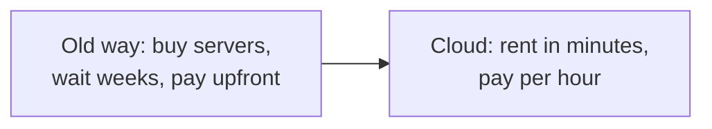
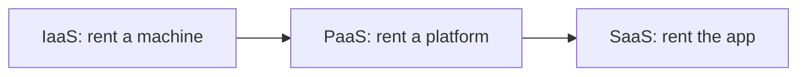
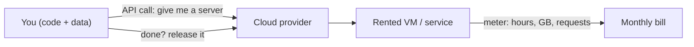
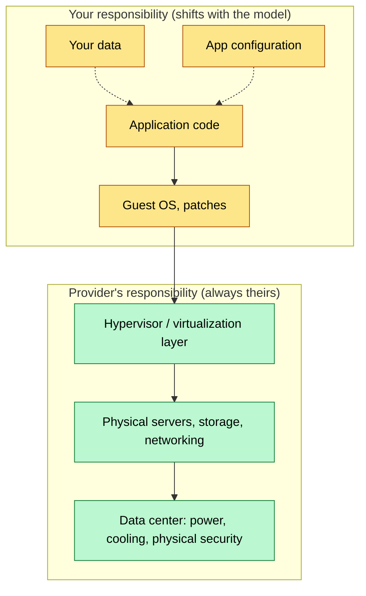
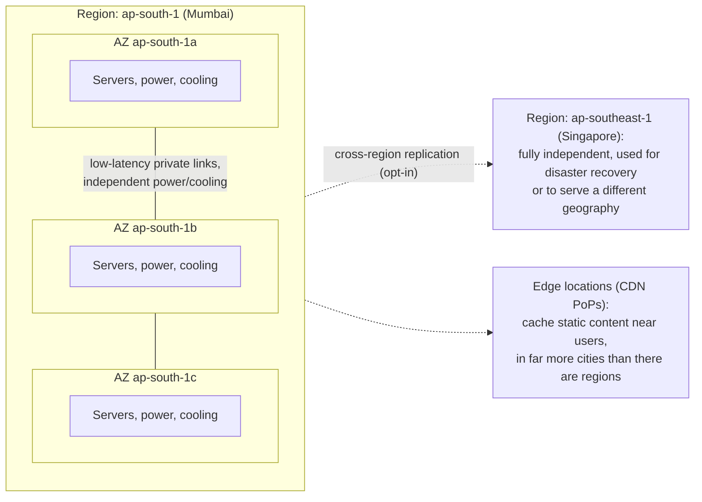

# Cloud Computing Basics

> [!summary] TL;DR
> Cloud computing means renting compute, storage and services from a provider over the network instead of buying and running your own servers, with on-demand self-service, a usage-based bill and a provider that handles the hardware underneath.

> [!abstract] Core idea
> - You rent capacity (virtual machines, storage, managed databases) instead of owning hardware, and pay for what you use.
> - The provider and you split security duties: a line called the **shared-responsibility model**, and where it falls depends on the service model (IaaS vs PaaS vs FaaS vs SaaS).
> - Capacity lives in **regions** (independent geographic areas) built from **Availability Zones** (physically separate data centers), so you design around one AZ or even one region disappearing.
> - Classic mistake: treating "cloud" as a synonym for "cheaper". A badly designed deployment (idle reserved capacity, a forgotten NAT gateway, unthrottled egress) can cost more than a fixed data center.

## Start here: the basics 🟢

> [!info] How to read this note (pick your level)
> - 🟢 **New to this?** Read "From zero" below, then sections 1, 2 and 10 (why, mental model and the cheat sheet). Stop there, that is a full first pass.
> - 🟡 **Know the basics?** Add sections 3, 4, 5 and 6 (how it works, a worked example, options and trade-offs).
> - 🔴 **Interview / SDE-3 prep?** Add sections 7, 8 and 9 (production, deep dive and interview questions). Headings are tagged 🟢🟡🔴 so you always know where you are.

**From zero, in 60 seconds** 🟢

Running a website needs computers that are always on. Buying them is slow and costly.
**Cloud computing** means renting those computers (and storage, and databases) from a company like AWS, over the internet.
You click or call an API, and a server is ready in a minute. You pay for what you use, like an electricity bill.

The provider looks after the buildings, power and hardware. You look after your code and settings.
You can rent at different levels: raw machines, a ready platform, or a finished app.

The rest of this note is just these 3 questions:
1. Why did everyone move to the cloud?
2. What are IaaS, PaaS and SaaS, and how do they differ?
3. How do you pay, and which bills surprise people?

**The problem in one story.**
A small shop sells online and gets 10x more visitors during one festival sale each year.
Buying enough computers for that one day means they sit idle the rest of the year.
Buying too few means the site crashes on its biggest day.
Cloud computing lets the shop rent extra computers for that day and hand them back after.

**Words you need first**

| Word | Plain meaning | Tiny example |
| --- | --- | --- |
| Server | A computer that answers requests from other computers | The machine that runs your Go API |
| Data center | A building full of servers, power and cooling | An AWS facility near Mumbai |
| Virtual machine (VM) | A pretend computer carved out of a real one by software | One EC2 instance on a big physical host |
| Provider | The company you rent cloud resources from | AWS, Google Cloud, Azure |
| Region | A geographic area where a provider runs data centers | `ap-south-1` (Mumbai) |
| Availability Zone (AZ) | A separate data center (or group) inside a region | `ap-south-1a` |
| Managed service | Something the provider runs and patches for you | RDS instead of Postgres you install yourself |

**Picture it**

**Analogy.** Cloud is like renting a car instead of buying one: you pay per day, someone else does servicing, and you can rent a bigger one for a road trip.
Where it breaks: with a rented car you never share the engine with strangers; in the cloud your VM often shares physical hardware with other customers.

**How the rest of this note builds up**

- First, why renting beats owning for spiky load (section 1) and the apartment-vs-hotel mental model for IaaS, PaaS, FaaS, SaaS (section 2).
- Then who secures what (shared responsibility) and how regions and AZs are laid out (section 3).
- Then cost: fixed vs autoscaled, pricing models and cost traps (section 4), plus service and deployment models (section 5).
- Finally the SDE-3 deep dive: trade-offs, production failure modes, virtualization, managed vs self-hosted, and scalability vs elasticity (sections 6-8).

> [!tip] Remember
> Cloud = renting metered computers and services over the network; the provider runs the building, you own what you put inside it.

## 1. Why it exists 🟢

Before cloud computing, running a web service meant buying physical servers, racking them in a data center you leased, wiring networking and power, and provisioning for your busiest day of the year year-round.

A retailer sizing for a Black Friday spike at 10× normal traffic had to buy that capacity permanently and let it idle the other 364 days, or under-provision and fall over.

Cloud computing turns that capital purchase into a rental. [NIST SP 800-145] defines it with five essential characteristics:

- **On-demand self-service:** you provision a server or a database from an API or console, without calling a salesperson.
- **Broad network access:** everything is reachable over standard network protocols, from laptops to phones.
- **Resource pooling:** the provider's physical hardware is shared across many customers using virtualization, assigned and reassigned by demand.
- **Rapid elasticity:** capacity can scale out in minutes and back down just as fast, so it feels unlimited to the consumer.
- **Measured service:** usage is metered (CPU-hours, GB stored, requests served), so both sides can see exactly what was consumed.

Concretely: that retailer runs 10 servers year-round on AWS and asks for 90 more an hour before the Black Friday spike, then releases them the next morning. They pay for 90 extra servers for about 18 hours, not 365 days.

## 2. Mental model 🟢

Think of it as renting serviced apartments instead of buying a house:

- **IaaS** (e.g., an EC2 virtual machine) is an empty apartment: walls, plumbing, electricity — you bring your own furniture (OS, runtime, app) and you are responsible for everything inside the unit.
- **PaaS** (e.g., AWS App Runner, Elastic Beanstalk) is a furnished apartment: the landlord patches the fridge and the boiler (OS, runtime patches); you just move your things in (your code) and live there.
- **FaaS** (e.g., AWS Lambda) is a hotel room you only occupy while you're actually in the building: you pay per stay (per invocation), and when you leave, it's released.
- **SaaS** (e.g., Gmail) is a hotel with room service: you don't manage anything, you just use the finished product.

Across all four, the building (power, physical security, networking backbone) is the provider's job. How much of the inside is your job shrinks as you move from IaaS toward SaaS — and so does how much you can customize.

## 3. How it works 🟡

**In plain words:** the cloud is layers. The provider owns the bottom (buildings, hardware); the higher the service you rent, the more of the stack they run for you.

On an **IaaS** VM, "your responsibility" includes the guest OS. On a **PaaS** or **FaaS** service, the provider patches the OS and runtime too, and "yours" shrinks to just code, config and data.

The line moving is the whole point of the shared-responsibility model: AWS is explicit that for EC2, you patch the guest OS and your application, while AWS patches the hypervisor and everything below it; for a managed service like RDS, AWS also patches the database engine's underlying OS, and your job shrinks to schema, queries and access control.

**Regions and Availability Zones**, concretely:

- A **region** is an independent geographic area (e.g., `ap-south-1` for Mumbai). Nothing about a region's infrastructure or data is shared with another region unless you explicitly replicate.
- An **Availability Zone (AZ)** is one or more discrete data centers with their own power and cooling, connected to the other AZs in the region by low-latency private links. AWS `ap-south-1` has 3 AZs as of 2026.
- Designing for "an AZ can disappear" means running at least 2 (ideally 3) AZs for anything stateful: an RDS Multi-AZ deployment keeps a synchronously replicated standby in a second AZ and fails over automatically, typically within one to two minutes (AWS pricing/documentation figure, varies by engine and transaction load), if the primary's AZ goes down.
- **Edge locations** are a separate, much larger network of points of presence used by CDNs (CloudFront) to cache content close to end users; they are not where your compute runs.

## 4. Worked example 🟡

### Whiteboard version

A team choosing between renting 3 fixed EC2 instances versus using on-demand Fargate tasks that scale with traffic:

| Approach | Cost model | What happens at 3am when traffic is near zero |
| --- | --- | --- |
| 3 fixed EC2 instances, always on | Pay for 3 instances × 730 hours/month, regardless of load | All 3 instances idle, same cost as peak |
| Fargate service, autoscaled 1–10 tasks | Pay per vCPU-second and GB-second actually used | Scales down to 1 task; cost drops to near the floor |

### Deep dive: picking a pricing model

**In plain words:** same machine, different ways to pay: by the hour, cheaper if you promise a year, or very cheap if you accept it may be taken away.

AWS EC2 (and most providers' equivalents) offer several ways to pay for the same virtual machine:

| Pricing model | How it works | Use when | Rough discount vs on-demand |
| --- | --- | --- | --- |
| On-demand | Pay per hour/second, no commitment | Unpredictable or short-lived workloads, dev/test | baseline (0%) |
| Reserved Instance / Savings Plan | Commit to 1 or 3 years of usage upfront or monthly | Steady baseline load you know you'll run | documented: roughly 30–72% depending on term and payment option (AWS pricing docs) |
| Spot Instance | Bid for the provider's unused capacity; can be reclaimed with ~2 minutes' notice | Fault-tolerant, interruptible batch jobs, CI runners, stateless workers behind a queue | documented: up to ~90% off on-demand (AWS pricing docs), varies by instance type and region |

This mirrors **CapEx vs OpEx**: buying your own data center is capital expenditure (a large upfront purchase, depreciated over years, sized for peak); cloud spend is operating expenditure (a recurring bill sized to actual usage), which is also why Reserved Instances exist — they let you trade some of OpEx's flexibility back for a discount, when you're confident about a steady floor of usage.

### Cost traps worth knowing by name

**In plain words:** the bills that surprise people are usually small hourly items left running, or data moving out of the cloud.

- **NAT Gateway hourly + per-GB charges**: a NAT Gateway in each AZ, left running for a service that barely uses outbound internet, bills 24/7 regardless of traffic — a common surprise line on a monthly AWS bill.
- **Cross-AZ and egress data transfer**: traffic that crosses an AZ boundary, or leaves AWS to the internet, is billed per GB; traffic stored and served from inside one AZ generally is not.
- **Idle reserved capacity**: committing to Reserved Instances sized for a traffic forecast that doesn't materialize locks in a cost without the matching usage.
- **Unmonitored managed-service tiers**: provisioned-capacity services (e.g., a sized RDS instance) keep billing at the provisioned size even when actual load barely uses it, unlike serverless variants that scale to zero.

## 5. Variants and comparison 🟡

| Model | What the provider manages | What you manage | Example |
| --- | --- | --- | --- |
| IaaS | Hardware, hypervisor, network, physical security | Guest OS, runtime, app, data, scaling policy | AWS EC2 |
| PaaS | + OS patches, runtime, load balancing | App code, config, data | AWS App Runner / Elastic Beanstalk |
| FaaS (serverless functions) | + the server process itself, scaling to zero | Function code, triggers, memory/timeout config | AWS Lambda |
| SaaS | Everything, including the application | Your data and user accounts inside it | Gmail, Salesforce |

| Deployment model | What it means | Use when |
| --- | --- | --- |
| Public cloud | Shared infrastructure, multi-tenant, provider-owned | Default for most workloads; lowest operational burden |
| Private cloud | Dedicated infrastructure, single-tenant, provider- or self-hosted | Strict regulatory or data-residency requirements |
| Hybrid cloud | Some workloads on-prem, some in public cloud, connected | Gradual migration, or keeping latency-sensitive/legacy systems on-prem |
| Multi-cloud | Workloads spread across more than one public cloud provider | Avoiding vendor lock-in, or using a best-of-breed service elsewhere; costs more in operational complexity |

## 6. Trade-offs and when not to use 🟡

- **Elasticity is not free.** On-demand pricing means unbounded traffic can mean an unbounded bill; without budget alarms and autoscaling ceilings, a traffic spike (legitimate or a DDoS) directly becomes a cost spike.
- **Virtualization overhead and noisy neighbors.** Multiple tenants share physical hardware; a provider's scheduler isolates you, but very latency-sensitive workloads sometimes still prefer bare-metal instances.
- **Vendor lock-in.** Deep use of one provider's managed services (proprietary APIs, managed databases, IAM model) raises the cost of ever moving to a different provider. Using open standards (containers, Terraform, standard SQL) softens this.
- **Predictable, steady-state workloads at large scale can be cheaper self-hosted.** A company with years of flat, well-understood traffic and the staff to run data centers (famously, Dropbox moved storage off AWS S3 to its own infrastructure in 2016 for a workload it understood precisely) can beat cloud pricing at sufficient scale — this is the exception, not the default assumption.

## 7. In production 🔴

- **Real systems:** Netflix runs almost entirely on AWS and relies on Multi-AZ and multi-region design to survive AZ failures; Capital One is a well-known case of a regulated bank moving core workloads to AWS under the shared-responsibility model with its own compliance controls layered on top.
- **Failure modes → fixes:**
  - An AZ loses power → services pinned to one AZ go down → run compute and data stores across at least 2 AZs, with a load balancer that health-checks and routes around the bad AZ.
  - A region-wide event → anything single-region is down → for critical systems, replicate to a second region and have a tested failover runbook (pure insurance; most teams accept single-region risk for non-critical systems because of the added cost and complexity).
  - Runaway autoscaling from a cost-ignorant policy → a bug causes a scaling loop → set hard maximum instance/task counts and billing alarms, not just scale-out triggers.
- **What to monitor:** AZ-level health checks and error rates, monthly cost by service (cost allocation tags), Reserved/Savings-Plan coverage vs actual on-demand spend, and NAT Gateway / cross-AZ transfer cost specifically, since both are easy to forget.

## 8. Deep dive 🔴

**Virtualization underneath IaaS.** A hypervisor (e.g., AWS's Nitro hypervisor, a thin KVM-based layer) partitions one physical host into multiple virtual machines, each with its own kernel, isolated from its neighbors.

Containers (see [[Docker 01 - Why Containers]]) are a lighter-weight alternative that share one kernel instead of running a full guest OS per workload; a newer middle ground is a microVM (e.g., Firecracker, which backs AWS Lambda and Fargate) — a stripped-down VM that boots in milliseconds, giving container-like density with VM-like isolation boundaries.

**Managed vs self-hosted, the RDS vs Postgres-on-EC2 question.** Running PostgreSQL yourself on an EC2 instance gives full control (any extension, any config flag) but makes you responsible for patching, backups, replication failover and storage scaling.

RDS for PostgreSQL automates backups, point-in-time recovery, Multi-AZ failover and minor-version patching, at a higher per-hour price and with a smaller set of tunable parameters and a managed major-version upgrade path.

The decision is rarely about cost per hour; it's about whether your team wants to own database operations.

**Scalability vs elasticity**, a distinction worth keeping precise for interviews: scalability is the system's *ability* to handle more load if given more resources (a property of the architecture); elasticity is whether those resources are added and removed *automatically* in response to demand (a property of the operational setup).

A system can be scalable (stateless, horizontally replicable) without being elastic (if nobody wired up autoscaling), and in principle something could autoscale a component that doesn't actually scale well, though in practice elasticity is built on top of an already-scalable design.

## 9. Interview questions 🔴

> [!question]- Define cloud computing the way an interviewer wants to hear it.
> On-demand, self-service access to a shared pool of configurable compute, storage and network resources, provisioned and released with minimal effort, and billed by actual usage. If you only have one sentence: renting metered compute and services over the network instead of owning hardware.

> [!question]- What's the difference between IaaS, PaaS, FaaS and SaaS?
> They differ in how much of the stack the provider manages for you: IaaS gives you a VM and you manage the OS up; PaaS also manages the OS and runtime, leaving you just code and config; FaaS runs your code per-invocation and scales to zero, so you manage only the function; SaaS is a finished product you simply use.
>
> More managed means less control but less operational burden.

> [!question]- What is the shared-responsibility model, and why does it matter?
> It's the split between what the cloud provider secures (physical hardware, hypervisor, and for managed services, more of the stack above that) and what you secure (your data, access control, and for IaaS, the guest OS and app).
>
> It matters because a breach caused by a misconfigured S3 bucket or an unpatched EC2 instance is on you, not the provider — "the cloud is secure" does not mean "my workload is secure".

> [!question]- Trap: "The cloud is always cheaper than on-prem." True or false?
> False. It's cheaper for variable, unpredictable, or growing workloads because you avoid overprovisioning for peak and avoid capital expenditure. For large, steady-state workloads a company deeply understands, self-hosting can be cheaper at scale — Dropbox's 2016 move of its storage layer off AWS S3 to its own infrastructure is the standard example.
>
> The honest answer is "it depends on the shape of the workload and the cost of the team to run it yourself."

> [!question]- What's the difference between a region and an Availability Zone?
> A region is an independent geographic area (e.g., Mumbai); an AZ is one or more physically separate data centers inside that region, linked by low-latency private networking to the other AZs in the same region.
>
> You spread stateful workloads across AZs for resilience within a region, and across regions only when you need resilience to an entire region going down or need to serve a different geography.

> [!question]- Why would a mature team ever choose Reserved Instances or Savings Plans over on-demand pricing?
> Because a known, steady baseline of usage (e.g., "we always run at least 20 instances") can be committed to a 1- or 3-year term for a documented discount (AWS pricing: roughly 30–72% depending on term and payment option), while still running on-demand or Spot for the variable portion above that baseline.
>
> It trades flexibility for a lower guaranteed cost on the part of the load you're confident about.

> [!question]- What does "designing for AZ failure" actually look like for a database?
> Deploy it Multi-AZ: a synchronously replicated standby in a second AZ, with automatic failover (RDS Multi-AZ typically completes within one to two minutes, per AWS documentation) so the application only sees a brief connection error and retries successfully against the new primary, rather than an extended outage.

## 10. Cheat sheet 🟢

- Cloud computing: on-demand, self-service, pooled, elastic, metered compute and services, per NIST SP 800-145.
- IaaS → PaaS → FaaS → SaaS: the provider manages progressively more of the stack, and you keep progressively less control.
- Shared-responsibility model: the provider secures the stack below the line for your service model; you secure everything above it, always including your data and access control.
- Region = independent geographic area; AZ = physically separate data center within a region; design stateful systems across ≥2 AZs.
- On-demand vs Reserved/Savings Plan vs Spot: pick by how predictable and interruptible the workload is.
- CapEx (buy hardware, size for peak) vs OpEx (rent, pay for actual usage) is the financial version of the same trade-off.
- Classic cost traps: NAT Gateway hourly + per-GB charges, cross-AZ transfer, idle reserved capacity.
- Scalability (can it handle more load) is not the same property as elasticity (does it adjust automatically).

## Links

- **Before this:** none — this is the entry point for 13 DevOps & Cloud.
- **Next:** [[Cloud Native and the 12-Factor App]], [[AWS 01 - Core Concepts (Regions, AZs, Accounts, Shared Responsibility)]]
- **Compare with:** [[Deploying a Go API on AWS (Reference Architecture)]] (one concrete architecture built on these building blocks)

### Watch on YouTube

- [What is Cloud Computing ?](https://www.youtube.com/watch?v=8C_kHJ5YEiA) · Apna College · 5 min · 2,896,003 views
- [Cloud Computing In 6 Minutes / What Is Cloud Computing? / Cloud Computing Explained / Simplilearn](https://www.youtube.com/watch?v=M988_fsOSWo) · Simplilearn · 6 min · 3,159,544 views
