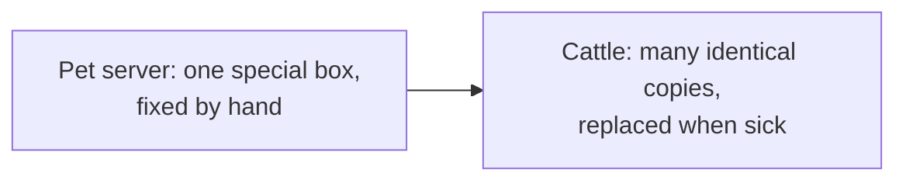
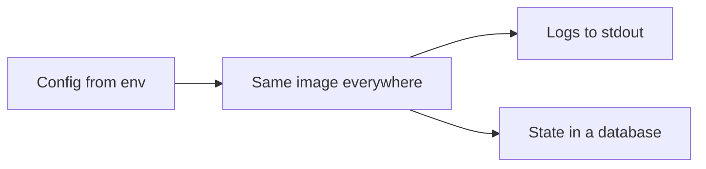
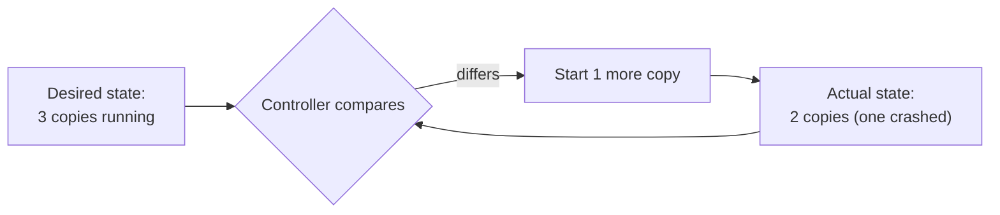
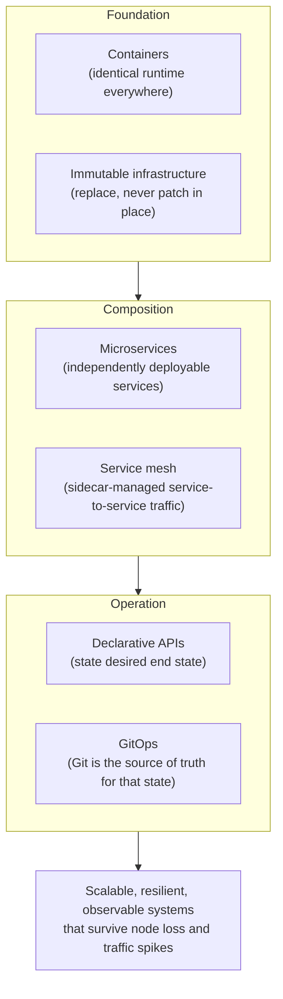
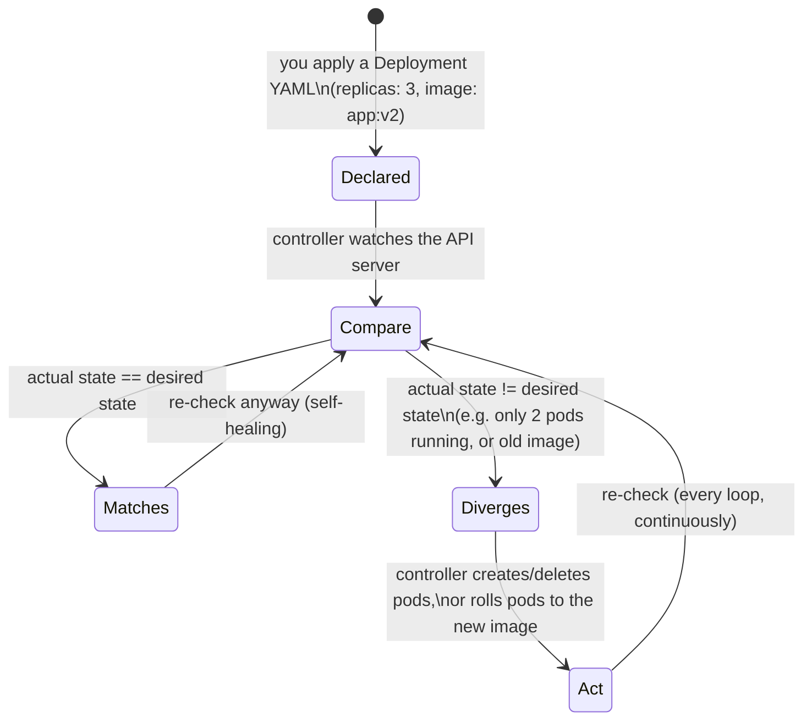
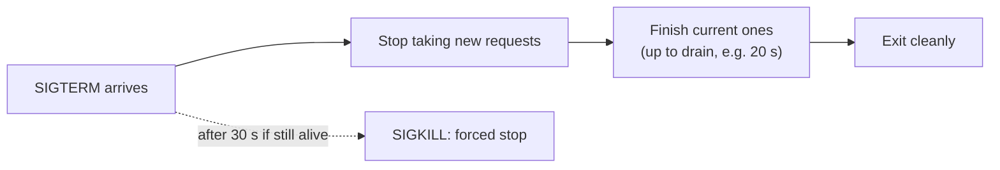

# Cloud Native and the 12-Factor App

> [!summary] TL;DR
> Cloud native means building applications as containerized, loosely coupled services that are automated, observable and resilient by design, so they take full advantage of the cloud's elasticity instead of just running unchanged on someone else's servers. The 12-Factor App is the concrete rulebook for writing services that fit this style.

> [!abstract] Core idea
> - "Cloud native" ≠ "runs in the cloud". A monolith lifted onto an EC2 instance is cloud-*hosted*; cloud native means containers, microservices, declarative infrastructure and automated operations, per the CNCF's own definition.
> - The 12-Factor App is a checklist for making a service stateless, configurable and disposable so an orchestrator (Kubernetes, ECS) can run many copies of it, restart it, and move it between machines without you noticing.
> - Kubernetes' whole operating model is a **reconcile loop**: you declare a desired state, a controller compares it to actual state, and continuously nudges reality toward the declaration.
> - Classic mistake: "containerizing" an app that still writes session state to local disk, reads a mutable config file baked into the image, and ignores SIGTERM. That's a container, not a cloud-native service — it will drop requests on every rolling deploy.

## Start here: the basics 🟢

> [!info] How to read this note (pick your level)
> - 🟢 **New to this?** Read "From zero" below, then sections 1, 2 and 10 (why, mental model and the cheat sheet). Stop there, that is a full first pass.
> - 🟡 **Know the basics?** Add sections 3, 4, 5 and 6 (how it works, a worked example, options and trade-offs).
> - 🔴 **Interview / SDE-3 prep?** Add sections 7, 8 and 9 (production, deep dive and interview questions). Headings are tagged 🟢🟡🔴 so you always know where you are.

> [!note] Before this note
> - [[Cloud Computing Basics]]: you rent servers from a provider by the hour, and you can add or remove them in minutes.
> - [[Docker 01 - Why Containers]]: a container is your app packed with everything it needs, so it starts the same way on any machine.

**From zero, in 60 seconds** 🟢

Moving an old app onto a cloud server does not make it "cloud native". It just runs somewhere else.
**Cloud native** means building the app so it can be copied, restarted and moved at any time without breaking.
To do that, each copy must keep nothing important inside itself. Data lives in a database; settings come from outside.



The **12-Factor App** is a short rulebook of 12 habits that make an app work this way.



The rest of this note is just these 3 questions:
1. What do the cloud native pillars (containers, automation, observability) mean?
2. How does "declare what you want" become reality (the reconcile loop)?
3. What are the 12 factors, and what breaks if you skip one?


**The problem in one story.**
A team moves its old app onto a cloud server and expects it to "scale".
They start a second copy, and users get logged out randomly because sessions were saved on the first copy's disk.
Every deploy also drops a few requests because the app dies mid-request.
Cloud native and the 12-Factor rules are about writing apps that survive being copied, moved and restarted.

**Words you need first**

| Word | Plain meaning | Tiny example |
| --- | --- | --- |
| Container | A packaged app plus everything it needs to run, started like a process | A Docker image of your Go binary |
| Orchestrator | Software that starts, stops and moves containers for you | Kubernetes, AWS ECS |
| Stateless | The app keeps no important data in its own memory or disk between requests | Sessions live in Redis, not in the process |
| Environment variable | A named setting passed to a process when it starts | `DATABASE_URL=postgres://...` |
| SIGTERM | The polite "please shut down" signal sent to a process | Kubernetes sends it before killing a pod |
| Declarative | You describe the end state you want, not the steps | "I want 3 copies running" |
| Microservice | A small service that owns one job and talks over the network | A payments service separate from search |
| Monolith | One big app where every feature lives in one program and ships together | Login, cart and payments in one binary |
| Pod | Kubernetes' smallest unit: one or a few containers running together | One copy of your Go API |
| Controller | A Kubernetes program that keeps comparing "wanted" with "running" and fixes the gap | The Deployment controller |
| Immutable infrastructure | Never edit a running server; build a new one and swap it in | Ship image `v2`, delete `v1` copies |
| Rolling deploy | Replace old copies with new ones a few at a time, so the app never fully stops | 3 pods: swap 1, then the next, then the last |
| Backing service | Anything your app talks to over the network to keep data | Postgres, Redis, S3 |
| Readiness probe | A check Kubernetes runs to ask "can this copy take traffic yet?" | `GET /ready` returns 200 |

**Picture it**



**Analogy.** A cloud-native app is like a chain restaurant kitchen: any cook can be swapped in, recipes come from head office (config), and nothing important lives in one cook's head.
Where it breaks: a kitchen manager reacts when someone tells them; an orchestrator checks and fixes the gap continuously, forever.

**How the rest of this note builds up**

- First, why "in the cloud" is not the same as "cloud native" (section 1) and the mental model (section 2).
- Then the CNCF pillars, the reconcile loop, and the 12 factors grouped by what breaks (section 3).
- Then a tested Go example of config-from-environment and graceful shutdown (section 4), and comparisons (section 5).
- Finally the SDE-3 deep dive: trade-offs, production failures, and the deeper mechanics (sections 6-8).

> [!tip] Remember
> Cloud native = stateless, configurable, disposable services that a controller can copy, move and restart without anyone noticing.

## 1. Why it exists 🟢

🟢 **Plain version:** Moving an app to the cloud only helps if you can run many copies of it and kill or restart any copy at any time. Old apps often cannot do that, because each copy keeps users' data on its own disk. The CNCF (the Cloud Native Computing Foundation, the group behind Kubernetes) wrote down the style that fixes this: pack apps in containers, split them into small services, replace servers instead of fixing them, and describe what you want instead of scripting each step. The 12-Factor App is the same idea as a checklist for one service.

Early cloud migrations often just moved a server into a VM in someone else's data center — same monolith, same deploy process, same assumption that the server never restarts.

That gets you a rented machine, not elasticity: you still can't run 50 copies of the app behind a load balancer (a front door that spreads requests across the copies), because 10 of them would fight over the same local session files, and a crashed instance would lose whatever it had in memory or on disk.

The CNCF's definition exists to name the opposite style precisely:

> "Cloud native technologies empower organizations to build and run scalable applications in modern, dynamic environments... Containers, service meshes, microservices, immutable infrastructure, and declarative APIs exemplify this approach."

Each term earns its place because it removes one specific assumption that breaks elasticity:

- **Containers** package the app with its exact runtime, so it starts identically on any node (see [[Docker 01 - Why Containers]]).
- **Microservices** let one team deploy and scale their piece without coordinating a monolith-wide release.
- **Immutable infrastructure** means you never patch a running server; you build a new image/instance and replace the old one, so "what's running" always matches "what was tested".
- **Declarative APIs** mean you state the desired end state ("3 replicas of this image") and let a controller figure out how to get there, rather than scripting the individual steps.

The 12-Factor App, written by Heroku engineers in 2011 and still the standard checklist, is the service-level version of the same idea: a set of rules that make *one* service safe to run this way.

### Real-life example: Swiggy at dinner time 🟢

At 8pm, many more people open Swiggy than at 4pm.
The platform starts, say, 30 copies of the ordering service instead of 10, then removes them after the rush.
This only works because no copy keeps your cart on its own disk; the cart lives in a shared store such as Redis.
If one copy crashes mid-order, the next request lands on another copy and your cart is still there.
That "any copy can vanish and nobody notices" property is exactly what cloud native and the 12 factors are about.

## 2. Mental model 🟢

Picture the difference between a hotel and a houseguest. A houseguest (the old-style server) has their own room, keeps belongings scattered around, and if they leave, the room is unusable until someone cleans it up and the guest is gone for good.

A hotel guest (a cloud-native instance) could be moved to any identical room on any floor mid-stay and never notice — because nothing important is stored in the room itself; it's all in the hotel's systems (the database, the shared network drive).

Kubernetes is the front desk: it doesn't care which physical room a guest occupies, only that the right number of guests of the right type are checked in at all times — and if a room floods, it checks a new guest into an identical room without asking you.

## Common beginner mistakes 🟢

- **Saving sessions or uploads on the container's own disk** → that disk is wiped when the container is replaced, and other copies cannot see it → keep sessions in Redis and files in object storage like S3.
- **Baking settings (DB address, passwords) into the image** → you must rebuild to move from staging to prod, so prod runs a build nobody tested → read settings from environment variables.
- **Ignoring SIGTERM** → the app is killed mid-request during every deploy → catch SIGTERM, stop taking new requests, finish the current ones, then exit.
- **Editing a running pod by hand** → the controller changes it back on its next check → change the YAML file and apply it again.
- **Thinking "we use Kubernetes, so we are cloud native"** → a monolith with local state in one big pod is still fragile → check the properties: stateless, config from outside, safe to kill.

## 3. How it works 🟡

> 🟢 → 🟡 **You now know** that cloud native means "any copy can be killed, copied or moved without anyone noticing". **Next we open the box**: the building blocks that make this possible, the loop Kubernetes runs to keep things the way you asked, and the 12 rules one service must follow.

### The CNCF pillars, as one picture

**In plain words:** cloud native is a few ideas working together: package in containers, split into services, automate deploys, and watch everything.

**Step by step:**
1. Pack the Go API into a container image, say `orders:v2`. It runs the same on a laptop and in prod.
2. Never fix a running server. To change anything, build `orders:v3` and replace the old copies (immutable infrastructure).
3. Split the big app into small services (orders, payments, search) so each team ships on its own.
4. Describe what you want in a file ("3 copies of `orders:v3`") and let a controller make it true (declarative APIs).
5. Keep that file in Git, and let a tool apply whatever is in Git (GitOps). A service mesh (a helper proxy, called a sidecar, placed next to each service to handle its network calls) can come later, when there are many services.



### The reconcile loop that makes "declarative" real

**In plain words:** you write down what you want ("3 copies"). A robot keeps comparing that with what is running and fixes any gap, forever.

**Step by step:**
1. You apply a file that says `replicas: 3, image: app:v2`. It is stored by the API server (Kubernetes' central front desk that holds the wanted state).
2. A controller reads it and counts what is running: 3 pods. All good.
3. One pod crashes. The next check counts 2 pods, which differs from 3.
4. The controller starts 1 new pod. The next check counts 3 again.
5. You change the file to `image: app:v3`. The controller sees old pods and replaces them, a few at a time.



This loop is *why* a pod that crashes gets replaced within seconds without a human: the controller's next pass simply sees "actual: 2 of 3" and creates one more. It is also why editing a live pod by hand is pointless — the next reconcile pass reverts it to match the declared state.

### The 12 factors, grouped by what breaks if you skip them

**In plain words:** read the last column first: it tells you the pain each rule saves you from.

**Step by step (one service following the rules):**
1. All the code lives in one Git repo, and `go.mod` lists every library (factors I, II).
2. CI builds one image, `orders:v2`. Staging and prod both run that same image (factor V).
3. Each environment passes its own settings as environment variables, like `DATABASE_URL` (factors III, IV).
4. The app listens on its own port, keeps no data on its disk, and you add copies to handle more load (factors VI, VII, VIII).
5. On SIGTERM it finishes current requests and exits; its logs go to the screen output (stdout) for the platform to collect (factors IX, XI).

| # | Factor | What it means | What breaks without it |
| --- | --- | --- | --- |
| I | Codebase | One codebase tracked in version control, many deploys | Environments silently diverge; "works on staging" stops meaning anything |
| II | Dependencies | Declare all dependencies explicitly (`go.mod`), never rely on system packages | "Works on my machine" — a different host has different global packages |
| III | Config | Store config (DB URLs, feature flags, secrets) in environment variables, not in code | You can't promote the same build from staging to prod without rebuilding it |
| IV | Backing services | Treat a database, queue or cache as an attached resource reachable by a URL, swappable without code changes | Swapping a managed RDS for a different Postgres instance means a code change |
| V | Build, release, run | Keep build (compile), release (build + config) and run (execute) as strictly separate stages | You can't roll back to a previous release without rebuilding |
| VI | Processes | Run the app as one or more stateless processes; anything persistent goes to a backing store | Two replicas disagree because each has its own local session cache |
| VII | Port binding | The app is self-contained and exports its service via a port (e.g. `net/http` listening on `:8080`), not injected into a runtime container like Tomcat (a Java server you drop apps into) | Can't run it standalone in a container the same way it runs in prod |
| VIII | Concurrency | Scale out via the process model: run more identical processes, not bigger threads inside one | Vertical-only scaling hits a ceiling and wastes the cluster's many small nodes |
| IX | Disposability | Fast startup, graceful shutdown on `SIGTERM`, crash-only design | A rolling deploy or scale-in cuts requests in half; slow starts make autoscaling useless |
| X | Dev/prod parity | Keep dev, staging and prod as similar as possible (same backing services, same deploy process) | Bugs only show up in prod, where they're expensive to debug |
| XI | Logs | Write logs as an unbuffered stream to `stdout`; let the platform collect and route them | The app owns log rotation and storage, and logs vanish when the container dies |
| XII | Admin processes | Run one-off tasks (migrations, a REPL, an interactive prompt for typing commands) as the same release, same config, same codebase | A migration run from a different build than what's deployed silently drifts |

## 4. Worked example 🟡

### Whiteboard version

A Go HTTP service that reads its port and database URL from the environment and nothing else — the smallest possible factor III + VII:

```go
port := os.Getenv("PORT")
db := os.Getenv("DATABASE_URL")
http.ListenAndServe(":"+port, nil)
```

If `PORT` or `DATABASE_URL` is missing or malformed, this version panics or hangs with no clear message — fine for a whiteboard, not for a build you'd deploy. The full version below validates both, picks a sensible default port, and is the exact code tested against.

### Factor III (config from environment) and factor IX (graceful shutdown), tested

**In plain words:** Go code showing two habits: read settings from the environment, and finish in-flight requests before you exit.

```go
package twelvefactor

import (
	"fmt"
	"os"
	"strconv"
)

// Config holds everything the process needs, loaded once from the
// environment (12-factor factor III: store config in the environment).
type Config struct {
	Port        int
	DatabaseURL string
	LogLevel    string
}

// LoadConfig reads Config from environment variables. It never reads a
// config file baked into the image, so the same image runs unchanged in
// dev, staging and prod (factor X: dev/prod parity) with only the
// environment changing.
func LoadConfig(getenv func(string) string) (Config, error) {
	dbURL := getenv("DATABASE_URL")
	if dbURL == "" {
		return Config{}, fmt.Errorf("DATABASE_URL is required")
	}

	portStr := getenv("PORT")
	if portStr == "" {
		portStr = "8080"
	}
	port, err := strconv.Atoi(portStr)
	if err != nil {
		return Config{}, fmt.Errorf("PORT must be an integer: %w", err)
	}

	level := getenv("LOG_LEVEL")
	if level == "" {
		level = "info"
	}

	return Config{Port: port, DatabaseURL: dbURL, LogLevel: level}, nil
}

// OSGetenv adapts os.Getenv to the getenv func(string) string shape LoadConfig
// takes, so production code calls LoadConfig(twelvefactor.OSGetenv) while
// tests pass a map lookup instead of touching real environment variables.
func OSGetenv(key string) string { return os.Getenv(key) }
```

```go
package twelvefactor

import (
	"context"
	"net/http"
	"time"
)

// RunWithGracefulShutdown starts srv and blocks until stop is signalled
// (in production, SIGTERM from the orchestrator), then drains in-flight
// requests for up to drain before returning. This is 12-factor factor IX,
// "disposability": the process starts fast and stops gracefully, so a
// rolling deploy or scale-in never cuts a request in half.
func RunWithGracefulShutdown(srv *http.Server, stop <-chan struct{}, drain time.Duration) error {
	serveErr := make(chan error, 1)
	go func() {
		serveErr <- srv.ListenAndServe()
	}()

	select {
	case err := <-serveErr:
		if err == http.ErrServerClosed {
			return nil
		}
		return err
	case <-stop:
		ctx, cancel := context.WithTimeout(context.Background(), drain)
		defer cancel()
		if err := srv.Shutdown(ctx); err != nil {
			return err
		}
		return nil
	}
}
```

In a real `main.go`, `stop` is closed by a `signal.Notify(ch, syscall.SIGTERM)` goroutine; Kubernetes sends `SIGTERM` to a pod, waits up to `terminationGracePeriodSeconds` (default 30s), then `SIGKILL`s it (a forced kill the app cannot catch) — so `drain` must be comfortably under that grace period.



**Test, run with `go test -race` on Go 1.24:**

**What this code does, in plain words:** the first test checks that missing settings fall back to 8080 and "info", and that set values win. The second test starts a real server, waits until it answers, sends the "stop" signal, and checks it shuts down without an error.

```go
func TestLoadConfig_DefaultsAndOverrides(t *testing.T) {
	env := map[string]string{"DATABASE_URL": "postgres://localhost/app"}
	cfg, err := LoadConfig(func(k string) string { return env[k] })
	if err != nil {
		t.Fatalf("unexpected error: %v", err)
	}
	if cfg.Port != 8080 || cfg.LogLevel != "info" {
		t.Errorf("want defaults 8080/info, got %d/%s", cfg.Port, cfg.LogLevel)
	}

	env["PORT"] = "9090"
	env["LOG_LEVEL"] = "debug"
	cfg, _ = LoadConfig(func(k string) string { return env[k] })
	if cfg.Port != 9090 || cfg.LogLevel != "debug" {
		t.Errorf("want overrides 9090/debug, got %d/%s", cfg.Port, cfg.LogLevel)
	}
}

// TestRunWithGracefulShutdown proves the server answers requests, then
// stops serving and returns cleanly once stop is closed, matching what an
// orchestrator expects after sending SIGTERM.
func TestRunWithGracefulShutdown(t *testing.T) {
	probe, _ := net.Listen("tcp", "127.0.0.1:0")
	addr := probe.Addr().String()
	probe.Close() // release the port; ListenAndServe binds its own listener

	srv := &http.Server{Addr: addr, Handler: http.HandlerFunc(
		func(w http.ResponseWriter, r *http.Request) { w.WriteHeader(http.StatusOK) })}

	stop := make(chan struct{})
	done := make(chan error, 1)
	go func() { done <- RunWithGracefulShutdown(srv, stop, 2*time.Second) }()

	// poll until the server is accepting connections, then confirm it
	// shuts down cleanly once stop is closed
	waitUntilReady(t, addr)
	close(stop)
	if err := <-done; err != nil {
		t.Fatalf("want clean shutdown, got %v", err)
	}
}
```

**Measured:** `go vet ./...` reports no issues, and `go test -race ./...` passes (2 tests, Go 1.24.4, 2026-11-07); full source and the `waitUntilReady` helper are in the companion scratch module.

## 5. Variants and comparison 🟡

| Approach | What it looks like | Use when | Cost |
| --- | --- | --- | --- |
| Lift-and-shift ("cloud-hosted") | Monolith moved onto a VM unchanged, manual restarts, config files on disk | A quick migration deadline, or a system being retired soon | Little elasticity gain; still fragile to single-instance failure |
| Containerized monolith, manual deploys | One container image, deployed by hand or a simple script, no autoscaling | Small team, low traffic, early-stage product | Faster to build than microservices, but no independent scaling or deploys |
| Cloud native (12-factor + container + orchestrator) | Stateless, config-from-env services, each independently deployable, run under Kubernetes/ECS with autoscaling | Multiple teams, variable load, need for zero-downtime deploys | Real operational investment: CI/CD, observability, on-call, cluster ops |

> [!warning] Interview trap
> "Cloud native" is not a synonym for "uses Kubernetes" or "runs in AWS". A single EC2 instance running a monolith that nobody has touched since 2019 is cloud-*hosted*, not cloud-native, no matter which provider it's on. The test is the properties (stateless, containerized, declaratively managed, observable), not the hosting location.

## 6. Trade-offs and when not to use 🟡

- **Operational overhead.** A cloud-native setup assumes CI/CD, container registries, an orchestrator, and someone who understands all three. For a two-person team shipping an MVP, that overhead can exceed the benefit — a single server with systemd (Linux's built-in tool that starts and restarts programs) and a nightly backup is a legitimate choice early on.
- **Debugging is distributed.** A request can now cross five services instead of one process; without distributed tracing (see [[Distributed Tracing with OpenTelemetry]]) and correlation IDs (one ID attached to a request and passed along to every service it touches), finding where it failed is much harder than reading one stack trace.
- **Microservices add network calls where function calls used to be.** Every service boundary is a new source of latency, partial failure and versioning to manage — not free architecture, a trade for independent deployability.
- **An anti-pattern worth naming:** a containerized monolith with manual deploys gets *some* of the deployment benefits (reproducible images) but none of the independent-scaling or independent-release benefits, while still carrying most of the container tooling overhead. If you're not going to decompose it or automate its deploys, plain VMs may be simpler.

## 7. In production 🔴

> 🟡 → 🔴 **You now know** the pillars, the reconcile loop, the 12 factors and how config-from-env and graceful shutdown look in Go. **Next is the advanced part**: what breaks in real clusters, what to watch, and the deeper ideas (GitOps, open standards, service mesh, resilience patterns) that come up in SDE-3 interviews.


- **Real systems:** Netflix popularized the microservices + chaos-engineering (breaking things on purpose in production to prove the system survives) style that much of "cloud native" thinking draws from; most CNCF graduated projects (Kubernetes, Prometheus, Envoy, containerd, Helm, Argo, Jaeger) are the default toolchain teams reach for when building this way.
- **Failure modes → fixes:**
  - Service ignores `SIGTERM`, keeps serving past shutdown deadline → Kubernetes `SIGKILL`s it after the grace period, dropping in-flight requests → implement graceful shutdown (factor IX) and keep the grace period comfortably longer than your slowest request.
  - Config baked into the image → a staging bug "disappears" in prod because they secretly run different images → enforce factor III: the same image, different environment variables, promoted unchanged between environments.
  - No readiness probe → traffic is routed to a pod before it's finished warming up (DB pool, cache) → add a readiness probe distinct from the liveness probe, and don't mark the pod ready until dependencies are confirmed reachable.
  - A service writes uploaded files to local disk → a rolling deploy or pod reschedule silently loses them → treat local disk as ephemeral; use object storage or a backing service (factor VI).
- **What to monitor:** per-service error rate and latency (not just an aggregate), pod restart counts (a proxy for crash-looping), deploy frequency and rollback rate (DORA metrics: four standard numbers for how fast and how safely a team ships), and whether readiness/liveness probes are actually distinct and correctly tuned.

## 8. Deep dive 🔴

**Why "declarative" survives chaos better than "imperative" automation.** An imperative deploy script runs a fixed sequence of steps once; if step 4 of 7 fails, the system is left in an undefined partial state and nobody is checking it again.

A declarative controller runs the reconcile loop *continuously and unconditionally* — every few seconds, forever, it re-derives "what should exist" and diffs it against "what does exist," whether or not anything just changed.

That's what makes Kubernetes self-healing: a node dying doesn't require anyone to notice and re-run a script; the next reconcile pass already sees too few replicas and creates more.

**GitOps is this same idea one layer up.** Instead of a human running `kubectl apply`, a GitOps controller (Argo CD, Flux) treats a Git repository as the declared desired state for the *whole cluster*, continuously reconciling the live cluster to match what's committed.

Rolling back a bad deploy becomes `git revert`, and drift between "what's in Git" and "what's actually running" is a first-class, alertable condition instead of institutional memory.

**Open standards underneath the pillars.** The CNCF stack only works across providers because of a small set of open specifications that any compliant tool implements interchangeably: the **OCI image spec** (what a container image is, so any registry and any runtime can use it), the **CRI** (Container Runtime Interface, so Kubernetes can run containerd, CRI-O or others interchangeably), the **CNI** (Container Network Interface, pluggable pod networking), and the **CSI** (Container Storage Interface, pluggable volume plugins).

OpenTelemetry plays the same standardizing role for observability instrumentation. Knowing these exist is what separates "I've used Kubernetes" from "I understand why Kubernetes is portable across clouds."

**Service mesh, briefly.** At enough microservices, cross-cutting concerns (mTLS between services, meaning both sides prove who they are with certificates and encrypt traffic, retries, per-service traffic metrics) become repetitive to implement in every service.

A service mesh (Istio, Linkerd) injects a sidecar proxy next to each pod that intercepts all its network traffic and handles those concerns uniformly, outside the application code — a deeper topic of its own, but worth recognizing as "the pillar that handles networking concerns the 12 factors don't cover."

**Resilience beyond the probes.** Readiness and liveness probes stop Kubernetes from routing to, or keep running, a pod that can't serve traffic, but they don't stop one service from hammering a dependency that's already failing.

A **retry with backoff** re-attempts a failed call instead of surfacing the error immediately — useful for a transient blip, dangerous without a cap, since a retry storm can turn one slow dependency into a cascading outage.

A **circuit breaker** sits in front of a dependency and, after enough failures, stops calling it for a cooldown window, failing fast instead of piling up more timeouts — the same pattern a service mesh's sidecar can apply uniformly without each service hand-rolling it.

North of the cluster, an **API gateway** (not a service mesh) is the single entry point that handles routing, auth and rate limiting for traffic coming in from outside, the complement to a mesh's job of handling traffic between services inside the cluster.

**The DevOps ethos underneath the tooling.** None of this works as a hand-off between a team that writes code and a separate team that runs it in production — the orchestrator, the probes and the reconcile loop assume whoever owns a service also owns its on-call.

That's the "you build it, you run it" principle Amazon popularized: the team that deploys a service carries its pager, which is also why deploy frequency and change-failure rate (two of the four DORA metrics, alongside lead time and recovery time) are tracked per team, not centrally.

## 9. Interview questions 🔴

> [!question]- What's the actual difference between "cloud native" and "cloud hosted"?
> Cloud-hosted just means the servers live in a provider's data center; the application and its operational model (manual restarts, local state, hand-run deploys) are unchanged from on-prem.
>
> Cloud native means the application is built for this environment specifically: containerized, stateless, declaratively managed, and automated — able to actually use elasticity and self-healing, not just rent someone else's rack space.

> [!question]- Name three 12-factor rules and what breaks if you skip each one.
> Config in the environment (factor III) — skip it, and you can't promote the same build between environments without rebuilding. Disposability / graceful shutdown (factor IX) — skip it, and every rolling deploy or scale-in event drops in-flight requests.
>
> Logs as an event stream to stdout (factor XI) — skip it, and the app owns log rotation itself, and logs disappear the moment the container dies.

> [!question]- Explain the Kubernetes reconcile loop to someone who's never used Kubernetes.
> You declare the end state you want (e.g., "3 copies of this image running"). A controller continuously compares that declaration to what's actually running, and whenever they differ — a pod crashed, you just changed the replica count — it takes action to close the gap, then checks again.
>
> Nothing runs once; it's a loop that never stops, which is why the cluster self-heals without a human re-running anything.

> [!question]- Trap: Is running on Kubernetes the same thing as being cloud native?
> No. Kubernetes is one tool that supports the cloud-native properties (declarative APIs, container orchestration), but a monolith stuffed into one giant container, deployed manually by someone clicking through `kubectl apply` with no CI/CD, no health checks and persistent local state, is not cloud native just because it happens to run inside a pod.

> [!question]- Why does immutable infrastructure matter, concretely?
> Because it guarantees "what's running in prod" matches "what was built and tested," with no drift from manual patches applied directly to a live server.
>
> If a server needs a change, you build a new image or instance, deploy it, and discard the old one — you never SSH in (open a remote terminal on the server) and edit it live, so there's never a snowflake server nobody can reproduce.

> [!question]- What does GitOps add on top of plain Kubernetes manifests?
> It makes Git the single source of truth for the cluster's desired state, with a controller (Argo CD, Flux) continuously reconciling the live cluster to match what's committed, instead of relying on someone remembering to run `kubectl apply`.
>
> Rollback becomes a Git revert, and drift between what's committed and what's running becomes an alertable, visible condition.

> [!question]- When would you deliberately choose not to go cloud native?
> For a small team or an early-stage product where the operational cost (CI/CD, orchestrator, observability stack, on-call for a distributed system) outweighs the benefit, and a single well-monitored VM with systemd and automated backups ships faster and is easier for a small team to fully understand.

## 10. Cheat sheet 🟢

- Cloud native = containers + microservices + immutable infrastructure + declarative APIs (CNCF definition), not "runs somewhere in the cloud".
- 12-Factor App: codebase, dependencies, config, backing services, build/release/run, stateless processes, port binding, concurrency via processes, disposability, dev/prod parity, logs as a stream, admin processes as one-off releases.
- Config in environment variables, never baked into the image or read from a mutable file (factor III + X).
- Disposability (factor IX): fast startup, graceful shutdown on `SIGTERM` within the orchestrator's termination grace period.
- Kubernetes' core idea is the reconcile loop: declare desired state, continuously diff against actual state, continuously act to close the gap.
- GitOps = reconcile loop at the whole-cluster level, with Git as the source of truth.
- Open standards (OCI, CRI, CNI, CSI, OpenTelemetry) are what make the stack portable across providers.
- Anti-pattern: a containerized monolith with manual deploys — the tooling overhead of cloud native, none of its benefits.

## Self-check 🟢🟡

🟢 Easy

> [!question]- Is an old app moved unchanged onto an EC2 VM "cloud native"?
> No. That is cloud-hosted: it runs in the cloud but still cannot be safely copied, killed or moved.

> [!question]- Where should a 12-factor app read its database address from?
> From an environment variable such as `DATABASE_URL`, not from a file baked into the image.

> [!question]- Where should a 12-factor app write its logs?
> To stdout (normal screen output). The platform collects and ships them.

🟡 Medium

> [!question]- A pod crashes and you did nothing, yet a new one appears in seconds. What made that happen?
> The reconcile loop: the controller saw 2 running where 3 were wanted and started one more.

> [!question]- Users get logged out at random after you scale from 1 copy to 2. Which factor was broken?
> Factor VI (stateless processes): sessions were stored inside one copy instead of a shared store like Redis.

> [!question]- Kubernetes waits 30 seconds after SIGTERM. Your drain timeout is 45 seconds. What goes wrong?
> Slow requests are cut off by SIGKILL at 30 seconds; keep the drain timeout well under the grace period.

## Links

- **Before this:** [[Cloud Computing Basics]], [[Docker 01 - Why Containers]]
- **Next:** [[Kubernetes Fundamentals]], [[Autoscaling]], [[Observability Fundamentals]]
- **Compare with:** [[Deployment Strategies - Rolling, Blue-Green, Canary]] (one piece of "disposability" in practice)

### Watch on YouTube

- [Cloud Native vs Cloud Ready / 12 Factor App](https://www.youtube.com/watch?v=CpzCHHc3nVw) · Telusko · 17 min · 52,513 views
- [12 Factors App / MicroServices Architecture / Cloud Native Best Practices](https://www.youtube.com/watch?v=N45VJ20wvCw) · Byte Programming · 18 min · 37,725 views
