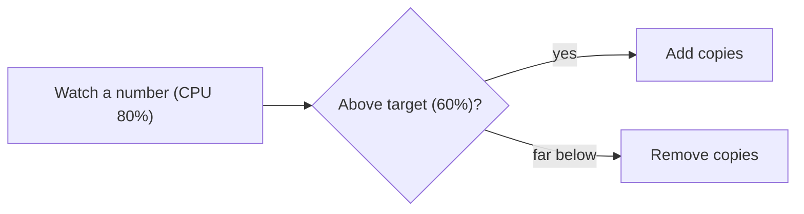
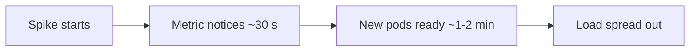
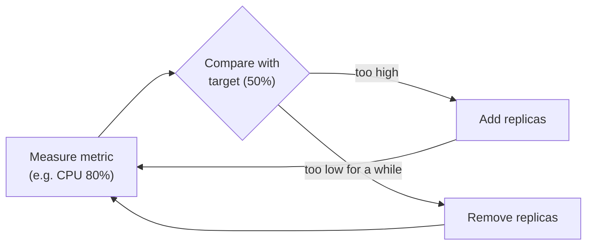
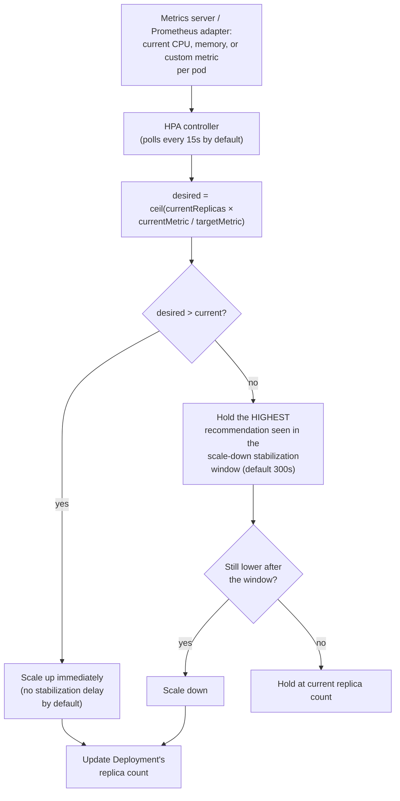
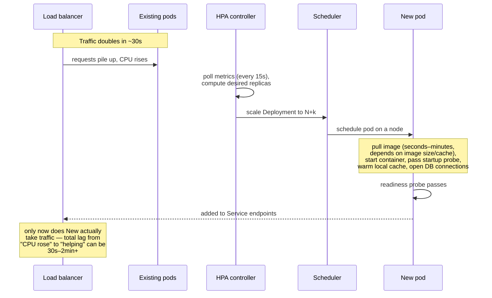
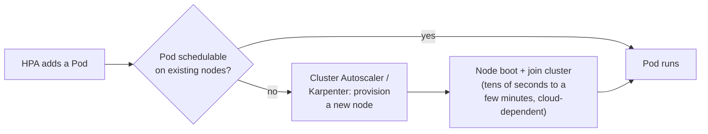
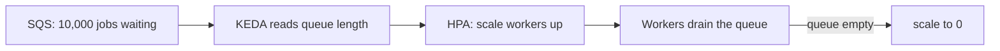

# Autoscaling

> [!summary] TL;DR
> Autoscaling automatically changes how much compute capacity a service has — more replicas (horizontal), bigger replicas (vertical), or more nodes underneath them — in response to a metric, so capacity tracks load without a human watching a dashboard and changing a number by hand.

> [!abstract] Core idea
> - Horizontal (more replicas) scales further and is the default for stateless services; vertical (bigger replicas) has a ceiling (one machine's size) and needs a restart to resize.
> - The Kubernetes HPA formula is `desired = ceil(currentReplicas × currentMetric / targetMetric)` — a simple proportional controller, not magic.
> - The metric you pick matters more than the autoscaler: CPU lags real load; requests-per-pod or p95 latency tracks it faster; queue depth is the right metric for workers, which is what KEDA is for.
> - Scale-up is usually immediate; scale-down is deliberately delayed (a stabilization window) to avoid flapping — thrashing between adding and removing capacity every minute.
> - New capacity isn't instant: image pull, cache warm-up, and connection-pool ramp-up all add lag between "autoscaler decided to add a Pod" and "that Pod is actually helping."

## Start here: the basics 🟢

> [!info] How to read this note (pick your level)
> - 🟢 **New to this?** Read "From zero" below, then sections 1, 2 and 10 (why, mental model and the cheat sheet). Stop there, that is a full first pass.
> - 🟡 **Know the basics?** Add sections 3, 4, 5 and 6 (how it works, a worked example, options and trade-offs).
> - 🔴 **Interview / SDE-3 prep?** Add sections 7, 8 and 9 (production, deep dive and interview questions). Headings are tagged 🟢🟡🔴 so you always know where you are.

> [!note] Before this note
> - [[Kubernetes Fundamentals]]: a Deployment keeps N copies (pods) running, a Service spreads traffic only to ready pods, and each pod has CPU/memory requests and limits.

**From zero, in 60 seconds** 🟢

Traffic is never flat. A sale can bring 5 times the normal load in a minute.
Too few servers and users see errors. Too many and you burn money all night.
**Autoscaling** adds or removes servers by itself, based on a number it watches, like CPU use.



It works like a thermostat: set a target, and it keeps nudging toward it.
The catch is lag: new copies take a minute or two to be ready, so the spike hits first.



The rest of this note is just these 3 questions:
1. How does the Kubernetes autoscaler decide how many copies?
2. What other kinds exist (bigger pods, more machines, scale on queue length)?
3. Which metric should you scale on, and how do you deal with the lag?


**The problem in one story.**
Your ticket-booking API runs on 3 servers and handles a normal evening fine.
A big movie opens and traffic triples in ten minutes; the 3 servers slow down and requests time out.
At 3am traffic is near zero, yet you still pay for 3 servers.
Autoscaling adds servers when load rises and removes them when it falls, without a human watching.

**Words you need first**

| Word | Plain meaning | Tiny example |
| --- | --- | --- |
| Replica / Pod | One running copy of your service | 5 pods of the API = 5 copies |
| Horizontal scaling | Add more copies | 3 pods → 6 pods |
| Vertical scaling | Make each copy bigger | 1 CPU → 2 CPUs per pod |
| Metric | A measured number about the system | CPU 80%, 200 requests/s per pod |
| Target | The value you want the metric to sit at | "keep CPU near 50%" |
| Node | A machine that pods run on | One EC2 instance in the cluster |
| Queue depth | How many jobs are waiting to be processed | 10,000 messages in SQS |
| HPA | Kubernetes' Horizontal Pod Autoscaler: changes the number of pods from a metric | 3 pods → 5 pods |
| Stabilization window | How long the autoscaler waits before scaling down, to be sure load really dropped | 300 seconds by default |
| Flapping | Adding and removing pods over and over as a metric bounces around its target | Up at 10:01, down at 10:02, up at 10:03 |
| Cold start | The time a brand-new pod needs before it is useful | Pull image, start, warm cache: ~1 min |
| p95 latency | The time 95% of requests finish within; the slowest 5% take longer | p95 = 200 ms |
| Cluster Autoscaler / Karpenter | Tools that add or remove whole machines (nodes) when pods have nowhere to run | Adds 1 EC2 instance |
| KEDA | An add-on that scales pods on things like queue length, even down to zero | Scale workers on SQS backlog |

**Picture it**



**Analogy.** A supermarket opens more checkout counters when queues grow and closes them when the store empties.
Where it breaks: a cashier can start in seconds; a new pod needs time to pull its image and warm up, so help arrives late.

**How the rest of this note builds up**

- First, why autoscaling exists (section 1) and the thermostat mental model (section 2).
- Then the HPA control loop and formula, the scale-up lag, VPA, Cluster Autoscaler/Karpenter, KEDA, AWS policy types and how to pick a metric (section 3).
- Then the HPA math in Go, a manifest and worked load-test numbers (section 4), and comparisons (section 5).
- Finally the SDE-3 deep dive: trade-offs, production failure modes and downstream limits (sections 6-8).

> [!tip] Remember
> Autoscaling is a feedback loop: measure, compare with a target, add or remove capacity, and remember new capacity is never instant.

## 1. Why it exists 🟢

A checkout service normally serves 200 requests/second on 4 pods at 30% CPU. A flash sale starts and traffic jumps to 2,000 requests/second within two minutes.

Fixed capacity means one of two outcomes: the team over-provisions for the peak year-round (paying for 10x capacity 95% of the time), or the service falls over during the spike because nobody manually added pods fast enough.

Autoscaling automates the "add capacity" decision so it happens in seconds to minutes instead of whenever a human notices and acts, and automates "remove capacity" so the team isn't paying for peak-sized infrastructure during the other 95% of the time.

The core trade-off this note works through: a metric-driven feedback loop is strictly faster than a human, but it's also a control system with its own failure modes — oscillation, lag, and the fact that adding a Pod doesn't instantly add usable capacity.

### Real-life example: Tatkal booking at 10 a.m. 🟢

Railway Tatkal tickets on IRCTC open at a fixed time every morning, and a huge crowd hits "book" within the same minute.
A purely reactive autoscaler would only notice once servers are already overloaded, and new copies would arrive a minute or two late.
Because the rush is at a known time, the smart move is scheduled scaling: add capacity at 9:50, before the crowd arrives.
After the rush, the autoscaler slowly removes the extra copies, waiting a few minutes to be sure the load really dropped.
Reactive scaling handles surprises; scheduled scaling handles rushes you can see coming.

## 2. Mental model 🟢

An autoscaler is a **thermostat for capacity**: it watches a metric (CPU, requests/sec, queue depth), compares it to a target, and adjusts the number of replicas (or node capacity) to close the gap.

This is the same reconciliation idea as the rest of Kubernetes (see [[Kubernetes Fundamentals]]), just with "how many Pods" as the thing being reconciled instead of "is this Pod running."

Like a real thermostat, it has to avoid overcorrecting: if it reacted to every momentary blip, it would oscillate (add a pod, see the average CPU drop because of it, remove the pod, see CPU rise again, repeat).

The stabilization window is literally the thermostat's dead-band (the small range where it deliberately does nothing) — don't act on every tiny excursion, only on a sustained one.

## Common beginner mistakes 🟢

- **Setting no `maxReplicas`** → a bug or an attack can scale you to hundreds of pods and a huge bill → always set a ceiling and alert when you sit at it.
- **Scaling an I/O-heavy Go API on CPU only** → requests pile up while CPU stays low, so it scales too late → scale on requests per pod or latency.
- **Expecting new pods to help instantly** → image pull and warm-up take a minute or more → keep `minReplicas` high enough to ride out the first minute, and pre-pull images.
- **Forgetting the database** → 30 new pods can open more connections than the database allows → put a connection pooler in front and size it for `maxReplicas`.
- **Scaling workers on CPU** → an idle worker says nothing about how many jobs are waiting → scale workers on queue length with KEDA.

## 3. How it works 🟡

> 🟢 → 🟡 **You now know** that autoscaling is a thermostat for capacity, and that new capacity always arrives a little late. **Next we open the box**: the exact math Kubernetes uses, where the lag comes from, the other kinds of autoscalers (bigger pods, more machines, queue-based), AWS's versions, and how to pick the number to watch.

### The Horizontal Pod Autoscaler (HPA) control loop

**In plain words:** every 15 seconds it checks the metric and does simple math: if pods are at 2x the target, ask for 2x the pods.

**Step by step:**
1. A metrics collector (the metrics server, or a Prometheus adapter for custom numbers) reports average CPU per pod: 80%.
2. Every 15 seconds the HPA reads it. Target is 50%, and there are 3 pods.
3. Math: 3 × 80 / 50 = 4.8, rounded up to 5 pods.
4. 5 is more than 3, so it scales up right away by changing the Deployment's replica count.
5. Later CPU drops to 20%. The math says 2 pods, but the HPA waits 5 minutes (the stabilization window) and only scales down if the lower number holds the whole time.



`desired = ceil(currentReplicas × currentMetric / targetMetric)` is the whole algorithm for one metric. With 3 pods averaging 80% CPU against a 50% target: `ceil(3 × 80/50) = ceil(4.8) = 5`.

Scale-up acts on this immediately; scale-down holds at the highest recommendation seen across the stabilization window so a brief dip doesn't trigger a scale-down that then has to reverse itself seconds later when load comes back.

### A scale-up under load: the lag that matters

**In plain words:** the extra pods don't appear right away. Add up the delays to know how long you must survive on the old count.

**Step by step (a typical timeline):**
1. 0 s: traffic doubles. The existing 4 pods slow down.
2. ~15-30 s: the HPA's next check sees high CPU and asks for more pods.
3. ~30-60 s: new pods are placed on nodes and pull the image (slower if the image is big and not cached).
4. ~60-90 s: they start, open DB connections, warm caches, and pass readiness.
5. Only now do they take traffic. For the first minute or so, the old pods carried everything alone.



Every step after "HPA decides to scale" is latency that a raw CPU-based policy doesn't account for. If the image needs pulling (no pre-pulled cache on that node) and the app opens a connection pool against the database on startup, the new pod can take well over a minute before it's actually absorbing load — during which the existing pods are still overloaded.

This is why metric choice and pre-warming matter as much as the scaling formula.

### Vertical Pod Autoscaler (VPA) and Cluster Autoscaler / Karpenter

**In plain words:** VPA makes each pod bigger instead of adding pods. Cluster Autoscaler and Karpenter add whole machines when pods have nowhere to run.

**Step by step:**
1. VPA watches a pod that always uses 900 MiB but asks for only 256 MiB. It recommends (or sets) 1 GiB, and the pod is restarted with the new size.
2. The HPA asks for 10 pods, but the cluster's nodes only have room for 7. Three pods sit "Pending".
3. Cluster Autoscaler sees the Pending pods and adds a node of a pre-set type; Karpenter picks the cheapest machine that fits those exact pods.
4. The new node boots and joins (tens of seconds to minutes), and the 3 pods finally start.

- **VPA** (a separate open-source project, not a built-in Kubernetes controller) recommends or automatically sets a Pod's CPU/memory `requests`/`limits` based on observed usage, instead of (or alongside) HPA's replica-count scaling. Because changing a Pod's resources requires recreating it, VPA in "Auto" mode causes restarts — it does not resize a running container in place. Running HPA on CPU/memory and VPA on the same resource at once is explicitly unsupported (they fight each other); combine HPA on a custom metric with VPA on resources if you want both.
- **Cluster Autoscaler** adds or removes **nodes**, not Pods — it watches for Pods that can't be scheduled because no node has room, and adds a node; it removes nodes that are empty enough and whose Pods could be rescheduled elsewhere. It only reacts to scheduling pressure, so it's inherently a layer behind HPA: HPA adds a Pod, that Pod can't be scheduled, only then does Cluster Autoscaler add a node.
- **Karpenter** is a newer alternative that provisions nodes directly from a workload's actual pending requirements (exact instance type and size for the pending Pods) rather than scaling a pre-defined node group (a set of identical machines of one type) up and down, so it tends to bin-pack (fit pods onto as few machines as possible) more efficiently and provision faster than Cluster Autoscaler's "add one more node of this fixed type" approach.



### KEDA: scaling on things that aren't CPU

**In plain words:** KEDA lets you scale on things like "messages waiting in the queue", and can even scale down to zero.

**Step by step:**
1. An email worker reads jobs from an SQS queue. At night the queue is empty, so KEDA keeps 0 workers.
2. A campaign drops 10,000 jobs into the queue.
3. KEDA sees the queue length and tells the HPA machinery to target, say, 100 jobs per worker: 100 workers (capped by your max).
4. As the queue drains, workers are removed, back to 0 when it is empty.



HPA natively scales on CPU, memory, or a custom metric exposed through the metrics API. **KEDA** (Kubernetes Event-Driven Autoscaling) plugs many more sources — queue depth (SQS, Kafka lag, meaning how far a consumer is behind the newest message, RabbitMQ), cron schedules, Prometheus queries — into that same HPA mechanism, and crucially can scale a Deployment **to zero** when there's no work, which core HPA cannot do.

This is the right tool for a worker pool consuming a queue: "CPU" on an idle worker tells you nothing; queue depth tells you exactly how much work is backed up.

### AWS policy types: target tracking, step, scheduled

**In plain words:** AWS gives three styles: keep a number at a target, jump by steps at thresholds, or scale on a clock (e.g., 9 am every day).

**Step by step (choosing one):**
1. Load changes smoothly and you can name a target ("CPU at 50%")? Target tracking. This is the default.
2. You want a small reaction to a small breach and a big reaction to a big one? Step scaling, with bands you choose.
3. You know when the rush comes (10 a.m. every day, a sale at 8 p.m.)? Scheduled scaling, set to grow before it starts.
4. The pattern repeats daily or weekly? Predictive scaling learns it and scales ahead.

Kubernetes only really ships one scaling shape (the HPA's target-tracking formula above), but AWS Auto Scaling (EC2 ASGs, Auto Scaling Groups that keep a fleet of identical VMs, and ECS service auto scaling) exposes several, and picking the wrong one is a common AWS-specific mistake:

- **Target tracking** is the one this note's formula generalizes: pick a metric and a target value (e.g. CPU at 50%, or ALB request count per target), and the policy continuously adds/removes capacity to hold the metric near that target — equivalent in spirit to the HPA loop above.
- **Step scaling** reacts to how far a CloudWatch alarm's (a rule that fires when an AWS metric crosses a line) metric is past its threshold, in bands: for example, add 1 instance if CPU is 50–70%, add 3 if it's over 70%. It is coarser and more manual to tune than target tracking (someone has to choose the bands), but it is useful when the response should be proportionally bigger for a bigger breach rather than smoothly continuous.
- **Scheduled scaling** sets `minSize`/`maxSize`/`desiredCapacity` at fixed times (before a known batch job, before a marketing push with a known start time) — no metric involved at all, just a cron-like trigger.
- **Predictive scaling** forecasts load from historical patterns and pre-scales ahead of it — the AWS-native version of the "predictive and scheduled scaling" idea covered in the deep dive below.

Target tracking is the default choice and the closest AWS analog to Kubernetes HPA; reach for step scaling only when the response genuinely needs to be tiered, and scheduled/predictive scaling when the load pattern is known in advance rather than purely reactive.

### Picking the metric

**In plain words:** CPU is easy but late. Requests per second or queue length show real load sooner.

**Step by step (ask these in order):**
1. Is it a worker reading a queue? Scale on queue length or the age of the oldest message.
2. Is it an HTTP API? Scale on requests per pod, which rises the moment traffic rises.
3. Do you promise users a response time? Watch p95 latency too, as the thing you are protecting.
4. None of the above wired up yet? CPU is fine as a starting point, knowing it reacts late.

| Metric | Tracks real load | Lag | Good for |
| ------ | ----------------- | --- | -------- |
| CPU utilization | Loosely — depends on whether the workload is actually CPU-bound | High (CPU often rises only after requests are already queuing) | Simple default when nothing better is wired up |
| Memory utilization | Rarely a good proxy for load on a stateless API | High, and often misleading | Workloads with a real memory-proportional-to-load relationship (caches) |
| Requests per pod (custom metric) | Directly | Low | HTTP services where request count correlates with work done |
| p95/p99 latency | Directly, and it's what users feel | Low, but noisier (needs a real sample size) | Services where latency SLOs (the response-time targets the team promises) are the thing actually being protected |
| Queue depth / message age | Directly, for async work | Low | Workers (via KEDA) — CPU on an idle worker says nothing about backlog |

CPU is the default because it's always available with zero setup, but it's a lagging, indirect proxy. A service that spends most of its time waiting on a downstream call (common for I/O-bound Go services) can have request queues building up while CPU stays low — scaling on CPU alone misses that entirely.

## 4. Worked example 🟡

### Whiteboard version

The bare formula, no clamping, no stabilization:

```go
desired := int32(math.Ceil(float64(currentReplicas) * currentMetric / targetMetric))
```

The full version below adds the min/max clamp real HPA always applies, and the scale-down stabilization window that prevents flapping.

### HPA math and the stabilization window, in Go

**In plain words:** Go code of the scaling formula, plus the "wait a few minutes before scaling down" rule that stops flapping.

```go
package hpa

import "math"

// Recommendation is one control-loop tick's desired replica count,
// tagged with a logical timestamp (tick index) so a stabilization
// window can look back over recent recommendations.
type Recommendation struct {
	Tick     int
	Replicas int32
}

// DesiredReplicas implements the Kubernetes HPA formula:
//
//	desiredReplicas = ceil(currentReplicas * (currentMetricValue / desiredMetricValue))
//
// clamped to [minReplicas, maxReplicas]. currentMetric and targetMetric
// are in the same unit (e.g. millicores, or requests/sec per pod).
func DesiredReplicas(currentReplicas int32, currentMetric, targetMetric float64, minReplicas, maxReplicas int32) int32 {
	if targetMetric <= 0 || currentReplicas <= 0 {
		return minReplicas
	}
	ratio := currentMetric / targetMetric
	desired := int32(math.Ceil(float64(currentReplicas) * ratio))
	if desired < minReplicas {
		desired = minReplicas
	}
	if desired > maxReplicas {
		desired = maxReplicas
	}
	return desired
}

// Stabilize applies the scale-down stabilization window: it never scales
// down below the highest recommendation seen in the last windowTicks
// ticks, which is how the HPA controller avoids flapping when a metric
// dips briefly. Scale-up is never delayed. history must be ordered
// oldest-first and include the current tick's recommendation last.
func Stabilize(history []Recommendation, windowTicks int) int32 {
	if len(history) == 0 {
		return 0
	}
	current := history[len(history)-1]
	cutoff := current.Tick - windowTicks
	best := current.Replicas
	for i := len(history) - 1; i >= 0; i-- {
		r := history[i]
		if r.Tick <= cutoff {
			break
		}
		if r.Replicas > best {
			best = r.Replicas
		}
	}
	return best
}
```

Tests, exactly as run against Go 1.24 (`go vet` clean, `go test -race` passes):

**What this code does, in plain words:** the tests feed in sample numbers (pods, current metric, target) and check the answer is right: rounding up, staying inside the min/max limits, and not scaling down until the lower number has held for the whole waiting window.

```go
func TestDesiredReplicas_ScalesProportionally(t *testing.T) {
	// 3 pods averaging 80% CPU against a 50% target: ceil(3 * 80/50) = ceil(4.8) = 5.
	got := DesiredReplicas(3, 80, 50, 1, 10)
	if got != 5 {
		t.Fatalf("DesiredReplicas = %d, want 5", got)
	}
}

func TestStabilize_HoldsHighestRecentRecommendation(t *testing.T) {
	// CPU spiked to 8 replicas three ticks ago then dropped to 3: the
	// scale-down stabilization window (5 ticks) must hold at 8 so the
	// controller doesn't flap back down immediately.
	history := []Recommendation{
		{Tick: 1, Replicas: 3},
		{Tick: 2, Replicas: 8},
		{Tick: 3, Replicas: 4},
		{Tick: 4, Replicas: 3},
		{Tick: 5, Replicas: 3}, // current tick's own recommendation
	}
	got := Stabilize(history, 5)
	if got != 8 {
		t.Fatalf("Stabilize = %d, want 8 (held from tick 2)", got)
	}
}

func TestStabilize_ScalesDownOnceSpikeAgesOutOfWindow(t *testing.T) {
	history := []Recommendation{
		{Tick: 1, Replicas: 8},
		{Tick: 2, Replicas: 3},
		{Tick: 3, Replicas: 3},
		{Tick: 4, Replicas: 3},
		{Tick: 5, Replicas: 3},
		{Tick: 6, Replicas: 3}, // tick 1's spike is now outside a 5-tick window
	}
	got := Stabilize(history, 5)
	if got != 3 {
		t.Fatalf("Stabilize = %d, want 3 once the spike ages out", got)
	}
}
```

### HPA manifest (Kubernetes 1.31+)

**What this file does, in plain words:** it tells Kubernetes to keep the `api` Deployment between 3 and a set maximum of pods, aiming at a fixed number of requests per second per pod, and limits how many pods may be added or removed per minute.

```yaml
apiVersion: autoscaling/v2
kind: HorizontalPodAutoscaler
metadata:
  name: api
spec:
  scaleTargetRef:
    apiVersion: apps/v1
    kind: Deployment
    name: api
  minReplicas: 3
  maxReplicas: 30
  metrics:
    - type: Pods
      pods:
        metric: { name: http_requests_per_second }
        target: { type: AverageValue, averageValue: "50" }
  behavior:
    scaleDown:
      stabilizationWindowSeconds: 300
      policies:
        - type: Pods
          value: 2
          periodSeconds: 60 # remove at most 2 pods/minute once stabilized
    scaleUp:
      stabilizationWindowSeconds: 0
      policies:
        - type: Pods
          value: 4
          periodSeconds: 60 # add at most 4 pods/minute, bounds a runaway metric
```

This scales on requests-per-second per pod (a custom metric, lower lag than CPU) rather than CPU, keeps `minReplicas: 3` so a traffic dip never scales to a cold start from zero, and caps both the scale-up and scale-down rate per minute so neither direction can swing capacity too fast relative to how quickly new pods actually become useful (the lag discussed above).

### Representative worked numbers: a load test proving the lag

```text
representative output — load test, ramping 200 → 2,000 req/s over 90s
t=0s    200 req/s,  4 pods,  28% CPU/pod,  p95 latency 40ms
t=30s   900 req/s,  4 pods,  61% CPU/pod,  p95 latency 95ms   <- HPA fires at ~50% target
t=45s   1400 req/s, 4 pods,  CPU still high; new pods scheduled, pulling image
t=75s   1900 req/s, 7 pods,  3 new pods now passing readiness, taking traffic
t=90s   2000 req/s, 9 pods,  59% CPU/pod,  p95 latency 58ms   <- stabilizing: requests/pod back near
                                                                  the t=30 level (222 vs. 225), so CPU
                                                                  holds rather than climbing further
```

Measured pattern (representative, not from a live run in this environment): roughly 60–90 seconds of elevated latency between the metric crossing its target and new capacity actually absorbing load, driven mostly by image pull and readiness, not by the HPA's own poll interval (15s).

Note that CPU/pod at t=90s (59%) is close to CPU/pod at t=30s (61%) — total traffic grew 2.2x (900→2000) while replica count grew 2.25x (4→9), so per-pod load, and the utilization it drives, stayed roughly flat instead of dropping to idle; the win is that CPU stopped climbing and latency recovered, not that the pods are now underloaded.

Pre-pulling images to nodes (a DaemonSet, which runs one pod on every node, or a node image cache) and keeping a startup probe tight are the two levers that shrink this window the most.

## 5. Variants and comparison 🟡

| Mechanism | Scales what | Metric source | Reacts to |
| --------- | ----------- | --------------- | --------- |
| Kubernetes HPA | Replica count (horizontal) | Metrics server, custom/external metrics API | CPU, memory, custom, external |
| Kubernetes VPA | Per-pod CPU/memory requests (vertical) | Metrics history (VPA recommender) | Sustained under/over-provisioning |
| Cluster Autoscaler | Node count | Unschedulable Pods / underutilized nodes | Scheduling pressure, not a metric directly |
| Karpenter | Node count, chosen per workload's exact needs | Unschedulable Pods | Scheduling pressure, with faster and tighter provisioning |
| KEDA | Replica count, including to zero | Queue depth, cron, Prometheus query, 60+ scalers | Event/work backlog, not just resource usage |
| AWS EC2 Auto Scaling Group (target tracking) | EC2 instance count | CloudWatch metric (CPU, ALB request count per target) | Same proportional idea as HPA, for raw EC2 fleets |
| ECS Service Auto Scaling | ECS task count | CloudWatch metric, same target-tracking policies | Same idea again, for ECS tasks instead of Pods |

## 6. Trade-offs and when not to use 🟡

- Autoscaling adds a feedback loop with its own failure modes (lag, flapping, wrong metric) on top of the system you're trying to make more reliable. A service with flat, predictable traffic and headroom to spare doesn't need it — fixed capacity sized for peak is simpler and has one less moving part to misconfigure.
- Horizontal scaling assumes the workload is actually horizontally scalable — stateless, or state externalized to a shared store. A service holding significant in-memory state per connection (a long-lived WebSocket, a connection that stays open for two-way messages, with session state, see [[Scaling WebSockets]] if that's your case) doesn't benefit from "add more pods" the same simple way.
- Scaling pods up faster than downstream dependencies can handle just moves the bottleneck: 30 new API pods all opening a fresh connection pool against the database can exhaust the database's `max_connections` (the most client connections it accepts at once) in seconds. See [[Connection Pooling]] — use a connection pooler (PgBouncer, RDS Proxy: a middle layer that lets many app connections share a few real DB connections) sized for the autoscaler's max, not the current replica count.
- Cost guardrails (`maxReplicas`, node group size caps) are not optional extras — a metric that misbehaves (a bug causing CPU to pin at 100%, a DDoS, a flood of attack traffic) with no upper bound turns "autoscaling saved us" into "autoscaling just spent the month's cloud budget in an hour."

## 7. In production 🔴

> 🟡 → 🔴 **You now know** the HPA formula and its scale-down wait, where the lag comes from, VPA, node autoscalers, KEDA, AWS policy types and how to pick a metric. **Next is the advanced part**: the ways autoscaling goes wrong in real systems (flapping, cold starts, downstream limits, runaway cost) and the deeper design choices behind it.


- **Real systems:** Kubernetes HPA and Cluster Autoscaler/Karpenter are the default scaling stack for any Kubernetes-based service at scale. KEDA is the standard answer for scaling consumers against Kafka/SQS/RabbitMQ backlog, including scale-to-zero for bursty batch-style workers. AWS target-tracking policies power EC2 ASGs and ECS service auto scaling the same way outside Kubernetes.
- **Failure modes → fixes:**
  - **Flapping:** metric oscillates around the target, scaling up and down every minute → widen the stabilization window, or scale on a smoothed/averaged metric instead of an instantaneous one.
  - **Cold-start cost dominates:** new pods take so long to become useful that the scale-up barely helps during a fast spike → pre-pull images, warm caches during startup probes rather than after readiness passes, keep `minReplicas` high enough to absorb the first seconds of a spike without waiting on new capacity at all.
  - **Downstream bottleneck:** pods scale fine but the database or a third-party API's rate limit caps real throughput anyway → autoscaling the pod tier doesn't help; fix or scale the actual bottleneck (read replicas, a connection pooler, caching, backpressure, meaning slowing or rejecting input when you are full).
  - **Cost explosion:** a runaway metric (bug, attack) drives `maxReplicas` repeatedly → bound `maxReplicas` and node group size deliberately, and alert on sustained high replica counts, not just on being at max (being pinned at max for an hour is itself the signal something's wrong).
- **What to monitor:** actual vs. desired replica count over time, time-to-ready for new pods (the cold-start lag), scale-down stabilization triggering too often or too rarely, and the downstream resource (DB connections, third-party quota) that the autoscaled tier puts pressure on.

## 8. Deep dive 🔴

- **Why scale-up has no default stabilization but scale-down does.** The asymmetry is deliberate: being briefly over-provisioned (extra pods for a few minutes) is cheap and safe; being under-provisioned (not enough pods) causes user-facing errors or latency immediately. The HPA's default `behavior` reflects that asymmetric cost — react to "need more" instantly, be patient about "need less."
- **Validating with load tests.** The HPA formula and manifest are easy to write and easy to get wrong in ways that only show up under real load — a target set too high (scaling only kicks in once things are already bad), a metric that doesn't actually track the real bottleneck, or downstream capacity that can't keep up with the autoscaler's `maxReplicas`. A load test that ramps traffic the way a real spike would (not an instant step function) is the only way to measure the actual time-to-recover, which is the number that matters, not the formula in isolation.
- **Predictive and scheduled scaling** pre-scale ahead of a known pattern (a lunch-hour spike, a scheduled batch job, a marketing push with a known start time) instead of reacting after the metric crosses the target — trading "always correct" for "correct ahead of time for predictable load," which matters when the cold-start lag (image pull, cache warm, connection pools) is itself the bottleneck a reactive policy can't out-run.
- **Combining HPA and VPA safely.** Running both on CPU/memory for the same Deployment causes them to fight — VPA resizing pods changes the per-pod metric HPA is averaging, feeding back into HPA's own decision. The supported pattern is HPA on a custom or external metric (requests/sec, queue depth) and VPA (in recommendation-only mode, or on a resource HPA isn't scaling on) handling right-sizing.
- **Karpenter's node-level bin-packing** picks the actual cheapest instance shape that fits a batch of pending Pods' requests, rather than scaling a fixed-shape node group — which matters at the margin for cost (fewer wasted, partially-empty nodes of one fixed size) and for workloads with uneven resource shapes (some pods CPU-heavy, some memory-heavy) that a single node group size fits poorly.

## 9. Interview questions 🔴

> [!question]- Write out the Kubernetes HPA formula and apply it to a concrete example.
> `desired = ceil(currentReplicas × currentMetric / targetMetric)`. With 3 pods at 80% CPU against a 50% target: `ceil(3 × 80/50) = ceil(4.8) = 5`.

> [!question]- Why does the HPA delay scaling down but not scaling up?
> Being briefly over-provisioned is cheap; being under-provisioned causes immediate user-facing impact. The default behavior reacts to "need more" instantly and holds the highest recent recommendation for a stabilization window (default 300s) before scaling down, to avoid flapping on a brief dip.

> [!question]- Why is CPU often a poor autoscaling metric for an I/O-bound Go service?
> A service spending most of its time waiting on a downstream call (database, third-party API) can have requests queuing up while CPU stays low, since the CPU isn't the bottleneck. Scaling on CPU alone reacts late or not at all; requests-per-pod or p95 latency tracks the real load more directly.

> [!question]- What's the difference between what Cluster Autoscaler and HPA each react to?
> HPA reacts to a metric (CPU, custom) crossing a target and changes replica count. Cluster Autoscaler reacts to Pods that can't be scheduled because no node has room, and changes node count. HPA can request more pods than the cluster currently has room for; Cluster Autoscaler is what then makes room.

> [!question]- When would you reach for KEDA instead of plain HPA?
> When the thing you need to scale on isn't a resource metric but a backlog — queue depth, Kafka consumer lag, a cron schedule — or when you need to scale a Deployment to zero when there's no work, which core HPA can't do. Typical case: a worker pool consuming SQS or Kafka.

> [!question]- Trap: "We autoscaled the API tier, so we're covered for the sale." What's missing?
> Autoscaling the API tier doesn't autoscale the database's connection limit or a third-party API's rate limit. Thirty new pods each opening a connection pool can exhaust `max_connections` in seconds, and the real bottleneck just moved downstream. Size a connection pooler and check every downstream dependency's own capacity against the autoscaler's `maxReplicas`.

> [!question]- Why can't you safely run HPA and VPA on the same resource for the same workload?
> VPA resizing pods changes the very metric (CPU/memory per pod) that HPA is averaging to decide replica count, so the two loops feed back into each other and can oscillate. The supported combination is HPA on a different metric (requests/sec, queue depth) with VPA handling resource sizing, or VPA in recommendation-only mode.

## 10. Cheat sheet 🟢

- `desired = ceil(currentReplicas × currentMetric / targetMetric)` — the whole HPA formula.
- Horizontal (more replicas) is the default; vertical (VPA, bigger replicas) needs a restart and has a per-machine ceiling.
- Scale up immediately; scale down after a stabilization window (default 300s) to avoid flapping.
- Pick the metric that tracks real load with low lag: requests/pod or p95 latency beat CPU for most I/O-bound services; queue depth (via KEDA) for workers.
- New capacity isn't instant — image pull, cache warm-up, and connection-pool ramp-up add real lag before a new pod helps.
- Cluster Autoscaler/Karpenter add nodes when Pods can't be scheduled; they're a layer behind HPA, not a replacement for it.
- Always set `minReplicas` (survive a traffic dip without a cold start) and `maxReplicas` (cap cost and protect downstream dependencies).
- Validate with a real ramping load test; a formula that looks right on paper can still be too slow once cold-start lag is accounted for.

## Self-check 🟢🟡

🟢 Easy

> [!question]- What is the difference between horizontal and vertical scaling?
> Horizontal adds more copies; vertical makes each copy bigger.

> [!question]- Why does a new pod not help the moment it is created?
> It must be placed, pull its image, start and pass readiness first, which can take a minute or more.

> [!question]- Why always set `maxReplicas`?
> To cap cost and protect the database if a bug or attack drives the metric up.

🟡 Medium

> [!question]- 4 pods average 90% CPU with a 60% target. How many pods does the HPA ask for?
> ceil(4 × 90 / 60) = ceil(6) = 6 pods.

> [!question]- Why does the HPA scale up at once but wait about 5 minutes to scale down?
> Too few pods hurts users right away; too many for a few minutes only costs a little, and waiting avoids flapping.

> [!question]- HPA wants 12 pods, but only 8 fit on the nodes. What adds room?
> Cluster Autoscaler or Karpenter, which add nodes when pods are stuck Pending.

## Links

- **Before this:** [[Kubernetes Fundamentals]]
- **Next:** [[Rollback and Safe Migrations]]
- **Compare with:** [[Connection Pooling]] (why autoscaling the app tier can overload the database tier), [[Load Balancing]] (routing traffic across whatever replica count autoscaling currently has)

### Watch on YouTube

- [Day 17/40 - Kubernetes Autoscaling Explained/ HPA Vs VPA](https://www.youtube.com/watch?v=afUL5jGoLx0) · Tech Tutorials with Piyush · 25 min · 31,305 views
- [Kubernetes Autoscaling: HPA vs. VPA vs. Keda vs. CA vs. Karpenter vs. Fargate](https://www.youtube.com/watch?v=hsJ2qtwoWZw) · Anton Putra · 14 min · 64,659 views
