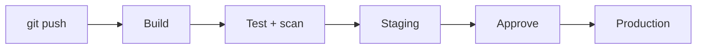
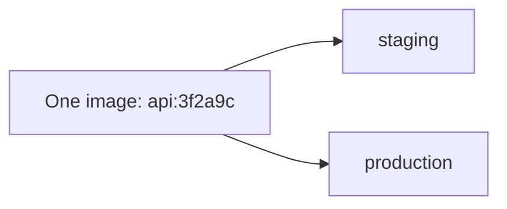
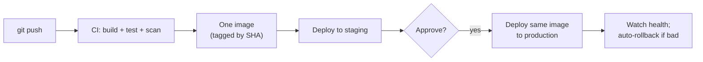
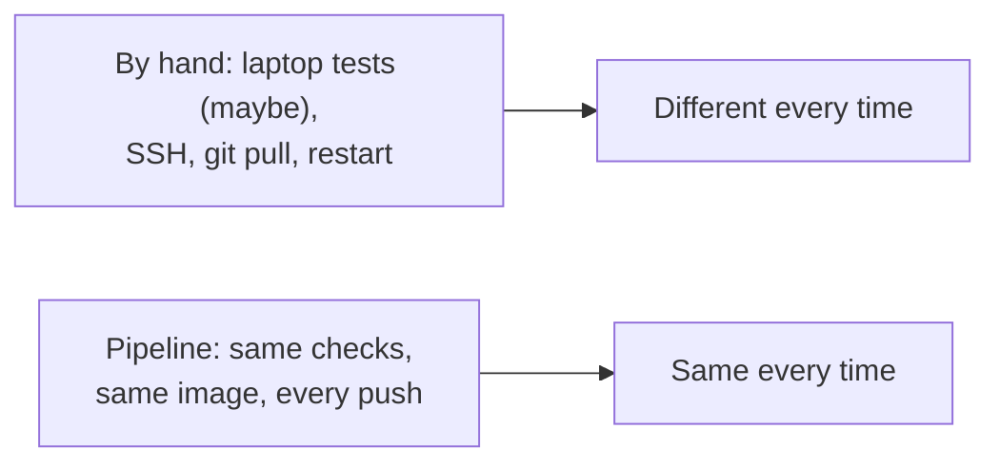
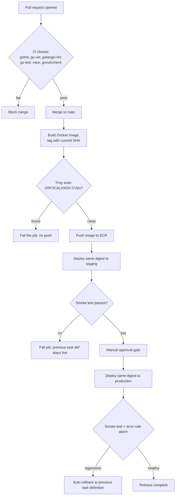
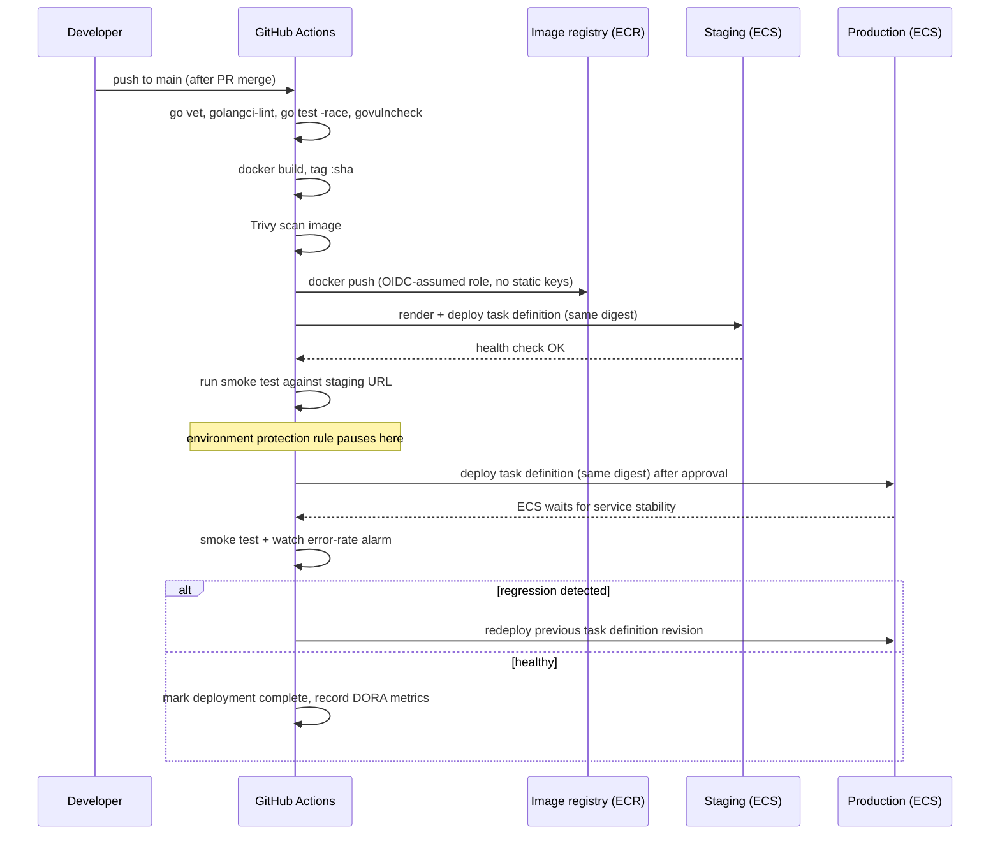

# CI-CD Pipelines (GitHub Actions for Go)

> [!summary] TL;DR
> A CI/CD pipeline is the automated path from a `git push` to a running deploy: it builds one artifact, tests and scans it, and then promotes that exact artifact through environments, with humans only approving the step into production.

> [!abstract] Core idea
> - Build the artifact **once** and promote the same image/digest through every environment; never rebuild per environment.
> - Continuous Integration (CI) is about trust: every merge is tested, linted and scanned before it can ship.
> - Continuous *delivery* means production is always one click away; continuous *deployment* means that click happens automatically.
> - Authenticate to the cloud with short-lived OIDC tokens, never long-lived access keys checked into pipeline secrets.
> - A pipeline without an automatic rollback trigger is not finished, it is a deploy script with extra steps.

## Start here: the basics 🟢

> [!info] How to read this note (pick your level)
> - 🟢 **New to this?** Read "From zero" below, then sections 1, 2 and 10 (why, mental model and the cheat sheet). Stop there, that is a full first pass.
> - 🟡 **Know the basics?** Add sections 3, 4, 5 and 6 (how it works, a worked example, options and trade-offs).
> - 🔴 **Interview / SDE-3 prep?** Add sections 7, 8 and 9 (production, deep dive and interview questions). Headings are tagged 🟢🟡🔴 so you always know where you are.

> [!note] Before this note
> - [[Testing in Go]]: `go test ./...` runs your tests, and `-race` also checks for data races between goroutines.
> - [[Containerizing Go Services]]: a Go service is shipped as a Docker image, built once from a Dockerfile.

**From zero, in 60 seconds** 🟢

Every time someone pushes code, a few things should happen: build it, test it, and if it is good, ship it.
Doing that by hand is slow and people skip steps.
A **CI/CD pipeline** is a robot that does those steps the same way every time.
**CI** (continuous integration) means build and test every push. **CD** (continuous delivery) means ship the tested result.



The key idea: build one package once, then move that exact package through each stage. Never rebuild for production.



The rest of this note is just these 3 questions:
1. What stages does a pipeline have, and what does each one catch?
2. What does a real GitHub Actions file for a Go service look like?
3. How do you check that a deploy actually works (smoke test)?


**The problem in one story.**
A developer finishes a change and copies it to the server by hand on Friday evening.
They forgot to run the tests, and the build on their laptop differs from the one on the server.
The site breaks, and nobody knows exactly which version is live.
A CI/CD pipeline makes every change go through the same automatic build, test and deploy steps.

**Words you need first**

| Word | Plain meaning | Tiny example |
| --- | --- | --- |
| Commit / push | Saving a change in Git and sending it to GitHub | `git push origin main` |
| Build | Turning source code into something runnable | `go build` makes a binary |
| Artifact / image | The packaged output of a build | A Docker image tagged with the commit SHA |
| Environment | A separate place the app runs | staging vs production |
| Workflow / job | A set of automated steps GitHub Actions runs | "test" job, then "deploy" job |
| Secret / credential | A password or key that grants access | AWS keys (avoid long-lived ones) |
| Rollback | Going back to the previous working version | Redeploy yesterday's image |
| Lint | An automatic check for style mistakes and likely bugs | `golangci-lint run` |
| Vulnerability scan | Checking code or an image against lists of known security holes (CVEs) | `govulncheck`, Trivy |
| Staging | A copy of production used for a final check before real users | `staging.example.com` |
| Smoke test | A quick check, right after a deploy, that the main thing works | `GET /healthz` returns 200 |
| Approval gate | A pause where a human must click "approve" before production | GitHub environment with required reviewers |
| OIDC | A way for the pipeline to get short-lived cloud access instead of a stored password | GitHub token → 1-hour AWS credentials |
| DORA four keys | Four standard numbers for how fast and safely a team ships | Deploys per day, change failure rate |

**Picture it**



**Analogy.** A pipeline is a car factory assembly line: every car passes the same stations and inspections, and the exact car that passed inspection is the one shipped.
Where it breaks: a factory rarely recalls a car within minutes; a good pipeline can roll a bad deploy back automatically almost right away.

**How the rest of this note builds up**

- First, why pipelines exist (section 1) and the mental model (section 2).
- Then how the stages connect: build once, promote, OIDC auth (section 3).
- Then a full GitHub Actions pipeline deploying a Go service to ECS, and a smoke-test gate in Go (section 4), plus comparisons (section 5).
- Finally the SDE-3 deep dive: trade-offs, production practice, and pipeline internals (sections 6-8).

> [!tip] Remember
> Build once, test it, then promote that exact same artifact to every environment, with rollback wired in.

## 1. Why it exists 🟢

Before CI/CD, a typical release looked like this: an engineer runs the test suite on their laptop (if they remember to), SSHes into (opens a remote terminal on) a production box, `git pull`s, restarts the process, and watches the logs for a minute. Three things go wrong with this in practice:

- **It doesn't scale with team size.** Two engineers deploying by hand to the same fleet will eventually overwrite each other's release, or deploy from a dirty working tree (local files with uncommitted changes) that was never tested.
- **It is not repeatable.** "Works on my machine" becomes "works on the machine I happened to SSH into," because the build step ran somewhere different from where the tests ran.
- **It has no gate.** Nothing stops an engineer from deploying code that fails `go vet` or a unit test; the only test environment is production.

**Documented numbers (DORA 2024 State of DevOps Report):** elite-performing teams deploy to production multiple times a day with change failure rates (the share of deploys that cause a problem) around 5%, while low performers deploy between once a month and once every six months with change failure rates over 40%.

A pipeline is what turns "deploy" from a risky, manual ritual into a boring, frequent, low-risk event — which is exactly what lets a team ship fixes fast instead of batching up large, risky releases.



### Real-life example: many small releases a day 🟢

A food-delivery app like Swiggy has many teams changing code every day: menus, payments, delivery tracking.
If each release were done by hand, people would batch changes into big, scary weekly releases.
With a pipeline, every merge is built, tested and scanned automatically, and the exact image that passed staging is the one that reaches production.
If the error rate jumps after a deploy, the pipeline rolls back on its own.
Small, frequent, boring releases are the goal, and the pipeline is what makes them possible.

## 2. Mental model 🟢

A CI/CD pipeline is an assembly line for one commit. Each station either rejects the commit (test station finds a bug, scan station finds a CVE, a publicly listed security hole) or stamps it and passes it to the next station.

The stamp carries forward: once an artifact is built and tagged with the commit SHA, every later station — staging, production — runs *that exact artifact*, never a fresh rebuild.

That single rule, "build once, promote the same artifact," is what makes "it passed staging" mean something: if production used a different build, staging would have tested nothing.

## Common beginner mistakes 🟢

- **Rebuilding the image for each environment** → production runs a build that staging never tested → build once, then promote the same digest.
- **Tagging images only as `latest`** → you cannot tell which commit is live or go back to a specific one → tag by commit SHA and deploy by digest.
- **Storing long-lived AWS keys as pipeline secrets** → a leak works until someone notices → use OIDC to get short-lived credentials per run.
- **Running database migrations inside the code deploy** → a rollback can leave old code on a new schema → run migrations as their own backward-compatible step.
- **Re-running flaky tests until they pass** → CI stops meaning anything → quarantine flaky tests and fix them.

## 3. How it works 🟡

> 🟢 → 🟡 **You now know** that a pipeline builds one image per change, tests it, and promotes that same image to each environment. **Next we open the box**: every station a Go change passes, what each one catches, and how the pipeline gets into AWS safely and backs out if production looks bad.

**In plain words:** the pipeline is a line of stations. Each station either passes the commit on or stops it with a clear reason.

**Step by step (before merge):**
1. You open a pull request. GitHub Actions starts the CI job.
2. `gofmt` checks formatting, `go vet` and `golangci-lint` look for likely bugs, `go test -race` runs the tests, and `govulncheck` looks for known security holes in your Go libraries.
3. Any failure blocks the merge button. All green → you may merge to `main`.

**Step by step (after merge):**
1. The pipeline builds the Docker image once and tags it with the commit SHA, say `api:3f2a9c`.
2. Trivy scans the image; a critical CVE fails the job and nothing is pushed.
3. The image is pushed to ECR (AWS's image registry), using short-lived OIDC credentials.
4. The same image goes to staging, and a smoke test checks it answers.
5. A human approves; the same image goes to production. If the error rate jumps, the pipeline redeploys the previous version.





## 4. Worked example 🟡

### Whiteboard version

The smallest useful CI job: on every push, format-check, vet, and test the Go module. Nothing deploys until this passes.

```yaml
name: ci
on: [push, pull_request]
jobs:
  test:
    runs-on: ubuntu-latest
    steps:
      - uses: actions/checkout@v4
      - uses: actions/setup-go@v5
        with:
          go-version: "1.24"
      - run: go vet ./...
      - run: go test -race ./...
```

The full workflow below adds the production concerns: formatting and vulnerability checks, image build and scan, OIDC authentication instead of static AWS keys, a staging deploy with a smoke test, and a manually approved production deploy that promotes the identical image.

### Full pipeline: GitHub Actions deploying a Go service to ECS

**In plain words:** a complete workflow file. Read it top to bottom as "when this happens, run these jobs in this order".

This is a representative GitHub Actions workflow (action versions current as of November 2026). It assumes the repository already has `deploy/task-definition.json` (an ECS task definition template: the file that tells AWS ECS which image, CPU, memory and settings to run) and a Dockerfile as covered in [[Docker 04 - Writing a Production Dockerfile for Go]].

```yaml
name: ci-cd

on:
  push:
    branches: [main]
  pull_request:

permissions:
  contents: read
  id-token: write   # required so configure-aws-credentials can mint an OIDC token

env:
  GO_VERSION: "1.24"
  ECR_REPOSITORY: myapp
  ECS_CLUSTER: myapp-cluster

jobs:
  test:
    runs-on: ubuntu-latest
    steps:
      - uses: actions/checkout@v4
      - uses: actions/setup-go@v5
        with:
          go-version: ${{ env.GO_VERSION }}
          cache: true
      - name: Check formatting
        run: |
          out=$(gofmt -l .)
          if [ -n "$out" ]; then echo "$out"; echo "run gofmt -w ."; exit 1; fi
      - run: go vet ./...
      - name: Lint
        uses: golangci/golangci-lint-action@v6
        with:
          version: v1.61
      - run: go test -race -coverprofile=coverage.out ./...
      - name: Scan for known vulnerabilities
        run: go run golang.org/x/vuln/cmd/govulncheck@latest ./...

  build-and-push:
    needs: test
    if: github.ref == 'refs/heads/main'
    runs-on: ubuntu-latest
    outputs:
      image: ${{ steps.meta.outputs.image }}
    steps:
      - uses: actions/checkout@v4
      - name: Assume deploy role via OIDC (no long-lived AWS keys)
        uses: aws-actions/configure-aws-credentials@v4
        with:
          role-to-assume: arn:aws:iam::123456789012:role/github-actions-deploy
          aws-region: ap-south-1
      - name: Log in to ECR
        id: ecr-login
        uses: aws-actions/amazon-ecr-login@v2
      - name: Build and smoke-run the image tagged with the commit SHA
        id: meta
        env:
          REGISTRY: ${{ steps.ecr-login.outputs.registry }}
        run: |
          IMAGE="$REGISTRY/${{ env.ECR_REPOSITORY }}:${{ github.sha }}"
          docker build -t "$IMAGE" .
          docker run --rm "$IMAGE" --version   # fails the job fast if the binary cannot even start
          echo "image=$IMAGE" >> "$GITHUB_OUTPUT"
      - name: Scan the image for known CVEs (before it is ever pushed)
        uses: aquasecurity/trivy-action@0.24.0
        with:
          image-ref: ${{ steps.meta.outputs.image }}
          severity: CRITICAL,HIGH
          exit-code: "1"
      - name: Push the scanned image
        run: docker push ${{ steps.meta.outputs.image }}

  deploy-staging:
    needs: build-and-push
    runs-on: ubuntu-latest
    environment: staging
    steps:
      - uses: actions/checkout@v4
      - uses: aws-actions/configure-aws-credentials@v4
        with:
          role-to-assume: arn:aws:iam::123456789012:role/github-actions-deploy
          aws-region: ap-south-1
      - name: Render task definition with the new image
        id: render
        uses: aws-actions/amazon-ecs-render-task-definition@v1
        with:
          task-definition: deploy/task-definition.json
          container-name: myapp
          image: ${{ needs.build-and-push.outputs.image }}
      - name: Deploy to staging and wait for ECS service stability
        uses: aws-actions/amazon-ecs-deploy-task-definition@v2
        with:
          task-definition: ${{ steps.render.outputs.task-definition }}
          service: myapp-service-staging
          cluster: ${{ env.ECS_CLUSTER }}-staging
          wait-for-service-stability: true
      - name: Smoke test staging
        run: go run ./cmd/smoketest --url https://staging.internal.example/healthz --timeout 60s

  deploy-prod:
    needs: deploy-staging
    runs-on: ubuntu-latest
    environment: production   # GitHub environment protection rule requires a human approval here
    steps:
      - uses: actions/checkout@v4
      - uses: aws-actions/configure-aws-credentials@v4
        with:
          role-to-assume: arn:aws:iam::123456789012:role/github-actions-deploy
          aws-region: ap-south-1
      - name: Render task definition with the same image digest tested in staging
        id: render
        uses: aws-actions/amazon-ecs-render-task-definition@v1
        with:
          task-definition: deploy/task-definition.json
          container-name: myapp
          image: ${{ needs.build-and-push.outputs.image }}
      - name: Deploy to production (ECS circuit breaker rolls back on failed health checks)
        uses: aws-actions/amazon-ecs-deploy-task-definition@v2
        with:
          task-definition: ${{ steps.render.outputs.task-definition }}
          service: myapp-service
          cluster: ${{ env.ECS_CLUSTER }}
          wait-for-service-stability: true
      - name: Smoke test production
        run: go run ./cmd/smoketest --url https://api.example.com/healthz --timeout 60s
```

### The smoke-test gate, in Go

**In plain words:** after deploying, a tiny program pings the health URL a few times. If it never answers OK, the pipeline fails.

`cmd/smoketest` in the workflow above is this package. It polls a health endpoint with exponential backoff (waiting longer after each failed try: 1 s, 2 s, 4 s…) until it answers `200 OK`, or returns an error once the pipeline's own timeout elapses — the thing that turns "the deploy command returned 0" into "the service is actually serving traffic." It compiles and passes `go vet` and `go test -race` on Go 1.24.

```go
// Package deploy implements the post-deploy smoke-test gate used by a CI/CD
// pipeline: poll the service's health endpoint with backoff until it is
// healthy, or give up when the context deadline (the pipeline's smoke-test
// timeout) expires.
package deploy

import (
	"context"
	"fmt"
	"net/http"
	"time"
)

// WaitForHealthy polls url with client until it returns HTTP 200, backing
// off exponentially between attempts, or returns an error once ctx is done.
// A GitHub Actions job calls this right after a deploy step, before
// promoting a canary or marking a rollout complete.
func WaitForHealthy(ctx context.Context, client *http.Client, url string) error {
	backoff := 200 * time.Millisecond
	const maxBackoff = 5 * time.Second
	var lastErr error
	for {
		if err := probe(ctx, client, url); err == nil {
			return nil
		} else {
			lastErr = err
		}

		select {
		case <-ctx.Done():
			return fmt.Errorf("smoke test did not pass before deadline: %w (last attempt: %v)", ctx.Err(), lastErr)
		case <-time.After(backoff):
		}

		backoff *= 2
		if backoff > maxBackoff {
			backoff = maxBackoff
		}
	}
}

func probe(ctx context.Context, client *http.Client, url string) error {
	req, err := http.NewRequestWithContext(ctx, http.MethodGet, url, nil)
	if err != nil {
		return err
	}
	resp, err := client.Do(req)
	if err != nil {
		return err
	}
	defer resp.Body.Close()
	if resp.StatusCode != http.StatusOK {
		return fmt.Errorf("status %d", resp.StatusCode)
	}
	return nil
}
```

Test, run with `go test -race ./...`: it proves the function both recovers from transient 5xx responses (server errors such as 500 or 503) and gives up once the context deadline passes.

**What this code does, in plain words:** the first test starts a fake server that fails twice and then answers OK, and checks the smoke test keeps trying and succeeds. The second uses a server that always fails, and checks the smoke test gives up with an error once its time limit runs out.

```go
package deploy

import (
	"context"
	"net/http"
	"net/http/httptest"
	"sync/atomic"
	"testing"
	"time"
)

func TestWaitForHealthy_RecoversAfterFailures(t *testing.T) {
	var calls int32
	srv := httptest.NewServer(http.HandlerFunc(func(w http.ResponseWriter, r *http.Request) {
		n := atomic.AddInt32(&calls, 1)
		if n < 3 {
			w.WriteHeader(http.StatusServiceUnavailable)
			return
		}
		w.WriteHeader(http.StatusOK)
	}))
	defer srv.Close()

	ctx, cancel := context.WithTimeout(context.Background(), 2*time.Second)
	defer cancel()

	if err := WaitForHealthy(ctx, srv.Client(), srv.URL); err != nil {
		t.Fatalf("WaitForHealthy() = %v, want nil", err)
	}
	if got := atomic.LoadInt32(&calls); got < 3 {
		t.Fatalf("got %d calls, want at least 3 (two failures then a success)", got)
	}
}

func TestWaitForHealthy_TimesOutWhenAlwaysUnhealthy(t *testing.T) {
	srv := httptest.NewServer(http.HandlerFunc(func(w http.ResponseWriter, r *http.Request) {
		w.WriteHeader(http.StatusInternalServerError)
	}))
	defer srv.Close()

	ctx, cancel := context.WithTimeout(context.Background(), 500*time.Millisecond)
	defer cancel()

	err := WaitForHealthy(ctx, srv.Client(), srv.URL)
	if err == nil {
		t.Fatal("WaitForHealthy() = nil, want a deadline error")
	}
}
```

**Measured (Go 1.24, `go test -race`, 2026-11-07):** both tests pass; the recovery test observes at least 3 calls (2 failures + 1 success) before returning, and the timeout test returns a non-nil error within its 500 ms budget.

## 5. Variants and comparison 🟡

| Approach | How it works | Use when | Cost |
| --- | --- | --- | --- |
| CI only | Tests and lints every commit; deploy stays manual | Small team, infrequent releases, or a regulated manual sign-off is required for every release | Low pipeline complexity, but deploys stay slow and error-prone |
| Continuous delivery | CI plus an automated build-and-stage pipeline; production deploy is a one-click, human-approved step | Most product teams: want fast iteration but keep a human gate before customer traffic | A protected "production" environment with required reviewers |
| Continuous deployment | Every commit that passes CI and staging deploys to production automatically, gated only by automated checks (smoke tests, canary analysis) | High-trust teams with strong automated test coverage and automatic rollback, shipping many small changes a day | Needs mature automated rollback (see [[Deployment Strategies - Rolling, Blue-Green, Canary]]) or a bad commit reaches every user |
| GitOps (Argo CD / Flux) (Git holds the wanted state, and a tool keeps the cluster matching it) | CI builds and pushes an image; a separate controller watching a Git repo of manifests reconciles the cluster to match, pulling instead of being pushed to | Kubernetes fleets wanting an auditable, declarative source of truth and automatic drift correction | An extra moving part (the GitOps controller) and a second repo to keep in sync with the app repo |

## 6. Trade-offs and when not to use 🟡

- A full pipeline (build, scan, staging, smoke test, approval, prod) is more YAML and more infrastructure to maintain than a `Dockerfile` and a `scp` (a command that copies files to a server over SSH). For a single-developer side project, that overhead can dominate the benefit.
- Continuous deployment trades a human gate for speed; it only pays off once automated tests and rollback are trustworthy enough to replace that human, otherwise it ships bugs faster, not slower.
- Build-once-promote-everywhere assumes every environment's infrastructure is close enough that the same image runs unmodified; a staging environment that silently differs from production (feature flags off, a smaller database) still means staging never really exercised what production will see — hence [[Feature Flags]] and representative data in [[Test Data Strategy]].
- Pipelines that run full integration tests on every push become slow and expensive at scale; large orgs split "every PR" checks from a nightly or pre-release "full suite" stage.

## 7. In production 🔴

> 🟡 → 🔴 **You now know** the stations a change passes, a full GitHub Actions workflow to ECS, and a smoke-test gate in Go. **Next is the advanced part**: the pipeline failures real teams hit, and the deeper ideas (build-once guarantees, supply-chain provenance, OIDC trust policies, caching, branch protection, trunk-based development).


- **Real systems:** GitHub itself runs its web app's deploys through GitHub Actions; Google and Amazon's internal pipelines are the source of the DORA benchmark data; most Kubernetes-native shops run CI (GitHub Actions, GitLab CI) to build images and a GitOps controller (Argo CD) to apply them, keeping the "what should be running" state in Git rather than in pipeline logs.
- **Failure modes → fixes:**
  - Long-lived AWS keys stored as repository secrets get leaked or over-scoped → use GitHub's OIDC provider to mint a short-lived STS token (temporary AWS credentials from the Security Token Service) per run, scoped by an IAM trust policy (the rule saying who may use an AWS role) to the exact repo and branch.
  - A migration ships inside the same deploy as the code that needs it, and a rollback of the code now points at a schema the old code cannot read → split migrations into their own expand/contract job and deploy (see [[Rollback and Safe Migrations]]).
  - Flaky tests get silenced with retries-until-green, which erodes the one guarantee CI exists to provide → quarantine flaky tests (tests that pass or fail at random) out of the required check instead of looping the whole suite (see [[Testing in CI-CD, Flaky Tests and Testing in Production]]).
  - A bad deploy reaches 100% of traffic before anyone notices → use the rollout strategies and automated analysis in [[Deployment Strategies - Rolling, Blue-Green, Canary]] instead of one big switch.
  - Everyone's PR competes for the same shared staging environment and blocks each other → ephemeral per-PR environments (a short-lived copy of the app created for one pull request and deleted after), or at least a "staging is busy" queue instead of a free-for-all.
- **What to monitor:** the DORA four keys (deployment frequency, lead time for changes, change failure rate, mean time to restore), pipeline duration per stage, flaky-test rate, and — once deployed — the same error-rate and latency signals used for the canary analysis in [[Deployment Strategies - Rolling, Blue-Green, Canary]].

## 8. Deep dive 🔴

- **Build once, promote everywhere.** The image is content-addressed by its digest (`sha256:...`); the human-readable tag (`:<commit-sha>`) is just a pointer to that digest. Re-running `docker build` in a later job, even from the identical Dockerfile and source, is not the same guarantee — reinstalled dependencies, base-image updates or non-deterministic build steps can silently produce a different artifact. The pipeline above passes the `image` output between jobs precisely so that "staging" and "production" always deploy the one digest that was built and scanned once.
- **Supply-chain provenance.** Beyond scanning for known CVEs, a mature pipeline attaches a Software Bill of Materials (SBOM, via `syft`) and build provenance attestations to the image (SLSA levels, a standard scale for how trustworthy a build's origin is), so a consumer can verify which workflow run, which commit, and which build steps produced the artifact, not just trust the registry.
- **OIDC trust policy.** `aws-actions/configure-aws-credentials` exchanges a GitHub-issued OIDC JWT (a signed token that says which repo and branch the run came from) for temporary AWS credentials. The IAM role's trust policy constrains which token claims it accepts, for example:
  ```json
  {
    "Effect": "Allow",
    "Principal": {"Federated": "arn:aws:iam::123456789012:oidc-provider/token.actions.githubusercontent.com"},
    "Action": "sts:AssumeRoleWithWebIdentity",
    "Condition": {
      "StringEquals": {"token.actions.githubusercontent.com:sub": "repo:my-org/myapp:ref:refs/heads/main"}
    }
  }
  ```
  This means only workflow runs triggered from `main` in this exact repository can assume the deploy role — a pull request from a fork gets no credentials at all.
- **Caching and speed.** `actions/setup-go`'s built-in cache and Docker BuildKit's layer and `--mount=type=cache` caches cut most of a pipeline's wall-clock time; a slow pipeline (above roughly 10 minutes) starts to measurably hurt how often engineers push small commits versus batching changes, which works against the DORA deployment-frequency goal.
- **Branch protection as the real gate.** The YAML only expresses intent; GitHub's branch protection rules (required status checks, required reviewers, and environment protection rules with required reviewers on `production`) are what actually stop a merge or a deploy from happening without the gate passing — the workflow can be edited, but a required check on a protected branch cannot be bypassed by editing the workflow in the same PR.
- **Trunk-based development.** This whole pipeline assumes branches are short-lived: a PR merges to `main` within a day or so, not after weeks on a long-running feature branch. A pipeline that runs `go vet`/`go test -race` on every push still catches nothing if branches diverge from `main` for weeks — the merge conflict and integration risk just moves to one giant, rarely-tested merge. Trunk-based development (small PRs, merged often, risky work hidden behind a flag — see [[Feature Flags]] — rather than kept on a branch) is what makes "every commit on `main` is releasable" actually true, which is the precondition the whole build-once-promote-everywhere pipeline is built on.
- **Matrix builds.** `jobs.test.strategy.matrix` runs the same job once per combination of inputs, for example `go-version: ["1.23", "1.24"]` × `os: [ubuntu-latest, macos-latest]`, to catch version- or platform-specific regressions (a new Go release changing behavior, or a path-separator bug that only shows up on another OS) before they reach a single production build. Most Go services only need to matrix the Go version (current and previous minor release) since the actual build and deploy target is one OS/architecture (`linux/amd64` or `arm64`); testing a 2×2 matrix takes the same wall-clock time as one job (they run in parallel) but doubles the runner-minutes billed, so teams drop entries that aren't actually supported in production.

## 9. Interview questions 🔴

> [!question]- What's the difference between continuous delivery and continuous deployment?
> Both mean every change that passes CI is automatically built, tested and pushed through staging ready to release. Continuous delivery stops at a human-approved button press before production; continuous deployment removes that button and releases automatically once automated checks (including post-deploy analysis) pass.

> [!question]- Why tag images by commit SHA instead of `latest`?
> `latest` is a mutable pointer: two deploys of "latest" at different times can run different code, and you cannot tell which commit is live or roll back to a specific one. A SHA (or digest) tag is immutable, so "deployed commit abc123" and "the image running in production" are provably the same thing.
> This is also the trap question: a candidate who says "just use the `latest` tag for simplicity" has described a system where rollback and audit are both impossible.

> [!question]- Why use OIDC instead of storing `AWS_ACCESS_KEY_ID`/`AWS_SECRET_ACCESS_KEY` as repository secrets?
> Static keys are long-lived: if leaked (logged by accident, exfiltrated from a compromised action), they work until manually rotated. OIDC exchanges a short-lived, workflow-scoped token for temporary STS credentials tied to one run, with no long-lived secret to leak in the first place.

> [!question]- Where do database migrations belong in this pipeline?
> In their own job, run before the new code deploys, written to be backward-compatible with both the old and new application version (the expand/contract pattern in [[Rollback and Safe Migrations]]) — never bundled into the same deploy step as the code that depends on the new schema, or a rollback of the code strands you on an incompatible schema.
> This is also a trap: students often reflexively say "run migrations as part of the deploy," which breaks rollback the moment a migration is not purely additive.

> [!question]- A deploy to production just finished, but the error rate spiked right after. What should the pipeline do automatically?
> It should already be watching post-deploy health (an error-rate or latency alarm tied to the new version) and trigger an automatic rollback — redeploy the previous task definition revision or shift traffic back — rather than wait for a human to notice. This is the automated-analysis step covered in [[Deployment Strategies - Rolling, Blue-Green, Canary]].

> [!question]- What are the DORA four keys, and why do pipelines get measured on them?
> Deployment frequency, lead time for changes, change failure rate, and mean time to restore. They are documented (DORA's own multi-year research) as the metrics that distinguish elite from low-performing teams, and a pipeline's whole job is to move all four in the right direction: deploy more often, faster, with fewer failures that take less time to fix.

## 10. Cheat sheet 🟢

- Build the artifact once; promote the same tag/digest through every environment, never rebuild per stage.
- CI = tested and linted on every push; continuous delivery = one approval away from prod; continuous deployment = no approval needed.
- Go stages: `gofmt -l`, `go vet`, `golangci-lint`, `go test -race` (with coverage), `govulncheck`, then build.
- Tag images by commit SHA (or digest), never only `latest`.
- Authenticate to the cloud via OIDC and a scoped IAM trust policy, not static access keys.
- Smoke-test after every deploy; wire an automated rollback to an error-rate/latency alarm, don't rely on a human noticing.
- Keep schema migrations in their own backward-compatible job, separate from the code deploy.
- Watch the DORA four keys plus pipeline duration and flaky-test rate.

## Self-check 🟢🟡

🟢 Easy

> [!question]- What is the difference between CI and CD?
> CI builds and tests every change; CD ships the tested result to environments.

> [!question]- Why tag images with the commit SHA?
> So you always know exactly which commit is running and can go back to a specific one.

> [!question]- What is a smoke test?
> A quick check right after a deploy that the service answers, for example `/healthz` returns 200.

🟡 Medium

> [!question]- Why must staging and production run the same image, not two builds?
> A second build can quietly differ (new base image, new dependency), so staging would have tested something else.

> [!question]- Why use OIDC instead of stored AWS keys in GitHub Actions?
> OIDC gives short-lived credentials limited to one repo and branch, so there is no long-lived key to leak.

> [!question]- What is the difference between continuous delivery and continuous deployment?
> Delivery stops for a human approval before production; deployment goes to production automatically when checks pass.

## Links

- **Before this:** [[Testing in Go]], [[Containerizing Go Services]]
- **Next:** [[Deployment Strategies - Rolling, Blue-Green, Canary]], [[Feature Flags]]
- **Compare with:** [[Rollback and Safe Migrations]], [[Testing in CI-CD, Flaky Tests and Testing in Production]], [[Kubernetes Fundamentals]] (GitOps alternative to a push-based pipeline)

### Watch on YouTube

- [GitHub Actions Tutorial - Basic Concepts and CI/CD Pipeline with Docker](https://www.youtube.com/watch?v=R8_veQiYBjI) · TechWorld with Nana · 32 min · 2,378,185 views
- [CI/CD Tutorial using GitHub Actions - Automated Testing & Automated Deployments](https://www.youtube.com/watch?v=YLtlz88zrLg) · Tom Shaw · 6 min · 486,435 views
