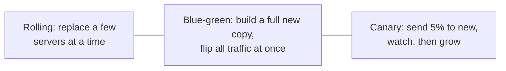
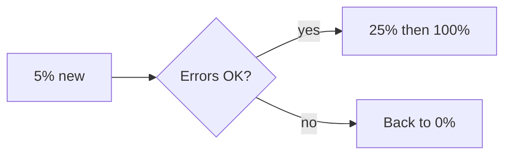
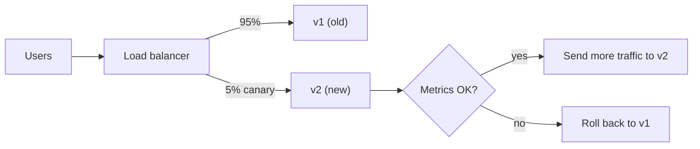
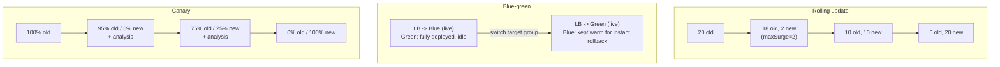
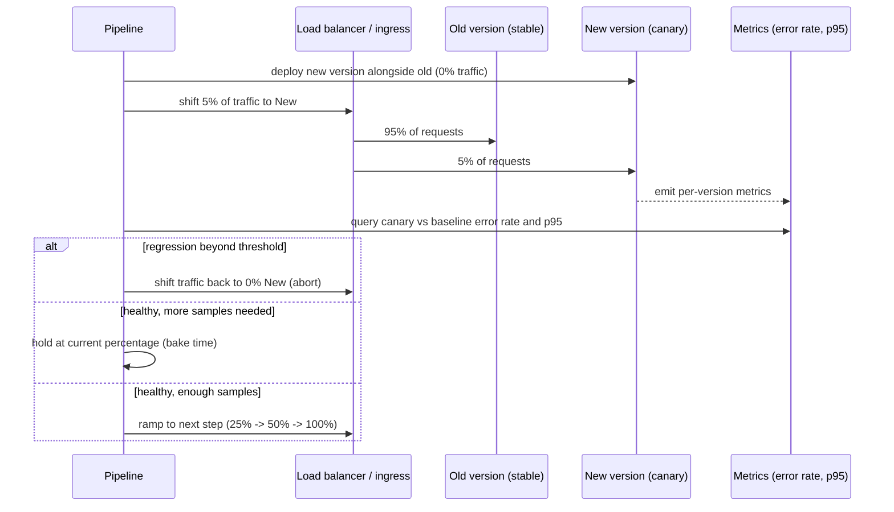

# Deployment Strategies - Rolling, Blue-Green, Canary

> [!summary] TL;DR
> A deployment strategy decides how traffic moves from the old version of a service to the new one. The choice trades off blast radius (how many users see a bad version), rollback speed, and infrastructure cost.

> [!abstract] Core idea
> - **Rolling:** replace old instances with new ones a few at a time; cheapest, but a bad version is already serving some traffic while you're still rolling it out.
> - **Blue-green:** run two full environments and switch all traffic at once; instant rollback, but double the capacity cost and no gradual exposure.
> - **Canary:** send a small, growing slice of traffic to the new version and watch its metrics before committing further; smallest blast radius, but needs automated analysis to be fast and safe.
> - All three assume the new and old versions can run side by side against the same database — see [[Rollback and Safe Migrations]] for how schema changes stay compatible with both.
> - Deploying new code and releasing it to users are two different decisions; see [[Feature Flags]] for separating them.

## Start here: the basics 🟢

> [!info] How to read this note (pick your level)
> - 🟢 **New to this?** Read "From zero" below, then sections 1, 2 and 10 (why, mental model and the cheat sheet). Stop there, that is a full first pass.
> - 🟡 **Know the basics?** Add sections 3, 4, 5 and 6 (how it works, a worked example, options and trade-offs).
> - 🔴 **Interview / SDE-3 prep?** Add sections 7, 8 and 9 (production, deep dive and interview questions). Headings are tagged 🟢🟡🔴 so you always know where you are.

**From zero, in 60 seconds** 🟢

Shipping a new version means swapping old servers for new ones while users keep using the app.
If the new version is broken, you want few users to notice and a quick way back.
There are three common ways to swap.



Rolling is cheap but slow to undo. Blue-green undoes in seconds but needs double the servers.
Canary shows a bug to only a few users first.



The rest of this note is just these 3 questions:
1. How does each strategy move traffic?
2. How do you decide at each canary step: go on or roll back?
3. Which one fits your cost and risk?


**The problem in one story.**
You have version 1 of your app running for all users, and version 2 is ready.
If you swap everyone to version 2 at once and it has a bug, every user hits the bug.
If you swap slowly, you limit the damage but the rollout takes longer.
A deployment strategy is the plan for moving users from the old version to the new one.

**Words you need first**

| Word | Plain meaning | Tiny example |
| --- | --- | --- |
| Version | One build of the app | v1 (old) and v2 (new) |
| Instance / pod | One running copy of the app | 10 pods serve traffic |
| Load balancer | Spreads incoming requests across copies | AWS ALB sends 90% to v1, 10% to v2 |
| Traffic | The stream of user requests | 1,000 requests per second |
| Blast radius | How many users a bad release can hurt | 5% of users vs 100% |
| Rollback | Going back to the old version | Point traffic back to v1 |
| Error rate | Share of requests that fail | 2 failures per 100 = 2% |

**Picture it**



**Analogy.** A restaurant testing a new dish first serves it to a few tables (canary), or swaps the whole menu overnight while keeping the old one ready (blue-green), or changes it table by table (rolling).
Where it breaks: diners can tell you the dish is bad; software needs automated metrics to notice.

**How the rest of this note builds up**

- First, why strategies exist (section 1) and the mental model (section 2).
- Then how rolling, blue-green and canary each move traffic (section 3).
- Then a Kubernetes rolling-update YAML and a canary analysis in Go (section 4), plus comparisons (section 5).
- Finally the SDE-3 deep dive: trade-offs, production practice, and database compatibility during rollout (sections 6-8).

> [!tip] Remember
> Every strategy trades blast radius, rollback speed and cost; canary limits damage best but needs automated analysis.

## 1. Why it exists 🟢

Say a payments service has 20 instances behind a load balancer, handling 2,000 requests per second. A new release has a bug that returns `500` for one edge case that happens on 1% of requests. Three ways to roll this out show the trade-off directly:

- **Deploy all 20 instances at once.** The bug affects 1% of all 2,000 req/s immediately: roughly 20 failed requests per second, company-wide, the moment the deploy finishes — and if the bug is more severe (say, a crash loop), all traffic goes down at once.
- **Replace instances one at a time (rolling).** After the first new instance is up, 1/20th of traffic (about 100 req/s) hits the new code; the bug surfaces at 1% of that slice — roughly 1 failed request per second — while 19 old instances still serve the rest. The blast radius is proportional to how far the rollout has progressed.
- **Send 5% of traffic to a canary first.** Only 5% of the 2,000 req/s (100 req/s) reaches the new code at all; the bug causes about 1 failed request per second, and — critically — automated analysis can catch the elevated error rate and abort before the rollout ever reaches the other 95%.

The strategy you pick is really a choice about how much of your traffic you are willing to risk before you have proof the new version is healthy.

## 2. Mental model 🟢

Think of the fleet as a dial between two positions: *all old* and *all new*. The strategies differ in how the dial moves and what proves it is safe to keep moving:

- Rolling moves the dial gradually, instance by instance, with only a health check at each step.
- Blue-green keeps a second, fully-built dial next to the first and flips a switch to swap which one traffic points at.
- Canary moves the dial deliberately slowly at the start, pausing to measure, before accelerating toward "all new."

## 3. How it works 🟡

**In plain words:** all three just move a dial from "all old" to "all new". They differ in how fast the dial turns and how much spare capacity you need.





## 4. Worked example 🟡

### Whiteboard version

The core decision at each canary step, stripped to its simplest form: not enough traffic yet means wait, a clear error-rate jump means abort, otherwise promote.

```go
package wb

type Metrics struct {
	Requests, Errors int
}

func Decide(canary Metrics, minSamples int, maxErrorRate float64) string {
	if canary.Requests < minSamples {
		return "hold"
	}
	if float64(canary.Errors)/float64(canary.Requests) > maxErrorRate {
		return "abort"
	}
	return "promote"
}
```

The full version below adds a baseline comparison (not just an absolute threshold) and a latency check, and ships with tests.

### Kubernetes rolling update, in YAML

**In plain words:** two settings control the pace: how many extra pods you may add, and how many may be down at once.

A `Deployment` with `maxSurge`/`maxUnavailable` tuned for a low-risk rolling update: never more than 25% of pods missing, and at most one extra pod above the desired count while the rollout is in progress.

```yaml
apiVersion: apps/v1
kind: Deployment
metadata:
  name: payments-api
spec:
  replicas: 20
  strategy:
    type: RollingUpdate
    rollingUpdate:
      maxSurge: 1          # at most 1 extra pod above `replicas` during rollout
      maxUnavailable: 25%  # at most 5 of 20 pods down at once
  template:
    spec:
      containers:
        - name: payments-api
          image: myrepo/payments-api:__COMMIT_SHA__
          readinessProbe:
            httpGet: {path: /healthz, port: 8080}
            periodSeconds: 5
            failureThreshold: 2
          livenessProbe:
            httpGet: {path: /livez, port: 8080}
            periodSeconds: 10
```

Kubernetes only routes traffic to a pod once its readiness probe passes, so a new pod that is up but still warming up its connection pools never receives traffic; `rollout undo` reverts the Deployment to the previous ReplicaSet if the rollout needs to be cancelled.

### Canary analysis, in Go

**In plain words:** a small function that compares the canary's errors and speed with the old version and answers: wait, continue, or roll back.

The decision at each canary step, as a pure, testable function: compare the canary's error rate and p95 latency against the baseline (not just an absolute number, since a baseline of 0.5% errors behaves differently from one at 0.01%), and require a minimum sample size before trusting the comparison at all.

This is the kind of check a progressive-delivery controller (Argo Rollouts, Flagger) runs automatically between ramp steps. It compiles and passes `go vet` and `go test -race` on Go 1.24.

```go
// Package rollout implements the canary-analysis decision used during a
// progressive deployment: compare the canary's error rate and tail latency
// against the baseline (the current stable version) and decide whether to
// hold, promote, or abort the rollout.
package rollout

// Metrics is a window of counts observed for one version during a canary step.
type Metrics struct {
	Requests int
	Errors   int
	P95ms    float64
}

// Decision is what the pipeline should do after one canary analysis window.
type Decision int

const (
	Hold Decision = iota
	Promote
	Abort
)

func (d Decision) String() string {
	switch d {
	case Promote:
		return "promote"
	case Abort:
		return "abort"
	default:
		return "hold"
	}
}

// Analyze compares a canary window against the baseline window and returns
// Hold when there is not yet enough traffic to trust the comparison, Abort
// when the canary's error rate or p95 latency has regressed past the
// allowed margin, and Promote otherwise.
func Analyze(baseline, canary Metrics, minSamples int, maxErrorRateIncrease, maxLatencyRatio float64) Decision {
	if canary.Requests < minSamples {
		return Hold
	}
	if errorRate(canary)-errorRate(baseline) > maxErrorRateIncrease {
		return Abort
	}
	if baseline.P95ms > 0 && canary.P95ms/baseline.P95ms > maxLatencyRatio {
		return Abort
	}
	return Promote
}

func errorRate(m Metrics) float64 {
	if m.Requests == 0 {
		return 0
	}
	return float64(m.Errors) / float64(m.Requests)
}
```

Table-driven test covering all four outcomes against the same realistic baseline (10,000 requests, 0.5% error rate, 120 ms p95):

```go
package rollout

import "testing"

func TestAnalyze(t *testing.T) {
	baseline := Metrics{Requests: 10_000, Errors: 50, P95ms: 120} // 0.5% errors

	tests := []struct {
		name       string
		canary     Metrics
		minSamples int
		maxErrInc  float64
		maxLatRat  float64
		want       Decision
	}{
		{
			name:       "not enough traffic yet",
			canary:     Metrics{Requests: 20, Errors: 0, P95ms: 100},
			minSamples: 200,
			maxErrInc:  0.01,
			maxLatRat:  1.5,
			want:       Hold,
		},
		{
			name:       "healthy canary promotes",
			canary:     Metrics{Requests: 500, Errors: 3, P95ms: 118}, // 0.6% errors
			minSamples: 200,
			maxErrInc:  0.01,
			maxLatRat:  1.5,
			want:       Promote,
		},
		{
			name:       "error rate spike aborts",
			canary:     Metrics{Requests: 500, Errors: 40, P95ms: 118}, // 8% errors
			minSamples: 200,
			maxErrInc:  0.01,
			maxLatRat:  1.5,
			want:       Abort,
		},
		{
			name:       "latency regression aborts",
			canary:     Metrics{Requests: 500, Errors: 2, P95ms: 400}, // 3.3x baseline
			minSamples: 200,
			maxErrInc:  0.01,
			maxLatRat:  1.5,
			want:       Abort,
		},
	}

	for _, tc := range tests {
		t.Run(tc.name, func(t *testing.T) {
			got := Analyze(baseline, tc.canary, tc.minSamples, tc.maxErrInc, tc.maxLatRat)
			if got != tc.want {
				t.Errorf("Analyze() = %v, want %v", got, tc.want)
			}
		})
	}
}
```

**Measured (Go 1.24, `go test -race`, 2026-11-07):** all four subtests pass: a 20-request canary holds (below the 200-sample minimum), a 0.6%-error canary promotes against a 0.5% baseline, an 8%-error canary aborts (a 7.5-point jump against a 1-point budget), and a canary at 3.3× the baseline's p95 aborts even with a normal error rate.

## 5. Variants and comparison 🟡

| Strategy | How it works | Use when | Cost |
| --- | --- | --- | --- |
| Recreate | Stop all old instances, then start all new ones | Dev/test environments, or when old and new cannot run side by side at all | Full downtime during the switch; simplest to reason about |
| Rolling (`maxSurge`/`maxUnavailable`) | Replace instances a few at a time behind the same load balancer target | The default for most stateless services; no extra infrastructure needed | Both versions serve real traffic simultaneously for the whole rollout; rollback means rolling forward again with the old image |
| Blue-green | Two full environments; a load balancer or DNS switch moves all traffic from one to the other at once | High-risk releases where instant, total rollback matters more than gradual exposure | Double the running capacity for the overlap window; DNS-based switches suffer TTL propagation delay |
| Canary (manual ramp) | A small percentage of traffic to the new version, increased in steps with a human watching dashboards between steps | Medium-risk releases with good per-version metrics but no automated analysis pipeline yet | Slower release cadence (a human has to keep checking in); still exposes some users at each step |
| Canary (automated analysis) | Same traffic shift, but a controller (Argo Rollouts, Flagger) queries metrics and promotes/aborts automatically | High release frequency where a human cannot babysit every rollout | Requires reliable per-version metrics and a tuned analysis config; false positives can abort healthy rollouts |
| Shadow / dark launch | Mirror real traffic to the new version without returning its response to the user | Testing a risky rewrite's behavior and performance against real traffic with zero user-facing risk | Needs care with side effects (the shadow version must not actually charge a card or send an email) |

## 6. Trade-offs and when not to use 🟡

- Blue-green's instant switch-back only holds if the database schema is compatible with both versions during the overlap; a release that both changes the schema and needs blue-green must still follow [[Rollback and Safe Migrations]]'s expand/contract pattern, or "switch back" strands you on an old binary pointed at a new schema.
- Blue-green's "instant rollback" is only as good as the smoke test run against the idle (green) environment *before* the switch — flip the load balancer or DNS record without one, and "instant rollback" just means you find out about a broken deploy from users instead of from a pre-switch check, at the same 100%-of-traffic blast radius as deploying with no strategy at all.
- Canary with automated analysis needs trustworthy per-version metrics (tagged by the new version's identifier) and a sensible `minSamples`; too low a sample size produces noisy aborts on pure statistical variance, too high a sample size makes every rollout slow even when the new version is fine.
- Long-lived client connections (WebSocket, gRPC streams, in-flight uploads) don't disappear just because traffic shifted away from a version; both rolling and canary deploys need connection draining so in-flight requests finish against the old instance instead of being cut off mid-request.
- For a low-traffic internal tool where a few minutes of downtime costs nothing, recreate is simpler to operate than any of the gradual strategies and has no extra infrastructure to misconfigure.
- Sticky-session canaries (same user always hits the same version) give a cleaner per-user experience than per-request splitting, but need a session-affinity mechanism at the load balancer, which recreate/rolling/blue-green don't need at all.

## 7. In production 🔴

- **Real systems:** Kubernetes `Deployment`s default to rolling updates; AWS CodeDeploy drives blue-green deploys for ECS and Lambda; Argo Rollouts and Flagger add canary and automated analysis on top of Kubernetes; Facebook and Google are documented as using staged percentage rollouts (gradual regional/percentage ramps) for both infrastructure and mobile releases.
- **Failure modes → fixes:**
  - A schema change ships in the same release as a blue-green switch and the old (blue) version can no longer read the new schema → the switch-back is no longer instant; always keep N and N-1 compatible during the overlap window (see [[Rollback and Safe Migrations]]).
  - A canary gets no real traffic because it is skipped by a client-side cache or CDN edge rule → verify the traffic-shifting mechanism actually applies at the layer users hit (ALB weighted target groups, a service mesh's virtual service, or DNS weighted records each have different blind spots).
  - Canary analysis flags a false positive from one slow downstream dependency that affects both versions equally → compare canary against a *simultaneous* baseline cohort, not last week's numbers, so external events affect both sides equally.
  - A rolling update's health check passes before the process has actually warmed up (JIT caches, connection pools), so early traffic to new pods is slow or errors → use a readiness probe that checks real dependency readiness, and add a startup probe with enough `failureThreshold` for slow starts.
  - Long-lived connections get hard-cut when an old pod is terminated → set `terminationGracePeriodSeconds` and a `preStop` hook that stops accepting new connections before the process exits.
- **What to monitor:** error rate and p95/p99 latency broken down **by version** (not aggregated across old and new), rollout progress (percentage at new version, bake time elapsed), rollback count and cause, and the same business KPIs that matter for the service (checkout success rate, not just HTTP status codes).

## 8. Deep dive 🔴

- **Kubernetes rolling-update math.** With `replicas: 20`, `maxSurge: 1`, `maxUnavailable: 25%` (5 pods), the controller can briefly run up to `20 + 1 = 21` pods and can take down up to 5 at once, replacing them in batches until all 20 are the new ReplicaSet. `kubectl rollout status` tracks this, and `kubectl rollout undo` reverts to the previous ReplicaSet (which Kubernetes keeps around by default) without a fresh image build.
- **Why canary needs a minimum sample size.** With a true 0.5% error rate, 20 requests can easily show 0 errors (about 90% chance) purely by chance; a canary analysis without a `minSamples` floor will confidently "pass" a broken version just because it got lucky on a tiny sample, or "abort" a healthy one on an unlucky one. The fix is standard statistics, not special deployment magic: don't trust a proportion estimate from too few trials.
- **Sticky cohorts vs. per-request splitting.** Weighted ALB target groups and Route 53 weighted records split per-connection or per-DNS-resolution, which is "sticky enough" for most HTTP traffic; a service mesh (Istio, Linkerd) or Argo Rollouts' traffic management can split per-request and even route by header (useful for internal dogfooding a canary before it sees any real customer traffic).
- **Bake time.** Between ramp steps, a canary should sit at a percentage for a minimum "bake time" (minutes, not seconds) before the next analysis — this catches delayed failures like a memory leak or a slow cache-fill regression that a one-shot check at t+10s would miss entirely.
- **Draining vs. abrupt termination.** `maxUnavailable`/pod termination during a rolling update removes a pod from the Service's endpoints before sending it `SIGTERM`, but there is an unavoidable race window where a request can land on a pod that is already shutting down; the standard fix is a `preStop` sleep (a few seconds) so the endpoint-removal propagates before the process actually exits.

## 9. Interview questions 🔴

> [!question]- When would you pick blue-green over canary?
> When instant, total rollback matters more than gradual exposure — for example a release you are not confident enough to leave partially rolled out for any length of time, or a monolith that cannot easily run two versions side by side under partial traffic.
>
> The cost is doubled capacity during the overlap and all-or-nothing exposure instead of limiting the blast radius.

> [!question]- Why does `maxSurge`/`maxUnavailable` matter, and what do they trade off?
> `maxSurge` is how many extra pods can run above the desired replica count during rollout (controls cost and how fast new pods roll in); `maxUnavailable` is how many pods can be missing at once (controls how much capacity — and blast radius if the new version is bad — disappears during the rollout).
>
> Setting both to 0 and a positive surge gives a fully surge-based rollout with zero capacity loss but temporarily higher cost; the reverse trades cost for capacity risk.

> [!question]- A canary step looks healthy after 10 requests. Do you promote it?
> No — this is the sample-size trap. Ten requests cannot distinguish a 0.5% error rate from a 10% error rate with any confidence; a canary analysis needs a `minSamples` floor before the error-rate and latency comparison means anything, otherwise you are promoting on noise.

> [!question]- How do feature flags relate to these deployment strategies?
> They're orthogonal and complementary: a deployment strategy controls which *version of the binary* serves a request; a feature flag controls which *code path inside that binary* runs.
>
> You can deploy a risky feature to 100% of instances behind a flag that is off, then ramp the flag's percentage independently of any deploy — see [[Feature Flags]].

> [!question]- What has to be true about the database for any of these strategies to work safely?
> The schema must be compatible with both the old and new application version for the entire overlap window — true for rolling (old and new definitely run concurrently), for canary (by design), and for blue-green (so the instant switch-back stays instant). This is the expand/contract discipline in [[Rollback and Safe Migrations]], not a deployment-strategy detail.

> [!question]- Your rollback took the old pods back, but requests are still failing. Why?
> Likely causes: the "rollback" only reverted code, not a non-additive schema change it depended on (data is now incompatible with the old code too); or a config/feature-flag change shipped alongside the code was not reverted; or clients cached a response shape from the new version and haven't retried.
>
> Rollback must cover code, config, flags and (via expand/contract) schema compatibility together, not just the container image.

## 10. Cheat sheet 🟢

- Rolling: cheap, default, but the bad version serves some traffic for the whole rollout duration.
- Blue-green: instant switch and instant switch-back, at double the running capacity during the overlap.
- Canary: smallest blast radius; needs per-version metrics and a sample-size floor to be trustworthy.
- Shadow/dark launch: zero user-facing risk, but side effects (payments, emails) must be suppressed in the shadow path.
- `maxSurge`/`maxUnavailable` tune a rolling update's cost vs. capacity-loss trade-off.
- Compare canary metrics against a simultaneous baseline cohort, not historical numbers.
- Schema must stay compatible with old and new versions for the whole overlap window, regardless of strategy.
- A deployment strategy moves the binary; a feature flag moves the code path — use both together for the riskiest releases.

## Links

- **Before this:** [[CI-CD Pipelines (GitHub Actions for Go)]], [[Load Balancing]]
- **Next:** [[Feature Flags]], [[Rollback and Safe Migrations]]
- **Compare with:** [[Kubernetes Fundamentals]], [[Autoscaling]], [[SLIs, SLOs, SLAs and Error Budgets]] (the error budget a canary analysis is really protecting)

### Watch on YouTube

- [Kubernetes Deployment Strategies with Demos / Canary / Blue Green / Rolling Update](https://www.youtube.com/watch?v=0QhUhrWGB9k) · Abhishek.Veeramalla · 51 min · 84,892 views
- [Deployment Strategies Explained: Blue-Green vs. Canary vs. Rolling](https://www.youtube.com/watch?v=H5z70EBtEow) · CodeLucky · 4 min · 4,962 views
