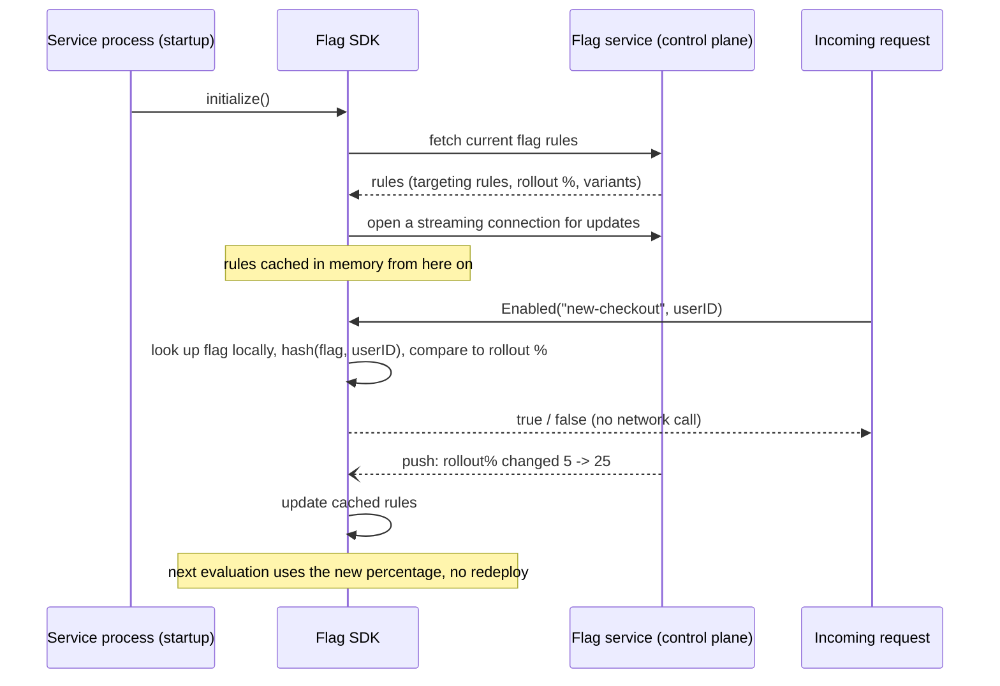
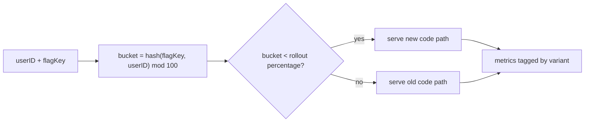

# Feature Flags

> [!summary] TL;DR
> A feature flag is a runtime switch that lets a team turn a code path on or off, or roll it out to a percentage of users, without deploying new code. It separates *deploying* code (getting it onto servers) from *releasing* it (letting users see it).

> [!abstract] Core idea
> - Deploy and release are different events: code behind a flag can sit in production, turned off, for as long as needed.
> - Evaluation happens **locally**, inside the service process, against a cached copy of the rules; there is no network call on the request path.
> - A flag has a safe default: if the flag service is unreachable, the SDK falls back to the last-known rules or a hardcoded default, never blocks the request.
> - Percentage rollouts use a deterministic hash of `(flag, user ID)`, so a user's bucket never changes as the percentage ramps up.
> - Flags are not free: every flag left in the code after its decision is made is a small amount of permanent complexity and a branch nobody tests both sides of.

## 1. Why it exists

Say a team is rewriting the checkout flow. Without flags, that rewrite ships as one all-or-nothing deploy: merge, build, deploy, and every user hits the new checkout the moment the rollout finishes. If it has a bug, the only way back is a full redeploy of the previous version — minutes, not seconds — while real orders are failing.

With a flag:

- The new checkout code deploys to production **disabled** (0% of users), alongside the old code. Deploying it changes nothing a user can see.
- It is enabled for 5% of users, and checkout-completion rate and error rate are watched by version.
- If something is wrong, the flag flips back to 0% in seconds — no redeploy, no pipeline run, just a config change the SDK picks up within its next poll or streamed update (typically seconds).
- If it's healthy, the percentage ramps the same way a canary deployment ramps traffic (see [[Deployment Strategies - Rolling, Blue-Green, Canary]]), except the dial here is a flag's targeting rule, not which binary is running.

The flag turns "redeploy under pressure, with a live incident running" into "change one number," which is both faster and far less risky, since changing a flag's rollout percentage cannot introduce a new bug the way a fresh deploy can.

## 2. Mental model

A feature flag is a named, cached decision table the application consults before running a branch of code: "for this flag, for this user/request, true or false (or which variant)?" The key mental shift from a naive implementation is that this table is **not fetched over the network on every request** — a real flag SDK fetches or streams the rules once, caches them in memory, and evaluates locally, so flag checks cost a map lookup and a hash, not an RPC.

A flag's rules are usually more than one percentage number. A real targeting configuration is an ordered list: match an **attribute** first ("`plan == enterprise`" or "`country in {IN, US}`"), fall back to a named **segment** (a saved, reusable group of users — "beta testers", "internal staff"), and only once nothing more specific matches, fall through to the **percentage rollout** this note's code implements. The percentage bucket is the last, catch-all rule in the list, not the whole targeting model.

## 3. How it works





## 4. Worked example

### Whiteboard version

The bare mechanism: hash the flag name and user ID together into a stable number, and compare it to the rollout percentage.

```go
package wb

import "hash/fnv"

func enabled(flag, userID string, pct int) bool {
	h := fnv.New32a()
	h.Write([]byte(flag + ":" + userID))
	return int(h.Sum32()%100) < pct
}
```

The full version below adds the edge cases that matter in production: percentage clamping, and the guarantee that ramping up the percentage only ever adds users, never removes someone who was already in.

### Local percentage evaluation, in Go

This models what an OpenFeature-style SDK does per request: no network call, just a deterministic hash against a cached percentage. A real OpenFeature client call looks like `client.BooleanValue(ctx, "new-checkout", false /* default */, evalCtx)` — `evalCtx` carries the attributes (user ID, plan, country) the provider's targeting rules match against before ever reaching a percentage bucket; `Enabled` below is the percentage-bucket piece of that evaluation, written directly instead of through the OpenFeature API so it stays a dependency-free, readable example. It compiles and passes `go vet` and `go test -race` on Go 1.24.

```go
// Package flags implements the local, deterministic percentage-rollout
// evaluation a feature-flag SDK performs on every request, with no network
// call: the rules are cached locally and only userID decides the outcome.
package flags

import "hash/fnv"

// Bucket returns a stable number in [0,100) for one flag key and user ID.
// The same flagKey and userID always map to the same bucket, so a user's
// place in the rollout never changes as the rollout percentage ramps up.
func Bucket(flagKey, userID string) int {
	h := fnv.New32a()
	h.Write([]byte(flagKey))
	h.Write([]byte{':'})
	h.Write([]byte(userID))
	return int(h.Sum32() % 100)
}

// Enabled reports whether userID falls inside the rollout percentage for
// flagKey. percentage is clamped to [0, 100].
func Enabled(flagKey, userID string, percentage int) bool {
	switch {
	case percentage <= 0:
		return false
	case percentage >= 100:
		return true
	default:
		return Bucket(flagKey, userID) < percentage
	}
}
```

Tests covering the three properties that actually matter for a rollout: determinism (a user's result never flips between calls at the same percentage), monotonic ramping (raising the percentage only adds users), and a roughly even distribution:

```go
package flags

import (
	"fmt"
	"testing"
)

func TestEnabled_IsDeterministic(t *testing.T) {
	for i := 0; i < 100; i++ {
		uid := fmt.Sprintf("user-%d", i)
		first := Enabled("new-checkout", uid, 30)
		for j := 0; j < 5; j++ {
			if got := Enabled("new-checkout", uid, 30); got != first {
				t.Fatalf("Enabled(%q) flipped between calls: %v then %v", uid, first, got)
			}
		}
	}
}

func TestEnabled_RampNeverRemovesAUser(t *testing.T) {
	// A user let in at a lower percentage must still be in at every higher
	// percentage: ramping 10% -> 50% -> 100% only ever adds users.
	for i := 0; i < 1000; i++ {
		uid := fmt.Sprintf("user-%d", i)
		b := Bucket("rollout-x", uid)
		at10 := Enabled("rollout-x", uid, 10)
		at50 := Enabled("rollout-x", uid, 50)
		if at10 && !at50 {
			t.Fatalf("user %s (bucket %d) enabled at 10%% but not at 50%%", uid, b)
		}
	}
}

func TestEnabled_DistributionIsRoughlyEven(t *testing.T) {
	const n = 20_000
	const pct = 25
	on := 0
	for i := 0; i < n; i++ {
		if Enabled("ramp-flag", fmt.Sprintf("user-%d", i), pct) {
			on++
		}
	}
	got := float64(on) / n * 100
	if got < pct-2 || got > pct+2 { // measured: FNV-1a bucketing over 20,000 synthetic IDs
		t.Fatalf("got %.2f%% enabled, want close to %d%%", got, pct)
	}
}

func TestEnabled_Bounds(t *testing.T) {
	if Enabled("f", "u", 0) {
		t.Fatal("0% must always be disabled")
	}
	if !Enabled("f", "u", 100) {
		t.Fatal("100% must always be enabled")
	}
}
```

**Measured (Go 1.24, `go test -race`, 2026-11-07):** over 100,000 synthetic user IDs, `Enabled(..., pct)` turned on 10.05% of users at `pct=10`, 25.08% at `pct=25`, and 50.14% at `pct=50` — within about 0.15 percentage points of the target at every level, which is the kind of spread an `FNV-1a`-based bucketing gives in practice.

## 5. Variants and comparison

| Flag type | How it works | Use when | Cost |
| --- | --- | --- | --- |
| Release toggle | On/off switch wrapping unfinished or unreleased code, usually removed soon after full rollout | Shipping a feature across multiple PRs/deploys before it's ready for any users | Short-lived; cheap if actually deleted after full rollout |
| Experiment (A/B) flag | Randomly assigns each user to a variant, held stable for the life of the experiment, and tied to an analytics event | Measuring a feature's effect on a business metric, not just rolling it out safely | Needs a stats/experimentation platform to read results correctly, not just the SDK |
| Ops / kill switch | A flag that disables a feature or an entire dependency call under operational stress (e.g. "disable recommendations if search is slow") | Protecting the system during an incident or overload, independent of any release | Must have a safe, well-tested "off" code path, or the kill switch itself is untested until the worst moment |
| Entitlement flag | Gates a feature by plan/tier/tenant rather than by rollout percentage | Paid-plan gating, enterprise-only features | Long-lived by design; not something to "clean up" like a release toggle |
| Client-side flag | Evaluated in the browser/mobile app, often fetched at app start | UI-only behavior, where no sensitive targeting logic needs to stay server-side | Flag values and targeting rules are visible to the client; never put a security decision behind a client-side flag |

## 6. Trade-offs and when not to use

- Every flag left in the codebase after its rollout decision is made is permanent complexity: a branch, a config value to keep correct across environments, and (usually) a combination nobody tests, because most test suites only exercise the "current" combination of flags, not all `2^n` combinations of n active flags.
- A flag is not a substitute for a real deployment strategy when the risk is in the binary itself (a crash, a memory leak, a broken startup) rather than in one code path — no flag check runs if the process never starts.
- Flags add a layer of indirection to "what is actually running for this user," which makes some production bugs harder to reproduce locally unless the targeting rules (or at least the specific user's evaluation) are easy to query.
- For a one-off internal script or a feature with no realistic rollback scenario, the overhead of wiring a flag is not worth it; plain code plus a normal deploy is simpler and has no flag debt to clean up later.
- If the flag service's SDK does not evaluate locally with a safe default, a flag you added to reduce risk can itself become a single point of failure that blocks every request when it can't be reached — the opposite of its purpose.

## 7. In production

- **Real systems:** LaunchDarkly, Unleash, GrowthBook, and Flagsmith are commercial/open-source flag platforms; most of them, along with in-house systems at large tech companies, follow the same shape — a control plane for rules and a lightweight SDK that caches and evaluates locally. The OpenFeature project (under the CNCF) standardizes the evaluation API so an application can swap providers without rewriting every flag check.
- **Failure modes → fixes:**
  - The flag service is unreachable at startup or mid-run → the SDK must serve its last cached rules (or a hardcoded default baked into the flag definition), never block or error the request; test this path explicitly, since it's the one path that only runs during an actual incident.
  - A flag's default silently changes meaning over time (someone edits the rule, forgetting what depends on it) → keep an owner and an expiry/cleanup date on every flag, and alert on flags past their expected lifetime.
  - Two flags interact in a combination nobody tested (flag A's new code path plus flag B's new config both on at once) → keep the full matrix of currently-active flag combinations small, and add integration tests for the combinations that matter.
  - A client-side flag is used to hide a feature that is still reachable via a direct API call → client-side flags control UI, not authorization; enforce access control server-side regardless of flag state.
  - Flag evaluation shows up as a measurable amount of per-request latency → that almost always means the SDK is calling out to the flag service per request instead of evaluating against a local cache; switch to a streaming/polling SDK, not a remote-evaluation one.
- **What to monitor:** evaluation counts and error rate per flag (did evaluation ever fall back to default?), the audit trail of who changed which flag's rules and when, number of active flags and how many are past their planned cleanup date, and — for anything tied to a rollout — the same per-variant business metrics used for canary analysis (see [[Deployment Strategies - Rolling, Blue-Green, Canary]]).

## 8. Deep dive

- **Streaming vs. polling.** A flag SDK typically either polls the control plane every N seconds or holds a long-lived streaming connection (SSE or a websocket) that pushes rule changes as they happen. Streaming gets near-instant propagation (useful for an ops kill switch during an incident); polling is simpler and tolerates flakier networks, at the cost of a propagation delay bounded by the poll interval.
- **Local evaluation is the architecture, not an optimization.** The naive design — call the flag service synchronously on every request — adds a network round trip (and a new failure mode: flag service down means app down) to every single request. Real SDKs instead treat the flag service purely as a source of *rule updates*, decoupling "is the flag service healthy right now" from "can this request be served."
- **Deterministic bucketing and sticky assignment.** Hashing `(flagKey, userID)` guarantees the same user always lands in the same bucket for that flag, which is what makes a ramp from 10% to 50% to 100% monotonic (nobody who was "in" at 10% is ever excluded later) and what makes an A/B experiment valid (a user doesn't switch variants mid-experiment). Using a different hash per flag (not a single global per-user hash) also avoids correlating unrelated experiments — two independent 50% flags shouldn't always land the same users in the same bucket.
- **Flag debt and expiry.** A release toggle is meant to be temporary: once a feature is at 100% and stable, the flag and the old code path should be deleted, or the codebase accumulates permanent conditionals that nobody dares remove. Mature setups track an owner and a review/expiry date per flag and flag "stale flags over N days old" as a lint-style check in CI.
- **Audit trail.** Every rule or percentage change is logged with who changed it, when, and the before/after value — LaunchDarkly and Unleash both keep this as a first-class feature, not an afterthought. When an incident review starts with "did anything change recently?", the flag audit log is one of the first places to check, right alongside the deploy log, precisely because a flag change can cause a production regression with no code deploy and no entry in Git history at all.
- **Testing flag combinations.** Since most of a test suite exercises only the currently-default combination of flags, a common practice is to explicitly run the critical path's tests once with each release toggle forced on and once forced off, rather than relying on incidental coverage — this is one of the concerns [[Testing in CI-CD, Flaky Tests and Testing in Production]] covers for CI pipelines with flags in play.

## 9. Interview questions

> [!question]- What's the difference between deploying and releasing a feature?
> Deploying means the code is running in production; releasing means users (or some percentage of them) can actually reach it. A feature flag is what lets those happen at different times — code can be deployed disabled, and released later by flipping a config value, with no redeploy.

> [!question]- Why must flag evaluation be local, not a network call per request?
> A per-request call to the flag service adds latency to every request and makes the flag service a new single point of failure: if it's down, the app blocks or errors on every request that checks a flag. A local SDK caches the rules (via polling or streaming) and evaluates in-process, so a flag check costs a map lookup, and the flag service being unreachable only means rules go briefly stale, not that requests fail.

> [!question]- How does percentage bucketing guarantee a user's result never flips as you ramp the rollout up?
> By hashing the user's ID together with the flag key into a fixed number (a bucket), and comparing that fixed number to the percentage threshold. The bucket never changes for that user and flag; only the threshold moves as the percentage ramps, so raising the percentage can only ever add users whose bucket falls below the new, higher threshold — never remove someone already under the old one.

> [!question]- Should a client-side (browser or mobile) flag ever gate access to a paid feature?
> No — this is the trap. Client-side flag rules and values are visible to anyone inspecting network traffic or the app's bundle, so a user can bypass a client-only check. Client-side flags control what the UI shows; the server must independently enforce any access-control decision regardless of what the client believes the flag says.

> [!question]- What happens to a feature flag after its rollout is complete and stable?
> It should be deleted, along with the old code path it replaced — a flag left in place after it is permanently on (or off) is pure debt: a branch nobody needs, that still has to be kept correct and still adds to the untested-combinations problem. Mature flag systems track an owner and an expected cleanup date per flag for exactly this reason.

> [!question]- How do feature flags relate to canary deployments — aren't they solving the same problem?
> They solve related but distinct problems at different layers. A canary deployment controls which *binary* (version of the whole service) serves a request; a feature flag controls which *code path inside one binary* runs. You can run 100% of traffic on the new binary while a risky feature inside it stays flagged off for everyone, and ramp the flag independently of any deploy — see [[Deployment Strategies - Rolling, Blue-Green, Canary]].

## 10. Cheat sheet

- Flags separate *deploy* (code is running) from *release* (users can reach it).
- Evaluation is local, against a cached rule set; the flag service is a control plane, not a per-request dependency.
- Percentage rollouts: `bucket = hash(flagKey, userID) mod 100`, compared to the rollout threshold — deterministic and monotonic as the percentage ramps.
- Always define a safe default for when the flag service is unreachable; test that path.
- Client-side flags control UI only; never put an authorization decision behind one.
- Flag types: release toggle (temporary), experiment (A/B), ops kill switch, entitlement (long-lived).
- Track an owner and expiry per flag; delete release toggles once the rollout is complete and stable.
- A flag moves a code path; a deployment strategy moves a binary — use both for the riskiest releases.

## Links

- **Before this:** [[Deployment Strategies - Rolling, Blue-Green, Canary]]
- **Next:** [[Rollback and Safe Migrations]]
- **Compare with:** [[Rollback and Safe Migrations]], [[Testing in CI-CD, Flaky Tests and Testing in Production]], [[SLIs, SLOs, SLAs and Error Budgets]]
