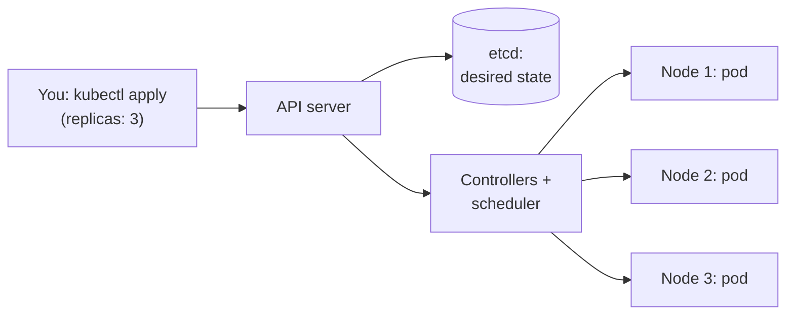
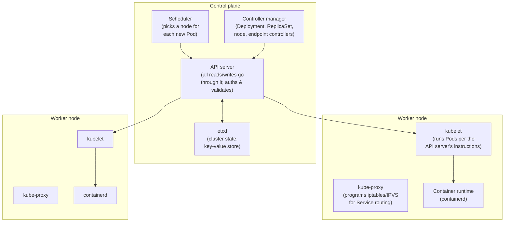
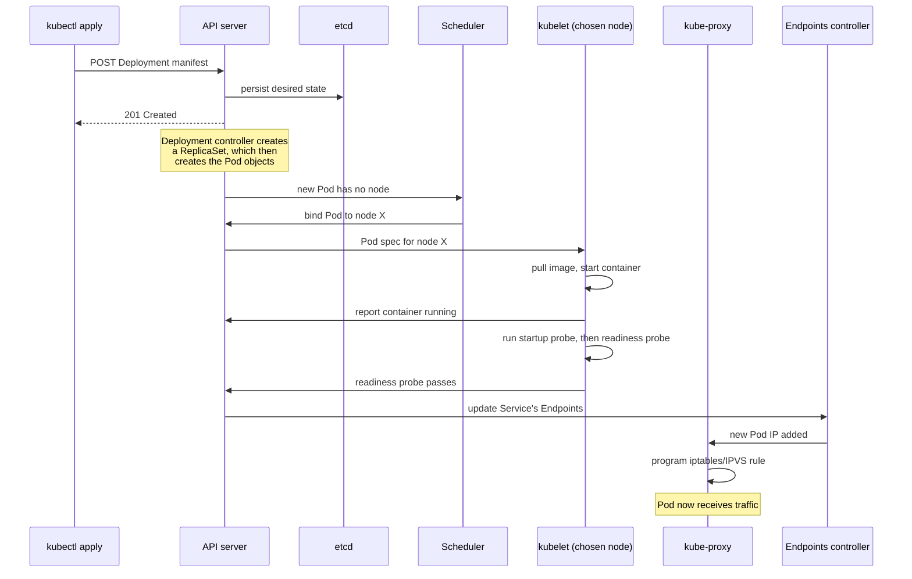
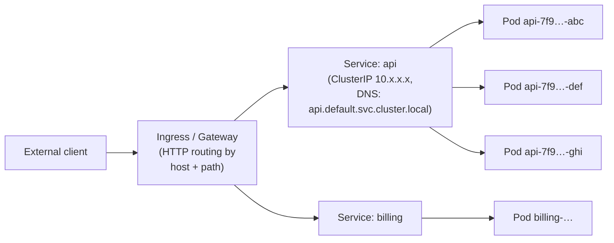
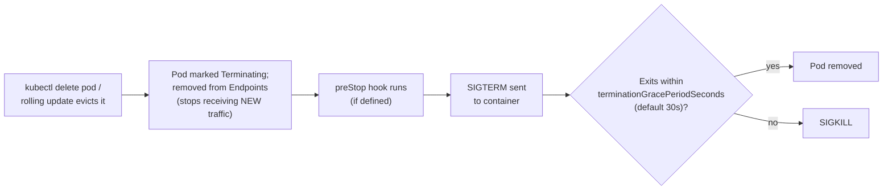

# Kubernetes Fundamentals

> [!summary] TL;DR
> Kubernetes keeps a declared number of healthy container instances running across a cluster of machines, restarting or rescheduling them when they fail, and routing traffic only to the ones that are actually ready. You describe the desired state in YAML; a set of control-plane controllers continuously reconciles the cluster toward it.

> [!abstract] Core idea
> - You declare desired state (YAML); controllers in the control plane continuously reconcile the cluster's actual state toward it — this loop is the whole system.
> - A Deployment manages ReplicaSets, which manage Pods — never Deployment straight to Pods.
> - A Service is a stable virtual IP and DNS name in front of a changing set of Pod IPs; Ingress/Gateway API route HTTP traffic from outside the cluster to Services.
> - Probes (liveness, readiness, startup) decide whether a Pod gets traffic and whether it gets restarted — they are not the same check.
> - ConfigMaps and Secrets inject configuration; Secrets are base64-encoded, not encrypted, unless you add encryption at rest or a secrets operator.

## Start here: the basics

**The problem in one story.**
Your Go API runs in one container on one server.
At 2 a.m. the server dies, and nobody is awake to restart it.
Next week traffic doubles and you need five copies, not one.
Kubernetes is the robot that keeps the right number of copies running, on whatever machines are healthy.

**Words you need first**

| Word | Plain meaning | Tiny example |
| --- | --- | --- |
| Container | A packaged app plus everything it needs to run | Your Go binary in a Docker image |
| Cluster | A group of machines managed as one | 3 control-plane nodes + 10 worker nodes |
| Node | One machine (VM or physical) in the cluster | An EC2 instance running kubelet |
| Pod | The smallest unit Kubernetes runs: one or more containers together | One pod = your API container |
| Desired state | What you *want* running, written in YAML | `replicas: 3` |
| Controller | A loop that compares desired vs actual state and fixes the gap | Deployment controller starting a missing pod |
| Service | A stable name and IP in front of changing pods | `orders.default.svc.cluster.local` |

**Picture it**



**Analogy.** A thermostat: you set 21°C, and it keeps switching the heater on and off until the room matches.
Where it breaks: a thermostat controls one number; Kubernetes reconciles thousands of objects at once, and it can only fix what it can observe (a pod that is "running" but serving errors looks healthy unless you add probes).

**How the rest of this note builds up**

- First, why an orchestrator exists (section 1) and the "declare desired state, controllers reconcile" mental model (section 2).
- Then the machinery: control plane and nodes, what happens on `kubectl apply`, Deployment → ReplicaSet → Pod (section 3).
- Then how traffic reaches pods (Services, DNS, Ingress/Gateway API), plus config, probes, resources and graceful shutdown.
- Finally the SDE-3 material: worked example, trade-offs, production failure modes and the deep dive.

> [!tip] Remember
> You write down what you want; Kubernetes controllers keep nudging reality until it matches.

## 1. Why it exists

Running a Go API as a single process on a single VM works until that VM reboots, runs out of memory, or needs a second instance for load.

Someone then has to notice the process died, SSH in, restart it, and manually keep a load balancer's target list in sync with which VMs are healthy. At ten services and fifty VMs, that's no longer a person's job — it has to be automated.

Kubernetes automates four things that used to be manual ops work:

- **Scheduling:** given a Pod that needs 500m CPU and 256Mi memory, pick a node in the cluster that has room, without an operator choosing by hand.
- **Self-healing:** when a Pod crashes or a node dies, start a replacement elsewhere, without a page going out first.
- **Scaling:** add or remove replicas of a Pod as load changes (see [[Autoscaling]]), and spread them across nodes.
- **Service discovery:** give a changing set of Pod IPs one stable name and address that other services can call.

A single dropped node used to mean manually finding out which services were on it and restarting them elsewhere. In Kubernetes, the scheduler already knows every node's capacity and every Pod's resource request, so it places a replacement automatically — typically in seconds once the node is marked unreachable.

## 2. Mental model

Kubernetes is a **reconciliation loop**, not a command executor.

You never tell it "start 3 more Pods." You tell it "I want 5 Pods of this spec to exist," and a controller keeps comparing that desired count against the actual count, forever, correcting the difference whenever it appears — a Pod crashes, a node dies, you edit the desired count — the same loop handles all of it.

A useful analogy: a thermostat doesn't execute "turn on the heater now" as a one-off action. It continuously compares the room's actual temperature to the set point and acts whenever they differ. Every Kubernetes controller (Deployment, ReplicaSet, HPA, and others) is a thermostat for some piece of desired state.

## 3. How it works

### Control plane and nodes



- **API server** is the only component anything talks to — `kubectl`, controllers, and kubelets all read and write cluster state through it. It authenticates, authorizes (RBAC), and validates every request before it touches etcd.
- **etcd** is a distributed key-value store holding every object's desired and last-known state. Lose etcd and you lose the cluster's memory of what should be running (though workloads already scheduled keep running until something needs to change).
- **Scheduler** watches for Pods with no node assigned and picks one based on resource requests, affinity rules, and taints/tolerations.
- **Controller manager** runs the reconciliation loops: the Deployment controller keeps a ReplicaSet's replica count at the Deployment's desired value, the node controller notices unreachable nodes, and so on.
- **kubelet** (one per node) is the agent that actually starts, stops, and reports on containers, per instructions from the API server, and runs the liveness/readiness/startup probes.
- **kube-proxy** (one per node) programs the node's networking rules so traffic to a Service's virtual IP reaches one of its Pods.

### `kubectl apply` to a running Pod



The gap between "container running" and "receiving traffic" is the readiness probe. A Pod can be alive and still get zero traffic if it never passes readiness — which is exactly what you want during a slow startup (warming a cache, opening a DB pool) instead of sending it requests it can't yet serve.

### The object chain: Deployment → ReplicaSet → Pod

A **Deployment never manages Pods directly.** It manages a ReplicaSet, which manages Pods.

This indirection is what makes rolling updates and rollback possible: a new Deployment revision creates a *new* ReplicaSet (scaled up) while the old ReplicaSet (scaled down to zero but not deleted) is kept in history, so `kubectl rollout undo` just scales the old ReplicaSet back up.

See [[Rollback and Safe Migrations]] for the rollback mechanics this enables.

- **Pod:** the smallest deployable unit — one or more containers that share a network namespace (one IP) and can share volumes. Almost always one container per Pod for a stateless Go service; a sidecar (a log shipper, a service-mesh proxy) is the common exception.
- **ReplicaSet:** keeps exactly N Pods matching a label selector running. You rarely create one directly.
- **Deployment:** manages ReplicaSets to provide declarative updates — change the image tag, and the Deployment controller creates a new ReplicaSet and shifts replicas from old to new according to `maxSurge`/`maxUnavailable`.
- **StatefulSet:** like a Deployment but for Pods that need a stable identity and storage — ordered names (`db-0`, `db-1`), a dedicated PersistentVolume per replica that follows it across rescheduling. Used for databases and queues you run in-cluster.
- **DaemonSet:** runs exactly one Pod per node (or per matching node) — log collectors, node-level monitoring agents.
- **Job / CronJob:** runs a Pod to completion once, or on a schedule, instead of keeping it running forever — batch work, scheduled reports.

### Services, DNS and Ingress/Gateway API



A **Service** is a stable virtual IP and cluster-internal DNS name that load-balances across every Pod matching its label selector, updated automatically by the Endpoints controller as Pods come and go — nothing in the client has to track individual Pod IPs, which are ephemeral and change on every restart.

- **ClusterIP** (default): reachable only inside the cluster — the normal choice for a service another service calls.
- **NodePort:** opens the same port on every node, forwarding to the Service — mostly used for local clusters or as a building block, rarely in production directly.
- **LoadBalancer:** asks the cloud provider to provision an external load balancer (an AWS NLB/ALB, say) pointing at the Service — the usual way to expose something to the internet.
- **Ingress** routes HTTP(S) traffic from outside the cluster to Services by host and path, with one external load balancer in front of many Services instead of one per Service. It predates more general traffic needs.
- **Gateway API** is the newer, more expressive replacement: separates the infrastructure object (`GatewayClass`/`Gateway`, who provisions the load balancer) from the routing rules (`HTTPRoute`, who owns which path), and supports more protocols and richer traffic splitting than Ingress's annotations-based extensions ever did cleanly. New clusters increasingly default to Gateway API; Ingress still works and is far more deployed today.

### ConfigMaps, Secrets, probes, and resources

- **ConfigMap:** non-sensitive key-value configuration, injected as environment variables or mounted files. Editing it doesn't automatically restart Pods that already read it as env vars — a mounted file updates in place (with a propagation delay), but most apps still need a restart or a reload mechanism to pick up a mounted ConfigMap change.
- **Secret:** structurally the same as a ConfigMap but intended for sensitive data. **The value is only base64-encoded, not encrypted**, unless the cluster has encryption at rest configured for etcd. Anyone who can read the Secret object or the etcd data directly can decode it trivially. For real secret management (rotation, external vaulting), see [[Secrets Management]]; tools like External Secrets Operator or Sealed Secrets sync from a real secrets store into Kubernetes Secrets rather than storing the source of truth there.
- **Probes** (see sequence diagram above for where they run):
  - **Liveness:** "is this container still working?" Fails → kubelet restarts the container. A liveness probe that's too strict (times out under normal load) causes restart loops under load, which is a common self-inflicted outage.
  - **Readiness:** "should this Pod receive traffic right now?" Fails → the Pod is removed from the Service's Endpoints (no new traffic), but the container keeps running and is not restarted. Use this for "temporarily can't serve" (DB connection pool exhausted, a dependency is down).
  - **Startup:** "has this container finished starting yet?" While it fails, liveness and readiness probes are not run at all — protects a slow-starting app (one doing a long cache warm or migration check) from being killed by a liveness probe that assumes it's already up.
- **Requests and limits:** `requests` is what the scheduler reserves for a Pod when picking a node (and what the Pod is guaranteed); `limits` is the hard ceiling. A Pod using more memory than its limit is **OOMKilled** — the kernel's OOM killer terminates it, visible as `OOMKilled` in `kubectl describe pod`. A Pod using more CPU than its limit is **throttled**, not killed — it just runs slower. A Pod's **QoS class** follows from these: `Guaranteed` (requests == limits for every container), `Burstable` (requests set, below limits), `BestEffort` (neither set) — QoS class decides eviction order when a node runs low on resources, `BestEffort` evicted first.
- **Namespaces** partition a cluster into logical groups (by team or environment) for naming, RBAC scope, and resource quotas — they are not a network or security boundary by themselves; that needs NetworkPolicies and RBAC on top.

### Graceful termination



Steps B and D happen **concurrently**, not in sequence — the Pod can still have in-flight connections from before it left Endpoints when SIGTERM arrives.

That's the classic race: a request lands just before removal from Endpoints propagates, and the app receives SIGTERM before that request finishes.

A `preStop` hook that sleeps a few seconds before SIGTERM, combined with the application finishing in-flight requests on SIGTERM instead of exiting immediately, closes this gap.

The application side of this (signal handling, connection draining, the exact Go pattern) is covered in [[Graceful Shutdown and Health Checks]] — this note only covers what Kubernetes does around it.

## 4. Worked example

### Whiteboard version

The smallest thing that deploys a container and makes it reachable: a Deployment and a ClusterIP Service, no probes, no resources, no Ingress.

```yaml
apiVersion: apps/v1
kind: Deployment
metadata:
  name: api
spec:
  replicas: 2
  selector:
    matchLabels: { app: api }
  template:
    metadata:
      labels: { app: api }
    spec:
      containers:
        - name: api
          image: ghcr.io/example/api:v1.0.0
          ports: [{ containerPort: 8080 }]
---
apiVersion: v1
kind: Service
metadata:
  name: api
spec:
  selector: { app: api }
  ports: [{ port: 80, targetPort: 8080 }]
```

This runs, but it has no health checks (a stuck Pod keeps taking traffic forever), no resource requests (the scheduler can pack it badly and it can starve or be starved by neighbours), and no Secrets. The full manifest below fills in the production concerns.

### Full manifest for a Go API (Kubernetes 1.31+)

```yaml
apiVersion: apps/v1
kind: Deployment
metadata:
  name: api
  labels: { app: api }
spec:
  replicas: 3
  revisionHistoryLimit: 10
  strategy:
    type: RollingUpdate
    rollingUpdate: { maxSurge: 1, maxUnavailable: 0 }
  selector:
    matchLabels: { app: api }
  template:
    metadata:
      labels: { app: api }
    spec:
      terminationGracePeriodSeconds: 30
      containers:
        - name: api
          image: ghcr.io/example/api:v1.4.2 # pin a digest in real prod manifests
          ports:
            - containerPort: 8080
          envFrom:
            - configMapRef: { name: api-config }
          env:
            - name: DB_PASSWORD
              valueFrom:
                secretKeyRef: { name: api-secrets, key: db-password }
          resources:
            requests: { cpu: "250m", memory: "128Mi" }
            limits: { cpu: "500m", memory: "256Mi" }
          startupProbe:
            httpGet: { path: /healthz/startup, port: 8080 }
            failureThreshold: 30
            periodSeconds: 2
          readinessProbe:
            httpGet: { path: /healthz/ready, port: 8080 }
            periodSeconds: 5
            failureThreshold: 3
          livenessProbe:
            httpGet: { path: /healthz/live, port: 8080 }
            periodSeconds: 10
            failureThreshold: 3
          lifecycle:
            preStop:
              exec: { command: ["sleep", "5"] }
---
apiVersion: v1
kind: ConfigMap
metadata: { name: api-config }
data:
  LOG_LEVEL: "info"
  REQUEST_TIMEOUT: "5s"
---
apiVersion: v1
kind: Secret
metadata: { name: api-secrets }
type: Opaque
data:
  db-password: cEBzc3cwcmQ= # base64, NOT encrypted — see "Secrets" above
---
apiVersion: v1
kind: Service
metadata: { name: api }
spec:
  selector: { app: api }
  ports: [{ port: 80, targetPort: 8080 }]
---
apiVersion: networking.k8s.io/v1
kind: Ingress
metadata:
  name: api
  annotations:
    nginx.ingress.kubernetes.io/ssl-redirect: "true"
spec:
  ingressClassName: nginx
  rules:
    - host: api.example.com
      http:
        paths:
          - path: /
            pathType: Prefix
            backend:
              service: { name: api, port: { number: 80 } }
```

Walking the choices: `maxUnavailable: 0` with `maxSurge: 1` means the rollout never drops below 3 ready Pods — it adds a 4th before removing an old one, trading a brief extra Pod's resource cost for zero capacity dip.

The `startupProbe` gives up to 60 seconds (30 × 2s) before liveness/readiness even start being evaluated, covering a slow first boot without that showing up as a liveness failure.

`requests` equal roughly half of `limits`, landing this Pod in the `Burstable` QoS class — guaranteed its request, able to burst to its limit, evicted before nothing (`Guaranteed`) but after `BestEffort` Pods if the node is starved.

### Representative output: `kubectl get pods` during a rollout

```text
representative output (Kubernetes 1.31+)
NAME                   READY   STATUS              RESTARTS   AGE
api-7f9c8d6b5-abc12    1/1     Running             0          2m
api-7f9c8d6b5-def34    1/1     Running             0          2m
api-7f9c8d6b5-ghi56    1/1     Running             0          2m
api-6b8d7c5a4-jkl78    0/1     ContainerCreating    0          3s
```

The new ReplicaSet's Pod (`6b8d7c5a4`) is being created alongside all three old Pods still `Running` — `maxSurge: 1` in action. Once `jkl78` passes readiness, one old Pod terminates, and the cycle repeats until the new ReplicaSet is fully up.

## 5. Variants and comparison

| Choice | How it works | Use when | Cost |
| ------ | ------------- | -------- | ---- |
| Deployment | Rolling update across stateless, interchangeable Pods | The default for stateless services | None beyond the base orchestration overhead |
| StatefulSet | Stable per-Pod identity and storage, ordered rollout | Databases, queues, anything that needs "pod N always has disk N" | More operational care; most teams use a managed DB instead |
| DaemonSet | One Pod per matching node | Node-level agents (log shippers, CNI, monitoring) | Scales with node count, not load |
| Job / CronJob | Run-to-completion, once or on a schedule | Batch jobs, scheduled reports, migrations | No restart-forever semantics; failures need their own retry policy |
| Ingress | Annotation-driven HTTP routing, one object type | Existing clusters, simpler routing needs | Advanced routing leans on controller-specific annotations, not portable |
| Gateway API | Typed resources split by role (infra vs. routes), native traffic splitting | New clusters, multi-team routing ownership, protocol needs beyond HTTP | Newer, controller support still maturing relative to Ingress |
| EKS (managed control plane) | AWS runs the control plane; you run worker nodes (or Fargate) | You want Kubernetes APIs with AWS handling etcd/API server availability | Per-cluster control-plane fee, still real Kubernetes YAML/kubectl |
| ECS (AWS-native, not Kubernetes) | AWS's own orchestrator: Task Definitions instead of Pods, Services instead of Deployments | Simpler AWS-only stack, no Kubernetes YAML to learn | Locked to AWS; no portable manifests, smaller ecosystem of tools |

## 6. Trade-offs and when not to use

- Kubernetes adds real operational surface: etcd backups, control-plane upgrades (or paying a managed offering to handle them), RBAC design, networking (CNI) choices. A single service with steady, modest load often runs fine and far more simply on a managed container platform like ECS/Fargate or Cloud Run.
- YAML sprawl is real: a moderately complex service easily has 5–10 manifests (Deployment, Service, Ingress, ConfigMap, Secret, HPA, NetworkPolicy, ServiceAccount) that need their own templating (Helm, Kustomize) to stay manageable across environments.
- Namespaces and RBAC give you blast-radius control, but they are not a hard multi-tenancy boundary — a determined workload in one namespace can still affect node-level resources (CPU, memory, network) shared with workloads in another namespace unless you also set resource quotas and, for stronger isolation, separate node pools.
- Debugging is one layer removed from the process: a slow request now means checking Pod logs, then Service endpoints, then Ingress controller logs, then node-level resource pressure — more places to look than a single VM running one process.

## 7. In production

- **Real systems:** nearly every large-scale backend that isn't fully serverless runs on Kubernetes or a managed variant (EKS, GKE, AKS) today; it's the de facto standard for container orchestration. Companies with smaller platform teams commonly use a managed layer on top (Fargate for EKS, or a PaaS like Render/Fly.io) to avoid running the control plane and node fleet themselves.
- **Failure modes → fixes:**
  - A Pod restart-loops because its liveness probe times out under normal load → loosen the probe's timeout/threshold, or split a slow endpoint out of the liveness check entirely (liveness should only check "is the process alive," not "is everything downstream healthy").
  - A rollout gets stuck half-done because the new image's readiness probe never passes → `kubectl rollout status` shows it stalled; `kubectl rollout undo` reverts to the last good ReplicaSet (see [[Rollback and Safe Migrations]]).
  - Pods get `OOMKilled` under load that used to be fine → the memory limit was set too low, or a leak appeared; check `kubectl describe pod` for the `OOMKilled` reason and the actual memory usage trend, not just the limit.
  - A Secret value leaks in a log line or a `kubectl describe` by a user with read access → Secrets are not encrypted by default; enable etcd encryption at rest and tighten RBAC on `get`/`list` for Secret objects, and keep real secret rotation in an external store (see [[Secrets Management]]).
- **What to monitor:** Pod restart count and reason, readiness-probe failure rate per Service, resource usage vs. requests/limits (to catch both waste and starvation), rollout duration and stuck rollouts, and node-level pressure (`DiskPressure`, `MemoryPressure` conditions).

## 8. Deep dive

- **Why the ReplicaSet indirection matters.** If a Deployment managed Pods directly, "roll back to the previous version" would mean recreating Pods from a remembered spec — slower and with no natural place to keep a scaled-down-but-not-deleted fleet warm. By delegating to ReplicaSets, the previous revision's ReplicaSet just needs its replica count turned back up; its Pod template never had to be reconstructed from history.
- **The Endpoints race in termination.** Removal from a Service's Endpoints and the SIGTERM signal are sent concurrently by the kubelet and the endpoint controller, not sequenced — there is no built-in guarantee that "stop receiving new traffic" fully propagates through kube-proxy's iptables/IPVS rules on every node before SIGTERM arrives. A `preStop` sleep is a pragmatic (not perfectly guaranteed, but very reliable in practice) way to widen that gap.
- **etcd is the whole cluster's memory.** Every object — every Deployment spec, every Secret, every current Pod placement — lives in etcd as the single source of truth the API server reads and writes. etcd uses Raft for its own internal consensus (see [[Consensus - Raft and Paxos]] if you want that mechanism), which is why etcd clusters are deployed in odd numbers (3 or 5) and why etcd backup/restore is a top disaster-recovery concern distinct from backing up application data.
- **CPU limits throttle via CFS bandwidth control**, not by killing the process — the kernel's Completely Fair Scheduler caps how many CPU-seconds a cgroup gets per period, and if a container's limit is below its actual need, the kernel simply schedules it less, which shows up as added latency, not an error. This is a common cause of "it's slow under load but never crashes."
- **EKS vs. ECS is a real architectural choice, not just a preference.** EKS gives you standard Kubernetes APIs — portable manifests, the whole open-source ecosystem (Helm charts, operators, Argo CD) — at the cost of needing Kubernetes expertise on the team. ECS is AWS-native with a smaller conceptual surface (Task Definitions, Services, Clusters) and less YAML, but everything you learn is AWS-specific and the ecosystem of third-party tools is far smaller.

## 9. Interview questions

> [!question]- Why does a Deployment manage a ReplicaSet instead of Pods directly?
> So that each rollout's Pod template is preserved as a distinct ReplicaSet, scaled up or down. This is what makes rolling updates (shift replicas gradually between two ReplicaSets) and rollback (scale the previous ReplicaSet back up) simple operations instead of needing to reconstruct Pod specs from history.

> [!question]- What's the difference between a liveness probe and a readiness probe?
> Liveness answers "should this container be restarted?" — failing it kills and restarts the container. Readiness answers "should this Pod receive traffic right now?" — failing it removes the Pod from the Service's Endpoints without touching the container. Using a liveness probe for a "temporarily overloaded" condition causes unnecessary restarts; readiness is the right tool for that.

> [!question]- A Pod keeps getting OOMKilled. What do you check, and what's the fix?
> Check `kubectl describe pod` for the OOMKilled reason and actual memory usage versus the configured `limits.memory`. The fix is either raising the limit (if the usage is legitimate) or finding a leak (if usage grows unbounded over time) — a limit set too low kills a healthy process, and a leak just moves the crash to whatever limit you set.

> [!question]- Trap: are Kubernetes Secrets encrypted?
> No, not by default — a Secret's value is only base64-encoded, which is reversible by anyone with read access to the object or to etcd directly. Real protection needs etcd encryption at rest, tight RBAC on Secret reads, and ideally an external secrets store (Vault, AWS Secrets Manager via an operator) as the actual source of truth.

> [!question]- What does a namespace actually isolate, and what does it not?
> It scopes naming, RBAC bindings, and resource quotas. It does not by itself isolate network traffic (needs NetworkPolicies) or guarantee resource isolation on a shared node (needs quotas and, for stronger isolation, dedicated node pools). Treat it as an organizational and policy boundary, not a hard security boundary.

> [!question]- Why might you choose Ingress over Gateway API today, or vice versa?
> Ingress is older, broadly supported, and fine for straightforward host/path routing with a controller you already know (nginx, ALB). Gateway API is the better choice for multi-team clusters that need role separation between "who owns the load balancer" and "who owns the routes," richer traffic splitting, or protocols beyond plain HTTP — at the cost of a newer, still-maturing controller ecosystem.

> [!question]- What happens between a Pod being marked for termination and the container actually stopping?
> It's marked `Terminating` and removed from the Service's Endpoints (no new traffic) while, concurrently, any `preStop` hook runs and then SIGTERM is sent. The container has until `terminationGracePeriodSeconds` (default 30s) to exit cleanly; past that, it gets SIGKILL. The concurrency between Endpoints removal and SIGTERM is why a `preStop` delay plus in-app graceful shutdown both matter.

## 10. Cheat sheet

- Deployment → ReplicaSet → Pod. Never Deployment directly to Pods.
- Control plane: API server (the only entry point), etcd (state), scheduler (placement), controller manager (reconciliation loops). Nodes: kubelet (runs Pods), kube-proxy (Service routing).
- Service = stable virtual IP/DNS over a changing set of Pod IPs; Ingress/Gateway API route external HTTP traffic to Services.
- Liveness = restart if failing; readiness = stop sending traffic if failing; startup = don't run the other two yet.
- `requests` → scheduling guarantee; `limits` → hard ceiling (OOMKilled on memory, throttled on CPU).
- Secrets are base64, not encrypted, by default.
- Termination: Endpoints removal and `preStop`/SIGTERM happen concurrently — handle the race with a short `preStop` delay and graceful in-app shutdown.
- Namespaces scope naming/RBAC/quotas; they are not a hard isolation boundary on their own.

## Links

- **Before this:** [[Docker 01 - Why Containers]], [[Docker 02 - Images, Layers and Containers]]
- **Next:** [[Autoscaling]], [[Rollback and Safe Migrations]]
- **Compare with:** [[Load Balancing]] (Service/kube-proxy as one concrete load-balancing mechanism), [[Graceful Shutdown and Health Checks]] (the application side of probes and termination)
