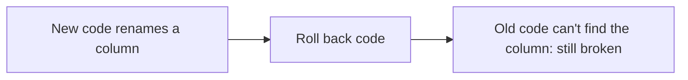
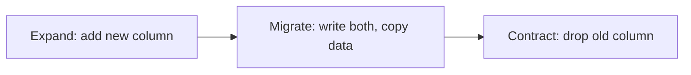
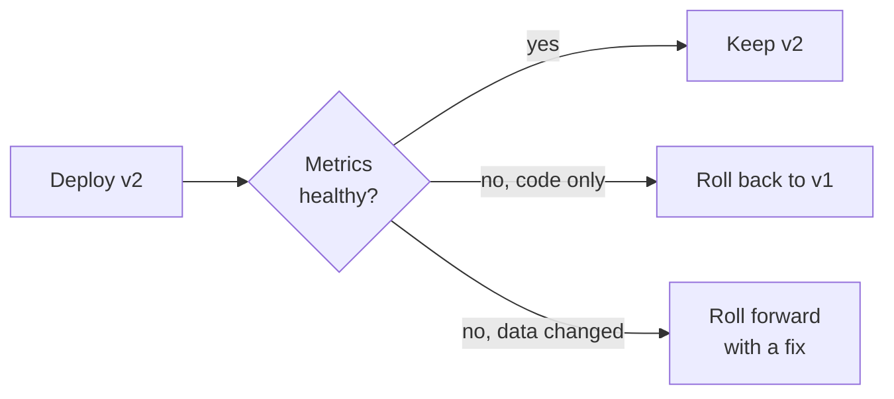
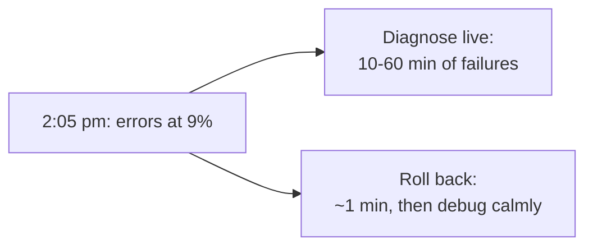
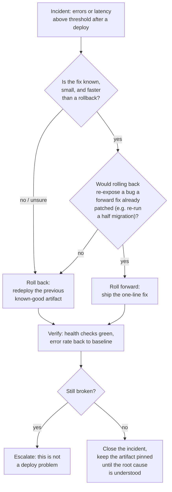
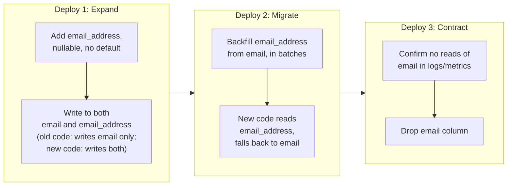

# Rollback and Safe Migrations

> [!summary] TL;DR
> A rollback returns a service to its last known-good version after a bad deploy. It only works if every change released alongside the code — database schema, event formats, config — stays compatible with both the new and the old version at the same time, because for a while both are running.

> [!abstract] Core idea
> - Roll back when the fix is unknown or slow; roll forward when you already know the one-line fix and a rollback would be riskier (for example, it would re-apply a half-done migration).
> - Code, config and flags can be rolled back. Sent emails, captured payments and dropped columns cannot — design for that before you ship.
> - Expand → migrate → contract: change the schema in three deploys so that old code and new code both run correctly against it at every point in between.
> - Automate the trigger (error-rate and latency alarms, SLO burn rate) — a human watching a dashboard is slower than the alarm that pages them.
> - A rollback is itself a deploy. It needs the same health checks, canary and monitoring as a forward deploy, or it just trades one bad version for a different kind of surprise.

## Start here: the basics 🟢

> [!info] How to read this note (pick your level)
> - 🟢 **New to this?** Read "From zero" below, then sections 1, 2 and 10 (why, mental model and the cheat sheet). Stop there, that is a full first pass.
> - 🟡 **Know the basics?** Add sections 3, 4, 5 and 6 (how it works, a worked example, options and trade-offs).
> - 🔴 **Interview / SDE-3 prep?** Add sections 7, 8 and 9 (production, deep dive and interview questions). Headings are tagged 🟢🟡🔴 so you always know where you are.

> [!note] Before this note
> - [[Deployment Strategies - Rolling, Blue-Green, Canary]]: during any rollout the old and new versions run side by side for a while, and a canary compares the new version's errors with the old one's.

**From zero, in 60 seconds** 🟢

A bad deploy goes out. The fastest fix is often to go back to the last good version. That is a **rollback**.
Code is easy to roll back. Data is not. If the new version changed the database, the old code may no longer understand it.



So you change the database in small safe steps, where both old and new code work at every moment.
This is called **expand, migrate, contract**: add the new thing, move data over, remove the old thing later.



The rest of this note is just these 3 questions:
1. When should you roll back, and when roll forward with a fix?
2. What can be undone and what can't?
3. How do you change a database without breaking a rollback?


**The problem in one story.**
You ship version 2 of your app on Friday evening.
Ten minutes later, checkout errors jump from 0.1% to 8%.
You want to go back to version 1 *now*, but version 2 already changed the database table.
Rolling back code is easy; rolling back data is the hard part this note is about.

**Words you need first**

| Word | Plain meaning | Tiny example |
| --- | --- | --- |
| Deploy | Putting a new version of code into production | Shipping `v2` of the API |
| Rollback | Going back to the previous known-good version | Redeploying `v1` image |
| Roll forward | Fixing the bug with a new version instead of going back | Shipping `v2.1` with the fix |
| Schema migration | A change to database structure | `ALTER TABLE users ADD COLUMN email` |
| Backward compatible | Old code still works with the new thing | `v1` ignores a new nullable column |
| Canary | Sending a small slice of traffic to the new version first | 5% of users get `v2` |
| Feature flag | A switch to turn behaviour on/off without deploying | `new_checkout=false` |
| Expand / migrate / contract | Change a database in three safe steps: add the new, move data over, remove the old | Add `email_address`, copy, drop `email` |
| Backfill | Filling a new column for all the old rows, in small batches | Copy `email` into `email_address` for 1M rows |
| Dual-write | New code writes the same value to both the old and the new place | Save to `email` and `email_address` |
| Artifact | The exact built thing you deploy, named by an unchangeable ID | Image `api@sha256:3f2a…` |
| Side effect | Something your code did outside itself that cannot be taken back | An SMS sent, a card charged |
| Circuit breaker (deploys) | An automatic stop that halts a rollout and goes back when health checks fail | ECS deployment circuit breaker |
| SLO burn rate | How fast you are using up your allowed errors for the month | 14x = a month's budget in ~2 days |

**Picture it**



**Analogy.** Undo in a text editor works for typing, but not after you have emailed the document to 1,000 people.
Code is the typing; data written by the new version is the sent email.
Where it breaks: with careful design (expand/contract migrations) you *can* make the "email" readable by both old and new versions, which an editor has no equivalent for.

**How the rest of this note builds up**

- First, why rollback is harder than it looks (section 1) and the mental model of what is reversible (section 2).
- Then roll back vs roll forward, what does and does not roll back, and mechanisms per layer (section 3).
- Then a worked example with automatic canary-based rollback (section 4).
- Finally the SDE-3 deep dive: expand/contract migrations, trade-offs, and production failure modes.

> [!tip] Remember
> Code can always go back; data usually cannot, so make every schema change safe for both versions.

## 1. Why it exists 🟢

A team ships a new pricing-calculation path to production at 2 p.m. By 2:05 p.m., the error-rate dashboard for that service jumps from 0.1% to 9%. Checkout requests are failing.

The on-call engineer (the person whose turn it is to handle production alerts) has two choices:

1. **Diagnose live**, under pressure, with checkout broken for every user, for as long as it takes to find and fix the bug.
2. **Roll back**: redeploy the previous version, which was serving traffic cleanly five minutes ago, and diagnose the bug offline with no user impact.

Rollback exists because (2) is almost always faster and safer than (1). The previous version is not a guess — it is the exact artifact that was passing health checks and serving real traffic a few minutes earlier.

Reverting to it takes the time of a deploy, typically under a minute with a pre-built image and an orchestrator (a system like Kubernetes or ECS that runs and replaces containers) that already knows how to roll a Deployment back.

Finding and fixing a live bug under incident pressure routinely takes 10–60 minutes, during which users keep failing.

The catch: rollback only returns *code* to its old version instantly.

If the bad deploy also changed something that doesn't roll back with it — a database column it dropped, an event schema a downstream consumer already started reading, a payment it already captured — the rollback does not undo that.

This note is about designing deploys so the rollback path is actually safe to take.



### Real-life example: a wrong discount at dinner time 🟢

Say a food app like Zomato ships a new coupon calculation at 7:30 pm, and within minutes some orders show a 90% discount instead of 9%.
Rolling the code back takes about a minute and stops new bad orders.
But the orders already placed with the wrong discount do not "roll back"; someone must find and fix them, or decide to honour them.
And if the new version had also renamed a database column, the old code might not even start after the rollback.
This note is about making that one-minute rollback always safe, and knowing what it cannot undo.

## 2. Mental model 🟢

Think of a release as **two independent axes that must stay compatible with each other**: the **code** axis (which version of the binary is running) and the **data/contract** axis (the schema, event format, and config that code reads).

A rollback moves the code axis backward in seconds. The data axis usually can't move backward at all — you don't un-capture a payment or un-drop a column.

So the rule is: **never let the data axis require a specific code version**.

Change the data axis in small, reversible-feeling steps (expand, then migrate, then contract) so that at every instant, both the old code and the new code can read and write it correctly.

Then a rollback of the code axis is always safe, because the data axis never moved out from under it.

## Common beginner mistakes 🟢

- **Renaming or dropping a column in the same deploy as the code change** → a rollback puts old code on a table it no longer understands → use expand, migrate, contract over three deploys.
- **Thinking "rolled back" means "fixed"** → emails sent and payments charged by the bad version are still out there → check and repair side effects before closing the incident.
- **Deploying `:latest` and deleting old images** → there is nothing exact to go back to → deploy by digest and keep the last several images.
- **Fixing config by hand on the server** → nobody knows what the previous config was → keep config in Git, versioned with the code.
- **Never practising a rollback** → the first real one finds missing steps under pressure → run rollback drills on purpose.

## 3. How it works 🟡

> 🟢 → 🟡 **You now know** that code can go back quickly but data usually cannot, and that schema changes must work for both old and new code. **Next we open the box**: how to choose between going back and fixing forward, exactly what does and does not undo, and the "undo button" each layer gives you.

### Roll back vs. roll forward

**In plain words:** going back is usually faster and safer. Going forward (a quick fix) only makes sense when going back is impossible or riskier.

**Step by step:**
1. Errors jump right after a deploy. Ask: do we already have a small, reviewed fix ready?
2. No, or not sure → roll back to the previous version.
3. Yes → would going back cause a new problem (for example, re-run a half-finished migration)? If yes, ship the fix forward; if no, still roll back.
4. Either way, check that errors return to normal.
5. Still broken? The cause is not the deploy (for example, an outside service failed), so escalate.



Roll back by default. Roll forward only when the fix is already written, reviewed, and smaller in blast radius than reverting — for example, a one-character config typo where a full redeploy would also re-run an expensive migration you don't want to repeat.

### What rolls back, and what doesn't

**In plain words:** code and config can go back. Sent emails, charged cards and changed data cannot.

**Step by step (sort each change into a bucket):**
1. Is it code, a feature flag, or config kept with the code? It can go back.
2. Is it infrastructure described in Terraform files? Re-apply the previous files.
3. Did it send a message, move money or tell another service something? It cannot go back; you can only repair.
4. Did it delete data (drop a column)? Only a backup brings it back. That is why deletes come last.

| Rolls back | Why | Doesn't roll back | Why not |
| ---------- | --- | ------------------ | -------- |
| Application code (redeploy the previous image digest) | The old binary still exists and is immutable | Emails, SMS, push notifications already sent | The message already left the building |
| Config and environment variables (if versioned alongside the deploy) | Just data, redeployed with the artifact | Payments already captured, refunds already issued | Money moved at a third party (payment processor) |
| Feature flags (flip back in the flag service, no redeploy needed) | Flags are runtime state, not baked into the artifact | A dropped column or truncated table | The bytes are gone; only a backup restores them |
| Infrastructure-as-code (servers and networks described in files, applied with `terraform apply`; here, the previous plan) | Declarative state, reapplied | Events already consumed and acted on by another service | The side effect already happened downstream |
| Kubernetes object specs (`kubectl rollout undo`) | The previous ReplicaSet's pod template is kept in rollout history | A shipped mobile app version | You don't control the user's device; they may run the new app for weeks |

The second column is why **expand/contract** exists: it turns "rolls back" into the common case by making sure new code never depends on data only new code can produce.

### Mechanisms, by layer

**In plain words:** each layer (Kubernetes, feature flags, load balancer, database) has its own "undo" button. Know which one to press.

**Step by step (fastest undo first):**
1. Risky code behind a flag? Flip the flag off: under a second, no deploy.
2. Blue-green? Point the load balancer back at the old environment: seconds.
3. Canary? Send its small share of traffic back to the stable version.
4. Plain Kubernetes rolling update? `kubectl rollout undo`: about as long as the rollout itself.
5. ECS with the circuit breaker on? It rolls back on its own when health checks fail.

- **Kubernetes Deployment:** `kubectl rollout undo deployment/api` reverts to the previous ReplicaSet recorded in rollout history (`kubectl rollout history`). It is itself a rolling update in reverse — old pods come up, new pods terminate, readiness gates the traffic switch. See [[Kubernetes Fundamentals]] for how the Deployment–ReplicaSet–Pod chain drives this.
- **ECS:** the deployment circuit breaker watches the new task set's health and, past a failure threshold, automatically stops the rollout and rolls the service back to the previous task definition (ECS's description of which image and settings to run) — no human in the loop required.
- **Blue-green:** switch the load balancer's target group (or the DNS record) back to the environment that was serving before, which is still warm and running. Fastest rollback there is, at the cost of running two full environments during the switch.
- **Canary:** stop promoting and shift the small percentage of traffic back to the stable version; nothing else needs to change because the stable fleet never scaled down.
- **Feature flag kill switch:** flip the flag off in the flag service. No deploy at all — propagation is as fast as the SDK's streaming update, typically sub-second. This is the fastest rollback that exists and the reason risky logic should ship behind a flag even when the deploy mechanism is a plain rolling update.
- **Config and Terraform:** redeploy the previous rendered config (the final config file after templates are filled in), or `terraform apply` against the prior committed plan. Config rollback needs the same version pinning as code — "what config was live two hours ago" has to be answerable from source control, not guessed.

## 4. Worked example 🟡

### Whiteboard version

The bare idea: compare the canary's error rate against the baseline's, and trip when it's too far off.

```go
if canaryErrorRate > baselineErrorRate*2 || canaryErrorRate > absoluteCeiling {
    abortRollout()
}
```

The full version below adds a minimum sample size (so three unlucky requests don't trip the alarm) and a "hold" state for when there isn't enough data yet.

### Automatic rollback trigger: canary analysis

**In plain words:** a robot compares the new version's errors with the old one. If they are clearly worse, it rolls back by itself.

A deploy pipeline runs a canary at 5% of traffic for 10 minutes, compares it against the baseline (the other 95%, still on the old version), and must decide: promote, hold and keep watching, or abort and trigger rollback.

```go
package rollback

import "errors"

// Verdict is the automatic rollback trigger's decision after comparing a
// canary (new version) against the baseline (old version).
type Verdict int

const (
	Hold Verdict = iota
	Promote
	Abort
)

func (v Verdict) String() string {
	switch v {
	case Promote:
		return "promote"
	case Abort:
		return "abort"
	default:
		return "hold"
	}
}

// Sample is one analysis window's observed counters for a single version.
type Sample struct {
	Requests int
	Errors   int
}

func (s Sample) errorRate() float64 {
	if s.Requests == 0 {
		return 0
	}
	return float64(s.Errors) / float64(s.Requests)
}

// ErrInsufficientSamples signals the analysis gate should hold and wait
// for more traffic rather than guess from a tiny sample.
var ErrInsufficientSamples = errors.New("rollback: insufficient samples")

// Analyze is the canary analysis gate: it compares the canary's error
// rate against the baseline's and against an absolute ceiling, and
// returns Abort (trigger automatic rollback), Promote (ramp the canary
// up), or Hold (keep watching). minSamples guards against deciding from
// a handful of requests; maxRelativeIncrease is how many times worse
// than baseline the canary may be (e.g. 2.0 = at most 2x baseline's
// error rate); absoluteCeiling is a hard cap regardless of baseline
// (e.g. 0.05 = 5%).
func Analyze(canary, baseline Sample, minSamples int, maxRelativeIncrease, absoluteCeiling float64) (Verdict, error) {
	if canary.Requests < minSamples {
		return Hold, ErrInsufficientSamples
	}

	canaryRate := canary.errorRate()
	if canaryRate > absoluteCeiling {
		return Abort, nil
	}

	baselineRate := baseline.errorRate()
	if baselineRate == 0 {
		// No baseline errors to compare against: any canary errors at
		// all are judged against the absolute ceiling only, already
		// checked above, so a clean canary promotes.
		if canaryRate > 0 {
			return Hold, nil
		}
		return Promote, nil
	}

	if canaryRate > baselineRate*maxRelativeIncrease {
		return Abort, nil
	}
	return Promote, nil
}
```

Test, exactly as run against Go 1.24 (`go vet` clean, `go test -race` passes):

**What this code does, in plain words:** the tests give the decision function a canary whose error rate is far above the baseline (it must say "abort") and one with too few requests (it must say "hold, wait for more data").

```go
func TestAnalyze_AbortsOnRelativeRegression(t *testing.T) {
	// baseline error rate 0.5%, canary 2% is 4x baseline, over the 2x cap.
	v, err := Analyze(Sample{Requests: 1000, Errors: 20}, Sample{Requests: 10000, Errors: 50}, 200, 2.0, 0.05)
	if err != nil {
		t.Fatalf("Analyze error = %v", err)
	}
	if v != Abort {
		t.Fatalf("Analyze = %v, want Abort", v)
	}
}

func TestAnalyze_HoldsWhenBaselineCleanButCanaryHasSomeErrors(t *testing.T) {
	// Baseline has zero errors to divide by; a non-zero but
	// sub-ceiling canary error rate can't be judged relatively, so the
	// gate holds rather than guessing.
	v, err := Analyze(Sample{Requests: 1000, Errors: 2}, Sample{Requests: 10000, Errors: 0}, 200, 2.0, 0.05)
	if err != nil {
		t.Fatalf("Analyze error = %v", err)
	}
	if v != Hold {
		t.Fatalf("Analyze = %v, want Hold", v)
	}
}
```

Both pass (`go vet` clean, `go test -race` green). A fuller suite should also cover: promoting on a clean canary, promoting on a comparable canary, aborting on the absolute ceiling, and holding on too few samples.

### Expand, migrate, contract across three deploys

**In plain words:** renaming a column, done safely, takes three separate deploys. At no point does any running code see a column it doesn't expect.

**Step by step (rename `email` to `email_address`):**
1. Deploy 1, expand: add an empty `email_address` column. New code writes both columns; old code still writes only `email`. Rolling back is safe.
2. Deploy 2, migrate: copy `email` into `email_address` for old rows, in batches. New code reads `email_address`, falling back to `email`. Rolling back is still safe.
3. Wait days, and check logs and metrics until nothing reads `email` any more.
4. Deploy 3, contract: drop `email`. This is the only step you cannot undo, so it goes last.

A column rename (`email` → `email_address`) is the simplest case that breaks naively: if you rename the column and deploy new code in the same step, every pod still running the old code (there are always some, mid-rollout) breaks instantly.



At every point up to the start of deploy 3, a rollback to the *previous* deploy's code is safe: the column that code expects still exists and is still kept correct.

Only deploy 3 (dropping the column) is irreversible — which is exactly why it is the last step, done only once deploy 2 has run in production long enough to prove nothing still reads the old column.

See [[Zero-Downtime Schema Migrations]] for the database-side mechanics of the backfill (batch size, lock avoidance, replication lag) and [[Schema Migrations in Go Services]] for how the migration tool and the dual-write code are structured in a Go service.

The same shape applies to **event schemas**: add a new field as optional, have producers start sending it while consumers still work without it, wait for all consumers to read it, only then make it required or remove the old field.

An event consumed by a service you don't control (a partner's webhook) may never let you remove the old field at all — you carry it forever or version the event type.

## 5. Variants and comparison 🟡

| Mechanism | Speed | What it actually reverts | Needs |
| --------- | ----- | ------------------------- | ----- |
| Feature flag kill switch | Sub-second | The code path behind the flag | The flag was wired in before the incident |
| Blue-green switch-back | Seconds (LB) to minutes (DNS TTL) | All traffic, instantly | A second full environment kept warm |
| `kubectl rollout undo` | A rolling update's worth of time (depends on replica count and readiness delay) | The pod template (image, env, config) | Previous ReplicaSet still in rollout history (`revisionHistoryLimit`) |
| ECS circuit breaker | Automatic, no manual trigger | The task definition | Enabled on the service; health checks configured |
| Roll-forward fix | As fast as CI/CD builds and deploys the new artifact | Only the specific bug, not the whole deploy | The fix is already known and reviewed |
| Data repair / replay | Minutes to hours | Side effects already applied (replays events, recomputes derived data) | An idempotent consumer (processing the same event twice has the same effect as once) and an event log or audit trail to replay from |

## 6. Trade-offs and when not to use 🟡

- Expand/contract triples the number of deploys for one schema change and keeps old columns around longer, which costs storage and code complexity (dual-write, dual-read branches). For an internal tool with a five-minute maintenance window, a single blocking migration is simpler and the trade-off isn't worth it.
- Automatic rollback triggers can themselves cause incidents: a flaky health check or a transient network blip can trigger a flood of unnecessary rollbacks. Require a minimum sample size and a sustained breach, not a single bad data point (see `Analyze`'s `minSamples` above).
- Keeping a previous environment warm for instant blue-green rollback doubles infrastructure cost for as long as it's kept. Most teams tear it down after a bake period (a waiting time to build trust in the new version), trading rollback speed for cost once the new version is trusted.
- Rolling back doesn't help when the previous version is *also* broken by something external — an expired certificate, a third-party API that changed — because the "known-good" artifact isn't actually good against today's environment.

## 7. In production 🔴

> 🟡 → 🔴 **You now know** how to choose between rollback and roll-forward, what can and cannot be undone, each layer's undo button, automatic canary rollback and the three-deploy schema change. **Next is the advanced part**: the rollback failures real teams hit, and the deeper ideas (migration edge cases, SLO burn-rate triggers, data repair, drills, pinned artifacts).


- **Real systems:** Kubernetes stores a bounded rollout history per Deployment (`revisionHistoryLimit`, default 10) specifically so `rollout undo` has something to go back to. AWS CodeDeploy and ECS's deployment circuit breaker automate the abort-and-rollback decision from CloudWatch alarms. Argo Rollouts and Flagger run the canary-analysis loop in this note as a Kubernetes controller, querying Prometheus (a popular metrics database) for the metrics.
- **Failure modes → fixes:**
  - Rollback redeploys the old binary against a schema the new deploy already changed incompatibly → the old binary crashes on startup or corrupts data. Fix: expand/contract, never a single breaking migration alongside a code deploy.
  - The team "rolls back" by editing config in place instead of redeploying a pinned artifact, and no one remembers what the config looked like before. Fix: version config with the artifact (same git SHA, same image tag) so "roll back" always means "redeploy a known commit," never "undo by memory."
  - A mobile app already shipped the new API's expectations to app stores, and the API gets rolled back. Fix: version the API, and keep the rolled-back version serving both the old and the still-pending-review new mobile release for as long as app store rollout takes (days).
  - Rollback itself fails health checks because the "old" image was already deleted from the registry to save space. Fix: retain the last N image digests and the Deployment's rollout history together; never garbage-collect (automatically delete as unused) one without the other.
- **What to monitor:** error rate and latency by version (not just service-wide), rollback count and mean time to rollback, canary analysis holds vs. aborts vs. promotes, and config/schema version drift between what's deployed and what the database actually has.

## 8. Deep dive 🔴

- **Rollback is not idempotent across migrations.** If deploy N added a NOT NULL column (a column that must always have a value) with no default and deploy N+1's rollback target is N-1, the rolled-back code doesn't know that column exists — which is fine, it just won't write to it — but any trigger or constraint (database rules that run or check on every insert) that now requires it will reject inserts from the old code. This is the sharpest edge of expand/contract: the *database* must always tolerate the *oldest* code version still permitted to run, not just the newest.
- **SLO burn-rate triggers** are a better automatic-rollback signal than a raw error-rate threshold, because they account for how fast the error budget (the small share of failures your target allows per month) is being consumed, not just whether it's currently breached. A burn rate of 14.4x (consuming a 30-day budget in about 2 days, or 2% of it in one hour) pages immediately; a burn rate of 1x just needs a ticket. See [[SLIs, SLOs, SLAs and Error Budgets]] for the formula and multi-window burn-rate alerting.
- **Data repair and replay.** When a bad deploy already processed events incorrectly — say it wrote a wrong discount to 10,000 orders before rollback — the fix isn't just rolling back the code, it's replaying the affected events through corrected logic (if the event log is retained and processing is idempotent) or running a backfill script that recomputes the derived state. This only works if the original events are retained somewhere durable (Kafka with a long retention, an outbox table, an audit log) — design that retention in before you need it, not during the incident.
- **Runbooks and drills.** A rollback procedure that's only ever been read, never executed, is unverified. Game-day drills (planned practice runs of an incident) that intentionally trigger a rollback in a non-production (or carefully scoped production) environment catch the gaps: a Terraform state lock (a lock that stops two people changing infrastructure at once) nobody remembered to release, a database migration that silently can't be reversed because deploy 3's "contract" step already ran, an on-call engineer who's never actually typed `kubectl rollout undo`.
- **Versioned artifacts, not "latest."** Rollback requires a previous artifact to exist and be addressable by an immutable identifier — an image digest, not a mutable tag like `:latest` that may have already been overwritten by a newer build. The same applies to Terraform state and rendered config: pin and keep history, or there's nothing to roll back *to*.

## 9. Interview questions 🔴

> [!question]- When would you roll forward instead of rolling back?
> When the fix is already known, small, and reviewed, and rolling back would be slower or riskier than shipping it — for example, a rollback would re-trigger an expensive migration, or the previous version has its own known issue. Default to rollback; only roll forward with a specific reason.

> [!question]- Why can't every deploy just be rolled back safely?
> Because code isn't the only thing that changes — schema, event formats, and external side effects (emails sent, payments captured) change too, and most of those can't be undone. A rollback only reverts the code; if the data layer moved in a way the old code can't handle, the rollback itself breaks.

> [!question]- Walk through expand/contract for dropping a column.
> Deploy 1 (expand): add the new column, dual-write from both old and new code paths. Deploy 2 (migrate): backfill historical rows, switch reads to the new column with a fallback. Deploy 3 (contract): once nothing reads the old column, drop it. Only deploy 3 is irreversible, so it runs last and only after deploy 2 has proven itself in production.

> [!question]- What should trigger an automatic rollback, and what shouldn't?
> A sustained breach of error rate, latency, or SLO burn rate over a minimum sample size and time window should trigger it. A single bad data point, a known flaky health check, or a metric still inside normal variance should not — require the signal to be both big enough and persistent enough to rule out noise.

> [!question]- Trap: "We rolled back the deploy, so we're safe now." What's missing?
> Rolling back the code doesn't undo side effects the bad deploy already caused — sent notifications, captured payments, corrupted derived data from events already processed. The incident isn't closed until you've checked what state those side effects left behind and repaired or replayed as needed.

> [!question]- How does `kubectl rollout undo` actually work?
> Kubernetes keeps a bounded history of a Deployment's previous ReplicaSets (their pod template, up to `revisionHistoryLimit`). `rollout undo` points the Deployment back at the previous revision's template, which triggers the same rolling-update machinery in reverse: new (old-version) pods come up and pass readiness, old (new-version) pods terminate.

> [!question]- A shipped mobile app already expects the new API contract. Can you still roll the API back?
> Only if the API was versioned (a new field was additive, or a new endpoint version exists) so the old API version keeps serving the app that hasn't updated yet. If the change was a breaking rewrite with no version split, rolling back the API breaks every client still on the new mobile release — which is why mobile-facing API changes need stricter backward compatibility than purely internal ones.

## 10. Cheat sheet 🟢

- Default to rollback; roll forward only with a known, smaller, already-reviewed fix.
- Code, config, flags and infra-as-code roll back. Sent messages, captured payments and dropped columns don't.
- Expand → migrate → contract: only the last step is irreversible, so it runs last and only once the middle step has proven itself.
- Feature flag kill switch is the fastest rollback there is — sub-second, no redeploy.
- Automate the trigger with a sustained error-rate/latency/SLO-burn-rate breach over a minimum sample size, not a single noisy data point.
- Keep rollback drills real: an untested runbook is a guess, not a procedure.
- Pin artifacts, config and Terraform state by immutable version — "latest" has nothing to roll back to.
- Closing an incident means checking side effects too, not just confirming the dashboard is green again.

## Self-check 🟢🟡

🟢 Easy

> [!question]- What is a rollback?
> Going back to the last version that was working, usually by redeploying its exact image.

> [!question]- Name two things a code rollback cannot undo.
> Messages already sent (email, SMS) and payments already charged; also deleted data.

> [!question]- What is the fastest kind of rollback?
> Flipping a feature flag off: under a second and no deploy.

🟡 Medium

> [!question]- Why is renaming a column in the same deploy as the code change dangerous?
> During the rollout, and after any rollback, old code runs against a table that no longer has the column it expects.

> [!question]- In expand, migrate, contract, which step cannot be undone, and when do you run it?
> Contract (dropping the old column); run it last, only after nothing reads the old column.

> [!question]- Why should an automatic rollback need a minimum number of requests and a sustained breach?
> So one unlucky request or a brief blip does not trigger a needless rollback.

## Links

- **Before this:** [[Deployment Strategies - Rolling, Blue-Green, Canary]]
- **Next:** [[Kubernetes Fundamentals]], [[Autoscaling]]
- **Compare with:** [[Feature Flags]] (deploy vs. release, the fastest rollback path), [[Schema Migrations in Go Services]] (the migration code itself), [[Zero-Downtime Schema Migrations]] (the database-side mechanics this note's expand/contract relies on)

### Watch on YouTube

- [The safe way to run zero-downtime database migrations](https://www.youtube.com/watch?v=l_jjjgwNRI0) · programmerCave · 8 min · 219 views
- [Flyway Tutorial: Database Schema Migrations in a Live MySQL Project / Safe Deployment #BVRK](https://www.youtube.com/watch?v=XRgB2XhSpNk) · BVRK Tech Tutorial · 12 min · 13 views
