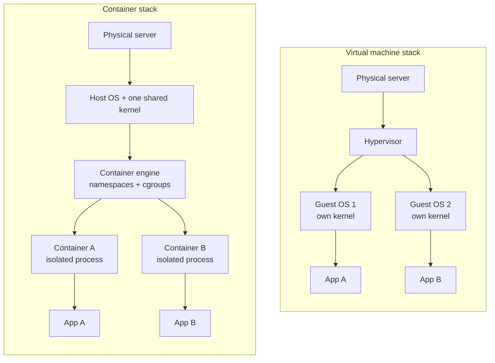
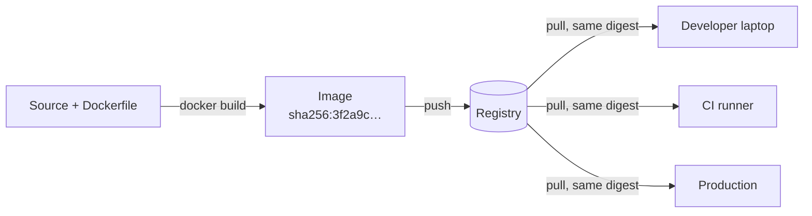

# Docker 01 - Why Containers

> [!summary] TL;DR
> A container packages an application with everything it needs to run — code, runtime, libraries, config — as one immutable artifact, and runs it as an isolated process that shares the host's kernel. That one artifact behaves the same on a laptop, in CI, and in production, which is the problem containers exist to solve.

> [!abstract] Core idea
> - "Works on my machine" happens because the machine, not the artifact, carries the runtime and its exact dependency versions.
> - A container is an isolated **process**: it gets its own filesystem, process tree, network, and environment, but still runs on the host's shared kernel.
> - A container is not a VM. It skips the hypervisor and the guest OS, so it starts in milliseconds and costs megabytes, not a full OS's time and footprint.
> - The artifact is immutable and content-addressed: you build an image once, and promote the exact same bytes through dev, CI, and production.
> - Isolation does not fix everything: it does not remove config drift between environments, kernel-feature differences, or the need to manage state.

### Whiteboard version

A team ships a Go service. In 2024 it was built and tested against Go 1.21 and a specific version of a C library used by a CGO dependency. By 2026, a new engineer's laptop has Go 1.24 and a newer system library. The code that compiled and passed tests in 2024 now fails to build, or builds but behaves differently at runtime, because the **environment**, not the code, changed underneath it.

A container fixes this by shipping the Go 1.21 toolchain's *output* (a compiled binary) together with the exact base OS layer and libraries it was built and tested against, as one artifact. Nothing about the new engineer's laptop — its Go version, its library versions, its OS — can leak into how that artifact runs.

## 1. Why it exists

Before containers, deploying meant replicating a server's exact state by hand or with a configuration-management tool: install this OS package at this version, this language runtime, this library, set these environment variables, open these ports. Four places had to agree: a developer's laptop, a teammate's laptop, the CI runner, and production. They rarely did.

Concretely: an API depends on `libssl` 1.1 and Node.js 18. A teammate's laptop has `libssl` 3.0 and Node.js 20 because they set it up a year later. The code runs locally for them with subtly different TLS defaults and V8 behavior, passes their tests, and then fails a cipher-negotiation test in CI, which still has the older versions. Nobody changed the code; the environment changed under it. Multiply this by every dependency and every machine, and "works on my machine" becomes the default failure mode of the team, not an edge case.

Containers close the gap by making the environment part of the shipped artifact instead of part of the target machine.

## 2. Mental model

A container is **a normal operating-system process that cannot see most of the machine it is running on.**

The host kernel is the only thing actually running the code — there is no second kernel, no virtual CPU. Four Linux kernel mechanisms do the hiding:

- **PID namespace** — the process sees itself as PID 1 and cannot see the host's other processes.
- **Mount namespace** — the process sees its own root filesystem (the image's files), not the host's.
- **Network namespace** — the process gets its own loopback and network interfaces.
- **cgroups** — the kernel caps how much CPU, memory, and I/O the process (and its children) may use, and can kill it if it goes over a memory limit.

Analogy: a container is like a hotel room, not a separate building. Every room (container) shares the same building's foundation, plumbing, and electrical grid (the host kernel), but each guest sees only their own room's door, furniture, and thermostat (namespaces), and the hotel caps how much power and water each room can draw (cgroups). A VM, by contrast, is a separate building with its own foundation, plumbing, and electrical grid — a full guest OS and kernel — which is why it costs far more to stand up and run.

## 3. How it works

Each guest OS in the VM stack boots its own kernel, drivers, and init system before the app ever starts — that is where the extra minutes and gigabytes go. In the container stack, `App A` and `App B` start as soon as the single shared kernel hands them a process id; there is no second boot.

The second mechanism is **build once, run anywhere the same way**:

The image is identified by a content hash (its digest), not just a name. Pulling that digest in CI and in production fetches byte-identical layers — there is no "rebuild for production" step where a version could silently drift, because the thing that runs in production is the thing that was already built and tested.

## 4. Worked example

Two developers, Priya and Sam, both run the same image, `myapi:3f2a9c` (a digest-pinned tag), on different host operating systems:

| Host | What the kernel sees | What the container sees |
| --- | --- | --- |
| Priya's Linux laptop | A process in its own PID/mount/net namespaces, cgroup-limited to 512 MiB and 1 CPU | Its own root filesystem from the image, PID 1, `localhost` |
| Sam's Mac (Docker Desktop) | Docker Desktop runs one lightweight Linux VM; inside that VM, the same namespaced process | Identical: same root filesystem, same PID 1, same `localhost` |
| A production EC2 host | Same namespaced process, same cgroup limits, same image digest | Identical to both of the above |

This is the concrete payoff: the thing both developers and production run is bit-for-bit the same artifact, so a bug that shows up in production can be reproduced locally by pulling that exact digest — not by trying to remember what versions production happened to have.

**Representative startup comparison** (estimate, consistent with Docker's own published container-vs-VM guidance; exact numbers depend on image and host):

| | Typical cold start | Typical disk footprint |
| --- | --- | --- |
| VM (full guest OS) | 10s of seconds to minutes | Gigabytes |
| Container | Tens to hundreds of milliseconds | Megabytes to low hundreds of MB |

Label: **estimate** — these vary enormously by image size and VM image, but the order-of-magnitude gap (seconds-to-minutes vs. milliseconds, gigabytes vs. megabytes) is the documented reason containers replaced VMs for per-service isolation.

## 5. Variants and comparison

| Approach | How it works | Use when | Cost |
| --- | --- | --- | --- |
| Containers | Shared host kernel, isolated via namespaces + cgroups | Packaging and deploying one service per isolated unit, dev/CI/prod parity | Weaker isolation boundary than a VM; shares the kernel |
| Virtual machines | Hypervisor virtualizes hardware; each VM boots its own kernel | Running different OS kernels on one host, or where kernel-level isolation is a hard security requirement | Minutes to boot, gigabytes of overhead per instance |
| Bare metal / direct install | App runs directly on the host OS, no isolation layer | Maximum performance, single-tenant hardware you fully control | No portability, no isolation between apps on the same host |
| WebAssembly (Wasm) sandboxes | App compiled to Wasm, run in a Wasm runtime's sandbox | Very fast cold starts for simple, language-agnostic, CPU-bound functions | Smaller ecosystem, limited syscall/network access without extra runtimes |

## 6. Trade-offs and when not to use

- Containers share the host kernel, so a kernel exploit can, in principle, cross container boundaries — a VM's hardware-enforced isolation is stronger. Multi-tenant, hostile-workload platforms often still put a VM (or a sandboxed runtime like gVisor/Kata) around groups of containers.
- A container needs a Linux-kernel-compatible host. Running Linux containers on macOS or Windows works only because Docker Desktop first starts a small Linux VM for you — see the deep dive.
- Containers do not fix configuration drift between environments: an environment variable or a feature flag that differs between staging and production still differs, container or not.
- Containers do not remove the need to manage state. A container's own filesystem is ephemeral; databases and files that must survive a restart still need volumes or external storage (see [[Docker 06 - Volumes and Bind Mounts]]).
- For a single, trusted, long-lived service with no need for portability or per-service isolation, a container adds an extra build and runtime layer for little benefit — a systemd-managed process can be simpler.

## 7. In production

- **Real systems:** every major cloud platform (AWS ECS/EKS/Fargate, Google Cloud Run/GKE, Azure Container Apps/AKS) runs workloads as containers; CI systems (GitHub Actions, GitLab CI) run each job inside a container for a clean, reproducible environment.
- **Failure modes → fixes:**
  - "Works on my machine, fails in CI" despite using containers → the Dockerfile itself is not pinned (a floating base tag like `node:20` resolved to a different patch version on different days); pin by digest.
  - Container runs locally but not on a teammate's Mac/Windows laptop → usually a resource limit in Docker Desktop's VM (memory, disk) or a platform mismatch (an `arm64`-only image on an `amd64` host or vice versa); see [[Docker 02 - Images, Layers and Containers]] on multi-arch images.
  - "It worked before I added volumes" → state leaking across container restarts in ways the image didn't account for; isolate what must persist.
- **What to monitor:** image digest actually deployed (not just the tag), container restart count, OOM-kill count from cgroup limits, and build time as a proxy for how bloated the image has become.

## 8. Deep dive

**Why Docker Desktop needs a VM on macOS and Windows.** Linux containers rely on Linux-specific kernel namespaces and cgroups; macOS's XNU kernel and Windows's NT kernel don't have them. Docker Desktop starts one small Linux VM (historically via HyperKit/Virtualization.framework on macOS, WSL2 on Windows) and runs the actual containers as Linux processes inside that single VM. From the outside this looks like "Docker just works" on a Mac, but there is in fact one VM boot happening — it's just shared across every container you start, not one VM per container, which is why it is still far cheaper than running separate VMs per service.

**The ecosystem map.** "Docker" names several distinct pieces that container terminology often blurs together:
- **Docker Engine** — the daemon (`dockerd`) and CLI that build images and run containers on one host.
- **OCI (Open Container Initiative)** — the vendor-neutral specifications for what an image and a runtime must look like, so images built by Docker run under `containerd`, `podman`, or a Kubernetes node's runtime without changes.
- **Registries** — where built images are stored and pulled from (Docker Hub, AWS ECR, GitHub Container Registry).
- **Compose** — a tool to describe and run several related containers together on one host (see [[Docker 07 - Docker Compose for Local Development]]).
- **Kubernetes** — an orchestrator that runs containers across a *fleet* of hosts, handling scheduling, scaling, and failover (see [[Kubernetes Fundamentals]]).

A single-host `docker run` and a Kubernetes-scheduled pod both end up starting the same kind of OCI-compliant isolated process; Kubernetes just decides *which* host and *how many* replicas.

## 9. Interview questions

> [!question]- Is a container a lightweight virtual machine?
> No. A VM virtualizes hardware and boots its own kernel; a container is an isolated process that uses the host's single kernel. That's why containers start in milliseconds and cost megabytes, while VMs take tens of seconds or more and cost gigabytes.

> [!question]- What two Linux kernel mechanisms actually provide container isolation?
> Namespaces (PID, mount, network, UTS, IPC, user, cgroup namespaces) hide most of the system from the process; cgroups cap and account for the CPU, memory, and I/O it's allowed to use. Docker is the tooling layer on top of both.

> [!question]- If containers share the host kernel, what security boundary do they actually provide?
> A weaker one than a VM: a kernel bug can, in principle, be exploited from inside a container to affect the host or other containers. Harden with a minimal base image, a non-root user, and dropped capabilities (see [[Docker 09 - Container Security and Hardening]]), and consider a VM-backed sandbox (gVisor, Kata Containers) for untrusted workloads.

> [!question]- Why does "build once, deploy the same image everywhere" matter more than "containers are fast"?
> Speed is a side effect of a shared kernel. The real reliability win is that the artifact that passed tests in CI is, byte for byte, the same artifact that runs in production — there is no separate "production build" step where a dependency version could silently differ.

> [!question]- Trap: "We containerized our app, so it will work the same everywhere now." What's missing from that claim?
> Containers fix *runtime and dependency* drift, not everything. Environment variables, feature flags, external service versions, and any state outside the container (databases, mounted volumes) can still differ between environments and still cause environment-specific bugs.

> [!question]- Why do we still need Kubernetes if containers already give us portability?
> A single host running `docker run` has no answer for "that host just died" or "we need 50 replicas across 10 machines." Kubernetes schedules containers across a fleet, restarts failed ones, and load-balances traffic to them — portability at the single-container level doesn't give you fleet-level scheduling or failover.

## 10. Cheat sheet

- A container is an isolated **process**, not a mini VM: it shares the host's one kernel via namespaces and cgroups.
- VMs virtualize hardware and boot a guest kernel each; containers don't, which is the whole speed/size difference.
- The artifact is immutable and digest-addressed: build once, promote the same digest through every environment.
- Docker Desktop on macOS/Windows runs one shared Linux VM under the hood so Linux containers can exist at all.
- Containers do not fix config drift, kernel-feature differences, or statefulness — those need their own solutions.
- "Docker" = Engine (daemon/CLI) + OCI spec (portability) + registries (distribution) + Compose/Kubernetes (orchestration).

## Links

- **Before this:** [[Processes, Threads and Context Switching]]
- **Next:** [[Docker 02 - Images, Layers and Containers]], [[Docker 03 - CLI Essentials]]
- **Compare with:** [[Cloud Native and the 12-Factor App]], [[Containerizing Go Services]] (Go-specific packaging), [[Docker 08 - How Docker Works Under the Hood]] (the namespaces/cgroups internals in depth)
