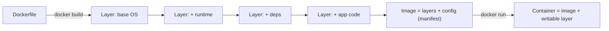
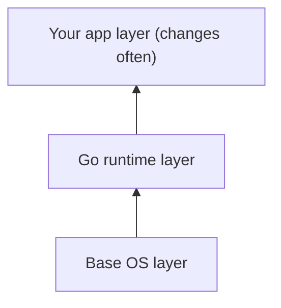
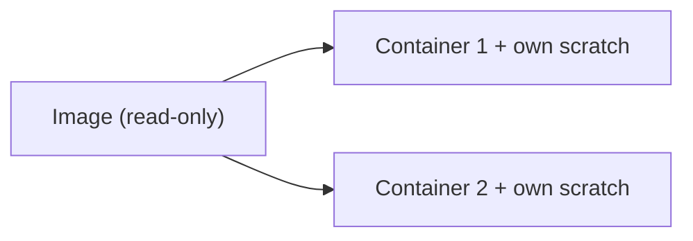
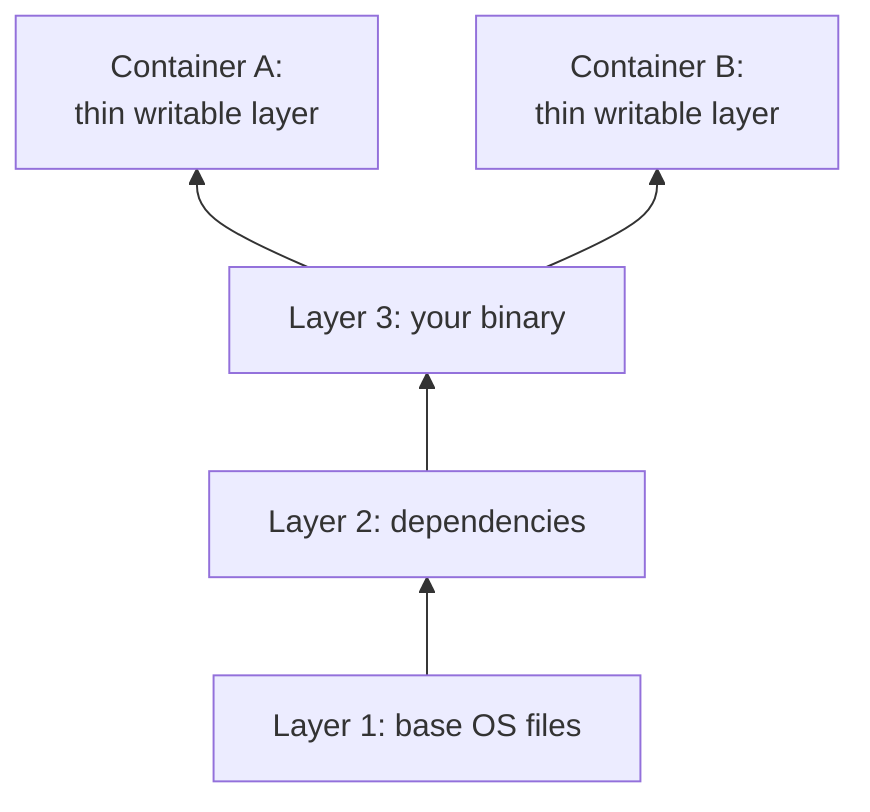
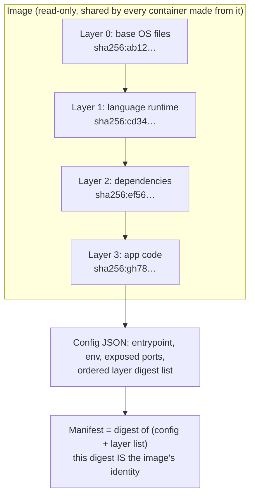
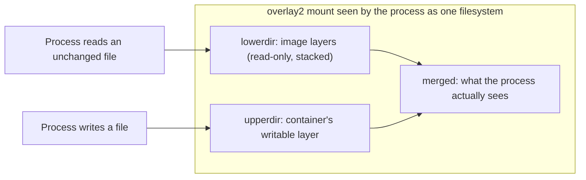
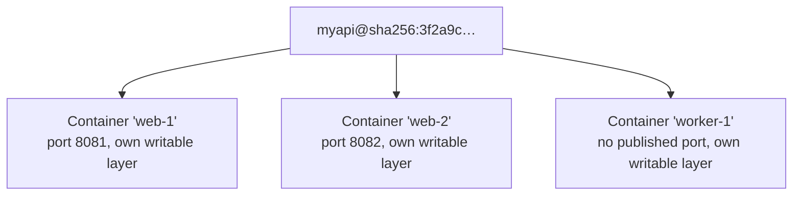

# Docker 02 - Images, Layers and Containers

> [!summary] TL;DR
> An image is a read-only, ordered stack of filesystem layers plus a config file (together, an OCI manifest); a container is that image with a thin writable layer added on top, running as a process. One image can start any number of independent containers.

> [!abstract] Core idea
> - Each filesystem-changing instruction in a Dockerfile produces one layer; layers are content-addressed and shared across images that happen to have identical ones.
> - `docker build` only ever *adds* layers; a container adds one more, writable layer on top (overlay2 copy-on-write) and never modifies the image's own layers.
> - A tag like `:latest` is a movable pointer; a digest (`@sha256:…`) is the actual immutable identity of an image. Pin by digest when you need to know exactly what is running.
> - Pulling an image only fetches layers you don't already have locally — this is why repeated deploys of similar images are fast.
> - A multi-arch image is really a manifest list pointing at one image per CPU architecture; the client pulls the one matching its own.

### Whiteboard version



Think of the image as a sealed stack of transparencies, each one adding or changing some files on top of the one below. A container clips one more, blank transparency on top that you're allowed to write on — the stack underneath never changes.

## Start here: the basics 🟢

> [!info] How to read this note (pick your level)
> - 🟢 **New to this?** Read "From zero" below, then sections 1, 2 and 10 (why, mental model and the cheat sheet). Stop there, that is a full first pass.
> - 🟡 **Know the basics?** Add sections 3, 4, 5 and 6 (how it works, a worked example, options and trade-offs).
> - 🔴 **Interview / SDE-3 prep?** Add sections 7, 8 and 9 (production, deep dive and interview questions). Headings are tagged 🟢🟡🔴 so you always know where you are.

**From zero, in 60 seconds** 🟢

A Docker **image** is a read-only bundle of files plus a note saying how to start the app.
It is built in **layers**: each step in your recipe adds one layer on top of the last.
If only your code changed, only the top layer is rebuilt and uploaded. The rest is reused.



A **container** is that image running, plus a thin writable layer on top for scratch files.
One image can start many containers, and each gets its own scratch layer.



The rest of this note is just these 3 questions:
1. What exactly is inside an image?
2. How do layers save time and space?
3. Tags vs digests: how do you name an image safely?


**The problem in one story.**
You build your app into a 300 MB package and push it to ten servers.
Next you change one line of code.
Pushing another 300 MB to every server for one line would be slow and wasteful.
Docker images are built from stacked layers, so only the changed layer travels.

**Words you need first**

| Word | Plain meaning | Tiny example |
| --- | --- | --- |
| Image | A read-only package of files and settings for an app | `golang:1.23` |
| Layer | One read-only slice of files added by one build step | The layer from `COPY . .` |
| Container | A running instance of an image, with its own writable layer | `docker run golang:1.23` |
| Registry | A server that stores and shares images | Docker Hub, Amazon ECR |
| Tag | A human-friendly, movable name for an image | `myapi:latest` |
| Digest | An exact content hash that never changes | `sha256:9f86d0...` |
| Hash | A short fingerprint computed from content | Same bytes always give the same hash |

**Picture it**



**Analogy.** Transparent sheets stacked on an overhead projector: each sheet adds drawings, and you see the combined picture.
A container adds one blank sheet on top that it can draw on.
Where it breaks: you cannot truly erase a lower sheet; deleting a file in a later layer only hides it, the bytes still ship.

**How the rest of this note builds up**

- First, why layers exist and the image vs container mental model (sections 1-2).
- Then how layers stack (union filesystem, copy-on-write) and tags vs digests (section 3).
- Then a worked example, including one image running as many containers (section 4).
- Finally variants, trade-offs and the SDE-3 production and deep-dive material.

> [!tip] Remember
> An image is a stack of read-only layers; a container is that stack plus one thin writable layer on top.

## 1. Why it exists 🟢

Without layering, every image rebuild would re-upload and re-store the entire filesystem, even when only one file changed. Teams pushing images several times a day would pay for and wait on gigabytes of redundant transfer and storage every time, and two images sharing the same base (say, `golang:1.24-alpine`) would duplicate that base entirely on every host that pulled both.

Concretely: a Go service's image is roughly 350 MB total, but around 320 MB of that is the Alpine base and Go runtime layers shared by every other Go service's image on the same registry and the same host.

Docker stores and transfers each of those shared layers exactly once; only the remaining ~30 MB of application-specific layers differs per service.

A CI pipeline redeploying the same service after a one-line code change re-pushes and re-pulls only the layer(s) that actually changed — typically a few megabytes, not the full 350 MB.

## 2. Mental model 🟢

An **image** is a recipe already baked into a stack of read-only ingredients: you can't eat off it (run it as a process) directly, but you can make as many identical cakes (containers) from it as you want, and baking a second cake never disturbs the recipe.

A **container** is one specific cake you can still poke at: it has the full baked stack underneath (read-only) plus a plate you're free to put crumbs, icing, or a bite mark on (the writable layer).

Throwing that cake away and baking a fresh one from the same recipe gets you back to the exact same starting stack — nothing you did to the plate persists.

## 3. How it works 🟡

**In plain words:** an image is a list of layer files plus a small settings file. Docker stacks the layers so they look like one folder.

A Docker image is, formally, an **OCI image**: a config JSON (entrypoint, environment, exposed ports, the ordered list of layer digests) plus the layers themselves, each a `tar` archive of filesystem changes (added, modified, or deleted files) relative to the layer below it.



When `docker run` starts a container, the engine mounts those read-only layers via **overlay2**, a union filesystem, and adds one writable layer on top:



Reading a file the image already shipped is served straight from the read-only lower layers.

Writing a file — even editing one byte of an existing file — triggers **copy-on-write**: overlay2 copies that whole file up into the writable `upperdir` first, then applies the change there.

The original in the image is never touched, which is exactly why many containers can share one image's layers safely and why removing a container (`docker rm`) only discards its `upperdir` — the image underneath is unaffected and ready for the next container.

### Tags vs. digests

**In plain words:** a tag (like v3 or latest) is a sticky note that can be moved to another image. A digest is a fingerprint that always means the exact same image.

A **tag** (`myapi:v3`, `node:20`, `latest`) is a human-friendly, *mutable* pointer that a registry maps to some digest at push time; pushing a new image to the same tag silently repoints it.  A **digest** (`myapi@sha256:3f2a9c…`) is the SHA-256 hash of the manifest itself — it can only ever refer to one specific, immutable set of layers and config.

> [!warning] The `latest` pitfall
> `latest` is not "the newest version" in any enforced sense — it's just whatever tag happened to be pushed without an explicit tag, which is frequently an old build nobody bothered to re-tag. Pulling `myapi:latest` in production gives no guarantee about *which* image you get, and no two pulls are guaranteed to return the same bytes. Deploy pipelines should resolve a build to its digest and deploy that digest, falling back to a semantic or git-SHA tag only for human readability.

## 4. Worked example 🟡

**In plain words:** a small Dockerfile, line by line, showing which line makes which layer.

A minimal Go service Dockerfile (the full production version with multi-stage builds and a non-root user is [[Docker 04 - Writing a Production Dockerfile for Go]]; this is the layering story only):

```dockerfile
FROM golang:1.24-alpine
WORKDIR /app
COPY go.mod go.sum ./
RUN go mod download
COPY . .
RUN go build -o server .
CMD ["./server"]
```

Each instruction that touches the filesystem creates one layer. **Representative output (`docker history`, Docker Engine 27, image built 2026-11-07):**

```text
IMAGE          CREATED              CREATED BY                      SIZE
e4f8a1b2c3d4   3 minutes ago        CMD ["./server"]                 0B
f5a9b2c3d4e5   3 minutes ago        RUN go build -o server .         11.2MB
a6b0c3d4e5f6   3 minutes ago        COPY . .                         1.4MB
b7c1d4e5f6a7   3 minutes ago        RUN go mod download              4.8MB
c8d2e5f6a7b8   3 minutes ago        COPY go.mod go.sum ./            2KB
d9e3f6a7b8c9   3 minutes ago        WORKDIR /app                     0B
<missing>      6 weeks ago          golang:1.24-alpine base layers   312MB
```

**Total image size: ~329 MB**, of which ~312 MB (95%) is the shared base layer that every other Go/Alpine-based image on this host or registry also uses and does not have to store or transfer again.

### One image, many containers



Running `docker run` three times against the same image produces three independent processes, each with its own writable layer, network identity, and lifecycle — stopping or removing `web-1` has no effect on `web-2`, `worker-1`, or the shared image.

A container is not just storage — it is a **process**.

Its main process (the image's `CMD`/`ENTRYPOINT`) becomes **PID 1** inside the container's own PID namespace, receives `SIGTERM` directly when the container is asked to stop (see [[Docker 03 - CLI Essentials]]), and its exit code becomes the container's own exit code, visible in `docker ps -a`.

That exit code is what tells `web-1` apart from a container that's still alive: "container" names a running (or exited) process plus its writable layer, while "image" names only the inert bytes it was started from.

**Image vs. container, side by side:**

| | Image | Container |
| --- | --- | --- |
| Nature | Read-only layer stack + config | Image + one writable layer |
| Created by | `docker build`, or `docker pull` | `docker run`, or `docker create` + `docker start` |
| Identity | Content digest (`sha256:…`) | Container ID (random, per instance) |
| Can it run? | No — it's inert data | Yes — it's a live process |
| How many can exist from one? | N/A | Unlimited, concurrently, from the same image |
| What deleting it affects | Every container still using its layers keeps working until they're also removed | Only that container's writable layer; the image is untouched |

## 5. Variants and comparison 🟡

| Approach to image identity | How it works | Use when | Cost |
| --- | --- | --- | --- |
| Mutable tag (`:latest`, `:v3`) | Registry maps a human name to whichever digest was last pushed to it | Local development, human-readable references in docs | No guarantee which bytes you get; silent drift |
| Digest pin (`@sha256:…`) | References the exact, immutable manifest | Production deploys, reproducible builds, security audits | Verbose; needs a resolution step (CI writes the digest somewhere) |
| Semantic + digest (`:v3@sha256:…`) | Tag for humans, digest enforced for the pull | CI/CD pipelines that want both readability and a guarantee | Slightly more tooling to keep both in sync |
| Multi-arch manifest list | One tag resolves to a list of (architecture → image digest) pairs | Shipping one image that must run on both `amd64` and `arm64` hosts | Build step must produce and push each architecture's image, then the manifest list |

## 6. Trade-offs and when not to use 🟡

- Layer caching only helps when instructions are ordered from least- to most-frequently-changing. Put a frequently changing `COPY . .` before a rarely changing `RUN go mod download` and you invalidate the dependency-download layer on every code change, defeating the cache (see [[Docker 04 - Writing a Production Dockerfile for Go]] for the correct order).
- Overlay2's copy-on-write copies a *whole file* up to the writable layer on first write, even for a one-byte change — a container that rewrites large files repeatedly should use a volume for that path instead of relying on the writable layer.
- A small number of total layers isn't automatically better: Docker has no hard layer-count problem in modern versions, and splitting a Dockerfile into more, well-ordered layers usually improves cache reuse more than it costs.
- Deleting an image tag does not reclaim disk space if a container (even a stopped one) still references its layers, or if another image shares them; `docker system prune` is often needed afterward (see [[Docker 03 - CLI Essentials]]).

## 7. In production 🔴

- **Real systems:** registries such as Docker Hub, AWS ECR, and GitHub Container Registry store and deduplicate layers by digest across every image pushed to them; tools like `dive` inspect a built image's exact layer-by-layer size breakdown to find waste.
- **Failure modes → fixes:**
  - Deploy pulls "the same tag" but behaves differently than yesterday → the tag was repointed to a new digest since the last pull; pin deploys by digest.
  - Image size balloons release over release → a layer added a large file (logs, build cache, test fixtures) that a later layer deletes — deletion in a *later* layer does not shrink the layer that added the file; it must not be added in the first place, or the whole operation must happen within one `RUN` instruction.
  - `docker pull` is slow in CI despite "nothing changed" → the base image tag moved (e.g., `golang:1.24-alpine` got a security patch), invalidating every layer built on top of it, including the application's own cached layers.
- **What to monitor:** total image size over time, the digest actually running in each environment (not just the tag), and `docker system df` for how much disk layers and containers are consuming on build/CI hosts.

## 8. Deep dive 🔴

**Why content-addressing layers matters for security, not just size.** Because a layer's identity *is* the hash of its contents, two images built from different Dockerfiles that happen to produce byte-identical layers (e.g., the same base OS layer) are guaranteed to be storing and running the exact same bytes — there's no way to have "the same layer" with subtly different contents. This is also why pinning by digest is a real security control: a digest cannot be silently repointed at different bytes the way a tag can, so a digest pin guarantees that what you scanned for vulnerabilities is what actually runs.

**Multi-arch images in practice.** `docker buildx build --platform linux/amd64,linux/arm64 -t myapi:v3 --push .` builds one image per architecture and pushes a single **manifest list** under the tag `myapi:v3`. When any client later does `docker pull myapi:v3`, the client's own architecture is matched against the manifest list automatically, and only the matching architecture's layers are fetched — an Apple Silicon (`arm64`) developer laptop and an `amd64` production host pulling the identical tag end up running different binary layers that implement identical application behavior.

**Why `docker build` without BuildKit used to be slower.** Classic (non-BuildKit) builds executed instructions strictly in order, one at a time, even when two instructions had no dependency on each other. BuildKit (default since Docker Engine 23, and assumed throughout this vault at Docker Engine 27+) builds a dependency graph of instructions and can run independent stages in parallel, skip stages whose outputs aren't needed by the final target, and cache more precisely at the level of individual files touched by a `COPY`, not just whole instructions.

## 9. Interview questions 🔴

> [!question]- What exactly is a Docker image, structurally?
> An ordered list of read-only filesystem layers (each a tar diff versus the layer below) plus a config JSON describing the entrypoint, environment, and that layer list. The whole thing's manifest digest is the image's true identity.

> [!question]- How does a container modify files without changing the image it came from?
> `overlay2` mounts the image's layers read-only as `lowerdir` and adds a writable `upperdir` for the container. Any write triggers copy-on-write: the affected file is copied up into `upperdir` first, so the image's own layers are never touched, and many containers can safely share one image.

> [!question]- Why is pulling an already-partially-present image fast?
> The client compares the digests of the layers it needs against the layers it already has locally (from any image, not just an earlier version of this one) and fetches only the missing ones. A rebuild that changes just the top layer re-pulls only that layer elsewhere.

> [!question]- Trap: "I deleted the file in a later Dockerfile layer, so the image shrank." Did it?
> No. Deleting a file in a later layer only hides it from the merged view; the earlier layer that added the large file is still stored and still transferred. To actually shrink the image, the add-and-remove must happen within the same `RUN` layer, or use a multi-stage build to avoid shipping that layer at all.

> [!question]- What's the practical difference between a tag and a digest?
> A tag is a mutable name a registry can repoint to a different image at any time; a digest is the immutable hash of the manifest and can only ever mean one specific set of bytes. Production deploys should resolve to, and pin, the digest.

> [!question]- Can two unrelated images share disk space on the same host?
> Yes, whenever they share identical layers (most commonly the same base image). The registry and the local Docker storage driver both deduplicate by layer digest, so `node:20-alpine` used by five different application images is stored once, not five times.

## 10. Cheat sheet 🟢

- Image = ordered read-only layers + config/manifest; container = image + one writable layer.
- Each filesystem-changing Dockerfile instruction (`RUN`, `COPY`, `ADD`) creates exactly one layer.
- overlay2 copy-on-write: reads hit the image's layers; writes copy the file up into the container's own writable layer first.
- A tag is a mutable pointer; a digest (`@sha256:…`) is the immutable real identity — pin deploys by digest.
- Pulling fetches only layers you don't already have locally, by digest.
- Deleting a file in a later layer doesn't shrink the image; the earlier layer that added it is still stored.
- A multi-arch tag is really a manifest list; the client's own architecture picks which underlying image it actually pulls.

## Links

- **Before this:** [[Docker 01 - Why Containers]]
- **Next:** [[Docker 03 - CLI Essentials]], [[Docker 04 - Writing a Production Dockerfile for Go]]
- **Compare with:** [[Docker 08 - How Docker Works Under the Hood]] (overlay2 and the rest of the runtime stack in full depth)

### Watch on YouTube

- [Docker Images & Containers Explained / Layers, Registries & Pulling Images](https://www.youtube.com/watch?v=QQkgHJp2C3M) · TechOps Tutorials · 30 min · 258 views
- [#578 Containers Explained: Docker Images, Containers and Layers](https://www.youtube.com/watch?v=LeGlK6VyE_Y) · LetsLearn AI · 8 min · 2 views
